# F.O.R.G.E.

[](changelog/README.md)

**Flecs-Oriented Runtime & Game Editor**

Native ECS game editor under development. Windows/D3D12 is the first editor target; the portable core can be built and tested on Linux.

## Technology stack

| Layer | Technology | Role in FORGE |
| --- | --- | --- |
| Engine and gameplay | C++20 | Native engine, editor, and project Components and Systems through the matching FORGE SDK. |
| Internal codec adapters | C17 | Private image codec boundaries. |
| Entity component system | Flecs | Entities, components, queries, reflection, relationships and scheduling. |
| Platform | SDL3 | Windows, input events, dialogs, process pipes and application paths. |
| Editor interface | Dear ImGui docking | Editor panels, inspectors, workspaces and controls. |
| Rendering | Diligent Engine and selected DiligentFX utilities | Shared Scene/Game renderer, PBR materials and GPU resources; D3D12 editor with Vulkan validation probes. |
| Shaders | HLSL | Surface shaders and shader generation from FORGE material graphs. |
| Game interface and fonts | RmlUi and FreeType | Runtime HUD documents, input, text and bundled-font rendering. |
| Physics | Jolt Physics and Box2D | Jolt supplies 3D bodies, queries, constraints and character movement; private Box2D supplies XY bodies, colliders, joints, sensors, queries, painted Tile Map collision and native 2D character movement. |
| Skeletal animation | Ozz Animation | Animation sampling, blending and glTF animation conversion. |
| Navigation | Recast and Detour | Static navigation mesh generation, path queries and local steering. |
| Audio | miniaudio | WAV decoding, playback, spatial sound and mixing. |
| Serialization | nlohmann/json | Authored JSON documents and process messages. |
| Mesh processing | meshoptimizer and Draco | Geometry processing and glTF compression decoding. |
| Texture processing | KTX Software/Basis, libpng, libwebp and stb | Texture import, image decoding and cooked texture processing. |
| Build tools | CMake and Ninja | Dependency configuration, incremental builds and packaging. |
| Compilers | MSVC and GCC | Windows builds and portable core validation. |
| Tests and automation | CTest, Python and GitHub Actions | Build automation, runtime checks, native editor validation and delivery gates. |

Exact revisions, enabled dependency features and license details are recorded in the [dependency baselines](docs/dependencies.md).

## Editor screenshots

Real Windows editor captures using small validation scenes. Click an image to open it at full size.

[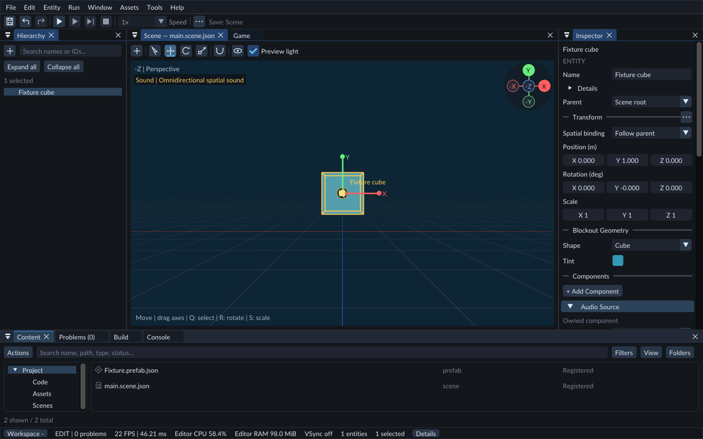](docs/images/readme/scene-editor.png)

| [C++ components and systems](manual/editor/native-gameplay.md) | [Material graphs and shader preview](manual/editor/material-graphs.md) |
| :---: | :---: |
| [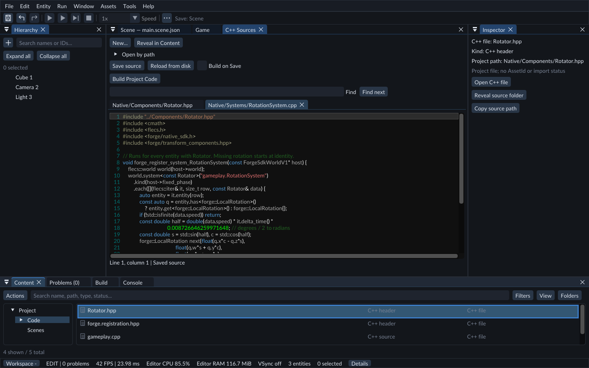](docs/images/readme/cpp-editor.png) | [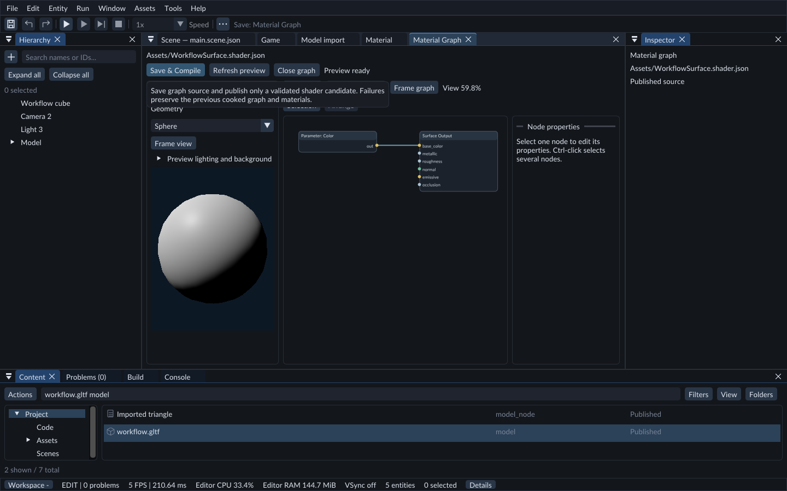](docs/images/readme/material-graph.png) |
| **[Animation states](manual/editor/animation-states.md)** | **[Mesh editing and sculpting](manual/editor/editable-meshes.md)** |
| [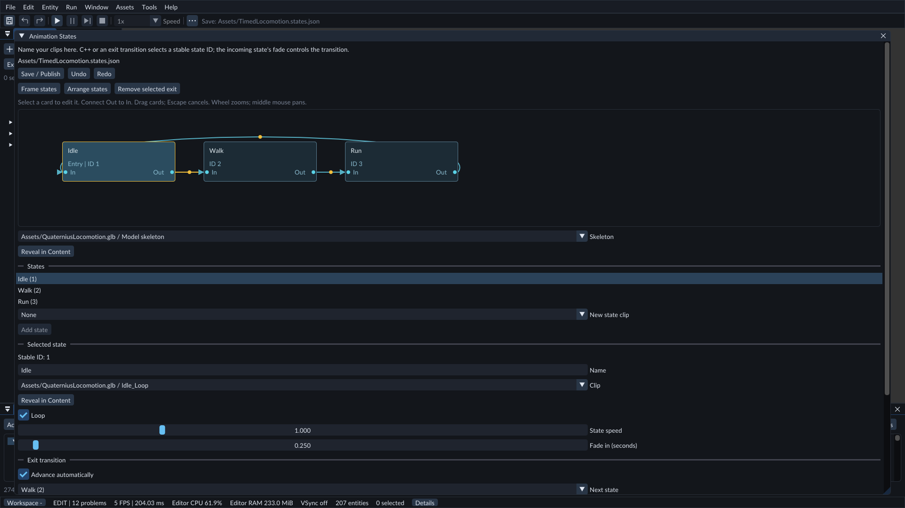](docs/images/readme/animation-states.png) | [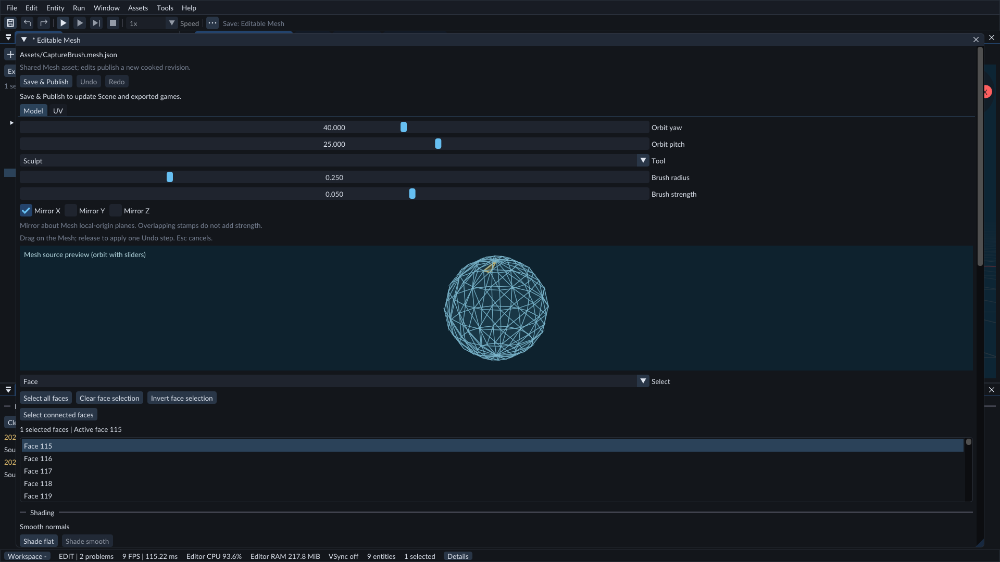](docs/images/readme/mesh-sculpting.png) |
| **[Sequence camera cuts](manual/editor/animation-sequences.md)** | **[Live Inspector tuning](manual/editor/play-mode.md)** |
| [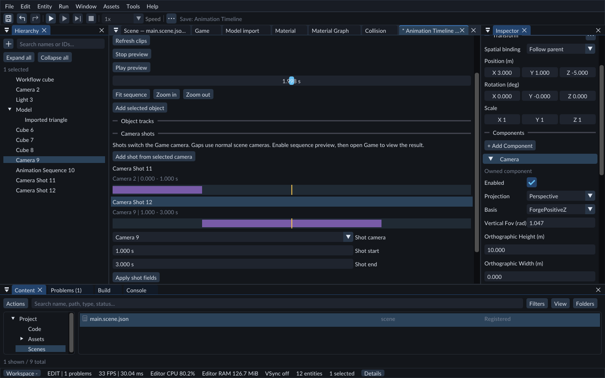](docs/images/readme/camera-sequencing.png) | [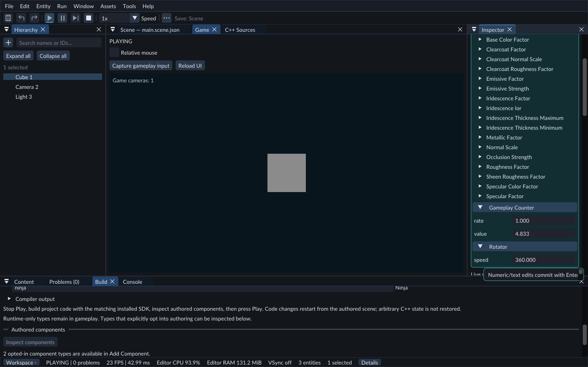](docs/images/readme/live-inspector.png) |

[Capture sources](docs/images/readme/README.md) · [Implementation and delivery status](docs/status.md)

## Tile Maps

[Tile Set and Tile Map tools](manual/editor/tile-maps.md) provide palette selection,
layered painting, stroke Undo/Redo and Inspector settings. These are the actual
Windows document controls rendered by the native validation fixture:

[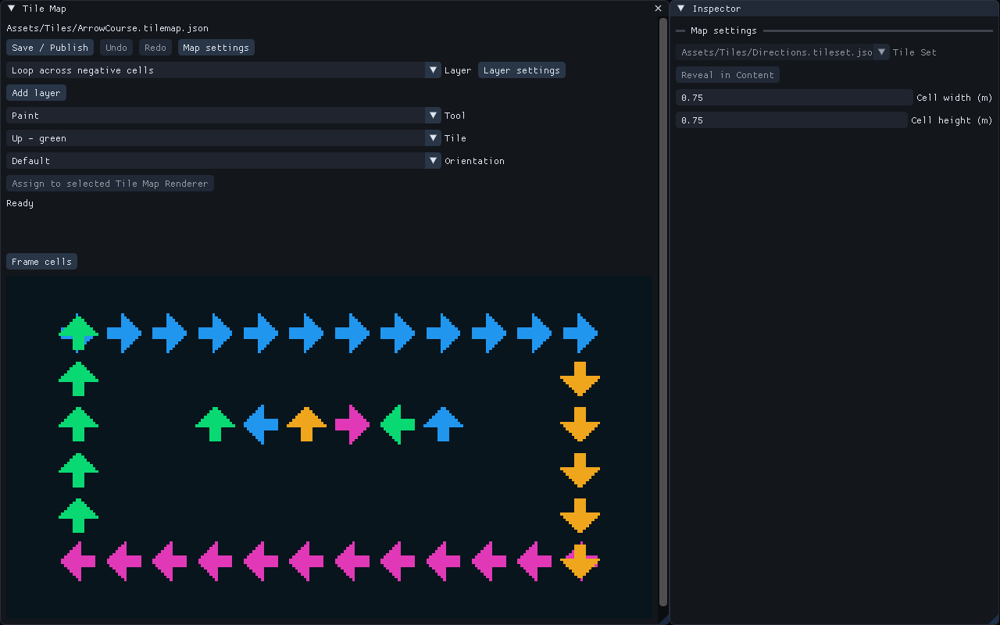](docs/images/readme/tile-map-authoring.png)

The editable Gallery scene uses two layers and a mirrored instance of the same
map. Native Game rendering on Linux software Vulkan:

[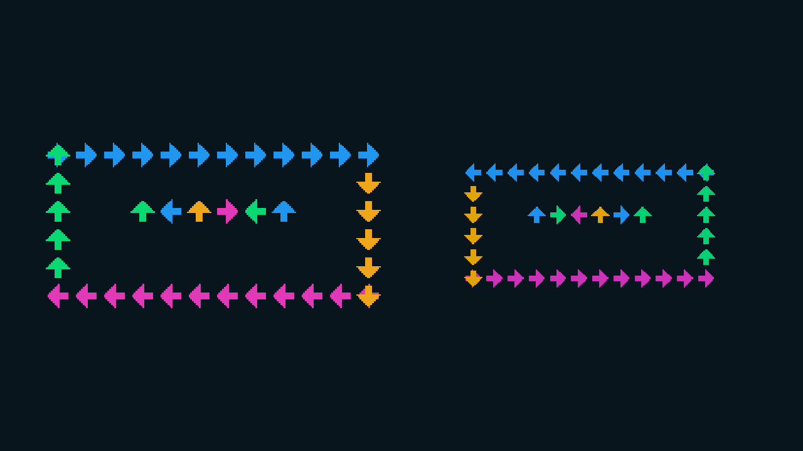](docs/images/readme/tile-maps.png)

## Sprite image regions

Sprite Renderer can select part of an existing image, animate frames inside it,
resize its borders or repeat the selected area. Gallery78 contains editable
examples. Build208 includes this workflow and the matching C++ SDK. The native
Windows validation capture shows the actual whole-image, cropped and filled objects:

[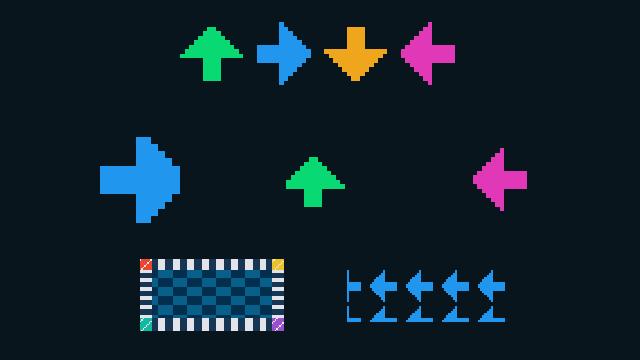](docs/images/readme/sprite-image-regions.png)

## 2D physics

Build206 adds the editable [C++ Character2D project](samples/projects/Character2D/README.md).
Its native 2D controller provides grounded movement, sliding, floor support and
checked placement. Project C++ supplies gravity and jumping. The actual Windows
Scene/Inspector capture shows copied ground, speed and blocked-placement feedback:

[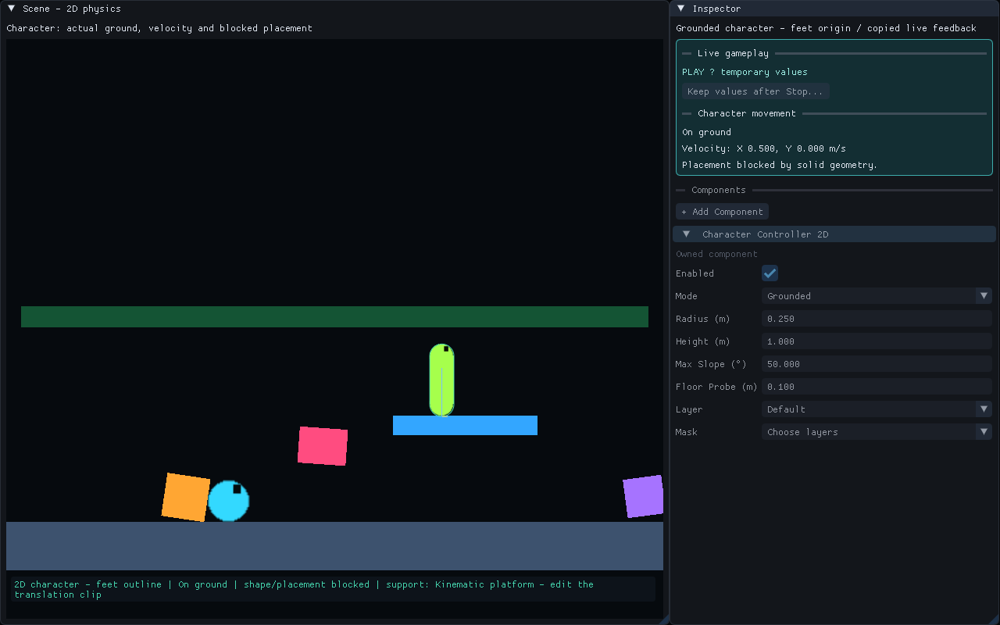](docs/images/readme/2d-character-inspector.png)

The [complete Build206 gate](https://github.com/saki2fifty/F.O.R.G.E./actions/runs/39822638412)
passes the editor, matching C++ SDK and source-free exported game checks. These
captures use software D3D12 WARP; physical GPU performance remains unmeasured.

The original [C++ 2D Movement project](samples/projects/Movement2D/README.md) adds
editable walking/jumping on painted and ordinary floors, using capsule support
sweeps and the existing Dynamic body. Speed and jump settings are Inspector
properties. Build204 includes the prepared project and matching compiled C++.
Its [Windows acceptance](https://github.com/saki2fifty/F.O.R.G.E./actions/runs/39761476803)
checks both Play hosts and the relocated exported game with native keyboard input.
The actual exported game's jump, rendered with D3D12 WARP:

[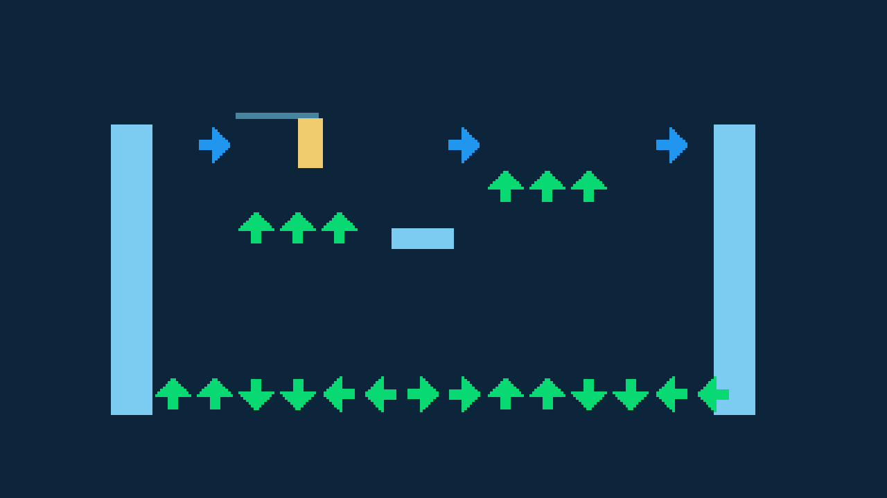](docs/images/readme/2d-movement-runtime.png)

The editable [2D physics gallery](manual/editor/physics-2d.md) combines falling
Sprite shapes, a moving Kinematic platform and a pass-through sensor. This is an
actual Windows Game render using the D3D12 WARP software adapter:

[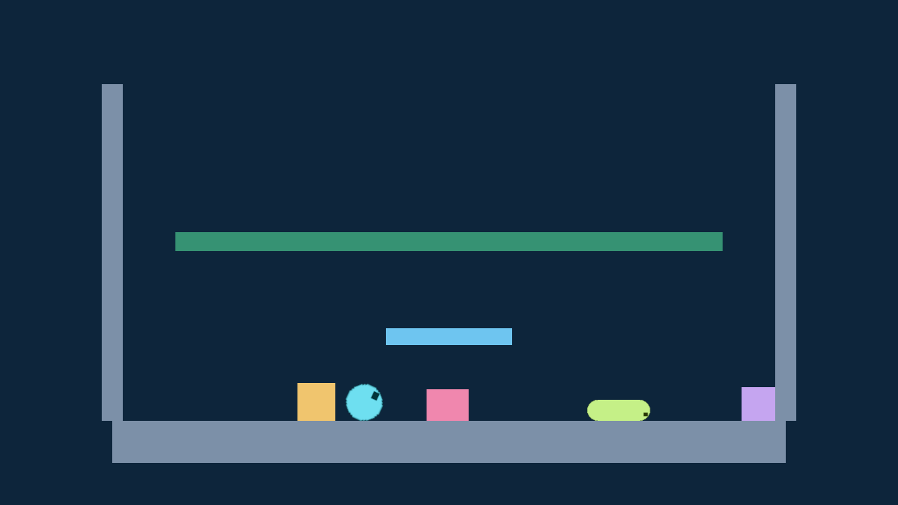](docs/images/readme/2d-physics-runtime.png)

### Painted collision

Gallery77 uses a painted Tile Map layer for static floors and platforms. Four
Dynamic shapes land on the green tiles; the blue arrows remain decorative.
Select the solid layer in the Inspector and see its collision boxes in Scene.
These Windows D3D12 WARP captures use the actual Game renderer and Inspector controls:

| Game after simulation | Published layer outlines and Inspector |
| :---: | :---: |
| [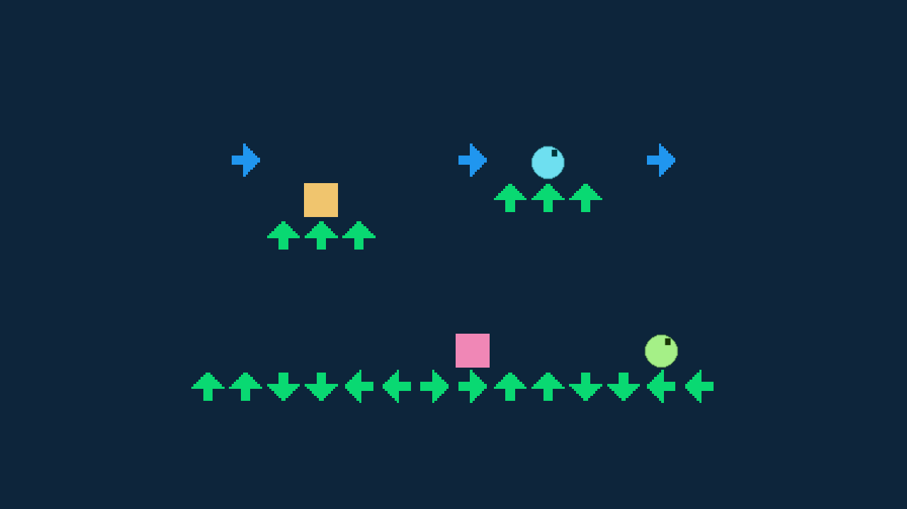](docs/images/readme/painted-collision-game.png) | [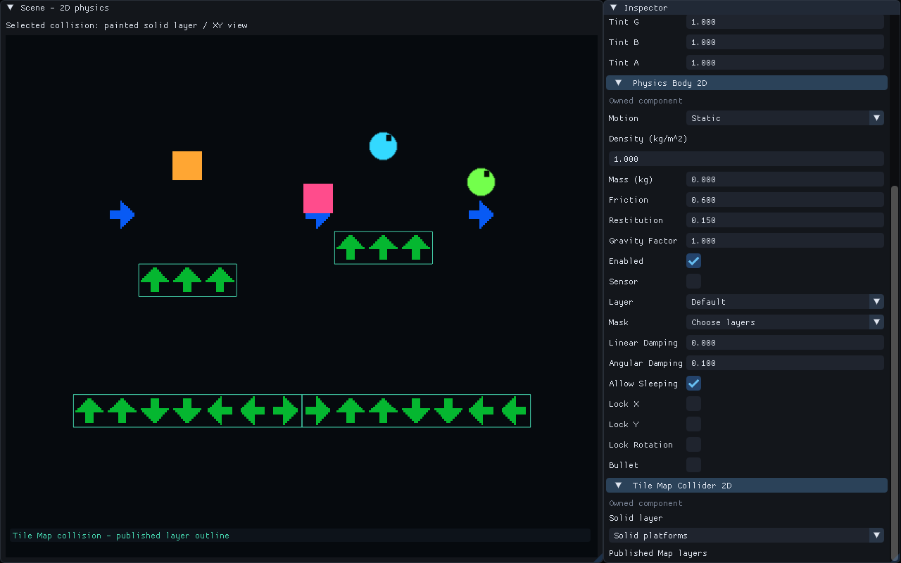](docs/images/readme/painted-collision-inspector.png) |

## User manual

Read the [FORGE User Manual](manual/README.md) for feature explanations and how-to guides. Windows packages include an offline edition under **Help → User Manual**. Technical implementation documents remain in `docs/`.

## Current implementation

**Development source:** [native MCP scene tools](manual/editor/mcp.md) connect AI
clients to the owning editor's automation service. Portable checks pass; native
Windows editor acceptance and a new package are pending. This is not included
in the current Build208 ZIP. Full project-to-export MCP coverage remains in
development; see the [capability checklist](docs/mcp.md).

- Flecs scene state, stable authored IDs, independent local translation/rotation/scale, derived world transforms, structured prefabs, reflected properties, atomic scene replacement and saves, undo/redo, and unknown-component preservation.
- Runtime-owned fixed clock, Pause/Step/Resume, derived hierarchical pose interpolation and a separate Play process with protocol 2. Project C++ gameplay registers Flecs components and systems through the exact matching SDK.
- Built-in C++ source editing, Component/System creation, incremental CMake builds and isolated candidate validation. Code iteration uses Stop → Save → Build → Play; changed source is never silently run or exported from an older module.
- Restart-bound plugin package validation/staging library. Native editor-plugin loading is not implemented.
- Windows editor source with SDL3, Dear ImGui docking, persistent workspace/tooltips, Hierarchy/Inspector/Content/Scene panels, CPU performance diagnostics, and shared Diligent Scene/Game rendering with imported models, PBR materials, cameras, lights, skins and morphs. Windows compilation is validated in GitHub Actions; the initial editor and subsequent UI controls have been exercised on a Windows desktop.

- Structured prefab assets with stable member identities, candidate publication and independent property overrides/Revert.
- [Skeletal animation](manual/editor/animation.md): validated glTF conversion, Animator playback, fixed-clock recovery and debug bones.
- [World sprites and image sheets](manual/editor/sprites.md): ordinary image Materials, sheet frames, size/pivot/flip/tint controls, geometric picking and step-valued Timeline animation. Original Gallery scenes71/72 demonstrate still images and animated signals.
- Exact-version shared-Flecs C++ gameplay SDK, [Jolt physics](manual/editor/physics.md), and [WAV audio sources/listeners](manual/editor/audio.md).

- Model/texture/material/shader importing, cooked resources and dependency-aware, relocatable game export with a standalone SDL/Diligent/RmlUi executable.
- [Navigation](manual/editor/navigation.md), [runtime UI](manual/editor/runtime-ui.md), and the [asset workflow](manual/editor/content-browser.md).
- [Phase8 runtime foundations](docs/game-foundation.md): resource-gated scene sessions, separate versioned player saves/settings, OS user-data storage, collision assets and a Jolt character controller.
- [Gameplay services](docs/gameplay-services.md): input contexts, player rebinding and queued session/save requests through the exact SDK. The [reference game](manual/reference-game.md) exercises menus, first-person movement, interaction, transitions and save/relaunch/load in the standalone host. Editor Play invokes project gameplay through its separate runtime session.

Advanced authoring systems and a broad public plugin SDK remain planned. See [implementation status](docs/status.md) for validation and the current delivered build; source implementation and downloadable delivery are recorded separately.

## Explore features

The [Feature Gallery](manual/getting-started/feature-gallery.md) is an editable sample project with focused scenes for transforms, lighting, physics, cameras, animation and world sprites. Open a scene in the editor, change its authored components, then select it as the startup scene and export a standalone game. The [reference game](manual/reference-game.md) remains the combined gameplay example.

## Build and test
Requires Git, CMake 3.30+, Ninja, Python 3.10+, and a C++20-capable toolchain. Windows requires an MSVC developer shell and Windows SDK.

```sh
cmake --preset core
cmake --build --preset core
ctest --preset core
```

The presets place local builds and dependency working directories in the workspace sibling `AgentFiles`. For another layout, configure explicitly:

```sh
cmake -S . -B /absolute/path/to/work/build -G Ninja -DFORGE_BUILD_EDITOR=OFF
cmake --build /absolute/path/to/work/build
ctest --test-dir /absolute/path/to/work/build --output-on-failure
```

Windows editor (requires D3D12-capable hardware to run):

```sh
cmake --preset windows-editor
cmake --build --preset windows-editor --target forge_editor forge_runtime
../AgentFiles/build/windows-editor/forge_editor.exe /absolute/path/to/game-project
```

The editor opens the project manifest startup scene, with legacy `main.scene.json` folders supported. See [Projects](manual/editor/projects.md) and [Scenes](manual/editor/scenes.md). User layout/settings are stored through SDL's application preferences directory.

See [native iteration](docs/native-modules.md), [scene format](docs/scene-format.md), and [dependency baselines](docs/dependencies.md).

## Editor controls

- **Ctrl+Minus**: reduce interface size to fit more controls on screen.
- **Ctrl+Plus** (or **Ctrl+Equals**): increase interface size.
- **Ctrl+0**: reset to 100%. Keypad plus/minus/zero are supported; zoom is saved between launches.
- **Play**: preview an isolated copy of the current authored scene.
- **Restart**: replace the play world with a fresh copy, including your latest authored edits.
- **Stop**: return the viewport to authoring. Inspector edits and Save always affect the authored scene.

Use **Build → Gameplay setup → Create C++ gameplay project** for a new project. Find and create Components and Systems in **Content → Code**, edit them in **C++ Sources**, then choose **Build Gameplay** and Play. Build on Save is optional. See [C++ gameplay](manual/editor/native-gameplay.md) for the Windows developer launcher and tool requirements.
