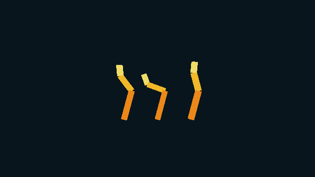
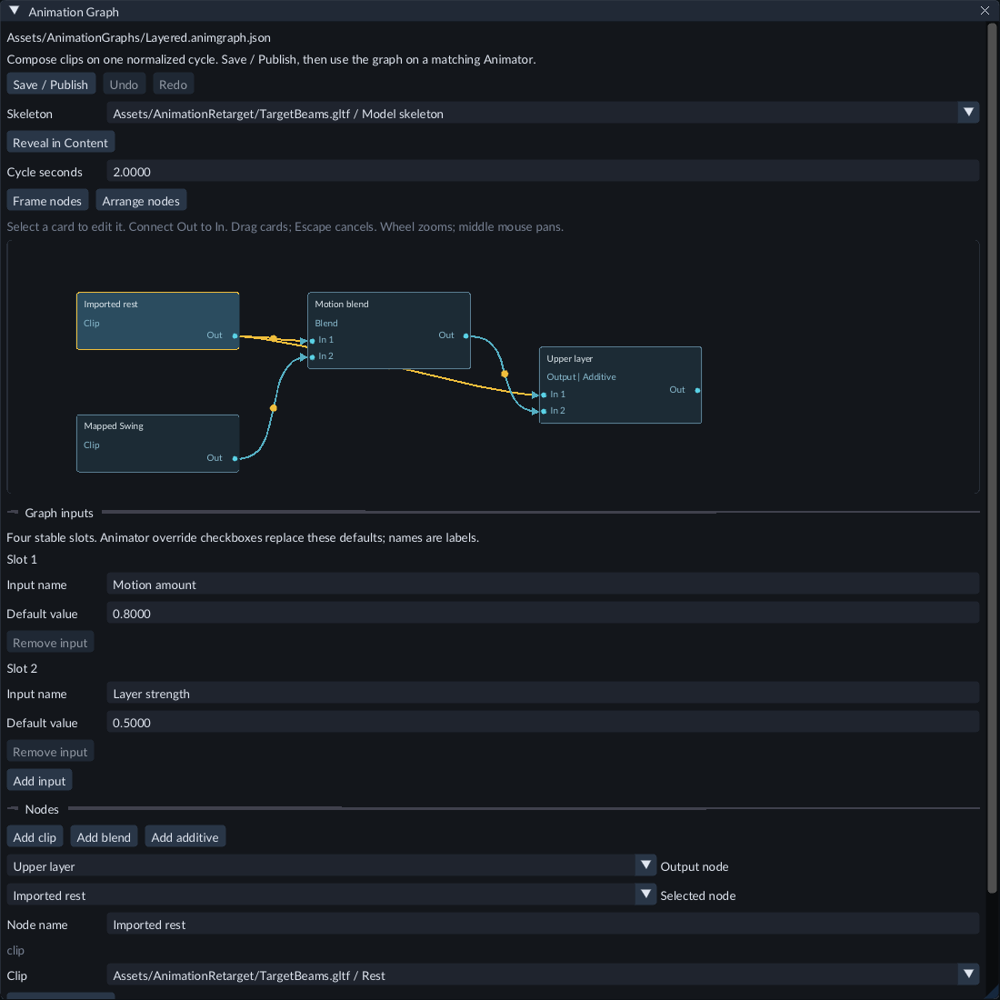

# Compose an animation graph

An **Animation Graph** combines clips, blends and additive layers for one imported
skeleton. Reuse the graph on several Animators, with different input values on each
object. Imported clips and [retargeted clips](animation-retargeting.md) must match
the graph's exact target skeleton.

## Try the Gallery

Open **Scenes/180-animation-graphs.scene.json** in the Feature Gallery project.
Press **Play** and open **Game**. The left rig uses the graph's defaults, the middle
uses full upper-body motion, and the right holds its imported rest pose with a
zero-strength layer. All three use the same graph and skeleton.

Stop Play. Open **Assets/AnimationGraphs/Layered.animgraph.json** in Content.
Its imported rest clip is shared by the blend and additive layer. **Motion amount**
controls the blend; **Layer strength** controls the final layer. The bone mask keeps
the base joint at rest while the upper chain moves.

## Create and connect nodes

1. Import a model with a skeleton and compatible animation clips. Wait for its import to finish.
2. In **Content → Create / Register**, choose **New animation graph...**. Enter a new project path ending in `.animgraph.json`, then click **Create**.
3. Choose **Skeleton** and set **Cycle seconds**. Every clip follows the same percentage of its own duration over this cycle.
4. Click **Add clip**. Select the card and choose its **Clip**. Repeat for the clips you need.
5. Click **Add blend** or **Add additive**. Connect a clip's **Out** to **In 1** or **In 2** on the new card. You can also choose **Input 1** and **Input 2** in its fields.
6. Set **Output node** to the final node. Every node must contribute to that output before publication. A clip or intermediate result can feed several nodes.
7. Choose **Weight source → Constant** and set **Weight**, or bind a named input as described below. An optional **Bone mask** controls how much of the second input affects each joint.
8. Click **Save / Publish**. Wait for publication to finish. Correct any reported missing binding, disconnected node or invalid connection before publishing again.

**Blend** mixes its two poses; weight `0` uses Input 1 and weight `1` uses Input 2.
**Additive** keeps Input 1 and adds Input 2's displacement from the skeleton rest
pose, scaled by the weight. Use **Blend** to mix complete poses and **Additive** for
a rest-relative overlay. Masks affect the second input in either case.

Drag cards to arrange them. **Frame nodes** fits the view, **Arrange nodes** places
cards on a grid, the mouse wheel zooms, and the middle mouse button pans. Press
Escape to cancel a drag or connection. Card positions are saved with this source.
**Remove selected node** clears its incoming references and output assignment.
Reconnect the remaining graph before publishing.

## Name and bind inputs

Click **Add input** to allocate a free slot. Set its **Input name** and **Default
value**. Slots 1–4 stay stable; changing a name does not change its slot. A used
input cannot be removed until its weight bindings are detached.

Select a Blend or Additive node and choose the input under **Weight source**.
**Input scale** and **Input bias** calculate `input × scale + bias`; the resulting
weight clamps to `0–1`. A negative scale can reverse an influence. These inputs
control weights, rather than changing the playback speed of individual clips.

Press Enter or leave a field to apply it. Escape cancels a pending field. **Undo**
first cancels an unapplied field or drag; otherwise it undoes one source edit.
Source history is separate from Scene history.

## Assign the graph and change an object's values

Place the matching model, select its root with an **Animator**, and click **Use on
selected Animator**. This selects the published **Animation graph**, clears the
other playback modes and resets the input override checkboxes in one Scene Undo
step. Save the Scene afterward.

In Inspector, **Override graph input 1** through **4** select the corresponding
**Graph input** value. Leave an override unchecked to use the source default. The
graph's named slots identify which value to change. Do not enable an undeclared
slot. Assigning a different graph or skeleton is an Edit operation.

For a temporary stopped preview, open **Content → Create / Register → Preview
skeletal animation...**, select the object and click **Play preview**. The published
graph's named inputs appear with their defaults. Change **Override source default**
and its value, pause or scrub the preview, then use **Apply preview settings to
Animator** to keep those settings as one Scene Undo step. **Stop preview** restores
the authored Scene view.

During game Play, the colored **Live gameplay** section exposes the graph's declared
input values and override checkboxes. Changes keep the current playback position
and affect only that running world. **Keep values after Stop...** stages a review;
stop Play and apply the selected fields to keep them. Stopping without applying
the review restores the authored values. Live input changes do not replay skipped
root movement or markers.

## Save and export

Save / Publish the graph and any changed masks or retarget recipes, then save the
Scene and project settings. Choose the intended startup scene before exporting.
Use the runtime kit matching the editor. The exported game includes the graph,
clips, masks and target model it needs; editable graph files are not required at
runtime. Keep the exported executable and its data together when testing it on
Windows.

## Limits and troubleshooting

- A graph supports 32 nodes, 8 clip nodes, 4 named inputs and 256 skeleton joints. A clip shared by several connections needs only one clip node.
- Cycle duration is `0.0001–3600` seconds. Input values, scale and bias must be finite within `±1,000,000`; constant weights stay within `0–1`.
- Save incomplete drafts, but connect every node to one complete output before publication. Cycles always reject. A rejected publication preserves the last successfully published graph.
- **Different skeleton or revision:** choose clips and masks published for the selected skeleton, then publish the graph again. Similar names or joint counts do not establish compatibility.
- **Conflicting playback modes:** use **Use on selected Animator** to select graph mode. Graph mode cannot also select a direct Clip, States, Blend Space or manual second-clip blend.
- **Input has no effect:** check its override checkbox, the node's Weight source, mask influence and whether the scaled weight has clamped to an endpoint.
- Root motion follows the participating clips' interval movement and root mask influence. See [root motion](animation-root-motion.md) for Apply and Extract behavior.
- This graph contains Clip, Blend and Additive nodes. State transitions, Blend Spaces and IK retain their separate controls; they are not node kinds in this graph.
