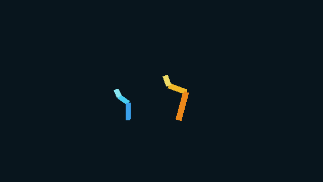
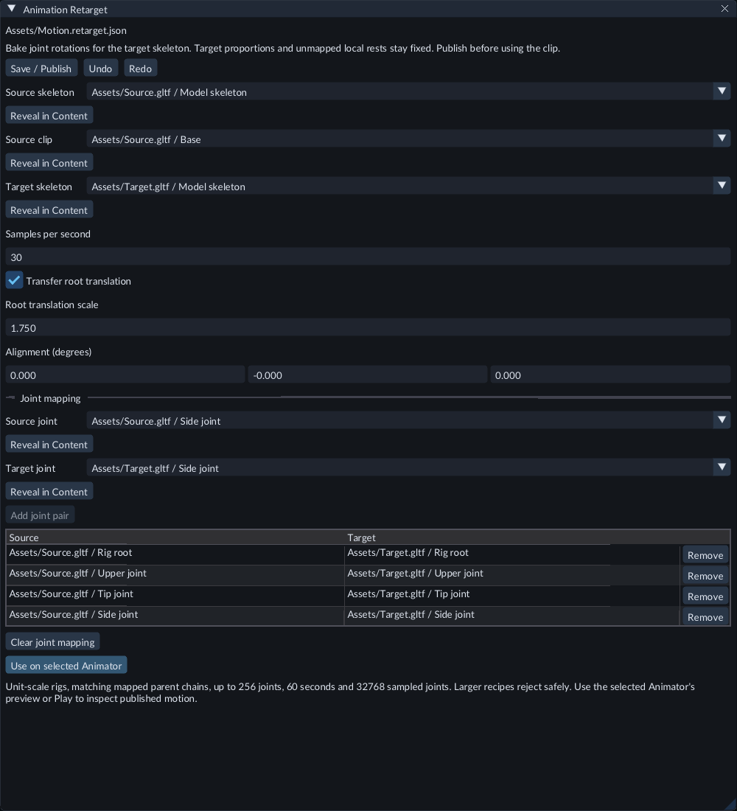

# Transfer animation to another skeleton

Use **Animation Retarget** to bake an imported animation for another imported
skeleton. Choose the corresponding joints explicitly. The new clip keeps the
target's proportions and plays through its ordinary Animator, States, Blend Space
or [Animation Graph](animation-graphs.md).

## Try the example

Open the Feature Gallery project and **Scenes/179-animation-retargeting.scene.json**.
Press **Play** and open **Game**. The short blue model uses its original Swing clip;
the taller gold model uses mapped motion with different rest rotations and lengths.

The target keeps its own proportions while following the mapped rotations.
The recipe leaves root translation off. Enable **Transfer root translation** to
copy the source model's side-to-side base motion too.

Stop Play before editing the recipe. In Content, open
**Assets/AnimationRetarget/Swing.retarget.json** to inspect its joint pairs.

## Create a retargeted clip

1. [Import](models.md) the source model with its animation and the target model with its skeleton. Wait for successful publication. Both rigs and the source animation must have unit scales.
2. In **Content → Create / Register**, choose **New animation retarget...**. Enter a new project file ending in `.retarget.json`, such as `Assets/Walk.retarget.json`, then click **Create**.
3. In **Animation Retarget**, choose **Source skeleton**, **Source clip** and **Target skeleton**. The clip must come from the source skeleton's model import. Wait for the published joints to appear.
4. Choose a **Source joint** and its corresponding **Target joint**, then press **Add joint pair**. Repeat for the joints to animate. Map roots to roots and map each joint's direct parent to its target's direct parent. A joint can occur only once on either side. Names are a guide; the selected joint identities form the mapping.
5. Set **Samples per second** and press Enter. Start at 30. For a large rig or long animation, reduce this value if the sampled-joint limit is reported.
6. If needed, enter **Alignment (degrees)** to rotate the source motion into the target model's axes. Press Enter to apply each edited field. Target bone lengths remain fixed.
7. Click **Save / Publish**. Wait for baking to finish. A failed bake reports the reason and preserves the last successfully published clip.

The recipe records which source and target joints correspond. **Undo**, **Redo**,
**Remove** and **Clear joint mapping** edit this recipe separately from the Scene.

## Root displacement

Enable **Transfer root translation** to transfer the source root's displacement
from its rest position. This requires one mapped source/target root pair. Enter
**Root translation scale**, from 0 to 100, and press Enter to apply it. Alignment also
rotates this displacement. Leave the checkbox off for motion that stays at the
target's rest position. Other source translations and morphs are not transferred.
For moving a game object from its animation, see [root motion](animation-root-motion.md).

## Use the result

Place the target model in the Scene and select its root. If it has no Animator,
use **Inspector → Add Component → Animator** and choose the recipe's target
**Skeleton**. Then click **Use on selected Animator** in Animation Retarget.
This assigns the published clip in one Scene Undo step. Alternatively,
choose the new clip in the Animator's **Clip** picker. Its Skeleton must be the exact
target skeleton used by the recipe.

If the Animator uses **States**, a **Blend Space** or an **Animation Graph**, choose the published clip in
that document. Use the Animator's bone preview or **Play → Game** to inspect the
motion. Recipe edits are locked during Play. Save the Scene after assigning the clip;
publishing the recipe does not save Scene changes.

## Saving and exporting

**Save / Publish** saves the mapping and builds the runtime clip. Save the Scene and
any state/blend-space/graph document that references it before exporting. Export with the
runtime kit included with the matching editor. The game receives the target skeleton
and baked clip; it does not need the editable recipe or source model unless another
game object also uses that model. After changing either imported skeleton, publish
the recipe again before exporting.

## Limits and troubleshooting

- Use up to 256 joints per rig, 60 seconds and 1–120 samples per second. Both endpoints count toward the 4096-frame and 32768-sampled-joint limits for each rig. A lower sample rate can make a larger rig fit.
- Each selected model's cooked bundle must fit 64 MiB. Unmapped target joints keep their local rest transforms. Unit scales are required throughout the rigs and source clip.
- **Missing parent mapping:** add the direct parent pair, continuing to a root.
- **Different skeleton or revision:** select the intended published skeletons, inspect their joint pairs and publish again. A clip baked for another target is not interchangeable merely because joint names or counts match.
- **No joints yet:** wait for inspection and check that both model imports succeeded. Closing or changing skeletons cancels the old inspection.
- This workflow transfers explicit skeletal rotations and optional root displacement. Automatic rig matching, whole-body fitting, morph transfer, non-unit scale transfer and using an already retargeted clip as the source are unavailable.
