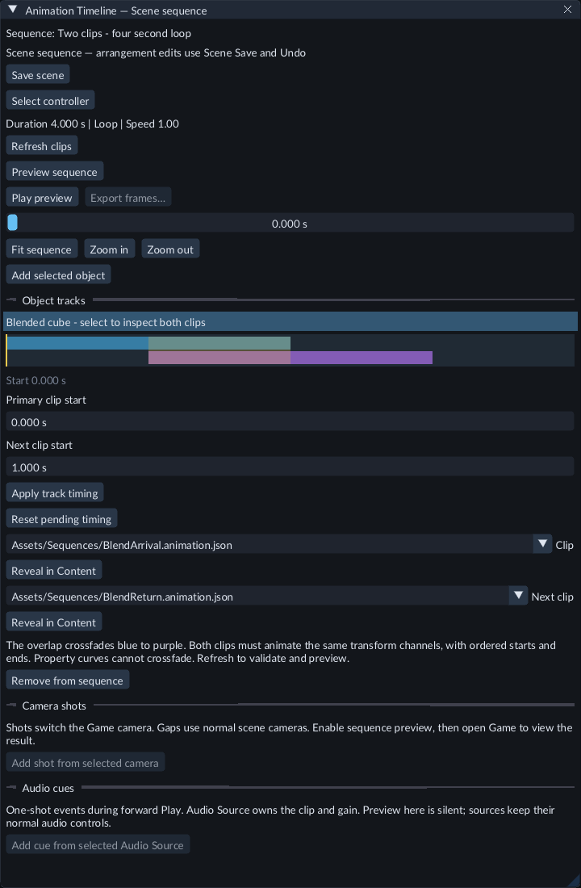
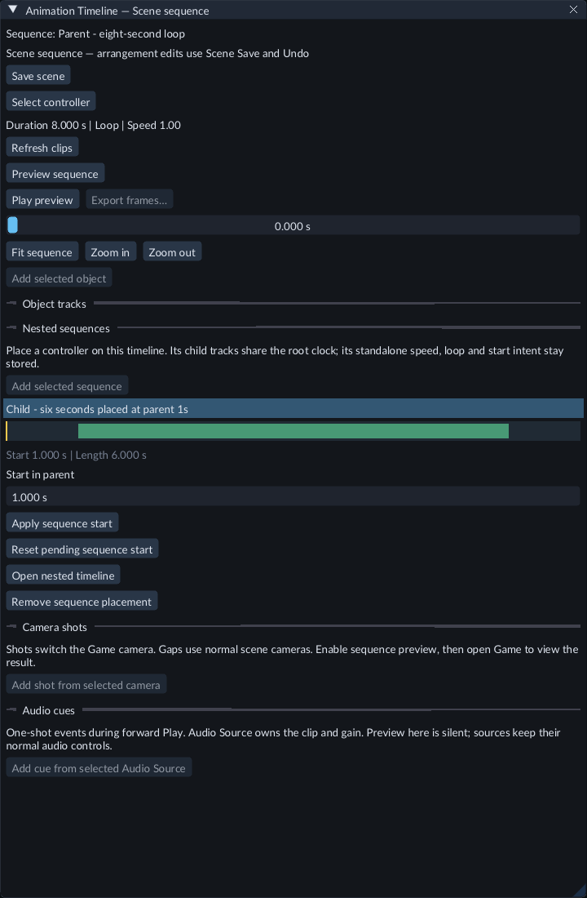

# Coordinate several animations

An **Animation Sequence** makes several objects use one playback time. Each object
keeps its reusable animation clip and a start time inside the sequence. A second
transform clip can crossfade on the same object. Sequences can also contain other
sequences, sharing their root controller's playback time.

Place camera shots on Timeline to control the view during a sequence.

## Try the included scene

Open **FeatureGallery / Scenes / 62-coordinated-animation.scene.json** and press
**Play → Game**. The camera moves immediately, the door begins after half a second,
and the light and sound begin changing after one second. Finished clips hold their
last values. The whole arrangement repeats every six seconds.

## Make an arrangement

1. Create and publish the [animation clips](transform-animation.md) you need.
2. In **Content → Create / Register**, choose **Create animation sequence**. You can also use **Entity → Create → Animation → Animation Sequence**.
3. Select the controller. In Inspector, set **Duration**, **Loop**, **Play on start** and **Playback speed**. Choose **Open sequence timeline** in Create / Register.
4. Select an object in Hierarchy, then choose **Add selected object** in Timeline. Choose its **Clip** using the asset picker. Repeat for the other objects.
5. Select a track, enter its start in seconds, and choose **Apply track start**. Apply or reset a pending start before selecting another track or changing its clip.
6. Choose **Refresh clips**, then **Preview sequence**. Scrub a track's time strip or the playhead slider. **Play preview** advances the preview; **Pause preview** holds it, and **Stop preview** restores the authored view. Fit/Zoom adjust the view.
7. Choose **Save scene**. Arrangement changes use Scene Undo/Redo and Scene Save. Opening an individual clip uses that clip's separate Save & Publish and history.

Preview changes a temporary Scene view. It runs no gameplay C++, physics or sound.
After Scene edits or publishing changed clips, choose **Refresh clips** again.
Open **Game** while sequence preview is active to see the camera image without
starting gameplay. The **SEQUENCE PREVIEW** label identifies this temporary view.
Use Game Play to hear sound and run gameplay.

## Crossfade two clips on one object

Open **FeatureGallery / Scenes / 145-sequence-clip-blending.scene.json** and press
**Play → Game**. The cube moves and rotates through two clips in a four-second
loop. The first clip starts at zero, the next at one second; the one-second
overlap blends from the first motion into the next.

The blue and purple clips overlap from one to two seconds on the selected track.

To make a two-clip track:

1. Create and publish two Transform Animation clips. Both must animate the same position, rotation and/or scale channels, without light, camera, sound, material or component-field curves.
2. Add the object to an Animation Sequence and choose its **Clip**. Select the object track, then choose **Next clip** using the asset picker.
3. Enter **Primary clip start** and **Next clip start**, then choose **Apply track timing**. Both edited values use one Scene Undo step. **Reset pending timing** reloads the current Scene values. Apply or reset before switching tracks or clips.
4. Choose **Refresh clips**. The upper blue strip shows the primary clip, the lower purple strip shows the next, and the highlighted intersection shows the crossfade. Use **Preview sequence**, scrubbing or frame export to inspect the result.
5. Choose **Save scene**. Game Play and exported games use the same saved clips and timing.

The next clip must start and finish no earlier than the primary clip. Both starts
must be inside the sequence's duration. An endpoint may extend beyond that duration;
the controller stops or loops at its own end. During an overlap, position and scale
blend linearly, while rotation follows the shortest arc. The clips keep their own
key interpolation. If there is a gap, the primary's final pose holds until the next
clip starts, then the pose cuts to that clip. Before and after the whole track,
the first and last poses hold.

Choose **None / Clear** in **Next clip** to return to a single clip. **Remove from
sequence** clears the controller binding and next clip while keeping the primary
clip and its standalone settings. Undo restores the arrangement. A missing or
incompatible clip is reported during **Refresh clips** or Play preparation; correct
its selection, channel set or timing and refresh again.

## Place a sequence inside another

Open **FeatureGallery / Scenes / 146-nested-sequences.scene.json** and press
**Play → Game**. The parent loops every eight seconds. Its six-second child starts
at one second: the three tones sound at parent times one, three and five seconds,
the gold panel moves, and the child switches between two cameras. The normal
overview camera appears before and after the child placement.

Select the child row to edit its start or open its own Timeline.

1. Create two **Animation Sequence** controllers in the same Scene. Give the parent enough **Duration** for the arrangement; the child's duration controls its placement length.
2. Open the parent's sequence Timeline. Select the child controller in Hierarchy, position the playhead and choose **Add selected sequence**.
3. Select the child under **Nested sequences**. Enter **Start in parent**, then choose **Apply sequence start**. This uses one Scene Undo step. **Reset pending sequence start** discards the pending value. Apply or reset before opening or removing the placement.
4. Choose **Refresh clips**, then **Preview sequence**. The green strip marks the child placement. Scrub the parent to inspect its descendants together. Game preview and frame export use the same composed camera image.
5. Choose **Open nested timeline** to edit the child's own objects, shots, sound cues or further child placements. Its local preview uses its own stored timing. **Open parent timeline** returns to the parent arrangement; refresh the parent to review the combined result.
6. Choose **Save scene**. Game Play and export use the saved parent bindings and prepared clips and sounds.

While placed, the child's clock, speed, loop and start/stop intent come from the
root controller. Its own **Playback speed**, **Loop** and **Play on start** stay
stored for local preview or standalone use. Pause, seek or restart the root to
control the arrangement. A bound child cannot be controlled independently.

Child starts must be inside their immediate parent's duration. Ancestor ends
truncate longer placements. Object tracks hold their first and last values
outside the placement; camera shots direct only within it, including their exact
final frame when a final shot reaches the child's end. Sound cues fire at their
translated parent times during forward playback, including each root loop.
Seeking and silent Timeline preview do not play skipped sounds.

**Remove sequence placement** clears the parent link and keeps the child, tracks,
start value and standalone settings. Undo restores the link. Inspector also exposes
**Parent sequence** and **Start in parent**. Circular links, missing controllers
and cross-Scene parents are reported during refresh or Play preparation. Include
the complete linked group when making a Prefab. Up to 64 enabled controllers can
participate; one controller with camera shots can direct each loaded Scene.

## Export preview frames

1. Stop Game Play. Finish any pending Timeline fields, then choose **Refresh clips**.
2. Choose **Export frames…** in the sequence Timeline. Game opens to show the sequence preview. Set **Start time**, **Frames per second** and **Frame count**.
3. Leave the current Game size, or enable **Fixed output size** and choose 720p, 1080p, Square or your own width and height. Choose a parent folder and a new folder name. Check the output dimensions and sampled time range, keep Game open, then choose **Start export**.
4. Wait for **Sequence frames saved** in the status bar or Console. Open the new folder to find the numbered PNGs and `frames.json` listing completed frames.

Every sampled time must be before the sequence's end. For a six-second sequence,
30 FPS and 180 frames sample 0 through 5.966667 seconds. Playback speed does not
change these chosen times. Fixed-size output keeps its resolution when you resize
the editor. Its Game preview fits the available space without stretching. Custom
dimensions must be from 1 to 4096 pixels per side. With fixed size off, keep Game
at the same size until export ends. The settings area scrolls in small windows;
Start and Cancel remain below it.

**Cancel export** keeps completed images and stops further frames after any
already accepted file finishes. Your previous preview position and playing state
return afterward, and Game returns to its normal panel resolution. Changing the
Scene, sequence or assets stops export. Changing Game's render size also stops a
current-size export. An existing output folder is preserved; choose a new name
for each run.

These frames contain the silent sequence camera image. Gameplay C++, physics,
runtime UI and sound do not run during this preview. For a single image while
playing, use [Game → Save image](viewport.md).

## Camera shots

Open **FeatureGallery / Scenes / 68-sequence-camera-shots.scene.json**. Play shows
the front view for two seconds, then the side view, then a close view. A short gap
returns to the normal overview camera before the six-second sequence repeats.

To author shots in your own sequence:

1. Create the cameras and position them in the Scene. Standby cameras can have **Enabled** turned off; a shot activates its chosen camera in the rendered view.
2. Open the controller's sequence Timeline. Select a camera in Hierarchy and choose **Add shot from selected camera**. The shot fills the next free interval at or after the playhead.
3. Select its row under **Camera shots**. Choose **Shot camera**, enter **Shot start** and **Shot end**, then choose **Apply shot fields**. The edit uses one Scene Undo step. Apply or reset pending fields before switching tracks.
4. Choose **Refresh clips**, then **Preview sequence** and open **Game**. Scrub a shot's strip or the playhead slider to inspect the cuts. Stopping preview restores the authored camera settings.
5. Choose **Save scene**. Play and export use this saved arrangement; no C++ module is required.

Adjacent shots cut exactly at their shared boundary. Shots cannot overlap and must
fit inside the controller's duration. Gaps use normal enabled cameras and their
composition order. A final shot ending at the controller duration holds when a
nonlooping sequence finishes. Disabled controllers and unbound or disabled shots
do not direct the camera.

One enabled controller with camera shots can direct each loaded Scene. Disable an
unused director before enabling another; ordinary object-only sequences can still
run independently. Camera shots can be renamed, copied and included with their
controller and cameras in a Prefab. The links use IDs, so equal camera names stay
independent. **Remove shot from sequence** clears its controller link and retains
the shot entity and camera reference.

## Sound cues

Open **FeatureGallery / Scenes / 70-sequence-audio-cues.scene.json** and press
**Play → Game**. A lower tone sounds at the start, a middle tone at two seconds,
and a higher tone at four seconds. The sequence repeats every six seconds while
the gold panel moves and the camera changes view.

To add a sound to your own sequence:

1. Create an **Audio Source** and assign an Audio Clip. Turn **Play on start** off if this sound should start only from cues. The source owns volume, pitch, looping and mixer settings; cue playback requests a one-shot effect.
2. Open the controller's sequence Timeline. Select the source in Hierarchy and choose **Add cue from selected Audio Source**. It creates a cue at the playhead.
3. Select the cue under **Audio cues**. Choose **Cue source**, enter **Cue time**, then choose **Apply cue fields**. Source and time use one Scene Undo step. Apply or reset pending fields before changing selection.
4. Choose **Save scene**, then use Game Play to hear it. Timeline preview and scrubbing stay silent. Export includes the saved cues and their prepared sounds.

The diamond marks when the sound is requested. Cues fire when forward playback
crosses them; a cue at zero also fires when the sequence starts or restarts. Pause
holds the sequence. Seeking does not play skipped sounds or stop sounds that have
already started. Audio Source Stop still stops its effects.

**Remove cue from sequence** keeps the entity, source and time for later reuse.
Copy a whole controller/source/cue group to keep its links independent, including
inside Prefabs. This feature places sound events on the fixed game clock; it does
not provide audio trimming, waveforms or sample-accurate music synchronization.

## Playback rules

Before a track starts, its clip holds its first value. After it ends, it holds its
last value. A sequence's end can cut a clip short. The controller's loop, speed and
playback intent govern all its tracks; the individual clips' standalone settings
stay stored for when they are removed from the sequence.

**Remove from sequence** keeps the primary clip and clears its controller and next
clip. Each object supports one primary clip and one optional next transform clip.
Camera shots cut without blending. This sequence mode does not crossfade property
curves, edit bones or encode a movie. Each controller has at most one parent
placement; place a copy of a complete linked group to reuse it independently.

Pause, Step and simulation Speed work as they do for other animations. C++ can use
the existing animation playback/control/seek operations on the controller. Bound
tracks can be inspected, but their clocks cannot be controlled independently.

## Prefabs and export

Prefab instances can join a sequence through their Scene settings. Duplicate a
controller together with its objects to make an independently bound copy. Copying
only an object keeps its link to the existing controller.

To reuse an arrangement, put its controller and linked objects under one parent
and create a prefab from that whole group. FORGE stores member links and resolves
each placed copy independently. In **Prefab source**, reference fields choose
members of that source. A link outside the selected group must be cleared or its
target included before capture. See [Links between members](prefabs.md)
and Gallery63. Individual instances can still join a Scene-owned sequence.

Save the Scene and publish its clips before exporting. Export includes the saved
arrangement and prepared clips and sounds. The exported game needs no editor or
C++ compiler for this feature. Existing native C++ modules must be rebuilt with the
matching SDK when upgrading to this engine version.
