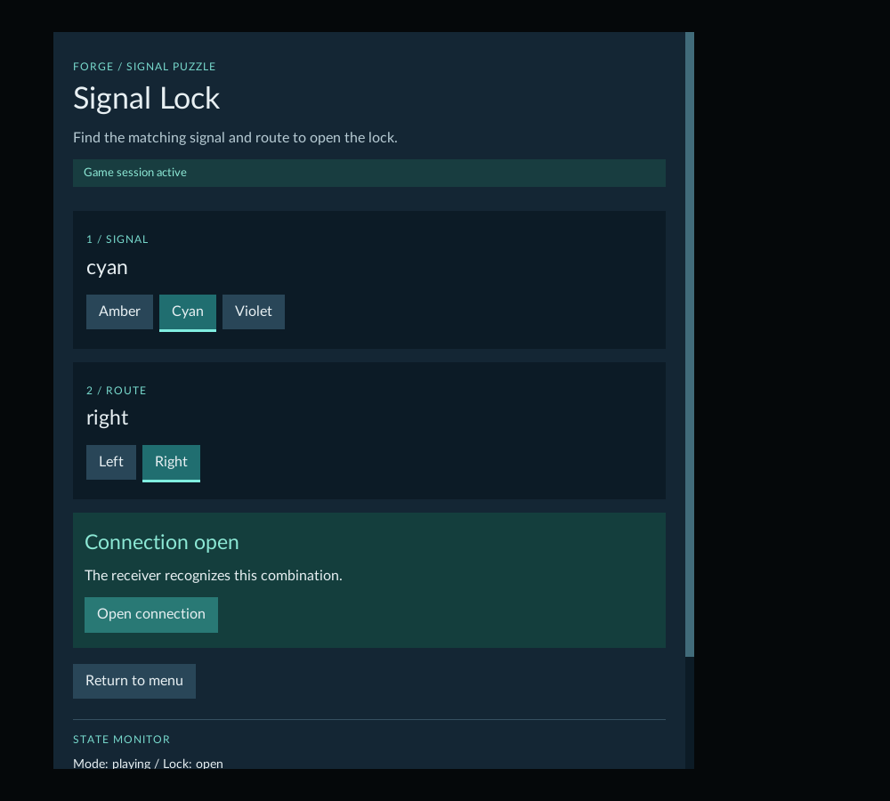
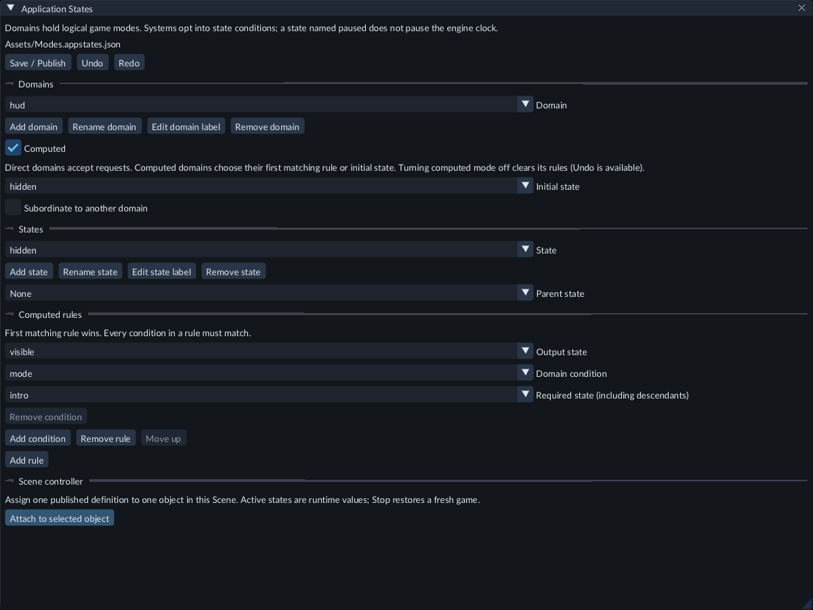
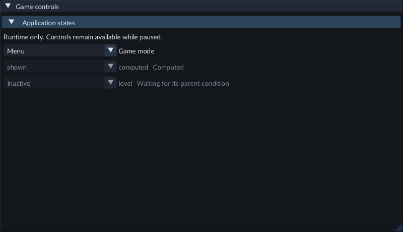

# Choose game modes with Application States

Use **Application States** for logical modes such as a menu, playing and game over.
Each **domain** is a named choice with one current state. Several domains can work
together: a game mode, a selected route and a connection result, for example.

## Try Signal Lock

1. Open Feature Gallery's **Scenes/134-signal-lock.scene.json** and press **Play**.
2. Enable **Capture gameplay input** and click the game's **Play** button.
3. Select a signal and route. The receiver's hint describes the combination that opens the connection.
4. When **Connection open** appears, click **Open connection**.
5. Click **Return to menu**, then **Play** to reset both choices.



Choose the matching signal and route, then open the connection. Scroll the panel
when the Game view is narrow.

The controls also work while the game is paused. **Pause**, **Resume** and **Step**
use the simulation clock. Changing a choice while paused does not advance a tick.
Press **Escape** to release game input before using the editor's panels.

## Create a state definition

1. Stop Play. In **Content → Create / Register**, choose **New application states...**.
2. Enter a path such as `Assets/Game.appstates.json`, then click **Create**.
3. The **Application States** document opens. Its initial `app` domain contains `menu`, `playing` and `game_over`.
4. Choose a **Domain** and **State** to edit. Use **Edit domain label** and **Edit state label** for readable display names.
5. Click **Save / Publish** and wait for publication to finish.

Domain and state **keys** are the names used by code, UI expressions and conditions.
Use lowercase letters, digits and underscores, beginning with a letter. Keys can
contain up to 48 characters. Labels can use readable UTF-8 text, up to 96 bytes.

**Add domain** creates another independent choice. **Add state** creates a state
inside the selected domain. **Rename domain** and **Rename state** ask for a new
key; click **Apply** to commit it. Renaming updates recognized references inside
this definition. Update C++ and RML strings that use the old key yourself.

Choose **Initial state** for each domain. **Remove state** and **Remove domain**
reject removal while other initial states, parent relationships or conditions still
refer to them. Update those references first. Use the document's **Undo** and
**Redo** to restore edits. Closing a changed document offers **Save**, **Discard**
and **Keep editing**.



Select a domain to edit its initial state, parent relationships and computed rules.

## Parents, subordinate domains and computed results

**Parent state** groups states under a shared mode. For example, `playing` and
`complete` can both have `game` as their parent. Conditions for `game` then match
both children. Choosing `game` directly activates that state; it does not select a
child automatically.

Enable **Subordinate to another domain** when a choice should exist only while
another mode is active. Select its required domain and state. An inactive
subordinate has no current state. When its condition becomes true again, it resets
to its own Initial state. Signal Lock uses this for its signal and route choices.

Enable **Computed** for a result that follows other domains. Add a rule, choose
its **Output state**, and add the required domain/state conditions. All conditions
in a rule must match. Rules run from top to bottom; the first matching rule wins.
Use **Move up** to change priority. If none match, the result uses Initial state.
Computed results cannot be changed directly. Turning Computed off clears its rules;
Undo restores them.

Domain dependencies and state parents must not form cycles. FORGE rejects an edit
that would create one and retains the previous valid definition.

## Connect the definition to a Scene

1. Create or select an object in Hierarchy for the Scene's state controller.
2. After publishing the definition, click **Attach to selected object** in its document.
3. The object receives **Application States** and its `definition` reference. This is one Scene Undo step.
4. Save the Scene. Keep one configured controller per Scene.

You can also use **Inspector → Add Component → Gameplay → Application States** and
assign its `definition` asset. Add a Camera for Game view and a
[UI Document](runtime-ui.md) if the player will use onscreen controls.

## Inspect and change a running game

In **Game**, expand **Application states**. Each dropdown shows its domain's
current state. Direct domains can be changed while running or paused. Computed
results and inactive subordinate domains are read-only. A pending request or error
appears below the controls.



Use the Game controls to inspect current runtime choices without editing the definition.

These changes affect the current runtime only. **Stop** followed by **Play** starts
from Initial state again. **Keep values** does not change a definition's initial
states. Stop Play before editing, publishing or replacing the definition itself.

## Use states in a game's RML

A configured Scene supplies read-only bindings:

- `forge_state_app`: the `app` domain's current key, or empty when inactive.
- `forge_rev_app`: its current revision as an exact decimal string.

Replace `app` with your domain key. Omit `data-model` attributes; FORGE supplies the
model. For example:

```xml
<p>Mode: {{forge_state_app}}</p>
<div data-if="forge_state_app | state_is('app', 'game')">Game session active</div>
<button data-event-click="command('forge.state', 'app:playing:' + forge_rev_app)">Play</button>
```

`state_is` also matches ancestor states. The button includes the observed revision,
so an old request cannot silently overwrite a newer state. Use the current revision
binding each time. Do not publish your own `forge_state_` or `forge_rev_` variables,
or register a custom `forge.state` action in a Scene that uses Application States.

Native project systems can condition their ordinary ECS queries on state membership.
The [C++ guide](native-gameplay.md) explains how to build a matching project module;
the installed SDK includes an `application_states_probe.cpp` example. Queued SDK
state requests require the Game service, available in shared-SDK Play and standalone
games. Legacy Play supports state queries and editor/UI controls but has no queued
Game service.

## Retire runtime objects when a state ends

For objects created by C++ during Play, use the creation request's state lifetime:

1. Create an entity or instantiate an admitted Prefab through the SDK client.
2. Wait until `inspect_entity` reports `FORGE_SDK_ENTITY_READY`.
3. Call `scope_runtime_entity(request, "app", "game")` while that state or ancestor is active. Inspect the returned Game request receipt for success.
4. Release the creation request observation when it is no longer needed.

The object and its structural children remain while `game` is active. Changing
between children of `game` retains them. Leaving `game` destroys the group; entering
it again does not recreate the objects. Spawn new objects explicitly when needed.
Releasing a creation request alone does not destroy its object.

Paused state changes also retire the object's native physics and source audio.
Other objects keep their current poses and velocities. Detached one-shot sounds
continue according to their own lifetime.

Scopes accept runtime-created roots only. They cannot attach to saved Scene
objects or Prefab templates. Choose the lifetime once; repeating the same choice
is safe, but changing a bound object's scope is rejected. Pending/released creation
requests, inactive states and stale revisions are rejected. Like queued state
requests, this SDK helper requires the Game service. An agent can use
`play.application_state.scope` with the current runtime root reference and domain
revision. Ordinary Play recovery retains these lifetimes; they are not durable
game saves or authored Scene changes.

If a scoped object has 2D physics and exits while paused, use **Step** to complete
pending contact-event processing before a new recovery checkpoint is available.
The object is already removed; ordinary running play completes this on its next
tick.

## Save, export and limits

Save/Publish the definition and save the Scene before exporting. The export includes
the referenced cooked definition and UI resources. The exported game starts from
Initial state; the current Play selection is not an exported save game.

Definitions support up to 16 domains, 64 states per domain, 512 states total and 16 parent
levels. Computed rules support up to 8 conditions each, 64 rules per domain and 256 rules
total. An application-state definition controls logical modes. It does not
automatically disable renderers, physics, audio or entities. Runtime objects are
deleted on state exit only when explicitly given a state lifetime as described
above.

If no state appears, check that the definition was published, assigned to the
Scene's single controller, and that Play has finished loading. If a request is
rejected, read the error, wait for current observations and retry with their revision.
A failed request leaves the current game state intact.
