# Audio

## Listen to a clip in the editor

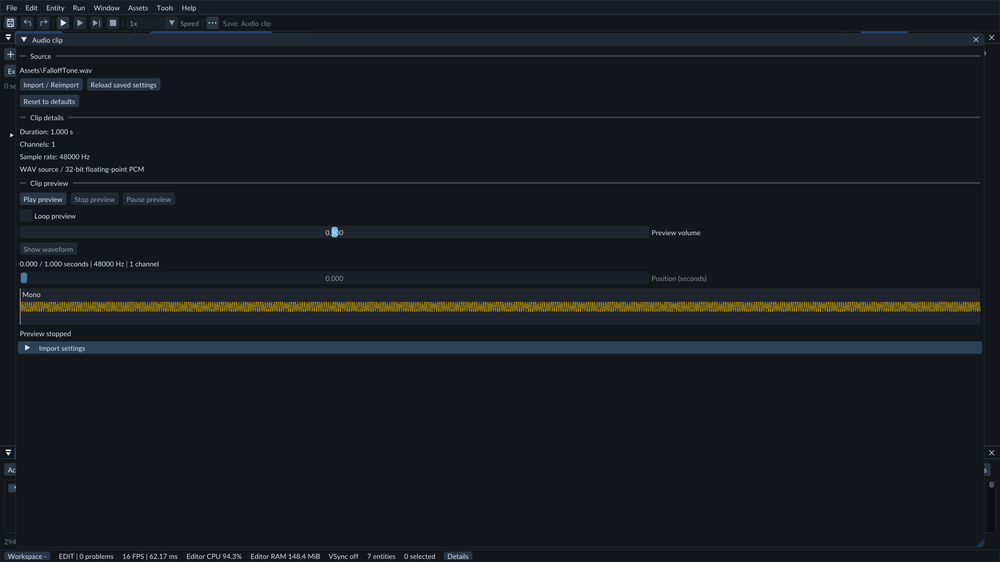

Preview a clip, inspect its waveform and adjust its position without entering game Play.

In **Content**, double-click an AudioClip to open its **Audio clip** tab. Under
**Clip preview**, click **Play preview**. **Restart preview** starts it again;
**Stop preview** releases it. **Loop preview** repeats the sound, and
**Preview volume** changes how loudly you hear it.

The tab shows **Loading preview...** or **Loading waveform...** during the first
load. You can stop a loading preview. Playback position and pause controls become
available when the sound is ready. Loading errors appear in this tab.

Click **Show waveform** to see the sound without playing it. Mono clips show one
band; stereo clips show separate Left and Right bands. Playing also loads the
waveform. The time display shows the current position and total duration.

During preview, use **Pause preview** and **Resume preview** to hold or continue
the same position. Click the waveform to jump to a point, or adjust
**Position (seconds)**. Dragging the position control seeks when you release it.
Seeking while paused keeps the preview paused. **Stop preview** releases sound
output and keeps the waveform visible; closing the tab releases the preview.

The waveform shows a compact overview, including short peaks. It does not edit
or trim the audio. Loading happens once for the selected clip; larger clips may
take a moment on their first load. Import settings are below the preview.

You do not need a camera, Audio Source entity or game Play for this preview.
Its loop and volume changes are temporary: they do not change your scene or the
game's mix volumes. Closing the tab, choosing another clip/project, reimporting,
or starting game Play stops it. Save import changes before previewing.

To try it, open the packaged Feature Gallery and double-click
**Assets/FalloffTone.wav** in Content. The original tone used by its audio scenes
is ready to preview. If sound output cannot open, the tab explains the error.

An **Audio Source** plays an imported audio clip during Play. An **Audio Listener** is the position and orientation from which spatial sounds are heard. Both are ordinary scene components and work with prefab inheritance and Undo/Redo.

## Supported audio sources

Import **WAV**, **FLAC** or **MP3** files with one or two channels. The source
extension must match its format. FLAC preserves the original samples; MP3 is
lossy and may sound different from the original recording. MP3 timing uses the
encoder delay/padding information when present; files without that information
can contain leading or trailing padding.

Use **Content → Import files...** to copy external recordings into your project
and review them before import. For a file already inside the project, choose
**Content → Create / Register → Import audio...**, enter its project-relative
path, then choose **Review settings** and **Import / Reimport**.

All three formats use the same preview, waveform, import settings and Audio
Source controls. Exported games use cooked PCM rather than decoding the source
recording. Choose Resident or Stream playback storage during import. Both retain
the source and cooked-clip size limits. Ogg/Vorbis and multichannel recordings
are not supported.

To compare formats, open **83 — Audio source codecs** in the Feature Gallery.
The three speakers use the same original stereo tone as WAV, FLAC and MP3. Only
WAV starts automatically. Stop, disable its **Play On Start**, enable it on one
other speaker, then Play again. You can also preview each clip from Content.

## Process a clip during import

Open an AudioClip from **Content**, then expand **Import settings** below its
preview. Processing is off and **Playback storage** is **resident** by default.

- **Force mono** combines the Left and Right channels. Opposite-phase stereo sounds can cancel when combined.
- **Normalize peak** raises or lowers the clip so its largest sample reaches full scale. It does not make different sounds equally loud.
- **Trim silence** removes quiet time at the beginning and end. **Trim threshold (dB)** chooses what counts as quiet; lower values preserve quieter sounds. Removed edges receive a short fade to reduce clicks. Entirely quiet clips keep one silent frame.

Click **Import / Reimport** to apply the settings. FORGE combines channels first,
then normalizes, then trims. The preview shows the resulting channels and duration.
Editing settings stops the old preview. **Reload saved settings** discards the
draft; **Reset to defaults** creates a draft with processing turned off.

Your original audio source remains unchanged. Games use the processed clip already built
during import, including in exported games. Stop and restart Play after reimport
to hear the new revision in a running scene. Scene Undo does not undo an import.

Try **34 — Audio import processing** in the Feature Gallery. Its two WAV sources
contain identical original tones: one keeps stereo and quiet edges; the other
uses mono, normalization and trimming. Preview either clip to compare.

## Choose resident or streamed playback

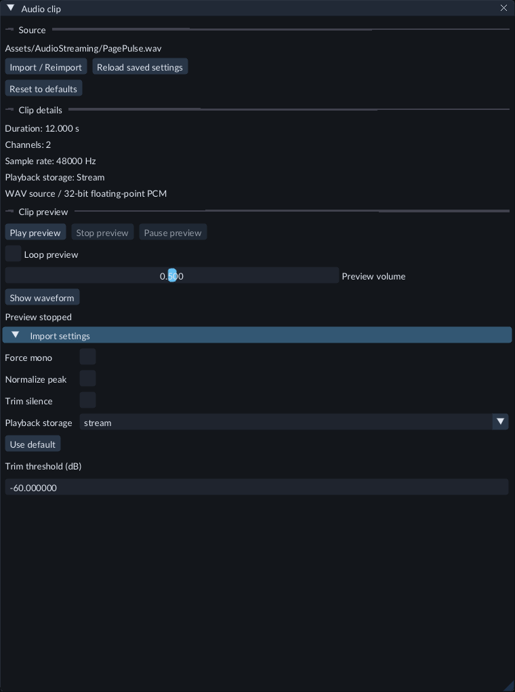

Open Import settings to choose playback storage and publish the cooked clip.

1. Open an AudioClip from **Content** and expand **Import settings**.
2. Set **Playback storage** to **resident** for ordinary effects, or **stream** for longer recordings whose complete decoded PCM should not stay in the runtime cache.
3. Click **Import / Reimport**. Stream requires at least one second after trimming. It converts the cooked clip to 48000 Hz while preserving mono or stereo channels.
4. Preview it, or assign it to an Audio Source. Save the Scene and restart Play after publishing a different revision.

Stream plays the immutable cooked PCM through worker-loaded pages. It needs a
writable operating-system temporary folder for a private backing copy. Export
includes the cooked clip; the original recording is not needed by the game.
Streams use the same gain, pitch, spatial controls, filters, effects and mix channels.
Preview seeks and **Play / Restart** may briefly show a loading state while pages
at the new position prepare. Stop also resets the position; Resume continues a
paused source without seeking.
**Live sound** keeps existing one-shots and their tails controllable while the main
source reloads. Pause, Resume and Stop also apply during that loading state.

Each runtime supports eight prepared, preparing or retiring stream voices,
including stopped sources and overlapping one-shots. Several sources can share
one backing copy, but each voice uses its own pages. Resident voices use the
ordinary 256-voice limit. Temporary copies are limited to 64 files and 256 MiB;
each source recording remains limited to 16 MiB and each cooked clip to 64 MiB.
Streaming does not remove these import limits or provide unbounded music playback.
The waveform can briefly decode the whole clip to build its compact overview.

During Play, **Live audio mix** shows resident PCM, reserved stream voices,
stream page budgets and temporary disk backing separately. A stream starvation
message in Console means pages arrived too late and playback may contain silence.
Reduce the number of streams or choose Resident for time-critical sounds. If a
stream cannot prepare, inspect its error and check temporary-folder space and
permissions before restarting Play.

Open **172 — Audio streaming** in the Feature Gallery. Its blue cube rotates
while a quiet, twelve-second stereo pulse loops. Open
**Assets/AudioStreaming/PagePulse.wav** to inspect **Playback storage**, preview
seeking and the converted sample rate. Save and export using the runtime kit
packaged with the current editor.

## Hear your first sound

1. Copy the included `Examples/Audio/test-tone.wav` into your project's `Assets` folder. You can also use your own small mono or stereo WAV, FLAC or MP3.
2. Open **Content → Create / Register → Import audio...**, enter the project-relative `Assets/test-tone.wav` source, choose **Review settings**, then **Import / Reimport** in the central **Audio clip** document. Alternatively, **Content → Import files...** copies external WAV, FLAC or MP3 files into a new project folder and imports them after your review.
3. Create a cube and select it. Use **+ Add Component → Audio / Audio Source** in Inspector.
4. Select it in **Clip**. Enable **Play On Start** and **Loop**.
5. Create another entity at the origin, select it, use **+ Add Component → Audio / Audio Listener**. Leave **Enabled** checked.
6. Press **Play**. You should hear the tone. **Pause** freezes it; **Step** advances the game once and remains silent; **Resume** continues playback. **Stop** ends all runtime sound.
7. Save the scene, reopen it, and repeat.

Start with a comfortable speaker/headphone volume. The example is a quiet, four-second synthetic tone.

## Source controls

- **Clip:** a registered asset, stored by its persistent identity. A path is only its current location.
- **Play On Start:** automatically starts this source when the runtime realizes it. Changing this option on an already realized voice does not restart it.
- **Loop:** repeat at the end of the clip. Disable it to play once.
- **Gain:** linear volume. `0` is silent, `1` is nominal; the supported range is `0–4`. Values above `1` amplify and may clip when mixed.
- **Pitch:** playback speed and pitch together; `1` is normal, `0.25–4` is supported. This is not independent time stretching.
- **Spatialized:** enable positioning and distance attenuation. Disable it for ordinary stereo playback that needs no listener or transform.
- **Doppler strength:** `0–5`, default `0` (off). With Spatialized enabled, movement toward the listener raises pitch and movement away lowers it. `1` gives the ordinary effect; larger values exaggerate it. Listener movement also affects the sound. Teleports and animation loop jumps do not create a pitch spike.
- **Minimum distance / Maximum distance:** meters. Distance is clamped to these limits. Maximum is not a universal mute radius. Maximum must be at least minimum; equal limits disable distance loss.

- **Distance falloff:** choose **Inverse**, **Linear**, or **Exponential**. Inverse is the default. Linear at strength1 fades to silence at maximum; the other curves can remain audible there.
- **Falloff strength:** `0–10`, default `1`. Higher values fade more strongly with distance. `0` keeps left/right positioning without reducing volume over distance. These controls affect spatialized sources.

- **Directional sound:** aim spatial audio along the object's negative Z axis. Rotate the source or its parent to change its direction. Disable this for ordinary sound in every direction.
- **Inner opening (deg):** full angle receiving full angular volume, `0–360`. `360` is omnidirectional.
- **Outer opening (deg):** full outer angle, at least the inner opening. Volume fades between the openings; equal openings make a hard boundary.
- **Outside volume:** `0–1`, default `.25`; outside the outer opening, this multiplies distance falloff and gain. `0` is silent; `1` preserves volume.
- **Mix channel:** choose **Master**, **Music**, **Effects** or **Dialogue**. Music, Effects and Dialogue use their own volume before Master. Changing channel keeps the sound playing.
- **Custom Bus:** choose a saved project bus, or **Stock mix channel** to use Mix channel. A custom selection preserves the stored stock choice. Changing a valid route keeps the sound's playback position.

Numeric fields commit with **Enter**. Errors leave the previous authored value intact. Object scale does not multiply gain or range. Parent transforms still move a child's position normally.

## Balance music, effects and dialogue

Open **Tools → Project Settings → Game defaults**. The four volume sliders set
shared starting values. Master affects all sounds; the other sliders affect
sources assigned to that channel. **Save Settings** applies defaults to the next
Play/export. A game's saved player preferences can override these defaults.
Zero volume mutes without stopping a sound's playback position. Each source
chooses whether it pauses with gameplay through **Pause with game**.

Scene **33 — Audio mixer** plays low, middle and high tones through Music,
Effects and Dialogue. Stop Play, change one channel's default volume, save settings
and Play again to compare. Select each named emitter to inspect or change its
**Mix channel**. Export preserves its routes and cooked tone.

### Create custom buses and sends

1. Stop Play and open **Tools → Project Settings → Game defaults → Custom audio buses**.
2. Click **Add custom bus**. Set its **Key** to `rain` and **Label** to `Rain`.
3. Set **Initial volume** to `0.5` and **Output** to `effects`.
4. Click **Add send**, choose `music` as **Send target**, and set **Send gain** to `0.25`.
5. Click **Save Settings**. Select an Audio Source in the Inspector and choose **Custom Bus → Rain (rain)**.
6. Save the Scene and start Play. The source now follows both paths; live bus and category faders let you compare them.

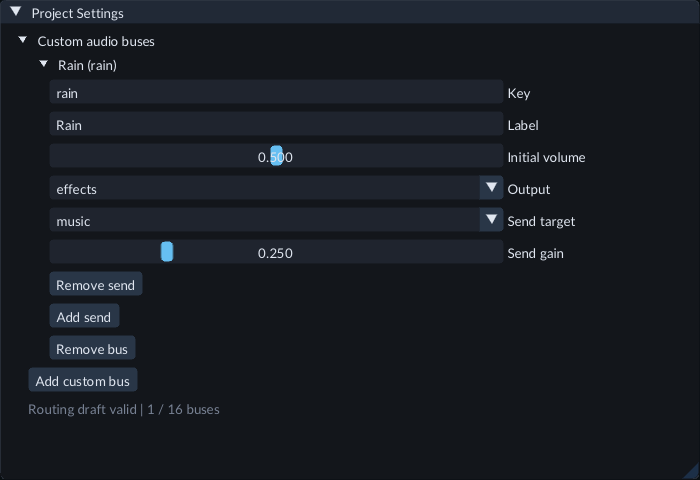

Set the bus output and additional sends in the project settings draft, then save.

Keys are stable project-local names: a lowercase ASCII letter followed by letters,
digits or underscores, at most 64 bytes. Labels are optional display text, at
most 128 UTF-8 bytes. `master`, `music`, `effects` and `dialogue` are reserved
terminal names. Sources and route targets bind to keys, so changing a label keeps
their selection. Changing or removing a key requires updating its references.

An output carries the full bus signal after its Initial volume. Each send adds
another path after that same fader. Target custom buses apply their own faders;
Music, Effects and Dialogue apply their category volume before Master. Paths add
without normalization and can amplify the sound. In this example, with category
and Master volumes at 1, the combined amplitude is `0.5 × (1 + 0.25) = 0.625`
times the source output.

There can be 16 custom buses and 3 sends per bus. Missing targets, duplicate targets,
cycles and graphs whose potential path sum exceeds 16 cannot be saved, including
cycles through muted buses or zero-gain sends. Resolve the displayed routing
error before saving. An unresolved source key remains visible and reports a
Play error for that source; it does not silently select the stock channel.

Buses without active shared effects use volume routing. To process several sources
together, configure **Shared effects** on their custom bus as described below.
Source filters, echo, reverb, pause, streaming and one-shots keep their existing
controls. Export requires the matching runtime kit packaged with the editor.
Stop Play and save settings and Scenes before exporting.

Open **191 — Audio routing** in the Feature Gallery for three pitched emitters
using Rain, Room and stock Dialogue. The camera, light and bus definitions are
included; no project C++ is required. Adjust the live faders, or stop and edit the
source selection and saved project graph before exporting.

### Process several sources through shared effects

1. Stop Play and open **Tools → Project Settings → Game defaults → Custom audio buses**.
2. Expand the bus you want to process, then **Shared effects**.
3. Turn on **High-pass filter**, **Low-pass filter**, **Echo** or **Reverb** and adjust their parameters.
4. Click **Save Settings**. Select each source in the Inspector and choose that bus in **Custom Bus**.
5. Save the Scene and start Play. The sources now feed the same bus processing.

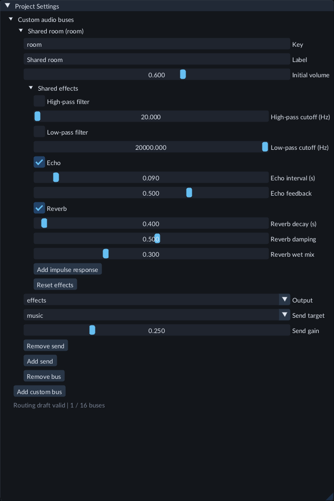

Enable and adjust shared processing on the bus, then save project settings before Play.

Processing order is High-pass → Low-pass → Echo → Reverb. High/low-pass cutoffs
range from 20 to 20000 Hz. Echo interval is 0.01–1 seconds, with feedback 0–0.75;
zero feedback bypasses echo. Reverb decay is 0.1–10 seconds, damping 0–0.95 and wet
mix 0–1; zero wet mix bypasses reverb. Inactive parameters are saved too.
**Reset effects** restores bypassed defaults for that bus.

**Initial volume** and additional send gains follow the effects. A send to another
custom bus feeds that bus's processing before its fader. Paths add and feedback
can amplify peaks, so reduce source or bus volume when needed. Muting a bus
silences its own retained output while processing keeps advancing; a downstream
bus can still have a tail from earlier input. Master and category faders control
the full signal reaching their respective output.

Sources with **Pause with game** on share one processing history; sources with it
off share a separate history that keeps playing during game pause. Full suspension
freezes both. Pausing, stopping, restarting or rerouting one source changes its
future input; it does not erase a shared tail already produced by several sources.
Completion-aware sound cues wait for their Source voices and source effects,
without waiting for shared bus tails. Controls take effect at normal buffered
output boundaries.

Open **196 — Shared audio bus effects** in the Feature Gallery to try two shared
buses with three original pitched tones. The independent tone keeps sounding
through gameplay Pause, while the other two pause with the game. Its camera,
light and project bus definitions are included; no project C++ is needed.

The bus layout and effects stay fixed during Play. **Live audio mix** shows their
chain count and delay memory; use its existing faders to adjust the current session.
Saving project settings makes defaults available to the next Play/export. Recovery
rebuilds fresh effect history from saved configuration and restored faders.
Shared effects do not provide convolution, nonlinear processors, arbitrary cyclic
routing or physical acoustic room simulation.

### Adjust the current game while it plays

During Play, open **Tools → Project Settings**. **Live audio mix** shows the sound
output, whether it is paused, voice counts and clip cache use. Change Master,
Music, Effects or Dialogue, then click **Apply live mix** to hear the change.
If the project has custom buses, **Custom bus volumes** adds one fader per key.
These affect the bus output and all its sends; topology stays fixed during Play.
**Reload live values** discards an unapplied draft. Controls briefly disable while
the game applies a request; a rejected request shows an error and can be retried.

You can adjust the mix while paused without advancing the game. These values
affect only the current Play session. Stop and Play again to return to saved
defaults. To make a starting mix permanent, stop, edit **Game defaults** and save
settings. Try the live sliders in **33 — Audio mixer** or **34 — Audio import
processing**.

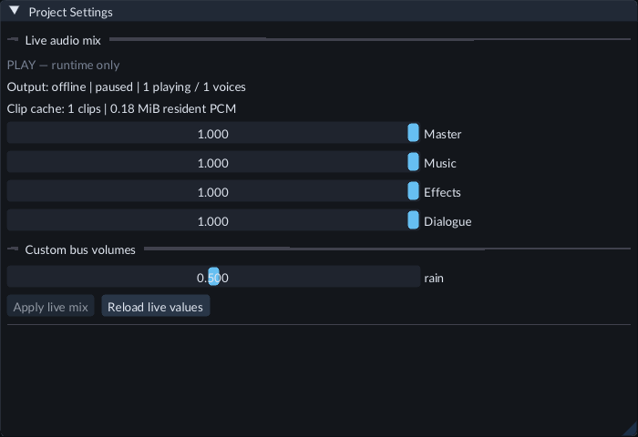

Edit a session draft, then use Apply live mix; Reload live values restores the
runtime's current values.

## Position and listener

Spatial sources use the scene's effective world positions. **Follow Structure**, **World**, and **Explicit** child spaces behave as described in [Scenes](scenes.md). Position updates follow completed game ticks. Audio does not move objects or run an independent transform simulation.

Use exactly one enabled listener. Its forward direction is local negative Z, with positive Y up. Multiple enabled listeners produce a diagnostic and mute spatial sources until corrected; FORGE does not choose an arbitrary listener. Missing or unresolved source/listener transforms also mute spatial playback. Positions outside ±1 billion meters are unsupported; float backend positioning does not promise large-world precision. Nonspatial sources remain available.

To check positioning, Stop, move the source to either side of the listener, and Play again. Move it farther away to hear attenuation. The editor's orbit camera is not an automatic audio listener.

## Prefabs and Undo

Create a prefab from an entity with AudioSource, then instantiate it twice. Edit the prefab source to change defaults. Instances follow successfully published changes unless they override the property. Gain, clip, loop, and other source properties can have independent override intent, including an override equal to the current default.

Use the existing prefab property **Revert** controls or the component header’s **Remove component / Revert component** to return to inheritance. Scene edits and Revert participate in scene Undo/Redo. Direct prefab source publication has the existing separate history boundary; it is not undone by scene Undo.

## Keep music or UI sounds playing during Pause

1. Stop Play and select the sound entity in **Hierarchy**.
2. In **Inspector → Audio Source**, turn off **Pause with game**.
3. For background music, enable **Loop** and **Play On Start**. Choose **Music** under **Mix channel** if you want the music volume slider to control it.
4. Save the scene, press Play, then press Pause. This sound continues; sources with **Pause with game** enabled stop advancing until Resume.

The option is on by default. It applies to both the main sound and its overlapping
one-shots, independently of their mix channel. The game's paused simulation does
not advance when an independent sound plays. **Pause sound** still pauses that
particular source, and **Stop sound** stops it and all of its effects.

Live changes affect the current Play session. To save a policy permanently, stop
Play, change the authored Inspector value and save the scene. Prefabs can supply
the policy, and an instance can override or revert it like other sound properties.

Stop, scene replacement and runtime faults silence the old scene's sound.
Preparing an unopened scene never starts its music. The Audio clip document's
preview Pause always pauses its preview, regardless of game source settings.

Open **84 — Independent audio** in the Feature Gallery. The gameplay speaker
pauses with the game; the music speaker continues. Select the UI speaker and use
**Live sound → Play one-shot** while paused to hear its independent effect.

## Filter a source's sound

1. Select a sound entity and expand **Inspector → Audio Source**.
2. Enable **Low-pass filter** and lower **Low-pass cutoff (Hz)** to soften high frequencies. Try 1000 Hz for a muffled sound.
3. Enable **High-pass filter** and raise **High-pass cutoff (Hz)** to reduce low frequencies. Try 200 Hz to remove bass.
4. Play the scene and compare the sound with each filter turned off. For a permanent setting, stop Play, edit the authored values and save the scene.

Both filters are off by default. Cutoffs range from 20 to 20000 Hz, including
when their filters are disabled. You can enable both to keep a band of frequencies.
These settings affect the source and its overlapping one-shots, after pitch and
spatial processing. They do not alter the imported recording or its waveform.
Prefabs can supply the same settings, with ordinary instance overrides and Revert.

Live filter changes update the current sounds without restarting their clips or
advancing gameplay. A paused gameplay sound stays silent; a source with **Pause
with game** turned off can still be heard. Changing or enabling a filter resets
the source's effect history and may cause a short transition or click. The controls
do not provide a smoothed, sample-accurate automation envelope.

Open **85 — Audio filters** in the Feature Gallery. Only **Dry tone** starts
automatically. Stop it under **Live sound**, then use **Play / Restart** on either
filtered speaker to compare the same recording. Saved filter settings also apply
in an exported game. These are source filters. Shared bus effects, effect send/return processing and automatic
acoustic occlusion are unavailable. See the reverb controls below for diffuse tails.

## Add an echo

1. Select a sound entity and expand **Inspector → Audio Source**.
2. Enable **Echo**. Set **Echo interval (s)** to the time between repeats, from 0.01 to 1 second. Start with 0.25 seconds.
3. Set **Echo feedback** to how much sound each repeat retains, from 0 to 0.75. Try 0.35 for a short fading echo. Zero bypasses the echo.
4. Play the sound and compare with Echo off. Reduce the source's Gain if overlapping repeats become too loud.
5. Stop Play, edit the authored values and save the scene to keep them in the project and exported game. Prefab overrides and Revert work normally.

Echo keeps the original sound and adds fading repeats after pitch, spatial processing and any source filters. Each one-shot has its own echo. A short clip can finish while its echo continues; the voice is released after the tail fades. With echo alone, the longest interval and highest feedback retain a tail for about 33 seconds after the clip's end is observed. Paused tails keep their place in the voice limit. Echo is disabled by default and does not change the imported recording.

Source Pause freezes the sound and its echo, including an echo that continues after the clip ends. Resume continues it. Stop discards the echo, and Play / Restart begins with fresh echo history. **Pause with game** also applies to echoes; full output suspension always pauses them.

Live changes to Echo, its interval or feedback update current voices without restarting their clips. Changing an active effect clears its history and can produce a short transition or click. Echo feedback is not a separate wet/dry mixer, reverb or shared effect bus.

## Add source reverb

1. Select a sound entity and expand **Inspector → Audio Source**. Choose an imported Clip. Enable **Play On Start** to hear it automatically, or start it with **Live sound** during Play.
2. Enable **Reverb**. Set **Reverb decay (s)** from 0.1 to 10 seconds. Start with 0.6 for a short tail.
3. Set **Reverb damping** from 0 to 0.95. Lower values keep a brighter tail; higher values soften high frequencies.
4. Set **Reverb wet mix** from 0 to 1. Zero bypasses reverb; one plays only the reverberated signal. Try 0.5 to mix the original sound with the tail.
5. Compare the sound in Play. Stop Play, edit the authored settings and save the Scene to keep them for export. Prefab overrides and Revert use the same fields.

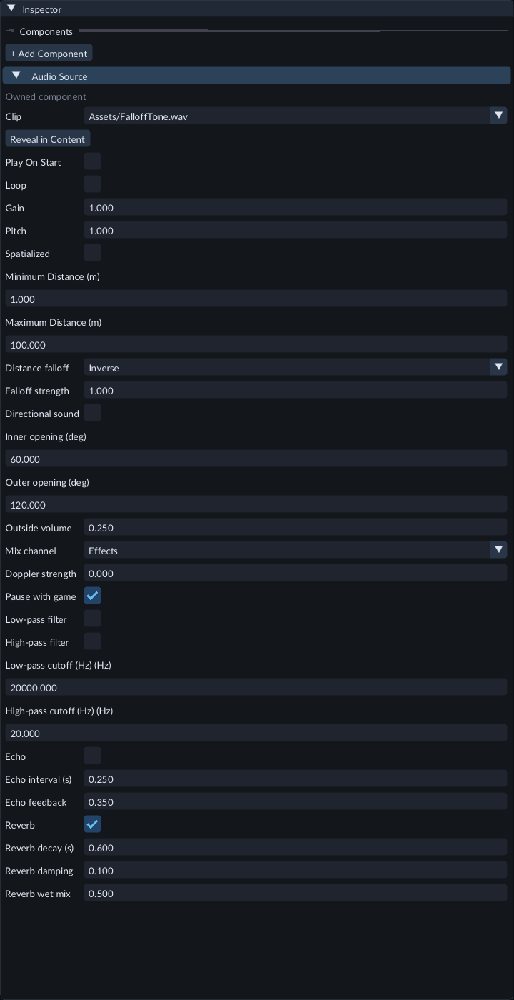

Reverb settings are near the bottom of Audio Source. This example uses the Effects mix channel.

Reverb follows pitch, spatial processing, source filters and echo. Each source and
one-shot keeps its own effect history. **Gain** and the mix channel volume control
the whole processed signal, including retained tails. Muting keeps playback and
effect time advancing; unmuting continues them. Reduce Gain if effects become too loud.

**Pause sound** freezes the source and its tail. **Resume sound** continues them;
**Stop sound** silences the source, and **Play / Restart** starts fresh effect
history. **Pause with game** applies normally. Live sound shows **Effect tail**
when a retained echo or reverb remains after its clip ends.

Changing active reverb, filter or echo parameters clears that source's effect
history without rewinding its clip. Gain, mix-channel changes and pause controls
preserve the history. Controls apply through the audio buffers and do not provide
sample-accurate cuts or a smoothed effect-parameter automation envelope.

Open **148 — Source reverb** in the Feature Gallery. A ten-second sequence plays
the same original tone dry at 0 seconds, with bright reverb at 3 seconds and with
more damping at 6 seconds. The scene includes its camera, light and saved settings;
Play and export it without project C++. Select either reverb source to change its
settings and compare the next cue.

Decay is a nominal effect setting rather than a physical room measurement. A
reverb tail is retired after twice the decay plus 0.5 seconds from its observed
clip end; pausing freezes that time. Echo followed by reverb adds their retained
tail spans. Tails occupy the normal voice limits until retirement. This is a
per-source effect; shared effect buses, effect send/return processing, impulse-response
files and acoustic room simulation are unavailable.

## Start or stop a source during Play

Select an entity with an Audio Source while Play is active. The tinted **Live
sound** section above the authored Inspector shows whether that source is playing,
paused or stopped, along with its duration and loop setting.

Click **Play / Restart** to start it from the beginning, or **Stop sound** to stop
that source. These buttons work when **Play On Start** is off. **Pause sound**
keeps its place; the button becomes **Resume sound** so you can continue there.
Restart returns to the beginning. Stop clears the paused position; Resume does
not restart a stopped or finished sound.

Sources with **Pause with game** enabled remain silent during game Pause; Resume
lets a restarted sound play. Sources with that option disabled can play while the
game is paused. A source you paused separately stays paused when the game resumes.
Controls wait for the current source status and briefly disable while applying.

Use **Play one-shot** for repeated effects. Each click plays the selected clip once
alongside existing sound, keeping the main sound's position. The panel shows how
many overlapping effects are active (up to16 per source). The source's Loop setting
still controls its main sound; these effects finish once. Stop clears them all.
Pause/Resume also works when only effects are active. The source's **Pause with game**
policy applies to its effects too.
A full voice budget reports a rejected effect instead of replacing existing sound.

One-shots with a Sound Cue offset show **Waiting to start** and a **Delayed
one-shots** count. **Pause sound** preserves the remaining delay, **Resume sound**
continues it, and **Stop sound** removes those waiting voices. New cue or Timeline
events can still request another sound after Stop.

These are temporary playback commands. They do not edit saved scene values.
Stopping game Play and starting again restores the saved autoplay settings.

Try **35 — Moving audio** in the Feature Gallery. The Doppler emitter and a
comparison emitter travel together past the camera/listener. Only Doppler starts
automatically. Stop it using **Live sound**, then select the comparison emitter
and start it to hear the same movement without pitch changes. Save the scene and
export it to test the automatic moving sound in a standalone game.

C++ code can call the matching SDK's `audio_source` callback with
`FORGE_SDK_AUDIO_RESTART`, `FORGE_SDK_AUDIO_STOP`, `FORGE_SDK_AUDIO_PAUSE` or
`FORGE_SDK_AUDIO_RESUME` or `FORGE_SDK_AUDIO_ONE_SHOT`. The C++ SDK client also offers
`audio_one_shot(scene_uuid, entity_uuid)`. Use persistent scene/entity UUIDs and call during a fixed
game tick. Rebuild project code when the installed SDK fingerprint changes.

## Create a sound playlist

Import and register your audio clips, then stop Play and open the target Scene.

1. In **Content**, select 1 to 8 AudioClip assets. Use **Ctrl-click** to select several clips.
2. Click **Sound playlist...** in Content's toolbar. In a short panel, open **Actions** first.
3. Enter a **Name**. Use **Move up**, **Move down** and **Remove** to arrange the draft list.
4. Set **Gap (seconds)** from 0 to 3600. Each sound finishes, including its source effects, before this gap and the next sound.
5. Enable **Loop playlist** to repeat the order. Leave it off to play the list once. **Play on start** starts the cue automatically; **Pause with game** pauses its run and sounds with gameplay.
6. Click **Create in Scene**. FORGE selects the new cue in Hierarchy; its Audio Sources are children. One Undo removes the complete creation. Save the Scene to keep it.
7. Start Play to listen. With automatic startup disabled, select the cue and use **Live sound → Start repeating** to start its run. After it finishes, **Replay run** plays it again.

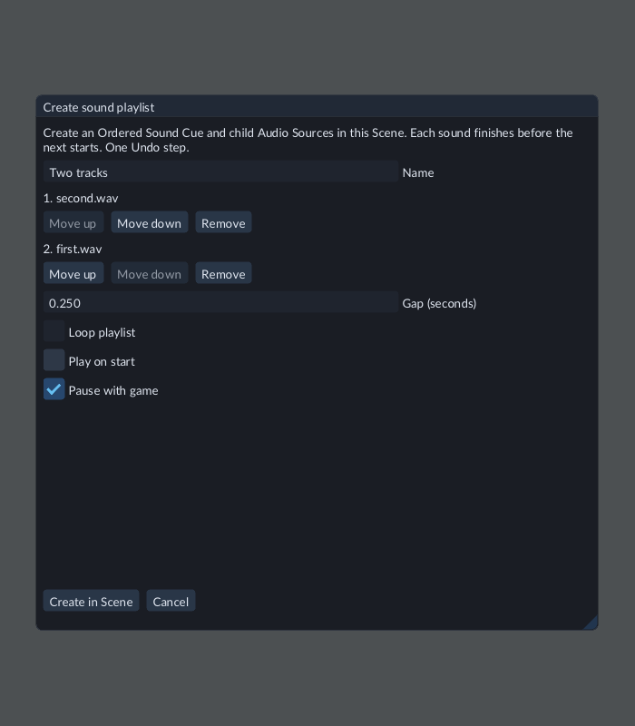

Review clip order and startup settings before creating the cue in the Scene.

The list is a creation draft. After creation, select its cue and use **Inspector →
Sound Cue → Edit sound cue**. Expand the **Ordered choice** root and use **Move up**
or **Move down** beside its children, then **Apply sound cue** and save. Edit each
child Audio Source to change its clip, pitch, volume, bus or effects. Keep those
Sources' own **Play On Start** off when the cue controls playback.

If you add or remove children after creation, set **Events per run (0 unlimited)** to the number
of sounds for one pass, or zero for an unlimited run. Moving children alone keeps
the count. Capture the cue root as a [Prefab](prefabs.md) to reuse the complete
subtree, or duplicate it in Hierarchy. Save before [exporting](runtime-content.md).

Creation is unavailable during Play or conflicting operations. If the Scene
changes while the dialog is open, review it and click **Use current Scene state**
before creating. A project/Scene switch requires canceling and reopening the
dialog. Missing clips must be restored or removed; **Cancel** leaves the Scene
unchanged. Streaming clips follow the same preparation and completion rules.

## Compose event sounds

A **Sound Cue** chooses or layers existing Audio Sources when an event requests a
one-shot. Each source keeps its clip, pitch, gain, spatial settings, bus, effects
and pause policy. Put the cue on its own entity in the same Scene as its sources.

To choose between two effects with relative weights 3 and 1:

1. Create two **Audio Source** entities and assign imported clips. Disable **Play On Start** so their main sounds wait for an event.
2. Choose **Entity → Create → Audio → Sound Cue**, select it, then click **Inspector → Sound Cue → Edit sound cue**.
3. Click **Add source node** three times. Nodes are numbered from zero. Keep **Root node** at 0.
4. Change Node 0 to **Weighted choice**. Assign the first source to Node 1 and the second source to Node 2 using their **Audio Source** pickers.
5. In Node 0, click **Add child** twice. Set their **Child node** values to 1 and 2, and their **Weight (1–65535)** values to 3 and 1.
6. Set **Seed**, then click **Apply sound cue**. Apply publishes the complete graph as one Undo step. Save the Scene to write it to disk.
7. Start Play, select the cue entity, then click **Live sound → Trigger cue**. The panel shows accepted triggers. Repeat to hear its choices.

**Layer** requests every child in one trigger. **Ordered choice** requests one child per
visit, wrapping to the first after the last. It does not wait for a clip to finish
or schedule a playlist. A graph can combine these branches. Weights apply to
Weighted choice; use positive integer weights to express relative frequency.
The same seed and selection state reproduce the same choices. A repeated shared
node advances on each visit, including multiple visits in one Layer.

To stagger the selected sounds, expand a **Source** node and set **Delay (seconds,
0–10)**. Zero starts that voice when ready; a positive value waits after the voice
has prepared. Click **Apply sound cue**, then save the Scene. The offset belongs
to that node: two nodes can select the same Audio Source with different offsets.
Branch nodes do not have an offset.

The delay uses output time and stays the same when you change source Pitch.
Source pause and full suspension preserve the remaining interval. Game Pause
preserves it when the source follows **Pause with game**; independent sources
continue. Loading can postpone preparation. Waiting voices consume the normal
16-per-source and 256-total voice limits. Use the runtime kit packaged with the
current editor when exporting delayed cues.

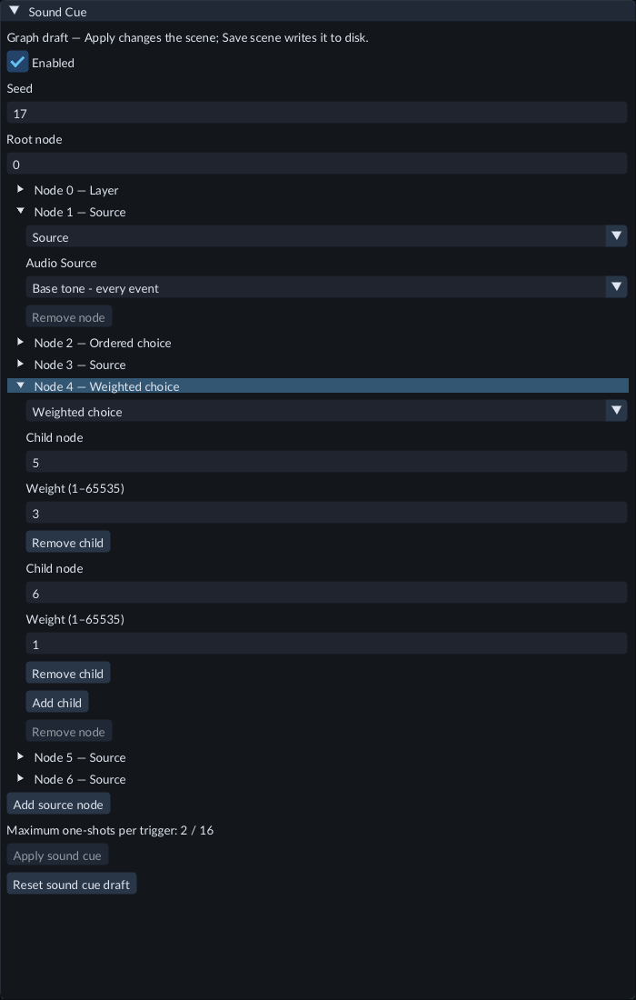

Expand a node to edit its source, delay, kind or children. The included example combines
a Layer, an Ordered choice and this Weighted choice. Source Node 3 in
**193-timed-sound-cues** waits 0.128 seconds after preparation.

Edits stay in a detached draft until Apply. **Reset sound cue draft** reloads the
current Scene values. If the Scene changes, reset before applying. An unapplied
draft for another object remains available when you return to that object; use
**Discard other cue draft** to begin editing a different cue. Disconnect a node's
incoming children and choose another root before removing it. Removing a node
adjusts later node numbers while retaining their existing connections.

Use up to 32 nodes, eight children per branch and 16 emitted one-shots per trigger.
Cycles, missing child indices, invalid weights and oversized layers are rejected.
Assign every Source node before triggering, including sources in currently unused
branches. Sources must belong to the cue's Scene and be active. Missing references
remain visible for repair. Prefab capture and duplication retain admitted internal
source links; external links must be contained in the captured subtree.

During Play, **Trigger cue** requests one event. To stop or pause sound,
select its Audio Source and use that source's controls. Those controls also affect
other sounds using the same source. Source voice limits still apply; an accepted
trigger does not guarantee that every requested effect fits the current budget.

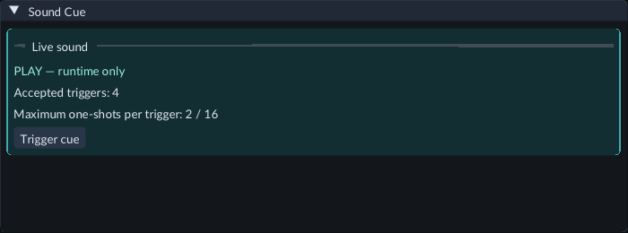

Use the tinted Live sound controls for temporary event requests during Play.
Enable sound during gameplay Pause by disabling **Pause with game** on the
participating sources. C++ actions that run while the game is paused require that
setting on every declared source, including unused branches.

To trigger a cue on the Scene Timeline, select its entity and choose **Add cue from
selected sound** in the controller's sound-cue section. Preview and seeking remain
silent. C++ code uses `audio_one_shot(scene_uuid, cue_entity_uuid)` from the matching
installed SDK; rebuild project code when its fingerprint changes. Cue selection
state restarts after a graph change or runtime-world replacement, including
recovery. It is not saved as an authored Scene value.

### Repeat sound events

To repeat a cue, expand **Repeating events** in its Inspector. Choose **Timing →
Interval**. Set **Repeat
interval (seconds; 0 off)** to a value from 0.25 to 3600. Enable **Repeat on start**
for automatic playback, then click **Apply sound cue** and save the Scene. Zero
turns interval repetition off. Each interval requests another event from the same graph;
it does not wait for the previous sound to finish.

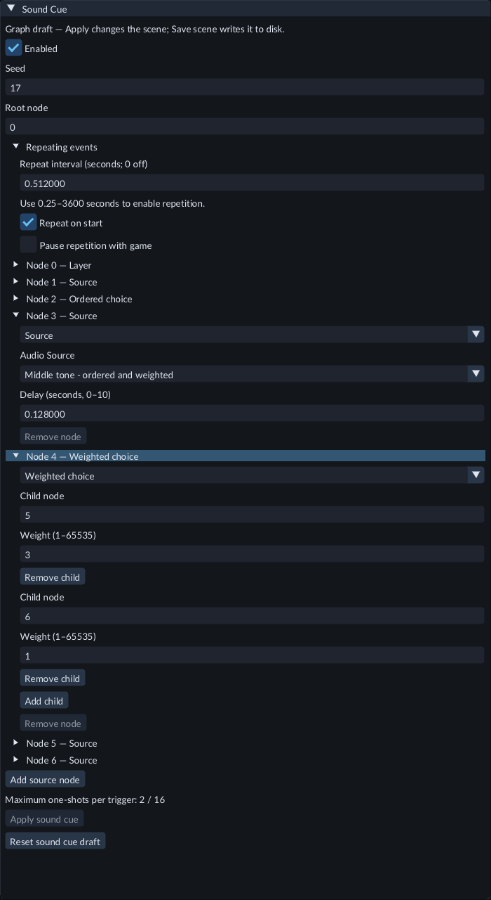

The repeating-cue Gallery example uses a 0.512 second interval with automatic
startup and independent sound during gameplay Pause.

During Play, select the cue and use **Start repeating**, **Pause repeating**,
**Resume repeating**, **Restart repeating** or **Stop repeating** in Live sound.
These controls affect future events. Already-requested sounds keep playing;
select their Audio Source to pause or stop those voices. Restart begins selection
again. The panel shows the next interval, preparation, skipped events and errors.
After repairing a missing source or invalid source policy, Restart the cue.

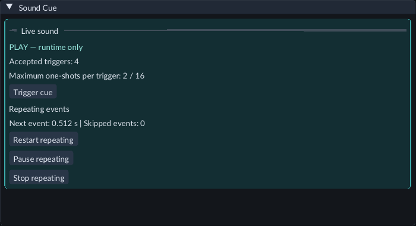

Use the tinted Live sound controls to adjust future production during Play.

**Pause repetition with game** holds future events during gameplay Pause. Disable
it, and disable **Pause with game** on every participating Audio Source, to keep
independent sound events running while gameplay is paused. Full output suspension
holds all producers. Pause/Resume preserve the remaining interval. Stop stays in
effect for the current runtime definition even when **Repeat on start** is enabled.

Repetition supports up to 32 active producers. If the host falls behind, it skips
missed intervals and requests one current event; it does not replay an accumulated
burst. Device timing follows host service. Source voice limits still apply.
Saving stores the repeat settings; temporary controls and active sounds are not
saved. A new Play session or recovered world starts fresh, using **Repeat on
start** if enabled. Export requires a runtime kit supporting repeating sound cues.

### Repeat after sounds finish

Choose **Timing → After event finishes** in **Repeating events** to wait for each
event's requested sounds and effect tails before requesting the next event.
Set **Gap after event (seconds)** from 0 to 3600; zero requests the next event
at the next audio service boundary after completion. Enable **Repeat on start**
for automatic playback, then **Apply sound cue** and save the Scene.

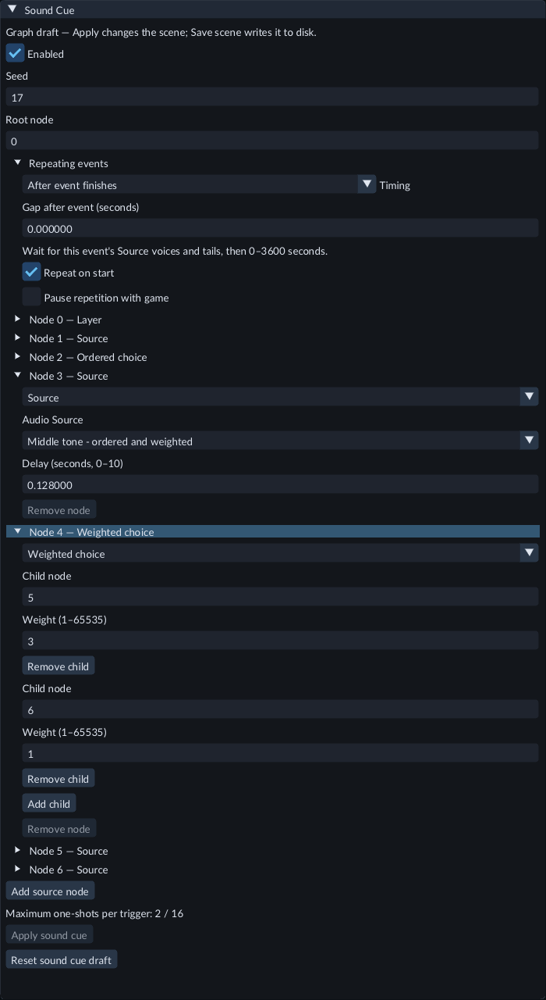

The completion-cue Gallery example uses zero extra gap after its layered event.

For a repeating playlist, use an **Ordered choice** root with one Source child
for each sound. The next completed event advances the ordered choice. Layered
and weighted events also work; all voices from the current event must finish.
Turn off **Play on start** on the participating Audio Sources when you want the
cue to supply their playback requests.

During Play, Live sound shows **Completed events** and the voices still belonging
to the current event. It shows the remaining gap after those voices finish.
Unrelated sounds sharing the Sources do not delay that event. **Trigger cue**
requests an additional event and advances the shared choices independently.
**Restart repeating** starts fresh choices while older Source voices keep their
existing playback. With **Events per run (0 unlimited)** set to zero, this mode
repeats until the producer is stopped.

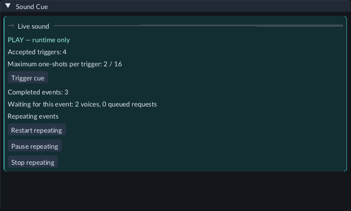

The tinted controls affect future production while Sources retain their voices.

**Pause repeating** holds future production; existing voices follow their Source
pause settings. Pausing an Audio Source holds its voices and therefore their
completion. Source **Stop** cancels its voices and can let the cue continue to its
next event; use **Stop repeating** to prevent future events as well. If a Source
becomes invalid or cannot admit a requested voice, repair it and Restart the cue.
Native transitions follow audio service; seamless device chaining through host
stalls is not guaranteed.

The independent gameplay-pause rules remain the same: disable **Pause repetition
with game** and **Pause with game** on every participating Source. Saved settings
and exports retain the mode and gap. Recovery starts a fresh event rather than
restoring active voices or completion progress. Export needs a matching runtime
kit supporting completion-aware cues; rebuild project C++ with its matching SDK.

### Play a finite run

In **Repeating events**, set **Events per run (0 unlimited)** to a whole number
from 1 to 65535. Choose either timing mode, configure its interval or gap, then
**Apply sound cue** and save the Scene. For automatic playback, enable **Repeat
on start**. In Interval mode, the interval must still be at least 0.25 seconds;
setting a count alone does not turn repetition on. Zero events per run means
unlimited repetition.

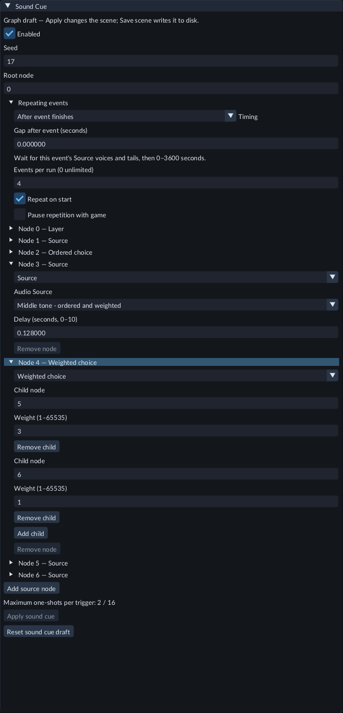

The finite-run Gallery example requests four events automatically.

The count includes the first scheduled event. An Ordered choice with three Source
children and a count of three plays each child once when no manual triggers
advance its choices. Use **After event finishes** to let one event finish before
starting the next. Interval events may overlap.

Live sound shows scheduled events issued and the run's limit. After the last
request, **Finishing this run's Sources** means its sounds and source effects
are still playing, including earlier overlapping events. **Finite run finished**
means they have all retired; use **Replay run** to begin fresh choices and counts.
Shared bus effects may continue to sound afterward. **Trigger cue** requests an
extra event without consuming the run count, and still advances shared choices.

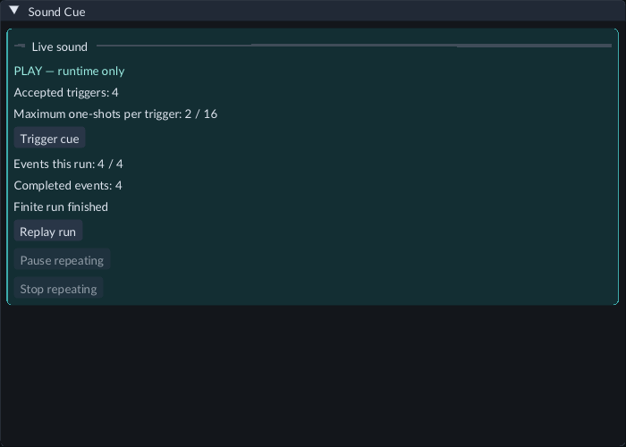

**Pause repeating** holds production and completion observation. **Stop repeating**
cancels future requests; it leaves requested sounds with their Sources and does
not mean the run finished naturally. Restart begins a fresh run while older sounds
keep playing. Source pause holds its sounds; Source Stop cancels them and can
allow a finishing run to complete.

Saved Scenes, Prefabs and exports retain the count. Play and recovery begin fresh,
without restoring active voices or progress. Export needs a runtime kit supporting
finite cue runs, and C++ projects need the matching SDK. If the run reports an
admission or Source error, repair the Source and restart the run.

## Registered clips

Import runs in a separate worker. It validates the audio source, prepares immutable audio
data, and records **Duration**, **Channels**, **Sample rate** and format. Select
the AudioClip in Content to see these details in Inspector, or double-click it to
open **Audio clip**. Its **Clip details** update even when Content is closed or folded. Import settings can combine channels, normalize peaks and trim quiet edges. Drop it onto an Audio Source's **Clip** field to assign it;
an incompatible asset type is rejected.

Keep `forge.assets.json`, the source recording and its `.forge-import.json` sidecar in source
control. Import does not modify the source recording and is separate from scene Undo. Reimport
preserves its AssetId and scene references. Existing clips created by the older
Register WAV command still work; opening and importing one adds validated data
without replacing its identity.

The source watcher can reimport changed audio sources after a clip has been imported. Use
Content's **Reimport** action to retry a failed source. A bad or stale candidate
keeps the previously selected audio and metadata. **Restart Play** to hear a newly
published revision; an active voice keeps its current decoded clip. There is no
automatic replacement of a playing waveform. Runtime loading of imported clips
uses the selected cooked data and does not require the source recording.

Supported Content file operations preserve or deliberately duplicate identity;
automatic relocation of files moved outside FORGE is not implemented. Move the
source through Content rather than renaming it externally. Missing/corrupt cooked
data is diagnosed; reimport from the source to rebuild it.

## Recovery and limitations

After crash/reload recovery, FORGE rebuilds audio from the recovered component configuration. **Play On Start** voices restart from the beginning; other voices remain stopped. If recovery remains paused, only sources with **Pause with game** turned off can play. Sample positions, manual playback commands and music continuity are not restored or saved in scenes.

Use mono or stereo WAV, FLAC or MP3 files. For WAV, start with 16-bit PCM at 24, 48 or 96 kHz;
unsupported or invalid encodings report an import error.

Audio supports up to 256 voices, mono/stereo source files up to 16 MiB, up to
64 MiB decoded per clip and 256 MiB of resident decoded clip data per runtime.
Stream pages and temporary backing have the separate limits described above.
Repeated sources share loaded clip data. Imported clips load in the background; a source
can remain silent while its first load finishes. Import older registered-only
WAVs to prepare them for this loading workflow.

Missing clips, invalid files and unavailable devices appear in the existing Play
log in **Console**. Optional device failure allows the game to continue silently.
Restart Play after fixing files/device selection if the operating system does not
recover playback. Use the Audio clip document to audition a sound and the mixer
controls to balance buses. Device selection, automatic voice stealing, unbounded
music streaming and replacement of an already playing waveform are unavailable.
Check the mix through the speakers or headphones your players will use.

## Compare the included falloff scene

Open **Examples/FeatureGallery/Scenes/31-audio-falloff.scene.json**. The blue,
yellow and red cubes use inverse, linear and exponential falloff. The camera is
the listener. Only blue starts automatically, so the sounds remain easy to compare.

Stop, disable **Play On Start** on blue, enable it on one other cube, and Play.
Move the camera nearer/farther while stopped, or change the selected source's live
strength during Play. Save authored settings while stopped before exporting.
An exported game includes the compiled engine and cooked sound; it needs the
original recording only when you return to authoring/reimport in the editor.

## Aim a directional sound

Open **32 — Directional audio** in the Feature Gallery and select **Directional
speaker**. The Scene helper shows its forward arrow and inner/outer angular
outlines. **Helpers** must be enabled. The outlines are visual aids, not a fixed
mute distance. The source points along negative Z; the normal transform gizmo's
blue axis shows positive Z.

Play to hear the tone. Stop, select **Aim parent**, rotate Y by180degrees and
Play again: the camera/listener is now behind the emitter, so it is quieter.
Try **Outside volume**0 or1, or change the openings in live gameplay controls.
Save authored edits while stopped before export. Older sounds stay omnidirectional
until you enable **Directional sound**. A source with zero scale along its forward
axis cannot be aimed and is muted while directional spatial sound is enabled.
