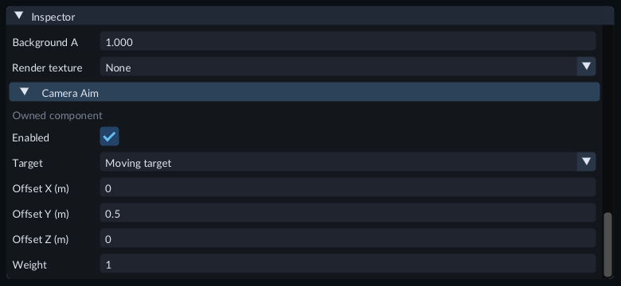
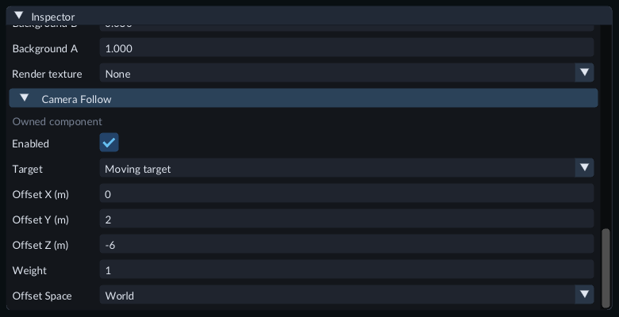

# Follow and aim a camera

Use Camera Aim to turn a view toward an object, and Camera Follow to place its
eye relative to an object. Both are components on the Camera entity and can be
used together. The entity's Transform remains its base pose.

## Aim at an object

**Camera Aim** turns a Camera's view toward another Scene object. The camera stays
at its authored position, and meshes, lights and children on its entity keep their
ordinary transforms. Use it for a stationary camera watching a moving character,
or for a camera rig whose view should follow a target.

1. Create a Camera with **Entity > Create > Rendering > Camera**, or select an existing Camera in Hierarchy. Position it away from the target.
2. Choose **Add Component** in Inspector and add **Camera Aim** to the same entity.
3. In **Target**, choose the Scene object to watch. Choose an actual instance when working with Prefabs.
4. Leave **Enabled** on and **Weight** at **1** to face the target fully. **0** keeps the camera's ordinary direction; values between 0 and 1 apply part of the turn.
5. Adjust **Offset X**, **Offset Y** and **Offset Z** to watch a point away from the object's origin, such as a character's head. These offsets follow the target's local axes, rotation, scale and parents.
6. Select the Camera to see its aimed view volume in Scene. Press Play and open Game to see the result. Moving or animating the target updates the view.
7. Stop and save the Scene. Saved settings work in exported games with the matching runtime kit.

The view turns through the smallest angle from the camera's ordinary direction.
It follows the camera's roll through that turn; it does not lock the horizon or
add a delay. An exactly opposite target uses the camera's own up axis to choose
the turn. Perspective, Orthographic and imported camera directions are supported.
Changing **Weight** changes the angular turn, rather than the target's position.

During Play, **Live gameplay** exposes Enabled, Weight and the three offsets.
These values affect the running game. Stop and review **Keep runtime values** to
keep selected changes, then save. Assign or clear Target in Edit.

When arranging [Camera Shots](animation-sequences.md), each camera aims before
its view participates in a transition. A blended view can temporarily point
between the endpoint directions. Its attached objects keep their node poses.
[Camera render textures](render-textures.md) use the same aim settings.

Open **219-camera-aim** in the [Feature Gallery](../getting-started/feature-gallery.md)
and press Play. A yellow cube moves left to right while a stationary camera
follows it. Blue cubes and the floor provide a stationary reference. The example
uses a built-in transform animation and needs no project C++ module. Stop before
changing the target binding, and select this Scene as startup before exporting.

Clearing Target, disabling Camera Aim or setting Weight to zero leaves the
ordinary view available. A bound target must belong to the same Scene and have
a resolved transform. A missing target, coincident aim point or invalid camera
transform omits that camera and reports the reason in Problems. Select a valid
target or disable Camera Aim to restore it. Reflected, collapsed or sheared camera
frames remain invalid; aiming does not repair them. A target uses its node pose,
so aiming one camera at another does not create a recursive view dependency.

## Follow target position

1. Create or select a Camera. Choose **Add Component** in Inspector and add **Camera Follow**.
2. Choose the object to follow in **Target**. Keep **Enabled** on and **Weight** at **1**.
3. Set **Offset X**, **Offset Y** and **Offset Z** to place the camera eye away from the target. The defaults are **0**, **2** and **-6**.
4. Choose **World** in **Offset Space** for offsets in world metres. Choose **Target** for offsets along the target's own axes, including its rotation, scale and parents.
5. Add **Camera Aim** to the same Camera and assign its Target when the view should face an object. The eye follows first, then the view aims from that eye.
6. Press Play and open Game. Move or animate the target to see the camera follow. Stop and save the Scene before exporting with the matching runtime kit.

Weight **1** uses the target plus its offset. **0** uses the Camera's own resolved
Transform. Intermediate values blend these positions. Following does not add a
delay or avoid obstacles. Its target always supplies its node pose; another
camera's derived view does not feed back into this calculation.

The Transform fields keep your base camera pose. Adjust the Follow offsets or
move the target to change the followed eye. The Scene camera icon and view volume
show the derived eye; transform handles stay with the authored node. Attached
meshes, lights and children keep their ordinary node poses.

During Play, **Live gameplay** exposes Enabled, Weight, the offsets and Offset
Space. Assign Target in Edit. Stop and review **Keep runtime values** to retain
selected changes, then save. A reusable Prefab can contain both the camera and
its target: each placed instance then keeps its own target binding.

Open **220-camera-follow** in the Feature Gallery. The Camera follows a yellow
cube and aims above its center. Blue cubes and a floor show the camera's motion.
Select **Following Camera - derived eye and aim** to compare both components.
The Scene includes its light and transform animation and needs no project C++
module. Save and select this Scene as startup before exporting.

A missing, foreign or unresolved Follow target omits that camera and reports the
reason in Problems. Clear Target, disable Follow or choose a valid object to
restore a valid view. Keep the eye away from its aim point when using both
components: coincident points cannot define a viewing direction. Invalid Camera
frames retain the restrictions described above.
