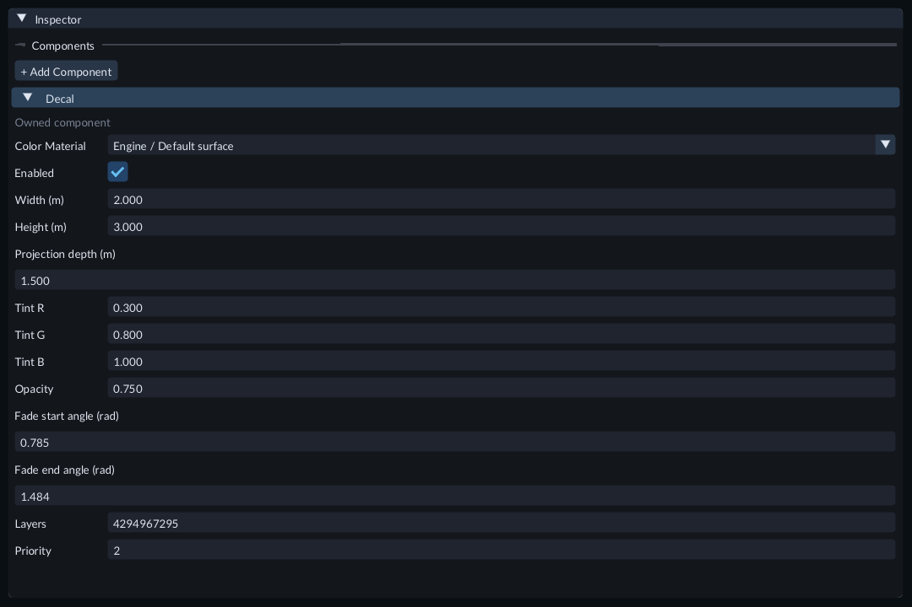
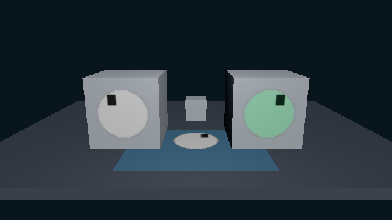

# Project color onto a Mesh

A **Decal Projector** paints a material's color onto physical Mesh surfaces inside
a box. Use it for a badge, floor marking or color patch. The receiving Mesh keeps
its lighting, surface properties and transparency.

## Place a projector

1. Add a Mesh with a PBR material and a light. Turn off **Preview light** when checking authored lighting in Scene. Add an enabled Camera to check the result in Game.
2. Choose **Entity > Create > Rendering > Decal Projector** and select it in Hierarchy.
3. In Inspector's **Decal** section, assign **Color Material**. Choose an ordinary PBR or Unlit material; **None** leaves the projector inactive. See [Materials](materials.md) to create an image material.
4. Move the box onto the receiving surface. Its arrow shows local **+Z**, the direction in which color travels. Rotate the projector until the arrow points into the surface. For a horizontal floor, an X rotation of 90 degrees points the arrow down.
5. Set **Width (m)**, **Height (m)** and **Projection depth (m)**. These are full local box dimensions before node scale. The box extends half the depth on either side of its center. A surface outside the box receives no paint.
6. Adjust the tint and **Opacity**, then save the Scene. Press **F** with the projector selected to frame its volume.

Assign Color Material first, then place and size the projection box around the surface.

Node rotation, scale and parenting affect the box and its image. Negative scale
mirrors the projection. The selected guide shows the box and travel direction;
an inactive projector keeps a guide so you can place and configure it.

## Choose the paint

The Color Material supplies its base or diffuse color and color texture. The
projector multiplies that color by **Tint R**, **Tint G** and **Tint B**. **Opacity**
controls how much paint covers the receiving material; zero disables its effect.

The source material's alpha mode controls its paint coverage:

- **Opaque** covers the surface independently of the source alpha.
- **Mask** skips paint where source alpha is below the material's cutoff. It leaves the receiving geometry intact.
- **Blend** uses the source alpha together with projector opacity.

Texture offset, scale, rotation, wrapping and filtering come from the source
material's color slot. The projector supplies the coordinates for that slot;
you do not need to add UVs to the receiving Mesh for the projected image.

## Fade, layers and overlapping paint

**Fade start angle (rad)** and **Fade end angle (rad)** reduce paint as a surface
turns away from the incoming projection direction. Values are in radians. The
defaults are approximately 0.785 and 1.484, corresponding to 45 and 85 degrees.
Keep start below end and use a visible interval between them. Back-facing
surfaces receive no paint.

**Layers** is a bit mask, like the receiving Mesh's layers. The projector, Mesh
and current Camera must share a layer. For example, a projector on layer mask
1 paints a Mesh on mask 1 or 3, while a Mesh on mask 2 is excluded.

Higher **Priority** paints later. Use different priorities when overlapping
projectors need a particular order. Equal priorities use stable entity IDs, so
reordering entries in Hierarchy does not change the paint order.

## Try the Gallery

Open **113-projected-color-decals** in the [Feature Gallery](../getting-started/feature-gallery.md).
The two cubes use the same badge material with separate layer masks and tints.
The left projector mirrors local X. Floor projectors demonstrate opacity,
volume clipping and overlapping priorities. Select a projector and change one
of these controls to compare the result.

The Gallery reuses one badge material for both cubes and the floor; each projector has its own placement and controls.

## Adjust during Play

Select the projector during Play and expand **Live gameplay**. You can change
Enabled, box dimensions, tint, opacity, fade angles, layers and priority. These
values belong to the running game. Stop Play to return to the authored Scene;
review and keep selected values through the usual live-tuning workflow when you
want to save them. Color Material assignment is available in Edit mode.

See [Play mode](play-mode.md) for live values and [Saving and recovery](saving-recovery.md)
for saving the authored Scene.

## Save and export

Save the Scene and any edited source material or texture. The projector's
Material and that material's Texture dependencies are included by normal content
export. To export a Gallery scene, choose **Use saved current scene as startup**
in Project Settings and save the settings first. See [Export a game or package content](runtime-content.md).

## Limits and troubleshooting

Texture filtering and wrapping configurations consume sampler slots. Matching
configurations in built-in PBR materials can share a slot. Material Graph texture
declarations reserve separate slots. More slots can reduce the available paint layers.

- The current profile supports eight active color projectors per visual scene. A projector is active when enabled, assigned a Material and given nonzero opacity.
- A physical Mesh part can have fewer available projector slots when its material uses many distinct samplers. If overlapping projectors exceed that part's capacity, FORGE keeps its ordinary material and reports a warning in Problems. Reduce overlap, disable projectors or simplify the receiving material's sampler requirements.
- Physical Mesh surfaces are the receivers. Unlit Mesh surfaces, Sprites and Tile Maps do not receive this projection. Custom physical Material Graph receivers need a Shader rebuilt with the current tools.
- Use an ordinary PBR or Unlit material as the color source. Custom Surface Shader sources are unsupported. This profile projects color; source normal maps, roughness, emission and render-state settings do not become receiving-surface properties.
- Keep dimensions between 0.001 and 10000 local metres. A collapsed transform cannot define a projection box. A fade interval too small to represent at rendering precision is rejected during extraction.
- Extreme node scales or distances can exceed projection precision for the current Camera. FORGE omits that projector with a warning and keeps the receiving Mesh visible. Adjust the projector's scale or placement.
- If paint is missing, check Enabled, Color Material, opacity, shared layers, box depth and arrow direction. Check the receiving material and authored lighting, then read Problems for resource or capacity errors.
- If a replacement material or color texture fails to load, the last admitted decal material remains visible with a resource warning. Correct the asset and retry its import or assignment.
