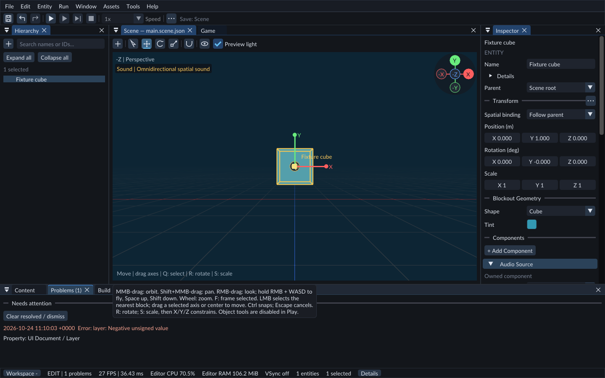

# Problems and diagnostics

**Problems** retains actionable errors and warnings for the current editor session. **Console** records chronological status changes and low-level runtime/build details. A failed field edit also explains itself beside that field.

Use the message, source and time to identify the action that needs attention.

## Find and resolve an issue

1. Open **Window → Problems**, or look at the problem count in the status bar.
2. Select an entry to inspect its entity or asset when that context is available.
3. Read the property/source context, correct the input or file, then retry the operation.
4. Use **Clear resolved / dismiss** to dismiss displayed entries. This clears messages; it does not repair project data.

Messages are bounded to 256 displayed entries and retained across panel closure. Repeated observed diagnostics are deduplicated. Switching projects starts a new session list. Console retains the most recent 256 status changes; **Clear log** clears only the displayed log.

Build output is also available in **Build**. Runtime UI, asset conversion/build and authoring failures feed Problems. Some low-level messages have no navigable target; use their source text and Console details.

Compiler, Play and exported-game test logs show a local date, time and UTC offset
at the start of each received line. Their timestamped views retain up to 256 KiB
of recent output. Older complete lines are removed first. An oversized single
line retains its original timestamp and newest text with **[earlier output
truncated]**, including when the program has not ended the line yet.

When an agent reads compiler, Play or exported-game logs, unreadable or incomplete
text bytes appear as replacement characters (`�`). Valid Unicode remains readable;
an unusual process encoding does not prevent the log response from being returned.

## Scene diagnostics

**Tools → Scene diagnostics** provides informational scene findings, including duplicate names, missing effective transform values and unresolved spatial bindings. Duplicate names are allowed because identities remain distinct. Unknown component data is retained when saving, although the current runtime cannot implement unknown behavior.

## Component schema

**Tools → Component schema** shows registered components and their field identities, types, defaults, units and limits. These are the same schemas used by Add Component and the typed Inspector. Quaternion storage is shown here; authored rotation editing presents Euler degrees.

See [Inspector](inspector.md), [Project Code](native-gameplay.md) and [Play mode](play-mode.md).

## Automatic asset reimport errors

When a watched source fails to reimport, its Problems entry identifies the asset
and source path. Select the entry to inspect that asset, correct the source, and
save it again or request Reimport. The last published revision remains usable.
Successful reimport clears that asset's error. **Open source** is offered for the
supported bounded text-source formats. When unavailable, use the asset/import view
or your external editor.
