# Place foliage

Use **Tools > Foliage placement...** to place independent copies of one Mesh
Renderer in a horizontal disk, using a plane, published heightfield terrain or
static triangle Mesh.
Each placement becomes an ordinary object in a
named group, ready for the Hierarchy, Inspector, Scene Save and game export.

## Choose the template

1. Place or create an object with a **Mesh Renderer** and assign its Mesh.
2. Set its local rotation and scale. Assign the materials, numeric material values, layers, shadows and optional **Wind** settings you want on the new objects.
3. Select the object in the Hierarchy, open **Tools > Foliage placement...**, and click **Use selected Mesh Renderer**.

The tool starts the disk center at the template's world position. It copies the
Mesh Renderer and the template's local rotation/scale. It does not copy gameplay,
colliders, animation, children or Prefab links. A model's skin/animation instance
is not created by this tool. The template remains in the Scene. Parent transforms are not copied; use an
unparented template when you want its visible rotation and scale to match exactly.

## Set the layout

Enter the new **Group name**. Set these controls:

- **Center X (m)**, **Center Y (m)**, **Center Z (m)**: World center of the new group. With terrain projection off, every new origin uses the same Y. With projection on, Y sets the group's origin; terrain and Height offset set the child heights.
- **Radius (m)**: Horizontal disk radius, from 0.01 to 1000 meters.
- **Minimum spacing (m)**: Minimum horizontal distance between new origins in this group. Zero permits any spacing.
- **Count**: 1 to 512 objects per placement. With terrain projection or collision rejection, **Candidate count** generates this pool before filtering.
- **Seed**: 0 to 4294967295. Change it for a different layout.
- **Minimum scale multiplier**, **Maximum scale multiplier**: Random uniform multiplier of the template's local scale. Each value is 0.01 to 100; maximum must be at least minimum.
- **Minimum yaw (deg)**, **Maximum yaw (deg)**: Rotation about world +Y before the template's local rotation. Use -360 to 360 degrees; maximum must be at least minimum.

Choose **Check layout** to validate all settings without changing the Scene.
Choose **Place foliage** to create and select the group. Each click creates a new
group, including when you reuse the same seed. Equal settings reproduce the layout
with new independent object identities.

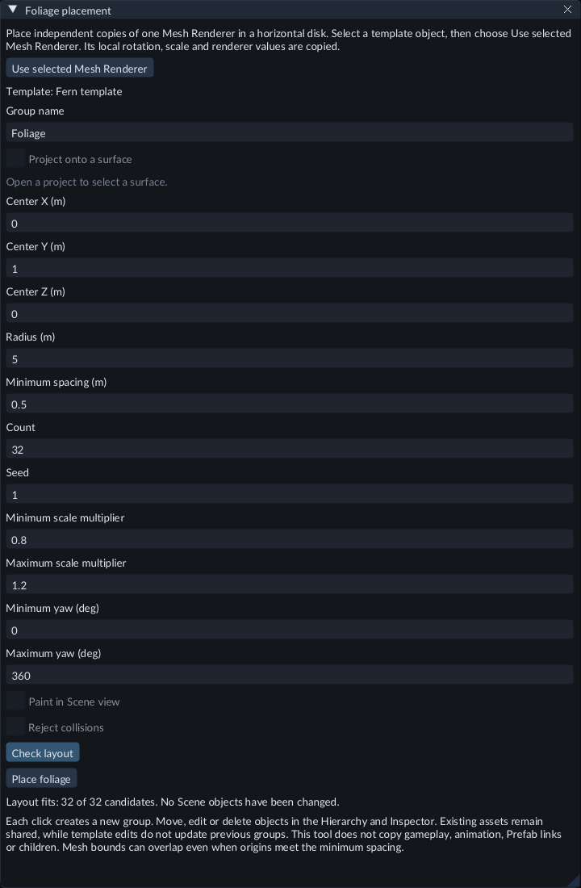

With projection off, the controls describe a horizontal origin plane. Choose a
Mesh whose pivot is at its base when each plant should rest on the surface at
every scale.

## Place onto a heightfield

Open **Gallery 147 — Terrain foliage** to see 128 blades resting on the layered
terrain. They are ordinary objects with saved heights, ready for Play and export.

1. [Create or open a heightfield terrain](terrain.md), save and publish it, and place its Mesh in the Scene. Keep it upright: rotation about Y and scaling are supported, with positive Y scale.
2. Choose the foliage template with **Use selected Mesh Renderer**. Enable **Project onto a surface**, then choose **Surface geometry → Heightfield terrain**.
3. Select the terrain's Mesh Renderer in Hierarchy, then choose **Use selected terrain**. The template and terrain have separate selections.
4. Set **Center X (m)**, **Center Z (m)** and **Radius (m)** so every new origin lies over a terrain tile. Set **Height offset (m)** from -1000 to 1000; zero places origins directly on the published surface. **Center Y (m)** controls the group pivot rather than moving the projected origins.
5. Set **Minimum slope (deg)** and **Maximum slope (deg)**. The default 0–90 keeps every covered candidate. For flatter ground, try 0–20. These angles measure the actual world-space triangle surface, including terrain scaling; they do not measure smoothed lighting normals.
6. Enable **Align to terrain slope** to tilt the placement frame onto the triangle surface. Leave it off to keep world-up yaw and the template orientation.
7. Choose **Check layout** and read how many candidates remain. **Place foliage** creates that subset. Save the Scene. Undo removes the entire new patch in one step.

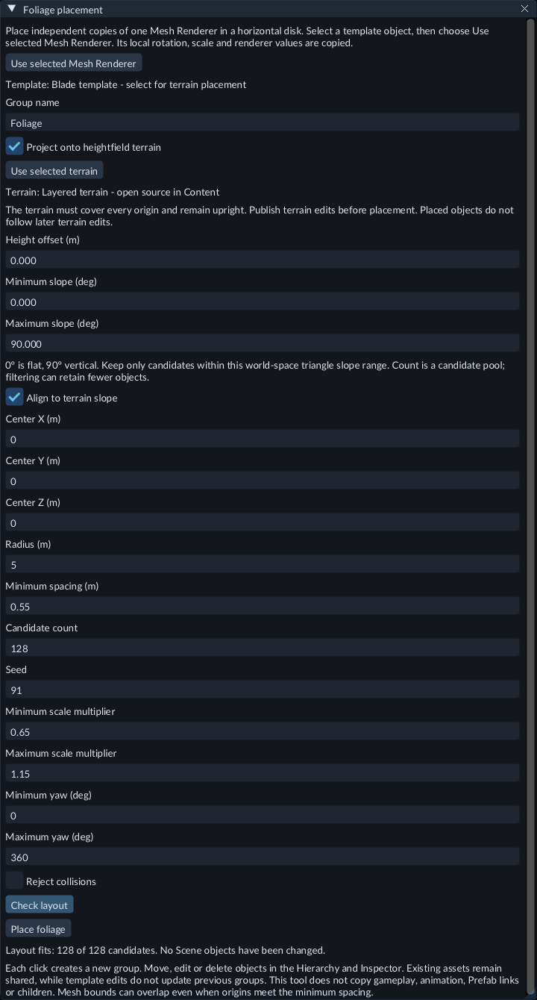

The selected terrain supplies heights and geometric slopes; Check layout reports how many candidates remain.

Projection uses the published surface. Save and publish terrain edits before
placing a patch; unsaved source drafts are not used. If a saved source differs
from its published Mesh, preparation stops until it is published again. Every
origin must be covered; a disk crossing missing tiles or the outer edge can fail
without creating objects. Move its center or reduce its radius.

Slope filtering keeps candidates in the original seeded layout. It does not
search again to fill the requested candidate count. A lower retained count is
expected; change the seed, center, radius or slope range for a different patch.
Retained origins keep their original spacing, yaw, scale and height offset. If no
candidate meets the range, the tool reports an error and creates no group.
Minimum and maximum must satisfy 0 ≤ minimum ≤ maximum ≤ 90 degrees. Both ends
are included. At an exact triangle diagonal or tile boundary, the same triangle
selection as the terrain height query determines the slope.

With **Align to terrain slope** off, objects retain their template orientation
and yaw rotates about world +Y. With it on, the tool tilts that placement frame's
+Y to the geometric terrain normal. Seeded yaw and the template rotation stay
relative to the tilted frame. A normally upright template follows the slope;
its own authored tilt or base-orientation correction remains relative. Scale and
its axis signs are preserved. Height offset moves along world Y, not the normal.
Heights and orientations are copied at placement.
Later terrain movement or sculpting does not update old patches. Place a new patch
or adjust the ordinary objects when the ground changes.

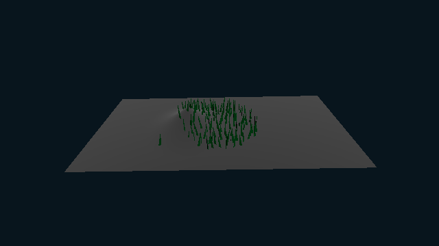

Gallery 147 uses the existing blade Mesh and heightfield with saved, independent plant transforms.

## Place onto a static Mesh

1. Stop Play. Publish an editable Mesh or import a static Model, then place its Mesh Renderer in the Scene.
2. Choose your foliage template with **Use selected Mesh Renderer**. Enable **Project onto a surface**, then choose **Surface geometry → Static triangle Mesh**.
3. Select the surface object in Hierarchy and choose **Use selected Mesh**. The template and surface have separate selections.
4. Set the disk center, radius and candidate count. Every horizontal origin must lie over an upward-facing surface triangle. Where surfaces overlap vertically, the highest upward triangle supplies the height.
5. Set **Height offset (m)** and the slope range. Enable **Align to Mesh slope** to tilt each placement to the geometric triangle normal. Leave it off for world-up yaw and the template's orientation.
6. Choose **Check layout**, then **Place foliage**. The new group uses one Scene Undo entry. Save the Scene; export uses these ordinary saved Mesh objects with the matching runtime kit.

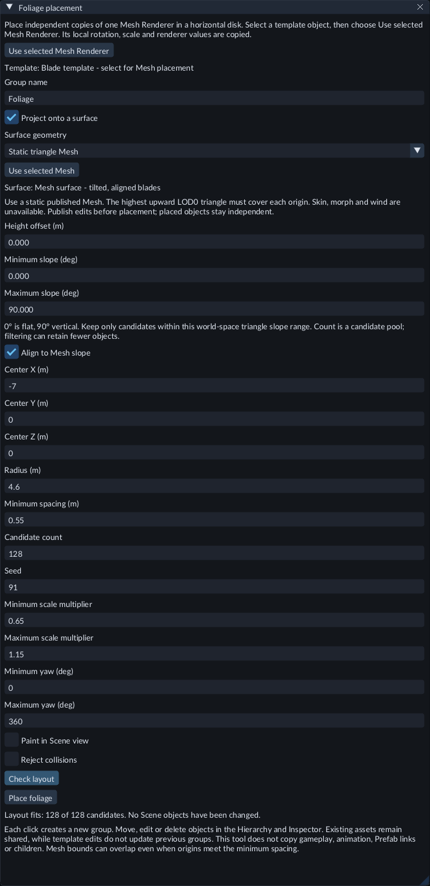

Choose Static triangle Mesh, select the surface and check the layout before placing.

Projection uses published LOD0 triangles at the surface's authored Scene transform.
Tilt, signed and nonuniform scale are supported. A flattened surface can work when
it retains valid upward triangles. Downward, vertical and unstable projected
triangles do not provide coverage. Image transparency, lighting and Material
appearance do not trim this geometric boundary.

The selected Mesh is limited to 8 MiB of decoded geometry, 16,384 vertices,
12,288 indices across its LODs and 32 parts, with at most 4,096 LOD0 triangles.
Skinned or morph-target Mesh data, enabled surface Wind and point/line parts are
unavailable. Reduce the Mesh or use heightfield mode for larger terrain.
Publish edits before preparing another patch. Unpublished source edits do not
change this mode's selected surface.

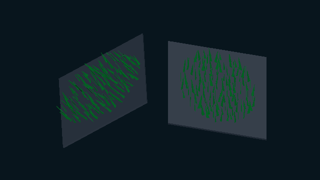

Gallery **200-mesh-surface-foliage** compares slope-aligned and world-up patches
on two instances of an editable ramp Mesh. Open its source under `Assets/Foliage`.

Later surface movement, geometry edits or animation do not move old placements.
They remain independent Scene objects. Optional **Reject collisions** composes
with this projection through the existing controls below. The optional Scene brush below creates independent objects; there is no live
foliage population.

## Paint foliage in Scene view

Open **Gallery 201 — Foliage surface brush** and press **Play → Game** to see two
saved strokes on tilted and mirrored ramps. Stop Play before painting another.

**Gallery 257 — Foliage brush clearance** compares strokes with 64 and 7 saved
plants. Each starts from three dabs and 96 candidates. The middle dab is blocked
by the central collider and omitted; the sparse stroke additionally separates
new clearance spheres across the remaining dabs. Both strokes use 0.4 m spheres.

1. Open a project and choose a template with **Use selected Mesh Renderer**.
2. Enable **Project onto a surface**, choose its geometry profile, then select the ground object in Hierarchy and choose **Use selected terrain** or **Use selected Mesh**. Keep that surface selected.
3. Set **Radius (m)** and **Candidate count** for each dab. Configure slope, alignment, scale and yaw as for one patch. Optionally enable **Reject collisions** and set the clearance controls below. **Separate new plants** checks the selected clearance volumes across the whole stroke, including between dabs.
4. Enable **Paint in Scene view**. Set **Dab distance (m)**, the minimum horizontal distance between sampled dab centers. Values from 0.01 to 2000 m are allowed. The single-disk center and Check layout / Place foliage controls become disabled.
5. Drag the left mouse button over the chosen visible surface in Scene view. Green circles mark sampled centers. Release to submit the whole stroke, or press Escape before release to cancel it. With clearance enabled, wait for preparation; **Cancel clearance** stops it before placement. One Scene Undo removes the whole completed stroke.
6. Save the Scene. Keep the surface selected to paint another stroke. Expand the new stroke group in Hierarchy to edit its dab groups and individual plants.

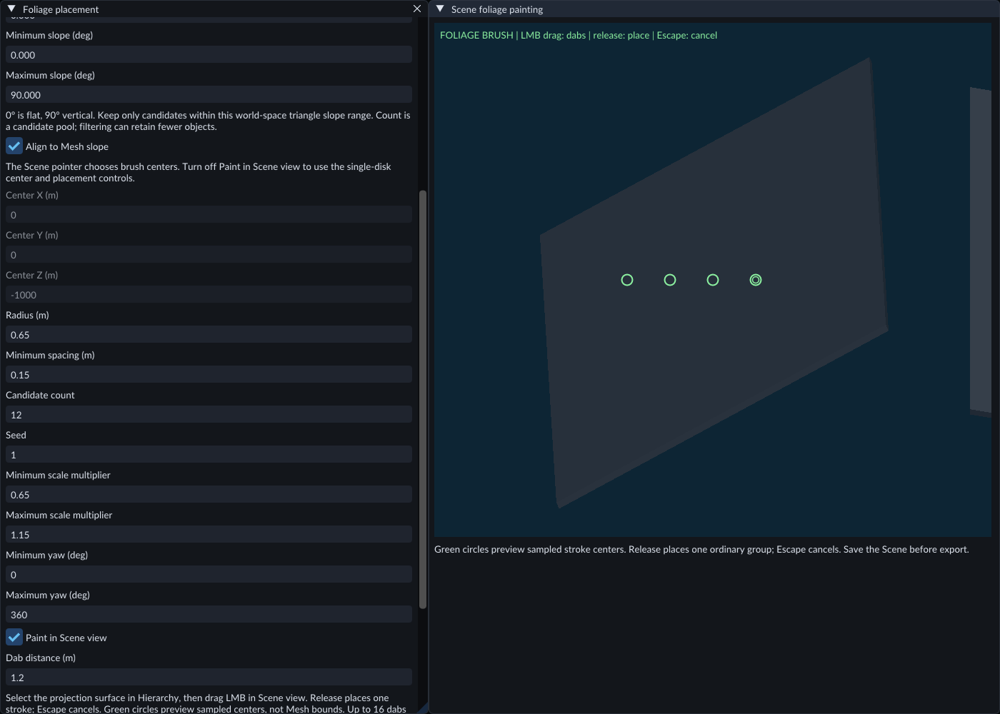

The Scene overlay marks brush mode and sampled centers while you hold LMB.

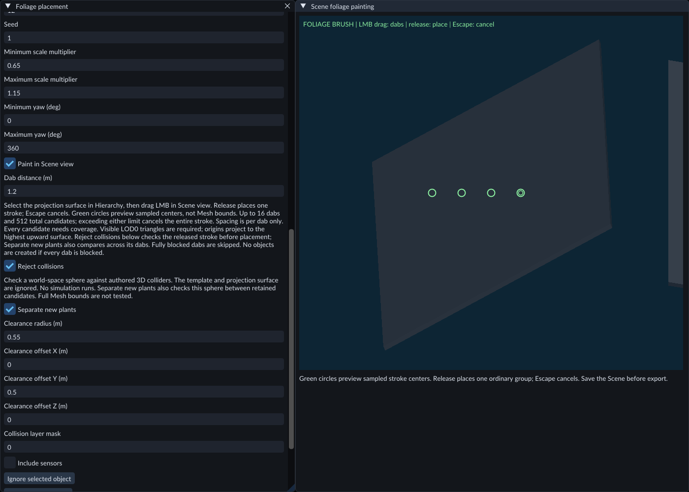

Enable both clearance options to check the released stroke against authored
colliders and separate its new plants. A layer mask of 0, shown here, checks only
the new plants against each other.

Each stroke allows at most 16 dabs and 512 total candidates. Exceeding either
limit cancels the whole stroke. Reduce Candidate count, shorten the stroke or
increase Dab distance. Fast motion does not fill unsampled gaps. Minimum spacing
applies within each dab. With **Separate new plants** enabled, clearance volumes
also keep retained candidates apart across dabs. Markers show
centers, not the final plant shapes or a world-radius outline.

Move close enough to use visible LOD0 triangles. Foreground objects block sampling
through them. The entire disk at each dab needs surface coverage; a dab near an
edge can reject the whole stroke. Projection chooses the highest upward surface
at each candidate XZ origin, even if a Mesh has overlapping surfaces. Brush mode
uses the same static geometry and terrain transform limits described above.
Clearance skips a dab when all its candidates become blocked; remaining dabs
keep their layout, heights and order. A wholly blocked stroke reports an error
and creates no objects. Each original dab still needs full surface coverage and
at least one slope-accepted candidate before clearance. Before release, close
the panel or change view, selection, Scene, project, settings or editing mode to
cancel an unfinished gesture. During clearance, use **Cancel clearance**;
closing the panel, changing Scene/project or locking Scene editing also cancels
pending placement. Later surface edits do
not move existing plants.

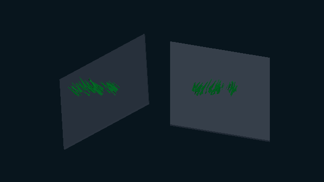

Each plant is an ordinary saved Mesh Renderer object in the exported game.

## Keep clear of colliders

Open **Gallery 156 — Foliage clearance** for a meadow placed around a large box
collider. Its saved plants are ordinary objects; no placement task runs during Play.
**Gallery 256 — Foliage candidate clearance** compares a dense patch of 83 plants
with a separated patch of 17 plants, each starting from 96 candidates. Both use 0.4 m
clearance spheres and the central collider; the separated group also checks
the new plants against each other. Open the Scene and press **Play → Game** to
see the saved ordinary objects.

**Gallery 267 — Foliage Mesh bounds** compares 64 plants retained by small root
spheres with 20 retained by static Mesh bounds. Both patches start from 96
candidates and separate their retained volumes. The mirrored blade template,
seeded variation and terrain slope alignment affect each Mesh clearance box.
The scene contains ordinary saved objects, a camera and light, and exports
without project C++ code.

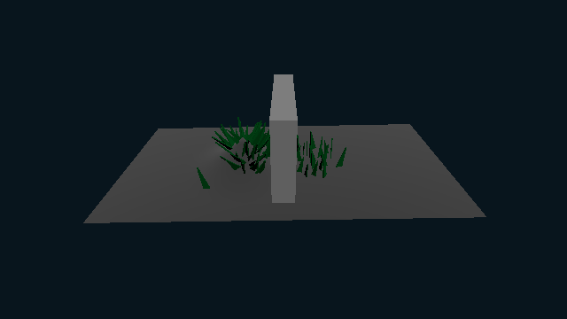

The left patch uses root spheres; the right uses conservative template Mesh bounds.

1. Open a project, choose your template and set the layout. Surface projection, slope filters and slope alignment can stay enabled.
2. Enable **Reject collisions**. Objects to avoid need enabled Physics Bodies and colliders in the selected clearance domain; a visible Mesh alone does not block placement. Save and publish any Collision asset edits first.
3. Choose **Clearance shape**. **World sphere** uses **Clearance radius (m)** from 0.001 to 100; its size does not follow the template. **Template Mesh bounds** encloses the static Mesh at each candidate's rotation, scale and slope alignment, then adds **Bounds padding (m)** from 0 to 100 on every side. **Template Mesh surfaces** checks the actual static triangles against 3D colliders. The corresponding **(XY)** choices check XY bodies with a circle, projected rectangle or projected triangles. The XY circle radius is 0.005 to 100 meters. **Template Mesh surfaces (Edit wind)** and **Template Mesh surfaces (XY, Edit wind)** sample the template's frozen wind shape. Surface profiles disable padding and ignore the retained radius setting.
4. Set **Clearance offset X (m)**, **Y (m)** and **Z (m)**. Each offset is -1000 to 1000 meters along world axes. The default (0, 0.5, 0) raises a sphere above the plant's base. For Mesh bounds or surfaces, set all three to 0 to test the unshifted geometry; other offsets move the whole clearance geometry. XY profiles use only X and Y; Z stays stored but is disabled and ignored.
5. Set **Collision layer mask** to the unsigned combination of the layer bits you want to avoid. The default 4294967295 selects every layer; 0 selects none. Enable **Include sensors** when sensor volumes should also exclude candidates.
6. The template and selected projection surface are ignored automatically. To ignore another collider, select its object in Hierarchy and click **Ignore selected object**. Up to 14 additional objects are allowed. Children are separate objects. **Clear ignored objects** removes these additional exclusions.
7. Enable **Separate new plants** to keep retained candidates apart. Surface profiles use conservative enclosing boxes or XY rectangles between new plants; the other profiles use their selected clearance volumes. The option starts off. It uses the selected domain, offsets and resolved heights, independently of the collider layer mask. XY profiles ignore Z when comparing new candidates. Set that mask to 0 when you only want separation between new plants.
8. Choose **Check layout**. Preparation loads the current published collision data and reports the number of candidates retained, including how many were skipped for overlapping another new plant. It changes no Scene objects. **Cancel clearance** stops pending preparation.
9. Choose **Place foliage**. The tool prepares current clearance, then creates the retained subset in one Scene Undo step. Save the Scene.

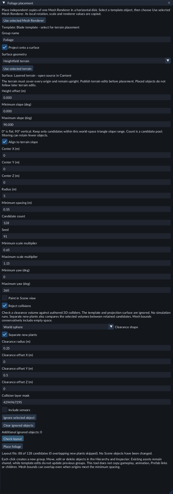

The clearance volume tests the authored colliders without advancing simulation.
It composes with the slope mask and keeps original candidate order, yaw, scale,
height and normal. It does not resample to fill the count. A completely blocked
layout reports an error and creates no group. Changing the Scene or project
cancels stale preparation. Closing the panel or entering a mode that locks Scene
edits cancels a pending placement. Assets or project settings that change during
preparation require another check. Preparation has a 30-second deadline; missing
or invalid collision assets or selected template Mesh resources are errors.

**Template Mesh bounds** follows the template's local rotation and signed scale,
the candidate's seeded yaw and scale variation, and any resolved slope alignment.
It combines the bounds of every static Mesh LOD into a box along world axes.
This conservatively includes empty space around tilted, separated or irregular
geometry; it can reject a placement whose triangles would fit. It does not test
exact triangle-against-triangle contact. Source position and parent transforms
are not copied into the plant.

This profile supports up to 8 MiB of Mesh data, 16,384 vertices, 49,152 indices and
32 parts. Wind, skin and morph deformation are unavailable for bounds clearance.
Disable template wind or use a static Mesh. The 3D box dimensions must fit 10,000
meters per axis, with at least 1 mm thickness for a flat or collapsed axis. XY
rectangles use the native XY profile: up to 1,000 meters per queried axis and at
least 1 cm thickness.
Save and publish Mesh edits, then check again to use the updated geometry.

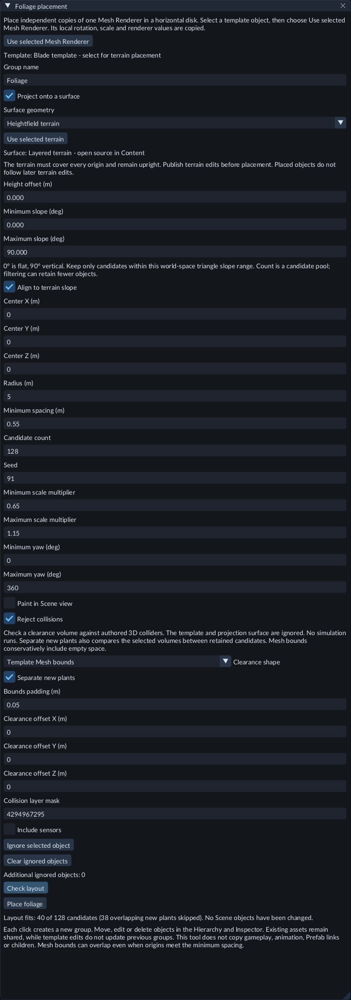

Choose the Mesh bounds profile and check the layout before placing the retained subset.

**World circle (XY)** uses the clearance radius in world X and Y. **Template Mesh
bounds (XY)** encloses the same transformed static Mesh, then projects its box
onto world XY and adds padding on those two axes. Both profiles ignore world Z,
even when plants lie far apart along Z. They query only XY physics bodies; the
profiles without **(XY)** query only 3D bodies. Layer masks, sensors and ignored objects work
in the selected domain.

The layout still places ordinary Mesh objects on an XZ disk, using its center Y
or resolved surface heights. Selecting XY clearance changes the rejection and
separation tests, while the saved placement, yaw and slope controls retain their
usual meaning. It does not select an XY drawing plane or accept Sprite templates.

Open `Examples/FeatureGallery/Scenes/268-foliage-xy-clearance.scene.json` for a
saved comparison: 29 circle-clear plants on the left and 5 Mesh-rectangle-clear
plants on the right, each from 96 candidates with new-plant separation enabled.
The scene contains an XY obstacle, a camera and light. It exports as ordinary
saved Mesh objects without project C++ code.

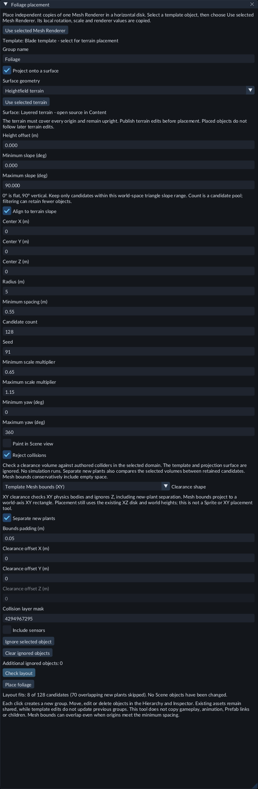

Choose an XY clearance shape to test XY bodies; the Z offset stays disabled.

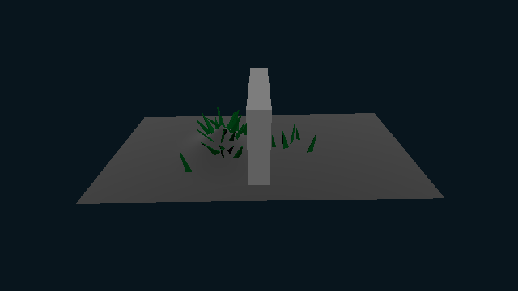

The saved comparison uses circles on the left and projected Mesh rectangles on the right.

### Check the template's triangle surfaces

Open **Gallery 269 — Foliage Mesh surfaces** for a saved comparison. The amber
group retains one two-panel plant with bounds clearance; the green group
retains two with surface clearance because their gap misses the obstacle.
The editable Mesh is **Assets/Foliage/SurfacePanels.mesh.json**. Camera and light
are included, and export uses the ordinary saved objects.

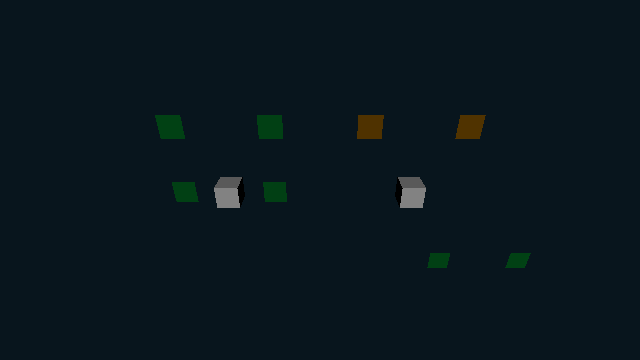

The green comparison keeps the lower plant because its two panels miss the cube
in their gap. Each plant has two panels; the separate template sits below.

Choose **Template Mesh surfaces** when enclosing bounds reject a gap in your
plant's actual geometry. **Template Mesh surfaces (XY)** projects those triangles
onto world X and Y before checking XY colliders. A projection can become a line
or point and still touch a collider. Both modes follow the same saved rotation,
signed scale, seeded variation and slope alignment as Mesh bounds.

Every static LOD contributes, up to 4,096 triangles in total. The same 8 MiB,
16,384-vertex, 49,152-index and 32-part Mesh limits apply. Source triangles must
have area. Line/point Mesh parts, skinning and morph targets are unavailable.
The two static surface choices require disabled Wind; use an Edit wind choice
for the frozen wind shape. Publish Mesh edits and check the layout again to use them.

These modes test contact with triangle surfaces. A collider wholly inside a
closed plant Mesh can miss every surface. Use an enclosing bounds profile when
you need that conservative rejection. **Separate new plants** also uses enclosing
bounds in surface modes, so it can reject empty space between new plants.
**Bounds padding (m)** is disabled; padding and radius stay stored for switching
profiles but do not expand surface clearance.

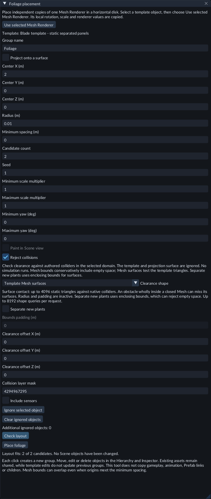

Select the surface profile and zero offsets to test the unshifted template triangles.

Preparation reports **Shape queries** as it works. Each poll checks at most 16
shapes, including enclosing sphere/circle probes and individual triangles. A
request stops at 8,192 queries or the 30-second deadline without placing partial
results. Reduce Candidate count or simplify the Mesh when the limit is reached.

With **Separate new plants**, the first clear candidate is kept. Each later
candidate is kept only when its clearance volume does not overlap an earlier retained
volume. Touching volumes are allowed. Previously excluded candidates do not
block later ones. The 3D profiles compare all three world axes; XY profiles compare
only X and Y, including across brush dabs. The filter
keeps original candidate order and can retain fewer plants than the requested
count; it never resamples. In brush mode it compares the entire stroke's retained
candidates across dab boundaries. Objects from earlier strokes need actual
colliders to affect a later stroke's collider clearance.

The 3D profiles test 3D colliders, including published Collision assets. The XY
profiles test XY Physics Bodies and colliders. Each profile can also separate new
plants in its own domain. Mesh bounds provide conservative clearance; Mesh surfaces
test static contact with current colliders. Deformed geometry and future object
motion are unavailable. Adjust the shape, radius or padding, offset, spacing and seed for
your geometry. Query origins must fit +/-1 billion meters per axis in 3D and +/-1 million
meters per queried axis in XY.
Tool choices and exclusions are session-only. Later collider changes do not move
already placed objects.

### Check frozen Edit wind

Open **Gallery 270 — Foliage Edit wind** and press **Play → Game**. The amber
group keeps both unchecked plants, including one bent into its obstacle. The
green group keeps only the clear upper plant. Frequency is 0 to hold this
comparison still; the independent template appears below the groups.

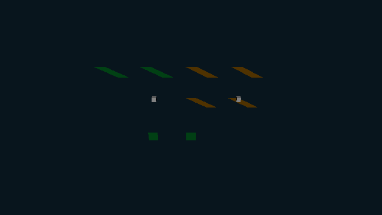

Use **Template Mesh surfaces (Edit wind)** or **Template Mesh surfaces (XY, Edit
wind)** when your template has **Mesh Renderer → Wind** enabled. These choices
check the same 0.5-second wind sample shown in Edit, evaluated at each new plant's
world origin. They keep the ordinary static Mesh, scale, yaw, slope, collision
filter, query-budget and Scene history workflows described above.

1. Stop Play. Select the template and configure **Inspector → Mesh Renderer → Wind**. Use an admitted static triangle Mesh and publish geometry changes before checking.
2. Open **Tools > Foliage placement...**, choose **Use selected Mesh Renderer**, set the layout, then enable **Reject collisions**.
3. Choose the **Edit wind** clearance shape for your collider domain. Set all clearance offsets to 0 to test the unshifted sampled shape. Radius and padding remain inactive.
4. Choose **Check layout**, then **Place foliage** when the retained subset is suitable. Save the Scene. The placed objects keep their ordinary Wind settings and animate during Play and export.

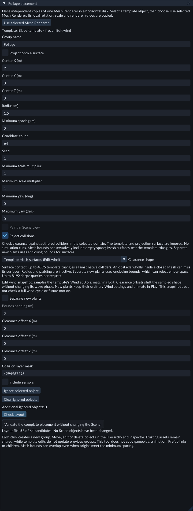

The checked subset fits the frozen wind shape. Bounds padding remains inactive
for triangle surface clearance.

The sample uses each candidate's original world X/Z position for the wave phase.
Moving the disk or changing its seed can change the bend even when the template
looks still. Clearance offsets shift the geometry after wind sampling, so they
do not change its phase. XY projects the sampled shape onto X/Y; original world
Z can affect wind phase, while **Clearance offset Z (m)** remains disabled and
ignored. Disabled Wind or zero amplitude uses the static shape in these profiles.

**Separate new plants** compares conservative bounds around each sampled shape.
It can reject empty space. This is one frozen contact sample, so a later phase,
full wind cycle or moving obstacle can still intersect the plants. It does not
change colliders or promise clearance throughout gameplay. Skinning, morphs and
closed-volume containment remain unavailable. World sphere/circle profiles keep
their independent radius behavior; the older Mesh bounds/static surface choices
still require disabled Wind.

## Add wind

Open **Gallery 157 — Foliage wind** and press **Play → Game**. The left patch sways;
the right patch stays still. The camera, light and shadows are included. Project
C++ is optional for this built-in effect.

1. Stop Play and select the blade template or an individual plant in Hierarchy.
2. In **Inspector → Mesh Renderer**, expand **Wind** and turn on **Enabled**.
3. Set **Amplitude (m)** for the maximum horizontal movement and **Height (m)** for the world height above the object origin where full movement is reached. A base pivot makes a useful plant origin.
4. Set **Direction X** and **Direction Z** for the horizontal world direction. Their relative values choose the direction; increasing both equally does not increase strength. Keep at least one nonzero when amplitude is nonzero.
5. Set **Frequency (Hz)** for cycles per simulation second, **Wavelength (m)** for the distance between repeating waves, and **Phase (°)** for an offset.
6. Save the Scene, then press Play. Pause holds the wind; Step advances it by one fixed tick. Simulation speed also controls its time progression.

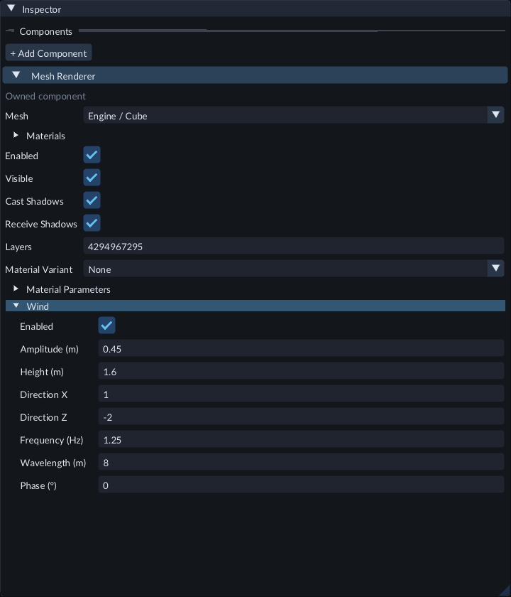

Edit holds a fixed wind preview. A particular phase can look straight; press Play
or change Phase to see another point in the wave. Zero amplitude keeps the original
geometry. Zero frequency holds the time phase; moving an object can still change
its position within the wave.

During Play, select the object and expand **Live gameplay → Mesh Renderer → Wind**.
The colored panel marks temporary values. Numeric edits commit with Enter. Stop
restores the authored settings. To keep a change, choose **Keep values after
Stop...**, stop Play, review it and choose **Apply to Scene**. Wind is one complete
reviewed property and one Scene Undo step; Save remains separate.

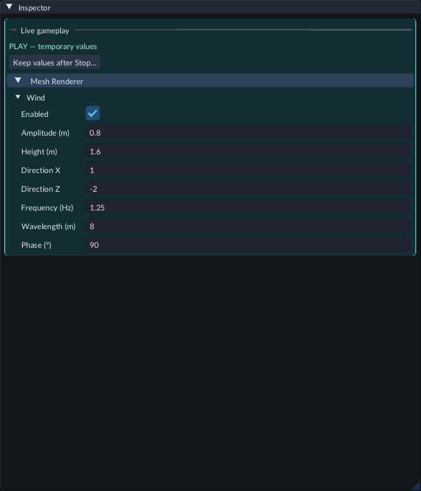

Set Wind on the template before placing foliage to copy it into the new patch.
Existing patches keep their own values when the template changes. Group rotation
does not rotate the world wind direction. Geometry, shading, shadows and picking
follow the displaced vertices; authored transforms and colliders stay fixed.
Use enough Mesh subdivisions for the bend you want: a coarse blade has straight
edges between its displaced vertices.

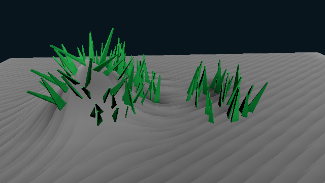

Wind supports static Mesh geometry. Active skinning and morph targets cannot be
combined with nonzero wind. Amplitude is 0–100 m, Height is 0.01–10000 m,
Frequency is 0–60 Hz, Wavelength is 0.1–10000 m and Phase is -360–360°.
Each direction component is finite within ±1000000. Active wind object origins
must stay within ±1 billion world meters on each axis. Export a saved Scene with
the matching runtime kit supplied with the editor; an older kit without wind
support is rejected. Wind needs no extra file or placement task during gameplay.

## Edit, save and export

Expand the group in the **Hierarchy** to select individual objects. Move or rotate
the group to transform the whole patch. Use the **Inspector** to edit a child.
Changing the template entity does not update existing patches. Mesh and Material
assets remain shared, so editing those assets follows their usual behavior.

**Scene Undo** removes an entire placement in one step; **Redo** restores the same
objects. Save the Scene to keep the patch. Normal Play and **Export Game** use the
placed objects and their existing asset references. The placement tool is disabled
during Play and active tasks that lock Scene edits. Tool choices are session-only;
they are not a saved procedural recipe.

Open **Gallery 144 — Foliage placement** for a tapered blade Mesh, two seeded patches
and a moving foreground marker. Select its template to make another patch. The
Mesh source opens in the ordinary editable Mesh tools.

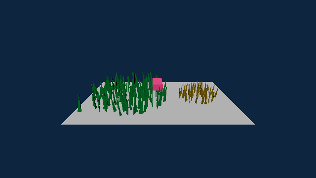

Gallery 144 uses one original blade Mesh with its pivot at the base. Each patch is
an ordinary group that you can expand, edit, save and export.

## Troubleshooting and limits

If the requested count cannot fit, increase the radius, reduce spacing/count or
change the seed. The failed placement creates no objects. A corrected successful
check or placement clears the tool's Problem entry. The whole Scene remains limited
to 10,000 entities and the normal command data budget.

Spacing compares new origins in the current group. Mesh bounds can overlap, and
existing objects require **Reject collisions** and enabled colliders in the selected
domain to affect clearance. **Separate new plants** uses the selected volumes between
retained new candidates. Increase the clearance radius or bounds padding to leave
more room, or reduce it to keep more plants. Heightfield mode requires upright terrain with positive Y scale;
static Mesh mode supports the bounded published triangle profile above. Brush
strokes use the limits described above; live surface links and world streaming
are unavailable. Adjust objects with the normal
Scene tools. Very large coordinates still have the limits of their consuming
renderer, collision and navigation systems.

At very large centers, world positions have less precision. The layout checks
spacing after that rounding. A dense request can fail when too few distinct world
positions fit; increase the radius or reduce the count.
