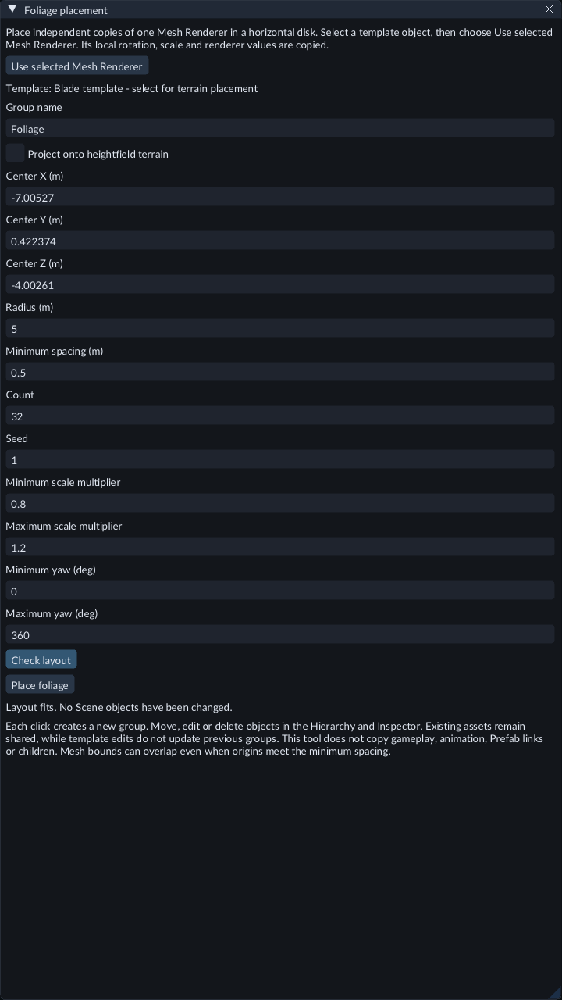
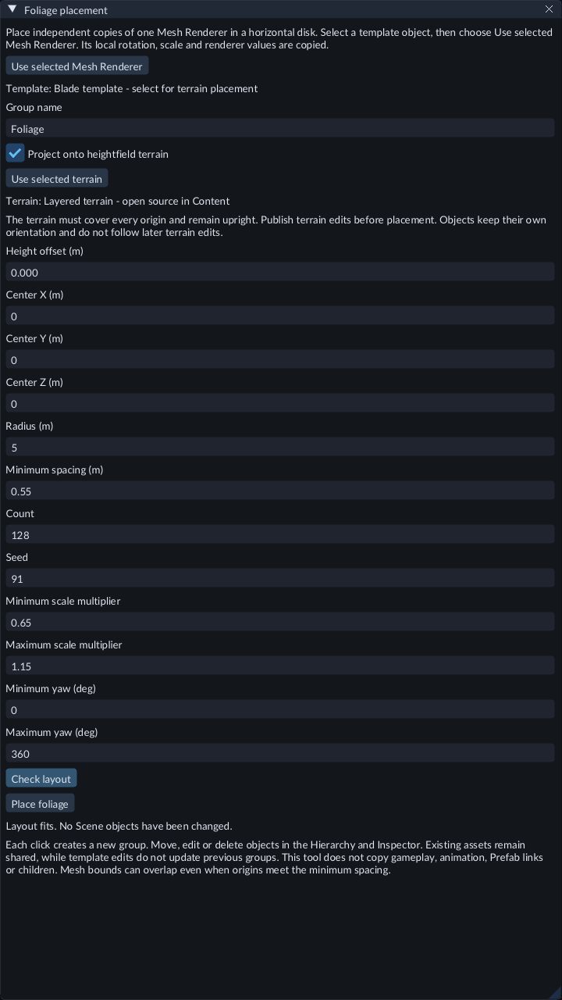
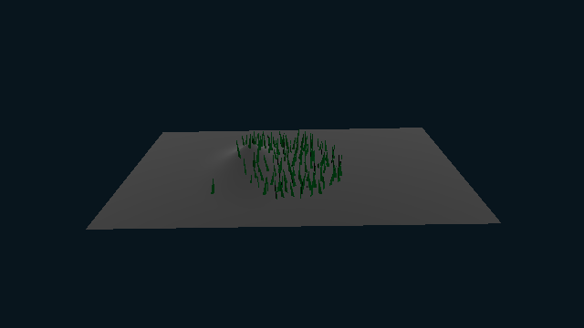
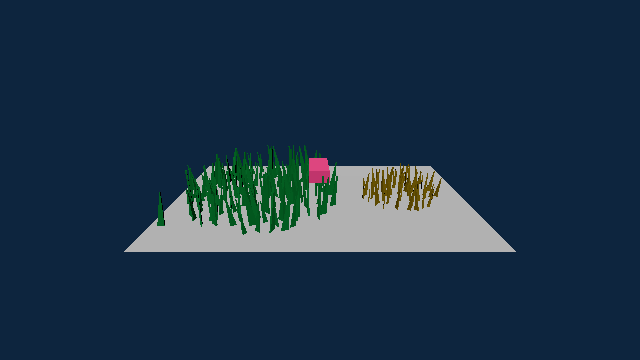

# Place foliage

Use **Tools > Foliage placement...** to place independent copies of one Mesh
Renderer in a horizontal disk, using a plane or a published heightfield terrain.
Each placement becomes an ordinary object in a
named group, ready for the Hierarchy, Inspector, Scene Save and game export.

## Choose the template

1. Place or create an object with a **Mesh Renderer** and assign its Mesh.
2. Set its local rotation and scale. Assign the materials, numeric material values, layers and shadow options you want on the new objects.
3. Select the object in the Hierarchy, open **Tools > Foliage placement...**, and click **Use selected Mesh Renderer**.

The tool starts the disk center at the template's world position. It copies the
Mesh Renderer and the template's local rotation/scale. It does not copy gameplay,
colliders, animation, children or Prefab links. A model's skin/animation instance
is not created by this tool. The template remains in the Scene. Parent transforms are not copied; use an
unparented template when you want its visible rotation and scale to match exactly.

## Set the layout

Enter the new **Group name**. Set these controls:

- **Center X (m)**, **Center Y (m)**, **Center Z (m)**: World center of the new group. With terrain projection off, every new origin uses the same Y. With projection on, Y sets the group's origin; terrain and Height offset set the child heights.
- **Radius (m)**: Horizontal disk radius, from 0.01 to 1000 meters.
- **Minimum spacing (m)**: Minimum horizontal distance between new origins in this group. Zero permits any spacing.
- **Count**: 1 to 512 objects per placement.
- **Seed**: 0 to 4294967295. Change it for a different layout.
- **Minimum scale multiplier**, **Maximum scale multiplier**: Random uniform multiplier of the template's local scale. Each value is 0.01 to 100; maximum must be at least minimum.
- **Minimum yaw (deg)**, **Maximum yaw (deg)**: Rotation about world +Y before the template's local rotation. Use -360 to 360 degrees; maximum must be at least minimum.

Choose **Check layout** to validate all settings without changing the Scene.
Choose **Place foliage** to create and select the group. Each click creates a new
group, including when you reuse the same seed. Equal settings reproduce the layout
with new independent object identities.

With projection off, the controls describe a horizontal origin plane. Choose a
Mesh whose pivot is at its base when each plant should rest on the surface at
every scale.

## Place onto a heightfield

Open **Gallery 147 — Terrain foliage** to see 128 blades resting on the layered
terrain. They are ordinary objects with saved heights, ready for Play and export.

1. [Create or open a heightfield terrain](terrain.md), save and publish it, and place its Mesh in the Scene. Keep it upright: rotation about Y and scaling are supported, with positive Y scale.
2. Choose the foliage template with **Use selected Mesh Renderer**. Enable **Project onto heightfield terrain**.
3. Select the terrain's Mesh Renderer in Hierarchy, then choose **Use selected terrain**. The template and terrain have separate selections.
4. Set **Center X (m)**, **Center Z (m)** and **Radius (m)** so every new origin lies over a terrain tile. Set **Height offset (m)** from -1000 to 1000; zero places origins directly on the published surface. **Center Y (m)** controls the group pivot rather than moving the projected origins.
5. Choose **Check layout**, then **Place foliage**. Save the Scene. Undo removes the entire new patch in one step.

The template stays separate while the selected terrain supplies each new origin's height.

Projection uses the published surface. Save and publish terrain edits before
placing a patch; unsaved source drafts are not used. If a saved source differs
from its published Mesh, preparation stops until it is published again. Every
origin must be covered; a disk crossing missing tiles or the outer edge can fail
without creating objects. Move its center or reduce its radius.

Objects retain their template orientation; yaw rotates about world +Y. This does
not align plants to slopes. Heights are copied at placement.
Later terrain movement or sculpting does not update old patches. Place a new patch
or adjust the ordinary objects when the ground changes.

Gallery 147 uses the existing blade Mesh and heightfield with saved, independent plant transforms.

## Edit, save and export

Expand the group in the **Hierarchy** to select individual objects. Move or rotate
the group to transform the whole patch. Use the **Inspector** to edit a child.
Changing the template entity does not update existing patches. Mesh and Material
assets remain shared, so editing those assets follows their usual behavior.

**Scene Undo** removes an entire placement in one step; **Redo** restores the same
objects. Save the Scene to keep the patch. Normal Play and **Export Game** use the
placed objects and their existing asset references. The placement tool is disabled
during Play and active tasks that lock Scene edits. Tool choices are session-only;
they are not a saved procedural recipe.

Open **Gallery 144 — Foliage placement** for a tapered blade Mesh, two seeded patches
and a moving foreground marker. Select its template to make another patch. The
Mesh source opens in the ordinary editable Mesh tools.

Gallery 144 uses one original blade Mesh with its pivot at the base. Each patch is
an ordinary group that you can expand, edit, save and export.

## Troubleshooting and limits

If the requested count cannot fit, increase the radius, reduce spacing/count or
change the seed. The failed placement creates no objects. A corrected successful
check or placement clears the tool's Problem entry. The whole Scene remains limited
to 10,000 entities and the normal command data budget.

Spacing compares new origins in the current group. Mesh bounds can overlap, and
other groups, objects and colliders are not checked. Terrain projection supports
the published heightfield profile. Tilted or vertically inverted terrain, arbitrary
imported surfaces, slope filters, paint strokes, wind and world streaming are not
supported. Place on a suitable surface or adjust objects with the normal
Scene tools. Very large coordinates still have the limits of their consuming
renderer, collision and navigation systems.

At very large centers, world positions have less precision. The layout checks
spacing after that rounding. A dense request can fail when too few distinct world
positions fit; increase the radius or reduce the count.
