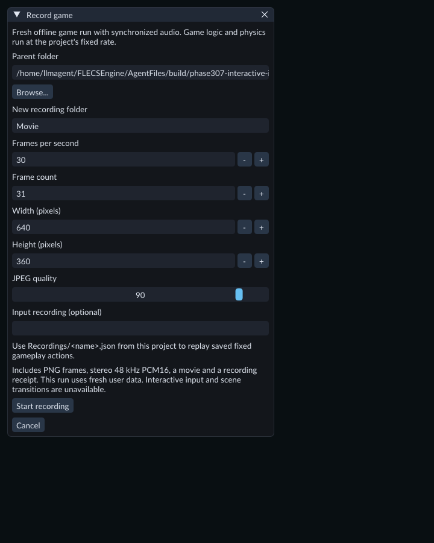
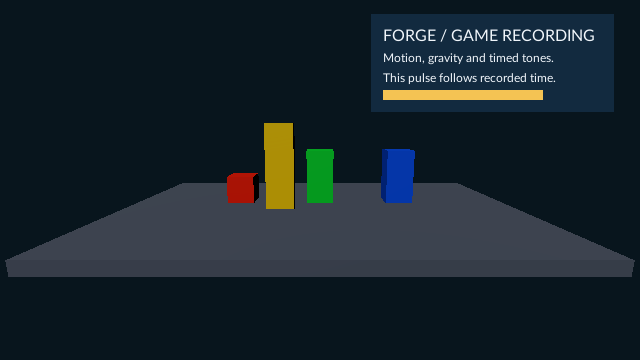

# Record a game movie

Use **Run → Record game…** to record a fresh game run with sound. The recording
runs scene behavior, physics and Project Code at the project's fixed simulation
rate. Its output is an AVI movie with Motion JPEG video and stereo sound.

## Before recording

- Stop Play and finish any pending project operations.
- Save and build changed Project Code. Select the matching **Native SDK folder** in Build and enable the project's game runtime settings.
- Give the scene an enabled game camera and any lighting it needs.
- Check the camera image in Game and the sound in ordinary Play first.

The recording starts a new run using the current scene. It uses a fresh
**UserData** folder inside its output folder. Settings or saves from an earlier
game run are not loaded. Changes made by that run stay in its runtime world;
the authored scene and its Undo history are preserved.
After recording, ordinary Play uses its previous user-data selection.

## Choose the recording

Choose the output and image settings before starting the fresh run.

1. Open **Run → Record game…**.
2. Choose an existing **Parent folder** and enter a **New recording folder** name. Use a new folder for every recording.
3. Set **Frames per second**, **Frame count**, **Width (pixels)** and **Height (pixels)**. For a six-second movie at 30 FPS, use 180 frames.
4. Set **JPEG quality**. Higher values usually retain more image detail and produce a larger movie. The default is 90. To use a [saved gameplay input take](input-recording.md), set **Input recording (optional)** to `Recordings/<name>.json`. Leave it empty for a run without recorded input.
5. Choose **Start recording**. Keep the Game view available while FORGE renders the frames. Recording can take longer or less time than the movie's duration.
6. Wait for **Game movie, PNG frames and PCM saved**, then open **game.avi** in a player that supports Motion JPEG and PCM audio.

FORGE captures the initial game image, then advances the game and mixes sound for
each frame interval. Runtime HUD animation follows recorded presentation time.
The fixed simulation rate remains the one selected in Project Settings; changing
the movie's FPS changes the captured intervals.

## Output and cancellation

The new folder contains:

- **game.avi** — the completed movie with sound.
- **frame-000000.png**, **frame-000001.png**, and subsequent PNGs — full-size captured frames.
- **audio.s16le** — the retained 48 kHz stereo, signed 16-bit audio samples.
- **recording.json** — frame times, simulation ticks, source identity, dates, completion state and any error.
- **UserData/** — data written by this fresh game run.

When you select an input recording, the folder also contains
**input-recording.json**. The receipt records its source identity, tick count and
digest. A selected take must match the fresh runtime's Scene/settings/build,
input map and simulation rate. After its last tick, gameplay input becomes neutral.

Choose **Cancel** to retire the recording. Completed PNGs, audio and the receipt
remain available. A file already being written must finish. A complete movie
already published remains available; an incomplete movie is not published.
Closing the editor stops the recording's Play process and attempts to save its
partial receipt after outstanding file work settles.

## Limits and troubleshooting

Use 1–240 FPS, 1–4,096 frames, dimensions from 1–4,096 pixels per axis and JPEG
quality from 1–100. Audio is limited to 128 MiB; retained PNG/audio snapshots and
the final movie each have a 256 MiB limit. Long recordings or large frames can
reach these limits before the frame-count limit.

This is an offline recording of a fresh run. Interactive input, Pause and scene
changes during recording are unavailable. During capture, a scene change, runtime fault or
authored scene edit stops the recording. Native audio events are sampled in
bounded mixing intervals; they do not have sample-accurate scheduling.
A saved input take can drive gameplay during capture, but does not guarantee
identical game state when native code, random values or external state differ.

If frames do not arrive, check the enabled camera, rendered Game view and asset
diagnostics. Save and rebuild changed Project Code before retrying. If encoding
fails, inspect **recording.json** and the retained PNGs/audio, then choose a new
output folder for the next attempt. Motion JPEG is lossy and needs opaque sRGB
display output; HDR, transparent video and runtime movie playback are unavailable.

Open **FeatureGallery / Scenes / 182-game-recording.scene.json** to try scene
motion, a falling red cube, three timed tones and a moving HUD pulse. A six-second
recording at 30 FPS includes the full sequence. For a silent Timeline preview
instead, use [sequence frame and movie export](animation-sequences.md).

The included scene after one recorded second. The red cube has fallen and the
HUD pulse has advanced with the movie's presentation time.
