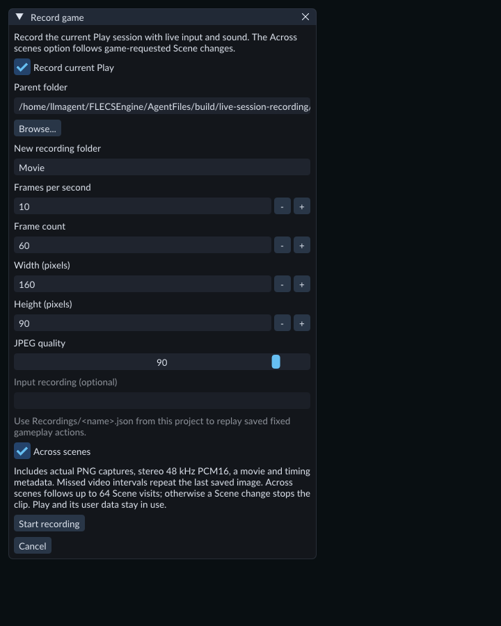
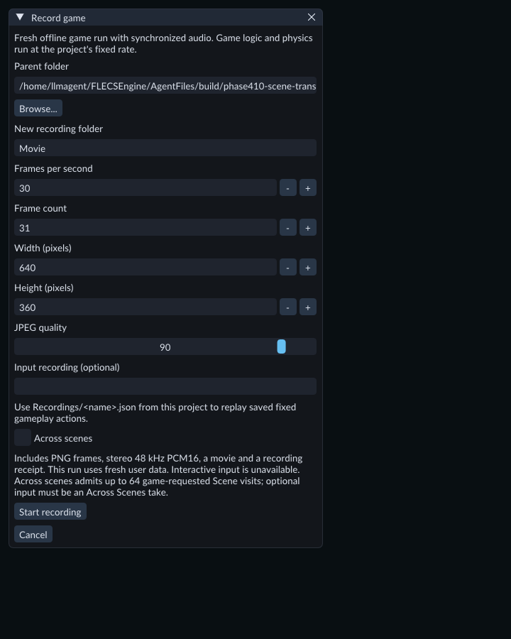
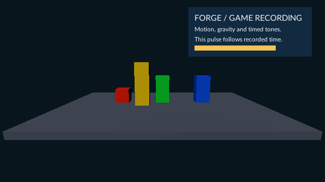

# Record a game movie

Use **Run → Record game…** to save Game output and sound as an AVI movie with
Motion JPEG video and stereo audio. Choose an existing Play session or a fresh
offline run. Both preserve the authored scene and its Undo history.

## Before recording

- Finish pending project operations and save and build changed Project Code.
- Select the matching **Native SDK folder** in Build and enable the project's game runtime settings.
- Give every Scene you will record an enabled game camera and any lighting it needs.
- Check the camera image in Game and the sound in ordinary Play first.

## Record the current Play session

1. Start ordinary Play and wait for Game and its resources to become ready.
2. Open **Run → Record game…**. **Record current Play** is selected when Play is active.
3. Choose an existing **Parent folder** and enter a **New recording folder** name. Use a new folder for every clip.
4. Set **Frames per second**, **Frame count**, **Width (pixels)** and **Height (pixels)**. For a six-second movie at 30 FPS, use 180 frames.
5. Set **JPEG quality**. Higher quality usually retains more image detail and produces a larger movie.
6. Enable **Across scenes** to follow game-requested Scene changes, or leave it off to record only the current Scene.
7. Choose **Start recording** and keep Game visible and its resources ready until recording finishes.

The live options attach to the current Play session. **Across scenes** follows
the game's existing Scene-loading requests. Saved-input selection applies to a
fresh offline run and remains disabled here.

Play continues with its existing world and user data. Capture gameplay input as
usual to interact with the game; Pause and Resume remain available. Recording
ends automatically after the chosen movie duration. Completion or **Cancel**
releases the recording observer and leaves Play running.

Live capture includes the current game's stereo mix. It does not capture the
microphone or other applications. Paused game behavior and sound follow the
project's normal pause policy; the recording duration continues to follow audio
device progress. Selecting a new saved input take during live recording is
unavailable. A replay already running in Play continues normally.

With **Across scenes** off, a runtime Scene change stops the clip and retains
partial output without publishing a complete AVI. The game's Scene change
continues. With **Across scenes** on, the clip follows up to 64 admitted Scene
visits, including the initial Scene and returns to an earlier Scene. Recording does not load those
Scenes itself. Cancelled or rejected loading leaves the current Scene and
recording in use. A recording preparation failure or the visit limit stops only
the recording; ordinary game loading continues.

## Record a fresh offline run

Stop Play before starting this mode. Open **Run → Record game…** and leave
**Record current Play** off. Choose the destination, frame rate, frame count,
image size and quality as described above.

The offline options start a new run using the current authored scene. The run
uses a fresh **UserData** folder inside its output folder. Earlier saves or
settings are not loaded; subsequent ordinary Play keeps its usual user data.

1. Optionally enter **Input recording (optional)** as a saved project path such as **Recordings/MyTake.json**. Leave it empty for behavior that starts without input. See [record and replay gameplay input](input-recording.md).
2. Enable **Across scenes** if game code changes Scenes during the movie. A selected take must have been recorded with **Across Scenes**. Leave the option off for a single-Scene movie.
3. Choose **Start recording** and keep Game visible until the run finishes.

The run starts at tick zero. It captures each image, mixes the matching audio
interval, then advances game behavior, physics and Project Code through the
project's fixed simulation rate. Interactive input and ordinary Pause are
unavailable in this mode. Completion or cancellation stops this recording's run.

**Across scenes** admits up to 64 game-requested Scene visits. Recording waits
for each Scene's resources and presentation. Loading time adds no movie frames
or sound. Each PNG retains its actual Scene, world generation and local tick.
A saved take supplies input; game code must still request its Scene sequence.

## Output and cancellation

The new folder contains:

- **frame-000000.png**, subsequent completed PNG captures and **audio.s16le**.
- **recording.json**, with local start/end timestamps, source and timing details, progress, errors and any complete movie metadata.
- **game.avi** when all planned movie frames and sound have been encoded successfully.
- **UserData** and, when selected, **input-recording.json** for a fresh offline run.

Live recording saves actual PNG captures. If rendering or file work misses a
movie interval, the movie repeats the last eligible saved image. It does not
advance the game to manufacture a missing image. The receipt lists actual
images separately from movie frames, including repeated image references and
observed audio positions. A completed live movie trims its audio to the chosen
movie duration. Live clips across Scenes also list their Scene/source visits
and audio boundaries in **recording.json**. Each actual image retains the Scene
and gameplay tick it showed, including when the movie repeats that image.

Choose **Cancel** to keep completed output without publishing an incomplete AVI.
A file already being written must settle. A complete movie already published
remains available. For an incomplete live clip, retained audio can include the
warm-up prefix or final copied tail; use the receipt's audio source start and
normalization fields when interpreting it. In an offline clip, an already saved
PNG can have no subsequent completed audio interval.

Closing the editor settles detached file work and attempts to save a partial
receipt. Closing a live recording task releases its observer through the Play
owner. The editor's normal shutdown also ends Play. Disk errors can prevent a
receipt from being saved.

## Limits and troubleshooting

Use 1–240 FPS, 1–4,096 frames, dimensions from 1–4,096 pixels per axis and JPEG
quality from 1–100. Movie audio is limited to 128 MiB; combined PNG/audio
snapshots and the final movie each have a 256 MiB limit. Repeated live image
references also count toward the encoder's snapshot budget. Large frames or
long clips can reach a byte limit before the frame-count limit.

Live recording uses observed mixer progress and the available Game image. Editor
transport, rendering and audio-device latency can affect their alignment. It
provides no sample-accurate synchronization guarantee. Its two-second mixer
queue fails capture if the editor cannot drain it quickly enough; completed
output remains available. Offline native audio events are sampled in bounded
mixing intervals and also lack sample-accurate event scheduling.

A Scene change before a pending Game image becomes available stops capture.
Keep Game visible and its resources ready before retrying. Images already copied
can finish saving after a Scene change and retain their original Scene details.

Source edits, runtime faults and process loss stop capture. For offline session
movies, failed or cancelled Scene loading and game-requested Pause or Quit also
stop the run. A saved input take does not guarantee identical game state when
native code, random values or external state differ.

If frames do not arrive, check the enabled camera, visible Game view and asset
diagnostics. Save and rebuild changed Project Code before retrying. If encoding
fails, inspect **recording.json** and retained PNGs/audio, then choose a new folder.
Motion JPEG is lossy and needs opaque sRGB display output. HDR, transparent video
and runtime movie playback are unavailable.

Open **FeatureGallery / Scenes / 182-game-recording.scene.json** to try scene
motion, a falling red cube, three timed tones and a moving HUD pulse. A fresh
six-second recording at 30 FPS includes its full sequence. For a silent Timeline
preview, use [sequence frame and movie export](animation-sequences.md). For an
example that loads another Scene, follow the Room A/Room B setup in
[gameplay input recording](input-recording.md). After verifying that Tab changes
Rooms in ordinary Play, use **Record current Play** with **Across scenes** to
record those transitions while you control the game.

The included scene after one recorded second. The red cube has fallen and the
HUD pulse has advanced with the movie.
