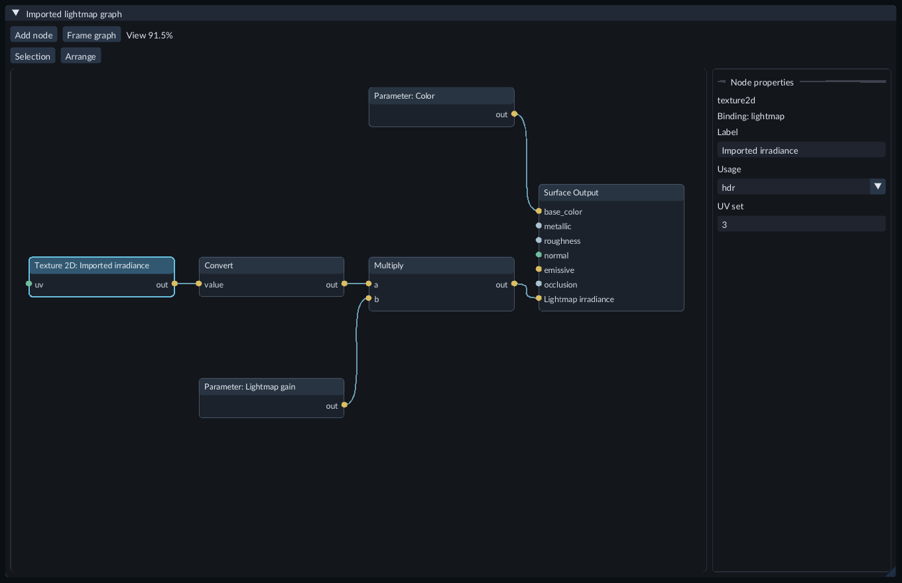

# Use an imported lightmap

An imported lightmap adds saved diffuse lighting to a Mesh material. The image
stores linear incident irradiance: the material's color, metallic value and
occlusion determine how much reaches the final image. A fully metallic surface
has no diffuse lightmap response.

Prepare a lightmap and matching mesh UVs outside FORGE. This workflow requires
the Windows/D3D12 Shader compiler. FORGE does not bake lighting or unwrap meshes
for lightmaps.

## Connect the map

1. Import the image through Content. For a linear HDR map, use an HDR texture variant and confirm it is available in the Texture workspace.
2. Create or open a **Mesh** [Material Graph](material-graphs.md).
3. Add **Texture 2D**. Select its header, choose **Usage → hdr**, and enter the mesh's logical **UV set** number. Keep its stable binding key, such as `lightmap`.
4. Add **Convert**, set **From type → color4** and **Value type → color3**, then connect the Texture output to its Value input.
5. Connect Convert to **Lightmap irradiance** on Surface Output. Leave this port unconnected for no imported-lightmap contribution.
6. To expose intensity, add a **Parameter** with **Value type → color3** and Value `(1, 1, 1)`. Give it a label such as Lightmap gain. Multiply it by the converted map and connect that result to **Lightmap irradiance**.
7. Choose **Save & Compile**, then wait for Shader publication to finish.

The Texture's usage and UV set describe how the material samples the imported map.

## Assign and adjust it

Create or open a [Material](materials.md), select the compiled graph in
**Surface Shader**, and assign the imported Texture to its lightmap slot. Use
that slot's UV offset, scale and rotation for an atlas region. Save the Material
and assign it to the intended Mesh slot in Inspector.

Change the gain parameter in the Material for a shared value. Use **Object
material values** in Inspector for a value belonging to one Mesh. During Play,
numeric overrides use the **Live gameplay** controls and the normal Keep
workflow. Save authored values before exporting.

The map remains visible when Scene environment intensity is zero. Direct lights,
environment lighting and local diffuse probes still add their own contributions.
Avoid baking a source into the map and adding that same lighting again at runtime.
Emission remains a separate Surface Output input.

## Test and export

In the packaged Feature Gallery, open `158-imported-lightmaps`. Its three cubes
share one Material and compare gains zero, one and two, without a Scene light.
The small original HDR image illustrates irradiance; it is not a bake of that
scene. The source checkout requires **Save & Compile** on its Shader and saving
its Material before playing.

Save the Shader, Material and Scene, then use [Export Game](runtime-content.md) with a
current matching runtime kit. An older kit that cannot render the Shader is
rejected. The exported game uses cooked data and does not need the graph editor
or source compiler.

If the map is missing, confirm its imported usage matches the Texture node and
Material binding. Check the mesh's UV channel and atlas transform. A missing UV
set can trigger the mesh's existing fallback or diagnostic. Negative, non-finite
or overflowing irradiance gives the shader's diagnostic color; supply finite,
nonnegative linear values. An unconnected Lightmap irradiance input or zero gain
produces no added baked light.
