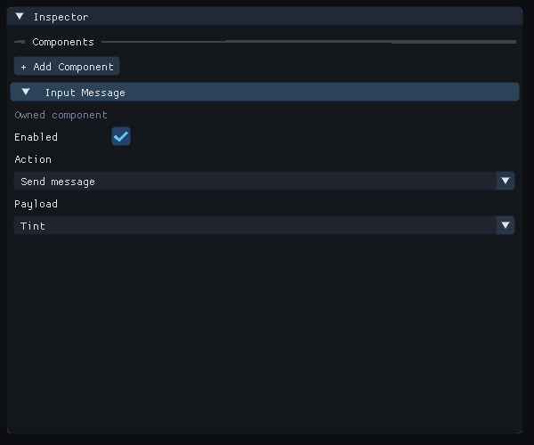

# Send component data from an input action

An Input Message sends a copy of an entity's component data when a digital input
action is pressed. A C++ observer receives the copy and can change the running
game. Holding the action sends once; a fresh press sends again.



Choose a saved Action and an attached Payload in Input Message.

## Prepare the source

1. Open Project Settings and create a digital input action, such as Send message, bound to key.space. Save the settings. Use a fixed input context if your project uses contexts.
2. Select an entity in Hierarchy. Attach or configure the component whose data you want to send. Builtin components and inspected, opted-in C++ components are supported, including inherited prefab values.
3. In Inspector, choose Add Component, then Gameplay, then Input Message.
4. Leave Enabled checked. Choose the saved action under Action. Choose the attached component under Payload.
5. Save the scene. These selections use the usual Undo, Redo and prefab overrides.

Action lists digital actions in fixed input contexts. Payload lists registered
components already attached to the entity. None leaves the emitter unassigned.
An Unavailable selection retains its saved ID or key; restore the missing action
or component, or select a replacement. Input Message cannot select itself.

## Receive the message in C++

For example, a Local Translation payload can be received by a native observer:

```cpp
world.observer("gameplay.PositionMessage")
    .event<forge::LocalTranslation>()
    .with(flecs::Any)
    .each([](flecs::iter& it, std::size_t row) {
        const auto* value = it.param<forge::LocalTranslation>();
        if (!value)
            return;
        auto next = *value;
        next.x += .5;
        it.entity(row).set<forge::LocalTranslation>(next);
    });
```

Register this observer through your project's C++ startup function and build the
matching module before Play. Include forge/transform_components.hpp for this
example. Use the actual registered native type for a project component. The
event's source is the entity with Input Message, including a prefab instance.
Treat the received value as read only, use it during the callback, and do not
throw from observers. The copy is released when dispatch finishes. Check source
identity when an observer should apply to only one scene or set of entities.

## Test and export

1. Open Feature Gallery scene Scenes/150-input-messages.scene.json for a complete example with a Camera, light and two message sources.
2. In Build, open C++ setup and choose Set up C++ code if needed. In Content, choose Create / Register, C++, System. Name it InputMessages and choose Component: None (empty registration). Create and open the file.
3. Open the bundled CodeExamples/InputMessages.cpp in a text editor. Replace the new Native/Systems/InputMessages.cpp contents with that example, save source and choose Build Project Code. Its matching registration function is forge_register_system_InputMessages. Keep the scene's existing input action and Input Message selections.
4. Press Play, open Game, capture gameplay input and press Space. Both cubes move half a unit to the right for each fresh press, wrapping back at the end of their range. Holding Space does not keep moving them.
5. Open Console, expand Gameplay input and inspect Input messages and Sent total. The total and last sent tick retain a brief dispatch between editor frames. Sent means the event was sent; visible behavior also requires the observer. A missing action, payload or unsupported value reports a diagnostic here.
6. Stop Play, save your authored scene and project settings, then export with the matching runtime and module kits. The exported game uses the same action and observer. Test fresh presses after opening the exported game.

Pause freezes dispatch. Step runs one fixed tick; normal input-capture release
and clock controls can neutralize pending physical input. Resume, capture input
and make a fresh press when testing with the editor's clock controls. Runtime
changes disappear when that runtime is replaced; save configuration in Edit.

## Current limits

Messages run before fixed C++ gameplay systems. All payloads for a tick are
copied before callbacks. Normal structural changes requested by observers become
visible after this batch, before gameplay systems. A source scheduled for
deletion still sends its already captured message.

Only digital actions in fixed contexts are supported. State Conditions and
disabled entities suppress dispatch. At most 256 sources are considered per tick;
Console reports overflow. Each payload must fit the 64 KiB value envelope and all
copies together must fit 4 MiB per tick. Unsupported raw pointers, resource owners
and unregistered project types cannot be selected. Messages have no saved
history, background delivery or replay after a runtime restart.

See [input and capture](input.md), [C++ components and systems](native-gameplay.md)
and [exporting a game](runtime-content.md).
