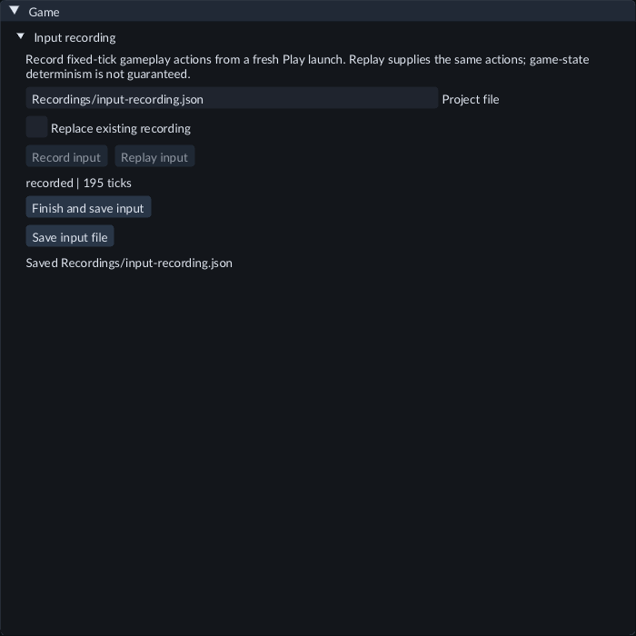

# Record and replay gameplay input

Use input recording to save the gameplay actions consumed during a fresh Play
session, then supply those same actions to another fresh session. Your project
needs an input map and gameplay that uses its actions.

The controls show the saved file and recorded tick count. Stop Play before
starting **Replay input**.

1. Save the Scene and project settings. Save and build any changed Project Code.
2. Stop Play, open **Game**, and expand **Input recording**.
3. Set **Project file** to `Recordings/<name>.json`.
4. Click **Record input**. FORGE starts a fresh session and begins recording before the first fixed simulation tick.
5. Use **Capture gameplay input** to send controls to the game. Play normally.
6. Click **Finish and save input** before stopping Play. Saving creates the project's `Recordings` folder. Enable **Replace existing recording** only when you want to replace an earlier take.
7. Stop Play. Click **Replay input** with the same file selected.

The status shows the recording mode and tick count. Replay supplies saved
gameplay actions and ignores physical gameplay input. After its last tick, input
becomes neutral. Stop Play to return to ordinary physical-input control.

Pause does not add recording frames. Step adds one fixed tick using the input
admitted by the current Play host. Relative motion and digital edges are saved
as the game consumed them. UI controls and text entry are outside this profile.
Runtime Inspector edits and clock controls are not part of the saved take.

## Saving and troubleshooting

**Save input file** saves the retrieved document again, for example after choosing
another name or explicitly allowing replacement. Save before Stop: stopping the
runtime discards any recording that has not been retrieved and saved.

To make a movie using a saved take, stop Play and open **Run → Record game…**.
Set **Input recording (optional)** to its `Recordings/<name>.json` path and choose
the movie settings. The movie uses those fixed gameplay actions and retains a
copy of the take. See [Record a game movie with sound](game-recording.md).

Recording stops at 4,096 ticks or 8 MiB, whichever comes first. Its status reports
the limit reached. Use **Finish and save input** to save that completed prefix.
If a runtime input-map change ends capture, this control can also save the
nonempty prefix recorded before the change.

Replay requires a fresh launch with the same Scene, saved settings, engine/SDK
build, input map and simulation rate. If admission fails, the error appears in
the input-recording controls. Reopen the matching source or make another take.

Input replay does not guarantee identical game state. Randomness, saves,
imported assets, asynchronous work and native gameplay can affect the outcome.
This profile does not record Scene transitions or restore a running game's C++
state. Recording files are project files outside the Content asset catalog;
they are not automatically included in an exported game. Movie recording is a
separate workflow: see [Record a game movie with sound](game-recording.md).

Open **FeatureGallery / Scenes / 209-input-recording.scene.json** to try recording
the Space action and viewing its counts in Console / Gameplay input. To see the
cube move on each recorded press, build the included `InputMessages` C++ System
using the [Input Message instructions](input-messages.md) before making the take.
