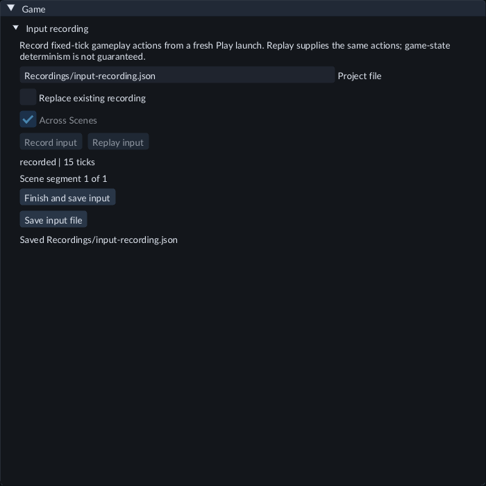

# Record and replay gameplay input

Use input recording to save the gameplay actions consumed during a fresh Play
session, then supply those same actions to another fresh session. Your project
needs an input map and gameplay that uses its actions.

The controls show the saved file and recorded tick count. Stop Play before
starting **Replay input**.

1. Save the Scene and project settings. Save and build any changed Project Code.
2. Stop Play, open **Game**, and expand **Input recording**.
3. Set **Project file** to `Recordings/<name>.json`.
4. Leave **Across Scenes** off for a take of the current Scene, or enable it for an interactive C++ game that loads other Scenes. Click **Record input**. FORGE starts a fresh session and begins recording before the first fixed simulation tick.
5. Use **Capture gameplay input** to send controls to the game. Play normally.
6. Click **Finish and save input** before stopping Play. Saving creates the project's `Recordings` folder. Enable **Replace existing recording** only when you want to replace an earlier take.
7. Stop Play. Click **Replay input** with the same file selected.

The status shows the recording mode and total tick count. Replay supplies saved
gameplay actions and ignores physical gameplay input. After its last tick, input
becomes neutral. Stop Play to return to ordinary physical-input control.

Pause does not add recording frames. Step adds one fixed tick using the input
admitted by the current Play host. Relative motion and digital edges are saved
as the game consumed them. UI controls and text entry are outside this profile.
Runtime Inspector edits and clock controls are not part of the saved take.

## Record across Scenes

**Across Scenes** requires interactive SDK Play with Project Code and game runtime
settings enabled. Select it while Play is stopped. Game-requested Scene changes
retain one take, with a separate segment for each visit. Returning to a Scene adds
a new segment; it does not resume that Scene's old runtime state.

Replay selects the profile stored in the file; the checkbox only affects new
recordings. Start with the original first Scene and matching source. Your game
must request the same later Scenes. FORGE finishes the current segment before
accepting the next Scene, then checks its identity and source. If loading takes
longer, **Waiting for the next recorded Scene to load** appears. Fixed gameplay
ticks wait while loading and editor controls continue. Step cannot cross this
boundary. Pause and time scale retain their usual controls.

Use **Cancel replay** to leave a replay, including one waiting for a missing or
mismatching Scene. Gameplay input stays neutral after cancellation; Stop and start
Play to use physical gameplay input again. A failed next-Scene check preserves
the current world and take. Correct the Scene/settings/code and start another
fresh replay rather than forcing a different Scene into the recorded sequence.

### Try the two-Scene example

1. Open **FeatureGallery / Scenes / 235-session-input-a.scene.json**.
2. Set up Project Code and create an empty C++ System named **SessionInput**. Replace its source with the bundled **CodeExamples/SessionInput.cpp**, then save it.
3. In the module's **Native/gameplay.cpp**, add a dependencies array containing `forge.input`, `forge.transforms` and `forge.game`; use that array and count `3` in its descriptor. Set both capability fields to `FORGE_SDK_GAME`. Keep the generated component/system registrations. Save and build Project Code with the matching SDK.
4. Stop Play, select **Across Scenes** and choose **Record input**. Capture gameplay input. Space moves the cube; Tab loads Room B. Press Space again, then Tab to return to Room A. Each room visit starts from its authored cube position.
5. Finish and save, Stop, then choose **Replay input**. The recorded actions move the cubes and request the same room changes. The Scene segment count shows each visit.
6. For standalone testing, save Room A as Startup Scene and export with the matching runtime and module kits. The Scenes declare each other as runtime dependencies, so both are included. The exported game supports the Space/Tab behavior; input recording itself uses the editor's Play controls.

The optional System is scoped to these two Scenes and their message sources.
Use your own stable Scene/entity references when adapting the behavior.
After editing either Scene, select that Scene asset in Content, open **Runtime
Dependencies** in its Inspector and save the reviewed dependency list before
exporting. The saved review must match the current Scene source. See
[runtime content](runtime-content.md).

## Saving and troubleshooting

**Save input file** saves the retrieved document again, for example after choosing
another name or explicitly allowing replacement. Save before Stop: stopping the
runtime discards any recording that has not been retrieved and saved.

To make a movie using a saved take, stop Play and open **Run → Record game…**.
Set **Input recording (optional)** to its `Recordings/<name>.json` path and choose
the movie settings. The movie uses those fixed gameplay actions and retains a
copy of the take. Enable **Across scenes** in the movie options for an Across
Scenes take; leave it off for a single-Scene take. Game code must request the
recorded Scene visits. See [Record a game movie with sound](game-recording.md).

Recording stops at 4,096 total ticks, 8 MiB or 64 Scene segments, whichever limit applies first. Its status reports
the limit reached. Use **Finish and save input** to save that completed prefix.
If a runtime input-map change ends capture, this control can also save the
nonempty prefix recorded before the change.

Replay requires a fresh launch with the same Scene, saved settings, engine/SDK
build, input map and simulation rate. If admission fails, the error appears in
the input-recording controls. Reopen the matching source or make another take.

Input replay does not guarantee identical game state. Randomness, saves,
imported assets, asynchronous work and native gameplay can affect the outcome.
Across Scenes stores the expected Scene visits and their fixed input. It does
not record control-phase actions, loading durations or arbitrary native state.
Ordinary runtimes support single-Scene takes. Recording files are project files outside the Content asset catalog;
they are not automatically included in an exported game. Movie recording is a
separate workflow: see [Record a game movie with sound](game-recording.md).

Open **FeatureGallery / Scenes / 209-input-recording.scene.json** to try recording
the Space action and viewing its counts in Console / Gameplay input. To see the
cube move on each recorded press, build the included `InputMessages` C++ System
using the [Input Message instructions](input-messages.md) before making the take.
