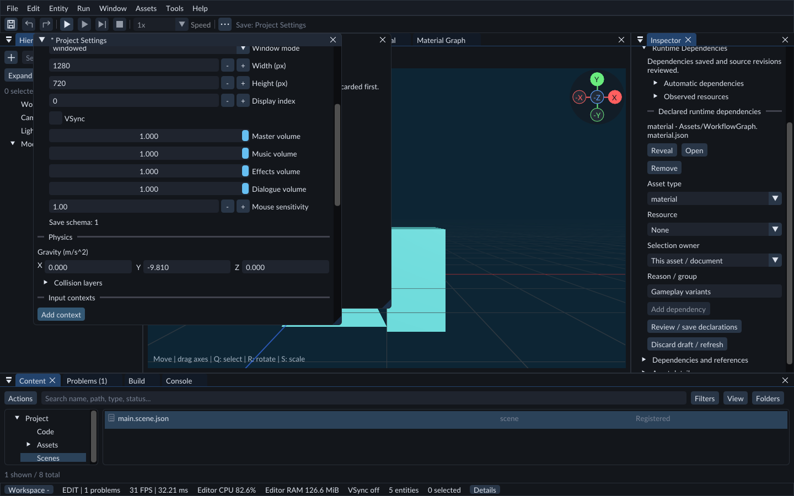

# Gameplay input

Input actions give your project named controls with stable identities. They are separate from editor shortcuts. Runtime systems read these values. Your gameplay code decides how they move a character or camera.



Open Input contexts in Project Settings to add and configure a context.

## Test a button without writing code

1. Stop Play. Open **Tools → Project Settings**.
2. Click **Add action**, expand **New action**, and name it `Test jump`.
3. Keep **Kind: digital** and **Control: key.space**. Click **Save Settings**.
4. Open Console and expand **Gameplay input** after starting Play.
5. In the Game panel, click **Capture gameplay input**.
6. Press and hold Space. The action shows **held**, and **presses** increases once.
7. Release Space. It shows **up**, and **releases** increases once.
8. Press **Esc** to release the physical relative mouse capture. The SDK play path ships the Escape down/up to your gameplay module BEFORE the neutral edge, then retains logical menu routing so runtime menu keys keep working; the legacy path only releases.

Action names are labels. Renaming an action preserves its ID. Removing it and adding a new action creates a new ID, even if the labels match.

## Pause and Step

While gameplay input is captured:

- **F6** pauses or resumes.
- **F7** advances one tick while paused.
- **Esc** releases the physical relative mouse capture. The SDK play path ships the Escape down/up to gameplay BEFORE the neutral edge so the runtime's release-guard sees the actual physical state, then retains logical menu routing so runtime menu keys keep working; the legacy path only releases the capture. Whether the game opens Pause or its in-game menu on Escape is project policy; FORGE does not decide for you.

Pause, hold Space, then press F7 twice. The first tick consumes the press; the second still shows held without adding another press. Release Space and Step again to consume its release. While paused, the monitor continues showing the last completed tick until you Step or Resume.

Held values can apply to every catch-up tick. Press/release edges apply once. A quick press and release before a tick retains both edges; multiple identical edges within one tick interval coalesce into its boolean flags. Mouse movement and wheel deltas are accumulated and consumed on one tick, then return to zero.

## One-dimensional and two-dimensional actions

Choose **axis1** for one value or **axis2** for an X/Y pair. Each binding contributes its control value multiplied by **x** and **y**.

For a two-dimensional movement action, use four bindings:

- **key.a:** x = -1, y = 0.
- **key.d:** x = 1, y = 0.
- **key.w:** x = 0, y = 1.
- **key.s:** x = 0, y = -1.

Continuous axes are clamped; two-dimensional continuous input is normalized if its length exceeds one. Relative mouse deltas are not normalized. Mouse delta units are SDL motion units, and wheel values are scroll units; they are not automatically multiplied by frame time.

Gamepad controls use **pad.** names. FORGE starts with the first connected gamepad. A deliberate button press or strong stick movement on another connected pad selects it; a short guard prevents rapid switching. Sticks range from -1 to 1; triggers from 0 to 1. Set **deadzone**, such as `0.2`, to ignore small stick movement; the remaining range is rescaled. Digital actions can also use a directional analog threshold or a wheel pulse. C++ can request bounded controller vibration. Sensors and multiple-player device assignment remain unavailable.

## Who owns the controls?

Outside capture, keyboard/mouse input belongs to the editor: camera navigation, shortcuts and text fields keep their normal behavior. Capture is explicit in the Game panel during Play. While captured, keyboard/mouse clicks go to gameplay, with Esc/F6/F7 reserved. In pointer mode, clicking outside the Game image releases capture and sends the click to the editor.

For mouse-look gameplay, enable **Relative mouse** before clicking **Capture gameplay input**. The pointer is hidden and motion continues without hitting the edge of the screen. Press **Esc** to release it. The SDK branch keeps menu routing intact and also forwards the Escape down/up to gameplay; the legacy branch releases without forwarding edges. Release capture and turn **Relative mouse** off to operate runtime menus with a pointer. Focus loss and Stop also release relative capture; returning focus does not recapture it automatically.

The runtime's initial menu-routing acquisition requires the Game panel to actually hold editor focus, not merely be visible. Clicking another editor panel (Scene / Console / Hierarchy / Asset) while the Game panel is still visible surrenders routing: the runtime menu keys stop reaching the Rml tree and reach the focused editor panel instead. Returning focus to the Game panel by clicking inside it re-arms menu routing on a fresh focused frame. OS focus return (Alt-Tab back) alone does NOT re-arm routing — click into the Game panel to retake it.

Surrender and return are normally driven through the pause menu: press **Esc** to pause (the editor leaves relative-mouse mode and switches to a pointer cursor), click on an editor control that does NOT replace the Game panel (the Hierarchy panel's **Expand all** button, the Console **Clear log** button, the Hierarchy search bar, or any panel header — Scene / Game are sibling tabs in the default dock, so clicking tab:Scene hides Game and breaks the surrender flow). The runtime menu keys must stop reaching the Rml tree (a Tab press should NOT navigate the menu). Returning requires clicking the live pause menu's **Capture gameplay input** button — clicking the Game tab while paused does not re-engage relative mouse mode and does not enable menu navigation; only the Capture button does. After re-engaging, Tab navigates the menu again. The pause menu's **Resume** button resumes gameplay with relative mouse mode on.

Focus loss, capture release, device disconnect and play-process restart neutralize input. Pending presses and mouse deltas are cleared so they do not fire later. Held controls must be released and pressed again after regaining capture. A live module replacement also clears runtime input at its load boundary.

Input queues are bounded. Overflow releases controls and reports a message rather than replaying an unlimited backlog. This is live local input delivery, not deterministic replay or networking.

See also [Project settings](project-settings.md), [Play mode](play-mode.md), and [Keyboard shortcuts](shortcuts.md).

## Game HUD input

In pointer mode, [Runtime UI](runtime-ui.md) receives captured Play input before gameplay actions. Relative-mouse mode sends motion/buttons to gameplay; release it before using pointer-driven HUD controls. Typing in a HUD field should not move the player. Escape releases physical capture and (with the SDK play path) forwards the Escape edges to gameplay; F6 and F7 remain available. UI capture clears held gameplay controls; release/repress keys when returning to gameplay.

## Input contexts and player rebinding

An input context groups controls for one activity, such as gameplay or a menu.
Use context priority and control consumption: a menu can
reserve its controls while gameplay is inactive. Switching contexts clears held
input so a press cannot carry into the next activity.

The binding API can clear or replace an action's controls, report conflicts and
listen for a new key, mouse button or gamepad control. Escape cancels listening.
The [reference game](../reference-game.md) exercises these operations in its
Options screen. Game settings are stored for the current operating-system user;
rebinding does not edit the project's default input map.

## Author input contexts

Open **Project Settings**. For a project using the older action map, choose
**Enable input contexts**. Existing actions keep their IDs and bindings and enter
an initially active **Gameplay** context. Changes remain a draft until **Save Settings**.

**Add context** creates an inactive context. Its **Priority** determines routing:
higher values run first; equal values use the displayed declaration order.
**Consume controls** blocks those controls in lower-priority contexts. Clear it
for deliberate pass-through. **Initially active** sets the state of a new world.
Gameplay code can change active contexts through the session service.

Choose **Fixed simulation** for movement and other simulation actions, or
**Control frame (menus)** for the standalone host's paused-menu callbacks.
Each action has a **Context** selector. Reassign its actions before removing a
context; the last context cannot be removed. Press **Enter** to confirm a unique
context name. Renaming updates project action
references, but gameplay code using the old name must be updated separately.

For stick bindings, **Radial deadzone** uses the stick's circular magnitude.
Digital actions can use **Press threshold** and **Negative direction** on analog
controls. Mouse movement cannot be a digital binding. Save validates the complete
candidate; invalid or duplicate bindings leave the previous project settings intact.

## Tune analog stick and trigger response

1. Open **Project Settings**, expand an action, and choose a gamepad stick axis or trigger for its binding.
2. Set **deadzone** to ignore movement near the center. For a stick, enable **Radial deadzone** to preserve its direction while conditioning its circular magnitude.
3. Set **Outer deadzone** to reach full output before the physical limit. For example, `0.1` reaches full output at 90% travel. Inner and outer deadzones must leave positive travel between them.
4. Set **Response exponent**: `1` is linear, `2` gives finer control near the center, and values below `1` respond faster. The supported range is `0.1` to `8`.
5. Save Settings, then Play. Open Console and expand **Gameplay input** to inspect the action's X/Y values as you move the stick or trigger. Export uses the saved settings and the same action mapping.

Conditioning happens before x/y contribution scales and before a digital action's
**Press threshold**. Negative axis values keep their sign. Keyboard/buttons and
relative mouse input use their existing behavior and do not expose these controls.
Choosing another physical control or committing a player rebind resets the previous
conditioning so analog settings cannot carry over onto a keyboard button.

For example, with inner deadzone `0.2`, outer deadzone `0.1` and exponent `2`, a
one-axis input of `0.55` produces `0.25`. With matching radial settings on both
stick axes, input `(0.33, 0.44)` produces `(0.15, 0.20)` and keeps its direction.

When Game defaults are configured, **Stick inner deadzone** and **Trigger inner
deadzone** replace the corresponding binding's inner value at runtime. Player
preferences can override those defaults.
Their effective inner and outer values must still leave positive travel. A
conflict is rejected while the previous settings remain active. Clear or reduce
the outer deadzone when a larger inner deadzone is needed.

## Add controller vibration in C++

Connect a gamepad that supports vibration. Your C++ module needs the `forge.game`
dependency and `FORGE_SDK_GAME` capability. Use a control callback for feedback
that should also work in a pause menu.

1. Submit a `game_request` object like the example below. Strengths range from0 to1; duration is an integer number of real milliseconds, up to5000.
2. Keep its returned token, poll `game_inspect`, and release the receipt with `game_release` when it finishes. Missing or unsupported controllers produce a failed receipt; continue the game without vibration.
3. Build your C++ source and Play. Keep the Game panel visible and focused, and use **Capture gameplay input** so your game receives controls.
4. Trigger your action. A new pulse replaces the previous pulse. Send zero for both strengths to stop it explicitly.
5. Check focus loss and Stop: existing vibration should end. Export with current built code to use the same requests in the standalone game; the player needs a supported controller, not the SDK or compiler.

```json
{"operation":"rumble","low":0.5,"high":0.75,"duration_ms":300}
```

The matching SDK's `sdk/sample/gamepad_feedback_probe.cpp` and
`gamepad_feedback_gameplay` target demonstrate two control actions: R/gamepad South
for a pulse and T/gamepad East for Stop. The sample requires its matching input map
and opted-in debug component; it is a developer fixture, not a component to attach
unchanged to your Cube.

Feedback uses real time, so slow motion does not lengthen a pulse. Pause stops the
preceding pulse; a focused, routed pause menu can request another. Device changes,
Play restart and Scene changes stop old feedback. Expiry needs ongoing SDL event updates and a working driver. If a driver refuses
Stop, FORGE logs the failure; the5000ms request limit cannot guarantee that faulty
hardware stops. Trigger vibration,
layered effects and multiple-player controller assignment are unavailable.
