# Scene lighting

Use **Tools > Scene lighting...**, or search for **Scene / Lighting** in the Command
Palette, to change the scene's environment, shadows, screen-space reflections, ambient occlusion, motion blur, focus blur, edge smoothing,
distance fog, [weighted transparency](transparency.md) and display brightness. These settings
belong to the scene: **Save** keeps them, and **Undo / Redo** reverses each committed
change. Opening this window keeps Scene as the active editing task.

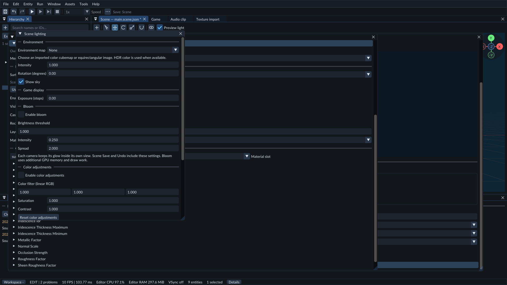

Scene lighting controls affect authored lighting. The Scene preview light is a separate viewing aid.

Turn off **Preview light** on the Scene toolbar when adjusting authored lighting.
Game and [camera render textures](render-textures.md) use authored lighting.
Camera/light icons and selection guides are
explained in [Viewport](viewport.md).

## Add a rectangular or spherical light

1. Use **Entity > Create > Rendering > Light** and select the new light.
2. In Inspector, choose **Rectangle** or **Sphere** in **Kind**.
3. Set **Intensity**, the color and **Range**. Zero range is unbounded. Keep a nonzero intensity and use a PBR material on the receiving object.
4. For Rectangle, set **Emitter Width (m)** and **Emitter Height (m)**. Rotate the entity to aim its emitting face; its direction guide points toward the receivers. Rolling the entity turns the rectangular highlight. **Basis** selects the local forward direction. For Sphere, set **Emitter Radius (m)**; rotation has no effect.
5. Turn off **Preview light** to inspect authored lighting in Scene, or press Play with an enabled Camera to see it in Game. Save the Scene before export.

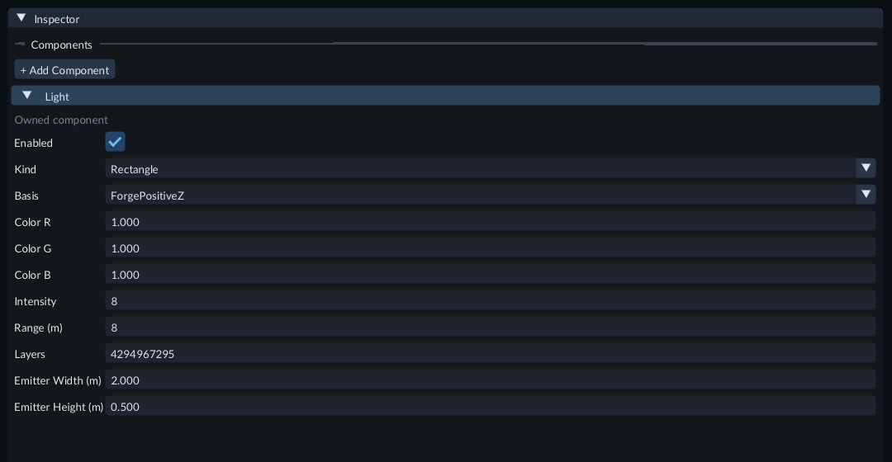

Rectangle lights emit from one side. Width and height are the full dimensions in
world metres. A Sphere is an opaque spherical emitter; a receiver on or inside it
gets no illumination from that source. All three size controls accept **0.001** to
**10000** metres. Entity scale does not multiply these dimensions. The Scene guides
show the emitting shape; they do not create a visible mesh in Game. Add a separate
mesh if the lamp itself must be visible.

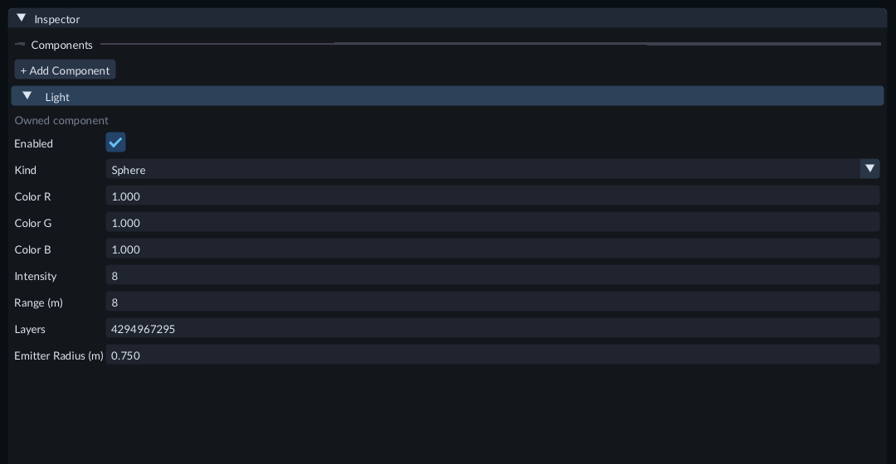

Larger emitters spread highlights over a reflective surface. **Intensity** uses
candela measured far from the source: along the front normal for Rectangle, and
in any direction for Sphere. **Range** uses distance to the emitter's center.
**Layers** controls which mesh layers receive its illumination.

While playing, the selected light's shape controls are adjustable under **Live
gameplay**. These changes affect only the running game. Stop and use the tuning
review to keep selected values, then save; stopping without keeping them restores
the authored values. Kind, color, intensity, range and layers are edited in Edit.

Open **112-area-lights** in the [Feature Gallery](../getting-started/feature-gallery.md)
to compare a warm rectangular source with a cool spherical source on metal spheres.

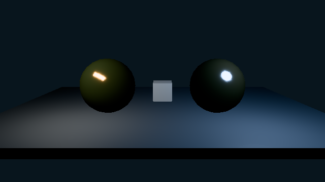

Area lights currently illuminate lit Mesh surfaces, including Mesh particles.
They do not cast shadows. If a light carried **Cast shadows** from another Kind,
uncheck it to remove the unsupported request. **Shadow Source Radius** and
**Shadow Angular Radius** belong to Point/Spot and Directional shadow filtering;
they do not control area-light emission. A custom physically based Surface Shader
must be rebuilt with the current shader compiler to supply the area-light variants.
Built-in PBR materials work without an additional shader import. Unlit surfaces do
not receive light.

## Use an image to shape a light

1. Import a Texture for scene rendering with **Color** or **HDR color** usage. Directional and Spot lights use a 2D image. Point lights use a Cube Texture, such as an imported DDS or KTX cubemap; a flat panorama or cross-layout image is not a Cube Texture.
2. Choose **Entity > Create > Rendering > Light**, select it, and set **Kind** to **Directional**, **Spot** or **Point**.
3. Assign **Light image** in Inspector. Search the picker by path, or drag a registered Texture from Content onto the field. Use a lit material on the receiving Mesh.
4. For Directional, set **Image width (m)** and **Image height (m)** to the full image size in world metres. Move the light to slide the pattern and rotate it to aim or roll the image. Entity scale does not resize it. With **Tile image** off, the light contributes nothing outside the image rectangle. With it on, the Texture's wrap settings determine repetition, mirroring or clamping.
5. For Spot, position and aim the light, then adjust **Inner Cone**, **Outer Cone**, **Intensity** and **Range**. The image fills the spot's square projection; the cone still controls illumination. For Point, move the light and rotate its cubemap orientation. Directional image size and tiling controls do not affect Spot or Point.
6. Turn off **Preview light** in Scene, or press Play with an enabled Camera, to inspect authored lighting. Save the Scene before export.

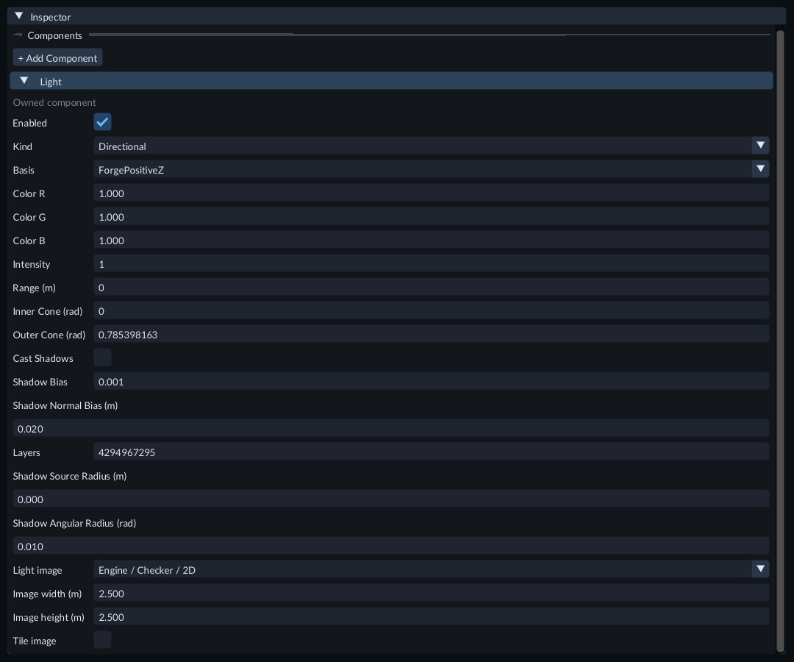

Directional image dimensions accept **0.001** to **10000** metres.

The image multiplies the light's color and intensity using its RGB values. Alpha
is ignored: transparent pixels can still illuminate if their stored RGB is nonzero.
This changes direct illumination; material color, emission and environment lighting
keep their own controls. The Texture's filtering, mip and sampler settings apply.
Rectangle and Sphere lights do not accept light images.

During Play, a Directional light with an assigned image exposes **Image width**,
**Image height** and **Tile image** under **Live gameplay**. Stop and use the tuning
review to keep selected values, then save. Assign or clear **Light image** in Edit.
**None / Clear** removes the image and restores ordinary illumination.

Open **117-light-images** in the [Feature Gallery](../getting-started/feature-gallery.md)
for a repeating directional arrow pattern, a patterned Spot light and a Point light
using a captured cubemap.

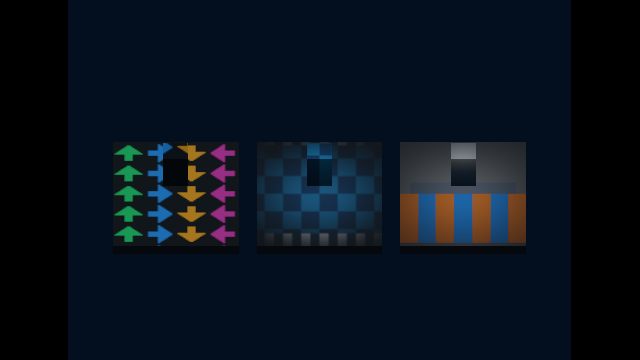

If an image cannot load, **Problems** explains the failure. The previous usable
image remains when compatible with the light kind; otherwise ordinary lighting
remains. An undefined image orientation also retains ordinary lighting. Restore
independent transform axes to use the image again. Changing between Point and the
2D light kinds requires a compatible Texture.

Light images share the receiving Mesh part's projected Texture/sampler slots with
Decals: up to eight distinct pairs, with fewer available for some complex materials.
If the complete set cannot fit, Problems explains the omitted projections and
ordinary materials and lighting remain available. Reusing a Texture with the same
sampler settings shares a slot. Custom physically based Surface Shaders need a
current cook to receive light images; older cooks retain ordinary lighting.

## Add an environment

1. Import a color image or cubemap using [Textures](textures.md). Use **HDR color** for a high-dynamic-range environment. A flat image should be an equirectangular panorama rather than an ordinary photograph.
2. Open **Scene lighting** and choose it in **Environment map**. Search by path, or drag the registered texture from Content onto the field.
3. Wait for the texture and lighting maps to finish loading. The environment lights imported PBR meshes and supplies their reflections. No punctual light is required.
4. Save the scene.

The environment uses the imported HDR-color variant when one exists, otherwise the
color variant. A texture imported only for normal or data use cannot supply environment
color. Change its import usages and reimport first.

**None / Clear** removes the environment lighting and background. **Reveal in Content**
selects the assigned asset without changing the scene reference.

## Adjust the light and background

**Intensity** multiplies both environment lighting and sky brightness. Enter a
nonnegative value and press **Enter**. Zero removes their contribution.

**Rotation (degrees)** turns the environment around world Y. The background and
reflections turn together. Positive angles turn +X toward -Z. Press **Enter** to commit.

Turn off **Show sky** to hide the background while keeping lighting and reflections.
The sky stays distant when you move the camera and remains behind scene geometry.

Changes to intensity and rotation reuse the prepared environment; they do not rebuild
its lighting maps every frame. If a replacement cannot load, **Problems** explains the
failure and the previous usable environment remains visible. Clear the field explicitly
to remove that previous environment.

## Add reflections for a room or region

A **Reflection Probe** supplies a saved reflection map inside a box. Use one
for a room whose walls should appear in nearby smooth surfaces even when those
walls are outside the camera view. Import a map, or capture a snapshot of your
Scene using the steps below.

1. Import a cubemap or complete equirectangular panorama with **Color** or **HDR color** usage. See [Textures](textures.md).
2. Choose **Entity > Create > Rendering > Reflection Probe** and select the new entity.
3. In Inspector, assign **Reflection map**. Move the probe to the position from which the map was captured.
4. Set **Half extent X**, **Half extent Y** and **Half extent Z** to half the box size. Entity rotation and scale also shape this region. Press **F** to frame its outline.
5. Set **Edge fade** to the distance, in world metres, over which the map fades in from each box face. Zero gives a hard edge. A fade wider than the box can keep its maximum influence below full strength.
6. Adjust **Intensity** and **Map rotation**. Rotation turns the map around world Y; it does not turn the box. **Box projection** corrects the sampled direction as the receiving surface moves away from the capture center. It works best when the box matches the captured room.
7. Save the Scene. Play and exported games use the saved component and imported map.

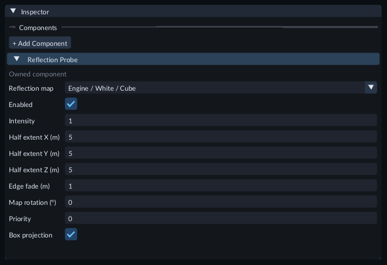

**Half extent** is measured before entity scale; **Edge fade** is measured after
that transform, in world metres. Higher **Priority** takes precedence in overlap;
its edge fade reveals lower-priority maps and then the Scene environment. Equal
priorities use stable entity order. **Enabled** off, an unassigned map or both
intensity controls at zero makes the probe inactive. Outside every box, the Scene environment remains.
By default, the map affects base reflections; diffuse light, the sky, clearcoat
and sheen keep the Scene environment. **Diffuse intensity** optionally supplies
local diffuse light as described below. It can supply reflections when global environment intensity
is zero. Smooth lit metal makes the result easiest to see.

Open **107-local-reflection-probes** in the Feature Gallery. Select **Warm reflection volume - priority 1**
or **Cool reflection volume - priority 0**, toggle Enabled and compare the nearby spheres and floor.
Move the probe or adjust its half extents, fade, priority or map rotation, then save.

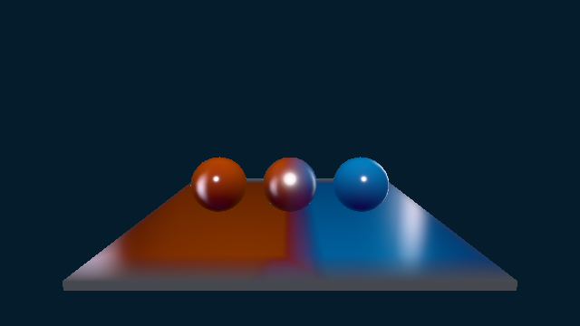

The left and right regions use different maps; the middle sphere shows their overlap.
During Play, the existing scalar controls appear under **Live gameplay**. These
changes affect the running world. Stop restores saved authored values unless you
keep selected fields through the tuning review. Assign maps while stopped.

Use at most **eight active assigned probes**. Above that limit the view keeps
global lighting and Problems reports the capacity warning. A failed replacement
keeps the previous usable map; clearing the field removes it. Singular transforms
and volumes that cannot be represented for a camera are skipped with a diagnostic.

Local specular reflections use the same depth-writing Mesh, camera-clear, shader,
draw-order and view-budget limits as screen-space reflections. Transparent objects, Sprites, Tile Maps,
particles and overlays keep their existing path. Anisotropic surfaces retain the
Scene environment. Per-Mesh probe masks are unavailable. Screen-space reflections can
run afterward and retain the local map where their visible-depth samples miss.

## Add local diffuse light

A probe can light nearby surfaces using its saved map. **Intensity** controls base
reflections; **Diffuse intensity** controls diffuse illumination independently.
Diffuse intensity starts at **0**, leaving the Scene's diffuse lighting unchanged.

1. Stop Play. Import a Color/HDR cube or complete panorama using [Textures](textures.md), or capture a map using the steps below.
2. Create or select a **Reflection Probe** and assign **Reflection map**.
3. Set **Diffuse intensity** to **1**. Set **Intensity** to **0** to compare diffuse lighting without local specular reflections. Global environment intensity can also be zero; local diffuse light still contributes.
4. Move the probe and set its **Half extent** values. **Edge fade** measures world metres inward from the box boundary. **Map rotation** turns the incoming light directions around world Y. **Box projection** affects specular reflections only.
5. Use **Priority** to control overlapping volumes. Higher priority takes precedence; its fade reveals lower-priority diffuse maps and then the Scene environment. A probe with Diffuse intensity zero does not cover other diffuse lighting.
6. Save the Scene, then test in Play. **Live gameplay** exposes diffuse intensity with the existing probe controls. Runtime edits are temporary unless kept through the tuning review; assign maps while stopped.

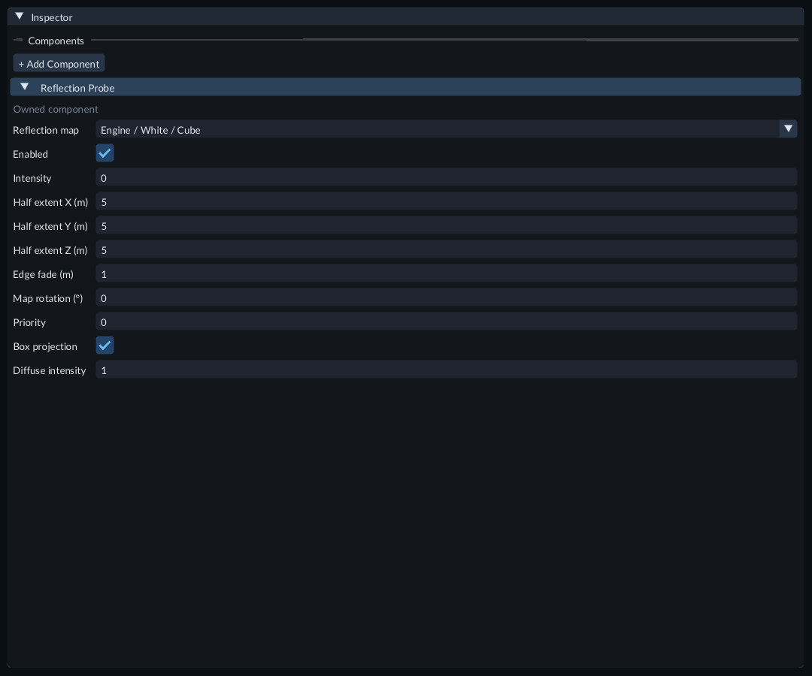

Use the two intensity controls to adjust reflections and diffuse light separately.

Open **118-local-diffuse-irradiance** in the Feature Gallery. Its warm and cool
volumes light the receivers and floor without direct lights or a global environment.
Select either volume, toggle Enabled, change Diffuse intensity or move its bounds.
The center receivers show their overlap.

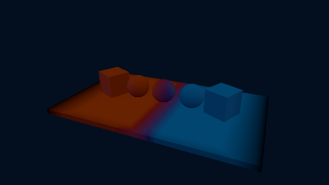

The same map and volume supply both lighting controls. Use at most **eight active
assigned probes in total**, including reflection-only and diffuse-only probes.
Lit Meshes and Mesh particles receive diffuse light; Unlit materials remain unlit.
Older custom Surface Shaders need a current cook for this input. A failed map
replacement keeps the previous usable map; clearing the map removes it.

The map is a static lighting snapshot. Moving scene objects or lights does not
update it. Local diffuse probes do not cast shadows, provide a sampled irradiance
grid or calculate multiple bounces. Capture a new map after changing its sources.

## Capture a reflection map from your Scene

1. Stop Play and save or discard open source drafts. Create or select a **Reflection Probe** and move it to the capture position. An unassigned **Reflection map** is fine. You do not need a Camera to capture a map; Play and exported games still need an enabled game Camera.
2. In its Inspector, click **Capture reflection map…**.
3. Choose **Face size (pixels)** from **16** to **1024**; the default is **256**. This is the square size of each of six cube faces. Set a positive **Near plane (m)** and a larger **Far plane (m)**. Geometry outside this range is clipped. **Layers** selects the capture camera's bit mask: **1** selects the first bit, **2** the next, and **3** both. The default **4294967295** includes all bits.
4. Enter a **New folder** below **Assets**, such as `Assets/ReflectionMap`. Its parent must exist and the new folder must not exist. Leave **Assign to this probe after import** enabled to request automatic assignment.
5. Click **Capture map**. FORGE captures the six faces and encodes the HDR map in the background. **Cancel capture** retires the pending capture without replacing your current map.
6. In **Import generated source**, review the destination and `Reflection.dds`. Keep **Import with defaults after copying** enabled and click **Copy sources**. Wait for the import result, then close the dialog.
7. A successful import assigns the new map if the original Scene and revision are still current. Assignment also resets **Map rotation** to **0°**, so the world-aligned capture matches your Scene. These two changes are one Scene Undo step. **Save** the Scene, then test in Play or export it as your Startup Scene.

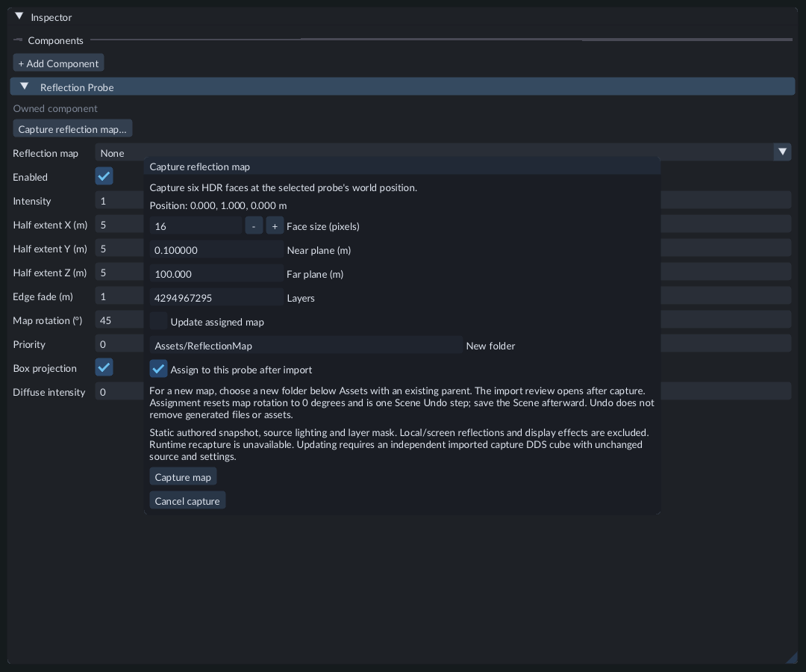

Choose the probe position and a new source folder before capturing.

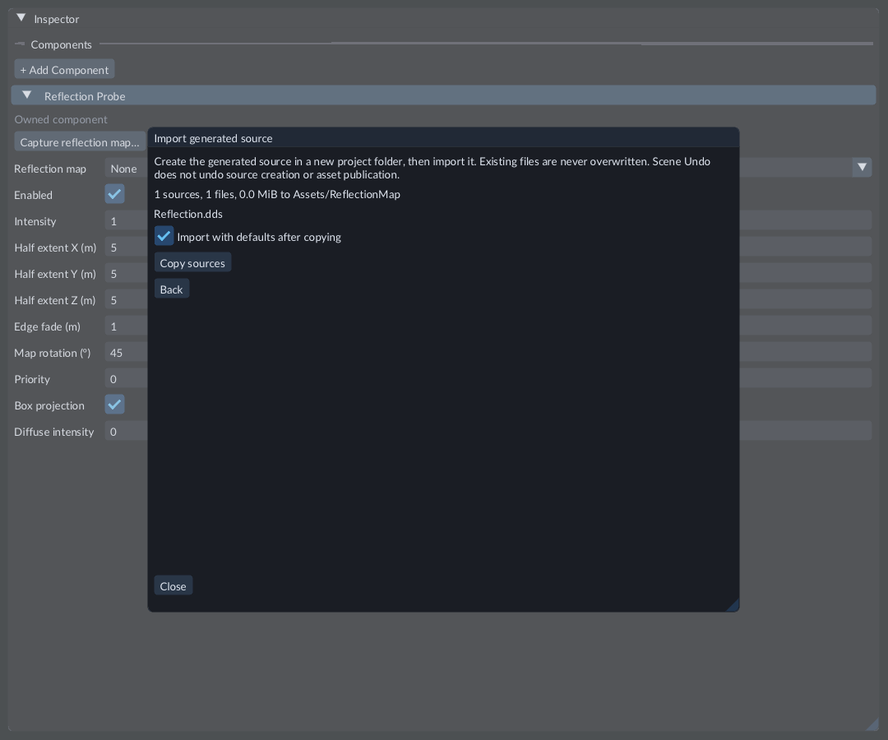

Review and import the generated source to make its Texture asset available.

If the Scene changes while import is pending, the new map stays available in
Content and FORGE leaves your existing assignment alone. Assign it explicitly
using **Reflection map**. Turning off automatic assignment has the same result.
Scene Undo changes the reference; it does not delete source files or published
assets. Cancelling an import preserves any source copy or publication already
completed. If you turn off **Import with defaults after copying**, only the source
is copied; import it through Content before assigning it.

Open **110-reflection-map-capture** in the Feature Gallery for a supplied captured
map and two metal spheres. The example uses **Layers = 1** while capturing and
**Layers = 2** on the game Camera. The colored source panels remain in the map
while the Camera keeps them out of its direct view; the spheres use **Layers = 2** and
are excluded from that capture mask.

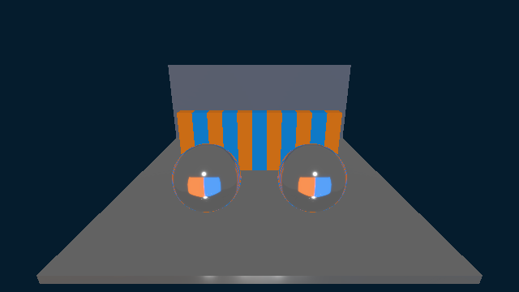

Toggle the captured reflection volume's **Enabled** control to compare the saved map.

A capture is a static authored snapshot. It uses source lighting, shadows, fog and
the source environment, including that environment when its display sky is hidden.
It excludes local reflection and diffuse probes, screen-space reflections, ambient occlusion, temporal
smoothing, motion/focus blur, bloom and display exposure/tone mapping/color grading.
It stores linear HDR values. It does not update when objects, lights or the probe
move. Capture a new map into a new folder after changing the Scene. Runtime
recapture and overwriting an existing map are unavailable.

For an empty or unexpected map, check the probe position, near/far planes, layer
mask and authored lighting. Keep the probe outside solid surfaces. Check
**Problems** and the import result for resource, range or publication errors;
a failed capture/import preserves the previous assignment.

## Use imported diffuse lighting

A Mesh Material Graph can sample a prepared lightmap through **Lightmap
irradiance** on Surface Output. Its diffuse contribution remains visible with
Scene environment intensity zero. It adds to active direct and probe lighting;
avoid counting the same baked lighting twice. Follow
[Use an imported lightmap](imported-lightmaps.md) for linear image usage, UVs,
gain controls, saving and export. FORGE does not bake maps or generate their UVs.

## Reflect visible surfaces

1. Stop Play and open **Tools > Scene lighting...**.
2. Give the receiving Mesh a lit Material with low **roughnessFactor**. A smooth metal surface makes the comparison clear. Keep the objects to reflect visible in the same view.
3. Expand **Screen-space reflections** and select **Enable screen-space reflections**.
4. Enter **Maximum distance (m)**, from **0 to 100**, and press **Enter**. Start at **25**; zero skips the effect.
5. Set **Thickness (m)**, from **0.0001 to 1**. Start at **0.1**. Smaller values reject more depth intersections; larger values can accept unrelated nearby surfaces.
6. Set **Strength**, from **0 to 1**, and **Maximum roughness**, from **0 to 1**. Reflections fade as surface roughness approaches the cutoff. Either value at zero skips the effect.
7. Turn on **Roughness filtering** to soften reflected detail as the receiving Material becomes rougher. Leave it off for the original sharp source lookup. It adds texture memory and rendering work.
8. Save the Scene. Play and exported games use these saved settings.

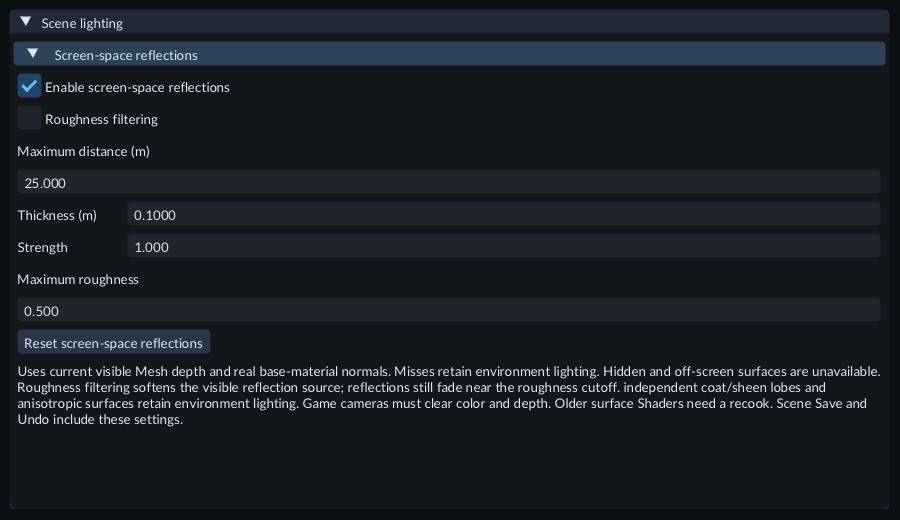

Use distance for ray reach, thickness for depth tolerance, and strength for the
blend with environment reflections. **Reset screen-space reflections** disables
the effect and restores **25 m**, **0.1 m**, **1**, **0.5** and **Roughness filtering** off in one Undo step.
Authored controls are read-only during Play. Turn off **Preview light** when
comparing authored lighting in Scene; Game uses the authored lighting directly.

Open **106-screen-space-reflections** in the Feature Gallery. Amber and blue
blocks reflect in a smooth metal floor. Toggle the effect to compare their
reflected colors; the rough back wall keeps its environment reflection. The
scene uses built-in assets and needs no C++ module or additional import.

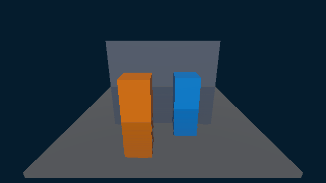

Compare the reflected blocks below the original objects.

Open **109-rough-reflection-filtering** for a rough metal floor below alternating
amber and blue columns. Toggle **Roughness filtering** to compare sharp and softened
reflected detail. Change the floor's **roughnessFactor**, keeping it below
**Maximum roughness**, to compare different footprints. Save the Scene and select
it as startup before exporting.

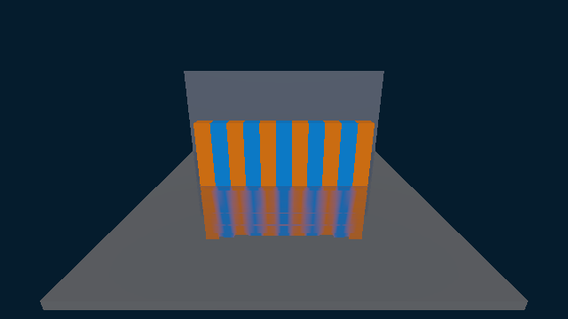

Compare the column reflections in the lower part of the floor.

Only current visible opaque and masked Mesh depth supplies reflected surfaces.
A hidden or off-screen object cannot appear in the reflection. Missing samples
retain environment reflections. Screen edges, thin geometry and depth steps can
show gaps or abrupt changes. **Roughness filtering** averages visible reflected
color over a bounded footprint; depth changes can make it use sharper detail to
avoid mixing surfaces. Source-level and depth changes can leave visible bands.
It still fades near **Maximum roughness**. The receiver's
Material controls roughness; the checkbox does not change that Material. Base
normal maps affect the ray. Separate clearcoat
and sheen reflections, and anisotropic surfaces, keep environment lighting.
Unlit and final-color custom Materials do not receive this effect.

Reflection runs before ambient occlusion, edge smoothing, motion blur and depth of
field. Transparency, Sprites, Tile Maps, particles, sky and overlays keep their
existing rendering. Game cameras must clear both color and depth; Materials must
test and write depth. Reimport older surface **Shaders** and rebuild dependent
**Materials** before using them with the effect. Unsupported shaders, depth,
draw order or capacity keep ordinary rendering and report a warning.

Up to eight Game views share a **512 MiB** surface texture estimate with ambient
occlusion, edge smoothing and motion blur. Scene preview has its own **512 MiB**
estimate. Native and temporary allocation overhead are additional. Reduce view
size or disable an effect when a capacity warning persists.

## Shade nearby ambient contacts

1. Stop Play and open **Tools > Scene lighting...**.
2. Assign an **Environment map** and give it a nonzero **Intensity**. The effect reduces environment lighting; it does not darken direct lights or emission.
3. Expand **Ambient occlusion** and select **Enable ambient occlusion**.
4. Enter **Radius (m)**, from **0 to 10**, and press **Enter**. Nearby visible geometry within this distance can reduce ambient light. Start at **0.5**.
5. Set **Strength**, from **0 to 1**. Zero strength or radius skips the effect.
6. Adjust **Depth bias (m)**, from **0 to 1**, if a flat surface appears to shade itself. Start at **0.01**; increasing bias ignores smaller depth differences.
7. Optionally set **Normal influence**, from **0 to 1**, and press **Enter**. Zero uses geometric directions from depth. Higher values blend toward the base Material normal, including a normal map. Start at zero and compare the contacts.
8. Save the Scene. Play and exported games use the saved settings.

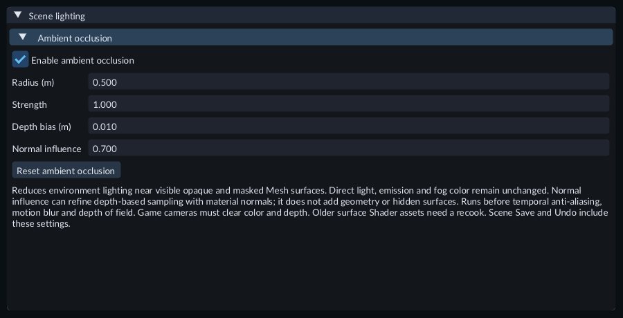

Use Radius for the reach of nearby contacts and Strength for their ambient-light reduction.
An unlit Material has no environment lighting to occlude. Assign a lit Material in
the Mesh Renderer when you need this effect.

**Reset ambient occlusion** disables the effect and restores radius **0.5 m**,
strength **1**, bias **0.01 m** and Normal influence **0** in one Undo step. Authored controls are read-only
during Play. Turn off **Preview light** when comparing authored Scene lighting;
Game uses the authored environment and lights.

Open **105-ambient-occlusion** in the Feature Gallery. Three amber posts stand in
front of a blue wall. Toggle the effect to compare the ambient shading near their
visible depth junctions. Shadows are disabled so direct-light shadow maps do not
supply this shading. The scene uses built-in meshes and an environment; no C++
module or additional import is required.

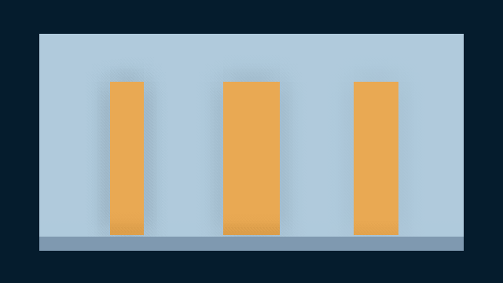

Compare enabled and disabled views near the posts and lower ledge.

Open **108-material-normal-occlusion** to compare a rippled normal-mapped wall.
In **Ambient occlusion**, change **Normal influence** between **0** and **1**.
The imported normal texture changes shading directions while the five Meshes and
their depth stay the same. Save the Scene before exporting; the cooked Material
and normal texture travel with it.

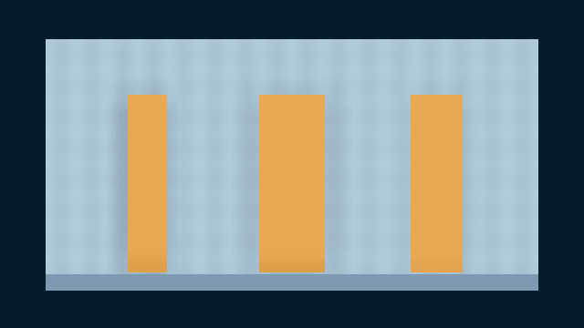

Compare Normal influence near the posts; the rippled lighting elsewhere is supplied
by the normal map itself.

A fine spatial sample pattern can be visible near contacts. The effect uses visible
depth and geometric directions, optionally refined by base Material normals.
Normal maps do not add geometry or hidden surfaces. Invalid, absent or backward
normal data uses geometric directions. Separate clearcoat/sheen normals are not
additional AO inputs. Hidden or screen-edge geometry cannot supply occlusion.
Direct lighting, emission, fog color and alpha remain unchanged. Transparency,
Sprites, Tile Maps, particles, sky and editor overlays keep their existing rendering.
Occlusion runs after enabled screen-space reflections and reduces their indirect
light too. It runs before edge smoothing, motion blur and depth of field.

Game cameras must clear both color and depth. Materials must test and write depth.
Older custom or graph **Shader** assets may need reimporting and their dependent
**Materials** rebuilding for their selected output profile. Normal influence needs
the new normal outputs when reflections are disabled; enabled reflections share
their existing normal image. Built-in Materials need no import. Unsupported shaders, draw order,
depth or capacity keep ordinary rendering and report a warning. Up to eight Game
views share a **512 MiB** surface texture estimate with reflections, edge smoothing and motion
blur; Scene preview has its own **512 MiB** estimate. Native and temporary allocation
overhead are additional. Reduce view size or disable the effect if a warning persists.

## Blur moving geometry

1. Stop Play and open **Tools > Scene lighting...**.
2. Expand **Motion blur** and select **Enable motion blur**.
3. Enter **Shutter fraction**, from **0 to 1**, and press **Enter**. A value of **0.5** spreads half of the movement since the previous completed image; **1** uses the full movement.
4. Enter **Maximum trail (px)**, from **0 to 32**, and press **Enter** to cap the blur in each view's pixels. Either value at zero keeps the image sharp.
5. Save the Scene, then press Play. Moving Mesh detail softens along its movement; a stationary view becomes sharp again. Exported games use the saved settings.

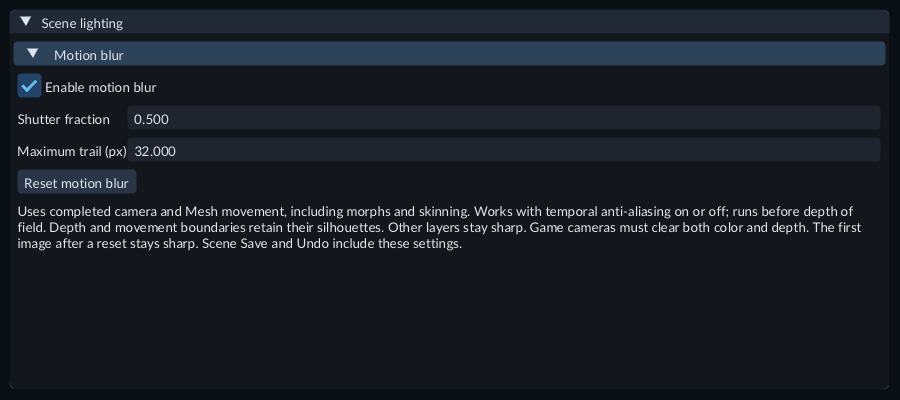

Use shutter fraction for exposure strength and maximum trail for a view-pixel limit.

**Reset motion blur** disables the effect and restores shutter **0.5** and trail
**32** in one Undo step. Authored settings are read-only during Play.

The effect uses completed camera and object movement, including animated morphs
and skinning. It works with temporal anti-aliasing enabled or disabled and runs
before depth of field. It averages available detail within a surface; it does not
spread a silhouette into a different depth or movement region. Transparency,
Sprites, Tile Maps, particles, sky and editor overlays stay sharp.

Open **104-motion-blur** in the Feature Gallery and press Play to compare the
moving checker panel with the stationary panel behind it. Stop Play to adjust the
shutter or trail limit. The Scene uses a built-in animation workflow and needs no
C++ module. Select its **Sequence - continuous checker motion** controller to
inspect or capture its motion through the Timeline.

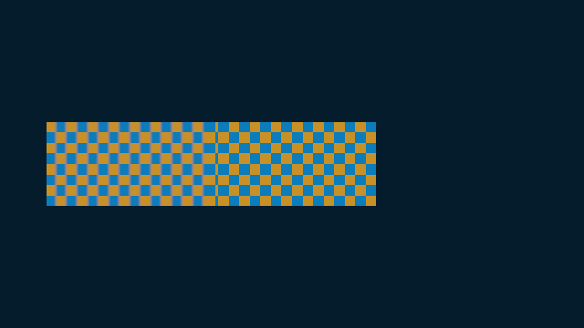

Compare the softened moving detail on the left with the stationary checks on the right.

The first image after a camera cut, manual Timeline seek, resize or resource
replacement stays sharp. During sequence frame capture, forward samples use the
preceding completed sample's motion and retain it while edge smoothing warms up.
The first sample in an export has no preceding sample and stays sharp. Ending or
cancelling capture discards that temporary motion field.

Game cameras must clear both color and depth; participating Materials must test
and write depth. Unsupported draw order, shaders or capacity keep ordinary
rendering and report a warning. Up to eight Game views share a **512 MiB** texture
payload estimate with reflections, ambient occlusion, edge smoothing and frozen motion; Scene preview has its own
**512 MiB** estimate. Native allocation and temporary retirement overhead are
additional. Reduce view size or disable the effect if a warning persists.

## Focus near and distant surfaces

1. Stop Play and open **Tools > Scene lighting...**.
2. Expand **Depth of field** and select **Enable depth of field**.
3. Enter **Focus distance (m)** and press **Enter**. This is the distance along the camera's view direction to the sharp plane, from 0.001 to 1,000,000 metres.
4. Set **Focus falloff (m)**, also 0.001 to 1,000,000 metres. Surfaces this far from the focus plane reach the maximum blur; nearer surfaces blur less.
5. Set **Maximum blur (px)** from 0 to 12 output pixels. Zero skips the effect.
6. Save the Scene. Play and exported games use the saved focus settings.

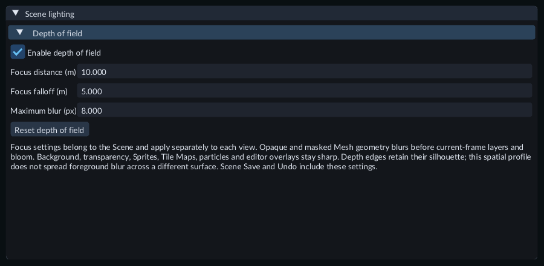

The Scene preview uses its navigation camera. Game uses each authored camera.
The same saved settings apply independently to those views. Moving or turning a
camera changes which surfaces fall on its focus plane. **Reset depth of field**
disables the effect and restores a distance of 10 m, falloff of 5 m and radius
of 8 px in one Undo step. Authored controls are locked during Play.

Open **103-depth-of-field** in the Feature Gallery. The middle checker panel is
sharp at **9.95 m**. Try **3.95 m** for the near panel or **15.95 m** for the far
panel, pressing Enter after each change. Disable the effect to compare all three
panels. No C++ module is needed.

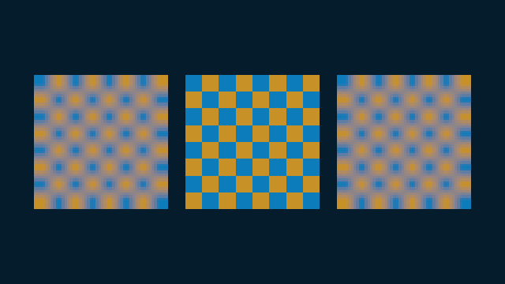

The middle panel stays sharp while the two outer panels soften at their saved
near and far distances.

This spatial profile blurs depth-writing opaque and masked Mesh surfaces before
current-frame layers and bloom. Background, transparency, Sprites, Tile Maps,
particles and editor overlays stay sharp. Depth edges keep their silhouette;
foreground blur does not spread across a different surface. This is a bounded
focus filter rather than a physical lens simulation.

Game cameras must clear both color and depth. Materials must test and write depth.
If an earlier current-frame layer interrupts the supported Mesh draw order, the
view keeps ordinary rendering and reports a warning. Unavailable sampled depth
or GPU capacity also keeps ordinary rendering. Reduce the view size or disable
the effect if its warning persists. Up to eight Game views share a 128 MiB scratch
texture estimate; Scene preview has its own 128 MiB estimate. Temporary and native
allocation overhead are additional.

## Smooth moving edges

1. Stop Play and open **Tools > Scene lighting...**.
2. Expand **Temporal anti-aliasing** and select **Enable temporal anti-aliasing**.
3. Start with **History stability** at **0.8**. Press **Enter** to commit a typed value.
4. Save the scene. Scene preview, Play and exported games use these saved settings.

Temporal anti-aliasing combines several rendered frames to reduce flickering along
geometry edges. Higher stability retains more of the previous image; lower values
respond faster. The allowed range is **0–0.95**. Zero keeps the current jittered
image without blending older color. Uncheck Enable to disable temporal accumulation;
motion blur and fast approximate filtering can continue independently.
**Reset temporal anti-aliasing** disables it and restores stability **0.8** in one
Undo step. Authored controls are read-only during Play.

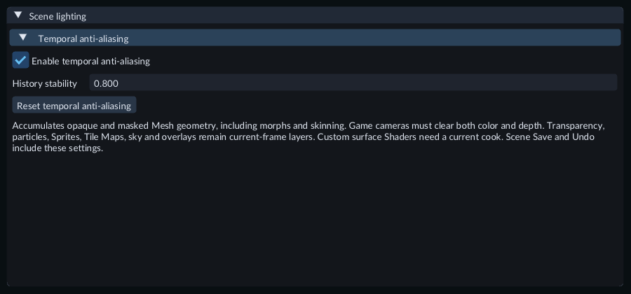

Use History stability to balance edge smoothing and responsiveness.

Open **102-temporal-antialiasing** in the Feature Gallery. Press Play to watch the
pink foreground bar move across thin cyan and amber edges. Compare enabled and
disabled views, and adjust stability after stopping Play. This scene uses an
existing animation clip and requires no C++ module.

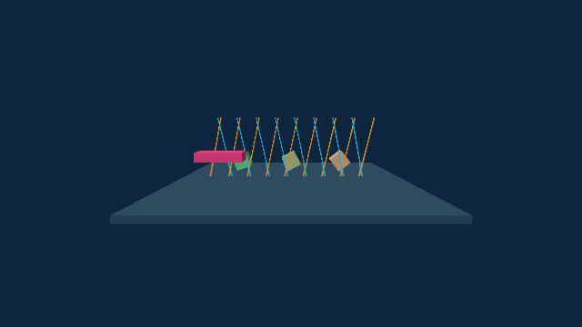

Compare edge stability while the foreground bar reveals different parts of the background.

Opaque and masked Mesh geometry participates, including moving objects, morph
shapes and skinned characters. Transparent surfaces, particles, Sprites, Tile Maps,
sky, editor guides and the game HUD keep their current-frame rendering. Each Game
camera must have both **Clear color** and **Clear depth** enabled. A camera that
loads an earlier view uses ordinary rendering and reports a warning in Problems.
An opaque Sprite, Tile Map or particle ordered before a later Mesh draw also uses
ordinary rendering for that view, preserving its existing depth and draw order.

A camera cut, changed lens, resize, resource replacement or new explicit sequence
sample starts a fresh image. Scene preview settles over eight frames, then reuses
its image until something changes. Sequence frame capture waits for its sample to
settle; opening or exporting a scene does not save this temporary image history.

This option uses extra GPU memory and draw work. Game supports up to eight
accumulated camera views within a shared 512 MiB texture-payload budget; Scene
preview has its own 512 MiB budget. Device limits and allocation overhead also
apply. An unsupported or oversized view uses ordinary rendering with a warning.
If Problems requests a current surface Shader, reimport that Shader and rebuild
its dependent Materials before comparing the result or exporting.

## Smooth edges without image history

1. Stop Play and open **Tools > Scene lighting...**.
2. Expand **Fast approximate anti-aliasing** and select **Enable fast approximate anti-aliasing**.
3. Start with **Subpixel smoothing** at **0.5** and **Edge search steps** at **12**. Press **Enter** to commit a typed value.
4. Save the scene. Scene preview, Play and exported games use these settings.

This filter smooths the current scene image after tone mapping. It needs no
previous frame, depth or motion information. It can run independently or alongside
temporal anti-aliasing. Game UI and editor guides are drawn afterward and keep
their original appearance.

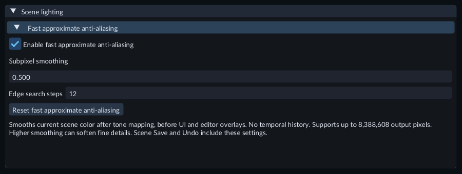

Use the defaults first, then compare fine details with the effect enabled and disabled.

**Subpixel smoothing** accepts **0–1**. Higher values soften isolated detail;
zero leaves the edge filter active. **Edge search steps** accepts **1–16** and
limits how far the filter follows an edge in each direction. **Reset fast
approximate anti-aliasing** disables it and restores **0.5** and **12** in one
Undo step. Authored controls are read-only during Play.

Open **143-fast-approximate-antialiasing** in the Feature Gallery and press Play.
The pink bar moves across thin cyan and amber lines and tilted cubes. Stop Play
to compare the filter settings, then save. The example includes a camera and
light, uses an existing animation clip and requires no project C++ module. Select
the scene as startup and export with the matching runtime kit to run it separately.

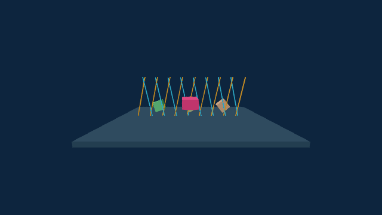

Compare current-frame edge smoothing while the foreground bar moves.

Low-contrast edges may remain unchanged. Alpha discontinuities retain original
pixels, and strong smoothing can soften small details. This filter does not
provide temporal stability. It supports up to **8,388,608 output pixels**, including
**3840 × 2160**, with an additional cached texture of up to **32 MiB per view**.
If a view exceeds that limit, reduce its size or disable the effect.

## Add distance fog

1. Open **Tools > Scene lighting...** and expand **Distance fog**.
2. Select **Enable distance fog**.
3. Enter **Fog color (linear HDR)**, **Start (metres)** and **End (metres)**. Press **Enter** to commit each field.
4. Save the scene. Play and export use the saved values.

Geometry keeps its surface color up to Start, gradually approaches Fog color, and
reaches that color at End. Distance is measured from the active camera in every
direction, including in an orthographic view. Scene View has its own camera, so
its fog distances can differ from the Game view.

Start must be zero or greater and below End. End accepts **0.001–1000000** metres.
Move End first when increasing Start past the current End. Fog color has three
linear RGB channels from **0** to **65504**; values above 1 are brighter than ordinary
white and can contribute to bloom. **Reset distance fog** disables fog and restores
gray, Start 0 and End 100 in one Undo step. Unchecking Enable retains your values.

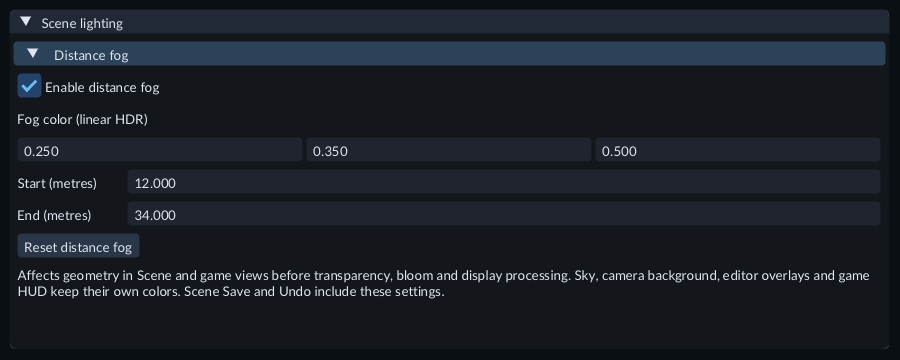

Open **98-distance-fog** in the Feature Gallery to compare the same colored
columns at increasing distances. Try Start 12 and End 34, then disable fog to compare.

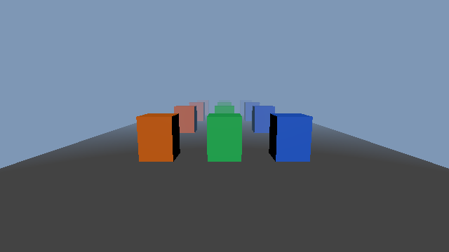

Fog affects geometry before transparency, bloom and display exposure. Sky, camera
background, editor overlays and the game HUD keep their own colors. Matching the
camera background to Fog color can make distant geometry blend into a clear view.
Distance fog provides distance fading. For localized geometry fog, use the Fog
Volume component below. Neither effect simulates weather or light scattering.

Authored controls are read-only during Play. If **Problems** requests a current
surface wrapper, reimport that custom Shader and rebuild its dependent Material
before enabling fog or exporting the scene. Disable fog to keep using an older
cook; an incompatible draw is omitted while fog is enabled. Invalid fields leave the previous
Scene values in place; correct them and press Enter to continue.

## Add a local fog volume

1. Stop Play and choose **Entity > Create > Rendering > Fog Volume**.
2. Select the new entity. In **Inspector → Fog Volume**, choose **Shape**: Box or Sphere.
3. Set **Half extent X**, **Half extent Y** and **Half extent Z**. These are local box half sizes or sphere radii in metres; unequal sphere dimensions form an ellipsoid.
4. Use the ordinary Transform controls to move, rotate or scale the entity. Select it in Scene View to see its outline. Frame Selected includes the volume's extent.
5. Set **Color R**, **Color G**, **Color B** and **Density**. Color uses linear HDR RGB. Density controls how strongly geometry fades per metre travelled through the volume; try 0.15 initially.
6. Save the scene. Press Play to compare Scene and Game views, then export with the runtime kit supplied with the editor.

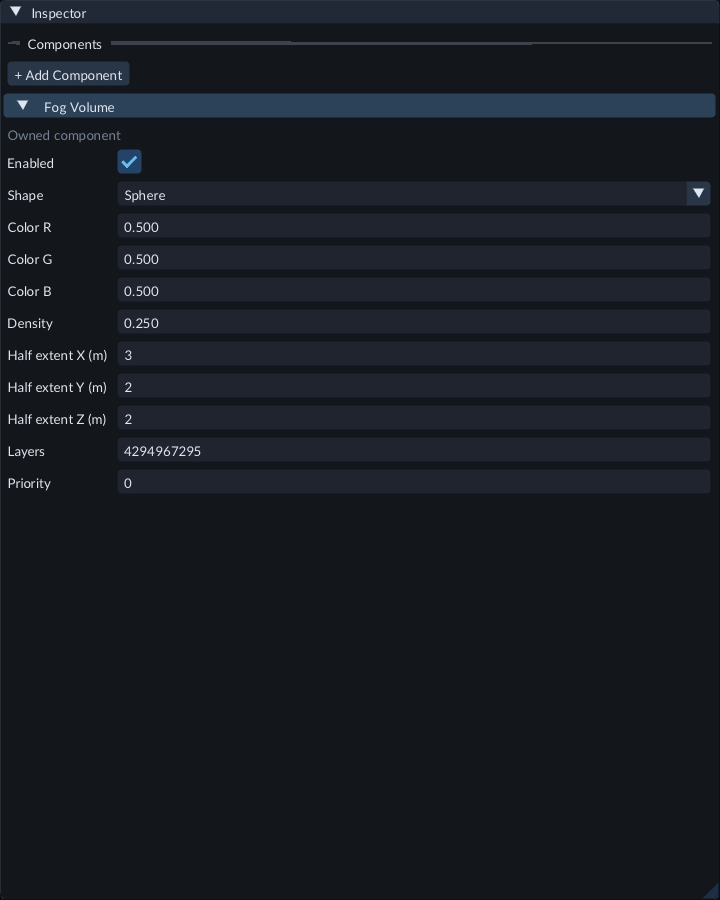

The outline follows the entity transform. A sphere with unequal dimensions or
nonuniform scale becomes an ellipsoid. A disabled volume keeps its settings;
Density 0 or Layers 0 also removes its contribution. Color channels accept
**0–65504**, Density **0–1000**, and half extents **0.001–1000000 metres**.

Camera, Fog Volume and receiving Mesh Renderer must share a **Layers** bit.
When more than **16 compatible volumes** affect a draw, higher **Priority** values
are selected first; equal priorities use stable entity IDs. Priority does not
control color layering. Overlapping colors mix according to their optical depth.
Global distance fog applies first, then local fog. Sky, background, HUD and editor
overlays retain their own colors. Local fog has no lighting or shadow scattering.

During Play, select the volume and adjust its fields in the colored **Live
gameplay** section. Changes affect the running world. Use **Keep values** to
review them, Stop Play and apply the selected fields to retain them. The applied
change supports ordinary Undo. Saving the authored scene does not save unkept
runtime values. Move volumes through Transform animation when needed; Fog Volume
fields do not have component keyframe tracks.

Open **160-local-fog-volumes** in the Feature Gallery to compare a blue box and a
warm ellipsoid around rows of depth markers. Select either mist entity, change
Density or Enabled, and compare the center row outside both volumes. The scene
includes its camera and light and requires no project C++ module.

If geometry disappears and **Problems** requests a current Shader cook, reimport
the custom Shader and rebuild the dependent Material. Keep the matching runtime
kit selected for export, including when a saved Fog Volume is disabled. An invalid
or singular transformed volume is skipped with a diagnostic; use finite dimensions
and a nonsingular scale. Scene View uses its own camera, so its fog appearance can
differ from the Game view.

## Add glow to bright surfaces

In **Tools > Scene lighting...**, scroll to **Bloom** and select **Enable bloom**.
Try **48-hdr-bloom** in the Feature Gallery to compare warm/cool emissive cubes with
an ordinary cube. Save the scene and export it through the usual Export Game window. For an
image-only example, open **128-sprite-tile-bloom**; its Sprites and Tile Map use the
same controls. See [glow for images and tiles](sprites.md).

- **Brightness threshold** selects how bright a surface must be before it glows. Start at **1**; lower values include dimmer surfaces.
- **Intensity** controls the added glow from **0** to **4**. **0** bypasses bloom.
- **Spread** controls how far glow extends from **0.5** to **16**. Start at **2**.

Press **Enter** to commit a numeric value. **Undo / Redo** reverses each change.
These saved settings affect Scene preview, Play and exported games. Bloom costs
extra GPU memory and draw work; leave it disabled when you do not need it. Separate
camera views keep glow inside their rectangles. Overlapping cameras can apply glow
to retained earlier camera color again.

## Adjust display brightness

**Exposure (stops)** affects the Game preview and is saved with the scene. Enter a
value from **-20** through **+20** and press **Enter**. **+1** doubles the light before
tone mapping; **-1** halves it. With automatic exposure enabled, this value adds
manual brightness compensation to the automatic gain. **0** adds no compensation.

The Scene preview has a separate personal **View > Exposure** setting. This lets you
inspect your work without changing the game's authored exposure. See [Viewport](viewport.md).

## Adapt Game brightness automatically

1. Stop Play and open **Tools > Scene lighting...**.
2. Expand **Automatic exposure** and select **Enable automatic exposure**.
3. Press Play. The first image sets its brightness immediately; later light changes gradually adjust the gain.
4. Stop Play to adjust the settings. Press **Enter** to commit a typed value, then save the Scene. Undo restores each edit; Play and exported games use the saved settings.

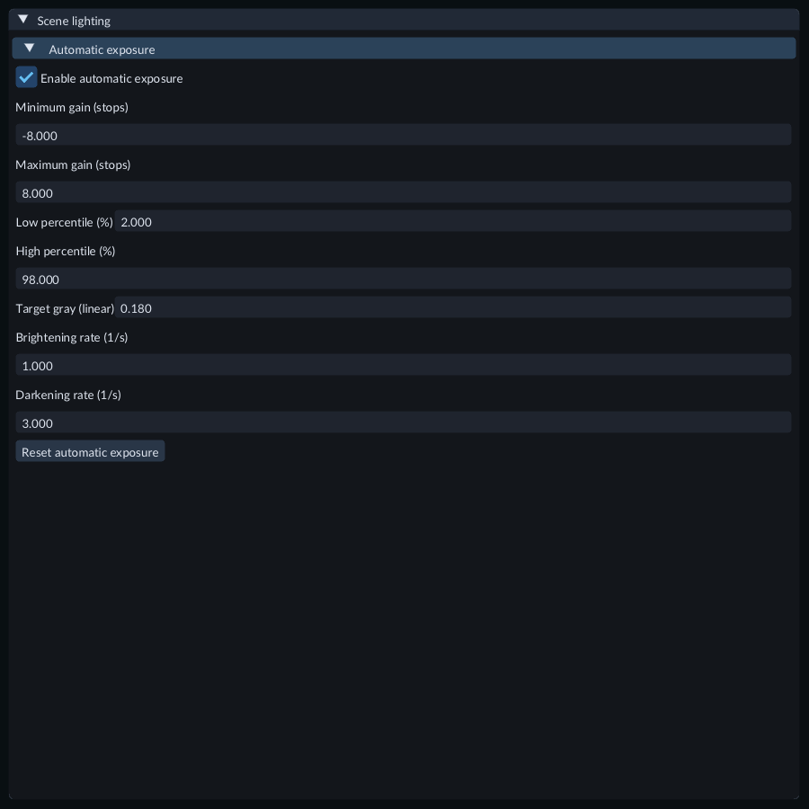

Set the brightness range and response in Automatic exposure.

- **Minimum gain (stops)** and **Maximum gain (stops)** limit the automatic correction from -20 through +20. Minimum must not exceed maximum; +1 doubles linear light. Equal limits hold a fixed gain.
- **Low percentile (%)** and **High percentile (%)** exclude dark and bright outliers from the light measurement. Each accepts 0–100 and low must be less than high. Defaults are 2 and 98. Empty black pixels are excluded already.
- **Target gray (linear)** accepts 0.001–1 and defaults to 0.18. It sets the target before tone mapping and color grading, so it does not promise an exact final screen brightness.
- **Brightening rate (1/s)** controls how quickly gain increases after the image becomes darker. **Darkening rate (1/s)** controls decreasing gain after brighter light. Both accept 0.01–20; larger values respond faster.
- **Reset automatic exposure** disables the effect and restores its defaults in one Undo step. Unchecking Enable retains your chosen values for later use.

Open Gallery **96-automatic-exposure** and press Play. Its sunlight switches from
dim to bright after two seconds and returns to dim just after four seconds,
repeating every eight seconds. Watch the initial brightness change settle. Stop,
change the rates, save and try again. Export it as the startup Scene to compare the
standalone result. No C++ module or compiler is required for this example.

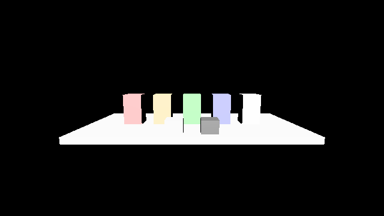

A light increase initially brightens the Game image.

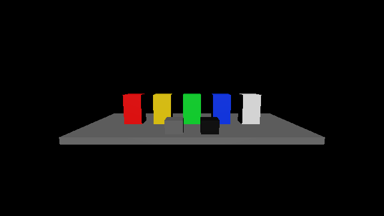

Automatic gain then brings the composed image toward the chosen target.

Automatic exposure measures the composed Game image, including bloom, before
manual compensation and grading. All camera rectangles share that measurement;
the game HUD is drawn afterward. Scene View keeps its separate manual preview.
Visual adaptation uses real elapsed presentation time, including while simulation
is paused. New Scenes, changed cameras/viewports, resizing and newly ready resources
restart the measurement, which can cause an immediate brightness change.

The meter samples a bounded grid and excludes empty black and invalid pixels.
There is no spot mask, per-camera exposure or HDR-monitor output mode. Strong gain
limits can clip display detail. An unsupported compute device reports a rendering
error when enabled; stop Play and disable the effect to use manual exposure.

## Adjust Scene colors

Open **Tools > Scene lighting...**, scroll to **Color adjustments**, and select
**Enable color adjustments**.

- **Color filter (linear RGB)** multiplies red, green and blue light before tone mapping. `1,1,1` leaves colors unchanged; each channel accepts 0–4. For a warmer image, try `1.1,0.85,0.7`.
- **Saturation** accepts 0–2: 0 is grayscale, 1 retains the original saturation, and 2 strengthens it.
- **Contrast** accepts 0–2: 1 retains contrast, higher values strengthen differences around 18% linear gray, and 0 produces a flat gray image. Strong settings can clip dark or bright detail.

Press Enter to commit a typed value. Each edit uses Scene Undo; save the Scene to
keep it. **Reset color adjustments** disables the effect and restores all default
values in one Undo step. Disabling it retains your chosen values for later use.

These are authored Scene settings shared by Scene preview, Play and exported games.
They affect geometry, the background and bloom; editor controls/overlays and the game
HUD keep their own colors. The Scene preview's personal exposure remains independent.
Stop Play to change these authored controls. Open Gallery
**69 — Scene color adjustments** to compare its warm preset with disabled, grayscale
and neutral settings, then export and run the same Scene.

## Add shadows

1. Select a Directional, Spot or Point light and enable **Cast shadows** in its Light component in the Inspector.
2. Open **Tools > Scene lighting...** and leave **Enable shadows** on.
3. Select the visible mesh. Its Mesh Renderer controls **Cast shadows** and **Receive shadows** independently.
4. Adjust **Map resolution** for detail, **Directional cascades** for camera-depth coverage, and **Shadow distance (m)** for the directional reach. Press **Enter** to commit a field.
5. Save the scene. Each setting change has its own Undo step.

Directional lights use 1–8 cascades. Spot lights use one perspective map; point lights
use six faces. The last directional cascade fades out over the final tenth of its
depth range. Neighboring cascades blend over an overlapping depth interval. **Shadow distance (m)** also limits shadow maps for point and spot lights
whose Range is unlimited; their light itself still follows its normal range rules.

**Maximum shadow lights** accepts 1–8 per camera. Shadow maps have a 256 MiB depth
payload limit per camera, in addition to the device's texture-size limit. Exceeding
these limits reports the affected light in **Problems**. That light continues to
illuminate the scene without a shadow; FORGE does not silently resize the maps.

A light's **Shadow bias** offsets the depth comparison. **Shadow normal bias** moves
the comparison point along the geometric surface normal in metres. Increase bias
carefully to remove surface speckling: too much bias detaches shadows from objects.

Alpha-mask materials use their base-color alpha and cutoff while casting shadows.
Alpha-blended surfaces do not cast opaque depth shadows. Mirrored meshes keep the
same casting behavior; fully collapsed geometry has no rasterized shadow area.
Legacy blockout shading remains unlit and does not receive PBR light/shadow terms,
although its derived mesh can cast. Use a PBR material for a lit receiver.

### Soften shadows with a light source size

Contact hardening makes a shadow sharp near the casting object and softer farther
away. Use a lit PBR receiver and an enabled shadow-casting Light. The Scene and
Mesh Renderer shadow switches described above must also be enabled.

1. Stop Play and select the light in Hierarchy.
2. For a Directional light, set **Shadow Angular Radius (rad)** in its **Light** component. This is the source's apparent half-angle, from **0** to approximately **0.785398** radians. Start with **0.01**.
3. For a Point or Spot light, set **Shadow Source Radius (m)** instead. This is a world-space radius from **0** to **10000** metres. Start with **0.1**. Entity scale does not multiply it.
4. Press **Enter** after typing. Move a casting box farther above a lit floor to compare the widening shadow edge. **0** retains the ordinary fixed filter. Each committed edit supports Undo and Redo.
5. Save the Scene. Play and exported games use these saved Light values; no extra baked asset is needed.

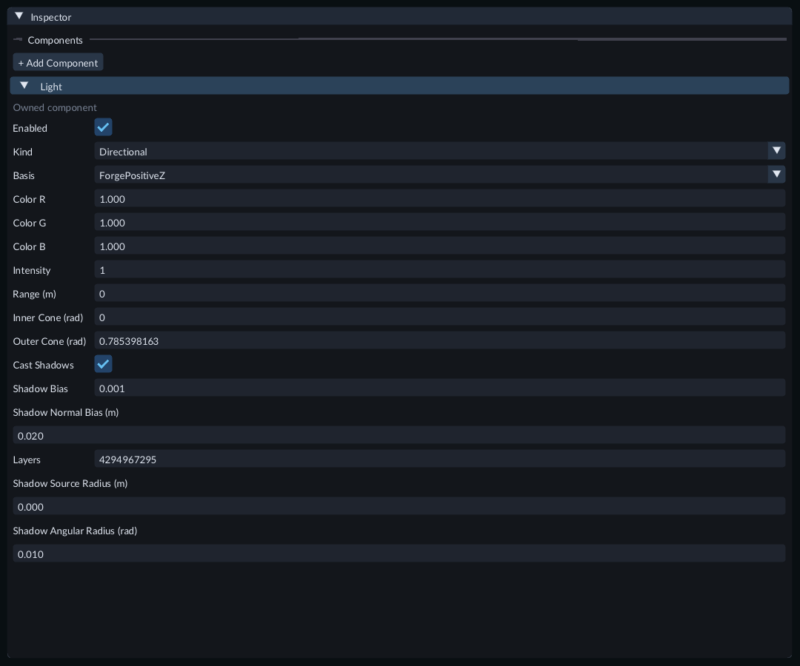

Only the source-size field for the selected light kind affects softness. Both fields
remain stored when you change Kind. Intensity, range, attenuation and illumination
retain their usual meaning: source size changes shadows, not area-light emission.

Open **111-contact-hardening-shadows** in the Feature Gallery for resting and raised
boxes. Select **Soft sun - change Shadow Angular Radius** and compare **0.08** with
**0**. Larger separation produces a wider soft edge.

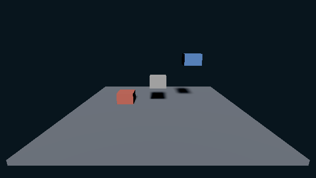

The resting box has the closest contact; the two raised boxes show increasing
separation. Turn off **Preview light** when comparing authored Scene lighting.

During Play, edit the two source-size fields under Inspector's **Live gameplay**.
They change the running world without changing the authored Scene. Stopping Play
restores authored values unless you keep the selected fields through the tuning
review. Other Light fields are edited while stopped. See [Play mode](play-mode.md).

Soft shadows use a bounded approximation from the existing shadow maps. The filter
radius is limited to **32 map texels**, or less on small maps; very large sources
can reach this limit rather than grow wider. Faint sampling patterns, missed thin
casters and reduced detail at low resolutions are possible. Raise Map resolution
or reduce source size when needed. Cascades, distance fades, layer masks, cast and
receive flags, alpha-mask behavior and the existing resource limits still apply.
Bias may need adjustment for the map resolution and surface slope. Source size
does not create transparent colored shadows or traced area-light illumination.

## Current integration limits

PBR materials receive scene lighting on both imported and built-in meshes. Legacy
blockout entities already resolve built-in Mesh/Material resources while keeping
their existing authored data and default unlit appearance. Assign a PBR material
to use the scene lights on a blockout object.
Game uses authored Camera components; add an enabled camera before starting Play.
See [Play mode](play-mode.md).

The resizable lighting window keeps labels beside or above their fields as space
allows. At larger interface zoom, scroll to reach the shadow settings. Changing
window size or interface zoom does not change the scene.
