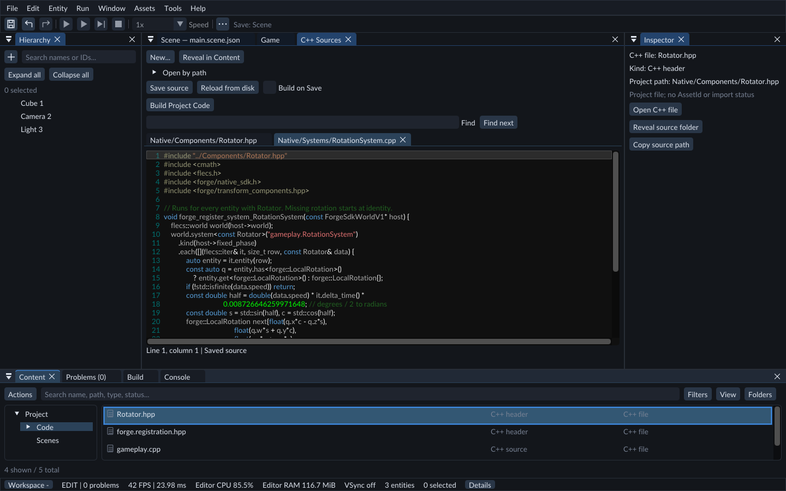
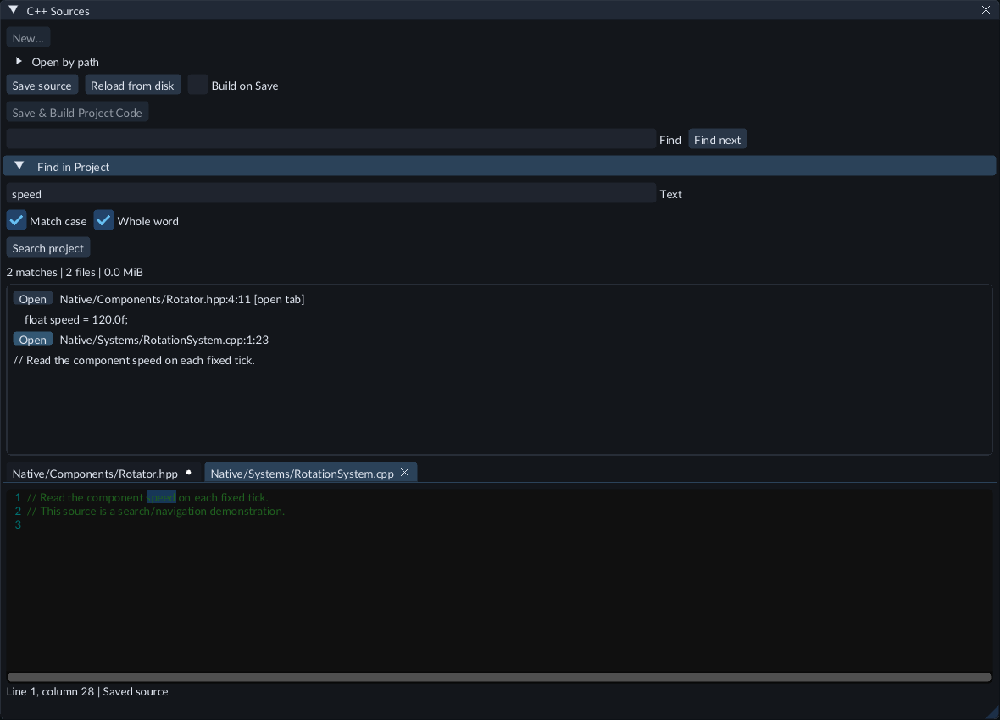

# Project Code (C++)

FORGE uses Flecs components for data and systems for behavior. Give a Cube a
`Rotator` component; a `RotationSystem` then processes every entity whose query
matches. Systems are registered for the world, not attached to individual objects.
C++ files live in your project's `Native/` folder. Find them under **Content → Code** and edit them in the central **C++ Sources** document. They are project files, not AssetId assets or Hierarchy entries.



Open a file from Content → Code to edit it in C++ Sources.

## Prepare the compiler

Install Visual Studio 2022 C++ build tools with the Windows SDK, CMake 4.3 or
newer, and Ninja. Extract the FORGE Windows ZIP, which includes the matching
Native SDK, then launch **Run-Forge-Dev.cmd** to use the installed toolchain.
The FORGE source build minimum is CMake 3.30; the packaged Native SDK install
needs CMake 4.3 or newer. In **Build**, expand **Compiler
setup** and choose **Test compiler tools**. FORGE builds and checks a separate starter
module without changing your gameplay or project settings. A failure names the
missing or incompatible tool. **Get C++ Build Tools** opens Microsoft's official
download page; FORGE does not install or bundle a compiler. You can specify CMake
and Ninja executable paths in Compiler setup. Normal source editing and an
exported game do not need these tools. A matching installed Native SDK is required
to build and Play C++.

### Resolve a toolchain mismatch

Open **Build → Compiler output** after a failed test. SDK compatibility errors
show the expected and detected compiler version, architecture, build configuration,
flags or C++ runtime library. Use the exact compiler/toolset required by your
FORGE distribution; having Visual Studio 2022 installed alone does not establish
compatibility. The error also identifies the SDK configuration file being used.
Keep **Native SDK folder** pointed at the SDK shipped with this editor.

If the error requires **CMake 4.3 or newer**, set the **CMake** field under
**Compiler setup** to that executable's full path, then choose **Test compiler
tools** again. A separately installed CMake and Visual Studio's bundled CMake can
have different versions. **Run-Forge-Dev.cmd** locates the installed tools;
the compiler test checks whether they can build and load a matching module.
After the test passes, choose **Build Project Code** for your own source.

## Create a component and system

1. Open **Build → C++ setup**. Choose **Set up C++ code** for a new project. Existing `Native/` source is never overwritten.
2. Open **Content → Create / Register → C++ → Component...** and enter `Rotator`. This creates and opens `Native/Components/Rotator.hpp` with a reflected `speed` value. In short panels, open **Actions** first.
3. Use **Content → Create / Register → C++ → System...**, select `Rotator`, and enter `RotationSystem`. This creates and opens `Native/Systems/RotationSystem.cpp`, which queries Rotator, reads effective rotation or identity, and runs on the fixed gameplay tick.
4. Double-click either file in **Content → Code** to edit it. The C++ Sources tab and **Save source** button mark unsaved changes with `*`. The active-task **Save** shortcut (Ctrl+S by default), document Save and the button save the active C++ file. Scene Save is separate. Change the shared Save key under **Edit → Preferences → Editor shortcuts...**.
5. Choose **Build Project Code** in Build, C++ Sources or Run. With unsaved drafts the action becomes **Save & Build Project Code**. It compiles saved files, validates the candidate in an isolated worker and publishes after admission.
6. Wait for **Project Code: Current**. Create a Cube, select it, use **Inspector → + Add Component** to add Rotator, set Speed and save the scene. Right-click the component header for **Open C++ Definition**.
7. Add an enabled Camera and a Light as described in [Your first scene](../getting-started/first-scene.md), then press **Play** and open Game to see the cube rotate. Code or schema changes use **Stop → Save → Build → Play**. FORGE offers **Save, Build & Play** for unbuilt source and never silently runs stale code.


**Content → Code** shows the real `Native/Components`, `Native/Systems` and other supported source paths. Its friendly Code label does not rename `Native/` on disk. Use **Create / Register → C++ → Source file... / Header file...** to add a `.cpp` or `.hpp` directly under `Native/` without overwriting an existing file. Managed builds register new `.cpp` files; a custom CMake recipe must include them explicitly. C++ Sources has a **New...** shortcut to the same Content creation dialog.

For project queries or observers without a component template, create a System
and select **Component: None (empty registration)**. FORGE creates a registered
startup function in Native/Systems and includes the source in managed builds.
Write the query or observer in that function; the empty template has no gameplay
behavior. Choosing a component still creates the rotation example.

The built-in source editor provides C++ highlighting, line numbers, source-only
Undo/Redo, **Ctrl+F** and **Find next**. A file changed outside FORGE shows a
notice; a conflicting Save keeps your draft, and **Reload from disk** asks before
discarding it. Source files must be UTF-8 and at most 1 MiB; up to 32 tabs may
be open. This editor does not include a debugger, full IDE completion or arbitrary
in-place C++ reload.

## Find code across the project

In **C++ Sources**, expand **Find in Project**, or press **Ctrl+Shift+F** while
that document has keyboard focus. Enter literal text, choose **Match case** and
**Whole word**, then press Enter or **Search project**. **Ctrl+F** and **Find next**
continue to search only the active file.



Project search lists matching Native paths, one-based lines and columns, and a
short source excerpt. Click **Open** beside a result to navigate to the match.
Results marked **[open tab]** use the text that was in that tab when the search
started, including unsaved changes. Searching and opening results do not save
files or add an Undo step. Existing source drafts and their Undo history remain
available in their tabs.

Search runs in the background. **Cancel search** stops it without changing code.
Rerun after editing: a result whose source changed is refused instead of opening
an outdated location. Reload an externally changed clean tab, then search again.
Save conflicts retain their normal behavior.

Only supported source/header files under **Native/** are searched. Build folders,
`.forge`, linked files/directories, SDK headers and engine sources are excluded.
Each source must be valid UTF-8 without NUL and at most 1 MiB. A search examines
at most 2,048 files and 32 MiB, returning at most 512 matches. **Incomplete**,
cancellation, skipped-file errors or a limit message mean the displayed list is
partial. Narrow the text when a limit is reached.

Matching uses literal text, without regular expressions. **Match case** is on by
default; turning it off ignores ASCII letter case. Non-ASCII text keeps its exact
spelling. **Whole word** treats letters, digits, underscores and non-ASCII bytes
as word content, so `speed` does not match `speeds` or `_speed`.

## Run an ECS system on worker stages

Open **161-fixed-ecs-workers** in a writable Feature Gallery copy. Its sixteen
cubes are a static setup stage until you build and attach the supplied component.
The camera and light are ready for Play.

1. Set up C++ code with the matching Native SDK and compiler as described above.
2. Create a C++ Component named **ParallelMotion**. Replace `Native/Components/ParallelMotion.hpp` with `CodeExamples/ParallelMotion.hpp` from the Gallery.
3. Create a C++ System named **ParallelMotion**, selecting **None (empty registration)**. Replace `Native/Systems/ParallelMotion.cpp` with `CodeExamples/ParallelMotion.cpp`. Change its first include to `#include "../Components/ParallelMotion.hpp"` so it finds your component header.
4. Save both files and choose **Build Project Code**. Inspect components if the Build panel asks for it.
5. Select a motion cube and add **Parallel Motion** in Inspector. Set **speed** to 1, or a negative value to move left. Attach it to more cubes to give the query more work. Save the Scene.
6. Open **Tools → Project Settings**, set **Fixed ECS workers** to 4 and click **Save Settings**. Press Play, then use Pause and Step to inspect movement. Each fixed second moves an attached cube by its speed along local X.
7. Compare with a saved setting of 1 after restarting Play. Cube motion should match. Sixteen cubes are a small demonstration, not a speed benchmark.

The example declares read-only component data and a writable, owned translation.
Its `.term_at(1).src().self()` restricts the second query field to the entity's
own translation; term indices start at zero. An entity that only inherits a
translation does not match this system. Give it its own translation to move it.
Only its explicit `multi_threaded()` system is distributed. Its modification
notification uses the iterator's staged entity and publishes at the native merge.
Do not call owner-thread services, manipulate the root world, change shared
containers, or let exceptions escape a worker callback. Physics, audio, assets,
rendering and editor documents keep their existing service contracts.

Use the colored **Live gameplay** Inspector to change speed while playing. Those
values remain temporary unless you capture and keep them after Stop. Save the
Scene and worker setting, choose the Scene as startup, build the matching module
and export with its module kit and a worker-capable runtime kit. Runtime-only
motion does not overwrite the authored positions.

## Tune values while playing

During Play, the Inspector has a **Live gameplay** section for admitted reflected
properties. Select the runtime entity and change Rotator Speed from 90 to 360. The
runtime checks and applies the value; behavior changes without compiling. **Stop** returns to the authored scene
and its prefab override intent. To keep selected values deliberately, choose
**Keep values after Stop...**, then Stop and use **Run → Review runtime tuning...**.
Apply selected fields as one Scene Undo step, then Save. See
[the complete review workflow](play-mode.md). A
read-only runtime field remains read-only. Code or schema edits still require a
new build and fresh Play session.

## Build status and failure

**Source Dirty** means a C++ tab has unsaved edits. **Build Required** means saved
source differs from the admitted module. **Building**, **Build Failed**, and
**Project Code: Current** distinguish the remaining states. A changed Native
SDK requires a compatible new build; a missing matching SDK blocks managed Play.
A failed build keeps the last good artifact, but Play and Export do not treat it as current. Click a
compiler diagnostic in **Compiler output** to open its source line. The full log
is `.forge/sdk-build/build.log`; source remains editable. Build on Save uses the
same build operation after source is saved. It waits for Play to stop and all
source drafts to be saved; turning it off affects future saves and does not
cancel a running build. Use **Cancel build** for that. Cancelling a candidate
never replaces the previous good module.

After **Cancel build**, wait for the stopping status to finish before starting
another build. You can continue using the editor while the compiler shuts down.
If FORGE reports an unexpected compiler shutdown, retry **Build Project Code**;
it uses fresh temporary build storage when the previous work cannot be safely
reused. Your saved C++ source and last good module remain available.

## Keep a C++ timer running during pause

Use your module's `controls` callback for menu timers or UI effects that should
continue while gameplay is paused. Fixed systems and Flecs simulation timers
follow gameplay speed and stop during Pause.

1. Declare the `forge.game` dependency and the SDK's `FORGE_SDK_GAME` capability for your module.
2. In `controls`, call `game_query` using its normal sizing call followed by a copied JSON buffer.
3. Read `clock.unscaled_time` for elapsed seconds, `clock.unscaled_delta` for the latest observed interval, and `clock.unscaled_sequence` to identify that interval.
4. Remember the last sequence. Only consume a new interval once; use differences between elapsed values if your timer skips observations.
5. Save and build your C++ source, then Play. Check the timer during **Pause**, **Hold motion (0x)** and a slower speed. Its time continues while fixed gameplay stays paused or slowed.

The matching SDK includes `sdk/sample/time_scale_probe.cpp`. Its
`time_scale_gameplay` target demonstrates this timer and control-input speed
changes; it is a developer example with its own fixture, not a component to attach
unchanged to your Cube.

These values are monotonic seconds, not dates. The first host observation is zero,
and repeated queries can return the same sequence. Long stalls appear in full;
cap an interval in your project if a UI effect needs it. Switching Scenes within
the session retains the host timeline. A new Play/process starts a new timeline.
Save timer progress explicitly in your game's save data if it must persist.

## Export

Save the scene, build current gameplay, then choose **Run → Export Game...**.
Export refuses dirty or unbuilt managed source. The standalone folder contains
the admitted compiled C++ module, matching runtime and cooked dependencies. It
runs after relocation without the source project, editor or compiler. Externally
built exact-SDK projects keep their explicit module kit/deployment workflow.

Older projects with the retired movement-only module format are preserved on disk
but cannot Play or Export with that code. Create a new managed C++ project and
migrate the source deliberately; FORGE does not automatically translate C/C++.

## Author opted-in project components

Reflection alone does not make arbitrary C++ objects editable. Your module must
explicitly opt a supported plain-value component into authoring using the exact
SDK's `authoring_type` callback, a stable namespaced key, positive schema version
and declared defaults. Native pointers and arbitrary resource-owning objects are
not generic authored values.

1. Stop Play and build the module with the matching Native SDK.
2. In **Build → C++ setup**, set **Native SDK folder**, then click **Inspect components**.
3. Wait for the available-type count. FORGE runs the inspection in a separate process; a failed inspection keeps the last admitted types and values.
4. Select an entity and use **Inspector > + Add Component**. Search the opted-in type's friendly name or category, then edit its reflected properties.
5. Save the scene and press Play. The matching runtime receives the authored values by stable field names. A missing or incompatible schema rejects the runtime load rather than silently ignoring those values.

Nested properties, collections, flags, references, defaults and prefab overrides
use the shared [Inspector controls](inspector.md). **Inspect components** does not
change existing values to new defaults or automatically migrate an older schema.

FORGE writes `forge.components.json` at the project root after successful
inspection. Keep this file in source control with your project: it records prior
schemas needed for migration and reserves a removed component's key for its
original module owner. It contains copied metadata, not gameplay code, and does
not activate a module by itself. Changing a type's structure requires a new schema
version; changing presentation labels or defaults does not rewrite existing values.
The history is bounded to 1,024 recorded declarations and 32 MiB; exceeding that limit
rejects activation without dropping old records.

## Migrate a changed component schema

Build the new schema version and **Inspect components** first. Old values stay
read-only until explicitly migrated. Keep your earlier `forge.components.json`
when upgrading the module; FORGE needs its source schema to interpret old values.

1. Choose **Migrate scene values...**, or open a prefab source and choose **Migrate open prefab draft...**.
2. Select the component's old and new versions. Confirm which document is the target.
3. Leave both rule lists empty to retain existing fields and add declared new-field defaults. Add an explicit alias for a rename, as shown below.
4. Click **Prepare migration**. Validation runs in a separate process and leaves documents unchanged.
5. After a successful preparation, choose **Apply scene migration** for one scene Undo step, or **Use migrated prefab draft** and review the prefab before its separate Save/Publish.

For a field renamed from `hitpoints` to `health`, use:

```json
{
  "aliases": [{"path": ["hitpoints"], "name": "health"}],
  "defaults": []
}
```

A nested collection path uses `*`, for example `["items", "*", "old_name"]`.
When a new field inside each list entry needs a value, add an explicit default such
as `{"path": ["items", "*", "added"], "value": 7}` to the `defaults` list.
Aliases use original source-field paths. Conflicting destinations, cycles, invalid
values and unsupported representation/unit changes reject the candidate.

Removed and unknown fields remain stored. Changed defaults affect new components,
not existing owned values. A partial prefab override does not gain extra top-level
overrides. Migrating a prefab source and its scene overrides are separate reviewed
operations; this is not Apply to Prefab and is not one cross-document transaction.
Scene Undo can restore an older schema payload read-only without losing its data.
If the document changes during review, prepare a fresh candidate.

For developer diagnostics, `bin/forge_runtime --inspect-sdk <project-folder>`
prints opted-in metadata without starting gameplay. The editor's Inspect command
adds worker supervision and transactional admission around that extraction.

For manifest fields, ownership and the installed sample, see the SDK installation's
`sdk/docs/extension-guide.md`. Compiler output stays in your build terminal; runtime
module messages appear in FORGE's diagnostics.

Exact SDK gameplay can request cooked Mesh, Material, Texture and Shader assets
through the host's Resources capability and inspect their load state and revision.
Texture requests can choose published color, data, normal-map or HDR variants.
Failed replacements keep the last usable revision. These requests load CPU data;
they do not grant access to the graphics device or guarantee a complete draw is
ready. The packaged SDK extension guide documents the
callback contract, lifetime and limits. Rebuild native modules when the exact SDK
fingerprint changes.

SDK gameplay can also request a new runtime entity, wait until it is ready, and
assign a MeshRenderer and local transform components using Flecs. It appears in
Game presentation through the normal scene membership. Creation takes effect at
the next game tick; when paused, use **Step** or **Resume**. It does not add an
object to the editor's saved scene or its Undo history. The SDK guide includes the
code, scene-selection rules, cancellation and lifetime details.

The migration review stays within the available editor area at larger interface scales. **Rules (JSON)** appears above its text field so the label remains readable. Scroll the review when its contents need more space; opening it does not change the scene or prefab.

## Run systems in a game mode

[Application States](application-states.md) defines modes and their parent
relationships in a published asset. Use the installed `forge/application_state_ecs.hpp`
helpers to read current states and condition ordinary native queries on their
membership. The `application_states_gameplay` SDK sample shows a constant domain
source, enter/exit event copies, queued requests and receipt handling.

Queued requests use the Game service. Check its capability before use: shared-SDK
Play and standalone games provide it; legacy Play does not. A successful queue
submission is not a completed transition. Inspect the returned receipt, handle a
rejected request and release it when finished. State queries and editor/UI controls
remain available in legacy Play. Runtime pairs are read-only for project code.

Use [State Condition](application-states.md)
on an object to control its stock rendering, physics, audio and other supported
runtime activity. This leaves its enable fields and structural identity intact.
It does not filter your C++ systems; keep their execution conditions explicit.
The matching SDK value is `forge::ApplicationStateGate` in
`forge/application_state_components.hpp`.

## Receive typed input messages

Add [Input Message](input-messages.md) to an entity to send an attached component's
value to a C++ observer on a digital press. Use the actual component type as the
event and an Any query term; read the copied value as const during the callback.
The Feature Gallery InputMessages.cpp example demonstrates source identity checks
and transient runtime changes through the same matching SDK.
