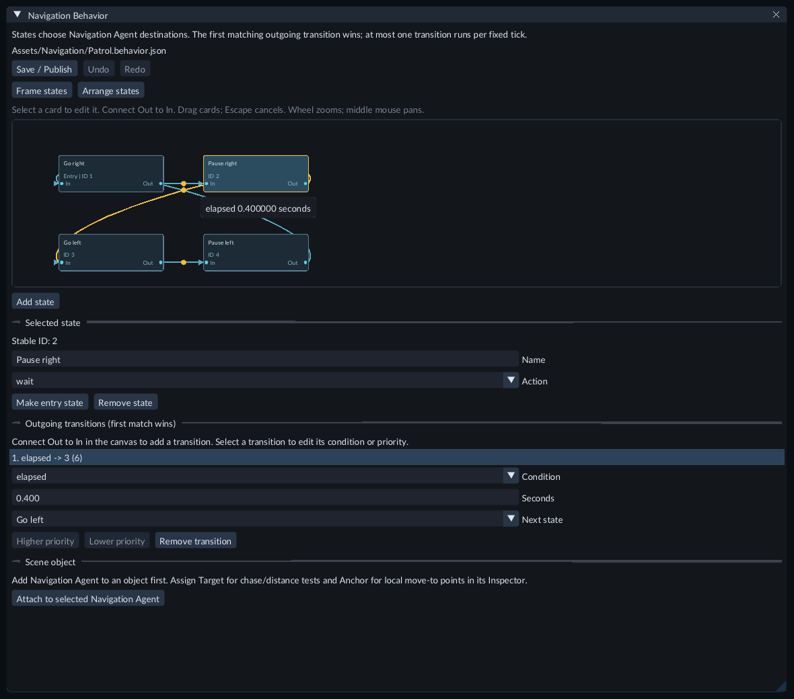
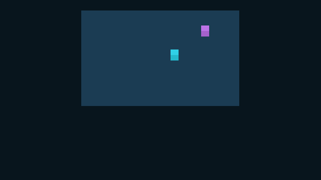
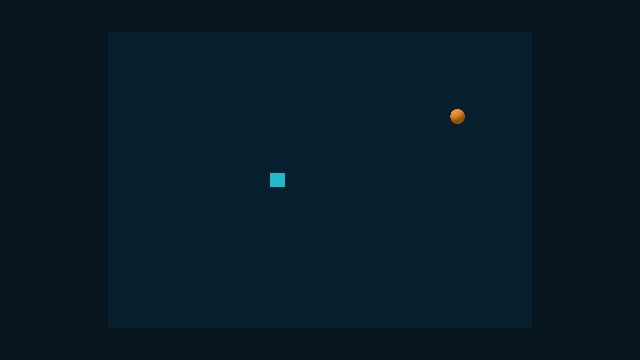
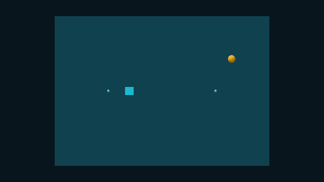
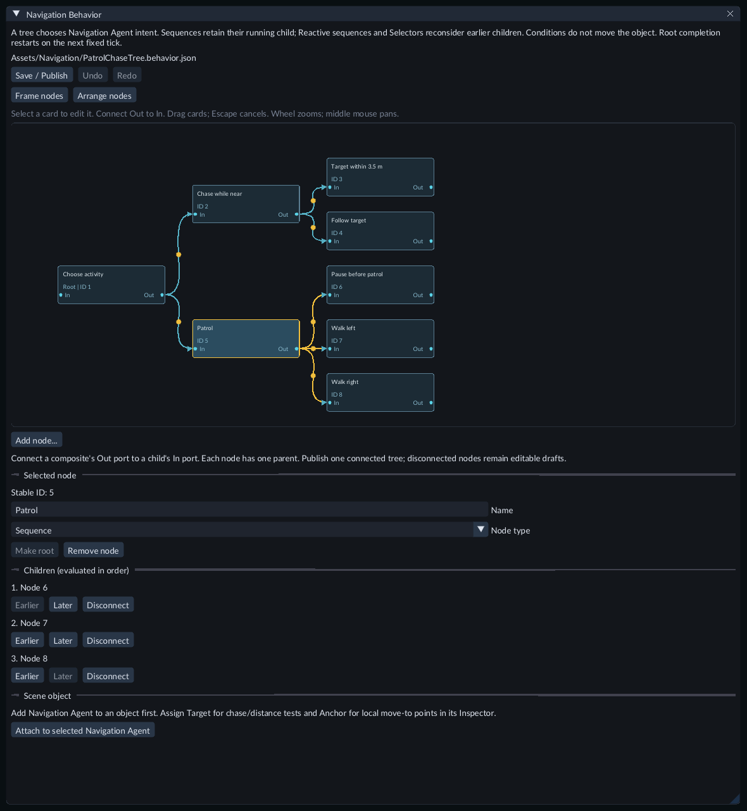

# Create a navigation behavior

A **Navigation Behavior** is a state graph or behavior tree that chooses where a
**Navigation Agent** should go. Use it for patrols, pauses and following a target. The agent
handles routes and movement. No project C++ module is required.

Select a connection to edit its condition, duration and destination below the canvas.

## Try the ready examples

Open **Scenes/131-patrol-behavior.scene.json** in Feature Gallery and press Play.
The cyan and violet agents share one graph and keep separate progress; the second
patrol uses an Anchor to move the route to another lane.

Open **Scenes/132-chase-behavior-xy.scene.json** for a moving orange target and a
cyan chaser. Its near/far conditions switch between watching and following. The
Camera keeps the course in view when the window changes shape.

Select **Patrol agent - inspect behavior** or **Chaser - inspect behavior and
target** to read Live gameplay progress. Stop before editing their graph files
under **Assets/Navigation** or the target's transform-animation clip. The examples
include cooked graphs, navigation and animation; they can be exported directly.

## Prepare the scene

1. Build a walkable [NavMesh](navigation.md) for your floor or XY regions.
2. Select the moving object. Add **Navigation / Navigation Agent**, assign that NavMesh, and choose its speed and stopping distance.
3. Keep Physics Body, Physics Body 2D and enabled Character Controllers off this object. Navigation must be its movement owner.
4. Save the scene. Add an active Camera and suitable lighting for Game view.

## Create and edit a graph

1. In **Content → Create / Register**, choose **New navigation behavior...**.
2. Enter a project file such as `Assets/Patrol.behavior.json`, keep **Profile → State graph**, and click **Create**.
3. The **Navigation Behavior** document opens with a **Wait** entry state.
4. Click **Add state** to create another card. Select a card to edit its name and action below the canvas. Names must be unique.

Open the published asset from Content to edit its source again. Keep the
`.behavior.json` suffix when moving or duplicating its source file.

- Drag a card and release to commit one Undo step. **Escape** cancels.
- Click **Out**, then a destination's **In**, to add a transition. Self connections are supported. New transitions use an elapsed time of one second.
- Select an edge or an outgoing transition row to edit its condition and destination.
- Use **Higher priority** and **Lower priority** to order a state's transitions.
- **Frame states** fits the cards. Wheel zooms; middle mouse pans.
- **Arrange states** organizes all cards as one Undo step.

Card positions are saved with the source and do not affect runtime behavior.
Use the document's **Undo** and **Redo**, or the ordinary history shortcuts while
it is active. IDs remain stable through renaming and arranging; deleted IDs are
not recycled. **Remove state** also removes transitions that enter that state.

## Actions and conditions

- **wait:** releases the behavior's own movement destination.
- **move_to_point:** sends the agent to Point, in world coordinates without an Anchor.
- **follow_target:** updates the destination from the current Target position.

Assign **Target** and optional **Anchor** on the object's Navigation Behavior
component in Inspector. An Anchor transforms move-to Point coordinates from
local to world space. XY navigation uses X/Y and keeps the moving object's visual Z.

- **elapsed:** this state's fixed simulation time reaches Seconds.
- **arrived:** navigation reports arrival at this state's movement destination.
- **target_near:** an available Target is at most Distance away.
- **target_far:** an available Target is at least Distance away.
- **target_missing:** the configured Target cannot be resolved.

The first matching outgoing transition wins. At most one transition runs per
positive fixed tick; entering a state resets its elapsed time. Zero seconds still
requires a tick. Missing targets match neither near nor far; add `target_missing`
for an explicit fallback.

### Build a patrol

1. Rename the first state **Go right**. Choose `move_to_point` and set Point to **4, 0, 0** for a 3D floor at world Y0.
2. Add **Pause right**, **Go left** and **Pause left**. Use `wait` for pauses and `move_to_point` with Point **-4, 0, 0** for Go left.
3. Connect the states in a loop. Choose `arrived` for each movement state's outgoing transition and `elapsed` for each pause. Set the pause durations in Seconds.
4. Select Go right and click **Make entry state**.
5. Click **Save / Publish** and wait for publication to finish.
6. Select your Navigation Agent in Hierarchy. Click **Attach to selected Navigation Agent** in the graph document. This adds the component if needed and assigns the graph in one scene Undo step. Save the scene.

For a chase, connect a wait state's `target_near` transition to a `follow_target`
state. Add `target_far` and `target_missing` transitions back to wait, then assign
Target in Inspector. Different near/far distances avoid repeated switching at
one distance boundary.

## Build a behavior tree

Choose **Profile → Behavior tree** in the New navigation behavior dialog to start
a tree. Existing state graphs keep their profile. To try a finished example, open
**Scenes/139-behavior-tree.scene.json**, press Play and watch the cyan agent chase
the orange target or patrol between green markers.

The green markers identify the two patrol destinations. Stop returns to the saved starting poses.

Stop and open **Assets/Navigation/PatrolChaseTree.behavior.json** in Content to
inspect the example. A tree evaluates children in their listed order:

- **Sequence** runs children in order. It remembers a running child, continues when that child succeeds, and fails when a child fails.
- **Reactive sequence** checks its earlier conditions again each tick. A failed condition cancels its running branch.
- **Selector** tries children until one runs or succeeds. Earlier branches have priority and are reconsidered each tick.
- **Wait** runs until **Seconds** elapse, then succeeds. It releases the behavior's own movement destination.
- **Move to point** and **Follow target** run until navigation reports arrival, or fail if their destination cannot be used. A missing Target fails Follow target.
- **Target near**, **Target far** and **Target missing** succeed or fail immediately. Near includes the chosen **Distance (m)**; Far includes that distance and larger values. An unavailable Target matches neither Near nor Far.

For a chase with a patrol fallback:

1. Choose **Selector** for the root's **Node type**.
2. Use **Add node...** to add a **Reactive sequence**, a **Target near** condition and **Follow target**. Connect the Selector's **Out** to the Reactive sequence's **In**, then connect that sequence to the condition and action in that order.
3. Add a **Sequence** as the Selector's second child. Connect a **Wait** and two **Move to point** nodes to it. Set the wait's Seconds and each movement node's Point.
4. Select each composite to review its children. **Earlier** and **Later** change execution priority. **Disconnect** keeps the child as an editable draft. Reconnect it before publication.
5. Use **Make root** on a parentless node if you need a different root. **Remove node** detaches its children rather than deleting them. Each node can have one parent; loops are rejected.
6. **Save / Publish**, attach the graph to the selected Navigation Agent, assign Target in Inspector and save the Scene.

**Frame nodes**, **Arrange nodes**, zoom, pan, drag, Undo and Redo work as for state
graphs. Switching a composite to a leaf disconnects its children. Disconnected
nodes and empty composites can remain in a draft; publication requires one
connected tree with at least one child per composite.

A completed root starts again on the next positive fixed tick. A preempted branch
starts fresh when chosen again. A new Wait does not receive time from the action
that preceded it in the same tick. In Play, **Navigation behavior** shows **Node**,
**Tree result**, elapsed time and **Steps**. Steps count completed positive fixed
evaluations. Pause and observation do not advance progress.

## Test, tune and export

Press **Play** and select the object. **Live gameplay → Navigation behavior**
shows its phase, state, elapsed time and transition count. **Navigation progress**
shows the agent's route and movement separately.

The behavior's live **Enabled** checkbox holds/resumes its graph progress.
Disabling releases its own destination; a destination later set by another
system remains under that system's control. Stop restores authored values.
Use **Keep values after Stop...** to retain selected supported changes deliberately.
Graph, Target and Anchor changes require returning to Edit mode.

Stop before editing the graph. **Save / Publish** the source, save the scene, then
start Play again. Save or explicitly discard pending source drafts before
[exporting](../getting-started/standalone-runtime.md). The export includes the
selected cooked graph and NavMesh without their editable source files or build workers.

## Troubleshooting and limits

- **Pending:** let the graph resource load. Publish a new source before attaching it.
- **Failed:** read the details and Problems. Check the graph, Target, Anchor, Navigation Agent and marked geometry. Other valid behaviors can continue.
- **No movement:** inspect Navigation progress, agent Enabled, speed, NavMesh and point reachability. A Wait action intentionally has no movement goal.
- **Missing Anchor:** repair or clear the reference. A point action with a configured unavailable Anchor cannot invent a world position.
- **Last good graph:** correct the rejected source replacement and publish again.
- **Pending changes on close:** choose **Save**, **Discard** or **Keep editing**. Source publication and scene saving are separate operations.

Limits: 32 states, eight outgoing transitions per state, 128 transitions total,
64 KiB source; 64 controllers and eight configured graph assets per scene.
Point coordinates are within ±4096, elapsed conditions within 0–3600 seconds and
target distances within 0–8192 world units. Trees have at most 32 nodes, eight
children per composite and eight levels including the root; each evaluation
boundary visits at most 32 nodes. Arbitrary script actions are unavailable.
Runtime progress is not an authored scene
property or a durable save-game payload.
