# Navigation

For patrols, timed pauses and target following, add a
[Navigation Behavior](navigation-behavior.md) to an agent after building its NavMesh.

Navigation lets an object find a route across a floor and around static obstacles. Build a **NavMesh** from marked 3D shapes, 2D regions or selected static colliders, then give an object a **Navigation Agent** and a destination. Choose the plane explicitly when building.

Agents follow baked static geometry. Add **Navigation Avoidance** for local steering
around other participating agents. For moving solid footprints, enable the
**Dynamic obstacles** when building and add **Navigation Obstacle** components.
The default **Movement → Navigation** writes the object's position directly and
cannot share it with a Physics Body or an enabled character controller.

## Rebuild navigation during Play

Use **Game → Runtime navigation** after supported navigation source geometry changes
during Play. The saved NavMesh supplies the build settings. Each rebuild replaces
the active world's private navigation basis, and agents plan new routes from it.

Try **237-runtime-navigation-rebuild** in the Feature Gallery:

1. Open the Scene and press Play. The floor moves two metres, then stops after one
second. The cyan agent waits because its original NavMesh is stale.
2. Pause after the floor stops. Open the **Game** tab and expand **Runtime navigation**.
3. Select **Profile → default**, then click **Rebuild navigation**.
4. Wait for **Rebuild: Applied**. Preparation and rebuilding also work while paused;
the agent stays in place until gameplay advances.
5. Resume or Step. The agent continues to the green destination.
6. Stop. The authored floor and agent return to their saved starting positions.

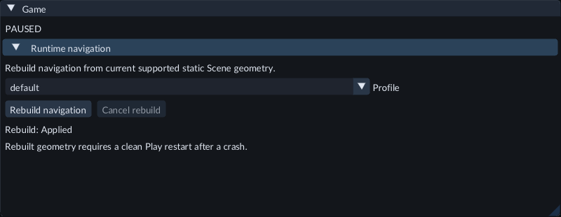

Choose a saved profile and wait for Applied before resuming movement on changed geometry.

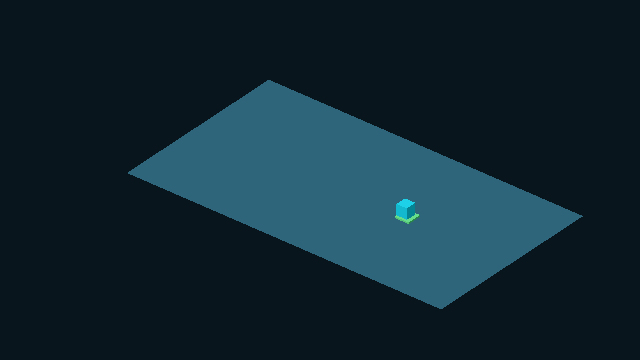

The Gallery agent resumes along the rebuilt floor and reaches its destination.

**Queued**, **Preparing** and **Building** describe work in progress. **Cancel rebuild**
cancels pending work. **Stale** means the source or selected asset revisions changed
before adoption; settle the geometry or pause, then try again. **Failed** includes
the reason. Allow a cancelled request to finish retiring before starting another.

Stop discards the private result. To save a permanent NavMesh, edit and save the
Scene outside Play, then use **Build NavMesh** in the navigation authoring controls.
The overlay's teal triangles continue to show the saved base; runtime route lines
show the agent's current path. Rebuilding does not save transient floor or agent poses.

Runtime rebuilding uses the same supported static shapes, Meshes, regions and
collected collision sources as the selected saved profile. Keep settings changes
such as radius, plane, collection layers or Dynamic obstacles in Edit and rebuild
the saved asset there. Moving physics bodies, skinned/deformed source geometry,
runtime-edited Map sources and moving-platform routing are unsupported.

The matching worker is included with the editor, SDK and runtime kit. An exported
game requests rebuilds through project C++ code; its player window has no editor
Game controls. The Gallery's optional **CodeExamples/RuntimeNavigationRebuildSystem.cpp**
requests the rebuild after the one-shot floor stops. See its setup in
**CodeExamples/README.md** before exporting this automatic demonstration. Without
that System, the exported agent waits for a game-owned rebuild request.

Rebuilt bases require a clean Play restart after a crash. Private crash recovery
is unavailable while a request is pending or after this world adopts a runtime
base. Save authored content normally before exporting.

## Steer a physical character

Open Gallery **224-navigation-characters** and press Play. The cyan character
reaches its destination. The orange character stops at the red physical wall,
which is deliberately absent from the baked route geometry. Physics determines
their movement and floor support.

1. In Edit, add **Character Controller** and **Navigation Agent** to the same object.
2. Set its spatial binding to **World** and keep its local up axis aligned with world **+Y**. Use a 3D ground NavMesh. Do not add another enabled physics body or a 2D character controller to this object.
3. In **Navigation Agent**, select **Movement → CharacterController**, assign the NavMesh, enable **Has destination**, and enter the destination and Speed.
4. Provide physical floor and obstacle colliders. Baked navigation geometry describes available routes; a visible floor alone does not provide character collision or support.
5. Press Play and inspect **Live gameplay → Navigation progress** and **Character movement** feedback. Position and velocity describe the character's actual physics result.

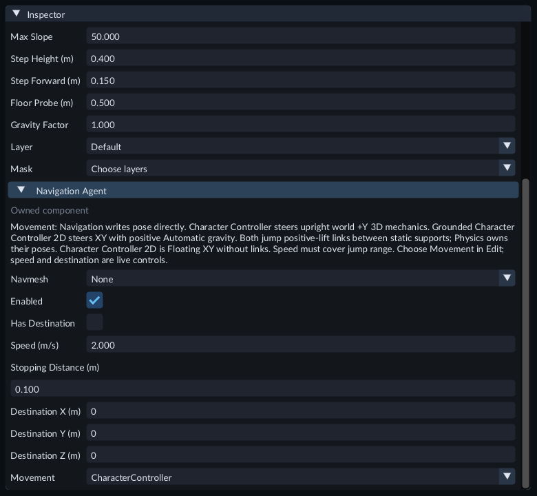

Choose the movement mode in Edit, then assign the saved NavMesh and destination.

To resume the orange Gallery character, Stop, disable the red wall's **Physics
Body → Enabled**, then Play again. During Play you can pause and step the game,
or change the character's live Speed, destination, Has destination and Enabled.
Speed **0** pauses steering; clearing Has destination cancels it. Character
gravity and floor support continue. Choose Movement in Edit.

Disable the Navigation Agent before handing movement to project C++ code.
Manual movement, jump and placement requests take precedence over navigation
requests in the same fixed step. Navigation reports physical blockage and never
teleports the controller through a collider.

Character steering supports upright 3D ground routes, grounded XY routes and the
physical jumps described below. Floating XY routes require no explicit links. Moving-platform
routing is unavailable. Incompatible configurations report a navigation diagnostic.
Save the Scene and select it as startup before exporting; this Gallery requires
no project C++ module. Review kept live values after Stop, then save explicitly.

In **Window → Profiler → Play runtime**, **NavSourceCapture** shows the CPU time
spent checking included sources during Play. Rebuild the NavMesh after changing
included geometry.

## Jump between static platforms

Open **226-navigation-character-jumps** and press Play. The cyan character jumps
onto the raised platform and reaches its marker. The orange character hits the
red physical wall and falls. A blocked jump does not suspend the character in
midair or count as arrival.

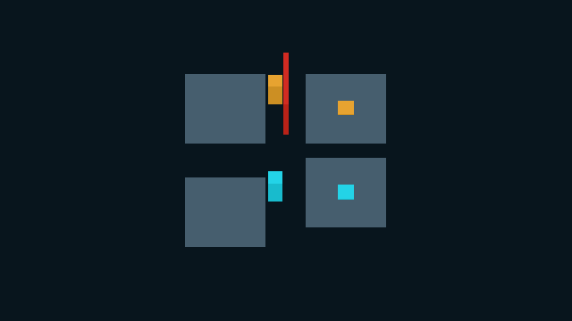

The lower cyan route reaches a raised platform; the upper orange route has a physical obstruction.

1. Provide two static walkable platforms with physical floor colliders. Add Navigation Surfaces and an enabled **Navigation Link** whose Start and End attach to those platforms. Use a 3D profile and a positive **Arc height**.
2. Build the NavMesh. Give the character an enabled upright, World-bound **Character Controller** and **Navigation Agent → Movement → CharacterController**. Assign the NavMesh and a destination beyond the link.
3. Set enough **Speed** for the crossing. The Gallery uses a four-metre span, one-metre Arc height and Speed **6** with the default gravity. A slower speed can be refused before takeoff. The configured gravity must point downward along world Y, and the controller's Gravity factor must be positive.
4. Play and inspect **Navigation progress** and **Character movement**. Physics determines takeoff, collisions, flight and landing. Arc height selects the intended lift; the character's actual path may differ from the displayed intent curve.
5. Stop, disable **Red flight wall → Physics Body → Enabled**, and Play again to let the orange character cross. Save the Scene and choose it as startup before exporting. Its built NavMesh, Camera and Light are included; no project C++ module is required.

Takeoff and landing must have static physical support. Same-height or upward zero-lift links,
sideways/upward gravity, moving-platform links and Floating XY jumps are
unsupported. A route can exist while a particular character lacks enough speed
or suitable support to jump it; inspect the navigation diagnostic.
For a lower End and zero Arc height, follow **Drop to a lower static platform** below.

During flight, Speed **0** stops navigation steering while gravity continues.
Stopping distance applies before takeoff: if the remaining route is already
within that distance, the character stays in place and reports arrival.
Clearing **Has destination** or disabling the Agent releases steering. A changed
destination takes effect after landing. Pause the game to freeze simulation;
setting Speed to zero cannot freeze a jump. Stop and Play to restart a missed
landing from the saved Scene. Choose movement and edit the link in Edit mode.

## Steer a Floating XY character

Open Gallery **225-navigation-characters-xy** and press Play. The cyan character
reaches its marker; the orange character stops at the red physical wall. Both use
the existing 2D controller, and their visual depth stays unchanged.

1. In Edit, create a walkable **Navigation Region 2D** and build a **2D (XY)** NavMesh. Leave clearance for the character's entire upright capsule around obstacles and region edges.
2. Give the moving object **Character Controller 2D** and **Navigation Agent**. Set the controller's **Mode → Floating** and the object's spatial binding to **World**. Keep the physical rotation upright with equal absolute X/Y scale. Do not add another enabled body or controller to the object.
3. In Navigation Agent choose **Movement → CharacterController2D**, assign the XY NavMesh and enable **Has destination**. Set Destination X/Y and Speed. Destination Z does not change visual depth.
4. Add physical **Physics Body 2D → Static** objects with Collider 2D shapes for solid obstructions. Baked regions describe routes; they do not create physical colliders. Use a child visual with its centre above the controller's feet.
5. Play and inspect **Navigation progress** and **Character movement**. Copied position, velocity, remaining distance and arrival follow the actual collision result.

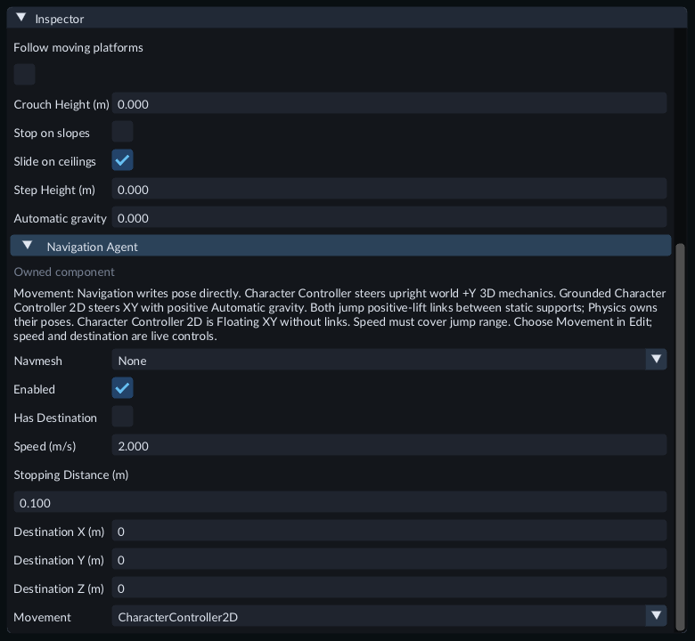

Choose CharacterController2D for an upright Floating controller and a saved XY NavMesh.

To release the orange Gallery character, Stop, disable the red wall's **Physics
Body 2D → Enabled**, then Play again. Speed **0**, Has destination and Enabled use
the same live controls and Keep review as other agents. Select Movement in Edit.
Manual XY movement or placement takes precedence in the same physics step.

Floating navigation requires **Automatic gravity** `0` and has no floor following.
Use the grounded profile below for supported static ground and explicit jump/drop
links. Floating jump/drop links and moving-platform routes are unavailable. Choose
the Gallery Scene as startup, save it and export normally; no project C++ module
is required.

## Steer a grounded XY character

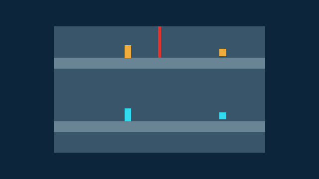

The two characters follow static ground toward their goal markers. The red physical
wall obstructs the upper route.

Open Gallery **227-navigation-grounded-xy** and press Play. The cyan character
walks along the lower physical floor. The orange character walks along the upper
floor and stops at the red wall. Both use native gravity and physical support.

1. In Edit, draw a **Navigation Region 2D** corridor that includes the character's feet and build a **2D (XY)** NavMesh. Provide separate static **Physics Body 2D** objects with solid Collider 2D shapes for the actual ground. A baked region does not create collision; a solid floor's filled footprint does not describe the space above a platform.
2. Give the character **Character Controller 2D → Mode → Grounded**, set **Automatic gravity** to `1`, and use **World** spatial binding with upright, uniformly scaled XY mechanics. Project gravity must have X `0` and negative Y. Do not add another enabled body or controller to the same object.
3. Add **Navigation Agent**, choose **Movement → GroundedCharacterController2D**, assign the saved NavMesh, and set a supported ground destination in X/Y. Leave room for the capsule and any authored stair rise. Visual Z stays independent.
4. Play and inspect **Navigation progress** and **Character movement**. Speed, blockage, arrival and support follow the actual physics result. Stop, disable the red wall's **Physics Body 2D → Enabled**, and Play again to let the orange character continue.
5. Save the Scene and choose it as startup before exporting. The Gallery includes its Camera and ready NavMesh and requires no project C++ module.

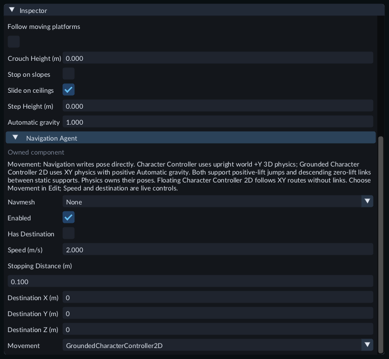

Choose the grounded movement profile and enable automatic gravity on its controller.

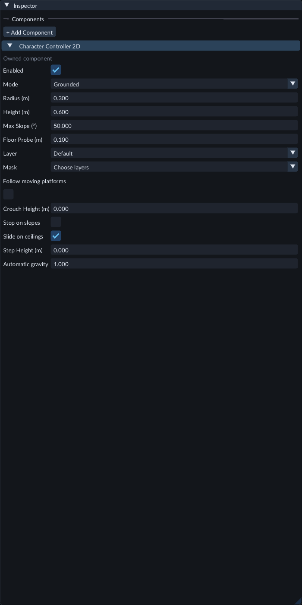

Automatic gravity `1` uses vertical Project gravity; `0` leaves gravity to C++.

This profile follows continuous supported static ground. Unsupported route bends
or destinations are refused; gaps hold steering. Larger ledges can block the
controller. **Step Height** and **Floor Probe** retain their ordinary physical
limits. Use explicit positive-lift links for jumps and descending zero-lift links for
drops, as described below. Automatic platformer reachability planning and moving-platform routes are unavailable. Use the
Floating profile for free XY movement.

Speed `0`, clearing **Has destination**, or disabling the Agent stops steering;
automatic gravity continues. Use game Pause to freeze simulation. Choose Movement
in Edit. Disable navigation before handing movement to C++ code; explicit manual
movement or placement wins at that physics boundary. Read about
[automatic gravity](physics-2d.md) before combining it
with your own controller code. Stopping distance has a `0.01` metre minimum.
Corner progress allows the controller's native contact band; arrival still uses
the actual remaining route and the chosen stopping distance.

## Jump between static XY platforms

Open Gallery **228-navigation-character-jumps-xy** and press Play. The lower cyan
character jumps across the gap, lands on the raised floor and reaches its marker.
The upper orange character hits the red physical wall and falls. A missed landing
reports a failure and never counts as arrival.

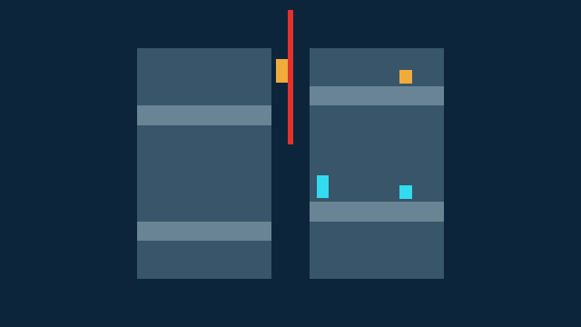

The lower lane has a clear crossing; the upper lane has a physical obstruction.

1. Create separate **Navigation Region 2D** islands around the character's approach and landing areas. Provide static **Physics Body 2D** floors with solid colliders below the character's feet. Regions describe the route; colliders supply support and collision.
2. Add an enabled **Navigation Link**, choose **Plane → 2D (XY)**, and use the same build profile as the islands. Place Start and End over supported ground, keep endpoint Z at `0`, and set a positive **Arc height**. Endpoints follow the link object's transform.
3. Build the XY NavMesh. Give the character **Character Controller 2D → Mode → Grounded**, **Automatic gravity → 1**, World spatial binding and **Navigation Agent → Movement → GroundedCharacterController2D**. Assign the NavMesh and a destination on the landing floor.
4. Set enough **Speed** for the crossing. The Gallery uses a four-metre span, one-metre Arc height, a one-metre raised landing and Speed `6`. Project gravity must point down world Y. Play and inspect **Navigation progress** and **Character movement**; physics determines the actual flight and landing.
5. Stop, disable the red wall's **Physics Body 2D → Enabled**, and Play again to let the orange character cross. Save, choose this Scene as startup and export normally. Its Camera and built NavMesh are included; no project C++ module is required.

Takeoff and landing require static walkable support. Same-height or upward zero-lift links, sideways
or upward gravity, Floating controllers and moving-platform routes are unsupported.
An unsupported route corner reports its index and XY coordinates. Insufficient
speed or fixed-step resolution can refuse a jump before takeoff. Visual Z remains
independent of physical XY movement.
Use the drop workflow below for a descending zero-lift crossing.

Speed `0` releases horizontal steering while gravity continues. Pause the game to
freeze time. A destination changed during flight is replanned after landing;
clearing **Has destination** or disabling navigation releases steering. Stopping
distance is checked before takeoff, so a character already within that distance
does not jump. Stop and Play to restart from the saved Scene after a missed landing.

## Drop to a lower static platform

Open Gallery **229-navigation-character-drops** for 3D, or
**230-navigation-character-drops-xy** for XY, and press Play. The cyan character
walks off the upper floor, falls and reaches the lower goal. The orange character
meets the red physical wall. A missed or obstructed landing does not count as arrival.

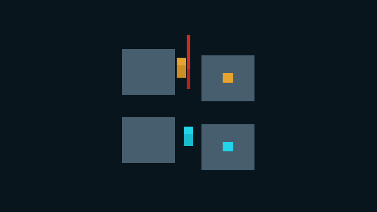

The 3D example uses physical platforms and a one-way descending link.

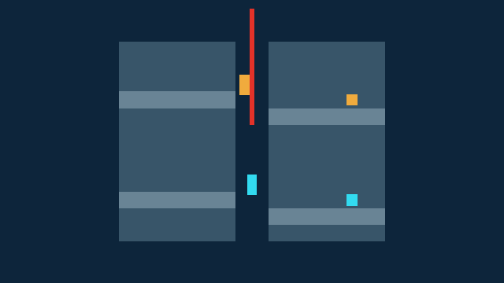

The XY example uses separate navigation regions and physical floor colliders.

1. Provide upper and lower static floors with solid colliders. Mark 3D routing surfaces with **Navigation Surface**, or draw **Navigation Region 2D** islands around the XY approach and landing areas. Artwork and routing geometry do not create physical support.
2. Add an enabled **Navigation Link** with the matching **Plane** and **Build profile**. Put Start over supported upper ground and End over supported lower ground, with a horizontal gap. Set **Arc height → 0** and turn **Bidirectional** off. Endpoints use the link object's local coordinates; check that End is lower in world Y. XY endpoint Z stays `0`.
3. Build the NavMesh. Use an upright World-bound **Character Controller** with positive **Gravity Factor** and **Movement → CharacterController** for 3D. For XY, use **Character Controller 2D → Mode → Grounded**, **Automatic gravity → 1** and **Movement → GroundedCharacterController2D**. Project gravity must point down world Y.
4. Assign the NavMesh and a destination on the lower floor. Set enough **Speed** to cross the gap. Play and inspect **Navigation progress** and **Character movement**. The character walks to the edge; physics controls the descent, collision and actual landing. Test again after changing speed, gravity or collision.
5. Stop, disable the red wall's **Physics Body → Enabled** or **Physics Body 2D → Enabled**, and Play again to let both characters cross. Save the Scene, choose it as startup and export normally. Both examples include a Camera and ready NavMesh and need no project C++ module.

Drops require static walkable support at both ends and horizontal room to leave
the upper floor. A blocked approach reports blockage and can resume when cleared.
Stopping distance is checked before the crossing; an already satisfied distance
does not start a fall. Very coarse fixed steps can refuse a short drop.
Same-height or upward zero-lift physical links, Floating XY controllers,
moving-platform routes and automatic platformer reachability graphs are unavailable.

Speed `0`, clearing **Has Destination**, or disabling navigation releases steering
while gravity continues. Use game Pause to freeze simulation. A destination changed
during a crossing is replanned after reaching the exit. Disable navigation before
handing movement to C++ code. Stop and Play to restart a missed landing from the
saved Scene. XY visual Z remains independent of the physical descent.

## Build a 3D floor and obstacles

1. Create a Plane. Set its scale to **20, 1, 20** and position to **0, 0, 0**.
2. Select it. In Inspector, use **+ Add Component → Navigation / Navigation Surface**. Leave **Enabled** checked.
3. Create a Cube at **0, 2, 0**, with scale **2, 4, 4**. Add a Navigation Surface to it too.
4. You can add a second obstacle elsewhere on the floor. Mark every static shape that should affect the route.
5. Save the scene.

Marked built-in shapes, editable Mesh assets, and static imported Mesh entities contribute. For an imported Model, select its child entity that has a **Mesh Renderer**, then add **Navigation Surface**. Marking only its group/root does not include its children automatically. Unmarked objects require the **Collect static colliders** option and eligible physical components described below. Keep included geometry static.

Marked sources and their spatial parents must have no enabled **Character
Controller** or **Character Controller 2D**. Disable the controller or use another
object as static navigation geometry. An inherited controller counts too. A
**Child space: World** object does not follow its structural parent. A failed build
keeps the previously selected NavMesh.

Skinned characters, morphing meshes, points and lines cannot be baked. The build uses the Mesh's first level of detail and all its triangle parts. The small-scene profile supports up to32 external Mesh assets and16,384 included triangles; an oversized/unsupported Mesh gives a diagnostic and preserves the previous NavMesh. After editing or reimporting a marked Mesh, rebuild that Mesh through its normal Content workflow, then rebuild navigation. Saving its source alone does not change the selected cooked revision.

Open **51-static-mesh-navigation** in Feature Gallery for a saved editable Mesh floor, static obstacle and ready-built route. Play, select the agent, and inspect **Live gameplay → Navigation progress**. You can export this scene without sending its editable Mesh source or a navigation build worker. Scene50 continues to demonstrate built-in shapes and retained older navigation assets.

## Build top-down 2D navigation

Open Gallery **80-xy-navigation** for a ready example. Press Play: the cyan agent
routes around the orange obstacle; the green and amber agents steer past each
other in the right lane. Their Sprites use an ordinary orthographic Camera. Select
an agent to inspect **Live gameplay → Navigation progress**. Stop restores its
starting position. This Scene needs no project C++ module.

To create your own:

1. Create an empty entity. Add **Navigation / Navigation Region 2D** in Inspector.
2. Leave **Enabled** on and **Obstacle** off. Set **Width = 20** and **Height = 14**. This centered rectangle is walkable. Its entity transform controls its XY position, rotation and scale; visual Z does not change the navigation footprint.
3. Create another empty entity with the same component. Enable **Obstacle** and set **Width = 2**, **Height = 4**. Put it in the walkable rectangle's center.
4. Select either region to see its outline in Scene: green for walkable, orange for obstacle, gray for disabled. Add Sprites separately if you want visible art.
5. Open **Content → Create / Register → Navigation**. Set **Plane → 2D (XY)**. Choose **Agent radius** for clearance and **Cell size** for build resolution, then click **Build NavMesh**. Enable **Scene → View → Navigation overlay**.
6. Create **Entity → Create → Rendering → Sprite**. Assign a published [image Material](sprites.md), set its size to **0.7 × 0.7 m** and position to **-8, 0, 0**. Add **Navigation Agent**, choose the generated NavMesh, set **Destination X = 8**, **Destination Y = 0**, and enable **Has destination**.
7. Add **Entity → Create → Rendering → Camera**. Set position to **0, 0, -20**, rotation to **0, 0, 0**, **Projection → Orthographic**, and **Orthographic Height = 17**. The Camera looks along +Z. An unlit Sprite image material needs no scene light.
8. Save, press **Play** and open **Game**. The Sprite follows the opening around the obstacle. In Scene, the navigation overlay shows its route.

Regions explicitly select navigation data. Sprite artwork does not supply navigation.
Use **Shape source → Collider 2D** to select a configured collider, or enable
**Collect static colliders** to include eligible physical obstacles as described below.
Overlapping walkable regions form a
union; obstacle regions cut that union before agent-radius clearance is applied.
An obstacle outside all walkable regions adds no walkable area. Add at least
one walkable region. Keep sources and their spatial parents static and free of
enabled Character Controllers, as in 3D.

XY destinations and movement use world X/Y. The agent keeps its starting world Z;
**Destination Z** does not move it between visual depths. Avoidance considers
participants on the same NavMesh even when their visual Z differs. This is
authored XY routing. Grounded characters can use the explicit jump/drop workflows
above; automatic platformer reachability graphs and moving-platform routes are unavailable.

A Scene can have several named navigation profiles. Switching **Plane** requires
an explicit rebuild and keeps that profile's asset identity. 3D Surface markers and 2D
Region markers are selected independently. Save the Scene and choose it as startup
before normal export; its built NavMesh is included in the game.

## Create polygon regions

Open Gallery **136-navigation-polygons** and press Play. The cyan agent follows
an L-shaped floor; the amber agent goes around an L-shaped obstacle. Both routes
use the saved NavMesh and can be exported without a project C++ module.

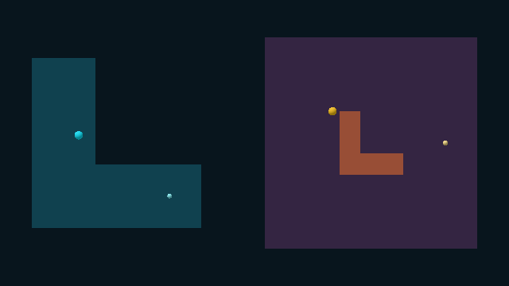

The two courses use separate visual meshes. Navigation Region outlines define the
walkable geometry; visible art does not automatically become navigation data.

1. Stop Play and select a **Navigation Region 2D**. Choose **Shape source → Rectangle / Points** and set Width/Height for its initial rectangle.
2. Click **Create polygon** in the component. This copies its four local corners into **Points** as one Undo step.
3. Expand **Points** and edit each point's **x** and **y** in metres. Use the collection controls to add, remove or reorder points. Each edit must leave a complete valid shape; an invalid candidate keeps the previous contour and reports the reason.
4. Keep 3–64 points in counterclockwise order when viewed from +Z. Avoid repeated points, straight intermediate corners, crossings and touching edges. Local coordinates must stay within ±1000 m; resolved world XY must remain within ±4090 m.
5. Leave **Obstacle** off for a walkable region, or enable it to cut a concave footprint out of another walkable region. Use a separate obstacle for a hole.
6. Rebuild the NavMesh with **Plane → 2D (XY)**, save the Scene and test in Play. Save authored changes outside Play before exporting.

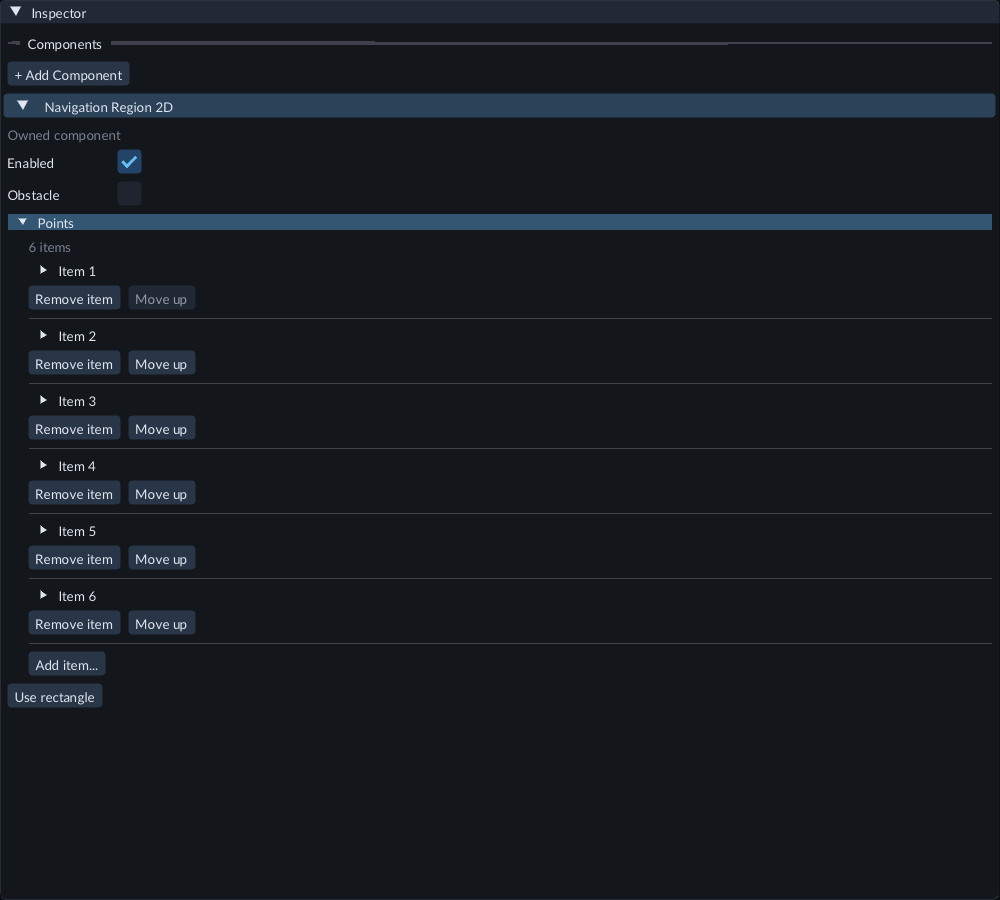

**Use rectangle** clears Points and restores Width/Height controls. Undo restores
the previous polygon. Polygon regions use ordinary transforms for position,
rotation and scale; the four rectangle extent handles are unavailable. Framing
and outline selection still use the full contour. Prefab point overrides and
Undo/Redo work through the regular Inspector.

## Use 2D collision shapes as navigation sources

Open Gallery **137-navigation-collision-sources** and press Play. The cyan agent
routes around a Circle and Capsule Collider on a Box Collider floor. The amber
agent routes around one published Tile Map collision layer. Select an agent to
inspect **Live gameplay → Navigation progress**.

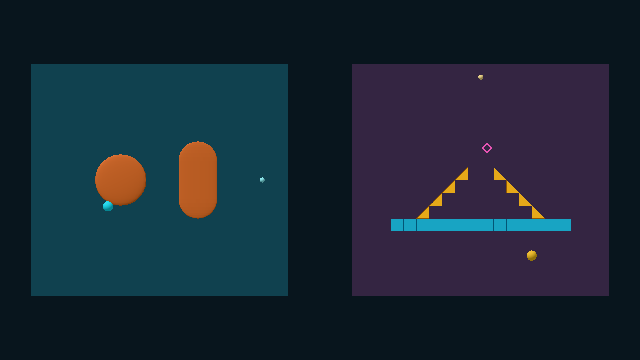

The courses use ordinary visual meshes and the Map’s published image material.
The marked collision footprints select their navigation geometry.

1. Stop Play. Select a static entity with exactly one **Box Collider 2D**, **Circle Collider 2D**, **Capsule Collider 2D** or **Tile Map Collider 2D**.
2. Add **Navigation / Navigation Region 2D**, then choose **Shape source → Collider 2D**. A Physics Body is not required for baking this configured footprint.
3. Leave **Obstacle** off to add walkable area, or enable it to cut the collider's footprint from another walkable area. Width, Height and Points are retained but inactive in this mode. Switching back to **Rectangle / Points** restores those controls.
4. For a Tile Map, assign a published Map to its **Tile Map Renderer** and choose **Tile Map Collider 2D → Collision layer**. Save and publish Map or Tile Set edits through their normal Content workflows before rebuilding navigation. Tiles with no collision contribute no footprint; cell flips, neighbor rules, concave profiles, islands and holes use the selected collision definitions. Hidden Map layers can supply collision.
5. Enable **Scene → View → Navigation overlay** to inspect the selected footprints. Island boundaries stay separate. Pending or stale Map resources show no substitute region. Press **F** to frame the selected complete footprint.
6. In **Content → Create / Register → Navigation**, choose **Plane → 2D (XY)** and **Build NavMesh**. Save the Scene, test Play, then export normally. The exported game includes the selected Map, Tile Set, visual dependencies and NavMesh.

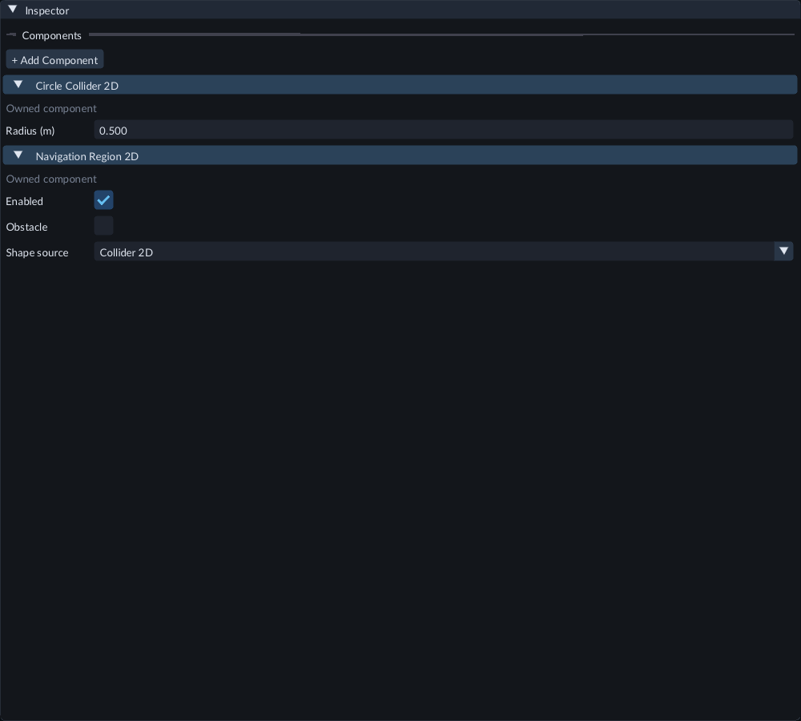

Change collider size through its collider component and position/rotation through
its ordinary transform. Rectangle resize handles are unavailable for derived
footprints. Circle and Capsule shapes require equal absolute X/Y scale; negative
scale is allowed. Keep collider sources upright in XY, without shear or moving
physics/controller ancestors. Navigation does not create a physics body or use
collision-layer masks, sensors or one-way direction to decide walkability;
**Enabled**, **Obstacle** and the explicitly selected collision geometry do that.

Rounded footprints use a bounded conservative approximation: obstacle contours
cover the configured shape and walkable contours fit inside it. Agent radius adds
clearance afterward. At most 32 distinct Map inputs and 512 derived convex masks
are supported within the overall source/triangle limits. A Map collision source
supports up to 512 collision pieces; oversized or numerically collapsed geometry
reports a build error and keeps the previous NavMesh.

Changing an included collider or a selected Map revision makes the NavMesh stale.
Stop Play and rebuild after such changes. Runtime cell edits to an included Map
also stop baked-route movement; reset that instance to its published cells before
resuming its existing route. Runtime editing does not rebake navigation. Use the
separate **Navigation Obstacle** workflow below for moving blocked areas.

## Collect static collision geometry

Open Gallery **141-navigation-collision-collection** and press **Play**. The cyan
agent patrols between the green markers around the orange wall. The floor uses a
Box Collider; the wall uses an editable Collision asset. Neither needs a Navigation
Surface marker. The scene includes its Camera, light, behavior and built NavMesh,
and runs without a project C++ module.

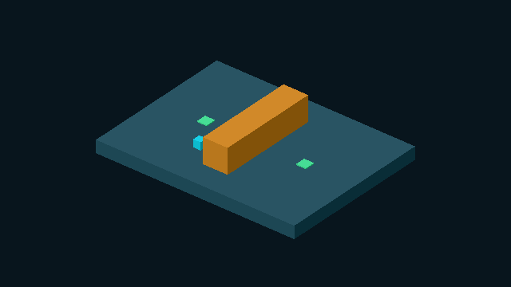

1. Stop Play. For a 3D floor or obstacle, add **Physics Body** and exactly one **Box Collider**, **Sphere Collider**, **Capsule Collider**, **Cylinder Collider** or **Asset Collider**. Set **Motion → Static**, enable the body and turn **Sensor** off. For an Asset Collider, assign a published Collision asset through the normal Content workflow.
2. For XY, author at least one walkable **Navigation Region 2D**. Add **Physics Body 2D** and exactly one supported Collider 2D to each physical obstacle. Keep its body enabled, Static and nonsensor. Box, Circle, Capsule and a selected Tile Map collision layer are supported.
3. Save the Scene. Open **Content → Create / Register → Navigation**, choose **Build profile** and **Plane**, then enable **Collect static colliders**.
4. Open **Collision layers** and select the bodies' physics layers. The mask selects each body's **Layer**; its contact **Collision mask** does not select build inputs. The layer picker becomes available when collection is enabled.
5. Adjust clearance/build settings and click **Build NavMesh**. The profile combines marked geometry with eligible physical sources. In XY, automatically collected shapes are obstacles; they add no walkable floor. In 3D, actual physical triangles supply floors and obstacles according to their shape and slope.
6. Assign that NavMesh to your Navigation Agent. Save, test Play and inspect **Live gameplay → Navigation progress**. Stop and save authored changes, select the Scene as startup, then export normally. Export includes the selected Collision/Map inputs and built navigation; it needs no navigation build worker at runtime.

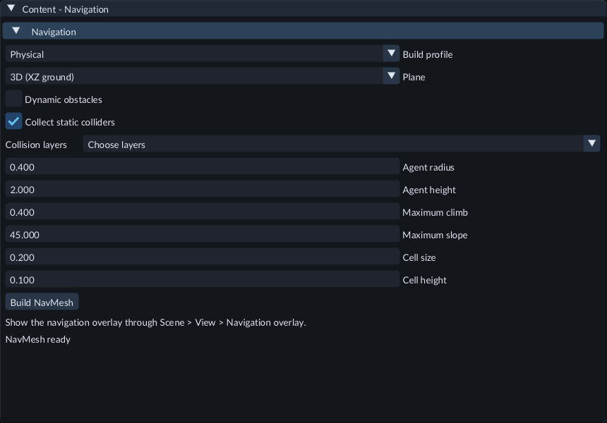

An explicit **Navigation Surface** or **Navigation Region 2D** takes precedence on
that object. Disable the marker to exclude it from collection. An enabled marker
keeps its explicit geometry/role, including a Collider 2D deliberately used as a
walkable region. Markers in the other plane do not affect collection.

Disabled bodies, sensors, moving bodies and excluded physics layers are skipped.
Included sources and followed spatial parents must satisfy the ordinary static
transform/controller rules. Collider scale restrictions still apply; ambiguous,
unresolved or unsupported selected geometry reports a build error and retains the
previous NavMesh. Visual artwork is independent of a collected physical shape.

Changing an included body's shape, transform, layer or eligibility makes the
profile stale. Replacing its selected Collision or Map revision also requires a
rebuild. Runtime movement holds while the sources do not match; collection does
not rebake a running game. Each named profile retains its own collection settings,
and collection can be combined with **Dynamic obstacles** and authored links.
Changing these build options publishes no Scene Undo step; ordinary component
edits retain their normal Undo/Redo history.

## Select and resize 2D regions in Scene

Enable **Scene → View → Navigation overlay** to show the region outlines. Click
an outline to select its region, or select it in Hierarchy. The selected outline
remains visible when the overlay is off. Hidden regions follow their hierarchy
visibility; locked regions cannot be picked. A disabled region has a gray outline
and remains editable.

Hover Scene and press **F** to frame the selected region's full XY footprint.
When a selected region also has visible art, framing includes both. Outlines show
the navigation plane at world Z0; visual Z remains separate.

For **Shape source → Rectangle / Points** with empty Points, press **W** over Scene to use Move. Four gold
squares appear at the selected region's edge midpoints. Drag one to change **Width** or **Height** symmetrically
around its center. The tooltip identifies the dimension. **Ctrl** rounds that
local dimension to **View → Snap spacing**; entity scale still changes its world
size. To move the whole region, use the ordinary transform handles. If an edge
handle is too small or edge-on, zoom in or face the XY plane; Inspector dimensions
remain available.

Release to keep the resize as one Undo step. **Escape** or right-click cancels.
Changing selection, losing editing access or resizing the viewport also cancels
a drag. Handles are unavailable during Play and for hidden or locked regions.
For multiple selections, use Inspector to edit individual region dimensions.

After resizing, save the Scene and explicitly **Build NavMesh** again. Until then,
the previous baked asset remains selected and the changed geometry is stale.
Undo can restore matching geometry; it does not undo a later asset build.

## Build the NavMesh

Open **Content → Create / Register → Navigation**. Select **Plane → 3D (XZ ground)** for the floor example. Its defaults are:

- **Agent radius: 0.4 m.** Clearance around obstacles and floor edges.
- **Agent height: 2 m.** Required space above the floor.
- **Maximum climb: 0.4 m.** Largest step the baked route can traverse.
- **Maximum slope: 45°.** Steepest walkable slope.
- **Cell size: 0.2 m.** Horizontal build resolution.
- **Cell height: 0.1 m.** Vertical build resolution.

Click **Build NavMesh**. The editor stays responsive while the worker builds and validates the candidate. **Cancel navigation build** discards the candidate. A failed build keeps the previous usable navmesh.

The ready/stale message checks included objects and the editor's current asset selection. Changing an included object or a build setting updates it immediately. Refreshing assets keeps your unfinished navigation settings. **NavigationStatus** in the editor CPU profiler shows the time spent checking this message.

Enable **Scene → View → Navigation overlay** to see translucent triangles. Default surfaces are teal; classified surfaces use their area colors. There should be an opening around the obstacle, with clearance determined by the agent radius. Yellow lines show runtime routes; dots mark their start and end.

Changing scenes or projects clears the previous overlay. Open **Content → Create /
Register → Navigation** to load the current scene's saved NavMesh. Loading it does
not rebuild or change the asset.

## Connect separated walkable parts

Use **Navigation Link** to connect two static walkable parts. With **Arc height = 0**,
an Agent with **Movement → Navigation** moves in a straight line between the
admitted endpoints at its current Speed. Use this for a deliberate crossing that
ordinary ground routing cannot follow. Physical characters use the jump or
descending-drop workflows above, where physics controls collision and landing.

Open **Scenes/140-navigation-links.scene.json** in Feature Gallery. The cyan
agent patrols across the upper gap in both directions through the `Loop` profile.
The orange agent crosses the lower gap once, from Start to End, through `OneWay`.
The upper profile uses Dynamic obstacles; the lower profile uses a static NavMesh.
Both use the ordinary Navigation Agent. The cyan patrol reuses the Gallery's Patrol
behavior; no project C++ module is required.

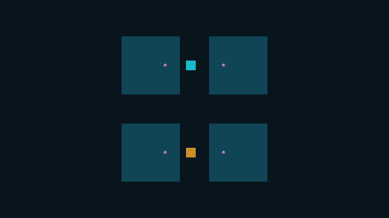

The cyan upper route permits return travel; the orange lower route permits Start
to End only. The image shows both agents during their first crossing.

To add a connection:

1. Stop Play. Create an empty entity, then use **+ Add Component → Navigation → Navigation Link**. You can also attach the link to an existing static source entity.
2. Choose **Plane → 3D** or **2D (XY)** to match the navigation build. Set **Build profile** to its exact case-sensitive name, such as `default` or `Loop`.
3. Set **Start X/Y/Z** and **End X/Y/Z** on the corresponding walkable parts. These coordinates are local to the link entity; its transform places them in the world. XY requires both local Z coordinates to be zero and ignores the source's visual depth.
4. Set **Endpoint radius** for ground attachment, between **0.05 m** and **5 m** in world units. The endpoints must attach to walkable ground. Keep the link and its followed spatial parents static, without an enabled Agent, Character Controller or moving Physics Body.
5. Leave **Bidirectional** enabled for return travel. Clear it for **Start → End** only. Leave **Enabled** checked to include the connection in its selected profile.
6. In **Content → Create / Register → Navigation**, choose the same **Build profile** and **Plane**, then **Build NavMesh**. Assign that profile's NavMesh to the Agent, save the Scene and Play.

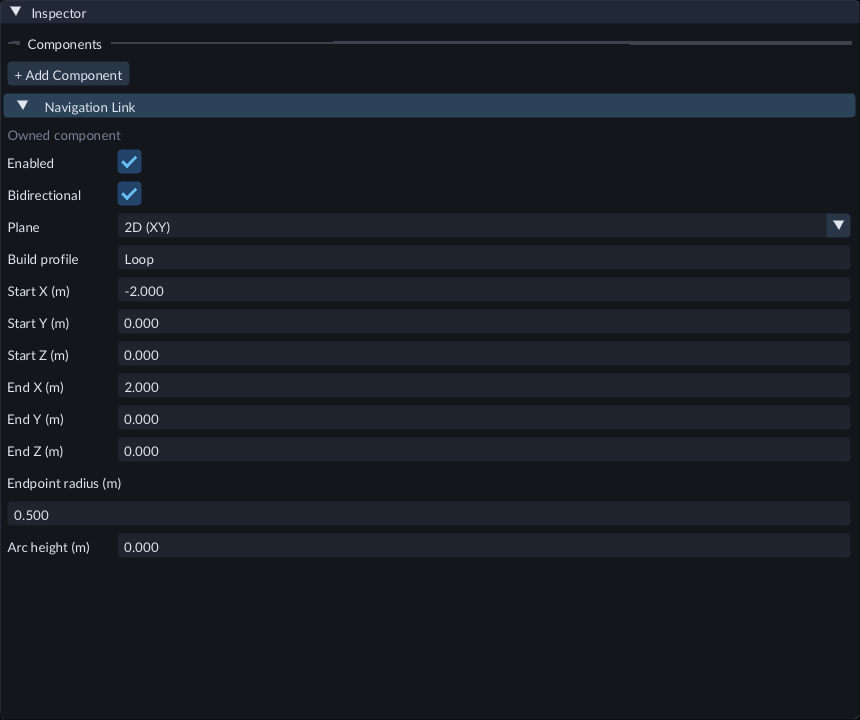

Select the upper two-way connection to inspect its profile, local Start/End and
world Endpoint radius. Clear Bidirectional for Start to End travel, then rebuild.

Enable **Scene → View → Navigation overlay** to see purple endpoint circles and
direction arrows for the selected profile. These guides show authored intent;
build status still determines whether the geometry and endpoints are valid. Saved
walkable triangles and runtime route lines use their usual overlay colors.

During Play, **Live gameplay → Navigation progress** identifies the active link.
Setting Speed to zero, disabling the Agent or clearing its destination holds an
active crossing. Re-enable it and restore a destination to continue. A new
destination waits until the Agent finishes the current span, then replans from the
exit. Stopping distance cannot stop an already active crossing midway. Ground
avoidance resumes after the crossing; it does not steer sideways across the gap.

If a dynamic obstacle disconnects an endpoint, the Agent holds its current span
until the connection is usable again. Endpoint, direction, radius, arc height and transform edits make the selected profile stale.
Stop Play and rebuild after editing. Changing Plane or Build profile removes the
link from the old selection and adds it to the new one; rebuild both affected
assets. Gameplay code that changes an Agent's NavMesh cancels its old crossing; place it on
valid ground before requesting a new route. Code that directly repositions the
Agent also discards the old crossing and starts a fresh route.

A profile supports at most **32 links**. Endpoints must be at least **0.01 m** apart
both locally and after transformation. With **Dynamic obstacles**, the endpoints
must lie in the same or adjacent tile coordinates. Tiles are 32 cells wide; at the
default 0.2 m Cell size this is 6.4 m. If the build reports a tile-span limit,
shorten/reposition the link or choose a coarser Cell size and rebuild. Moving
platform attachments are unavailable. For an upright physical character, follow
**Jump between static platforms** for positive lift or **Drop to a lower static
platform** for a descending zero-lift link in this guide.

### Follow an authored arc

Open **Scenes/218-navigation-link-arcs.scene.json** in Feature Gallery and press
Play. The cyan agent repeatedly crosses the upper gap using a 1.5 m arc; the orange
agent follows a 1 m one-way arc across the lower gap.

1. Stop Play and select **Two-way connection - Loop profile** in Hierarchy.
2. In **Inspector → Navigation Link**, change **Arc height**. Zero gives straight traversal; positive values lift the route toward world **+Y**. Height is in world metres and is independent of the link entity's rotation and scale.
3. Open **Content → Create / Register → Navigation**. Choose **Build profile → Loop** and **Plane → 2D (XY)**, then click **Build NavMesh**. Rebuild **OneWay** instead when editing the lower connection.
4. Save the Scene and Play. **Speed** measures distance along the complete arc, so a taller arc takes longer at the same speed. During a crossing, **Live gameplay → Navigation progress** shows the admitted arc height.
5. Select the saved Scene as startup before exporting. The built navigation and saved height travel with the exported game.

The upper connection uses the dynamic Loop profile. Stop before changing its
height, rebuild that profile, and save before testing or exporting.

Height accepts **0–100 m**. A curved link needs at least **0.01 m** of horizontal
separation after transformation and ground attachment. In XY this requires
different world X coordinates. Curves must stay within the navigation world
bounds. Existing endpoint attachment and dynamic tile-span limits still apply.

Arcs prescribe movement without gravity. Add **Navigation Link Collision** to an
agent to check physical obstructions during crossings, as described below. Keep
link sources static. Holds, retargeting, stale-source blocking and endpoint
revalidation follow the same rules as straight links. Setting an instance's height
to zero gives that instance straight traversal; property **Revert** resumes its
Prefab source value.

Links use normal component/property Undo, prefab inheritance and Scene saving.
An exported game carries the built connections and needs no navigation builder,
editor or compiler to run them. Choose this Scene as startup and save before export.

For an agent using MCP, add `forge.navigation_link` with `forge_component_add` and
set its fields through `forge_property_set_many`. Use one property transaction when
changing several endpoint coordinates. `forge_discover` provides the field schema
and Plane choices. `forge_navigation_build` uses the same named-profile owner;
poll `forge_navigation_status` for completion and `link_count`. Scene edits require
an editable connection, baking requires asset-write access, and Play requires the
execution grant. These operations preserve the usual revision, sequence and Undo
checks; direct source-file edits are unnecessary.

### Check physical obstructions during crossings

Open **Scenes/222-navigation-link-collision-3d.scene.json** or
**Scenes/223-navigation-link-collision-xy.scene.json** in Feature Gallery. Press
Play: the travelers stop before red physical blockers on straight and arced links.
No project C++ module is required.

1. Stop Play and select a traveler. Expand **Inspector → Navigation Link Collision**. On your own Navigation Agent, add it from **+ Add Component → Navigation** first.
2. Set **Radius** for the traveler's world-space width. In 3D, **Straight height** excludes the capsule's rounded ends; its bottom sits **Clearance** above the navigation foot. XY uses a circle and preserves visual Z.
3. Give obstructions an enabled **Physics Body** and supported Collider in 3D, or **Physics Body 2D** and Collider 2D for XY. A visual mesh alone cannot block a crossing. Keep the traveler free of a Physics Body or enabled Character Controller.
4. **Collision mask** selects body layers. The default **4294967295** includes every layer; **0** skips checks. Turn **Include sensors** on to block on sensors too.
5. Save and Play. Inspect **Live gameplay → Navigation progress**. **Blocked** holds the last checked point; removing the obstruction lets the traveler continue.
6. In **Live gameplay → Navigation Link Collision**, change volume/filter fields while paused, then Step or Resume. In the Gallery, **Collision mask = 0** permits passage. To retain settings, choose **Keep values after Stop...**, stop, review and save. Runtime positions are not kept.
7. Save and select this Scene as startup before exporting. Its built navigation and physical components travel with the exported game.

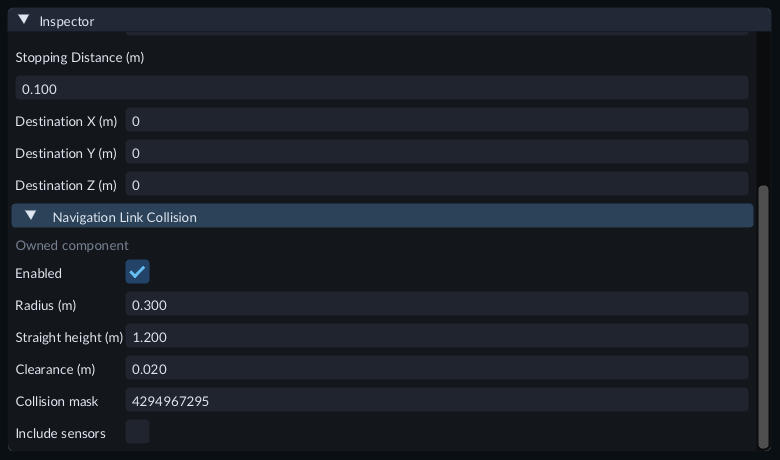

Radius and Straight Height accept **0.001–100 m**; Clearance accepts
**0.001–1 m**. Node scale does not resize the volume. Clearance also bounds the
conservative extra margin for curved spans. High speed, a tall arc or very small
clearance can exceed **64 queries per agent per fixed tick**. That tick fails
without partially moving the traveler. Reduce Speed, increase Clearance or use a
shorter fixed timestep, then retry.

Queries use the currently realized physics world; body edits appear after physics
synchronization. Initial overlaps block. Checks apply to explicit crossings;
normal surface movement retains its routing and avoidance. Sliding,
depenetration, gravity, physical response and moving-platform attachment are
unavailable. Missing physics reports failure. An absent/disabled component or
zero mask retains unchecked traversal.

MCP uses the same `forge.navigation_link_collision` component through discovery,
component/property authoring, `forge_play_tune` and runtime tuning review. Changing
this volume needs no navigation rebuild.

## Use different agent sizes

Open Gallery **138-navigation-profiles** for two agents sharing one floor. The
small cyan agent uses the `default` profile with radius **0.2 m** and crosses the
three-metre passage. The large amber agent uses `Large` with radius **1.8 m** and
moves within the left room; its baked clearance cannot pass through that opening.
Both agents use **Navigation Avoidance → Shared group = 1** to participate across
their different profiles. Both Nav assets are included when you export the saved Scene.

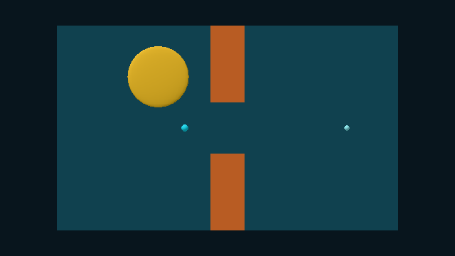

The floor and explicitly marked obstacles are shared. Each build profile has its own collection filters, radius,
settings and NavMesh asset.

1. Stop Play. Open **Content → Create / Register → Navigation** and choose a saved name under **Build profile**. `default` is the original profile.
2. To add another, choose **Build profile → New profile...**, enter a name and click **Use new profile**. This starts an unfinished draft using the current settings.
3. Set **Plane**, **Agent radius** and the other settings, then **Build NavMesh**. Building publishes the new asset; selecting a name alone does not build it.
4. Select each agent. In **Navigation Agent → NavMesh**, choose the matching **Navigation / default** or **Navigation / Large** asset. The picker also shows the asset path so you can distinguish different Scenes.
5. Save the Scene, then Play. Each agent uses its assigned profile's clearance.

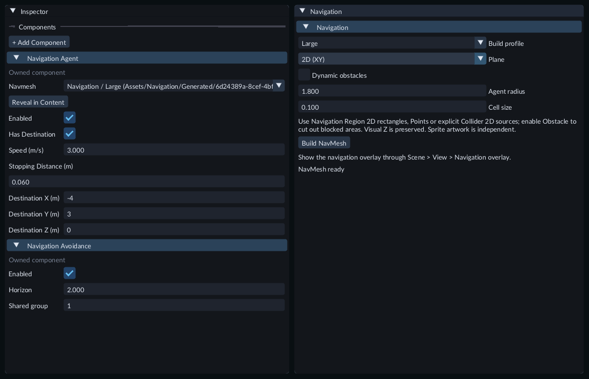

Choose the same profile in the build controls and the agent's NavMesh field.
The saved Large profile has radius 1.8 m; the agent keeps its own destination.

Names are case-sensitive and contain 1–64 ASCII letters, digits, `_` or `-`,
beginning with a letter. A different name creates another asset. Switching a saved
profile loads its settings and overlay. It does not reassign agents or change
Scene Undo history. The overlay shows paths and destination guides for the
selected profile; select the agent's profile before editing its destination in
the Scene view.

Rebuilding or changing Plane keeps that profile's asset ID. Other profiles remain
available. After changing shared marked geometry, rebuild every affected profile
before Play. A running world can load at most eight Nav assets within its existing
32MiB tile-data budget. Profile controls are locked during Play.

## Choose allowed areas and route costs

Use areas when agents of the same size should prefer different routes on one
NavMesh. For different physical clearances, use the named profiles above.

1. Select an included **Navigation Surface**, walkable **Navigation Region 2D** or static collider selected by collision collection. Add **Navigation Area** through **+ Add Component**.
2. Choose **Area**. **Default** is area 0; areas 1–15 provide additional classes. This class applies to included walkable geometry and matching Navigation Links on that entity. Structural children keep their own classification.
3. Rebuild the affected profiles. Enable **Scene → View → Navigation overlay**. The **Surface areas** legend in the navigation controls identifies saved surface colors.
4. Select an object with **Navigation Agent** and add **Navigation Area Filter**.
5. Set **Allowed areas**. Each bit permits one area: 1 allows area 0, 2 allows area 1, and 4 allows area 2. For example, 5 permits areas 0 and 2. The default 65535 permits all sixteen areas; 0 permits no routing surface.
6. Expand **Costs**. Its sixteen entries are labeled **Area 0** through **Area 15**. Each defaults to 1 and accepts 1–1,000,000. A cost of 2 counts travel through that area as twice its distance when choosing a route. Speed still controls movement speed.
7. Save the Scene and Play. Agents can share one NavMesh while using different masks and costs. A route needs permitted start and end surfaces, intermediate surfaces and links.

Navigation area bits and physics collision-layer bits are independent. Adding
Navigation Area alone does not include geometry in a build or provide physical
support. Where eligible surfaces overlap at the same height, the higher area
number takes priority. Obstacle masks remain blocked space.

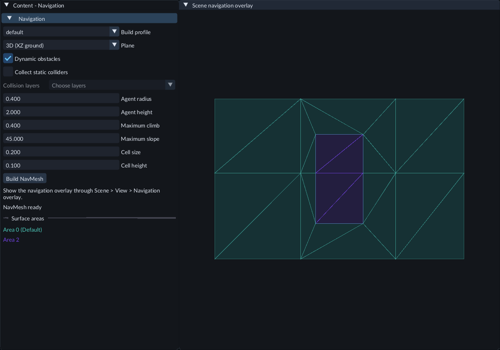

The saved Area 0 and Area 2 surfaces use different overlay colors. These colors
identify navigation classes independently of the visible floor material.

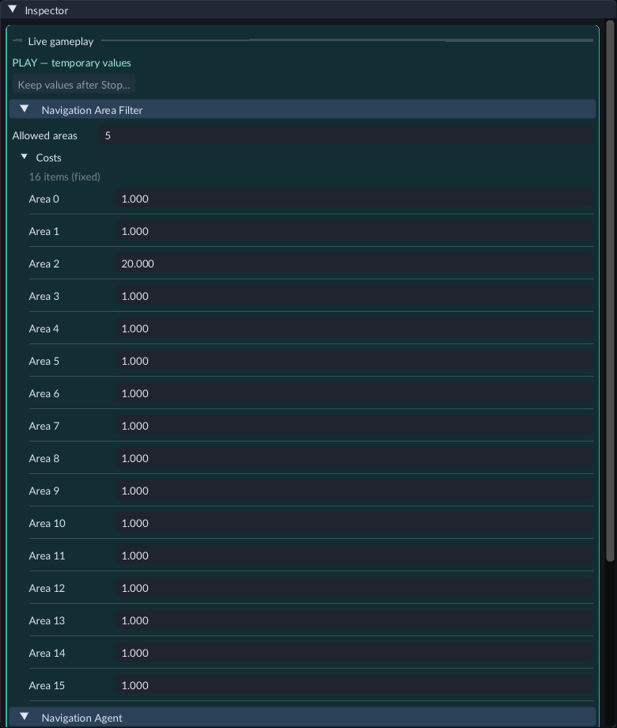

Mask 5 permits areas 0 and 2. Increasing Area 2's cost favors another permitted
route when one is available.

The Feature Gallery includes **231 — Navigation area costs** and
**232 — Navigation area costs XY**. Cyan crosses the gold surface directly,
Orange routes around its higher cost, and Violet excludes that area. Each scene
shares one NavMesh and a patrol graph across its agents.

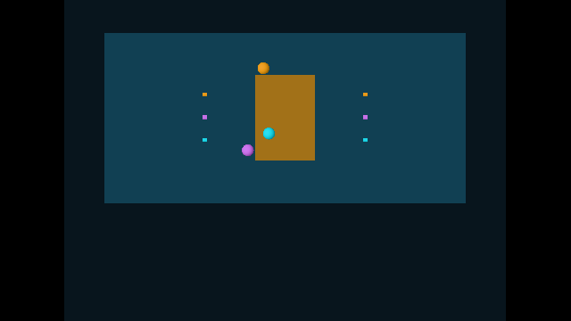

In the 3D course, Cyan takes the direct route through the gold area while Orange
and Violet pass around it.

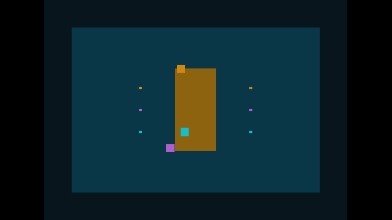

The XY course uses the same area and filter controls with explicit walkable regions.

During Play, use **Live gameplay → Navigation Area Filter** to change mask and
costs without rebuilding. Changes take effect at the next navigation boundary. An
active link crossing retains its admitted policy until completion, then replans.
Physical collision and gravity continue to control character poses.

Stopping Play restores authored values. To retain edits, use **Keep values after
Stop...**, review the mask and Costs fields, Stop, then apply the selected values
and save. Costs is reviewed as one array field. Keep uses ordinary Scene/Prefab
property operations and Undo history.

## Route around moving obstacles

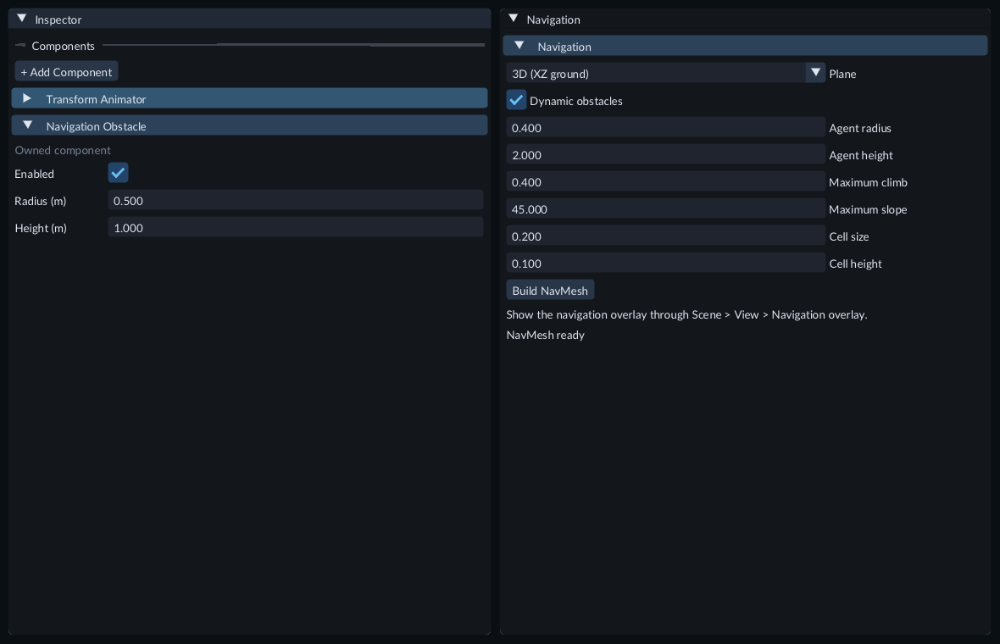

Set the obstacle's local dimensions in Inspector and enable **Dynamic obstacles** in the desired
build profile before rebuilding.

Open **129-moving-navigation-3d** or **130-moving-navigation-xy** in Feature Gallery
for a ready example. The orange obstacle follows an editable animation clip while
the cyan agent recalculates its route. No project C++ module is required.

1. Keep the floor's **Navigation Surface** or walkable **Navigation Region 2D**.
2. On the moving object, remove its Navigation Surface/Region marker. Add **Navigation / Navigation Obstacle**. Leave **Enabled** on. Do not add a Navigation Agent to this same object.
3. Set **Radius** for its local circular footprint. In 3D, set **Height** for a cylinder centered on its origin. The object can have separate visible art; the Navigation Obstacle does not create a renderer or physics collider.
4. Open **Content → Create / Register → Navigation**. Select the plane, check **Dynamic obstacles**, then click **Build NavMesh**. Agents keep their existing NavMesh reference when the same Scene's asset is rebuilt.
5. Save the Scene. During Play, move the obstacle through an ordinary transform animation or project C++. Agents recalculate their routes around its current footprint. Disabling/removing the component restores walkable tiles.
6. Use **Live gameplay → Navigation progress** on an agent to inspect its route. Yellow overlay paths follow the current carved mesh; teal triangles show the saved base. Stop restores authored starting values. Save outside Play before exporting; the generated layers and obstacle components travel with the game.

The 3D shape must stay upright, with equal X/Z scale and no shear; yaw and mirrored scale
are allowed. XY uses equal projected X/Y scale and ignores visual Z and Height. Radius
accepts 0.05–5 m and Height 0.2–10 m before entity scale. Agent-radius clearance is added
automatically. An unsupported ellipse, tilt or collapsed shape gives a diagnostic and
prevents stale-route movement.

Use at most eight enabled obstacles. Each inflated footprint can overlap at most eight
baked layers; reduce its size or change the tile resolution if that limit is exceeded. A
tiled build supports at most 64 layers of 32 × 32 cells, with four layers at one tile
coordinate. It may reach this limit before the general 512×512-cell grid limit. A
footprint may span at most 16 tile positions along either axis, even when many positions
are empty. Reduce a large footprint or rebuild with coarser cells. Keep larger stationary
obstacles in the static bake.

This updates blocked portions of the existing floor. It does not create new floors, rebake
moving platforms, stop physics bodies or push an agent out of an obstacle. If an obstacle
covers the agent's start, it cannot move. Inspect its failure diagnostic; navigation can
resume when a valid start and route become available. Obstacle properties are authored in
the regular Inspector outside Play; they are not part of the live agent-tuning controls.

## Let agents steer around each other

Open Gallery scene **52-navigation-avoidance** and press **Play**. Two agents pass each other in one lane; another goes around a parked agent in the other lane. The saved scene includes its built navigation, camera and light, and can be exported normally.

Add **Navigation Avoidance** to each Navigation Agent that should participate. Enable it and set **Horizon** to the number of seconds to look ahead (default 2). The baked radius defines clearance. In 3D, height also filters vertically separated participants; XY ignores visual depth. Idle and paused participants stay in the way; disabled agents or agents without this component do not participate.

**Shared group** defaults to **0**, which keeps different Nav assets isolated.
To let agents on different profiles steer around each other, stop Play and give
them the same value from **1–32**. Their profiles must use the same Plane. Each
agent contributes its own baked radius. Agents on the same Nav asset still
interact regardless of this setting. Save the Scene before exporting.

**Avoidance layers** is the agent's avoidance membership; **Avoidance mask** selects the membership
bits it observes. Both accept whole numbers from `0` to `4294967295`. For example,
Avoidance layers `4` and Avoidance mask `4` select bit 2; `2147483648` selects bit 31. Avoidance mask `0` ignores
peers while keeping surface boundaries and physical collision. Avoidance layers `0` makes
the agent unobserved by other avoidance agents without changing what it observes.
These are avoidance bits, separate from physics collision layers.

**Priority** accepts `0–1` and defaults to `0.5`. An agent steers around observed
peers with equal or higher priority. With priorities `0.8` and `0.2`, the lower
priority agent yields while the higher priority agent keeps its route. This does
not reserve space or let either agent pass through a physical wall. Masks are
independent in each direction: one agent can observe another without being
observed in return. Shared group, Plane, source availability and the 3D height
restriction still apply.

During Play, select an agent and adjust **Enabled**, **Horizon**, **Avoidance layers**,
**Avoidance mask** or **Priority** in **Live gameplay**. These changes affect the running
world; Stop restores the authored scene. Use **Keep values after Stop...** to
review selected changes for the saved Scene. Edit the regular Inspector outside
Play to save settings directly. Policy edits do not require a NavMesh rebuild.

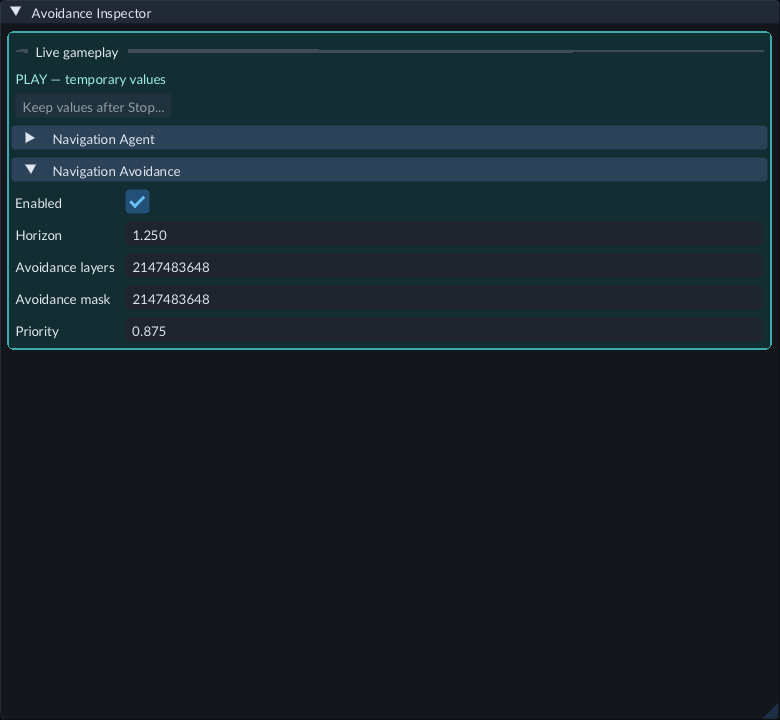

Expand Navigation Avoidance to adjust the running agent's peer policy.

Open **233-navigation-avoidance-policies** for 3D or
**234-navigation-avoidance-policies-xy** for XY. Press Play. Cyan keeps its route
with Priority `0.8`; Orange yields with Priority `0.2`. In the other lane, Violet
uses Avoidance mask `0` while Gold observes their shared bit `2147483648` and yields. Each
pair repeats its patrol. Select an agent to inspect the settings, Stop before
saving, and choose the Scene as startup before exporting. No C++ module is
required.

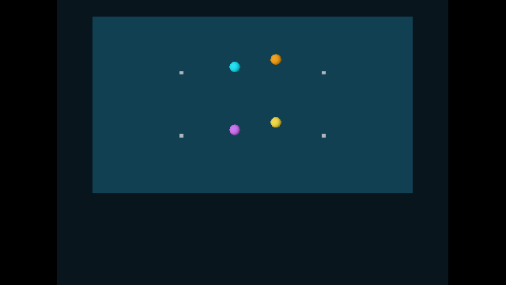

In the 3D example, Orange yields to higher priority Cyan; Gold yields to Violet
because Gold observes their shared membership and Violet observes no peers.

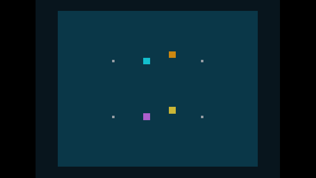

The XY example uses the same policy controls while preserving each agent's visual
depth.

Shared group is an authored setting and cannot be changed in Live gameplay or
animated. C++ projects must build their modules with the matching installed SDK.

Keep movement anchors aligned with the navmesh and use stationary parents. This is local steering, so tight or crowded spaces can still jam. It does not add physics collision response or moving obstacle carving.

A build is a separate asset operation. Scene Undo does not undo a navmesh build. Successful rebuilds keep the same asset identity, so agents keep their reference.

## Make an agent follow a path

1. Create another Cube named **Agent** at **-8, 0.1, 0**. A small scale such as **0.2, 0.2, 0.2** makes it easy to see.
2. Use **+ Add Component → Navigation / Navigation Agent**. Do not mark this moving object as a Navigation Surface or Navigation Region 2D, give it a Physics Body in either domain, or enable a Character Controller on it.
3. Choose the generated **NavMesh**.
4. Set **Destination X = 8**, **Destination Y = 0.1**, and **Destination Z = 0**. Press Enter to commit each numeric field.
5. Enable **Has destination**. Leave **Enabled** checked and **Speed** at 2.
6. Make sure the Scene has a [game Camera and Light](../getting-started/first-scene.md), save, then click **Play**. The cube should travel around the obstacle and stop near the destination.
7. Click **Pause**. It stops. **Step** moves it one simulation tick; **Resume** continues.
8. Click **Stop**. The authored cube returns to its original position.

For a 3D NavMesh, destinations use world X/Z across the floor and Y upward. For an XY NavMesh, use X/Y across the region; visual Z remains unchanged. **Stopping distance** is the remaining distance along the route to the projected destination. Movement changes position; the agent does not turn to face its route. Its transform origin follows the navigation surface. For a larger visual model, use a child object with an upward local offset.

## See the requested destination

1. Build the NavMesh, or expand **Content → Navigation** to load its saved overlay.
2. Select the agent, choose its **Build profile** under Navigation and confirm its **NavMesh** matches that profile's asset.
3. Enable **Has destination** and turn on **Navigation overlay** in the Scene tools.

A cyan diamond labeled **Requested destination** shows the selected agent's
destination. A thin cyan line joins its world origin to that point. Edit the
destination fields in Inspector to move the guide; normal Undo, Save and reopening
keep their usual behavior. A disabled agent has a gray guide.

For XY navigation the guide keeps the agent's visual Z. For 3D it uses all three
world coordinates. The requested point still needs projection onto the NavMesh
when the game runs; a visible diamond does not confirm that a route is available.
During Play, the amber path shows the calculated route. Clearing **Has destination**,
hiding the agent or turning off **Navigation overlay** removes the requested guide.
The guide is an editor overlay and is absent from exported games.

## Move the destination in Scene

1. Select one placed agent with **Has destination** enabled and its saved NavMesh loaded under **Content → Navigation**.
2. In **Navigation Agent**, click **Edit destination in Scene**, or choose **Scene / Navigation destination** in the command palette. This opens the Scene view, centers the requested point without changing zoom, and enables **Navigation overlay**.
3. Drag a colored axis to change one coordinate. Drag the gold center to move across the navigation plane. For 3D, handles change world X/Z and keep Destination Y; for XY they change world X/Y and keep Destination Z.
4. Use **Snap** or hold **Ctrl** to snap world metres with **View → Snap spacing**.
5. Release to apply one Undo step. **Escape**, right-click, middle-click or losing application focus cancels the preview.
6. Press **W** for ordinary object Move or **Q** for selection. Save the Scene to keep the destination, then Play to test its route.

The preview leaves the agent's transform in place. A view looking along the plane
may hide the center handle; orbit to see both axes and the center. Hidden or
selection-locked targets are not editable. Loading the saved NavMesh does not bake
a new one. Prefab instances use ordinary property overrides, Undo and **Revert**.
Destination editing is unavailable during Play; use **Live gameplay** fields to tune
a running agent.

Keep the agent's effective spatial parents stationary and free of enabled
character controllers. The default **Movement → Navigation** refuses an enabled
controller on the object. Use **Movement → CharacterController** for the supported
upright, World-bound 3D ground profile, or **CharacterController2D** for a World-bound
Floating XY controller, or **GroundedCharacterController2D** for a Grounded XY
controller with positive automatic gravity and static physical support. If project C++ owns the
character's movement, disable its Navigation Agent and use read-only Navigation
queries to obtain routes.

## Tune an agent during Play

Select an agent in Hierarchy during Play. Open **Inspector → Live gameplay →
Navigation Agent**. These fields affect the running copy:

- **Speed** changes its movement rate. Set it to **0** to hold that agent while other gameplay continues.
- **Enabled** turns its navigation movement on or off. **Has Destination** starts or clears its route request.
- **Destination X**, **Destination Y** and **Destination Z** set a world-space goal. Use X/Z for 3D or X/Y for top-down 2D. XY movement keeps visual Z.
- **Stopping Distance** changes how close along the route it tries to get.

For a goal requiring several coordinate changes, **Pause** first, enter each value,
then **Step** or **Resume**. Edits themselves do not advance simulation. Navigation
uses the new settings on its next fixed tick. Watch **Navigation progress** for the
result; a goal outside the walkable area can fail even when its numeric values are
valid. A rejected field value retains the previous value. The NavMesh asset is
chosen in the authored Inspector while stopped.

Collapse the Navigation Agent section to reach Navigation Avoidance in a short
Inspector, or scroll to the controls. Supported live fields remain available while
the game is paused. Their temporary values do not change the Scene or Prefab source.

To keep selected settings, choose **Keep values after Stop...**, Stop, then use
**Run → Review runtime tuning... → Apply to Scene** and save. This uses one Scene
Undo step and copies only selected tunable values; it does not keep the agent's
runtime position or change its NavMesh. See [Play mode](play-mode.md).

## See movement progress

Open **50-navigation-progress** in the Feature Gallery. Select **Agent - inspect progress during Play**, then press Play. The cube travels around the obstacle and stops. In Inspector's **Live gameplay → Navigation progress**, watch the state, route distance, measured speed and navigation tick. These are read-only runtime observations; Stop restores the saved scene.

- **Moving** means the agent advanced on its last navigation tick.
- **Arrived** means it reached its stopping distance along the route.
- **Paused** means its configured speed is zero. Pausing the game itself freezes the last displayed observation; Step updates it once.
- **Pending** means the current settings have not run through a navigation tick yet.
- **Failed** shows the status and **Details** from the last navigation tick. For example, it can identify a conflicting physics component, an unavailable NavMesh or changed source geometry. Ancestor conflicts show the authored name and ID; use Hierarchy's search to find that object.
- **Blocked** means no progress on one tick. Optional local avoidance can still jam in crowded or blocked spaces.

Distance and speed appear only for a valid sampled route. Expand **World coordinates**
to see the sampled **Position** and **Projected goal** in X, Y, Z order. These are
read-only navigation-tick values; the running image can interpolate between ticks.
Pending, disabled and failed states do not show invented route coordinates. Changing a
live target clears its previous target-failure details until the next navigation tick.

A failed agent can recover after you correct its settings or sources. For supported
stale geometry, use **Game → Runtime navigation → Rebuild navigation**, or Stop and
rebuild the saved NavMesh. Use Console/Problems for the timestamped log history; Inspector details
explain the current failed sample. Some unavailable assets are rejected during
Scene preparation instead; a failed replacement retains the previous active world. If an agent-count limit recurs after being
resolved, it produces a fresh warning.

An exported Gallery50 scene uses the included built NavMesh; it does not need an
editor, compiler or navigation build worker to run.

## Save, reopen and rebuild

Save the scene after choosing the navmesh and destination. Reopening restores those authored settings; generated navigation remains a project asset.

Moving or resizing included geometry makes navigation stale. Use an explicit runtime rebuild for supported changes during Play. To change saved geometry or build settings, Stop, save the Scene and use Build NavMesh. Runtime agents refuse to move on stale geometry while a replacement is pending.

A NavMesh belongs to the scene that produced it. A duplicated scene needs its own build and agent references to that new asset.

## Prefab agents

Create a prefab from an agent using the normal [prefab workflow](prefabs.md). Instances inherit its navigation configuration. Override **Speed** or destination fields on one instance; use the Inspector's property **Revert** controls to follow the prefab again. Scene Undo/Redo covers these authored edits. Runtime routes are not saved in a prefab.

## Common messages

- **No enabled geometry:** add enabled Navigation Surfaces or eligible collected static colliders for 3D, or walkable Navigation Region 2D shapes for XY. Check **Plane**, **Collect static colliders** and **Collision layers**. XY still needs an explicit walkable region.
- **Stale navmesh:** rebuild after changing included geometry.
- **Point outside navmesh:** put the agent and destination over a teal walkable region. Projection searches nearby, not across the entire world.
- **Partial / no path:** the destination is disconnected. Check gaps, clearance, slope and included obstacles. For a link, check its Plane, Build profile, direction and endpoint attachment, then rebuild the matching profile.
- **Missing or incompatible asset:** choose a valid NavMesh built for this scene, or rebuild it.
- **Physics ownership error:** remove the agent's Physics Body and any moving physics spatial ancestor, or use an independent World spatial binding.
- **Build/query limit:** reduce the included area or geometry, or increase cell size. A single build supports at most 512 × 512 cells.

Navigation supports static shapes/Meshes and collected physical geometry in 3D, and rectangles, polygon regions and selected or collected 2D collision footprints in XY, within roughly four kilometres of the origin and 64 agents. Authored straight or arced links connect static walkable parts for ordinary agents. Physical characters support upright 3D ground routes, positive-lift jumps and descending zero-lift drops between static supports, or Floating XY routes without links. Grounded XY movement supports continuous static physical ground and the same explicit jumps/drops with automatic gravity. Explicit runtime rebuilds accept supported changed static source snapshots. General XY platformer jump/drop route planning, moving-platform routes and deformed or moving-physics navigation sources are unavailable. Moving cylinder/circle carving requires the Dynamic obstacles profile described above. Optional avoidance is local steering and does not guarantee collision prevention. See [Play mode](play-mode.md) and [Transforms](transforms.md) for related controls.
