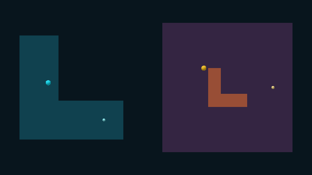
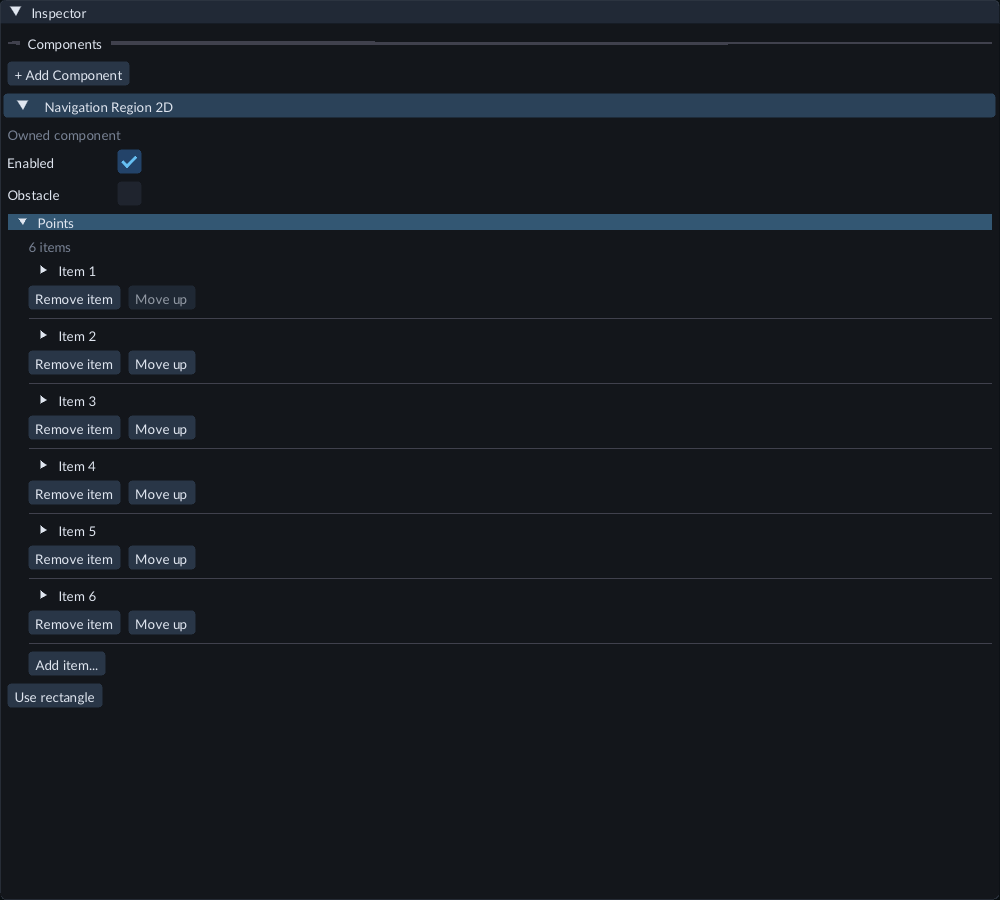
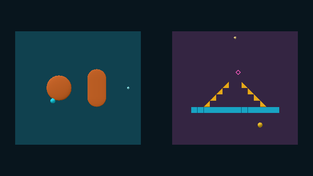
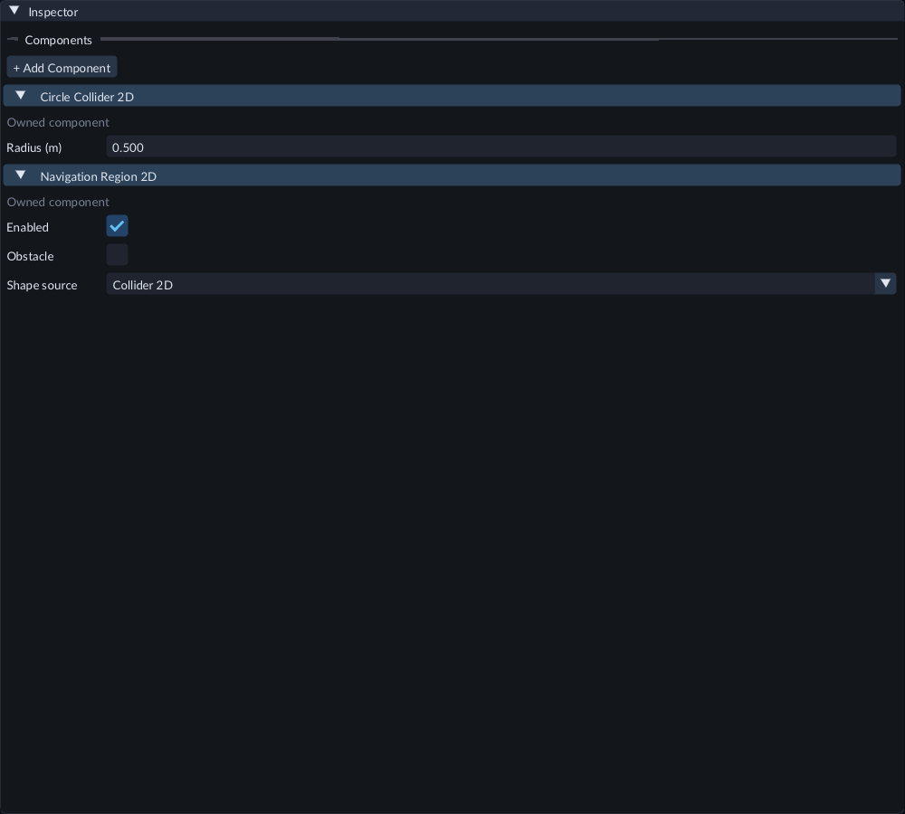
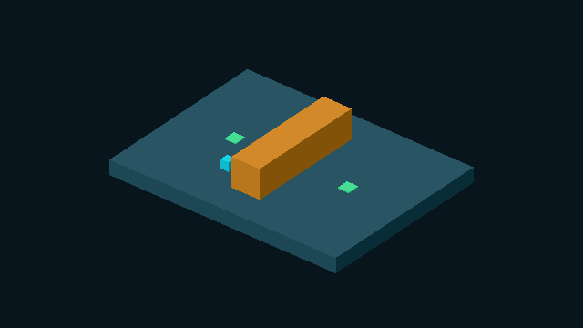
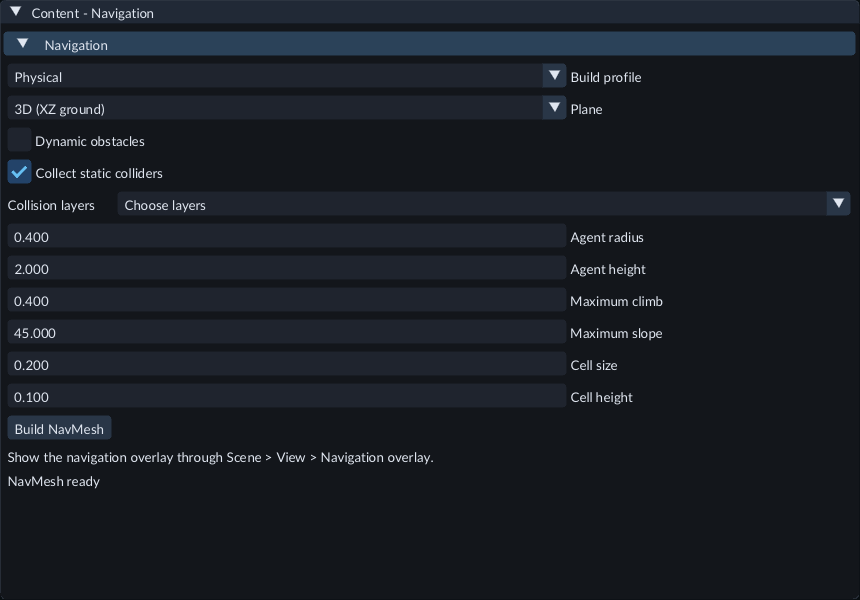
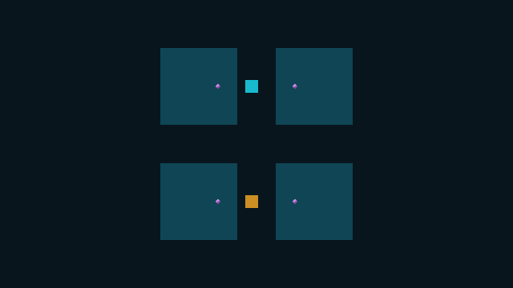
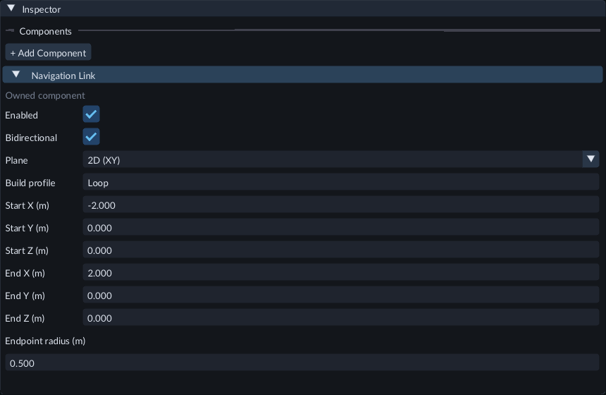
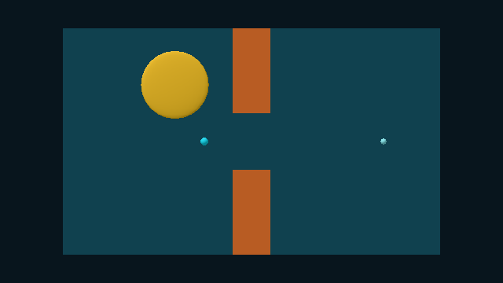
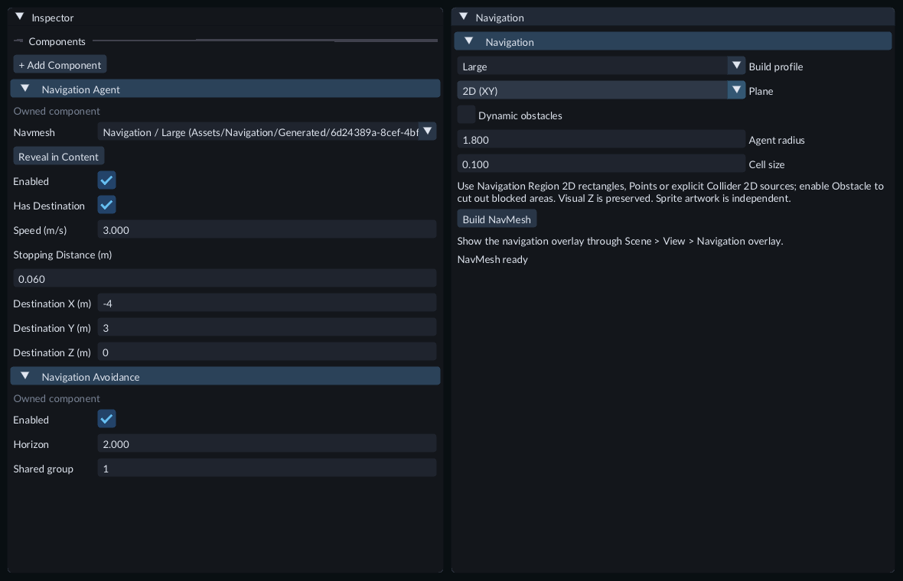

# Navigation

For patrols, timed pauses and target following, add a
[Navigation Behavior](navigation-behavior.md) to an agent after building its NavMesh.

Navigation lets an object find a route across a floor and around static obstacles. Build a **NavMesh** from marked 3D shapes, 2D regions or selected static colliders, then give an object a **Navigation Agent** and a destination. Choose the plane explicitly when building.

Agents follow baked static geometry. Add **Navigation Avoidance** for local steering
around other participating agents. For moving solid footprints, enable the
**Dynamic obstacles** when building and add **Navigation Obstacle** components. Navigation Agents cannot also have a Physics Body, Physics Body 2D
or an enabled Character Controller in either domain.

In **Window → Profiler → Play runtime**, **NavSourceCapture** shows the CPU time
spent checking included sources during Play. Rebuild the NavMesh after changing
included geometry.

## Build a 3D floor and obstacles

1. Create a Plane. Set its scale to **20, 1, 20** and position to **0, 0, 0**.
2. Select it. In Inspector, use **+ Add Component → Navigation / Navigation Surface**. Leave **Enabled** checked.
3. Create a Cube at **0, 2, 0**, with scale **2, 4, 4**. Add a Navigation Surface to it too.
4. You can add a second obstacle elsewhere on the floor. Mark every static shape that should affect the route.
5. Save the scene.

Marked built-in shapes, editable Mesh assets, and static imported Mesh entities contribute. For an imported Model, select its child entity that has a **Mesh Renderer**, then add **Navigation Surface**. Marking only its group/root does not include its children automatically. Unmarked objects require the **Collect static colliders** option and eligible physical components described below. Keep included geometry static.

Marked sources and their spatial parents must have no enabled **Character
Controller** or **Character Controller 2D**. Disable the controller or use another
object as static navigation geometry. An inherited controller counts too. A
**Child space: World** object does not follow its structural parent. A failed build
keeps the previously selected NavMesh.

Skinned characters, morphing meshes, points and lines cannot be baked. The build uses the Mesh's first level of detail and all its triangle parts. The small-scene profile supports up to32 external Mesh assets and16,384 included triangles; an oversized/unsupported Mesh gives a diagnostic and preserves the previous NavMesh. After editing or reimporting a marked Mesh, rebuild that Mesh through its normal Content workflow, then rebuild navigation. Saving its source alone does not change the selected cooked revision.

Open **51-static-mesh-navigation** in Feature Gallery for a saved editable Mesh floor, static obstacle and ready-built route. Play, select the agent, and inspect **Live gameplay → Navigation progress**. You can export this scene without sending its editable Mesh source or a navigation build worker. Scene50 continues to demonstrate built-in shapes and retained older navigation assets.

## Build top-down 2D navigation

Open Gallery **80-xy-navigation** for a ready example. Press Play: the cyan agent
routes around the orange obstacle; the green and amber agents steer past each
other in the right lane. Their Sprites use an ordinary orthographic Camera. Select
an agent to inspect **Live gameplay → Navigation progress**. Stop restores its
starting position. This Scene needs no project C++ module.

To create your own:

1. Create an empty entity. Add **Navigation / Navigation Region 2D** in Inspector.
2. Leave **Enabled** on and **Obstacle** off. Set **Width = 20** and **Height = 14**. This centered rectangle is walkable. Its entity transform controls its XY position, rotation and scale; visual Z does not change the navigation footprint.
3. Create another empty entity with the same component. Enable **Obstacle** and set **Width = 2**, **Height = 4**. Put it in the walkable rectangle's center.
4. Select either region to see its outline in Scene: green for walkable, orange for obstacle, gray for disabled. Add Sprites separately if you want visible art.
5. Open **Content → Create / Register → Navigation**. Set **Plane → 2D (XY)**. Choose **Agent radius** for clearance and **Cell size** for build resolution, then click **Build NavMesh**. Enable **Scene → View → Navigation overlay**.
6. Create **Entity → Create → Rendering → Sprite**. Assign a published [image Material](sprites.md), set its size to **0.7 × 0.7 m** and position to **-8, 0, 0**. Add **Navigation Agent**, choose the generated NavMesh, set **Destination X = 8**, **Destination Y = 0**, and enable **Has destination**.
7. Add **Entity → Create → Rendering → Camera**. Set position to **0, 0, -20**, rotation to **0, 0, 0**, **Projection → Orthographic**, and **Orthographic Height = 17**. The Camera looks along +Z. An unlit Sprite image material needs no scene light.
8. Save, press **Play** and open **Game**. The Sprite follows the opening around the obstacle. In Scene, the navigation overlay shows its route.

Regions explicitly select navigation data. Sprite artwork does not supply navigation.
Use **Shape source → Collider 2D** to select a configured collider, or enable
**Collect static colliders** to include eligible physical obstacles as described below.
Overlapping walkable regions form a
union; obstacle regions cut that union before agent-radius clearance is applied.
An obstacle outside all walkable regions adds no walkable area. Add at least
one walkable region. Keep sources and their spatial parents static and free of
enabled Character Controllers, as in 3D.

XY destinations and movement use world X/Y. The agent keeps its starting world Z;
**Destination Z** does not move it between visual depths. Avoidance considers
participants on the same NavMesh even when their visual Z differs. This is
top-down routing; it does not plan platformer jumps, falls or moving platforms.

A Scene can have several named navigation profiles. Switching **Plane** requires
an explicit rebuild and keeps that profile's asset identity. 3D Surface markers and 2D
Region markers are selected independently. Save the Scene and choose it as startup
before normal export; its built NavMesh is included in the game.

## Create polygon regions

Open Gallery **136-navigation-polygons** and press Play. The cyan agent follows
an L-shaped floor; the amber agent goes around an L-shaped obstacle. Both routes
use the saved NavMesh and can be exported without a project C++ module.

The two courses use separate visual meshes. Navigation Region outlines define the
walkable geometry; visible art does not automatically become navigation data.

1. Stop Play and select a **Navigation Region 2D**. Choose **Shape source → Rectangle / Points** and set Width/Height for its initial rectangle.
2. Click **Create polygon** in the component. This copies its four local corners into **Points** as one Undo step.
3. Expand **Points** and edit each point's **x** and **y** in metres. Use the collection controls to add, remove or reorder points. Each edit must leave a complete valid shape; an invalid candidate keeps the previous contour and reports the reason.
4. Keep 3–64 points in counterclockwise order when viewed from +Z. Avoid repeated points, straight intermediate corners, crossings and touching edges. Local coordinates must stay within ±1000 m; resolved world XY must remain within ±4090 m.
5. Leave **Obstacle** off for a walkable region, or enable it to cut a concave footprint out of another walkable region. Use a separate obstacle for a hole.
6. Rebuild the NavMesh with **Plane → 2D (XY)**, save the Scene and test in Play. Save authored changes outside Play before exporting.

**Use rectangle** clears Points and restores Width/Height controls. Undo restores
the previous polygon. Polygon regions use ordinary transforms for position,
rotation and scale; the four rectangle extent handles are unavailable. Framing
and outline selection still use the full contour. Prefab point overrides and
Undo/Redo work through the regular Inspector.

## Use 2D collision shapes as navigation sources

Open Gallery **137-navigation-collision-sources** and press Play. The cyan agent
routes around a Circle and Capsule Collider on a Box Collider floor. The amber
agent routes around one published Tile Map collision layer. Select an agent to
inspect **Live gameplay → Navigation progress**.

The courses use ordinary visual meshes and the Map’s published image material.
The marked collision footprints select their navigation geometry.

1. Stop Play. Select a static entity with exactly one **Box Collider 2D**, **Circle Collider 2D**, **Capsule Collider 2D** or **Tile Map Collider 2D**.
2. Add **Navigation / Navigation Region 2D**, then choose **Shape source → Collider 2D**. A Physics Body is not required for baking this configured footprint.
3. Leave **Obstacle** off to add walkable area, or enable it to cut the collider's footprint from another walkable area. Width, Height and Points are retained but inactive in this mode. Switching back to **Rectangle / Points** restores those controls.
4. For a Tile Map, assign a published Map to its **Tile Map Renderer** and choose **Tile Map Collider 2D → Collision layer**. Save and publish Map or Tile Set edits through their normal Content workflows before rebuilding navigation. Tiles with no collision contribute no footprint; cell flips, neighbor rules, concave profiles, islands and holes use the selected collision definitions. Hidden Map layers can supply collision.
5. Enable **Scene → View → Navigation overlay** to inspect the selected footprints. Island boundaries stay separate. Pending or stale Map resources show no substitute region. Press **F** to frame the selected complete footprint.
6. In **Content → Create / Register → Navigation**, choose **Plane → 2D (XY)** and **Build NavMesh**. Save the Scene, test Play, then export normally. The exported game includes the selected Map, Tile Set, visual dependencies and NavMesh.

Change collider size through its collider component and position/rotation through
its ordinary transform. Rectangle resize handles are unavailable for derived
footprints. Circle and Capsule shapes require equal absolute X/Y scale; negative
scale is allowed. Keep collider sources upright in XY, without shear or moving
physics/controller ancestors. Navigation does not create a physics body or use
collision-layer masks, sensors or one-way direction to decide walkability;
**Enabled**, **Obstacle** and the explicitly selected collision geometry do that.

Rounded footprints use a bounded conservative approximation: obstacle contours
cover the configured shape and walkable contours fit inside it. Agent radius adds
clearance afterward. At most 32 distinct Map inputs and 512 derived convex masks
are supported within the overall source/triangle limits. A Map collision source
supports up to 512 collision pieces; oversized or numerically collapsed geometry
reports a build error and keeps the previous NavMesh.

Changing an included collider or a selected Map revision makes the NavMesh stale.
Stop Play and rebuild after such changes. Runtime cell edits to an included Map
also stop baked-route movement; reset that instance to its published cells before
resuming its existing route. Runtime editing does not rebake navigation. Use the
separate **Navigation Obstacle** workflow below for moving blocked areas.

## Collect static collision geometry

Open Gallery **141-navigation-collision-collection** and press **Play**. The cyan
agent patrols between the green markers around the orange wall. The floor uses a
Box Collider; the wall uses an editable Collision asset. Neither needs a Navigation
Surface marker. The scene includes its Camera, light, behavior and built NavMesh,
and runs without a project C++ module.

1. Stop Play. For a 3D floor or obstacle, add **Physics Body** and exactly one **Box Collider**, **Sphere Collider**, **Capsule Collider**, **Cylinder Collider** or **Asset Collider**. Set **Motion → Static**, enable the body and turn **Sensor** off. For an Asset Collider, assign a published Collision asset through the normal Content workflow.
2. For XY, author at least one walkable **Navigation Region 2D**. Add **Physics Body 2D** and exactly one supported Collider 2D to each physical obstacle. Keep its body enabled, Static and nonsensor. Box, Circle, Capsule and a selected Tile Map collision layer are supported.
3. Save the Scene. Open **Content → Create / Register → Navigation**, choose **Build profile** and **Plane**, then enable **Collect static colliders**.
4. Open **Collision layers** and select the bodies' physics layers. The mask selects each body's **Layer**; its contact **Mask** does not select build inputs. The layer picker becomes available when collection is enabled.
5. Adjust clearance/build settings and click **Build NavMesh**. The profile combines marked geometry with eligible physical sources. In XY, automatically collected shapes are obstacles; they add no walkable floor. In 3D, actual physical triangles supply floors and obstacles according to their shape and slope.
6. Assign that NavMesh to your Navigation Agent. Save, test Play and inspect **Live gameplay → Navigation progress**. Stop and save authored changes, select the Scene as startup, then export normally. Export includes the selected Collision/Map inputs and built navigation; it needs no navigation build worker at runtime.

An explicit **Navigation Surface** or **Navigation Region 2D** takes precedence on
that object. Disable the marker to exclude it from collection. An enabled marker
keeps its explicit geometry/role, including a Collider 2D deliberately used as a
walkable region. Markers in the other plane do not affect collection.

Disabled bodies, sensors, moving bodies and excluded physics layers are skipped.
Included sources and followed spatial parents must satisfy the ordinary static
transform/controller rules. Collider scale restrictions still apply; ambiguous,
unresolved or unsupported selected geometry reports a build error and retains the
previous NavMesh. Visual artwork is independent of a collected physical shape.

Changing an included body's shape, transform, layer or eligibility makes the
profile stale. Replacing its selected Collision or Map revision also requires a
rebuild. Runtime movement holds while the sources do not match; collection does
not rebake a running game. Each named profile retains its own collection settings,
and collection can be combined with **Dynamic obstacles** and authored links.
Changing these build options publishes no Scene Undo step; ordinary component
edits retain their normal Undo/Redo history.

## Select and resize 2D regions in Scene

Enable **Scene → View → Navigation overlay** to show the region outlines. Click
an outline to select its region, or select it in Hierarchy. The selected outline
remains visible when the overlay is off. Hidden regions follow their hierarchy
visibility; locked regions cannot be picked. A disabled region has a gray outline
and remains editable.

Hover Scene and press **F** to frame the selected region's full XY footprint.
When a selected region also has visible art, framing includes both. Outlines show
the navigation plane at world Z0; visual Z remains separate.

For **Shape source → Rectangle / Points** with empty Points, press **W** over Scene to use Move. Four gold
squares appear at the selected region's edge midpoints. Drag one to change **Width** or **Height** symmetrically
around its center. The tooltip identifies the dimension. **Ctrl** rounds that
local dimension to **View → Snap spacing**; entity scale still changes its world
size. To move the whole region, use the ordinary transform handles. If an edge
handle is too small or edge-on, zoom in or face the XY plane; Inspector dimensions
remain available.

Release to keep the resize as one Undo step. **Escape** or right-click cancels.
Changing selection, losing editing access or resizing the viewport also cancels
a drag. Handles are unavailable during Play and for hidden or locked regions.
For multiple selections, use Inspector to edit individual region dimensions.

After resizing, save the Scene and explicitly **Build NavMesh** again. Until then,
the previous baked asset remains selected and the changed geometry is stale.
Undo can restore matching geometry; it does not undo a later asset build.

## Build the NavMesh

Open **Content → Create / Register → Navigation**. Select **Plane → 3D (XZ ground)** for the floor example. Its defaults are:

- **Agent radius: 0.4 m.** Clearance around obstacles and floor edges.
- **Agent height: 2 m.** Required space above the floor.
- **Maximum climb: 0.4 m.** Largest step the baked route can traverse.
- **Maximum slope: 45°.** Steepest walkable slope.
- **Cell size: 0.2 m.** Horizontal build resolution.
- **Cell height: 0.1 m.** Vertical build resolution.

Click **Build NavMesh**. The editor stays responsive while the worker builds and validates the candidate. **Cancel navigation build** discards the candidate. A failed build keeps the previous usable navmesh.

The ready/stale message checks included objects and the editor's current asset selection. Changing an included object or a build setting updates it immediately. Refreshing assets keeps your unfinished navigation settings. **NavigationStatus** in the editor CPU profiler shows the time spent checking this message.

Enable **Scene → View → Navigation overlay** to see translucent teal triangles. There should be an opening around the obstacle, with clearance determined by the agent radius. Yellow lines show runtime routes; dots mark their start and end.

Changing scenes or projects clears the previous overlay. Open **Content → Create /
Register → Navigation** to load the current scene's saved NavMesh. Loading it does
not rebuild or change the asset.

## Connect separated walkable parts

Use **Navigation Link** to connect two static walkable parts. The Agent moves in a
straight line between the admitted endpoints at its current Speed. This is useful
for a deliberate crossing that ordinary ground routing cannot follow. It does not
simulate a jump or drive a physics character.

Open **Scenes/140-navigation-links.scene.json** in Feature Gallery. The cyan
agent patrols across the upper gap in both directions through the `Loop` profile.
The orange agent crosses the lower gap once, from Start to End, through `OneWay`.
The upper profile uses Dynamic obstacles; the lower profile uses a static NavMesh.
Both use the ordinary Navigation Agent. The cyan patrol reuses the Gallery's Patrol
behavior; no project C++ module is required.

The cyan upper route permits return travel; the orange lower route permits Start
to End only. The image shows both agents during their first crossing.

To add a connection:

1. Stop Play. Create an empty entity, then use **+ Add Component → Navigation → Navigation Link**. You can also attach the link to an existing static source entity.
2. Choose **Plane → 3D** or **2D (XY)** to match the navigation build. Set **Build profile** to its exact case-sensitive name, such as `default` or `Loop`.
3. Set **Start X/Y/Z** and **End X/Y/Z** on the corresponding walkable parts. These coordinates are local to the link entity; its transform places them in the world. XY requires both local Z coordinates to be zero and ignores the source's visual depth.
4. Set **Endpoint radius** for ground attachment, between **0.05 m** and **5 m** in world units. The endpoints must attach to walkable ground. Keep the link and its followed spatial parents static, without an enabled Agent, Character Controller or moving Physics Body.
5. Leave **Bidirectional** enabled for return travel. Clear it for **Start → End** only. Leave **Enabled** checked to include the connection in its selected profile.
6. In **Content → Create / Register → Navigation**, choose the same **Build profile** and **Plane**, then **Build NavMesh**. Assign that profile's NavMesh to the Agent, save the Scene and Play.

Select the upper two-way connection to inspect its profile, local Start/End and
world Endpoint radius. Clear Bidirectional for Start to End travel, then rebuild.

Enable **Scene → View → Navigation overlay** to see purple endpoint circles and
direction arrows for the selected profile. These guides show authored intent;
build status still determines whether the geometry and endpoints are valid. Saved
walkable triangles and runtime route lines use their usual overlay colors.

During Play, **Live gameplay → Navigation progress** identifies the active link.
Setting Speed to zero, disabling the Agent or clearing its destination holds an
active crossing. Re-enable it and restore a destination to continue. A new
destination waits until the Agent finishes the current span, then replans from the
exit. Stopping distance cannot stop an already active crossing midway. Ground
avoidance resumes after the crossing; it does not steer sideways across the gap.

If a dynamic obstacle disconnects an endpoint, the Agent holds its current span
until the connection is usable again. Endpoint, direction, radius and transform edits make the selected profile stale.
Stop Play and rebuild after editing. Changing Plane or Build profile removes the
link from the old selection and adds it to the new one; rebuild both affected
assets. Gameplay code that changes an Agent's NavMesh cancels its old crossing; place it on
valid ground before requesting a new route. Code that directly repositions the
Agent also discards the old crossing and starts a fresh route.

A profile supports at most **32 links**. Endpoints must be at least **0.01 m** apart
both locally and after transformation. With **Dynamic obstacles**, the endpoints
must lie in the same or adjacent tile coordinates. Tiles are 32 cells wide; at the
default 0.2 m Cell size this is 6.4 m. If the build reports a tile-span limit,
shorten/reposition the link or choose a coarser Cell size and rebuild. Moving
platform attachments and simulated jumps are unavailable.

Links use normal component/property Undo, prefab inheritance and Scene saving.
An exported game carries the built connections and needs no navigation builder,
editor or compiler to run them. Choose this Scene as startup and save before export.

For an agent using MCP, add `forge.navigation_link` with `forge_component_add` and
set its fields through `forge_property_set_many`. Use one property transaction when
changing several endpoint coordinates. `forge_discover` provides the field schema
and Plane choices. `forge_navigation_build` uses the same named-profile owner;
poll `forge_navigation_status` for completion and `link_count`. Scene edits require
an editable connection, baking requires asset-write access, and Play requires the
execution grant. These operations preserve the usual revision, sequence and Undo
checks; direct source-file edits are unnecessary.

## Use different agent sizes

Open Gallery **138-navigation-profiles** for two agents sharing one floor. The
small cyan agent uses the `default` profile with radius **0.2 m** and crosses the
three-metre passage. The large amber agent uses `Large` with radius **1.8 m** and
moves within the left room; its baked clearance cannot pass through that opening.
Both agents use **Navigation Avoidance → Shared group = 1** to participate across
their different profiles. Both Nav assets are included when you export the saved Scene.

The floor and explicitly marked obstacles are shared. Each build profile has its own collection filters, radius,
settings and NavMesh asset.

1. Stop Play. Open **Content → Create / Register → Navigation** and choose a saved name under **Build profile**. `default` is the original profile.
2. To add another, choose **Build profile → New profile...**, enter a name and click **Use new profile**. This starts an unfinished draft using the current settings.
3. Set **Plane**, **Agent radius** and the other settings, then **Build NavMesh**. Building publishes the new asset; selecting a name alone does not build it.
4. Select each agent. In **Navigation Agent → NavMesh**, choose the matching **Navigation / default** or **Navigation / Large** asset. The picker also shows the asset path so you can distinguish different Scenes.
5. Save the Scene, then Play. Each agent uses its assigned profile's clearance.

Choose the same profile in the build controls and the agent's NavMesh field.
The saved Large profile has radius 1.8 m; the agent keeps its own destination.

Names are case-sensitive and contain 1–64 ASCII letters, digits, `_` or `-`,
beginning with a letter. A different name creates another asset. Switching a saved
profile loads its settings and overlay. It does not reassign agents or change
Scene Undo history. The overlay shows paths and destination guides for the
selected profile; select the agent's profile before editing its destination in
the Scene view.

Rebuilding or changing Plane keeps that profile's asset ID. Other profiles remain
available. After changing shared marked geometry, rebuild every affected profile
before Play. A running world can load at most eight Nav assets within its existing
32MiB tile-data budget. Profile controls are locked during Play.

## Route around moving obstacles

Set the obstacle's local dimensions in Inspector and enable **Dynamic obstacles** in the desired
build profile before rebuilding.

Open **129-moving-navigation-3d** or **130-moving-navigation-xy** in Feature Gallery
for a ready example. The orange obstacle follows an editable animation clip while
the cyan agent recalculates its route. No project C++ module is required.

1. Keep the floor's **Navigation Surface** or walkable **Navigation Region 2D**.
2. On the moving object, remove its Navigation Surface/Region marker. Add **Navigation / Navigation Obstacle**. Leave **Enabled** on. Do not add a Navigation Agent to this same object.
3. Set **Radius** for its local circular footprint. In 3D, set **Height** for a cylinder centered on its origin. The object can have separate visible art; the Navigation Obstacle does not create a renderer or physics collider.
4. Open **Content → Create / Register → Navigation**. Select the plane, check **Dynamic obstacles**, then click **Build NavMesh**. Agents keep their existing NavMesh reference when the same Scene's asset is rebuilt.
5. Save the Scene. During Play, move the obstacle through an ordinary transform animation or project C++. Agents recalculate their routes around its current footprint. Disabling/removing the component restores walkable tiles.
6. Use **Live gameplay → Navigation progress** on an agent to inspect its route. Yellow overlay paths follow the current carved mesh; teal triangles show the saved base. Stop restores authored starting values. Save outside Play before exporting; the generated layers and obstacle components travel with the game.

The 3D shape must stay upright, with equal X/Z scale and no shear; yaw and mirrored scale
are allowed. XY uses equal projected X/Y scale and ignores visual Z and Height. Radius
accepts 0.05–5 m and Height 0.2–10 m before entity scale. Agent-radius clearance is added
automatically. An unsupported ellipse, tilt or collapsed shape gives a diagnostic and
prevents stale-route movement.

Use at most eight enabled obstacles. Each inflated footprint can overlap at most eight
baked layers; reduce its size or change the tile resolution if that limit is exceeded. A
tiled build supports at most 64 layers of 32 × 32 cells, with four layers at one tile
coordinate. It may reach this limit before the general 512×512-cell grid limit. A
footprint may span at most 16 tile positions along either axis, even when many positions
are empty. Reduce a large footprint or rebuild with coarser cells. Keep larger stationary
obstacles in the static bake.

This updates blocked portions of the existing floor. It does not create new floors, rebake
moving platforms, stop physics bodies or push an agent out of an obstacle. If an obstacle
covers the agent's start, it cannot move. Inspect its failure diagnostic; navigation can
resume when a valid start and route become available. Obstacle properties are authored in
the regular Inspector outside Play; they are not part of the live agent-tuning controls.

## Let agents steer around each other

Open Gallery scene **52-navigation-avoidance** and press **Play**. Two agents pass each other in one lane; another goes around a parked agent in the other lane. The saved scene includes its built navigation, camera and light, and can be exported normally.

Add **Navigation Avoidance** to each Navigation Agent that should participate. Enable it and set **Horizon** to the number of seconds to look ahead (default 2). The baked radius defines clearance. In 3D, height also filters vertically separated participants; XY ignores visual depth. Idle and paused participants stay in the way; disabled agents or agents without this component do not participate.

**Shared group** defaults to **0**, which keeps different Nav assets isolated.
To let agents on different profiles steer around each other, stop Play and give
them the same value from **1–32**. Their profiles must use the same Plane. Each
agent contributes its own baked radius. Agents on the same Nav asset still
interact regardless of this setting. Save the Scene before exporting.

During Play, select an agent and adjust **Enabled** or **Horizon** in **Live gameplay**. These changes affect the running world; Stop restores the authored scene. Edit the regular Inspector outside Play to save the settings.

Shared group is an authored setting and cannot be changed in Live gameplay or
animated. C++ projects must build their modules with the matching installed SDK.

Keep movement anchors aligned with the navmesh and use stationary parents. This is local steering, so tight or crowded spaces can still jam. It does not add physics collision response or moving obstacle carving.

A build is a separate asset operation. Scene Undo does not undo a navmesh build. Successful rebuilds keep the same asset identity, so agents keep their reference.

## Make an agent follow a path

1. Create another Cube named **Agent** at **-8, 0.1, 0**. A small scale such as **0.2, 0.2, 0.2** makes it easy to see.
2. Use **+ Add Component → Navigation / Navigation Agent**. Do not mark this moving object as a Navigation Surface or Navigation Region 2D, give it a Physics Body in either domain, or enable a Character Controller on it.
3. Choose the generated **NavMesh**.
4. Set **Destination X = 8**, **Destination Y = 0.1**, and **Destination Z = 0**. Press Enter to commit each numeric field.
5. Enable **Has destination**. Leave **Enabled** checked and **Speed** at 2.
6. Make sure the Scene has a [game Camera and Light](../getting-started/first-scene.md), save, then click **Play**. The cube should travel around the obstacle and stop near the destination.
7. Click **Pause**. It stops. **Step** moves it one simulation tick; **Resume** continues.
8. Click **Stop**. The authored cube returns to its original position.

For a 3D NavMesh, destinations use world X/Z across the floor and Y upward. For an XY NavMesh, use X/Y across the region; visual Z remains unchanged. **Stopping distance** is the remaining distance along the route to the projected destination. Movement changes position; the agent does not turn to face its route. Its transform origin follows the navigation surface. For a larger visual model, use a child object with an upward local offset.

## See the requested destination

1. Build the NavMesh, or expand **Content → Navigation** to load its saved overlay.
2. Select the agent, choose its **Build profile** under Navigation and confirm its **NavMesh** matches that profile's asset.
3. Enable **Has destination** and turn on **Navigation overlay** in the Scene tools.

A cyan diamond labeled **Requested destination** shows the selected agent's
destination. A thin cyan line joins its world origin to that point. Edit the
destination fields in Inspector to move the guide; normal Undo, Save and reopening
keep their usual behavior. A disabled agent has a gray guide.

For XY navigation the guide keeps the agent's visual Z. For 3D it uses all three
world coordinates. The requested point still needs projection onto the NavMesh
when the game runs; a visible diamond does not confirm that a route is available.
During Play, the amber path shows the calculated route. Clearing **Has destination**,
hiding the agent or turning off **Navigation overlay** removes the requested guide.
The guide is an editor overlay and is absent from exported games.

## Move the destination in Scene

1. Select one placed agent with **Has destination** enabled and its saved NavMesh loaded under **Content → Navigation**.
2. In **Navigation Agent**, click **Edit destination in Scene**, or choose **Scene / Navigation destination** in the command palette. This opens the Scene view, centers the requested point without changing zoom, and enables **Navigation overlay**.
3. Drag a colored axis to change one coordinate. Drag the gold center to move across the navigation plane. For 3D, handles change world X/Z and keep Destination Y; for XY they change world X/Y and keep Destination Z.
4. Use **Snap** or hold **Ctrl** to snap world metres with **View → Snap spacing**.
5. Release to apply one Undo step. **Escape**, right-click, middle-click or losing application focus cancels the preview.
6. Press **W** for ordinary object Move or **Q** for selection. Save the Scene to keep the destination, then Play to test its route.

The preview leaves the agent's transform in place. A view looking along the plane
may hide the center handle; orbit to see both axes and the center. Hidden or
selection-locked targets are not editable. Loading the saved NavMesh does not bake
a new one. Prefab instances use ordinary property overrides, Undo and **Revert**.
Destination editing is unavailable during Play; use **Live gameplay** fields to tune
a running agent.

Keep the agent's spatial parents stationary and free of enabled character
controllers. A controller on the object or its spatial parent stops navigation
movement and reports a failed/invalid state. A disabled controller allows ordinary
navigation. If C++ controls your character, query the Navigation service for a
route and let that controller own movement; do not add a second active Navigation
Agent driver.

## Tune an agent during Play

Select an agent in Hierarchy during Play. Open **Inspector → Live gameplay →
Navigation Agent**. These fields affect the running copy:

- **Speed** changes its movement rate. Set it to **0** to hold that agent while other gameplay continues.
- **Enabled** turns its navigation movement on or off. **Has Destination** starts or clears its route request.
- **Destination X**, **Destination Y** and **Destination Z** set a world-space goal. Use X/Z for 3D or X/Y for top-down 2D. XY movement keeps visual Z.
- **Stopping Distance** changes how close along the route it tries to get.

For a goal requiring several coordinate changes, **Pause** first, enter each value,
then **Step** or **Resume**. Edits themselves do not advance simulation. Navigation
uses the new settings on its next fixed tick. Watch **Navigation progress** for the
result; a goal outside the walkable area can fail even when its numeric values are
valid. A rejected field value retains the previous value. The NavMesh asset is
chosen in the authored Inspector while stopped.

Collapse the Navigation Agent section to reach Navigation Avoidance in a short
Inspector, or scroll to the controls. Supported live fields remain available while
the game is paused. Their temporary values do not change the Scene or Prefab source.

To keep selected settings, choose **Keep values after Stop...**, Stop, then use
**Run → Review runtime tuning... → Apply to Scene** and save. This uses one Scene
Undo step and copies only selected tunable values; it does not keep the agent's
runtime position or change its NavMesh. See [Play mode](play-mode.md).

## See movement progress

Open **50-navigation-progress** in the Feature Gallery. Select **Agent - inspect progress during Play**, then press Play. The cube travels around the obstacle and stops. In Inspector's **Live gameplay → Navigation progress**, watch the state, route distance, measured speed and navigation tick. These are read-only runtime observations; Stop restores the saved scene.

- **Moving** means the agent advanced on its last navigation tick.
- **Arrived** means it reached its stopping distance along the route.
- **Paused** means its configured speed is zero. Pausing the game itself freezes the last displayed observation; Step updates it once.
- **Pending** means the current settings have not run through a navigation tick yet.
- **Failed** shows the status and **Details** from the last navigation tick. For example, it can identify a conflicting physics component, an unavailable NavMesh or changed source geometry. Ancestor conflicts show the authored name and ID; use Hierarchy's search to find that object.
- **Blocked** means no progress on one tick. Optional local avoidance can still jam in crowded or blocked spaces.

Distance and speed appear only for a valid sampled route. Expand **World coordinates**
to see the sampled **Position** and **Projected goal** in X, Y, Z order. These are
read-only navigation-tick values; the running image can interpolate between ticks.
Pending, disabled and failed states do not show invented route coordinates. Changing a
live target clears its previous target-failure details until the next navigation tick.

A failed agent can recover after you correct its settings or sources. For stale
baked geometry, stop Play, restore matching geometry or rebuild navigation, then
start again. Use Console/Problems for the timestamped log history; Inspector details
explain the current failed sample. Some unavailable assets are rejected during
Scene preparation instead; a failed replacement retains the previous active world. If an agent-count limit recurs after being
resolved, it produces a fresh warning.

An exported Gallery50 scene uses the included built NavMesh; it does not need an
editor, compiler or navigation build worker to run.

## Save, reopen and rebuild

Save the scene after choosing the navmesh and destination. Reopening restores those authored settings; generated navigation remains a project asset.

Moving or resizing included geometry makes navigation stale. Stop Play and rebuild. Changing the build settings also requires rebuilding. The status under the build controls identifies stale navigation. Runtime agents refuse to move on stale geometry.

A NavMesh belongs to the scene that produced it. A duplicated scene needs its own build and agent references to that new asset.

## Prefab agents

Create a prefab from an agent using the normal [prefab workflow](prefabs.md). Instances inherit its navigation configuration. Override **Speed** or destination fields on one instance; use the Inspector's property **Revert** controls to follow the prefab again. Scene Undo/Redo covers these authored edits. Runtime routes are not saved in a prefab.

## Common messages

- **No enabled geometry:** add enabled Navigation Surfaces or eligible collected static colliders for 3D, or walkable Navigation Region 2D shapes for XY. Check **Plane**, **Collect static colliders** and **Collision layers**. XY still needs an explicit walkable region.
- **Stale navmesh:** rebuild after changing included geometry.
- **Point outside navmesh:** put the agent and destination over a teal walkable region. Projection searches nearby, not across the entire world.
- **Partial / no path:** the destination is disconnected. Check gaps, clearance, slope and included obstacles. For a link, check its Plane, Build profile, direction and endpoint attachment, then rebuild the matching profile.
- **Missing or incompatible asset:** choose a valid NavMesh built for this scene, or rebuild it.
- **Physics ownership error:** remove the agent's Physics Body and any moving physics spatial ancestor, or use an independent World spatial binding.
- **Build/query limit:** reduce the included area or geometry, or increase cell size. A single build supports at most 512 × 512 cells.

Navigation supports static shapes/Meshes and collected physical geometry in 3D, and rectangles, polygon regions and selected or collected 2D collision footprints in XY, within roughly four kilometres of the origin and 64 agents. Authored straight links connect static walkable parts; simulated jumps, moving-platform routes, automatic physics-character movement and general runtime geometry rebaking are unavailable. Moving cylinder/circle carving requires the Dynamic obstacles profile described above. Optional avoidance is local steering and does not guarantee collision prevention. See [Play mode](play-mode.md) and [Transforms](transforms.md) for related controls.
