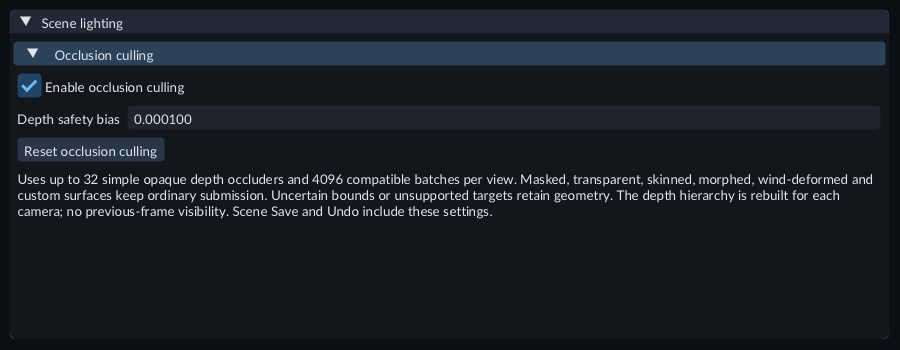
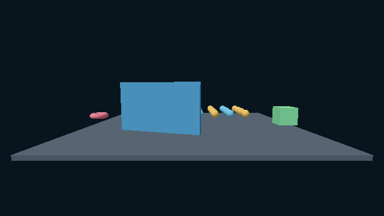

# Occlusion culling

Occlusion culling skips eligible Mesh batches that are completely hidden behind
opaque geometry. The rendered scene should look the same with it enabled or
disabled. It is most useful when simple walls or other large opaque surfaces hide
many detailed meshes.

## Enable culling

1. Stop Play and open **Tools > Scene lighting...**.
2. Expand **Occlusion culling** and select **Enable occlusion culling**.
3. Start Play with a Camera. Move around the scene and compare the result with culling disabled.
4. Stop Play and save the Scene. Export uses the saved settings.

The controls belong to the Scene. **Undo / Redo** reverses each committed change.
They are read-only during Play. **Reset occlusion culling** disables the option
and restores the default bias.

## Adjust the safety bias

**Depth safety bias** accepts **0** to **0.01**, with **0.0001** as the default.
Enter a value and press Enter to commit. Larger values keep more potentially
hidden geometry visible. This is a margin in normalized camera depth, rather than
a distance in metres. Camera clipping settings affect how it relates to distance.

## Try the example

Open **169-occlusion-culling** from the [Feature Gallery](../getting-started/feature-gallery.md)
and press Play. The blue wall moves and turns, revealing the spheres behind it.
The two side landmarks remain visible. The moving wall follows a reusable
transform clip on its parent; select the parent in Hierarchy to inspect it.

Stop Play, toggle **Enable occlusion culling**, and replay the same scene. The
picture should remain consistent. Culling reduces hidden geometry work; the
existing material groups and CPU draw-call count can remain unchanged.

## Supported geometry and limits

Built-in opaque triangle Meshes must test and write depth. Their object transforms
can move or animate. Masked, transparent, transmissive, skinned, morphed,
wind-deformed and custom Surface Shader parts keep their ordinary submissions.
Sprites, tiles and particles retain their existing rendering paths. Shadows and
selection are controlled separately.

Each view uses current geometry and camera depth. It does not reuse the previous
frame's hidden-object decisions. A batch stays visible whenever a member could
be visible or its bounds are uncertain, including clip-plane crossings.

The current profile uses up to **32** simple occluders and **4096** compatible
batches per view. An occluder needs at most **8192** submitted elements and a
projected bounding rectangle covering at least **1/64** of the view. The full
render target must fit **8,388,608 pixels** and the bounded depth/hierarchy storage.
Unsupported devices, oversized targets or unavailable resources keep ordinary
rendering. Allocation or preparation failures appear in Problems.

An open scene with little hidden geometry can gain little benefit and incur the
extra depth work. Compare representative scenes using the
[Performance window](performance.md), and leave culling disabled when it does not help.
