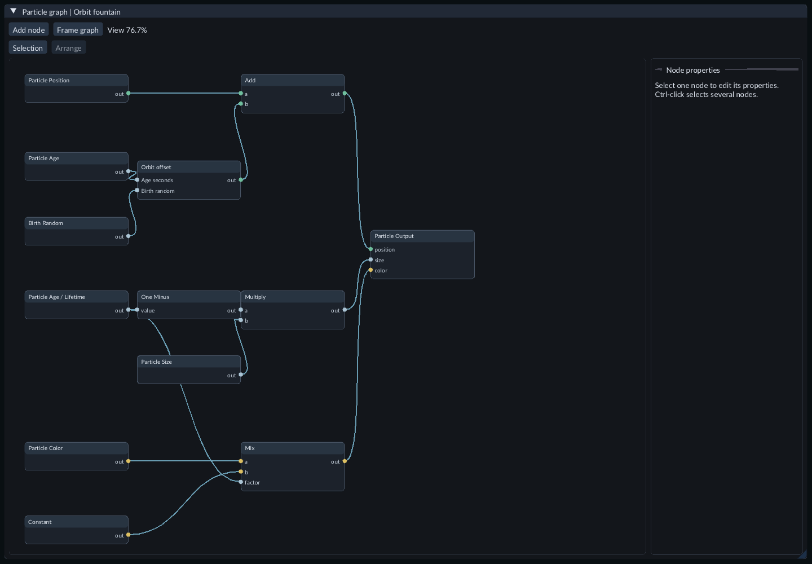

# Create a particle graph

Use a particle graph to change each particle's position, size and color with
connected nodes. It is a Shader asset assigned to a Particle Effect. The effect
still controls emission, lifetime, shape, mesh and material. This workflow needs
Windows, the packaged Shader worker and a compute-capable D3D12 device. Project
C++ code is unnecessary.

## Try the example

1. Open FeatureGallery and **Scenes/239-particle-graphs.scene.json**.
2. In Content, open **Assets/Particles/Graphs/Orbit.graph.shader.json**. Choose **Save & Compile** and wait for completion.
3. Open **Assets/Particles/Graphs/OrbitFountain.particles.json**. Keep **Evaluation → Graph**, then choose **Save / Publish**.
4. Press Play and open Game. Two fountains share the program, with separate seeds, sizes and tints. Stop before editing source.

The Orbit function offsets each particle using its age and birth random value.
Size decreases over life; color blends toward teal. Double-click the function
call to inspect its nodes; **Back to particle graph** returns to the main canvas.

## Create a program

1. Stop Play. In **Content → Create / Register**, choose **New graph...**.
2. Enter a new `.shader.json` file inside an existing project folder. Set **Domain → Particles** and choose **Create graph**.
3. Use **Add node** to add particle inputs, constants and math. Drag an output port onto a compatible input port to connect them. Select a node to edit its properties. Undo/Redo belongs to this source document.
4. Connect results to **Particle Output**: `position` is a vector3 in emitter-local meters, `size` is a scalar and `color` is linear RGB. Unconnected outputs retain the effect's normal evaluated values.
5. Use **Frame graph**, mouse-wheel zoom and middle-mouse pan to navigate. **Selection** and **Arrange** help organize nodes. Pure functions can group reusable math.
6. Choose **Check program** to compile the current draft without publishing it. Read its status or diagnostic. To try the result visually, assign the published Shader to an effect and use the effect's preview or Play.
7. Choose **Save & Compile**. Wait until the source has no pending compilation or publication. A failed compile keeps the previously published revision available.

Particle inputs provide local Position, Velocity and spawn Origin; Age in seconds;
Age / Lifetime from 0 to 1; evaluated Size and Color; and one repeatable Birth Random
value. Inputs precede the emitter's size multiplier and tint. Random is stable for
a particle's birth; it does not change every frame.

## Assign the program and its bounds

1. Create or open a **Particle Effect** from Content.
2. Choose the published program in **Graph Shader**. Ordinary Compute or material Shaders do not appear as compatible choices.
3. Set **Graph extents (m)** to the maximum local distance from the emitter on each axis. Set **Graph maximum size (m)** to the largest size the graph may output.
4. Keep **Evaluation → Graph**. Preview the effect, then **Save / Publish**. Assign it to a Particle Emitter, save the Scene and Play.

Graph positions clamp between the negative and positive extents. Size clamps from
zero to the declared maximum. Choose bounds large enough for the intended motion;
small bounds clip the motion. Bounds also control camera culling. Extents allow
0–1,000,000 meters per axis; maximum size allows 0–10,000 meters. Zero collapses
that axis or size. Nonzero values must remain representable at float precision.
Emitter size and tint apply afterward.

Selecting CPU or GPU retains the assigned graph and bounds. CPU uses ordinary
processor evaluation; GPU uses the built-in compute behavior. Return to Graph to
use the retained program. Save/publish each backend change before Play or export.

## Save and export

Publish the Shader first, then the Effect, and save the Scene. Set that Scene as
startup in Project Settings and export with the matching packaged runtime kit.
The selected program is included as compiled bytecode. The exported game needs
compute support; it does not need graph source, the Shader worker or C++ build tools.

If a Shader is missing from the picker, compile it and confirm its domain is
Particles. If publication fails, check the graph diagnostic and the effect's
bounds and lifetime-stop spacing. A missing graph capability in the runtime kit
requires the matching kit. Stop Play before editing saved source.

## Current limits

Graphs are stateless math over the existing analytic particle effect. They do not
provide particle collision, feedback buffers, arbitrary HLSL, texture sampling,
events, trails or transparent smoke. One root graph admits 256 nodes, 1,024 links
and 16 local pure functions; expanded functions admit 1,024 nodes. Cycles,
unavailable node versions and incompatible port types reject compilation.

RGB clamps to 0–65,504. A nonfinite output falls back to its ordinary effect value
before bounds are applied. Arithmetic and seeded visuals use GPU float precision;
they do not guarantee identical pixels across graphics devices. The ordinary
[mesh particle limits](particles.md) still apply.
