# Mesh particle effects

A particle effect is a reusable stream or burst of small meshes. Use it for
stylized sparks, debris or fountains. Effects can use solid or masked meshes, or
sorted transparent meshes with CPU evaluation, and camera-aligned quads with CPU,
GPU or Graph evaluation. Explicit weighted GPU alpha supports approximate
transparent blending and per-particle fades over life. Ordered GPU alpha supports
a compatible group of transparent emitters in one view. CPU and GPU analytic ribbon
trails follow each particle's local path. Built-in CPU and GPU Mesh particles can
bounce against an emitter-local plane. CPU Scene collision responds to realized
3D or XY Scene colliders and keeps existing particles in world space as emitters move.
CPU World ribbon trails retain those historical paths and surviving tails.

## Try the Gallery

Open **Scenes/238-gpu-mesh-particles.scene.json** to see two fountains sharing
**Assets/Particles/GpuFountain.particles.json**. Press **Play**. Select either
emitter to adjust its live size and tint. Stop, open the effect from Content and
use **Evaluation** to choose CPU or GPU, then **Save / Publish**. This scene
includes a camera and light and needs no project C++ code.

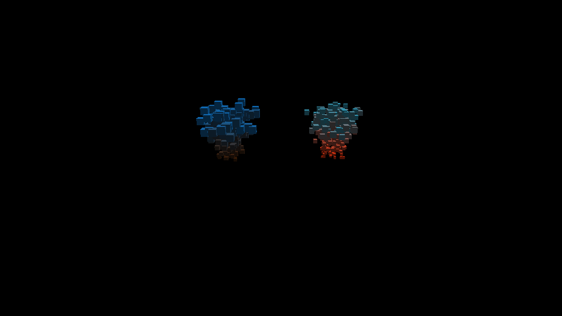

Two emitters share one effect while keeping their own appearance controls.

Open **Scenes/54-cpu-mesh-particles.scene.json** in FeatureGallery. Press **Play**
to see orange and blue fountains and an initial burst. Stop and restart Play to
repeat the burst. Select an emitter in Hierarchy to change its seed, visibility,
layers or playback speed. Speed 0 freezes that emitter; disabling it restarts
emission when enabled again. Save authored changes for export.

Open **Scenes/56-particle-shapes-and-lifetime.scene.json** to compare Point, Box,
Sphere and Disc origins. The back pair compares a free jet with drag and a size
curve. Open effects under **Assets/Particles/Shapes** from Content to change the
shapes, damping, growth and color. These scenes need no C++ compiler.

## Create and edit an effect

1. Stop Play. In **Content → Create / Register**, choose **Particle Effect**.
2. Enter a project file such as `Assets/Particles/Sparks.particles.json` and create it. The **Particle Effect** document opens. Existing sources open from Content.
3. Choose **Evaluation → CPU** or **GPU**, then its **Mesh** and optional **Material**. Start with the built-in cube.
4. Choose Continuous or Burst. Set capacity, lifetime and either particles/second or burst count. Enter numeric values to commit them. Continuous capacity must accommodate rate times lifetime; errors retain the previous valid values.
5. Choose Point, Box, Sphere or Disc. Box uses full dimensions in meters; Sphere fills its radius and Disc fills a plane perpendicular to Direction. Adjust direction, cone, speed, acceleration and drag. Zero drag preserves free motion.
6. For analytic effects, use preview Play/Pause, time and Reset. Preview is independent of game Play and does not change the scene. Orbit/zoom its image. Scene collision requires Play in the main editor with realized Scene colliders. Undo/Redo edits source values.
7. Choose **Save / Publish**. This saves and builds the runtime effect. A failed build reports the problem and retains the working published revision.

## Choose evaluation

**CPU** evaluates particles on the processor. **GPU** evaluates births, motion,
size, color and instance transforms on a compute-capable graphics device. Both
use the same fixed game clock, effect controls and per-emitter appearance values.
They use different seeded patterns; changing evaluation can change the arrangement.

**Graph** applies an assigned particle Shader to each GPU particle. Follow
[Create a particle graph](particle-graphs.md) for the node canvas, program assignment,
bounds, publication and export. Switching backends retains graph settings.

**CPU (sorted alpha)** uses processor evaluation and also supports transparent
Materials. It uses the same CPU birth pattern and fixed clock as **CPU**. See
**Transparent CPU particles** below.

Use the effect document's preview to inspect a draft before publishing. Changing
Evaluation retains the asset, curves and stop values and supports Undo/Redo.
Choose **Save / Publish** before playing or exporting. GPU curves need stop times
that remain distinct at float precision; increase the gap if an edit reports an
error. If the rendering device cannot evaluate GPU effects, the renderer reports
a diagnostic; choose CPU and publish to use processor evaluation.

## Transparent CPU particles

Open Gallery **Scenes/240-sorted-alpha-particles.scene.json** and press **Play**.
Teal and amber emitters share one effect and Material. Their meshes overlap and
blend with the background; the solid central marker blocks particles behind it.
This scene includes its camera and light and needs no project C++ module.

The Gallery scene at three seconds in the Game renderer.

1. Stop Play. Open your effect in Content and choose **Evaluation → CPU (sorted alpha)**.
2. Create or open a [project Material](materials.md). Choose a built-in shader model, such as **Unlit**, then **Alpha → Blend**.
3. Enable **Depth test** and disable **Depth write**. Set the base color's alpha below 1, or use a color texture with an alpha channel. Save the Material.
4. Choose that Material in the effect's **Material** field, then **Save / Publish**. Assign the effect to a Particle Emitter, save the scene and press Play.

For the Gallery's shared assets, open
**Assets/Particles/Alpha/GlassCloud.particles.json** or
**Assets/Particles/Alpha/Glass.material.json**. Change the Material's alpha for
transparency; use the emitter's RGB tint for its color. RGB lifetime curves do not
change opacity.

Transparent particles use individual draws sorted with ordinary transparent
meshes. Intersecting meshes can show sorting artifacts because triangles inside
one particle are not sorted individually. Reduce particle counts when using this
mode. A view containing transparent particles uses sorted rendering even when
**Weighted transparency** is enabled. GPU and Graph evaluation use opaque or masked
Materials unless **Weighted alpha (GPU)** or **Sorted alpha (GPU)** is explicitly
enabled; see the corresponding workflows below. A failed
publication retains the working selected effect.

Export with the runtime kit packaged with this editor. An older kit that lacks
the sorted-alpha profile is rejected. The player needs no compiler or compute
support for CPU evaluation.

## Camera-aligned quads

Open **Scenes/242-camera-aligned-particles.scene.json** in the Gallery and press
**Play**. Two emitters share a soft alpha image, Material and Effect. Their
reflected/nonuniform scales change quad dimensions while each view sets orientation.
Open **Assets/Particles/Billboards/SoftCloud.particles.json** to edit the effect or
**SoftCloud.paint-texture.json** to paint its image. The camera and light are included.

The Gallery scene at three seconds in the Game renderer.

Use **Camera-aligned quads** in the Particle Effect document for flat particles
that follow each camera's view plane. With CPU evaluation, enabling it selects
**CPU (sorted alpha)** and displays **Engine / Quad** in the disabled **Mesh** field.

1. Stop Play and open or create a Particle Effect in Content.
2. Enable **Camera-aligned quads**. Choose a built-in Material. Use **Alpha → Blend**, **Depth test** enabled and **Depth write** disabled for a transparent image.
3. Assign a color texture with an alpha channel in the Material to give each quad its shape. Save the Material. Opaque and masked Materials also work when particle opacity stays at 1.
4. Adjust particle size and the emitter's X/Y scale for width and height. The full emitter transform still positions particle motion; each camera sets the visible quad orientation.
5. Optionally enable **Use opacity over life** to fade particles. A changing opacity requires a Blend Material.
6. Choose **Save / Publish**, save the scene and press Play. Export using the runtime kit packaged with this editor.

Disabling **Camera-aligned quads** restores the original Mesh selection and retains
opacity settings. CPU and GPU alignment settings are separate. Choosing **GPU**
or **Graph** retains the CPU setting; the checkbox then shows the GPU setting.
Return to **CPU (sorted alpha)** to apply the retained CPU alignment again.
Undo/Redo restores the source settings. Each camera aligns its own view independently.

Quads stay parallel to the camera plane, including in perspective views. They do
not rotate toward each particle's eye direction, face along velocity or support
axis locks. Particle spin is unavailable. CPU quads can use Scene collision;
analytic plane response uses Mesh geometry. Ribbon trails use their own connected
Quad geometry.
Transparent quads share the sorting and particle-count limits described above.

## GPU camera-aligned quads

Open **Scenes/243-gpu-camera-particles.scene.json** and press **Play**. The blue
and amber emitters share **Assets/Particles/Billboards/DeviceCloud.particles.json**
and a masked Material. They reuse the image from the CPU camera-aligned example.
The image's alpha cuts out the quad shape; the visible pixels write depth.

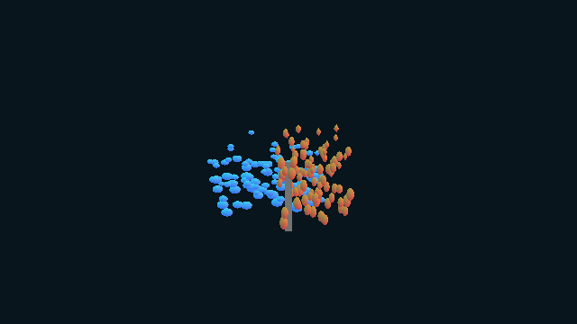

The Gallery scene at three seconds in the Game renderer.

1. Stop Play and open the Particle Effect in Content.
2. Choose **Evaluation → GPU** for built-in motion, or **Graph** for an assigned, compiled [particle program](particle-graphs.md).
3. Enable **Camera-aligned quads**. GPU keeps built-in motion; Graph keeps its assigned program. Both use **Engine / Quad**.
4. Choose a built-in Material with **Alpha → Opaque** or **Mask**. For an image cutout, assign a color texture with alpha and choose **Mask**. Save the Material.
5. Adjust particle size and emitter X/Y scale for width and height. Choose **Save / Publish**, save the Scene and press Play.
6. Export with the runtime kit packaged with this editor. The player needs compute-capable graphics; no source files or compiler are required.

For the authored-program example, open
**Scenes/244-gpu-graph-camera-particles.scene.json**. Compile
**Assets/Particles/Graphs/Orbit.graph.shader.json** first, then publish
**Assets/Particles/Billboards/GraphCloud.particles.json**. It uses the same masked
Material as the built-in example. Shader compilation requires Windows and the
packaged Shader worker.

Disabling GPU alignment restores the original Mesh and keeps the selected GPU or
Graph evaluation. CPU alignment and opacity settings remain available when you
switch back to CPU evaluation. GPU quads support opaque and masked Materials, or
Blend Materials with explicit **Weighted alpha (GPU)** or **Sorted alpha (GPU)**.
Enable **Use opacity over life** for either transparent GPU or Graph transport. Camera-plane orientation and the
other particle limits above also apply to GPU quads.

## Weighted GPU transparency

Open **Scenes/247-weighted-gpu-particles.scene.json** in FeatureGallery and press
**Play**. Two emitters share a soft alpha image, Material and Effect. The Scene
includes a camera, light and solid depth marker. This example needs no project
C++ code. **Scenes/248-weighted-gpu-graph-particles.scene.json** uses an authored
particle program; compile **Assets/Particles/Graphs/Orbit.graph.shader.json** before
publishing its Effect on Windows.

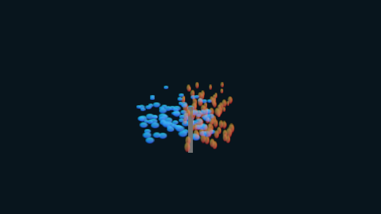

The Gallery scene in the Game renderer at three seconds.

1. Stop Play and open a Particle Effect from Content. Enable **Weighted alpha (GPU)**. This selects GPU evaluation or keeps an active Graph.
2. Choose a built-in Material with **Alpha → Blend**, **Depth test** enabled and **Depth write** disabled. Set its base alpha or assign a color texture with an alpha channel. Save the Material.
3. Optionally enable **Camera-aligned quads** for image particles. Disable it to use the retained Mesh. Size, RGB, shapes, motion and emitter tint use the usual controls.
4. Choose **Save / Publish**. In the Scene's rendering settings, enable **Weighted transparency**. Save the Scene and press Play.
5. Export using the runtime kit packaged with this editor. Both the explicit Effect profile and the Scene setting must be saved.

Weighted blending approximates the combined color of overlapping fragments. It
does not provide exact physical layer ordering or refraction. Transparent ordinary
Meshes in an admitted view share this transport. Opaque geometry still blocks
particles behind its depth surface. Material and texture alpha apply; optional
GPU opacity over life multiplies them. Built-in GPU Mesh particles also support
the local plane response described below. GPU analytic ribbons can use this same
weighted transport with their own explicit trail setting.

A visible Sprite, Tile Map, sorted transparent CPU particle, transmission Material,
incompatible transparent Mesh or unsupported render target prevents complete-view
weighted rendering. These GPU emitters are then omitted from that view and
**Problems** reports the reason. Other sources use their ordinary sorted fallback.
Enable the Scene setting and resolve the reported incompatibility to restore the
emitters. See [Blend overlapping transparent Meshes](transparency.md).

Turning **Weighted alpha (GPU)** off restores the retained opaque/masked GPU or
Graph profile. Switching to CPU preserves this setting and the independent CPU
opacity, alignment, ribbon and plane settings. Undo/Redo restores source choices.

## Ordered GPU transparency

Open **Scenes/253-ordered-gpu-particles.scene.json** in FeatureGallery and press
**Play**. Two tinted emitters share
**Assets/Particles/Alpha/OrderedDeviceCloud.particles.json**, the soft cloud image
and its Blend Material. Particles are ordered back to front on the graphics
device. The Scene includes a camera, light and solid depth marker; it needs no
project C++ code.

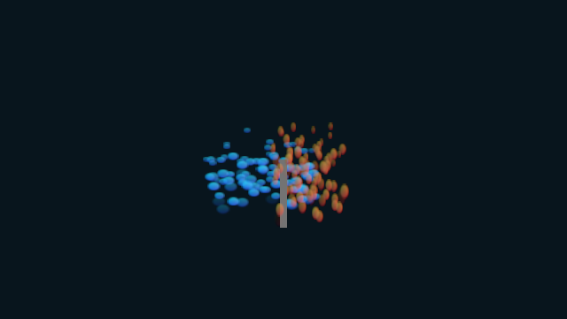

The Gallery scene in the Game renderer at three seconds.

1. Stop Play. Open the Particle Effect from **Content** and enable **Sorted alpha (GPU)**. This selects GPU evaluation or keeps an active Graph, and turns off **Weighted alpha (GPU)**.
2. Select a built-in Material with **Alpha → Blend**, **Depth test** enabled and **Depth write** disabled. Set its base alpha or use a color image with alpha, then save the Material.
3. Open **Tools > Scene lighting...**, expand **Transparency** and turn **Weighted transparency** off. Save the Scene.
4. Optionally enable **Camera-aligned quads**, built-in plane motion or analytic ribbons. These geometry choices retain their existing combination limits. Enable **Use opacity over life** to add a fade while keeping sorted GPU blending.
5. Choose **Save / Publish**, save the Scene and press **Play**. Use the emitters' size, RGB tint and playback controls as usual. Undo/Redo restores source choices.
6. Export using the runtime kit packaged with this editor. The player needs compute-capable graphics; editable sources and a compiler are not required.

The entire visible transparent group must use compatible sorted GPU particles.
With **Compatible Materials (GPU)** off, emitters must share the same Mesh, Material and images, raster orientation,
layers and other draw settings. Opaque and masked geometry can still block the
particles through depth testing. Ordinary transparent Meshes, CPU alpha
particles, other GPU alpha modes, visible Sprite/Tile layers and incompatible
resources prevent this group from drawing in that view. **Problems** reports the
reason. Resolve the incompatibility to restore the whole group; the renderer does
not keep an arbitrary subset or reuse another camera's particles.

Use CPU sorted alpha when transparent particles must share ordering with ordinary
transparent Meshes. Weighted GPU alpha provides a separate approximate transport.
The two GPU alpha controls are mutually exclusive. Turning sorted alpha off
restores the retained opaque/masked GPU profile; choose an appropriate Material
or another alpha transport before playing. CPU settings, source values and stop
identities stay retained when changing evaluation.

Ordering uses each Mesh particle's center or each ribbon segment's midpoint.
Intersecting surfaces can still show ordering artifacts because fragments within
a particle or segment are not sorted separately. Source changes need
**Save / Publish** before Play or export. An older runtime kit that lacks this
transport is rejected during export.

### Use distinct compatible Materials

Open **Scenes/255-compatible-material-particles.scene.json** in FeatureGallery.
Four emitters use separate teal, amber, violet and blue Materials. Their Particle
Effects and Materials are in **Assets/Particles/Materials**. The Scene includes a
camera and light and runs without project C++ code.

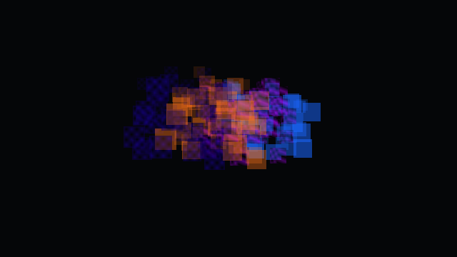

The Gallery Game at three seconds, with all four Material selections ordered together.

1. Stop Play and open each participating Particle Effect from **Content**.
2. Enable **Compatible Materials (GPU)**. This enables **Sorted alpha (GPU)** and selects GPU evaluation or retains an active Particle Graph.
3. Use the same Mesh and compatible built-in Blend Materials with depth testing enabled and depth writes disabled. Keep the same built-in shading model and texture roles in all Materials; their factors, images, UV transforms and sampler choices can differ.
4. Leave the Scene's **Weighted transparency** off. Choose **Save / Publish** for every changed asset, save the Scene and press **Play**.
5. Export with the runtime kit included with this editor.

All visible sorted GPU emitters in the group must enable this choice. A view can
contain up to four distinct Material selections, with at most eight unique
sampler states and 32 texture bindings.
Geometry, raster orientation, layers and shadow reception must remain compatible.
Projected decals, projected light images, custom Material Shader surfaces and
transmission cannot participate. The renderer reports an incompatible selection
in **Problems** and omits the complete group until it is corrected.

Turning this choice off restores the single-Material sorted transport. Changing
to CPU or weighted GPU alpha retains the inactive choice. Undo/Redo restores the
source settings; particles continue to use the ordinary World emission clock.
This option does not sort individual fragments inside a particle or ribbon.

## GPU opacity over life

Open **Scenes/249-gpu-particle-opacity.scene.json** and press **Play**. Each particle
fades in and then out. The two emitters share
**Assets/Particles/Opacity/DeviceFade.particles.json** and the existing soft image
and Blend Material. The Scene includes a camera, light and opaque depth marker.
**Scenes/250-gpu-graph-particle-opacity.scene.json** combines the same fade with
the Orbit program; compile **Assets/Particles/Graphs/Orbit.graph.shader.json**
before publishing **Assets/Particles/Opacity/GraphFade.particles.json** on Windows.

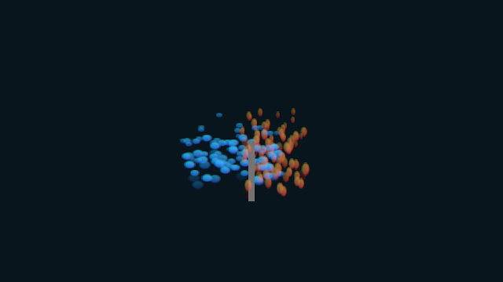

The GPU fading Gallery scene at three seconds in the Game renderer.

1. Stop Play and open the Particle Effect from Content. Choose **Evaluation → GPU**, or **Graph** with a published particle program.
2. Enable **Use opacity over life**. This enables **Weighted alpha (GPU)** unless **Sorted alpha (GPU)** is already selected, and keeps the selected Graph and camera alignment.
3. Use a built-in **Alpha → Blend** Material with **Depth test** enabled and **Depth write** disabled. Save the Material. Optionally enable **Camera-aligned quads** for image particles.
4. Set **Start opacity (0–1)** and **End opacity (0–1)**, or enable **Use opacity curve** and edit its 2–16 stops. **Linear** interpolates to the next stop; **Step** holds the current value until the next stop.
5. Choose **Save / Publish**. For **Weighted alpha (GPU)**, enable **Weighted transparency** in the Scene rendering settings. For **Sorted alpha (GPU)**, leave that Scene setting off and follow **Ordered GPU transparency** above. Save the Scene and press Play.
6. Export with the runtime kit packaged with this editor. The player needs compute-capable graphics, without editable sources or a compiler.

Opacity multiplies Material, texture and vertex alpha and leaves RGB tint and
motion independent. GPU values use float precision. Very close stop times must
remain distinct at that precision; Step transitions and lifetime boundaries can
appear at a slightly different instant from CPU evaluation.

Disabling **Use opacity over life** retains its endpoints and curve and keeps
the selected GPU alpha transport. CPU and GPU activation choices are independent and share the
same endpoints and stops. The checkbox shows the choice for the selected backend.
Switching evaluation, Undo/Redo and Save preserve these settings. Turning
the selected GPU alpha transport off suspends the GPU fade until weighted or
sorted GPU blending is re-enabled. An incompatible view omits these emitters and reports the reason in
**Problems**, as described above.

## Analytic ribbon trails

Open **Scenes/245-analytic-particle-trails.scene.json** in FeatureGallery and press
**Play**. Teal and amber emitters share an editable trail effect and transparent
Material. The central solid marker blocks ribbons behind it. The scene includes
its camera and light and needs no project C++ code.

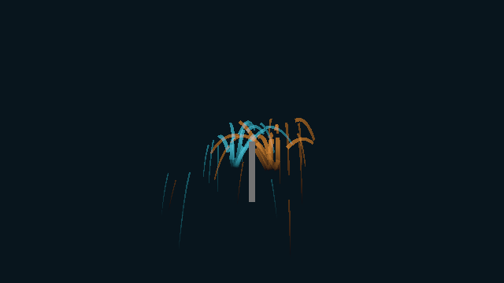

The Gallery scene in the Game view at three seconds.

1. Stop Play. Open a Particle Effect from Content and enable **Analytic ribbon trails (CPU)**. This selects **CPU (sorted alpha)** and connected Quad geometry.
2. Set **Trail duration (seconds)** to the length of local path to display, from 0.001 to 30 seconds.
3. Set **Trail segments (1–16)**. More segments give a smoother curved path and more detail in lifetime appearance, at a higher draw cost. Press Enter to commit either value.
4. Use a double-sided built-in Material. For opacity, choose **Alpha → Blend**, enable **Depth test** and disable **Depth write**. Solid or masked Materials work with particle opacity fixed at 1.
5. Choose speed, acceleration, drag, size, color and optional opacity over life. Set capacity to include particles whose tails remain after their heads die.
6. Choose **Save / Publish**, save the scene and press Play. Export with the runtime kit packaged with this editor.

For this example, edit **Assets/Particles/Trails/RibbonFlow.particles.json** or
**Assets/Particles/Trails/Ribbon.material.json**. Size controls ribbon width;
emitter X scale also scales that width. Color and opacity multiply the Material.
The texture's V coordinate spans the visible tail to head.

Trails follow the particle's analytic path in emitter-local space. Moving an
emitter moves its whole ribbon; this mode does not record its earlier world
positions. After a head reaches its lifetime, its tail shrinks until the trail
duration has elapsed. A stationary particle produces no ribbon.

Continuous capacity must cover `ceil(rate × (lifetime + trail duration))`.
Each emitter reserves `capacity × segments` of the scene's 8,192 instances;
reduce capacity, rate, duration or segments if admission reports a budget error.
Width and appearance are sampled at segment endpoints and interpolated, including
changes from Step curves. Higher segment counts resolve more detail.

Switching evaluation retains trail settings. Select **CPU (sorted alpha)** to
apply them again. In **CPU (sorted alpha)**, disabling trails restores the retained mesh/quad settings;
Undo/Redo restores the complete edit. GPU trails have their own activation, as
described below. This analytic mode does not record historical emitter motion or
combine with collision. Use **World ribbon trails (CPU)** for historical Scene paths.
Graph trails are unavailable.

## GPU analytic ribbon trails

Open **Scenes/252-gpu-analytic-particle-trails.scene.json** in FeatureGallery and
press **Play**. Teal and amber emitters share
**Assets/Particles/Trails/DeviceRibbonFlow.particles.json** and the existing
double-sided ribbon Material. The Scene includes its camera, light, depth marker
and weighted-transparency setting. No project C++ module is required.

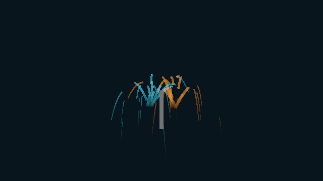

Two emitters share one effect while retaining their own seeds and tint.

1. Stop Play and open the Particle Effect from Content.
2. Choose **GPU** under **Evaluation**, then enable **Analytic ribbon trails (GPU)**.
3. Set **Trail duration (seconds)** and **Trail segments (1–16)**. Duration accepts 0.001–30 seconds; more segments describe curved paths and changing width in greater detail.
4. Choose a double-sided built-in Material. The gallery's **Assets/Particles/Trails/Ribbon.material.json** is ready to use.
5. For a Blend Material, select weighted GPU alpha with the Scene's weighted-transparency setting enabled, or **Sorted alpha (GPU)** with that Scene setting off (see **Ordered GPU transparency** above). Enable GPU opacity over life for lifetime fades. Solid or masked ribbons use identity particle opacity.
6. Choose **Save / Publish**, save the Scene, then press **Play**. Export with the matching runtime kit packaged with the editor.

GPU ribbons use connected Quad geometry. Enabling them turns off GPU plane
collision and camera-aligned individual quads. An assigned Graph stays retained
but inactive; Graph trajectories cannot supply these analytic ribbons. Turning
trails off restores the retained GPU Mesh profile. CPU and GPU keep independent
trail activation and share duration and segment settings.

The current emitter transform moves the whole local path. Width comes from the
emitter's X scale. Tails shrink after their head reaches its lifetime; they do not
record historical world-space emitter motion. Size, color and opacity are sampled
along the path. Device float precision can collapse a very short visible interval.

Continuous capacity covers `ceil(rate × (lifetime + trail duration))`, and each
emitter reserves `capacity × segments` against the Scene's 8,192-instance budget.
Reduce rate, capacity, duration or segments if admission reports a budget error.
Weighted ribbons require complete-view weighted admission; incompatible views
omit these emitters and report a diagnostic. Per-emitter sorting does not provide
a fallback for GPU Blend.

## Plane collision

Open **Scenes/246-particle-plane-collision.scene.json** in FeatureGallery and press
**Play**. Teal and amber cubes bounce above the gray floor and fade over their
lifetimes. The floor is a visual guide; each emitter's Effect defines its plane.
Open **Assets/Particles/Collision/BouncingCloud.particles.json** to adjust it.

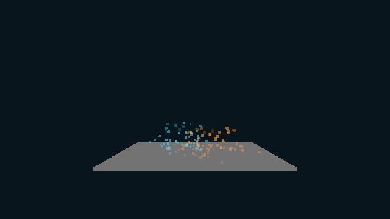

The Gallery scene in the Game view at three seconds.

1. Stop Play. Open a Particle Effect in Content and enable **Plane collision (CPU mesh)**. This selects **CPU (sorted alpha)** with its saved Mesh.
2. Set a nonzero **Plane normal**. **Plane offset (m)** measures signed distance from the emitter origin along the normalized normal. For normal `(0,1,0)`, offset `-1` places the plane one meter below that origin.
3. Set **Collision radius (m)**. Particle centers stay this far above the plane. Radius is constant and independent of the Mesh size or lifetime size curve; choose a radius that fits the visual shape.
4. Set **Restitution (0–1)** for normal rebound speed and **Tangent friction (0–1)** for the fraction of tangent velocity removed at each contact.
5. Set **Permitted bounces (0–16)**. After that many rebounds, the next incoming contact ends the particle. Use `0` to end particles at first contact. Births already below the plane end immediately. A zero rebound under inward acceleration ends the particle; without inward force it can slide or depart.
6. Press Enter to commit numeric values. Choose **Save / Publish**, save the Scene and press Play. Export using the runtime kit packaged with this editor.

For the Gallery scene, the emitter origins are one meter above the floor; offset
`-1` therefore matches its top. Move or rotate an emitter and its local plane
follows the current transform. This mode does not collide with Scene colliders,
record past world-space emitter motion or apply impulses to physical bodies.

For GPU collision, choose **GPU**, then enable **Plane collision (GPU mesh)**.
Use the same normal, offset, radius and response controls. This selects built-in
Mesh motion and turns off GPU camera alignment. It retains an assigned Graph for
later use. Opaque and masked Materials work directly; for Blend, enable
**Weighted alpha (GPU)** with the Scene's **Weighted transparency** enabled, or
**Sorted alpha (GPU)** with that Scene setting off (see **Ordered GPU transparency** above). You
can then enable **Use opacity over life** for fades. Save the Effect and Scene
before exporting with the matching runtime kit.

Open **Scenes/251-gpu-particle-plane-collision.scene.json** in FeatureGallery to
try GPU response. Both tinted cube emitters share
**Assets/Particles/Collision/DeviceBounces.particles.json** and the glass Material.
The Scene includes weighted transparency, lifetime fades, a camera, light and
gray plane guide. Open the Effect to change the plane and response, then choose
**Save / Publish** and export. No project C++ module is needed.

The GPU Gallery scene in the Game renderer at three seconds.

CPU and GPU activation choices are independent and share the plane settings.
Switching Evaluation restores the choice for that backend; Graph keeps plane
settings inactive. Turn collision off before using retained camera alignment or
CPU ribbons. GPU evaluation uses float precision, so contact times near tangency
or the rebound limit can differ from CPU results. Killed GPU births use zero-size
geometry within the reserved instance budget until their ordinary lifetime ends.

Plane collision uses ordinary Mesh particles. Scene-collider response, collision
callbacks, arbitrary Graph trajectories, ribbons and camera-aligned quads cannot
be combined with this plane response. Nonidentity particle opacity needs a Blend
Material with depth testing enabled and depth writing disabled.

## Scene collision

Open **Scenes/254-scene-particle-collision.scene.json** in FeatureGallery and press
**Play**. Two tinted emitters share
**Assets/Particles/Collision/SceneBounces.particles.json**. Particles respond to the
real floor and inclined obstacle. Stop, select either obstacle in Hierarchy and
move, resize or rotate it, then press Play again. The camera and light are included;
no project C++ code is required.

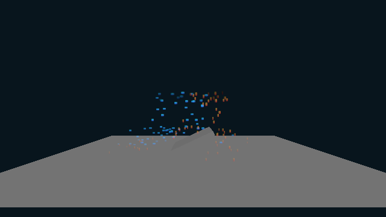

The Scene collision Gallery running in the Game renderer at three seconds.

For 2D colliders, open **Scenes/258-xy-scene-particle-collision.scene.json** and
press **Play**. Its shared **Assets/Particles/Collision/XYSceneBounces.particles.json**
selects **World XY**. The camera, light, floor and inclined 2D obstacle are included.

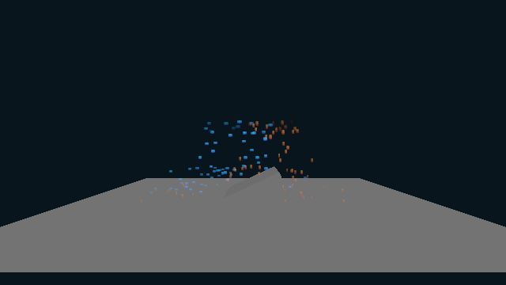

The XY Scene collision Gallery in Game at three seconds. The rendered geometry
shows the surfaces used by the 2D colliders.

1. Stop Play. Open the Particle Effect from Content and choose a CPU **Evaluation**.
2. Enable **Scene collision (CPU)**. This selects **CPU (sorted alpha)** and turns off local-plane and ribbon activation while retaining their settings.
3. Choose **Scene query space**: **World 3D** uses 3D colliders and sphere radius 0.001–1,000 m; **World XY** uses 2D colliders and circle radius 0.005–500 m. Set **Scene radius (m)** within that range. Radius is independent of visible size, emitter scale and lifetime size curves. Change an unsupported retained radius before selecting a different space.
4. Set **Scene restitution** and **Scene friction** from 0 to 1. Restitution controls normal rebound speed; friction removes a fraction of tangent velocity at each impact. These Effect settings control the response; Scene bodies do not receive particle impulses.
5. Set **Scene permitted bounces** from 0 to 16. After that many rebounds, the next incoming contact ends the particle. Zero ends it at the first contact. Initially penetrating births and sustained inward-force contact without normal rebound also end.
6. Use **Scene collision layers** to choose the named Physics layers to query. **No layers** allows free flight inside the running World. Sensor shapes are ignored. These collision layers are separate from the emitter's rendering layers.
7. Keep camera alignment enabled for quads, or turn it off to use the saved Mesh. Lifetime size, color and opacity controls remain available. Fading transparent particles need a Blend Material with depth testing enabled and depth writing disabled.
8. Choose **Save / Publish**, save the Scene and press **Play**. Add enabled Physics bodies and colliders matching the selected space for any other surfaces the particles should hit. Export through **Export Game** using the runtime kit packaged with this editor.

Each birth uses the emitter's adopted fixed-update position, orientation and
scale. Its velocity and acceleration transform into world space at birth.
Moving or rotating an emitter later affects new births; it does not drag existing
particles. **Size multiplier** and **Tint R / G / B** remain adjustable in
**Live gameplay** and do not change collision radius or motion.

Test this mode during Play. Stopped Scene, isolated Effect and Timeline previews
have no live collision simulation and display a Play notice. Isolated preview
playback and seeking are disabled. Stop/restart, changing seed or Effect,
disabling/re-enabling an emitter and visual recovery restart its transient history.
Particle histories are not saved into the Scene.

Scene collision supports CPU Mesh, camera-plane particles and the historical
ribbon workflow below. It does not combine with GPU evaluation, local analytic
ribbons or the local-plane response. Queries use bounded
straight sphere or circle sweeps to approximate curved paths against the current physics
snapshot; this is not continuous moving-surface collision. There are no resting
contacts, collision callbacks or two-way rigid-body response.

**World XY** ignores collider and particle Z positions when checking contact.
Rebound and friction affect X/Y motion; Z keeps its authored acceleration and drag.
Initially overlapping or touching births end immediately, including births moving
away from a surface. A rebound leaves at least a 5 mm gap to avoid repeated native
contact. XY query endpoints must be within ±1,000,000 m. The query-space selection
and collision settings remain saved when another evaluation mode is active.
Scene collision reserves at most 1,024 births across enabled emitters, within the
ordinary 8,192-instance Scene budget. High rates, playback speeds, small radii or
many contacts can exceed the per-update collision work budget. Reduce these
settings or the number/capacity of emitters when a budget error is reported.

## Historical World ribbon trails

Open **Scenes/259-world-particle-trails.scene.json** in FeatureGallery and press
**Play**. The teal emitter moves sideways using an editable Transform Animation;
the amber emitter remains fixed. Trails retain the paths of earlier births as the
teal emitter moves and rebound from the Scene floor and obstacle. Open
**Scenes/260-xy-world-particle-trails.scene.json** for the XY query variant. Both
scenes include a camera and light and require no project C++ code.

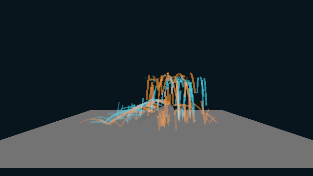

The 3D Gallery in the Game renderer at three seconds.

1. Stop Play and open a Particle Effect from Content. Select **CPU (sorted alpha)**.
2. Enable **World ribbon trails (CPU)**. Choose **World 3D** or **World XY** under **Scene query space** and configure the Scene radius, restitution, friction, bounce limit and collision layers.
3. Set **Trail duration (seconds)** from 0.001 to 30 and **Trail segments (1–16)**. Press Enter to commit a number. More segments describe curved motion and appearance in greater detail.
4. Choose a double-sided built-in Material. For fades, use **Alpha → Blend**, enable **Depth test** and disable **Depth write**. The Gallery shares **Assets/Particles/Trails/Ribbon.material.json**.
5. Choose **Save / Publish**, save the Scene and press Play. Edit the reusable effects **WorldFlow.particles.json** and **XYWorldFlow.particles.json** under **Assets/Particles/Trails**. Open **EmitterSweep.animation.json** in Timeline to adjust the teal emitter's looping translation.
6. Export with the runtime kit packaged with this editor. An older kit without World-trail support is rejected. The player requires no compiler or compute support for CPU trails.

Earlier point positions and ribbon widths keep their birth transform; later
emitter movement and scale affect new births. Emitter size and tint controls in
**Live gameplay** still modulate existing ribbons. After a head reaches its
lifetime or ends at contact, its tail shrinks until the trail duration expires.
Disabling the emitter, replacing its seed/effect or restarting Play clears history.
History is transient and is not saved in the Scene. Stopped Scene, Timeline and
isolated Effect views require Play rather than simulating a separate World.

Paths are bounded sampled polylines. Contact corners consume segments in addition
to the tail/head endpoints. If the selected segment count cannot preserve every
corner in a visible window, the complete particle update reports a budget error;
increase segments or reduce contacts/duration. Continuous capacity must cover
`ceil(rate × (lifetime + trail duration))`; each emitter reserves
`capacity × segments` within the Scene's 8,192-instance limit. The Scene collision
query and birth limits also apply. World trails are CPU-only; local analytic
trail and plane selections switch to their own geometry while retaining settings.

## Opacity over life

Open **Scenes/241-particle-opacity.scene.json** in the Gallery and press **Play**.
New particles fade in, then fade out as they age. The two emitters share
**Assets/Particles/Alpha/FadingCloud.particles.json** and the same glass Material
used by the sorted-alpha example. The camera, light and solid depth marker are
included; no C++ module is needed.

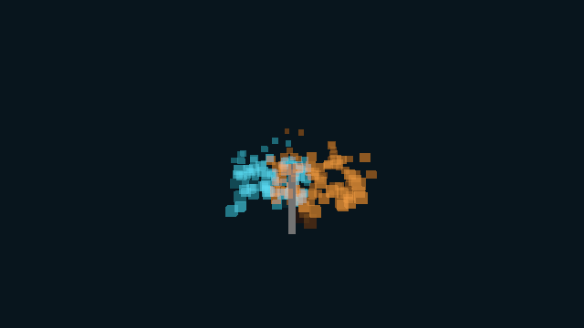

The fading Gallery scene at three seconds in the Game renderer.

1. Stop Play and open the effect in Content. Choose **Evaluation → CPU**, then enable **Use opacity over life**. This selects **CPU (sorted alpha)**.
2. Use a built-in **Alpha → Blend** Material with **Depth test** enabled and **Depth write** disabled.
3. Set **Start opacity (0–1)** and **End opacity (0–1)**. A value of 0 is invisible; 1 retains the Material's original alpha. Values blend across each particle's lifetime.
4. For a shaped fade, enable **Use opacity curve**. Use **Add stop**, edit each stop's **Time (0–1)** and **Opacity (0–1)**, and choose **Linear** or **Step** under **To next stop**. Endpoints remain at birth (0) and death (1); interior stops can be removed. The curve supports 2–16 stops and replaces start/end interpolation.
5. Choose **Save / Publish**, save the scene and press Play. Export using the matching runtime kit packaged with this editor.

Opacity multiplies Material, texture and mesh-vertex alpha. For example, Material
alpha 0.4 and particle opacity 0.5 give alpha 0.2 before any texture or vertex alpha.
RGB tint and RGB lifetime gradients continue to control color independently.

Disabling **Use opacity over life** retains its values and curve for later use.
Ordinary **CPU** retains these settings without applying opacity; select
**CPU (sorted alpha)** to use enabled CPU opacity again. **GPU** and **Graph** have
a separate activation choice, described in **GPU opacity over life** above.
Undo/Redo restores the settings and stop identities. An older runtime kit without
the selected opacity profile is rejected during export.

## Size and color over life

Use start/end size and color for a simple fade in size or RGB. Enable **Use size
curve** or **Use color gradient** for more control. Each channel starts with birth
and death stops; **Add stop** splits the largest gap. Stop time runs from 0 at
birth to 1 at death. Enter commits values.

- Edit each stop's size or linear RGB. Colors have no particle opacity.
- Choose **Linear** to blend to the next stop, or **Step** to hold until it.
- Move interior times between their neighbors; the birth/death times stay fixed.
- Remove interior stops. Each channel supports 2–16 stops.
- Disable a channel to return to its retained start/end values. Undo restores the previous stops and values.

For analytic profiles, preview Play/Pause and time show the same motion and
lifetime values used by the exported game. Scene collision requires Play in a
Scene. Changes stay in the effect draft until **Save / Publish**. Existing
effects stay loadable; adding extended controls updates the source format in the
same Undo step, without changing its asset identity.

## Put it in a scene

Add **Particle Emitter** to an object through Inspector, then assign the published
effect. The effect document also has **Assign to selected Particle Emitter**.
The object can also have an ordinary MeshRenderer. Place a game camera and light,
save and press Play. Analytic effects use a frozen sample in stopped Scene view;
Scene collision displays a Play notice instead.

Changes made during Play are temporary live values. Stop to edit and save the
authored scene. Export through **Export Game** normally: selected effects, meshes
and materials are included already built. Use the runtime kit packaged with this
editor; an older kit can be rejected for an unsupported effect profile. Players
need no compiler. GPU effects need compute support on the player's graphics device.

## Size and tint for each object

Select an object with **Particle Emitter** in Inspector. Set **Size multiplier**
from 0.01 to 16 and **Tint R / G / B** from 0 to 1. A value of 1 keeps the effect's
original size or color channel; a tint of 0 removes that channel. These values
multiply the effect's lifetime values without changing motion. Several objects
can share one effect and have different sizes and colors.

During Play, the colored **Live gameplay** section offers these four controls.
They update the running effect without restarting it. Stop discards Live changes.
To keep values, Stop, edit the ordinary Inspector and save the scene.

Open Gallery **57-particle-emitter-appearance.scene.json**. The front row compares
small, normal and large neutral jets; the back row adds warm, green and blue tints.
All six use **Assets/Particles/SharedJet.particles.json**. Export and run normally.
Projects with C++ modules must rebuild those modules against the matching SDK.

## Limits

Each effect supports up to 1,024 particles; a scene supports 64 enabled emitters
and 8,192 reserved instances. Trails reserve one instance per segment, including
shrinking tails. Use one static triangle part, one LOD and one material
slot. Built-in PBR and Unlit surfaces work. **CPU (sorted alpha)** additionally
accepts Blend Materials with depth testing and no depth writes. GPU and Graph
accept Blend with explicit **Weighted alpha (GPU)** or **Sorted alpha (GPU)**
and their complete-view admission rules; opacity over life can then apply
per-particle fades.
Other evaluation profiles require opaque/masked Materials. Skinned/morphing meshes,
transmission and custom Shader surfaces report errors. Particles do not cast shadows.
Built-in GPU Mesh particles support the emitter-local plane response. Built-in
GPU ribbons use the separate analytic trail setting. Plane response for authored
Graph trajectories, ribbons or camera-aligned quads is unavailable.
CPU Scene collision is separate: it supports Mesh/camera-plane geometry and
historical World ribbons, requires
the running World's matching 3D or XY physics geometry and reserves at most 1,024 births across
enabled emitters. It uses the matching Scene-collision runtime-kit capability.

Changing the seed restarts the effect with a different pattern. C++ can adjust the
native component; `sdk/sample/particle_probe.cpp` demonstrates seed/speed changes
with a matching rebuilt SDK module.
