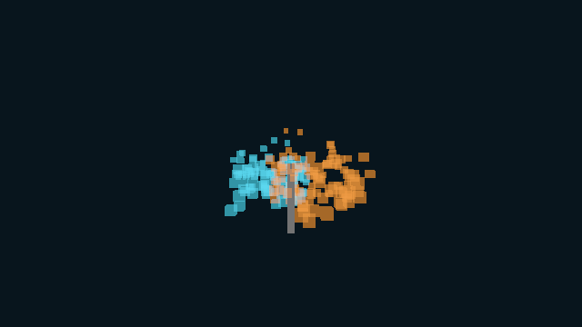
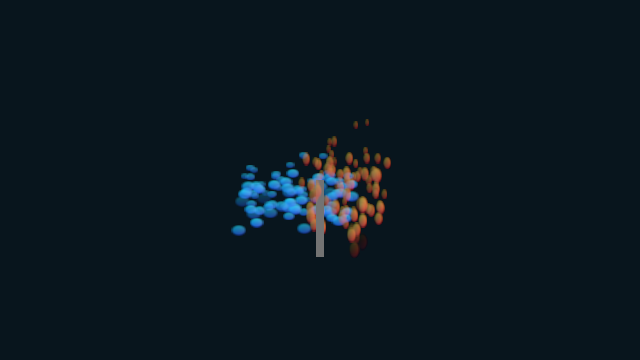

# Mesh particle effects

A particle effect is a reusable stream or burst of small meshes. Use it for
stylized sparks, debris or fountains. Effects can use solid or masked meshes, or
sorted transparent meshes and camera-aligned quads with CPU evaluation. Trails
and particle collision are not supported.

## Try the Gallery

Open **Scenes/238-gpu-mesh-particles.scene.json** to see two fountains sharing
**Assets/Particles/GpuFountain.particles.json**. Press **Play**. Select either
emitter to adjust its live size and tint. Stop, open the effect from Content and
use **Evaluation** to choose CPU or GPU, then **Save / Publish**. This scene
includes a camera and light and needs no project C++ code.

Two emitters share one effect while keeping their own appearance controls.

Open **Scenes/54-cpu-mesh-particles.scene.json** in FeatureGallery. Press **Play**
to see orange and blue fountains and an initial burst. Stop and restart Play to
repeat the burst. Select an emitter in Hierarchy to change its seed, visibility,
layers or playback speed. Speed 0 freezes that emitter; disabling it restarts
emission when enabled again. Save authored changes for export.

Open **Scenes/56-particle-shapes-and-lifetime.scene.json** to compare Point, Box,
Sphere and Disc origins. The back pair compares a free jet with drag and a size
curve. Open effects under **Assets/Particles/Shapes** from Content to change the
shapes, damping, growth and color. These scenes need no C++ compiler.

## Create and edit an effect

1. Stop Play. In **Content → Create / Register**, choose **Particle Effect**.
2. Enter a project file such as `Assets/Particles/Sparks.particles.json` and create it. The **Particle Effect** document opens. Existing sources open from Content.
3. Choose **Evaluation → CPU** or **GPU**, then its **Mesh** and optional **Material**. Start with the built-in cube.
4. Choose Continuous or Burst. Set capacity, lifetime and either particles/second or burst count. Enter numeric values to commit them. Continuous capacity must accommodate rate times lifetime; errors retain the previous valid values.
5. Choose Point, Box, Sphere or Disc. Box uses full dimensions in meters; Sphere fills its radius and Disc fills a plane perpendicular to Direction. Adjust direction, cone, speed, acceleration and drag. Zero drag preserves free motion.
6. Use preview Play/Pause, time and Reset. Preview is independent of game Play and does not change the scene. Orbit/zoom its image. Undo/Redo edits source values.
7. Choose **Save / Publish**. This saves and builds the runtime effect. A failed build reports the problem and retains the working published revision.

## Choose evaluation

**CPU** evaluates particles on the processor. **GPU** evaluates births, motion,
size, color and instance transforms on a compute-capable graphics device. Both
use the same fixed game clock, effect controls and per-emitter appearance values.
They use different seeded patterns; changing evaluation can change the arrangement.

**Graph** applies an assigned particle Shader to each GPU particle. Follow
[Create a particle graph](particle-graphs.md) for the node canvas, program assignment,
bounds, publication and export. Switching backends retains graph settings.

**CPU (sorted alpha)** uses processor evaluation and also supports transparent
Materials. It uses the same CPU birth pattern and fixed clock as **CPU**. See
**Transparent CPU particles** below.

Use the effect document's preview to inspect a draft before publishing. Changing
Evaluation retains the asset, curves and stop values and supports Undo/Redo.
Choose **Save / Publish** before playing or exporting. GPU curves need stop times
that remain distinct at float precision; increase the gap if an edit reports an
error. If the rendering device cannot evaluate GPU effects, the renderer reports
a diagnostic; choose CPU and publish to use processor evaluation.

## Transparent CPU particles

Open Gallery **Scenes/240-sorted-alpha-particles.scene.json** and press **Play**.
Teal and amber emitters share one effect and Material. Their meshes overlap and
blend with the background; the solid central marker blocks particles behind it.
This scene includes its camera and light and needs no project C++ module.

The Gallery scene at three seconds in the Game renderer.

1. Stop Play. Open your effect in Content and choose **Evaluation → CPU (sorted alpha)**.
2. Create or open a [project Material](materials.md). Choose a built-in shader model, such as **Unlit**, then **Alpha → Blend**.
3. Enable **Depth test** and disable **Depth write**. Set the base color's alpha below 1, or use a color texture with an alpha channel. Save the Material.
4. Choose that Material in the effect's **Material** field, then **Save / Publish**. Assign the effect to a Particle Emitter, save the scene and press Play.

For the Gallery's shared assets, open
**Assets/Particles/Alpha/GlassCloud.particles.json** or
**Assets/Particles/Alpha/Glass.material.json**. Change the Material's alpha for
transparency; use the emitter's RGB tint for its color. RGB lifetime curves do not
change opacity.

Transparent particles use individual draws sorted with ordinary transparent
meshes. Intersecting meshes can show sorting artifacts because triangles inside
one particle are not sorted individually. Reduce particle counts when using this
mode. A view containing transparent particles uses sorted rendering even when
**Weighted transparency** is enabled. GPU and Graph evaluation require opaque or
masked Materials; a failed publication retains the working selected effect.

Export with the runtime kit packaged with this editor. An older kit that lacks
the sorted-alpha profile is rejected. The player needs no compiler or compute
support for CPU evaluation.

## Camera-aligned quads

Open **Scenes/242-camera-aligned-particles.scene.json** in the Gallery and press
**Play**. Two emitters share a soft alpha image, Material and Effect. Their
reflected/nonuniform scales change quad dimensions while each view sets orientation.
Open **Assets/Particles/Billboards/SoftCloud.particles.json** to edit the effect or
**SoftCloud.paint-texture.json** to paint its image. The camera and light are included.

The Gallery scene at three seconds in the Game renderer.

Use **Camera-aligned quads** in the Particle Effect document for flat particles
that follow each camera's view plane. Enabling it selects **CPU (sorted alpha)**
and displays **Engine / Quad** in the disabled **Mesh** field.

1. Stop Play and open or create a Particle Effect in Content.
2. Enable **Camera-aligned quads**. Choose a built-in Material. Use **Alpha → Blend**, **Depth test** enabled and **Depth write** disabled for a transparent image.
3. Assign a color texture with an alpha channel in the Material to give each quad its shape. Save the Material. Opaque and masked Materials also work when particle opacity stays at 1.
4. Adjust particle size and the emitter's X/Y scale for width and height. The full emitter transform still positions particle motion; each camera sets the visible quad orientation.
5. Optionally enable **Use opacity over life** to fade particles. A changing opacity requires a Blend Material.
6. Choose **Save / Publish**, save the scene and press Play. Export using the runtime kit packaged with this editor.

Disabling **Camera-aligned quads** restores the original Mesh selection and retains
opacity settings. Choosing **CPU**, **GPU** or **Graph** retains alignment without
applying it. Return to **CPU (sorted alpha)** to apply it again. Undo/Redo restores
the source settings. Each camera aligns its own view independently.

Quads stay parallel to the camera plane, including in perspective views. They do
not rotate toward each particle's eye direction, face along velocity or support
axis locks. Particle spin, GPU alignment, collision and trails are unavailable.
Transparent quads share the sorting and particle-count limits described above.

## Opacity over life

Open **Scenes/241-particle-opacity.scene.json** in the Gallery and press **Play**.
New particles fade in, then fade out as they age. The two emitters share
**Assets/Particles/Alpha/FadingCloud.particles.json** and the same glass Material
used by the sorted-alpha example. The camera, light and solid depth marker are
included; no C++ module is needed.

The fading Gallery scene at three seconds in the Game renderer.

1. Stop Play and open the effect in Content. Enable **Use opacity over life**. This selects **CPU (sorted alpha)**.
2. Use a built-in **Alpha → Blend** Material with **Depth test** enabled and **Depth write** disabled.
3. Set **Start opacity (0–1)** and **End opacity (0–1)**. A value of 0 is invisible; 1 retains the Material's original alpha. Values blend across each particle's lifetime.
4. For a shaped fade, enable **Use opacity curve**. Use **Add stop**, edit each stop's **Time (0–1)** and **Opacity (0–1)**, and choose **Linear** or **Step** under **To next stop**. Endpoints remain at birth (0) and death (1); interior stops can be removed. The curve supports 2–16 stops and replaces start/end interpolation.
5. Choose **Save / Publish**, save the scene and press Play. Export using the matching runtime kit packaged with this editor.

Opacity multiplies Material, texture and mesh-vertex alpha. For example, Material
alpha 0.4 and particle opacity 0.5 give alpha 0.2 before any texture or vertex alpha.
RGB tint and RGB lifetime gradients continue to control color independently.

Disabling **Use opacity over life** retains its values and curve for later use.
Switching to **CPU**, **GPU** or **Graph** also retains them; these modes do not
apply opacity. Select **CPU (sorted alpha)** to use enabled opacity again. Undo/Redo
restores the settings and stop identities. An older runtime kit without the opacity
profile is rejected during export.

## Size and color over life

Use start/end size and color for a simple fade in size or RGB. Enable **Use size
curve** or **Use color gradient** for more control. Each channel starts with birth
and death stops; **Add stop** splits the largest gap. Stop time runs from 0 at
birth to 1 at death. Enter commits values.

- Edit each stop's size or linear RGB. Colors have no particle opacity.
- Choose **Linear** to blend to the next stop, or **Step** to hold until it.
- Move interior times between their neighbors; the birth/death times stay fixed.
- Remove interior stops. Each channel supports 2–16 stops.
- Disable a channel to return to its retained start/end values. Undo restores the previous stops and values.

Preview Play/Pause and time show the same motion and lifetime values used by the
exported game. Changes stay in the effect draft until **Save / Publish**. Existing
effects stay loadable; adding extended controls updates the source format in the
same Undo step, without changing its asset identity.

## Put it in a scene

Add **Particle Emitter** to an object through Inspector, then assign the published
effect. The effect document also has **Assign to selected Particle Emitter**.
The object can also have an ordinary MeshRenderer. Place a game camera and light,
save and press Play. Scene view uses a frozen sample while editing.

Changes made during Play are temporary live values. Stop to edit and save the
authored scene. Export through **Export Game** normally: selected effects, meshes
and materials are included already built. Use the runtime kit packaged with this
editor; an older kit can be rejected for an unsupported effect profile. Players
need no compiler. GPU effects need compute support on the player's graphics device.

## Size and tint for each object

Select an object with **Particle Emitter** in Inspector. Set **Size multiplier**
from 0.01 to 16 and **Tint R / G / B** from 0 to 1. A value of 1 keeps the effect's
original size or color channel; a tint of 0 removes that channel. These values
multiply the effect's lifetime values without changing motion. Several objects
can share one effect and have different sizes and colors.

During Play, the colored **Live gameplay** section offers these four controls.
They update the running effect without restarting it. Stop discards Live changes.
To keep values, Stop, edit the ordinary Inspector and save the scene.

Open Gallery **57-particle-emitter-appearance.scene.json**. The front row compares
small, normal and large neutral jets; the back row adds warm, green and blue tints.
All six use **Assets/Particles/SharedJet.particles.json**. Export and run normally.
Projects with C++ modules must rebuild those modules against the matching SDK.

## Limits

Each effect supports up to 1,024 particles; a scene supports 64 enabled emitters
and 8,192 reserved particles. Use one static triangle part, one LOD and one material
slot. Built-in PBR and Unlit surfaces work. **CPU (sorted alpha)** additionally
accepts Blend Materials with depth testing and no depth writes; other evaluation
modes require opaque/masked Materials. Skinned/morphing meshes, transmission and
custom Shader surfaces report errors. Particles do not cast shadows. Per-particle
opacity is supported by CPU sorted-alpha evaluation; transparent GPU particles
are not supported.

Changing the seed restarts the effect with a different pattern. C++ can adjust the
native component; `sdk/sample/particle_probe.cpp` demonstrates seed/speed changes
with a matching rebuilt SDK module.
