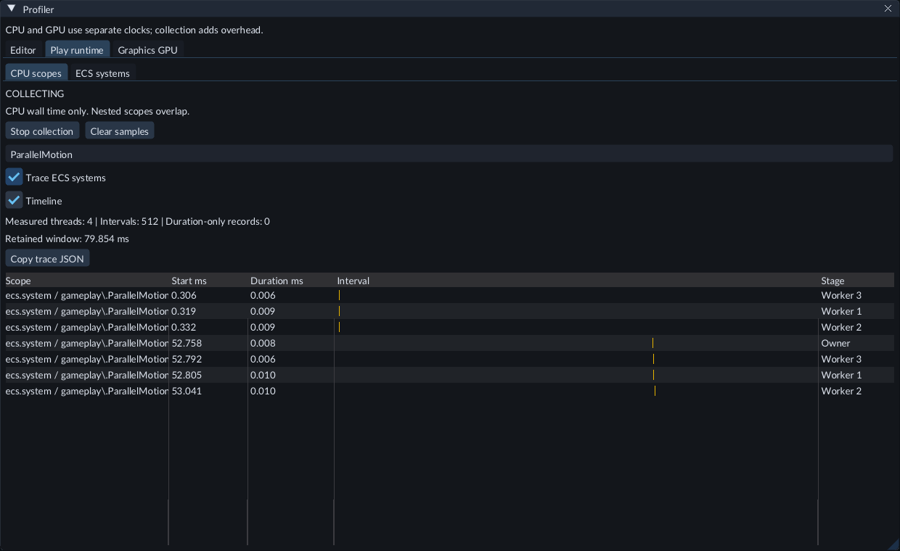
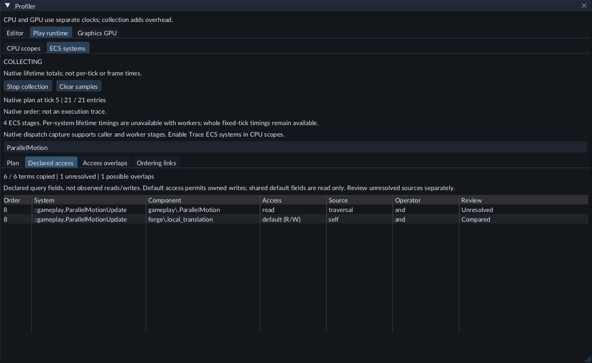
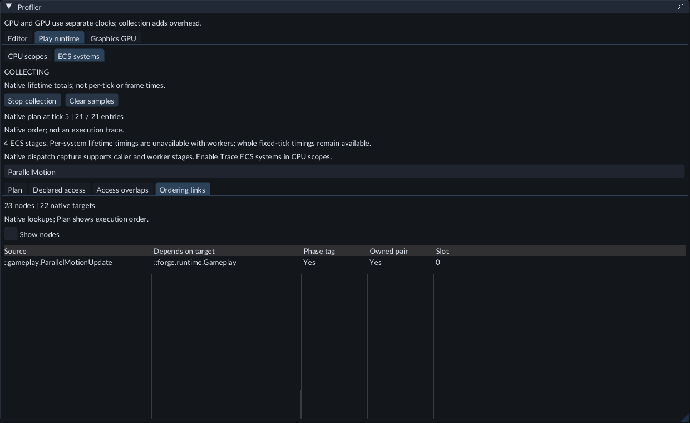

# Performance and diagnostics

The permanent bottom bar helps you see how the editor is running. Console explains recent operations and failures.

## Read the counters

**FPS** and mean frame time describe the editor's frame loop. Lower frame time means more frames per second. These are not GPU execution-time measurements.

**CPU** is the editor process's usage normalized across logical processors. **RAM** is its resident memory in MiB. Separate gameplay/compiler processes are excluded. Counters update about every half second; unavailable values show `--`.

**VSync off** means the application requests unsynchronized presentation and imposes no FPS cap. Driver or compositor settings can still affect observed rates. The bar also shows Edit/Play state and authored entity count.

## See where frame time goes

Open **Tools → Performance**. Its CPU frame sections update about every half second:

- **Update and editor UI** covers input, workers, authoring data, panels and overlays.
- **Scene render submission** covers the CPU work to redraw or reuse the Scene image.
- **UI render submission** covers the backbuffer and Dear ImGui rendering commands.
- **Present call** measures time spent handing the frame to Diligent/Windows.

These sections measure CPU wall time. GPU work runs asynchronously; waits can occur during submission or presentation. A GPU bottleneck cannot be diagnosed from these numbers alone.

**Scene redraws / Retained** counts full scene renders and unchanged EDIT image reuses since launch. An idle static scene can reuse its image while the interface continues drawing uncapped. Moving the camera, editing a primitive, resizing or previewing a transform refreshes the image. Play always redraws. This optimization currently applies to static blockout geometry; idle editor FPS is not gameplay performance.

### Compare a slowdown

1. Keep the same window size, panel layout and camera view.
2. Compare an empty scene, one cube and two cubes. Keep selection consistent: selecting an object adds Inspector controls and an outline.
3. Wait a second after each change, then note FPS, frame time and the four CPU sections.
4. Compare idle viewing with orbiting. Enable **Redraw static scene every frame** to measure continuous scene submission even when the camera is still. Disable it again for normal use; this comparison setting lasts only for this session.
5. Include the measurements and GPU model with a performance report.

For perspective, 2500 FPS is 0.40 ms per frame, 2000 FPS is 0.50 ms and 900 FPS is about 1.11 ms. Compare milliseconds to judge the added work. FORGE does not impose an FPS cap to hide that work.

## Inspect Play CPU costs

Open **Window → Profiler**, choose **Play runtime → CPU scopes**, and start collection.
Use **RuntimeEntityPublication** to see time spent creating queued objects and
Prefab groups. **ResourceSynchronization** shows resource synchronization;
**PresentationPoseCapture** shows the work that prepares smooth presentation poses.
**FixedSimulationTick** includes these stages and the rest of the simulation.

Use the same scene and actions when comparing runs. The profiler keeps recent
samples, so capture a creation spike soon after it happens. These are CPU times;
the rows overlap and should not be added together to calculate FPS. Stop collection
to keep the current samples, or Clear to begin another comparison.

## Inspect a CPU timeline

1. Open **Window → Profiler** and choose **Editor** or **Play runtime → CPU scopes**. Start Play first when inspecting its runtime.
2. Click **Start collection**, perform the action you want to measure, then click **Stop collection** to retain the recent records.
3. Enable **Timeline**. Read **Start ms**, **Duration ms** and the interval bars to compare completed measured scopes. Hover a bar for its name, tick and record sequence. Use the filter to find a scope; scroll the panel or table when needed.
4. Click **Copy trace JSON** to copy all retained measured intervals for that owner. Paste into a text file and save it with a `.json` extension for a viewer that supports Trace Event JSON. Copying includes the capture date, time and UTC offset. Filtering changes the display, not the copied trace.
5. Disable **Timeline** to return to the grouped summary. **Clear samples** starts a fresh observation window and discards unfinished samples. Clearing Editor samples also clears its GPU records.

The history holds at most 512 records. Nested scopes overlap; adding their durations does not give a frame time. Start times are relative to the earliest retained measured interval. The capture date identifies when the trace was copied, not an absolute timestamp for every interval. Editor and Play use separate clocks and should be inspected separately.

The timeline shows completed host scopes with measured starts. Duration-only records, including C++ SDK profile samples and the exclusive **UpdateAndEditorUI** total, stay in the summary. If the timeline is empty, collect an editor frame or a Play fixed tick and check its measured interval count. **Copy trace JSON** is disabled until a measured interval exists.

Host scopes belong to the calling owner. Supported native ECS worker dispatches
retain their stage identity and use separate tracks. Logical overlap lanes within
one stage are layout only. Stage identifiers are not OS thread IDs. GPU durations
and ECS system lifetime totals remain in their own views. Sampled call stacks are
unavailable.

### Trace individual ECS dispatches

1. Start Play and open **Window → Profiler → Play runtime → CPU scopes**.
2. Enable **Trace ECS systems**, then **Start collection**. If collection is already running, enabling the option takes effect after its acknowledgement. Unsupported hosts show an explanation.
3. Run the game or Step while paused, then stop collection. Enable **Timeline** and filter for **ecs.system** to find individual native dispatches. **Copy trace JSON** includes them with the other measured intervals.
4. Disable **Trace ECS systems** when you finish. It starts off in a new process. **Clear samples** discards retained records and resets skipped-dispatch counts.

A dispatch includes the native system's query, setup and deferred work. A timer-gated system contributes a dispatch only when it runs. These are not separate measurements of every entity callback. Capture covers the caller and supported native ECS workers inside the fixed pipeline boundary. Other background tasks are outside this capture. These are wall intervals, not hardware CPU utilization.

Collection and system tracing both add overhead. The shared history holds at most 512 records, so a busy tick can replace older samples quickly, including older worker observations. Nesting beyond 64 or a worker's 512-record capture buffer shows a skipped count. Stop collection promptly to retain the action you need. The options are temporary diagnostics and do not change saved Scene data or exported game content.

### Read native worker tracks

1. Build and attach the [ParallelMotion example](native-gameplay.md), then save **Fixed ECS workers** as 4 in Project Settings and restart Play.
2. Open **Window → Profiler → Play runtime → CPU scopes**, enable **Trace ECS systems**, and start collection.
3. Run or Step, then stop collection. Filter for **ParallelMotion**.
4. Read each summary row's **Stage** to compare Owner and Worker dispatches separately. Enable **Timeline** to compare their measured intervals and copy the trace when needed.

**Measured threads** counts the stages represented in the retained intervals.
It can be lower than your configured count after records are evicted. Worker
numbers identify native ECS stages within this runtime; Owner is its caller.
The summary keeps separate groups for the same system on different stages.
Overlapping durations must not be added together to estimate frame time.

If no worker tracks appear, check that an attached system has matches and uses
`multi_threaded()`, that the saved worker count was applied by restarting Play,
and that tracing and collection were enabled before a fixed tick. Custom clocks,
external worker configurations and unsupported host hooks retain owner-only
capture. Pause without Step does not run another fixed tick.

## Inspect ECS system order

1. Start Play and open **Window → Profiler → Play runtime → ECS systems**.
2. Click **Start collection**. Run the game, or use Step while paused, to populate the table.
3. Read **Order**, **System** and **First target** to inspect the native fixed-pipeline plan. The first target is the first native DependsOn lookup; it can name another system rather than a phase. **Merge** marks a Flecs synchronization point. Systems with no matching entities are absent.
4. Use **Filter system, target or component...** to find a system. Order numbers keep their original positions when filtering; merge rows remain visible.
5. Stop collection to retain the view. **Clear samples** discards it; another collected fixed tick can populate it again.

**CPU lifetime ms** is the native system's cumulative CPU wall time since that system
was created, including native measurements before collection started. Clear does
not reset those counters. These values are separate from the recent **CPU scopes**
samples and do not measure one tick, a rendered frame or GPU time. **Mode** shows
native Immediate, Deferred or Multi-threaded configuration, not actual processor
utilization. A missing timing value appears as `--`.

With **Fixed ECS workers** above 1, per-system lifetime timings are unavailable
and appear as `--`. The plan still shows systems, access modes and merges.
**Trace ECS systems** can capture caller and supported native worker dispatches;
their observed stages appear in CPU scopes. **CPU scopes → FixedSimulationTick**
still measures the owner waiting for the whole tick, including its synchronization.
Compare identical scenes and settings rather than adding incomplete system rows.

The displayed tick identifies when the native plan was captured. Watching the
panel requests a new observation on the next collected fixed tick; inspecting a
paused game does not advance it. The plan can change as systems gain or lose
matches. It is not a log of every invocation or a thread timeline. Large plans
show their first 256 entries with a truncation notice; long names end with `...`.
Collection adds overhead. The authoring world's separate ECS inspection window
does not execute gameplay to produce these observations.

## Review declared component access

1. Open **Window → Profiler → Play runtime → ECS systems**. Start collection and run or Step a fixed tick, then stop collection to retain the view.
2. Choose **Declared access**. Filter by a system or component name to read its declared fields, access mode, source and query operator.
3. Use **Plan** to locate the system's current native order and first dependency target. **default (R/W)** permits changes to owned data; a default shared field is read only. **Compared** means this field participates in the limited overlap check.
4. Choose **Access overlaps** to review possible read/write or write/write sharing between earlier and later systems. Check your C++ declarations and phase choices when their relative order matters.

These are query declarations, not measurements of every memory access. Overlap
rows do not prove a race: filters can select different entities, optional data
can be absent, and systems still run in the displayed native order. The view does
not reorder systems or edit code.

**Unresolved** fields need separate review. Traversal, variable sources, wildcard
or complex expressions and no-data output annotations are outside the comparison.
A source that traverses from a fixed entity retains that starting entity's name;
hover the Source cell to read it. Callback side effects that were never declared
are outside this observation.
The comparison covers different systems; it does not analyze sharing among the
worker callbacks of a single system.

In a short window, scroll the Profiler panel to reach its data. Use the table's
horizontal scrollbar to reach the remaining columns. Repeated declarations for
the same system/component/source pair share a representative overlap row; the
Declared access tab retains the individual copied terms.

The view copies at most 512 terms, 32 per system, and retains up to 128 overlap
rows with an 8192-comparison limit. A partial-observation notice identifies omitted
coverage. An empty list cannot establish independent access. The Plan's separate
256-entry limit still applies. Clear discards these observations with the other
collected system data; stopping Play or replacing the world requires fresh data.

## Inspect native ordering targets

1. Open **Window → Profiler → Play runtime → ECS systems**. Start collection and run or Step a fixed tick, then stop collection to retain the observation.
2. Choose **Ordering links**. Read **Source** and **Depends on target** for each returned native lookup. **Slot** preserves that source's lookup index. Use the system, phase or component filter to narrow the rows.
3. Read **Phase tag** to see whether the target has the native phase marker. **Owned pair** reports whether the source owns that relation pair. A lookup can resolve an inherited target; an unowned pair is not a missing dependency.
4. Enable **Show nodes** to inspect names and temporary native IDs. **Copied plan** identifies systems copied from the plan; **More targets** identifies a source with omitted targets. Disable the option to return to links.
5. Use **Plan** for the observed execution order. Clear discards both views; new data requires another collected fixed tick. Older runtime snapshots can show the plan without ordering targets.

The view follows native DependsOn lookups from copied plan systems, with limits
of 512 nodes, 512 links and 8 targets per source. A partial-target notice reports
omitted coverage; the plan's separate 256-entry limit still applies. It does not
reconstruct every inheritance path, compute an effective phase, establish race
freedom or edit system dependencies. Row position in this tab is lookup order,
not execution order. Native IDs are temporary diagnostics for this runtime
world. Scroll the panel or table when needed to reach rows and columns.

## Compare a repeatable CPU workload

With a source checkout, Python3 and a matching configured **forge_runtime** build,
run `python tools/benchmark_runtime.py --runtime /path/to/build/forge_runtime --output /path/to/evidence/run.json` from the checkout. Use `forge_runtime.exe` on Windows. Choose a new output path for every run.

The report checks flat and hierarchical transform scenes and saves fixed-tick CPU
samples. Add `--baseline /path/to/evidence/run.json` on a later run to compare
matching workloads on the same controlled machine. `--counts`, `--warmup`,
`--samples` and `--repeats` adjust the run; use identical values for comparisons.
The default large workloads can take several minutes. Use `--counts 64 512` for
a shorter comparison with the same transform checks.
This source tool needs its matching CMake build cache and test client. It does not
load your project, measure Game FPS/GPU work or change editor settings. Profiling
overhead is included. Keep the report and matching build receipt together.

## Find an error

Open Console and read the latest file/editor message, or runtime status. Compiler output is in Build. Native compilation also writes its current complete log to `.forge/sdk-build/build.log`. The launchers retain console output on an editor failure.

## Runtime timing

While playing, Console shows **Tick** and **Fixed** (the simulation rate, normally 60 Hz). Tick counts completed gameplay updates, independently of editor FPS. **Dropped** counts whole ticks discarded during overload; **Clamped** shows elapsed seconds excluded after long stalls. These counters can explain lost simulation time without confusing it with render FPS. A fixed timestep alone does not guarantee deterministic gameplay.

## Report a problem

1. Open **Help → Copy build information** and paste it into your report.
2. Describe the action you took and what you expected to happen.
3. Include the Console message and a screenshot if the issue is visual.
4. Mention whether you were editing or playing and whether restarting changes the result.

The build format is `yymmdd-counter`, using UTC. The counter keeps increasing across dates. Failed packaging attempts may leave gaps. Re-downloading a build does not change its identity.

## When the GPU falls behind

FORGE limits queued rendering to two frames, even with VSync off. A slow GPU makes
the editor wait for completed work instead of continually allocating more graphics
resources. If frame completion stalls for five seconds, FORGE reports a rendering
error. This does not limit FPS to your display’s refresh rate.

## GPU pass timing

Open **Window → Profiler → Graphics GPU** and click **Start collection**. Use the
Scene or Game view, then stop collection to inspect recent pass durations. This
includes editor UI and asset previews. Collection starts off each time FORGE opens.

Results arrive after rendering is submitted. **Frame** identifies the submitted
editor frame; pending, skipped and discarded counts explain incomplete samples.
A retained Scene image does no new drawing. Use the existing redraw comparison
when you need continuous Scene work. These rows do not measure standalone game FPS
or total graphics card usage. GPU profiling can add overhead.

CPU and GPU collection are independent. Clearing editor samples clears both views;
closing the panel keeps collection running. Switching projects stops GPU
collection and keeps completed records until you clear them. A device without
supported GPU timing shows an explanation and continues rendering normally.
