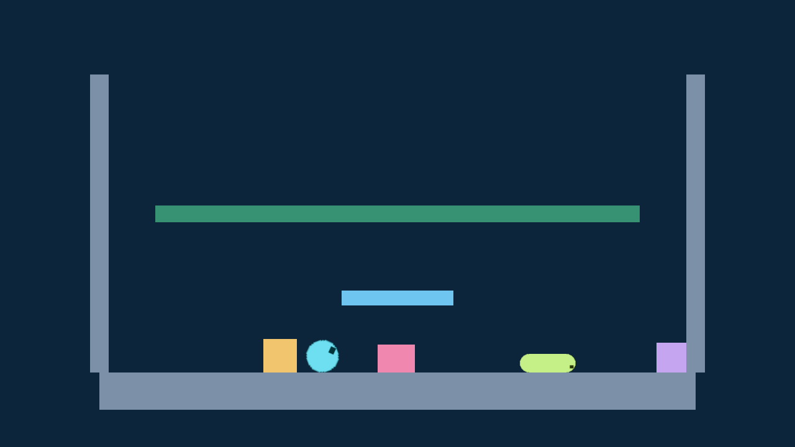
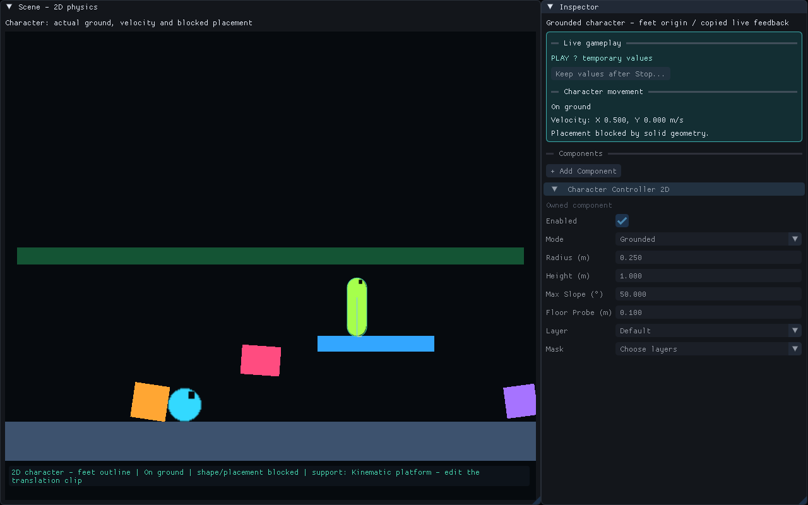
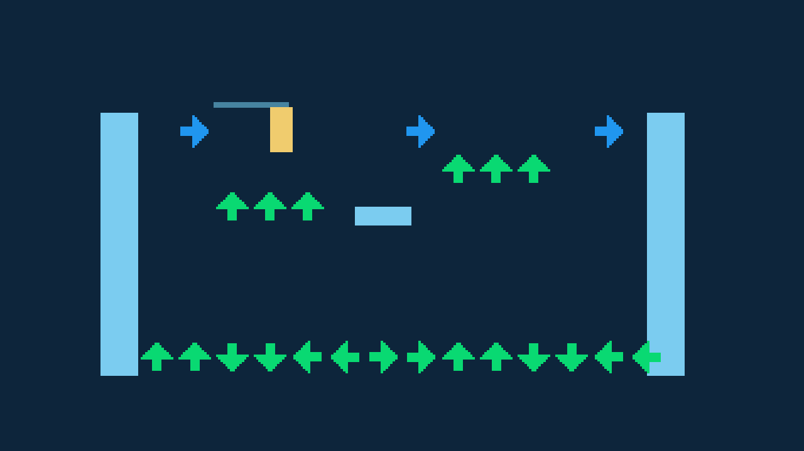
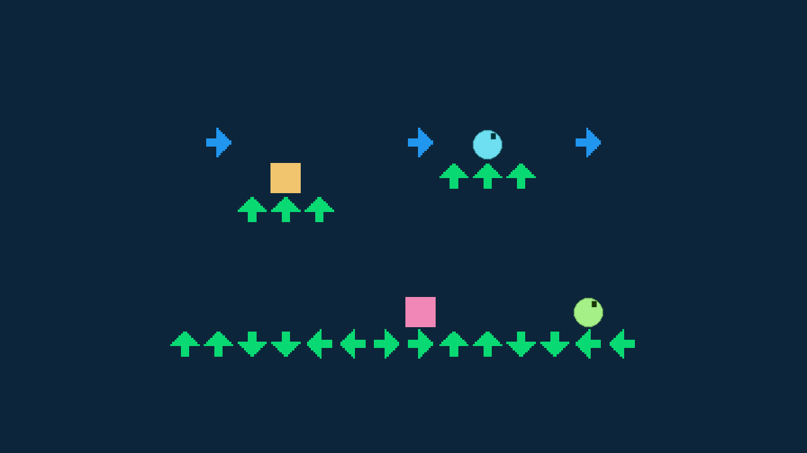
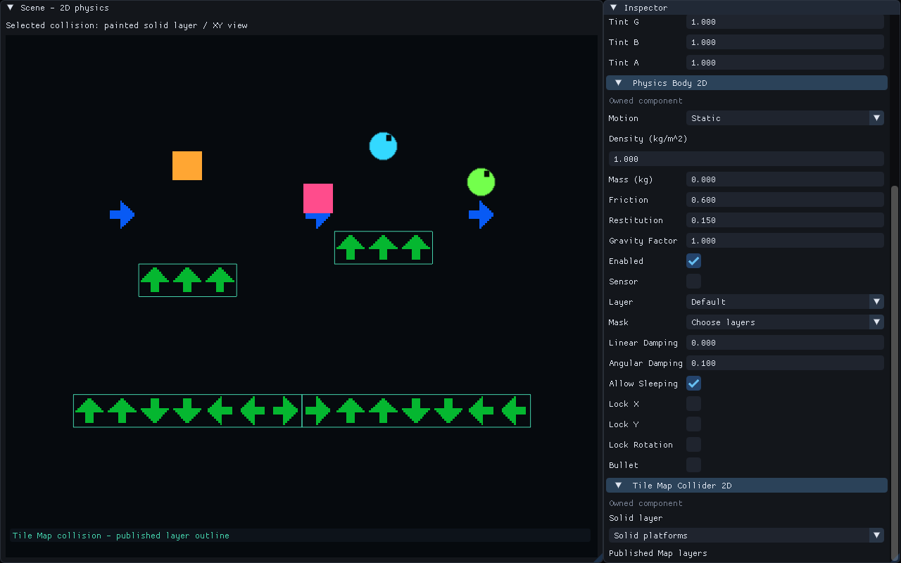

# 2D physics

2D bodies move in the world's XY plane. Positive Y is up; rotation is around Z.
They use the same Play, Pause, Step and Stop controls as the rest of FORGE.
Their saved settings belong to the Scene; the running simulation owns velocity,
sleep and contact state. 2D and 3D bodies do not collide with each other.

## Try the gallery

Copy **Examples/FeatureGallery** to a writable folder and open it. Open
**Scenes/75-2d-physics.scene.json**, press Play, then switch to Game. Three colored
boxes, a circle and a capsule fall through a green sensor strip. The blue
Kinematic platform moves beneath them; the floor and walls are Static solids.
The capsule's Sprite children follow its moving body.

Stop and select **Dynamic amber box**. In **Physics Body 2D**, change
**Restitution** to `0.8`, then Play to compare its bounce. Stop and change
**Motion** to Static to hold it in place. Undo restores the earlier setting.
Stop always returns to the authored starting layout.

Select **Green sensor** and disable **Sensor**. Play again: the strip is now
solid. Stop and Undo to restore the pass-through zone. The sensor exposes copied
Begin/End observations to C++; it does not change color automatically.

## Set up your own body

Use an ordinary entity with **Sprite Renderer** for the image. In Inspector,
choose **+ Add Component → Physics Body 2D**, then add one of:

- **Box Collider 2D**: full width and height, centered on the entity.
- **Circle Collider 2D**: radius, centered on the entity.
- **Capsule Collider 2D**: radius and straight segment height along local Y. Total height includes both rounded ends.
- **Tile Map Collider 2D**: rectangular collision from one published Tile Map layer, on a Static nonsensor body.

Set **Spatial binding** to **World** before choosing Dynamic. Static bodies
stay in place; Kinematic bodies follow supported authored/animated targets;
Dynamic bodies respond to gravity and collisions. A Sprite's width and height
are separate from its collider dimensions. **Selected collision** in the Scene
view displays the selected body's authored collision outline.

Circle and capsule shapes need equal absolute X/Y scale. Bodies and their
effective parents must remain in XY with Z-only rotation and no shear. A body
cannot also run an enabled 3D body or Character Controller. Visual children can
follow a Dynamic body; another simulated body cannot inherit its movement.

## Create a one-way platform

1. Add **Physics Body 2D** and **Box Collider 2D** to an ordinary entity.
2. Set **Motion** to **Static**, leave **Sensor** off, then enable **One-way collision**.
3. Set the Box width and height to match the platform. Objects can pass through from below and land on its local positive Y face. Z rotation changes that face; negative Y scale reverses it.
4. Enable **Selected collision** in Scene. The arrow points toward the solid face.
5. Leave **One-way margin** at `0.02 m` initially. It controls tolerance near the solid face; the permitted range is `0` to `1 m`, with a minimum effective contact tolerance of `0.005 m`.
6. Save and Play. Stop restores the authored scene. Save before exporting with the matching runtime kit; the saved platform behavior also works in the game.

Try **Scenes/79-one-way-platforms.scene.json** in FeatureGallery. The two left
circles fall onto ordinary and one-way platforms. On the right, reverse gravity
pushes two circles upward: the ordinary platform stops one, while the one-way
platform lets the other reach the ceiling. No Project Code build is needed.

In **Examples/Character2D**, walk slightly left under the green platform and jump.
The character passes through its underside and lands on top. Its C++ code still
chooses jump speed and gravity; the controller handles the platform response.

This setting supports Static nonsensor Box platforms. Moving platforms and painted
Tile Map one-way collision are unavailable. Geometric ray, overlap and sweep
queries still see the whole Box. Checked character placement rejects embedded
positions even when the character could pass through during ordinary movement.

## Settings and C++

Density is kg/m². Mass `0` derives mass from density and scaled area; a positive
mass overrides it. Friction, restitution, gravity factor, drag, sleeping, axis
locks and Bullet are editable body settings. Layers and masks use the existing
named Project Physics slots. Project gravity XY drives 2D bodies.

**CodeExamples/Physics2D.hpp** provides queued launch velocity and sensor-reading
helpers for the matching C++ SDK. Read events in PostPhysics; their availability
lasts for the current tick. Epochs distinguish a retired body from a replacement
with the same authored identity. See the gallery's **CodeExamples/README.md** for
units, permissions and registration context.

For a complete C++ walk/jump project, open a writable copy of
**Examples/Movement2D**. Capture gameplay input in Game, move with A/D or arrows,
and jump with Space. Select the amber Player and change **2D Movement** speed or
jump speed in the Inspector. The example checks for ground with a capsule sweep,
ignoring itself and sensors. Painted floors and a separate box stepping stone
both support it. Stop restores saved state; save/publish before export. See the
project's **README.md** for the
experiment, C++ source and matching runtime/module-kit export workflow. This
example uses a Dynamic body and capsule sweeps. For the dedicated controller,
use **Examples/Character2D** as described below. Automatic stairs and 2D navigation
are unavailable.

Bullet improves high-speed solid collision with supported receivers. It does
not guarantee exact projectile timing or every fast sensor crossing. The native
continuous sensor path retains eight candidates per fast body per step.

## Connect bodies

Create a separate entity, add **Physics Joint 2D**, and choose **Body A** and
**Body B** from the 2D-body pickers. Both must be enabled nonsensor bodies, and
at least one must be Dynamic. The joint entity's own transform does not position
the connection. **Anchor A/B X/Y** are points in each body's local coordinates.

- **Distance** holds the anchors at a fixed distance. A positive **Spring Frequency** makes it elastic; **Spring Damping** controls how quickly it settles.
- **Hinge** keeps the anchors together and lets the bodies rotate. Frame angles define the rest orientation; optional angle limits and a torque-limited speed motor control rotation.
- **Slider** allows travel along the joint frame's X axis. Optional travel limits and a force-limited speed motor control its movement.

Distances use metres; frame/limit angles use degrees. Hinge motor speed is
degrees per second; Slider motor speed is metres per second. A positive speed
moves Body B relative to Body A's frame. **Collide Connected** controls whether
the pair can collide; ordinary body layers/masks still apply. If several joints
connect the same pair, any joint disabling connected collision takes precedence.

Select a joint in Scene to see its authored guide. These are editing aids, not
live force measurements. Stop before editing saved settings, then Play to test.
The same property history and Prefab reference behavior apply. Matching C++ can
change runtime settings before Physics using **CodeExamples/Physics2DJoints.hpp**.

Try **Scenes/76-connected-2d-bodies.scene.json**: a cyan pendulum, amber rigid
tether, rose spring and green motor carriage. Stop, select **Slider - positive
rail motor**, change its speed to `-0.9`, and Play to reverse its direction.

## Painted Tile Map collision

Open **Scenes/77-painted-2d-collision.scene.json** and Play. Colored bodies fall
onto the green painted floors; the blue decorative arrows let them pass through.
Stop and open **Assets/Tiles/PaintedPlatforms.tilemap.json**. Choose **Solid
platforms**, erase the left raised platform, then **Save / Publish**. On the next
Play, the amber box drops to the lowest floor. Undo the source edit and
**Save / Publish** again to restore it.

For your own Map, put **Tile Map Renderer**, a Static nonsensor **Physics Body 2D**
and **Tile Map Collider 2D** on the same entity. Choose its **Solid layer** in the
Inspector. Use this collider instead of a Box, Circle or Capsule Collider 2D.
Publish the Map before Play or export. **Selected collision** outlines the
published layer; unsaved painting is not yet the active collision.

Each occupied cell contributes its rectangle, including transparent image pixels.
This profile supports Static rectangular Map collision; moving Maps, per-tile
slopes and one-way collision on painted Maps are not available.

## Character movement

Open a writable copy of **Examples/Character2D** for a player controlled by C++ and
**Character Controller 2D**. Build Project Code with the matching SDK, then Play.
Capture Game input and use A/D or arrows to walk; press Space to jump. Holding
Space does not repeat after landing. A gamepad's left stick and south button work too.

Select the Player. **Character Movement 2D** exposes speed, jump speed, gravity and
terminal speed. Change authored values while stopped and save, or try temporary
changes in **Live gameplay**. The live **Character movement** section reports
ground state, velocity and blocked placement. Stop restores authored values.

Enable **Scene → View → Selected collision** to see the feet-origin capsule and,
during Play, its support normal and velocity. The player can stand on the painted
floors and box stone. Walls block it; the marked sensor does not.

For your own player, add **Character Controller 2D**, then supply C++ behavior
through Project Code. The example source is under **Content → Code**. It reads
input, chooses movement, applies gravity and permits a jump from walkable ground.
Use an upright object with **Child space: World**; its origin is its feet. Keep
positive Y scale and equal absolute X/Y scale. Attach visual children if they
need independent rotation. Do not add an enabled Physics Body or another controller
to the same object.

Grounded mode reports floor support and can follow a nearby descending surface.
Floating mode accepts XY movement without floor support. This profile does not
provide automatic stairs, crouching, moving-platform carry or 2D navigation.
See the example's **README.md** for the editable source and export experiment.

## Export

Save the Scene and choose **Use saved current scene as startup** in Project
Settings. Export using the matching runtime kit. The saved bodies, Sprite
materials and prepared animation clip travel with the game. Optional C++ behavior
travels as its compiled module. Players need neither source code nor a compiler.

The two C++ examples use the same export workflow. Character2D exports its compiled
movement code and controller settings. Movement2D uses a Dynamic body and a support
sweep. Their source files are not needed to run the exported games.

## Visual examples

Gallery75 demonstrates 2D bodies, shapes, a moving platform and a sensor.

Character Controller 2D reports ground contact and movement in Live gameplay.

The editable Movement2D project combines C++ input with walking and jumping.

Painted solid tiles act as floors while decorative tiles remain non-colliding.

Inspect the published solid layer before testing the map in Play.
