# Prefabs

A prefab is a reusable group of objects saved as its own asset. Instances follow the prefab's values until you override a value in that instance. Editing the source updates the instances that still follow it.

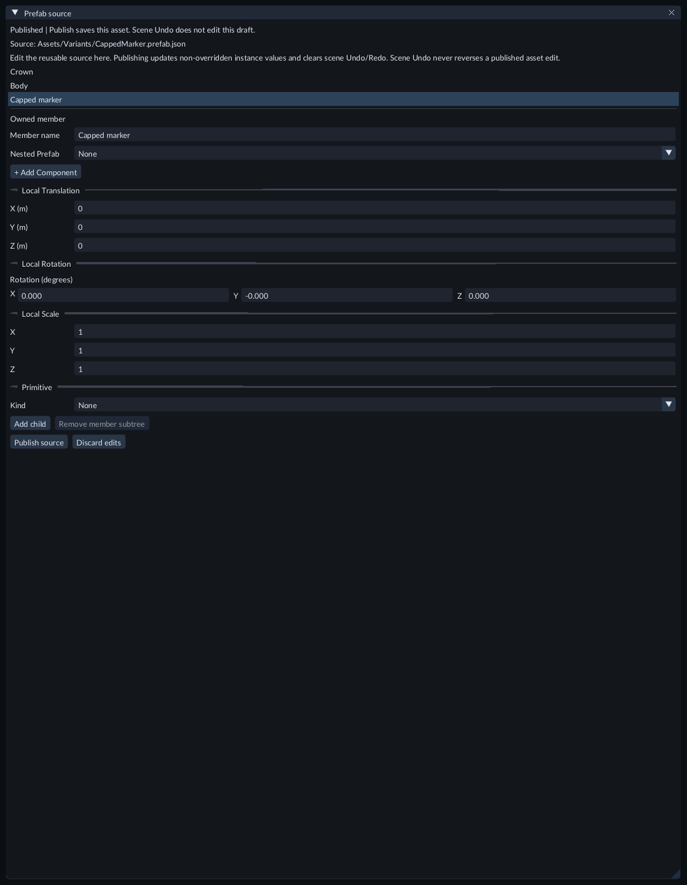

Edit the prefab source to update instances that follow its values.

## Create a prefab

1. Build a group in the Hierarchy with one parent and its children. It can include unchanged linked prefab instances. Linked children with Scene-only overrides, extra attachments, unavailable members or changed root bindings cannot be captured; use the nested source workflow below instead. Legacy scene-local prefab definitions still cannot be captured.
2. Select the parent.
3. In **Content**, expand **Create / Register → Prefabs**.
4. Enter a new project-relative filename, such as `Assets/Chair.prefab.json`.
5. Click **Create from selection**.

Your original objects remain in the scene. Create does not replace or delete them. Existing files are never overwritten by Create.

## Add linked copies

Select the prefab in Content, then use **Create / Register → Prefabs → Instantiate**, or its right-click menu. Repeat to create another copy. Each copy has its own object identities. Instantiation is one scene Undo step.

The Hierarchy marks roots with **[prefab]** and their structured children with **[member]**. Select any member to inspect it. Move, rotate and scale work on individual members; rearranging, renaming or removing the source's interior happens in **Edit source**. You can attach ordinary scene objects beneath a member using the usual Parent control.

## Change one instance

Select an instance or one of its members and edit its normal Inspector fields. Translation, rotation and scale are independent: moving a member does not stop it from following source rotation or scale changes.

An override means you explicitly chose that value. It remains an override even if it equals the source value. Supported color fields can have independent overrides; changing red does not require overriding green and blue. Setting the whole color through the color picker explicitly sets all three channels.

The Inspector's **Prefab instance** section shows the resolved revision and offers **Revert** controls for overridden components and supported individual fields.

## Revert to the source

Instance root names follow the source until you rename the instance; **Revert name** restores that link.

Click the matching **Revert** control in the Inspector. The instance immediately follows the current source value again. Scene **Undo** restores the override, and **Redo** removes it again.

Transform Revert works on a whole channel: translation, rotation or scale. Rotation is one complete rotation, rather than four independently inherited quaternion numbers.

## Edit the reusable source

1. Select the asset in Content and click **Edit prefab source** in Inspector, or use its context menu. Alternatively, select an instance and click **Open prefab source** in its Inspector.
2. In **Prefab source**, select a member.
3. Edit its name or component fields. **Parent member** changes the source hierarchy while keeping the member's local transform.
4. **Spatial binding** selects Follow parent, World or Explicit attachment while retaining local values. Instance-root attachment is chosen in the scene Inspector.
5. **Add child** creates a member with a new identity. **Remove member subtree** removes a member and its descendants from the source.
6. Click **Publish source**.

FORGE validates the candidate and prepares replacement instances before replacing the saved asset. Invalid values, hierarchy cycles, stale files and failed file replacement keep the previous usable revision and instance state. The error stays visible and your draft remains open for correction.

A successful publication updates non-overridden values. Existing overrides remain intact. **Discard edits** restores the window's last published contents. Closing an unsaved source asks Publish, Discard or Cancel.

**History boundary:** publishing a source change affecting the current scene clears that scene's Undo/Redo history. Scene Undo does not undo shared prefab-asset edits. Save your scene after a source change adds new members so their new object mappings are persisted. Apply from an instance uses the separate coordinated workflow below.

Prefab authoring is disabled while Play, native builds, file dialogs or transform gestures are active. Stop Play before publishing; the next Play session receives the updated prefab definitions.

## Nest reusable assemblies

Use a nested Prefab when an assembly needs linked copies of another reusable
object. The child keeps its own source; editing that child updates every copy
that still follows it.

1. Create the child Prefab first, such as `Assets/Wheel.prefab.json`.
2. Open the enclosing Prefab with **Edit source**.
3. Select the member that will hold the child, or use **Add child** to create one.
4. Set **Nested Prefab** to the child asset.
5. Adjust the holding member's translation, rotation and scale to place the child.
6. Click **Publish source**, then save the Scene.

The holding member remains a normal part of the enclosing source. The linked
child appears beneath it as a separate **[prefab]** root in the Scene Hierarchy.
Repeated links to the same asset produce independent copies. To change only one
kind of child, create a variant of that child and select the variant for its link.

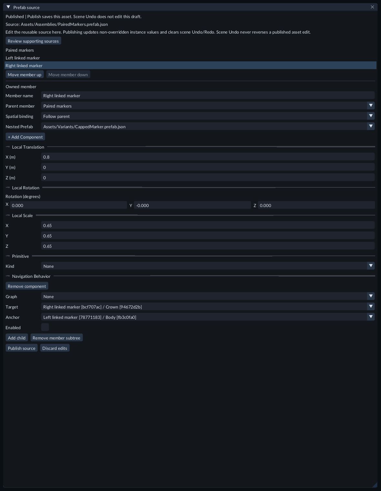

Select the holding member to choose its child asset and inspect references to the
left or right linked occurrence.

A source reference picker shows the holding member, its short identity and the
child member. Choose the intended occurrence even when several copies share
names. Each placed assembly resolves the reference to its own child. A missing
reference keeps its identity until you explicitly change it.

In an enclosing variant, choose **None** to clear an inherited child link.
**Use inherited nested Prefab** restores the current base's choice. Clearing a
link makes the existing child and attached Scene objects unavailable while
retaining their identities and overrides. Restoring the same asset reconnects
that copy. Selecting another asset creates a distinct linked copy; it does not
retarget old references to the replacement.

In the Scene, a linked child's root supports normal name, component, transform
and **Spatial binding** overrides. Its structural Parent follows the enclosing
source. Change that link in **Prefab source**; select the outer instance to
move, duplicate or delete the whole assembly. Interior members follow the child
source's structure and spatial bindings. Dynamic physics bodies still need World
spatial binding.

If a supporting child source changes while your source draft is open, choose
**Review supporting sources** to review its current saved contents. Enclosing
variants use **Rebase draft**. Your own draft intent is retained; Publish validates
it against the reviewed sources. If this source's own file changed, reopen it.

**Create from selection** can retain unchanged linked children. It does not copy
Scene-only overrides, extra attachments or changed child-root bindings into the
asset. If capture is blocked, keep the Scene unchanged and add the links in the
source window, or put reusable differences in a child source/variant first.

Assemblies support up to 4,096 expanded active members and 16 links along a path
through bases and nested assets. Cycles, unavailable required sources and overly
deep structural hierarchies reject publication. Nesting selects Prefab format7
and Scene format6; use an editor/runtime that supports those saved formats.

Open **Scenes/207-nested-prefab-assemblies.scene.json** and press **Play → Game**.
The left assembly repeats a capped marker twice. The middle variant clears its
right link. The right variant replaces its right child with a forked marker.
Stop Play, edit **Assets/Assemblies/PairedMarkers.prefab.json**, and select
**Right linked marker** to inspect the asset and scoped references shown above.
The reference component is disabled for this static demonstration. Camera and
Material are included; no project C++ module is required. Publish source edits
and save the Scene before exporting.

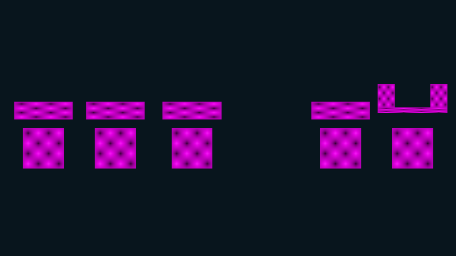

Compare the two capped children, the single capped child, and the capped/forked pair.

## Duplicate instances and assets

Use the normal **Duplicate subtree** action on an instance root to make another linked instance with fresh object identities and copied override intent.

Select the prefab in Content, enter a new destination filename and click **Duplicate asset**. An ordinary source copy receives new asset and member identities. A variant copy receives a new asset identity and keeps its base and inherited member identities. Its owned additions, including removed definitions retained for restoration, receive fresh member identities. Known references between those additions follow the copy; opaque data remains unchanged.

## Create a variant

A variant inherits another prefab's structure and values. Store the common setup in
the base, then change the names, components, properties or member structure that differ.
Changes to the base flow through fields that the variant still inherits. Scene
instances can add their own overrides on top of the selected variant.

1. Select the base prefab in **Content**.
2. Expand **Create / Register → Prefabs** and enter a new filename, such as `Assets/AmberBeacon.prefab.json`.
3. Click **Create variant**, then **Edit source**.
4. Select an inherited member and edit its name or component fields.
5. Click **Publish source**, then instantiate the variant in your scene.

The source window identifies the **Variant base** and shows inherited values.
**Inherited member** identifies a member supplied by the base or a related source contribution; **Owned member**
identifies an addition defined in this source.
**Component inherited** means all its values follow the base. **Properties
overridden** marks a partial override; its individual fields show **Inherited** or
**Overridden**. **Component overridden** means the whole component is owned by the
variant. Choosing a value equal to the base still records an explicit override.
Use **Override name** or **Override component** to retain the current value
explicitly. Right-click an editable property and choose **Override field** to
retain only that field, including a value equal to the base or a schema default.
The same context menu offers Revert for an owned field or component.

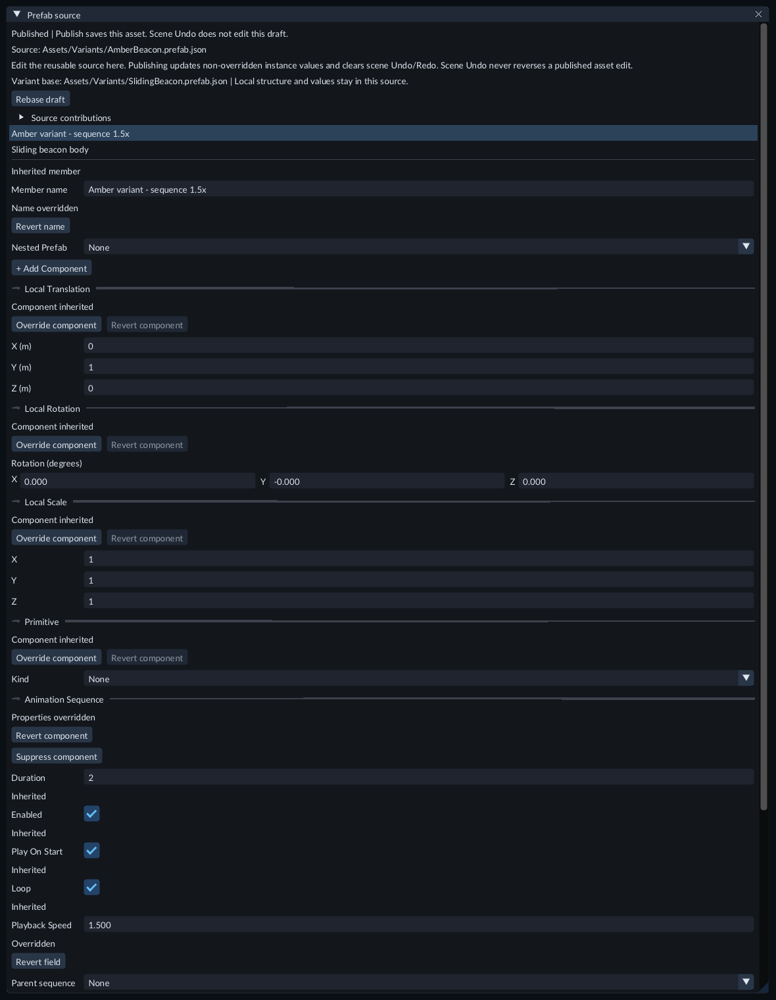

Inspect the base relationship and override labels before publishing a variant.

Use **Revert name**, **Revert field** or **Revert component** to follow the base
again. Translation, rotation and scale use complete channels. A variant can add,
override or suppress an optional component on an inherited member. An owned
addition keeps its own complete name and component values: use **Remove component**
for its optional components. It has no base name, component or property to Revert.

To omit an optional component from a variant:

1. Open the variant with **Edit source** and select its member.
2. Find the component and click **Suppress component**. This replaces its local component/property overrides and hides it from the effective variant.
3. Click **Publish source** to update instances and the next Play/export.
4. To inherit it again, find **Suppressed: …**, click **Restore component**, then **Publish source**. Restoration uses the current base's values.

Suppression persists across base updates and temporary base-component removal.
Required components, including transform channels and Color, have no Suppress
control. Scene instances may still add their own explicit optional component.
**+ Add Component** also lets the variant own a new component instead of inheriting
it. For a source using an older format, the first suppression enables Prefab
format5; restoration keeps the selected format, so use an editor that supports it.
If older source data already uses
the reserved suppression field, the operation reports a conflict and keeps the
draft unchanged; preserve or rename that extension explicitly before trying again.

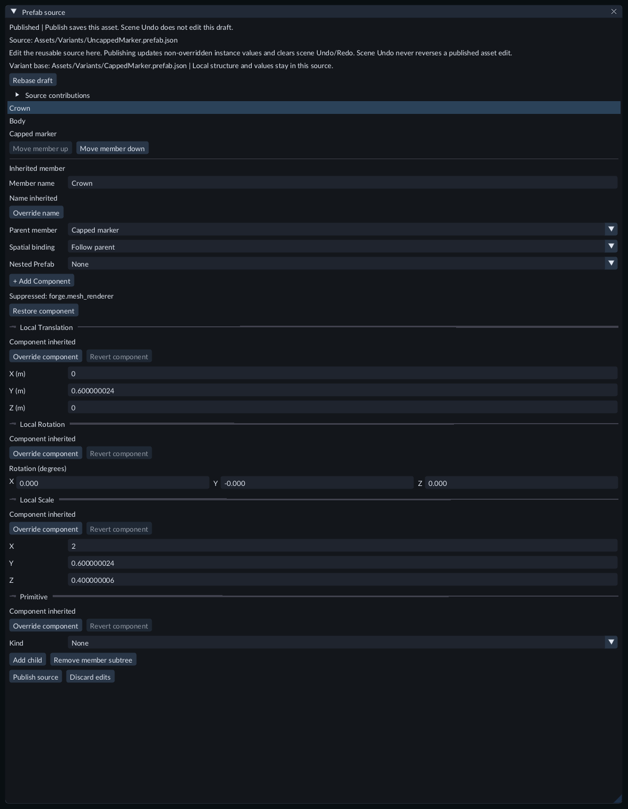

Select the member that owns the suppression. **Restore component** resumes its
base inheritance; **Publish source** saves the change.

If the base changes while a draft is open, publication rejects the stale review.
Choose **Rebase draft** to refresh published sources and review the new inherited
values while retaining your explicit draft overrides. A successful source refresh
can clear Scene history. If the variant's own file changed externally, close and
reopen it to review that file before publishing. Failed validation keeps the draft.

A variant can use another variant as its base. A path through base relationships
and nested links can contain up to 16 links; missing required assets and cycles
reject. If the base removes a member, its variant overrides are retained for that
same identity to return; names do not retarget them. Related variants can contribute
to the same source through the workflow below.

Open **Scenes/142-prefab-variants.scene.json** in the Feature Gallery and press
**Play**. The base, amber, blue and chained pink variants run the same sliding
animation at different speeds. The repeated blue instance has its own controller.
Stop Play and open **Assets/Variants/AmberBeacon.prefab.json** to edit the sequence
speed or select its body to change color. Save the scene before exporting; no
project C++ module is required for this example.

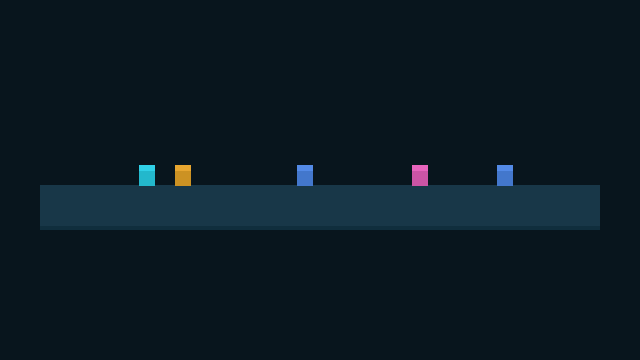

Compare the shared motion with each variant’s color and sequence speed.

For component absence, open **Scenes/205-prefab-component-suppression.scene.json**
and press **Play → Game**. The left marker has an inherited crown, the middle
variant suppresses its Mesh Renderer, and the right chained variant adds an
explicit Mesh Renderer of its own. Stop Play and edit
**Assets/Variants/UncappedMarker.prefab.json**, select **Crown**, then choose
**Restore component → Publish source** to restore the middle crown. Save the Scene
before exporting. This example uses the existing Unlit checker Material and
requires no project C++ module.

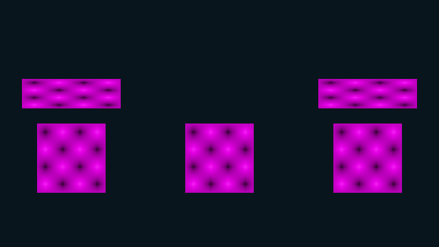

Compare the retained body and member structure with the missing middle renderer.

## Combine related source contributions

Use source contributions when two variants of the same common Prefab supply
different reusable changes. For example, one can change a marker's width while
another changes its color. Create both variants from the common source first.
Use nested Prefabs for separate objects with independent source hierarchies.

1. Create a variant of the source whose changes should apply first.
2. Open its **Edit source** window and expand **Source contributions**.
3. Choose **Add related source...** and select the other variant.
4. Add more sources if needed. **Earlier** and **Later** change their order; **Remove** removes an additional input while retaining your local overrides.
5. Inspect the inherited members and values, then click **Publish source**.
6. Save your Scene before Play or export.

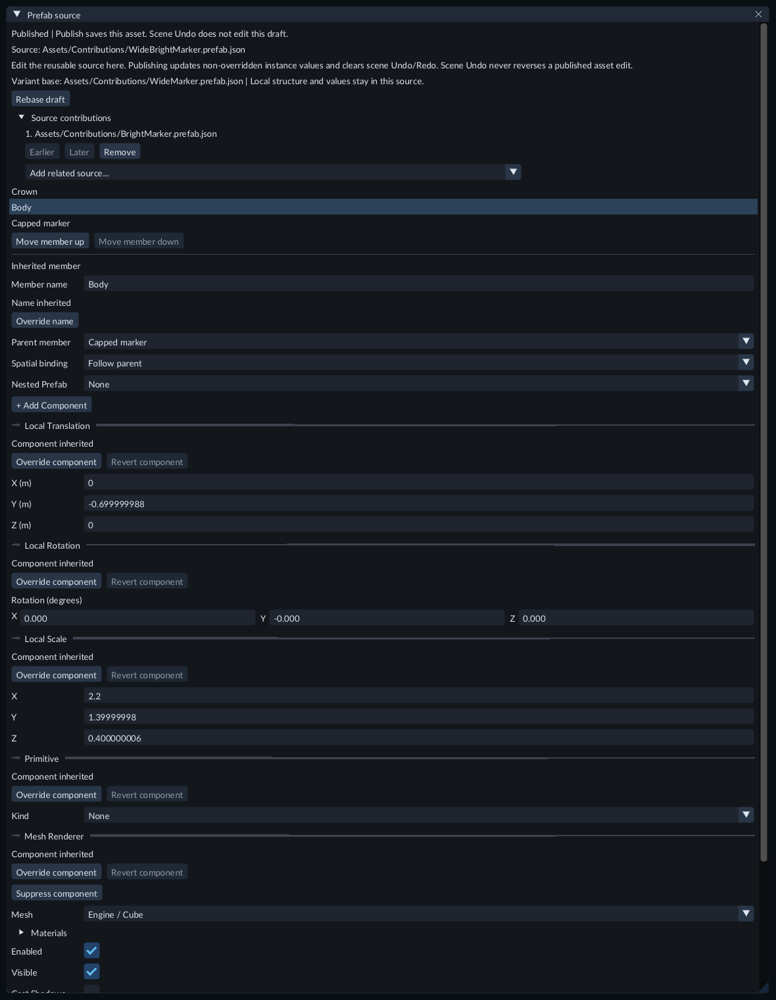

Expand **Source contributions** to inspect and change the additional inputs.

The primary base applies first, then the listed sources, then this source's own
overrides. Shared ancestors apply once. A source contributes only the values and
structure it explicitly authors; inherited defaults do not erase another source's
field changes. **Revert field**, **Revert name** and **Revert component** remove
this source's local intent and follow the combined inherited result. A later
explicit whole component can supply a component suppressed by an earlier input.

Inputs must share the same complete-source ancestor and root member identity.
Duplicate assets, incompatible ordering, cycles and conflicting member identities
reject the edit without changing the draft. Use variants created from the common
source; duplicating an ordinary source creates a different identity family.
An input can address its own members and inherited members. Put references between
independent contributors in the combined source, where both are available.
Removed or unavailable members follow the existing per-source removal and repair
rules; adding another input does not automatically restore an earlier removal.

There can be up to 15 additional inputs and 64 unique contributors including the
current source. The existing 16-link path and expanded-member limits also apply.
Selecting contributions enables Prefab format8; removing every additional input
keeps that format. If an older extension already uses its reserved field, preserve
or rename that extension before enabling contributions. Use an editor/runtime
that supports the saved format.

If a contributor changes externally, use **Rebase draft** to review the current
saved sources while retaining local intent. Publication checks the reviewed
sources as well as the file being edited. Restore a missing required input before
reviewing and publishing the source. Direct publication clears affected
Scene history; Scene Undo does not edit the source draft.

Open **Scenes/208-prefab-source-contributions.scene.json** in the Feature Gallery
and press **Play → Game**. From left to right, compare the common marker, the wide
variant, the bright variant and the variant combining width and color. Stop Play
and edit **Assets/Contributions/WideBrightMarker.prefab.json**. Expand **Source
contributions** to inspect its bright input, or select **Body** to add a local
override. Publish and save before exporting. The Camera and Material are included;
no project C++ module is required.

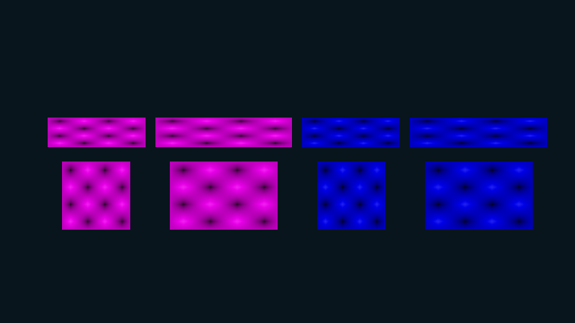

The final marker inherits width and color from separate related sources.

## Change a variant's member structure

1. Open the variant's **Edit source** window and select an available member.
2. Click **Add child** to create an owned addition under it. The child receives registered component defaults and starts one unit above its parent.
3. Select a non-root member. **Parent member** changes its structural parent; **Spatial binding** selects Follow parent, World or Explicit attachment. Explicit attachment also offers **Spatial target**. These edits retain local transform values.
4. Use **Move member up** or **Move member down** to order siblings.
5. Use **Remove member subtree** to omit a member and dependent branches from the effective variant. Its owned definition or inherited removal intent remains in this source.
6. Click **Publish source**, then save the Scene if new instance member mappings were created.

The first structural edit explicitly selects Prefab format6. An older source that
already uses one of its reserved structural fields reports a conflict and keeps
the draft unchanged; preserve or rename that extension before trying again. Use
an editor that supports this format. Invalid cycles reject the edit immediately.
The source root keeps its identity and Scene-owned attachment.

For inherited members, **Revert parent** and **Revert spatial binding** remove only
that source's explicit attachment override and follow the current base again.
**Revert sibling order** clears this source's order prefix for the selected parent.
Other properties and component overrides remain intact.

Expand a member under **Unavailable members** to inspect its stable identity and
repair its parent or spatial attachment. **Restore member** clears this source's
removal flag. Missing or removed parent/spatial targets can keep a branch
unavailable; repair the attachment or restore the target as well. A member removed
by the base remains absent until that base restores it. Restoring a local addition
uses its retained definition and identity. Reparenting a branch away from a removed
ancestor can keep that branch available.

Publication updates instances and the next Play/export through the usual source
workflow. Scene Undo does not edit this draft or reverse source publication.

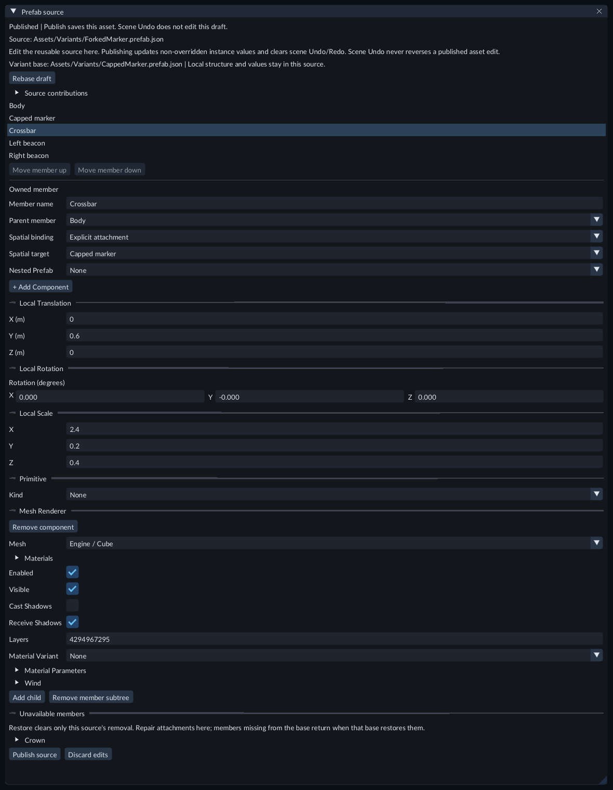

Select **Crossbar** to inspect its owned values and separate structural/spatial attachments.

## Try the member-structure example

Open **Scenes/206-prefab-member-structure.scene.json** in the Feature Gallery and
press **Play → Game**. The left marker uses the base crown. The middle variant
removes that crown and owns a Crossbar with two beacons. The right chained variant
removes one beacon, reparents the other beneath Body and changes its offset/order.
The Crossbar and beacons attach spatially to the root, keeping their sizes
independent of their structural parents' scale.

Stop Play and edit **Assets/Variants/ForkedMarker.prefab.json**. Select **Crossbar**
to inspect **Owned member**, **Parent member** and **Spatial binding**. Expand
**Crown** under **Unavailable members** and choose **Restore member → Publish
source** to inherit the crown again. Save the Scene after publication and before
export. The Camera and Material are included; no project C++ module is required.

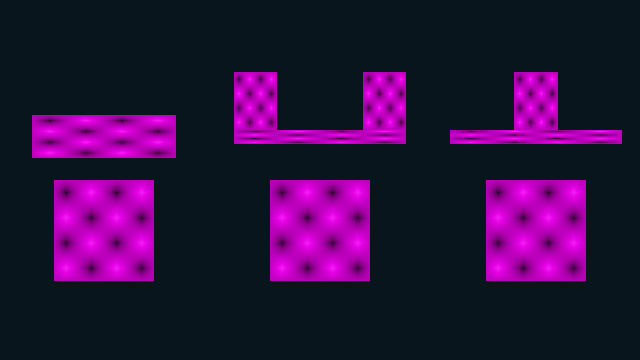

Compare inherited structure, owned additions and the derived attachment changes.

## Missing assets and removed members

A removed member keeps its previous object identity and overrides as a **[missing]** entry. References do not silently point to a different object. A missing prefab asset likewise keeps the instance's identity, mapping and override data.

Restore the original asset or member identity, then click **Refresh prefabs**. Renaming or moving a `.prefab.json` file within the project does not change its asset identity. Copying a file by hand preserves its identity and is rejected as a duplicate; use **Duplicate asset** for a new logical asset.

After editing source files outside FORGE, increase the source revision and use **Refresh prefabs**. Invalid external candidates leave the editor's previous revision active. Reopen the source window before publishing if its file changed externally.

## Current boundaries

The source window edits admitted built-in and project components. Unavailable plugin data is preserved without interpreting it. Combining unrelated root namespaces, per-instance interior hierarchy changes and Unpack are unavailable. Related source contributions use the common identity family described above. Apply supports admitted instance overrides as described below. Existing scene-local prefabs remain supported in their original form; opening them does not create asset files or automatically convert them.

See also [Transforms](transforms.md), [Undo and redo](undo-redo.md), [Saving and recovery](saving-recovery.md) and [Play mode](play-mode.md).

## Physics defaults

Body and collider components can be inherited from prefab sources. Source changes propagate to fields without overrides; explicit instance edits remain. Revert removes that intent and is part of scene Undo. Solver objects exist only during Play and are never saved in the prefab. See [Physics](physics.md).

A newly instantiated prefab root keeps the existing per-instance spatial attachment policy. If its body is Dynamic, set that instance root's **Spatial binding** to **World** before Play. FORGE does not silently detach it. Duplicating a configured instance retains its binding.

## Draft close and active Save

Prefab source stays open when Content is hidden. An asterisk and **Unsaved draft** identify unpublished changes. Selecting the same source again keeps its draft. Closing, switching source or switching project asks **Publish**, **Discard**, or **Cancel**. Failed publication leaves the draft open and previous good source/instances intact.

Ctrl+S publishes when Prefab source is the active task. Scene Save does not publish it, and scene Undo/Redo does not edit it. Publishing may clear scene history because existing instances reconcile to a new source revision. This direct-source publication is different from the coordinated Apply workflow below.

Source members use **+ Add Component** and the same typed fields as the entity Inspector, including UI Document asset references and integer Layer. Structural draft edits validate before acceptance; publishing validates the complete candidate and affected instances.

## Member order

Select a member in the prefab source document and use **Move member up** or **Move member down** to change its order among siblings. Publishing propagates the source order to instances. Identity, overrides and dynamic scene attachments remain independent. Variants store a stable member-ID order prefix; other base siblings keep their relative order. Missing or differently parented IDs remain dormant, and ordinary sibling moves retain those addresses. **Revert sibling order** returns to current-base ordering. Failed edits/publication keep the previous usable order. Scene Undo does not reverse prefab-source publication.

Unavailable component schemas are shown read-only in the source member Inspector.
Their values remain in the prefab when you publish unrelated changes. A missing
module does not replace those values with defaults. Inherited unknown data also
remains visible on scene instances without becoming a local override.

## Links between members

Include linked objects in the same group when you create a prefab. FORGE converts
their supported links into reusable member links. Two placed copies then point to
their own objects. This includes animation sequence controllers and physics joint
bodies, as well as admitted C++ component fields and collections.

In **Prefab source**, a reference field selects a member of that prefab or **None**.
Renaming a member keeps its links. A removed target shows **Missing member** and
its short identity; restoring the same member identity restores the link. Adding a
new collection entry and choosing **Cancel** leaves the source unchanged.

An instance can override a link in its normal Scene Inspector. Applying that link
to the source requires a target belonging to the same instance. An outside target
keeps the current source unchanged and reports an error.

Open **Scenes/63-portable-prefab-rigs.scene.json** in the Feature Gallery to compare
two copies. The doors run at different sequence speeds, and each pendulum uses its
own bodies. Dynamic bodies use World space: moving their structural parent leaves
them in place. Set each body's initial world position when arranging such a rig.

Ordinary sources with member links use prefab source version3; variants use
version4. Existing source versions retain their meaning and remain readable;
an older editor cannot open the new source version. C++ runtime reference values
retain their shape; build modules with the SDK matching your editor and runtime. Applying an unrelated
value to an older prefab keeps its existing format and links.

## Apply instance overrides

Select the **instance root** in Hierarchy. In Inspector's **Prefab instance** section,
choose **Apply instance overrides...**. Review the override count and select
**Apply and save both**, or **Cancel**.

Apply transfers admitted component, supported property and name overrides across
that instance to its existing prefab members. The selected instance then inherits
those values again. Other instances follow them unless they have their own overrides.
Equal-value overrides transfer too. Translation, rotation and scale stay independent.
For a variant instance, Apply writes the selected variant's explicit intent and
leaves its base file unchanged. Unmodified fields continue to inherit from the base.
Unknown/unadmitted component payloads stay on the instance. Structural attachments,
spatial binding and new/removed members are not inferred or copied to the source.

**Apply saves both the prefab and the current scene, including other unsaved scene
changes.** Save an untitled scene first. Publish or discard any open prefab draft
before Apply. A scene change while the confirmation is open requires a new review.

One **Scene Undo** reverses Apply and saves both files; Redo publishes both again.
Undo/Redo uses fresh source revisions rather than rewinding revision numbers.
Subsequent ordinary scene edits have their usual history entries. Direct **Publish
source** keeps its separate history boundary. External scene or prefab changes
make Apply/Undo reject instead of overwriting newer work; the history entry remains.

If interrupted, reopening the project recovers the pair before loading the scene.
An external conflict preserves the files and journal with an actionable diagnostic.
