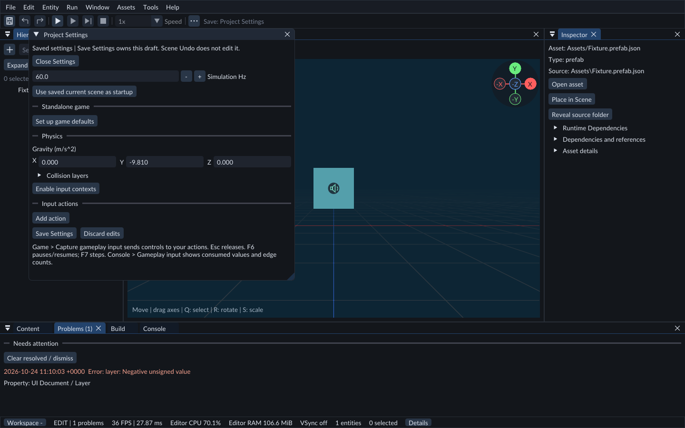
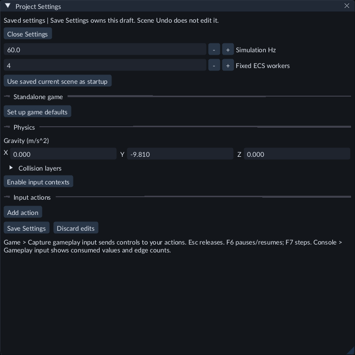

# Project settings

Project settings define shared game behavior. Open **Tools → Project Settings**. Your dock layout, interface scale, tooltips and compiler paths remain personal editor preferences.

Choose a saved startup scene and configure the game defaults before exporting.

## Change simulation frequency

1. Stop Play and wait for any native build to finish.
2. Open **Tools → Project Settings**.
3. Change **Simulation Hz** to a value from **1 to 240**.
4. Click **Save Settings**.
5. Start Play and check **Console → Fixed**.

The default is 60 Hz. Step still advances exactly one tick; at 120 Hz that tick represents 1/120 second. Settings apply when you next start Play. Saving settings does not alter scene Undo/Redo or the authored scene.

## Use fixed ECS workers

1. Stop Play and open **Tools → Project Settings**.
2. Set **Fixed ECS workers** to **1–16**. The count includes the calling owner thread; 4 means that thread plus three workers.
3. Click **Save Settings**, then start Play again.

The default is 1. Extra stages run only C++ systems explicitly declared
`multi_threaded()`. Ordinary systems and engine services retain their thread
ownership. Increasing this setting alone may add overhead without making a game
faster. Compare the same workload and choose the lowest useful count.

Step still advances one fixed tick, and Pause stops fixed gameplay. Live property
edits apply between ticks. Save the setting before export and use a matching
runtime kit; an older kit without worker support is rejected. Players do not
need a compiler. See [Write a worker-safe system](native-gameplay.md) and
[Profiling limits](performance.md).

## Choose the startup scene

Save your current scene, then click **Use saved current scene as startup** and **Save Settings**. FORGE stores the scene's asset identity. Moving its file inside the project does not change that identity. Copying a scene file by hand can create duplicate identities and makes startup ambiguous; use the editor's Save scene As... workflow for an independent scene.

## Configure controls

The **Input actions** section defines project actions and their bindings. See [Gameplay input](input.md) for an exact walkthrough and [Touch input](touch-input.md) for contact controls.

## Save and discard

**Save Settings** validates the complete candidate before atomically replacing `forge.project.json`. Invalid frequency, bindings or startup references leave the previous configuration intact. An externally changed manifest is rejected; reopen the project before editing it again.

**Discard edits** restores the currently loaded settings and clears the draft's
validation error. Closing an unsaved window asks Save, Discard or Cancel. **Cancel**
keeps the draft and its diagnostic so you can correct it. Scene Undo does not undo
project settings.

Older version-1 manifests are read without replacing them. The first settings save writes version 2 and retains `forge.project.json.v1.backup`. Unknown fields are preserved. Unsupported future versions are rejected.

See also [Projects](projects.md), [Play mode](play-mode.md), and [Settings and appearance](settings.md).

## Gravity

**Physics → Gravity XYZ** controls acceleration for the next Play runtime. The default is (0, -9.81, 0) m/s². Unknown project settings remain preserved. See [Physics](physics.md).

## Save the active settings draft

The window title gains an asterisk and shows **Unsaved settings** after an edit. Ctrl+S saves these settings while this task is active. Closing or switching project asks **Save Settings**, **Discard**, or **Cancel**. A validation failure keeps the draft open. Scene Save and scene Undo/Redo do not own project settings.

There are at most 64 input actions and 16 bindings per action. Add controls disable and explain the limit when reached. Settings take effect on the next Play.

## Standalone game defaults

**Set up game defaults** creates the configuration for your standalone game.
**Game defaults** then exposes the game title, stable application ID, window mode,
resolution, display index, VSync, Master/Music/Effects/Dialogue volumes,
[custom audio buses and sends](audio.md), and mouse sensitivity. **Save
Settings** publishes the draft; **Close Settings** asks what to do with unsaved
changes. These settings have separate ownership from scene Undo.

Keep the application ID unchanged across builds to retain access to the same player
saves/settings. Choose the saved startup scene here, then use
[Run > Export Game](runtime-content.md) to assemble a standalone folder.
