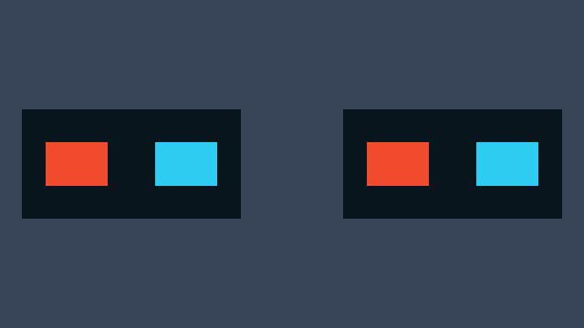
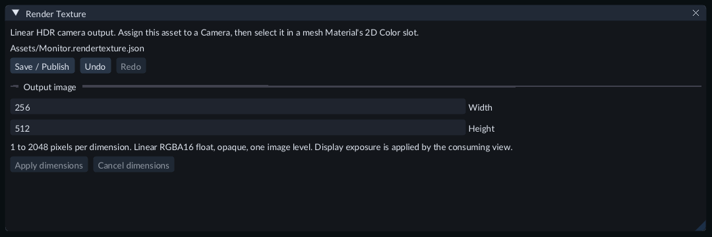

# Show a camera image on a mesh

A render texture is a saved output image configuration. A Camera draws into it;
a Material displays that live image on a Mesh. Use it for a monitor, a split-screen
display or a camera looking at another monitor. The Camera's view changes as the
scene moves. The image pixels are recreated when the scene runs.

## Try the example

Open **Scenes/152-camera-render-textures.scene.json** in the
[Feature Gallery](../getting-started/feature-gallery.md) and press Play. The left
monitor combines two cameras viewing rotating red and cyan cubes. A third camera
views that monitor and sends its image to the right monitor. The main Camera
shows both monitors. No project C++ compiler is required.

The left monitor combines two Cameras. The right monitor receives a Camera image of the left one.

The source cubes use **Layers = 1**, the left monitor uses **Layers = 4**, and the
right monitor uses **Layers = 8**. Select a Camera to inspect its layer mask,
viewport and **Render texture** assignment. These masks keep a producer from
looking at its own output.

## Create an output image

1. Stop Play and open **Content → Create / Register → New render texture...**.
2. Enter a new project-relative path ending in `.rendertexture.json`, such as `Assets/Monitor.rendertexture.json`. Its folder must already exist.
3. Choose **Create**. The **Render Texture** document opens.
4. Enter **Width** and **Height**, from 1 to 2048 pixels each. Choose **Apply dimensions** to record both values as one Undo step. **Cancel dimensions** restores the current document values.
5. Choose **Save / Publish**. Wait for publication to finish before assigning the output.

Set the output size, then publish the image configuration.

Double-click the asset in Content to reopen it. Source Undo and Redo affect this
document. Saving its configuration does not save a still image of the camera.

## Connect a Camera and Material

1. Create source geometry and a Camera through **Entity → Create → Rendering → Camera**. Position the Camera to see the geometry. Give the geometry **Mesh Renderer → Layers = 1** and the Camera **Layers = 1**.
2. In the Camera's Inspector, assign the published asset to **Render texture**. An empty assignment sends that Camera to the main Game output.
3. [Create a Material](materials.md) with **Shader model = Unlit**. Expand **Texture slots → Base Color Texture** and select the output in **Render texture**. Choose **Save** to publish the Material.
4. Create a Quad, assign that Material to its Mesh Renderer, and set **Layers = 2**. Position it where the game's main Camera can see it.
5. Add a separate main Camera, leave its **Render texture** empty, and set **Layers = 2**. Keep the producer Camera's mask at 1 so it cannot see the Quad.
6. Save the Scene and press Play. The Quad displays the producer's image. Stop Play before changing saved assignments.

Use a lit Material if the monitor should respond to scene lighting. **Unlit** is
convenient when the displayed image should remain readable without receiver lights.
The producer uses authored scene lights and lighting settings. The Scene toolbar's
**Preview light** only lights the navigation view.

## Combine or relay camera images

Assign the same output to several Cameras to compose them by **Order**, then
entity identity when orders match. **Viewport X**, **Viewport Y**, **Viewport Width**
and **Viewport Height** describe normalized output rectangles. For two equal
halves, use Width 0.5 for both and X 0 and 0.5. Each Camera retains its own color
and depth clear settings. Its automatic aspect follows that output rectangle.

A Camera can view a Mesh displaying another output. Keep its own output out of
its visible layer mask. All required images are drawn in dependency order during
the same frame. Camera Shot controls choose main-output Cameras; they leave
independent output producers running.

## Save and export

Publish each output and its dependent Materials, save the Scene, and select it as
the startup scene before [exporting the game](runtime-content.md). After resizing
and publishing an output, reopen and save its dependent Materials before export.
Export checks their recorded dependency revisions and rejects an outdated binding.
The exported game recreates the live images from the saved configuration and Cameras.

## Limits and troubleshooting

A scene view supports at most four enabled outputs, sixteen producer Cameras and
4,194,304 output pixels in total. Images are opaque linear HDR, two-dimensional,
single-layer and have one image level. The consuming view applies display exposure
and tone mapping. Transparent output, mip chains, arrays and cubemap outputs are
unavailable.

Render textures fill 2D Color slots on Mesh Materials. Sprite, Tile Map, particle,
Decal, environment and light-image inputs require their existing static resources.
During Play, [Runtime UI](runtime-ui.md) can explicitly
select this output through **UI Document → Render Texture**. It draws after all
producer Cameras and before image consumers. Main-window UI and editor overlays
stay separate. Mesh clicks do not provide input to output UI. An isolated Material
preview has no scene Camera producer; inspect the Material on a Mesh in Game.

A Mesh uses its own UV coordinates to display the image. If text is upside down,
correct that Material's texture UV transform rather than changing the Camera.
The Gallery154 monitor Materials use UV offset `(0, 1)` and scale `(1, -1)` for
their primitive surfaces.

Check **Problems** for a missing producer, unpublished configuration or feedback
cycle. Ensure the producer Camera is enabled and its layer mask excludes every
Mesh displaying its own output. A chain must not loop back to an earlier output.
Unavailable or cyclic images cannot reuse old pixels as the current frame.
Camera frustum guides use published dimensions; an unavailable configuration hides
the frustum until it is ready. A fixed Camera aspect remains authoritative.
