# Runtime UI

Runtime UI is the interface shown **inside your running game**: HUDs, menus, buttons and text fields. FORGE uses RmlUi for it. The editor's own panels still use Dear ImGui.

## Create your first HUD

1. Open a writable project. In **Content → Create / Register → Runtime UI**, click **Create HUD example**.
2. Create or select an entity in the Hierarchy panel.
3. In **Inspector → Components**, click **+ Add Component → Runtime UI / UI Document**.
4. Use the **Document** asset picker to select the new `Assets/UI/HUD-…/hud.rml` asset. Keep **Enabled** and **Visible** checked.
5. Save, then press **Play**. The Game viewport shows a styled panel, image, simulation tick, pause state, buttons and a text field.
6. Turn on **Capture gameplay input** in the Game controls to interact with the HUD.

The example creates three files: `hud.rml` for content, `hud.rcss` for appearance, and `badge.tga` for the image. You do not need to enter an asset UUID or write C++.

## Try the buttons and text field

Click **Pause**. The tick counter stops, but the HUD stays interactive. Click the text field and type; gameplay keyboard actions should not fire while the field owns your input.

Click **Step** while paused: the counter advances by one. Click **Resume** to continue. **F6** pauses/resumes, **F7** steps while paused, and **Escape** releases game input so you can use the editor again.

For slow motion, a button can use `data-event-click="command('TimeScale','0.5')"`.
Use `1` for normal speed or `0` to hold motion while keeping the HUD interactive.
Values must be numeric strings between 0 and 4. This changes simulation speed; it
keeps existing sound at normal speed. The original Gallery58 Scene includes six
working speed buttons and can be exported without a C++ gameplay module.

UI capture clears held gameplay controls to prevent stuck movement. Release and press a movement key again when returning from a field to gameplay.

Resize the viewport and editor window. The HUD remains positioned within the game image. Ctrl+Plus/Minus changes the editor interface independently; it is not a game HUD zoom control.

## Use your own document

Put an `.rml` file and its resources inside the project. Enter its project-relative path in **Content → Create / Register → Runtime UI → Project UI file**, then click **Register / Refresh**. Assign it through the Document picker.

RML resembles HTML; RCSS resembles CSS, but this is not a web browser. Link each stylesheet from the document:

```xml
<rml>
<head><link type="text/rcss" href="hud.rcss" /></head>
<body>
  <p>Tick: {{tick}} — Paused: {{paused}}</p>
  <button data-event-click="command('Pause')">Pause</button>
</body>
</rml>
```

A simple stylesheet:

```css
body { font-family: Lato; font-size: 18px; color: #edf3fa; }
button { padding: 8px 12px; background-color: #34597b; }
button:hover { background-color: #477da9; }
```

FORGE supplies the data model automatically; omit `data-model` attributes. `tick` and `paused` reflect gameplay state. Add [UI Values](sequence-ui.md) on the same entity to supply named numbers without C++. Project C++ can publish additional scalar values and register commands. The included pause/step example works without it. Events request changes from gameplay. A text field's local contents are transient and do not automatically change game state.

For translated menus, use a [UI Localization catalog](ui-localization.md) and
`{{ 'message_key' | tr(forge_locale) }}`. Its language command works without
project C++, including while paused. This catalog stores literal messages;
editor translation and parameter/plural formatting are unavailable. Supported
script runs can use the optional [Shape UI text](ui-text-shaping.md) setting;
full paragraph bidirectional layout remains unavailable.

For menus and state-driven choices, use [Application States](application-states.md).
Its read-only state bindings, ancestor conditions and revision-checked `forge.state`
buttons work without a project C++ module, including while paused.

## Draw UI in a Camera image

1. Create and publish a [Render Texture](render-textures.md). Assign it to an enabled Camera, and display the image through a Mesh Material.
2. Select the UI entity. In **Inspector → UI Document → Render Texture**, select that same output asset. Leave this field empty for an ordinary main-window HUD.
3. Keep **Document**, **Enabled** and **Visible** assigned as usual. Save the Scene and press **Play**. The document draws over the complete output image after its Cameras, before Materials and other Cameras read the image.
4. Add [UI Values](sequence-ui.md) to bind numbers to its text or styles. These values and the built-in `tick` / `paused` bindings work on the output too.

Open **Scenes/154-camera-output-ui.scene.json** in the Feature Gallery for a
working example. Both monitors show the telemetry panel; the second monitor reads
it through another Camera during the same frame. The guide stays on the main Game
view. Pause, select **Telemetry - UI in Split camera output**, and change
**Live gameplay → UI Values → amount** between `0` and `1` to fade the panel.
Use the ordinary Keep runtime values review if you want to retain a live change.

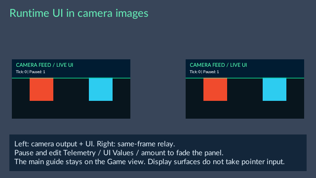

The same telemetry panel reaches the direct monitor and its camera relay.

Each output uses its published width and height. RCSS `px` and `dp` both correspond
to output pixels, independently of editor/window scale. Higher **Layer** values
place documents above lower ones on the same output. One UI Document chooses one
output; use another entity to display another copy.

Output images become interactive when their display mesh has **UI Surface Input**. Without that component they remain display-only.
The output must have an enabled Camera producer; assigning UI alone creates no
image. Runtime UI draws during Play and standalone gameplay; it is not drawn in
the stopped Scene view or stopped animation frame exports.

Save the UI resources, Scene and output/Material publications before exporting.
Use the runtime kit packaged with your editor; an older kit without output-UI
support is rejected. The exported game includes the reachable RML resources and
recreates the image. UI focus, animation progress and live values are not saved
unless an existing save/review workflow explicitly retains them.


## Interact with UI on a scene surface

1. Set up a Camera output and UI Document as described above. Keep the producer Camera's layers separate from the display surface to avoid feedback.
2. Display that output using **Engine / Quad**. Assign an ordinary unlit Material with **Opaque**, **Double sided**, **Depth test** and **Depth write** enabled. Its only texture must be the output in **baseColorTexture**, using **Color**, **2D** and **UV0**.
3. Use identity UVs, or a complete axis flip: scale `-1` with offset `1` on the flipped axis. For an upright panel, set Y scale to `-1` and Y offset to `1`. Cropping, rotation, repeating image regions, programmable Materials and deformed geometry are outside this interaction profile.
4. Select the Quad, click **+ Add Component**, choose **UI Surface Input** under **Runtime UI**, and assign the same output in **Render Texture**. Leave **Geometry** at **Quad** and **Enabled** checked. Save the Scene and published resources.
5. Press **Play**, open **Game**, and capture gameplay input. Click the displayed controls. A focused text field accepts keyboard text; navigation acts on the focused output. Main-window UI takes precedence over surfaces under an uncaptured pointer.

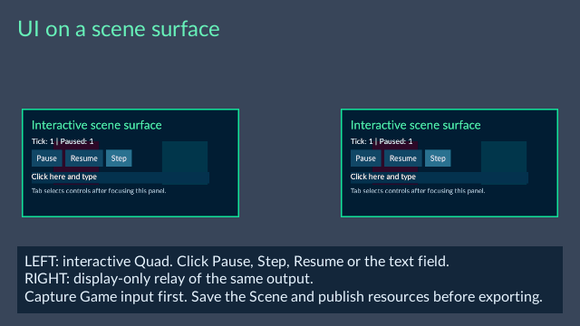

The left panel accepts native UI input; the right monitor relays its current image.

The surface uses the output's pixel dimensions. Pointer coordinates follow the
retained displayed pose, Material UV flip and Game Camera viewport. A pressed
control keeps its surface through dragging outside the Quad, until release.
Removing or hiding the surface, losing its output producer, replacing the Scene
or leaving the Game view cancels its input. Native focus and field text are
transient; save authored UI Values or gameplay state through their normal owners.

Geometric Mesh, Sprite and Tile Map blockers prevent a new surface hit. This is a
geometric query: transparent holes, one-sided culling and transient particles do
not provide pixel-accurate hit masks. Editor selectability does not disable Game
UI input. Separate split-screen Game viewports are supported; overlapping Camera
viewports reject ambiguous surface input. The profile supports up to 64 enabled
surfaces per Scene. Free-space3D UI layout is unavailable.

If a control does not respond, check **UI Surface Input → Render Texture** against
the Material and UI Document output, producer Camera layers, the supported
Material settings and **Problems**. UI Source documents use native RCSS
`pointer-events` and keyboard focus rules; use `tab-index:auto` on navigable
buttons. Runtime UI is interactive during Play and in exported games. Save the Scene and sources, select the intended startup Scene in Project
Settings, and export with the runtime kit packaged with this editor; old kits without surface
input support are rejected.

### Use an animated or custom mesh

Open **Scenes/177-animated-mesh-ui.scene.json** in the Feature Gallery, press
**Play**, and capture Game input. The left panel is an original two-part bent
mesh with a support joint and **Bend** morph. Click **Pause**, **Step**, **Resume**
or the text field. Step advances its animation once while the UI stays usable.
The right monitor displays the same output image.

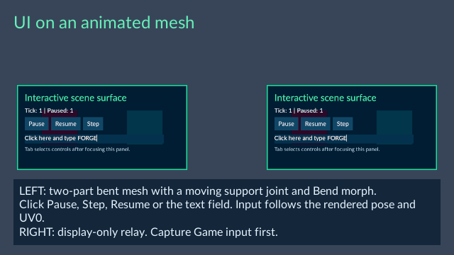

The left mesh accepts controls and text; the right monitor relays the camera image.

To use your own mesh, follow the output and Material setup above, then set
**UI Surface Input → Geometry** to **Mesh**. Use triangle parts with **UV0** laid
out inside the complete image, from 0 to 1 on both axes. Every part and LOD must
have usable UV triangles and the supported output Material. Multiple parts may
share that output. Skin and morph animation, and supported wind on static meshes,
use the displayed pose.

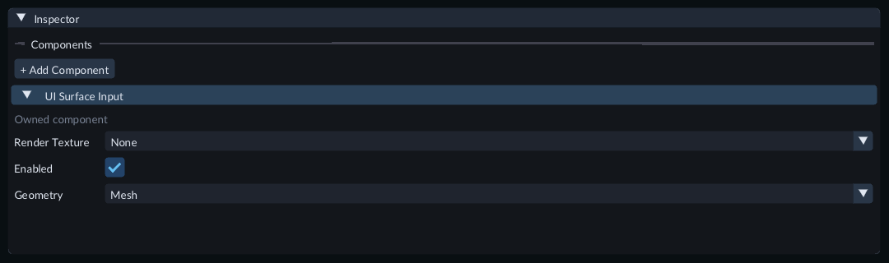

Choose **Mesh** in **Geometry**, then assign the published output in **Render Texture**.
The unassigned field shown here does not provide input yet.

Keep UV islands from overlapping at different positions on the mesh. Such a
point has no unique input target, and controls there do not accept input. UV
holes and triangles with collapsed UVs cannot provide controls. Repeated/cropped
images, other UV channels and custom programmable Materials are unsupported.
See **Problems** for profile errors. Large meshes share a bounded work allowance
with surface lookup and blockers; simplify the interactive geometry if queries
exceed it.

Dragging can continue beyond the image on the last triangle's plane. Replacing
its mesh, changing the selected LOD or switching **Geometry** cancels that gesture.
Text caret positioning follows the current UV mapping across parts. Runtime text
and focus remain transient. Save the Scene and published model/UI resources before
exporting, and use the runtime kit packaged with this editor for mesh input.

## Animate your HUD

Open **Scenes/100-ui-animation.scene.json** in the Feature Gallery and press **Play**.
The blue bar changes width and opacity, and the yellow marker moves horizontally.
Capture gameplay input and click **Pause**: the tick counter stops while both
animations continue. Click **Resume** to change the state panel's color smoothly.
Hover a button to see its color transition.

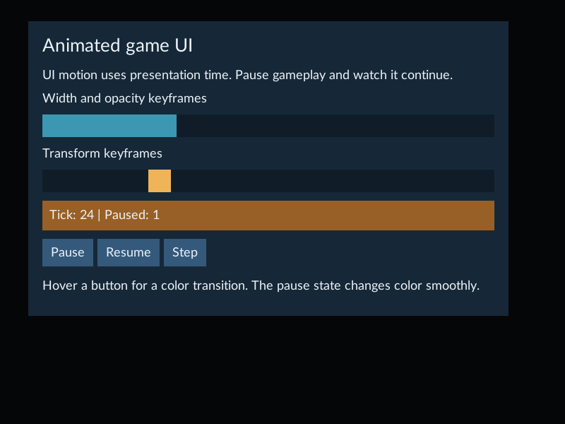

The gallery HUD keeps moving while the paused tick counter holds.

RCSS motion belongs to the document's stylesheet. It uses presentation time,
so gameplay pause and simulation speed do not control it. It is separate from
Scene objects' Animation Timeline. To animate a bound number with sequence time, use [UI Values](sequence-ui.md). Edit the gallery's **Assets/UI/Motion/hud.rcss**
in a text editor to change the duration, endpoint values or colors. Save, then use
**Reload UI** in the Game controls. A successful reload restarts the document's
animations; an invalid replacement keeps the previous usable UI and shows a
diagnostic. Gameplay state stays intact.

For a repeating width and opacity animation:

```css
#meter { display:block; height:24px; background-color:#48b6d5;
         animation:1s linear-in infinite alternate meter-motion; }
@keyframes meter-motion {
  from { width:40px; opacity:0.2; }
  to   { width:240px; opacity:1; }
}
```

For a state-driven transition, add `data-class-paused="paused"` to an RML element:

```css
#state { background-color:#285a74;
         transition:background-color 0.4s linear-in; }
#state.paused { background-color:#986026; }
```

Use RmlUi timing names such as **linear-in**, **cubic-in-out** and **sine-in-out**;
plain `linear` is not an accepted timing name. The gallery demonstrates width,
opacity, color and translation. Keep animated sizes inside the viewport and avoid
having multiple animations control the same property. UI animation is intended
for visual feedback, not precise gameplay timing: long presentation gaps advance
an animation by at most 0.1 seconds per update.

Save the Scene and select it as startup before exporting. The game includes the
required RML and RCSS through the normal content package. This example needs no
C++ module or compiler. Transient animation progress is not saved in the Scene.

## Apply blur and color filters

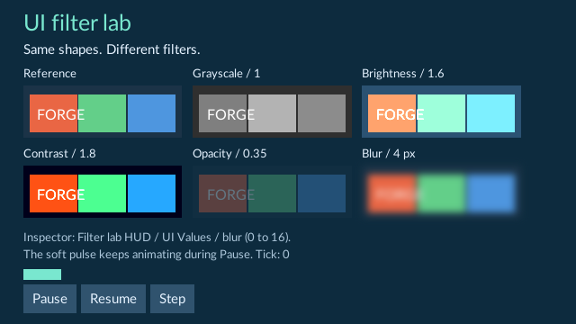

The Game view keeps the sample labels sharp while each panel filters its own shapes.

Open **Scenes/155-ui-filters.scene.json** in **Examples/FeatureGallery** and press
**Play**. Compare the reference shapes with grayscale, brightness, contrast,
opacity and blur. Pause, select **Filter lab HUD**, and change **Live gameplay →
UI Values → blur** between `0` and `16`. The blur sample updates while the fixed
gameplay tick stays held. The small soft pulse keeps animating on presentation time.
Stop returns the live value to its saved setting.

Edit **Assets/UI/Filters/Lab.rml** through the Content source workflow or a text
editor. Filters belong in an element's RML inline style or linked/embedded RCSS:

```css
#panel { filter: blur(2px) contrast(1.2); }
```

Filters apply to the element and its descendants in the written order. Put a label
outside that element if its text should stay sharp. A named UI Value can control a
filter with `data-style-filter="'blur(' + blur + 'px)'"`. Use a saved **UI Values**
component for the initial value and the live Inspector to try changes during Play.
Avoid having a binding and an animation control the same filter property.

- `blur(2px)`: standard deviation from `0` to `16` resolved pixels.
- `opacity(0.5)`: `0` to `1`.
- `grayscale(1)`: `0` to `1`.
- `brightness(1.5)`: `0` to `4`; `1` keeps the original brightness.
- `contrast(1.5)`: `0` to `4`; `1` keeps the original contrast.

Chains support up to eight filters and four nested filtered layers. Blur softens
pixels within the target image; content beyond the image edge is unavailable.
Large viewports and nested effects use more temporary image memory. Unsupported
filters, excessive values or resource limits report a problem. **Reload UI** keeps
the previous usable UI when a replacement fails. Correct the source and reload.

Filters also work in UI assigned to a camera image. Save the sources and Scene,
select the Scene as startup, and export with the runtime kit supplied with this
editor. An older kit without filter support is rejected before replacing an
existing export. No C++ module is needed. Drop shadows use the workflow below;
backdrop filters and linear gradients use the workflows below. Alpha masks and box shadows use the workflows below. Other shader decorators are unavailable.

## Add a drop shadow

Open **Scenes/162-ui-drop-shadows.scene.json** in **Examples/FeatureGallery** and
press **Play**. Compare the reference, hard, left-offset, soft, stacked and live
samples. Shadows follow the rendered alpha of the element and its descendants.
The original content stays above its shadow.

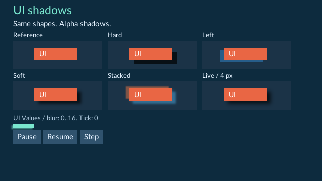

The small shadow pulse animates on presentation time, including while Pause holds
the fixed gameplay tick.

1. Pause, then select **Shadow lab HUD** in Hierarchy.
2. Under **Live gameplay → UI Values**, change **blur** between `0` and `16`. Watch the **Live** sample soften. `0` gives a hard shadow.
3. Stop to restore the saved value. Set **UI Values → blur** in Edit and save the Scene to keep a new initial value.
4. Edit **Assets/UI/Shadows/Lab.rml**, save it, and use **Reload UI** during Play to try source changes.

A filter uses color, horizontal offset, vertical offset and blur sigma:

```css
#badge { filter: drop-shadow(#20408080 8px 6px 2px); }
```

This casts a partly transparent blue shadow, eight resolved pixels right and six
down, with sigma two. Negative offsets move left or up. Each offset must stay
between `-128` and `128`; sigma must stay between `0` and `16`. Color includes its
own alpha. A transparent shadow adds nothing. Keep model-bound values in range.
This `filter` follows the rendered alpha, including descendants. To shadow the element’s border box, use the box-shadow workflow below.

Chain filters in the desired order. A second shadow receives the result of the
first, including its shadow. Opacity before or after a shadow can therefore give
different results. Filtered layers share the nesting, memory and image-edge
limits above. Content and blur tails outside the target image are unavailable.

Drop shadows also work in UI assigned to a camera image. Save the sources and
Scene, select it as startup, and export with the runtime kit supplied with this
editor. An older incompatible kit rejects before replacing an existing export.
The same saved UI Values and source animation run in the exported game.

## Filter the background behind a panel

Open **Scenes/163-ui-backdrop-filters.scene.json** in **Examples/FeatureGallery**
and press **Play**. The cards compare reference colors, backdrop blur, grayscale,
contrast, a foreground filter and a live backdrop. Text above a backdrop filter
stays sharp. The **Foreground** card applies its blur to its own text and surface.

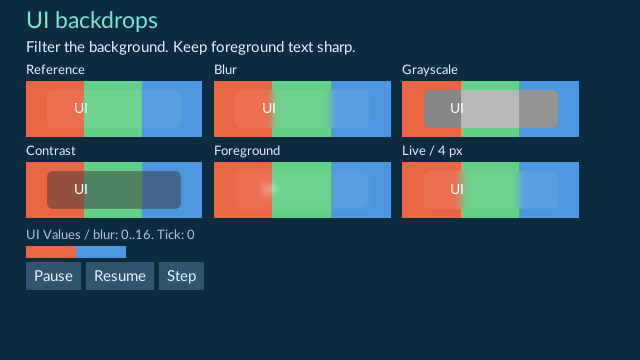

The colored bar beneath the cards animates its backdrop blur on presentation time.

1. Pause, select **Backdrop lab HUD**, and change **Live gameplay → UI Values → blur** between `0` and `16`.
2. Watch the **Live** card's background soften while its text stays sharp. `0` removes the blur.
3. Stop to restore the saved value. Change **UI Values → blur** in Edit and save the Scene to keep a new initial value.
4. Edit **Assets/UI/Backdrops/Lab.rml**, save, and use **Reload UI** during Play for source changes.

Apply a backdrop filter to a transparent or partly transparent panel:

```css
#glass {
    background-color: #ffffff10;
    border-radius: 6px;
    backdrop-filter: blur(3px) brightness(0.8);
}
```

The panel samples content already drawn behind it in the current target. Its own
background, border, text and children draw above that result. A fully opaque panel
can cover the filtered background. Its border box and rounded corners constrain
the backdrop result; parent clipping also applies. Objects drawn later are not
part of that backdrop.

Backdrop chains use the same supported filters and ranges as ordinary filters.
Use `data-style-backdrop-filter="'blur(' + blur + 'px)'"` for a named UI Value.
Keep bindings and keyframes for a property separate. An ordinary `filter` on the
same panel processes the combined backdrop and panel contents afterward.

Backdrop work consumes temporary layers from the shared image budget. A panel
with both kinds of filter uses more layers; deep combinations can reach the
four-active-layer limit with fewer than four panels. Reduce nesting or effects
when admission reports a limit. Target-edge pixels and blur tails outside the
current image remain unavailable. Correct an invalid source and **Reload UI**;
a rejected replacement keeps the preceding usable presentation.

Save the sources and Scene before export and use the runtime kit supplied with
this editor. Older kits without backdrop support reject before replacing an
existing export. Main Game UI and UI assigned to camera images use this workflow.

## Add a linear gradient

Open **Scenes/164-ui-linear-gradients.scene.json** in **Examples/FeatureGallery**
and press **Play**. The cards show horizontal, vertical, multiple-stop,
transparent, repeating and live-angle gradients. The small bar below them changes
angle on presentation time, including while simulation is paused.

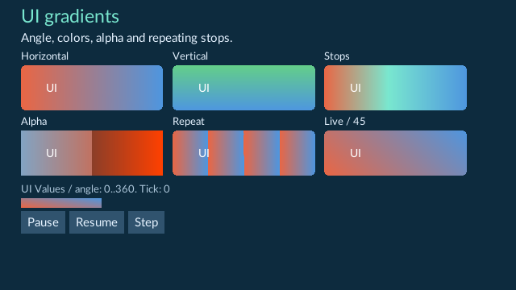

Apply a gradient with the `decorator` property:

```css
.panel {
    width: 240px;
    height: 80px;
    decorator: linear-gradient(90deg, #e96644 0%, #79e7cf 45%, #4e96df 100%);
}
.stripes {
    decorator: repeating-linear-gradient(90deg, #e96644 0%, #4e96df 25%);
}
```

An angle of `90deg` runs left to right; `180deg` runs top to bottom. Supply two
through sixteen stops, with optional positions. Alpha in a color fades into the
content already behind the panel. Rounded borders and parent clipping apply.
For a two-color alternative, use `horizontal-gradient(#e96644 #4e96df)` or
`vertical-gradient(#e96644 #4e96df)`; these forms separate colors with a space.

In the gallery, select **Gradient lab HUD** and change **UI Values → angle**.
During Play, use its live tuning controls to try `0`, `45`, `90` and `180`.
The source binds that value with:

```html
<div data-style-decorator="'linear-gradient(' + angle + 'deg,#e96644,#4e96df)'" />
```

Live tuning affects the current session. Stop Play and edit the authored value to
keep it, then save the Scene. Source keyframes can animate compatible gradient
angles and stops; keep a binding and keyframes off the same property.
Register or refresh edited RML/RCSS through **Content**, then **Reload UI**.
An invalid replacement keeps the last usable UI and reports a problem.

Use finite stop positions in nondecreasing order. Resolved endpoints
use finite coordinates within ±65,536 pixels. Resolved stop positions, measured
relative to the gradient line, are bounded to ±65,536. The line must have nonzero
length, and a repeating gradient needs a nonzero repeat interval. At most 256 compiled gradient records
can be live across UI contexts. Reduce stops or elements if admission reports a
limit. Radial and conic gradients use the workflow below. Alpha masks use the workflow below. Arbitrary shaders are unavailable.

Main Game UI and UI assigned to camera images use the same gradient source.
Save the sources and Scene, select the startup Scene, then export with the runtime
kit supplied with this editor. An older incompatible kit rejects before replacing
an existing export. No C++ module is needed.

## Add radial and conic gradients

Open **Scenes/165-ui-radial-conic-gradients.scene.json** in
**Examples/FeatureGallery** and press **Play**. Compare the circle, offset ellipse,
repeating rings, conic colors, transparent wedges and live-angle card.

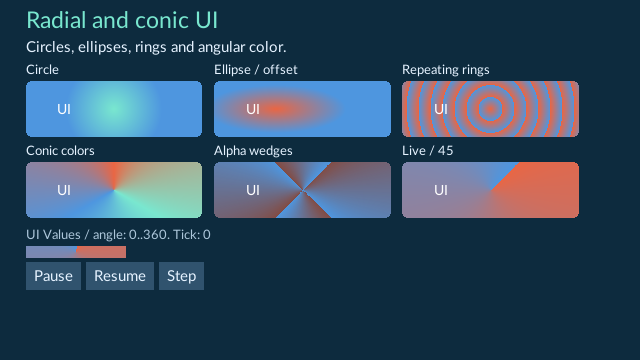

Use `radial-gradient` for circular or elliptical color bands and `conic-gradient`
for color around a center. The following declarations use explicit sizes and
positions:

```css
.circle {
    decorator: radial-gradient(circle 48px, #79e7cf, #4e96df);
}
.ellipse {
    decorator: radial-gradient(70px 24px at 35% 50%, #e96644, #4e96df);
}
.cone {
    decorator: conic-gradient(from 90deg at 50% 50%, #e96644, #4e96df);
}
.rings {
    decorator: repeating-radial-gradient(circle 24px, #e96644 0%, #4e96df 50%);
}
.wedges {
    decorator: repeating-conic-gradient(from 45deg, #e9664480 0deg, #4e96df 90deg);
}
```

A conic angle starts at the top and increases clockwise. `from` rotates that
start, while `at` moves the center. Radial stop percentages are relative to the
resolved radius; conic stops can use angles or percentages of a full turn.
Repeating variants repeat the interval between the first and last stop.
Transparent stops reveal the content behind the element. Parent and rounded
border clipping still apply; narrow or very frequent bands can alias.

Select **Gradient lab HUD** and change **UI Values → angle** in live Play tuning.
Pause to keep simulation fixed while observing the small animated bar. Bind a
saved value through `data-style-decorator`, for example:

```html
<div data-style-decorator="'conic-gradient(from ' + angle + 'deg,#e96644,#4e96df)'" />
```

Use the same register/refresh, **Reload UI**, live tuning, Stop/save and export
workflow as linear gradients. Live tuning changes only the current session.
Main Game UI and camera-image UI share this source path. Export with the supplied
runtime kit; an older kit without these gradient types rejects before replacing
an existing export.

The shared two-to-sixteen-stop and 256-live-record bounds apply across all
shader-backed gradient types. Both resolved radial radii must be between `0.0001`
and `65,536` pixels, centers must stay within ±65,536 pixels, and the resolved
conic angle must be within ±65,536 radians. A repeating interval must be nonzero.
Invalid source or excessive values keep the last usable UI when reloaded.

## Fade or cut out UI with an alpha mask

Open **Scenes/166-ui-alpha-masks.scene.json** in **Examples/FeatureGallery** and
press **Play**. Compare the reference card with linear, radial, conic, PNG and
live-angle masks. The mask applies to both the card and its **UI** text.

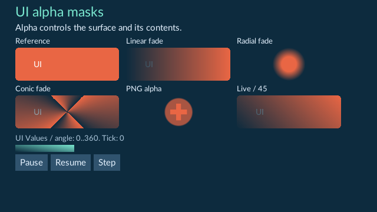

Use `mask-image` with a supported gradient or local image decorator:

```css
.panel {
    background-color: #e96644;
    mask-image: linear-gradient(90deg, #0000, #000f);
}
.round-fade {
    mask-image: radial-gradient(circle closest-side, #000f 45%, #0000 100%);
}
.icon-mask {
    mask-image: image("icons/health.png" contain);
}
```

Opaque mask pixels keep the content; transparent pixels hide it. Intermediate
alpha fades the content into what is behind it. With an ordinary alpha mask, RGB does not determine
coverage: opaque black and opaque white both keep content. Use image alpha,
rather than a black-and-white picture without transparency, to cut out a shape.
Local PNG, JPEG and supported TGA images use the existing UI image rules; JPEG
has no alpha and therefore does not make transparent holes. Paths are relative
to the RML document. Rounded borders and parent clipping still apply.

For an image decorator, register the image, then select the UI document in
**Content**. In **Inspector → Runtime Dependencies**, add the image with expected
type **Texture** and a reason, then **Save declarations**. Observing a file during
preview does not by itself make it required runtime content. Review declarations
again after editing the source. Gallery166 already declares its PNG mask.
See [Runtime content](runtime-content.md) for the complete declaration workflow.

In the gallery, select **Mask lab HUD** and tune **UI Values → angle** during Play.
Pause to keep simulation fixed while the small bar continues its presentation
animation. A source binding can drive the mask with a saved value:

```html
<div data-style-mask-image="'linear-gradient(' + angle + 'deg,#0000,#ffff)'" />
```

Use either a binding or compatible native keyframes for the same property.
Live tuning affects the current session; Stop, edit the authored value and save
the Scene to keep it. Register/refresh edited sources through **Content**, then
**Reload UI**. An invalid replacement keeps the preceding usable UI.

Masks share the filter image budget of 32 cached images and 256 MiB of logical
pixel storage. A mask needs content and mask drawing layers, a retained snapshot
and an intermediate image. They consume the existing four-active-layer bound;
nested masks and combined effects can reach it quickly. A mask also counts as
one entry in the eight-filter chain. Reduce nesting, resolution or effects when
admission reports a limit. The supported gradient stop/radius/angle limits still
apply to a gradient mask. Mask snapshots stay local to one presentation frame;
there is no reusable mask-snapshot asset.

Ordinary filters on the element run before its final alpha mask. Main Game UI
and UI assigned to camera images use the same source workflow. Save the source
and Scene before exporting with the runtime kit supplied with this editor. Older
kits without mask support reject before replacing a preceding export. No C++
module is needed. Luminance masks use the workflow below. Arbitrary shaders are unavailable.

## Mask with image brightness

Open **Scenes/171-ui-luminance-masks.scene.json** in **Examples/FeatureGallery**
and press **Play**. Compare **Alpha / gray** with **Luminance / gray**. The same
opaque gray keeps an alpha-masked panel fully visible and fades a luminance-masked
panel. The other samples show a black-to-white fade, color weights, a PNG mask
and a live angle.

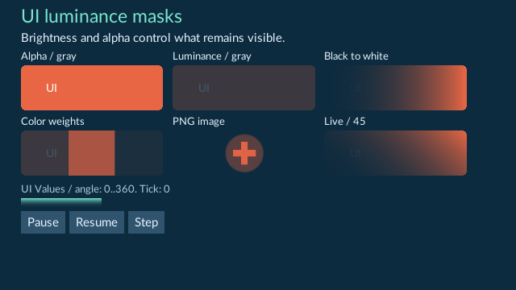

The mask affects each panel and its text. Select **Luminance mask lab HUD** and
adjust **UI Values → angle** in live Play tuning. Pause to keep simulation fixed;
the small bar continues its presentation animation. Stop Play and save an authored
angle to keep that value in the Scene.

In a registered RML or RCSS source, wrap one supported image or gradient in
`luminance(...)`:

```css
.fade {
    mask-image: luminance(linear-gradient(90deg, #000, #fff));
}
.image-mask {
    mask-image: luminance(image("icons/shape.png" contain));
}
```

Black hides the content, white keeps it, and intermediate brightness fades it.
Coverage uses linear RGB brightness multiplied by image alpha. Red, green and
blue contribute different amounts; an opaque display-gray value of 128 gives
about 22% coverage. Fully transparent pixels always hide content. This behavior
is consistent in ordinary and linear-color camera outputs. A normal `mask-image`
without the wrapper continues to use alpha alone.

The wrapper accepts one anonymous image, linear, radial, conic or repeating
gradient. Its inner declaration may contain up to 4096 bytes. Named inner
decorators, a comma-separated inner group and nested `luminance(...)` wrappers
are unsupported. Existing image sizes and gradient limits apply. The wrapper adds
one active drawing layer to the ordinary mask's layers; combined effects can
reach the shared four-layer limit. Reduce nesting or effects when admission fails.

Saved values can drive a mask with the existing model binding:

```html
<div data-style-mask-image="'luminance(linear-gradient(' + angle + 'deg,#000,#fff))'" />
```

Use the usual source editing, register/refresh and **Reload UI** controls.
An invalid replacement preserves the preceding usable UI. For an image mask,
register its image and declare the required runtime dependency on the UI document
using [Runtime content](runtime-content.md). Gallery171 already declares its PNG.
Save the source and Scene before exporting with the current runtime kit. Older
kits without luminance support reject the export before replacing its destination.
No C++ module is required.

## Shadow a panel’s box

Open **Scenes/167-ui-box-shadows.scene.json** in **Examples/FeatureGallery** and
press **Play**. Compare the reference, hard offset, soft offset, spread, inset and
live samples. Box shadows follow the panel’s border box and rounded corners.
Text remains sharp.

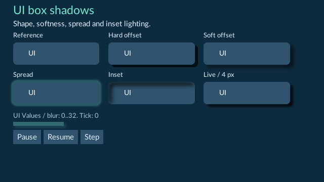

1. Pause, then select **Box shadow lab HUD** in Hierarchy.
2. Under **Live gameplay → UI Values**, change **blur** between `0` and `32`. The **Live** card changes softness; `0` produces a hard shadow.
3. Stop to restore the saved value. Set **UI Values → blur** in Edit and save the Scene to keep a different starting value.
4. Edit **Assets/UI/BoxShadows/Lab.rml**, save, and use **Reload UI** during Play. An invalid replacement keeps the preceding usable UI.

Write color, horizontal offset, vertical offset, blur radius and spread:

```css
#panel { box-shadow: #0008 6px 5px 8px 2px; border-radius: 7px; }
#inset { box-shadow: #000a 5px 5px 8px 2px inset; }
```

Positive offsets move right/down. Positive spread expands an outer shadow and
shrinks the opening of an inset shadow; negative spread reverses that effect.
Keep the resolved blur radius between `0` and `32` pixels. This radius is twice
the blur sigma used by the `filter: blur()` and `drop-shadow()` controls.
Use `inset` to place the shadow inside the panel. A model binding can change the
value during Play:

```html
<div data-style-box-shadow="'#0008 6px 5px ' + blur + 'px 0px'" />
```

Direct `box-shadow` keyframes and transitions are unavailable. For animated
shadow controls, use a shadow panel as described below. You can also animate another
compatible property, such as opacity, or update a model-bound value. The gallery’s small bar
uses an opacity animation; it continues while Pause holds the gameplay tick.

Shadows share the 32-image, 256 MiB logical filter pool and four-active-layer
limit. At most 24 cached shadow textures may remain live across all UI contexts;
distinct shapes and live values can require different textures. Reduce the number
of distinct shadows, document copies, resolution or nesting if a resource limit
is reported. Cached textures retire with their native document/cache references.
A shadow’s internal canvas must fit the current UI viewport: oversized canvases
can be clipped, including in small camera images. Content beyond the image edge
is unavailable. Leave space around panels and check every intended output size.

Main Game UI and camera-image UI use the same sources and model controls. Save
the source and Scene, select the saved Scene as startup, and export with the
runtime kit supplied with this editor. Older kits without box-shadow support
reject before replacing an existing export. No project C++ module is needed.

## Animate a panel shadow

Open **Scenes/173-ui-shadow-motion.scene.json** in **Examples/FeatureGallery** and
press **Play**. The cards show changing color, offset, blur and spread; an inner
shadow; a discrete inset switch; a hover/focus transition; and a live blur value.
Point at **Hover / focus** to change its shadow. Pause gameplay: the UI motion
continues while the simulation tick holds.

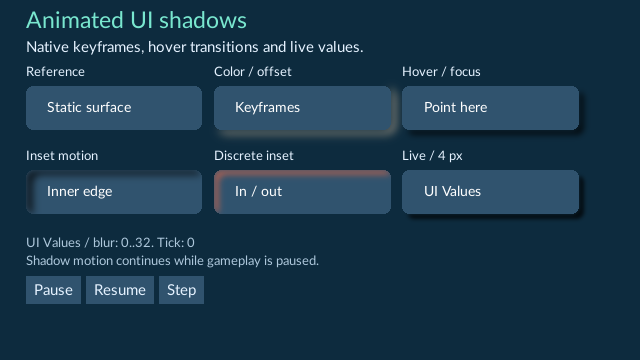

The Color / offset card changes its shadow while the Live card follows UI Values.

1. Select **Animated shadow lab HUD** in Hierarchy.
2. In **Live gameplay → UI Values**, set **blur** between `0` and `32`. The **Live** card changes softness.
3. Stop to restore the saved value. To keep a starting value, set **UI Values → blur** in Edit and save the Scene.
4. Edit **Assets/UI/ShadowMotion/Lab.rml**, save it, then choose **Reload UI** during Play. Successful replacement restarts native animation. An invalid replacement keeps the usable UI.
5. Set this Scene as the saved startup Scene and export with the supplied runtime kit.

Use a `forge-shadow-panel` element with the ordinary native layout and child
content controls:

```html
<forge-shadow-panel id="glow"><p>Ready</p></forge-shadow-panel>
```

```css
forge-shadow-panel { display: block; }
#glow {
    width: 160px; height: 60px; background-color: #30536e;
    forge-shadow-color: #79e7cf80;
    animation: 2s linear-in infinite alternate glow;
}
@keyframes glow {
    from { forge-shadow-blur: 2px; forge-shadow-y: 0px; }
    to   { forge-shadow-blur: 14px; forge-shadow-y: 8px; }
}
```

The controls are **forge-shadow-x**, **forge-shadow-y**, **forge-shadow-blur**,
**forge-shadow-spread**, **forge-shadow-color** and **forge-shadow-inset**.
Lengths default to zero, color to transparent, and inset to `outset`. Set inset to
`inset` for an inner shadow. An inset animation switches discretely. Colors use
native gamma-aware interpolation. Add a native `transition` for these controls
to animate a class, hover or focus change. Keep timing names such as `linear-in`;
plain `linear` is unsupported.

Use ordinary native length units such as `px`, `dp` and `em`; percentages are
unsupported. Resolved lengths must stay within `-8192` to `8192` pixels, and blur
within `0` to `32` pixels. At most 24 shadow panels are admitted per view, subject
to the shared image, snapshot and layer limits above. Reduce distinct shadows or
resolution when those limits are reported. Oversized shadow canvases can clip at
the view edge.

Bind a named UI Value through the existing model:

```html
<forge-shadow-panel data-style-forge-shadow-blur="blur + 'px'" />
```

Use either a binding or animation for a given control. On this element, author
the shadow through these six controls; the element derives its `box-shadow`
value. Ordinary `div` box shadows retain the preceding workflow. Source edits and
saved UI Values are included in export; temporary Live gameplay changes require
the normal tuning review if you want to keep them. Older runtime kits without
shadow-panel support reject the export before replacing its destination.

## Layout your document

RmlUi does not supply a browser's default HTML layout. If a menu collapses into a
narrow strip, give its containers block layout in your stylesheet:

```css
body, div, h1, h2, p { display: block; }
```

Set the sizes and spacing your design needs. Use percentage widths with a maximum
width and scrolling for long menus so controls remain reachable in smaller windows.
The reference game's stylesheet provides a working example.
Scrollable documents must also style native `scrollbarvertical` with an explicit
width; otherwise its auto-sized box can consume the menu content width. The
reference stylesheet includes a visible track and draggable thumb.

## Try the image gallery

Open **Scenes/59-ui-png-jpeg.scene.json** in **Examples/FeatureGallery** and press
Play. The HUD shows a transparent PNG health icon and an original JPEG landscape.
Pause, Resume and Step remain usable in small windows. Export the scene through
the normal Export Game workflow; the required images ship with it.

For your own HUD, place images beside the RML document and use, for example,
``. Register/refresh the document through Content. A UI
image uses the same Texture asset identity as an image imported for a 3D material.
UI displays its source pixels; a material uses its cooked texture settings. Reload
UI applies valid image changes. A bad image keeps the last working HUD and reports
a problem. FORGE does not apply camera orientation tags or image color profiles;
export artwork in the orientation and display colors you want.

## Styles, fonts and images

For supported script joining, ligatures and combining marks, enable the saved
[Shape UI text](ui-text-shaping.md) project setting and use a suitable project font.
For whole-character plain arrow movement and deletion in native text fields,
enable the separate [Edit whole UI characters](ui-text-input.md) setting.

Use document-relative local resource paths. The supplied **Lato** font is packaged with FORGE, so it does not depend on installed system fonts. You may load project `.ttf`/`.otf` fonts using an RCSS `@font-face` declaration, with suitable redistribution rights. Use explicit `font-family` and `font-size`; font shorthand is not supported in this integration. When replacing a font using the same family name, restart Play to clear its font cache.

Images support **PNG**, **JPEG** (`.jpg` or `.jpeg`) and uncompressed true-color **TGA** (24 or 32 bits), at most 2048×2048. Use PNG for transparent icons and JPEG for opaque artwork. Image bytes and decoded pixels have additional limits; very large or high-precision images can exceed them. SVG, remote URLs, templates and stylesheet imports are not supported yet. Link multiple stylesheets individually. Blur and the color filters described above use bounded temporary layers. Drop shadows use the filter workflow above. Backdrop filters use the workflow above. Linear, radial and conic gradients use the workflows above. Alpha and luminance masks use the workflows above. Box shadows use the workflow above. Other shader decorators are unavailable.

`px` means game render-target pixels; `dp` follows display density. The editor's interface scale remains separate. Check text input and sizing on the displays and input languages used by your game.

Font `src` paths are relative to the **project root**, as a FORGE policy for RmlUi 6.3 font declarations. For example, place `game.ttf` at that root:

```css
@font-face { font-family: Game; src: "game.ttf"; }
body { font-family: Game; }
```

## Edit and reload

Stop Play and open a registered RML or RCSS asset from Content using **Edit UI
source**. Edit **Source**, or use **Elements** for widget attributes, leaf text and
structure. Choose **Save source**, then start Play again. See
[Edit a game's UI source](ui-source.md).

You can also edit the file in another text editor, save it, then click **Reload
UI** in the Game controls during Play. FORGE prepares the replacement first. If
it fails, the previous usable HUD remains visible and an error explains the failure.
Reloading clears hover/focus and local text-field contents without restarting
gameplay. UI Source has its own Undo/Redo; source saving and registration are
outside scene history. External file edits do not enter native source history.

## Multiple documents and prefabs

Add UI Document to more than one entity to show multiple documents. **Layer** controls their starting draw order; larger values draw later. Equal layers follow scene order. RmlUi handles normal focus and element ordering within the UI context. Up to 16 documents can be active.

**Enabled** controls whether a document participates. **Visible** hides or shows it without removing the authored component. A hidden document cannot send gameplay commands.

UI Document works with [prefabs](prefabs.md). The document reference, visibility and layer can inherit from the source or be overridden. Property Revert follows the prefab again; scene Undo/Redo restores these edits. the component header’s **Remove component / Revert component** removes local configuration/overrides. UI DOM and local input state are not saved into the prefab.

## When something does not appear

- Confirm Document points to a registered `.rml` asset and Enabled/Visible are checked.
- Read the Runtime UI message in the Game controls. Check balanced tags, linked styles and resource paths.
- Keep resources inside the project; absolute machine paths and web URLs reject.
- Use the packaged Lato family first to distinguish font issues from layout issues.
- Large documents, deep nesting, too many files or oversized images/fonts reject with limits.
- After fixing a file, use Reload UI. If the first document could not load, stop and restart Play.

Stopping Play destroys the live UI. Starting again rebuilds it from the saved configuration and current runtime state. Recovery recreates the UI; unsaved text-field contents and hover state are not restored.

## Try the complete workflow

Create the example, assign it, Play, capture input, Pause, type, Step once and Resume. Resize the viewport, press Escape, Stop, then save/reopen the scene. Finally create a prefab from the UI entity and try a visibility override and Revert. No C++ changes are needed.

See also [Play mode](play-mode.md), [Gameplay input](input.md), [Prefabs](prefabs.md), and [Content browser](content-browser.md).


## UI files in Content

**Register / Refresh** also accepts project RCSS styles, TTF/OTF fonts and TGA
images. Each registered file gets a stable identity; refreshing preserves it.
Select the asset in Content to see its admitted format, source size and source
status. This action validates source admission and records metadata. It does not
load a HUD, replace a live font or cook image data. TGA registration uses the
existing Texture asset type, so it can later use the normal texture import
workflow. An already imported Texture keeps its settings and selected output.

To record the files your HUD actually uses:

1. Run **Play** and show the HUD in Game. Resolve loading errors first.
2. If you edited the files, use **Reload UI** and verify the replacement succeeds.
3. **Stop** Play.
4. Open **Content → Create / Register → Runtime UI** and choose **Refresh loaded resources**.
5. Refresh Content and inspect the document's dependencies and their referrers.

This uses the last successful UI load in this editor session. It records the
files RmlUi read, including linked styles, project fonts and images. With several
simultaneous documents, their observed supporting resources are conservatively
shared in the dependency list. This is not a claim to discover every resource
that a later dynamic UI state might request. Engine-provided Lato has no project
AssetId.

A file edited since that load rejects the metadata refresh; the previous catalog
stays intact. Load the edited HUD successfully before retrying. Switching projects
clears the remembered set. Content source status changes when a recorded source
or dependency differs; that status does not automatically reload presentation.
Use **Reload UI** for RML/RCSS/images and restart Play for changed font families.
The generic asset **Reimport** command is for cooked importer routes and does not
replace this UI workflow. Metadata publication is separate from scene Undo.

## Standalone loading state

In current source builds, a game UI can show the host's scene-loading state
without receiving access to the host or graphics objects. These read-only values
are supplied to every RmlUi document:

- `forge_loading_state`: idle, preparing, loading, ready, activated, cancelled, failed or faulted.
- `forge_loading_stage`: current preparation stage.
- `forge_loading_completed` / `forge_loading_total`: completed stages and total; zero total means no measurable progress yet.
- `forge_loading_error_code` / `forge_loading_error`: failure category and readable reason.
- `forge_loading_can_cancel`: whether the unpublished scene can still be cancelled.

For example:

```html
<div>{{forge_loading_stage}} {{forge_loading_completed}} / {{forge_loading_total}}</div>
<div>{{forge_loading_error}}</div>
<button data-if="forge_loading_can_cancel" data-event-click="cancel_loading()">Cancel</button>
```

Cancellation leaves the currently active scene intact. An old Cancel request
cannot cancel a newer scene request. Progress counts preparation stages, not
bytes or an estimated time. The initial host displays a loading title until its
first UI is ready; an already loaded menu/scene can present later transitions.
The game supplies the loading-screen design. These names are reserved for the
presentation host; do not publish gameplay values under the same names.
