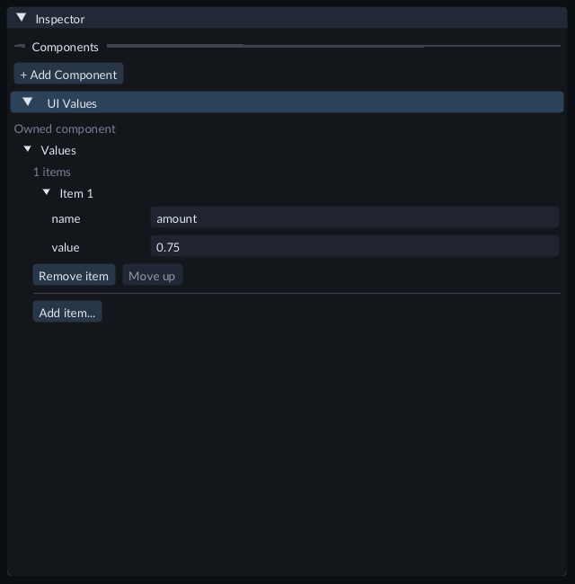
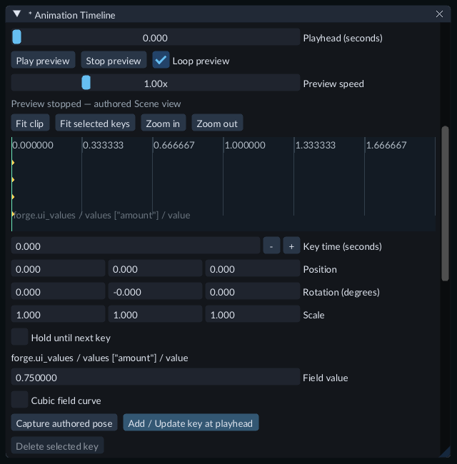
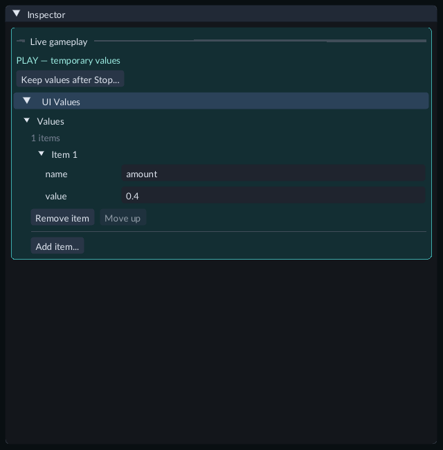

# Animate UI with a Scene sequence

Use **UI Values** to give a UI Document named numbers that you can edit in the
Inspector and animate in the Timeline. RML expressions use those numbers for
text, styles and classes. No project C++ module or compiler is required. Use a Scene with an enabled Camera
and a registered UI Document.

## Try the gallery

1. Open **Examples/FeatureGallery** and **Scenes/151-sequence-ui.scene.json**.
2. Press **Play**. The bar grows, fades and changes color during a four-second loop.
3. Capture gameplay input and click **Pause**. The bar holds; the small pulse continues.
4. Click **Step** to advance one simulation tick, or **Resume** to continue.
5. Stop, select **HUD - keyed Timeline values**, and expand **UI Values** in Inspector.

The root sequence lasts four seconds. A two-second child starts at root time 1s;
its clip animates the HUD's `amount` and `width` numbers. Before and after that
placement, the bar holds the nearest clip endpoint. The pulse is a separate RCSS
animation that uses presentation time.

## Add named values

1. Select the entity containing your **UI Document**.
2. Choose **+ Add Component → Runtime UI → UI Values**.
3. Expand the values collection and choose **Add item...**. Expand **New item** in the popup.
4. Enter a `name`, such as `amount`, and a numeric `value`, such as `0.25`. Choose **Add**.
5. Press Enter to commit later numeric or text edits. Save the Scene.



Expand Values and Item 1 to edit the name and value.

Each component supports up to 16 entries. Names are case-sensitive, unique within
the component and at most 64 ASCII characters. Start with a letter, followed by
letters, digits or underscores. Names such as `amount` and `meter_width` work;
spaces, dots, leading underscores and leading digits do not.

`tick`, `paused`, the `forge_loading_` prefix and native expression words are
reserved. Expression words include `ev`, `false`, `it`, `it_index`, `literal`,
`size` and `true`, ignoring letter case. Localization and Application States also
reserve their own bindings when configured. Values must be finite numbers.

## Bind the document

Edit your RML to consume the same names:

```xml
<p>Amount: {{amount}}</p>
<div id="meter" data-style-opacity="amount"
     data-style-width="width + 'px'"
     data-class-bright="amount >= 0.6"></div>
```

Give the element its normal layout and colors in RCSS. The expression sets
opacity directly, converts `width` to a pixel length and toggles the `bright`
class. Keep values within the supported range of the property you bind; opacity,
for example, uses 0 through 1. Avoid also assigning an RCSS animation or transition
to that same driven property.

Save the files and use **Reload UI** during Play, or restart Play. The existing
[Runtime UI guide](runtime-ui.md) explains document registration, input and reload.

## Animate the numbers

1. Create an animation clip through **Content → Create / Register → New transform animation...**.
2. Choose the UI Document entity as **Preview object** in the Animation Timeline.
3. Expand **Component fields**. Add the UI Values leaf for the name you want to animate, such as `values ["amount"] / value`.
4. Select or add keys, set **Field value**, and choose **Add / Update key at playhead**. Uncheck Position, Rotation and Scale if this clip only animates UI values.
5. Choose **Save & Publish** and **Attach animation to object**. Coordinate its Transform Animator through an [Animation Sequence](animation-sequences.md), then save the Scene.
6. Press **Play** to see the bound UI. Pause and seek the root sequence through its playback controls to inspect a particular time.



Select a key to edit the named number using Field value.

A keyed track follows the entry's name when you reorder the collection. Renaming
or removing that entry breaks its binding; remove the obsolete Timeline field
and add the current one. Animation changes existing values and does not add rows.
Cubic field curves and ordinary held keys use the same clip controls as other
[component fields](transform-animation.md).

The Timeline's numeric fields and copied preview sample the values. Edit-mode
Scene/sequence previews and sequence frame export do not render Runtime UI;
use **Play → Game** to see RML. UI keyframe animation in RCSS remains on its
presentation clock and cannot be scrubbed by a Scene sequence.

## Live changes, saving and export

During Play, edit UI Values under **Live gameplay**. These edits are temporary.
An active animation can replace them at its next sample. Use **Keep values after
Stop...** to review changes, Stop, then apply the selected field to the Scene.
Applying uses ordinary Scene Undo. Save afterward to keep the changes on disk.



The colored Live gameplay section identifies temporary values.

UI Values can inherit from a Prefab and use the normal property override and
Revert workflow. Values belong to each document entity; multiple documents can
use the same entry names independently. Project C++ can also publish copied model
values, but a published name must not collide with a UI Values entry. The combined
copied model supports 32 entries per document, including `tick` and `paused`.

Select the saved Scene as startup before exporting. The normal export includes
the clip, UI Document, stylesheet and named Scene values. The exported game uses
the same sequence timing. Local text input, focus and native CSS animation progress
remain transient and are recreated when the document is replaced or Play restarts.
