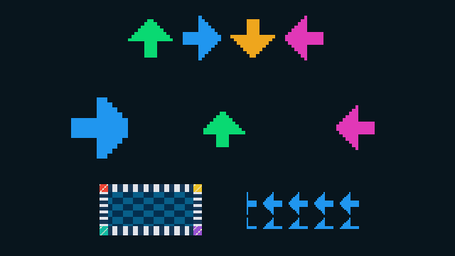
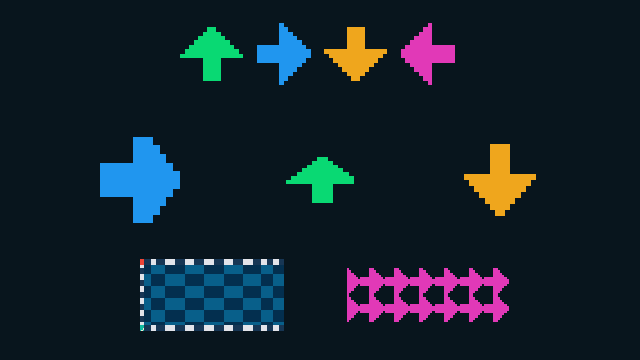
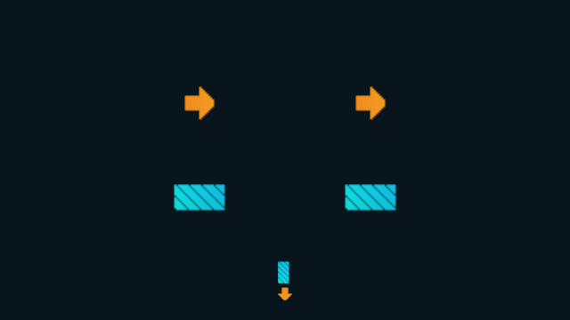
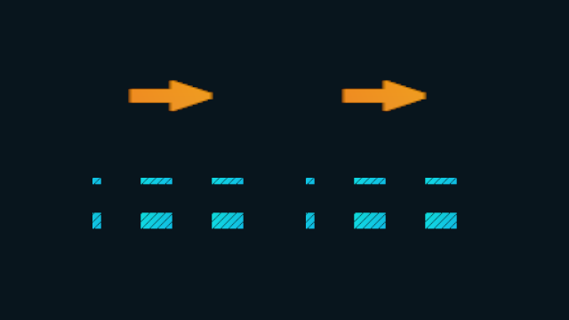
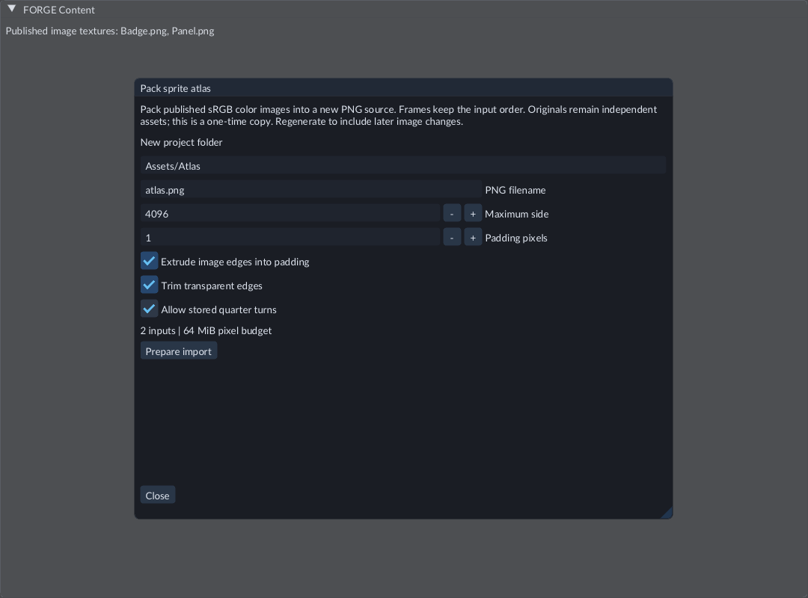
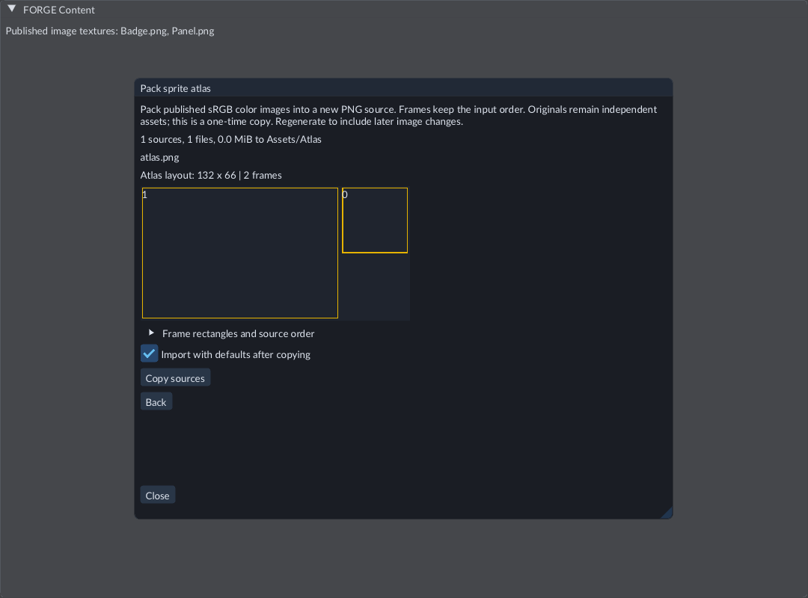
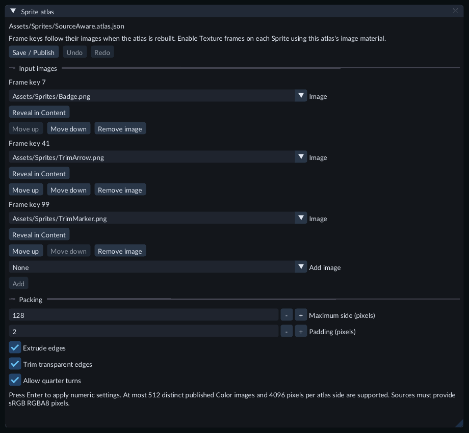
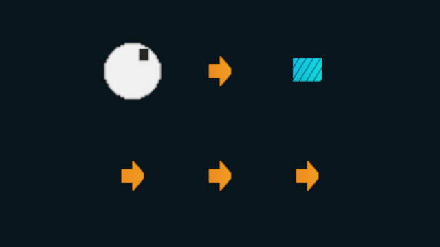
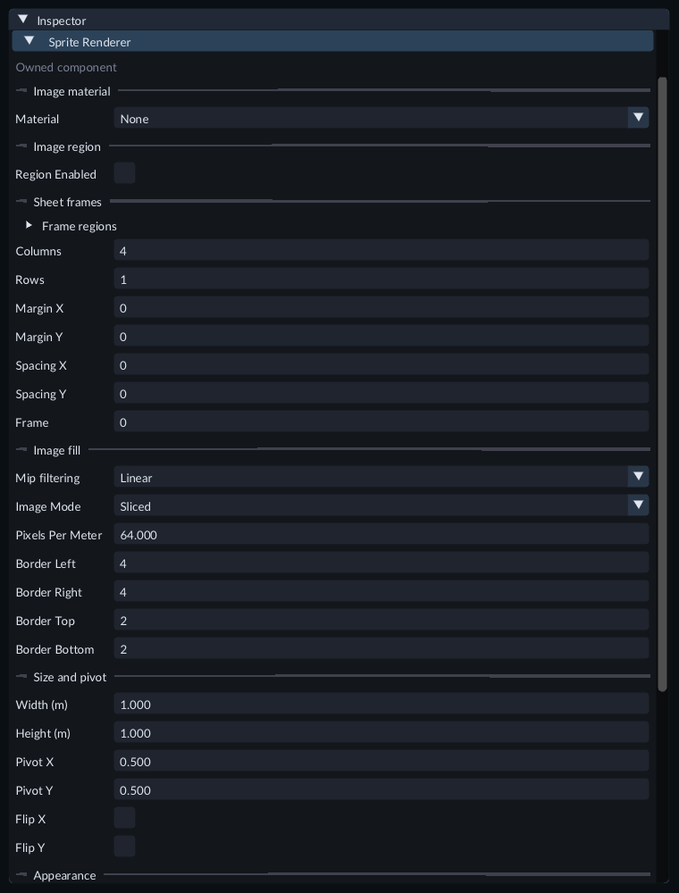

# World sprites and image frames

A Sprite places an image in the scene. It uses the ordinary camera, scene
transforms and Material assets, so it can appear beside meshes and move with a
parent. It does not require C++ code. The Feature Gallery includes editable examples.

Gallery78 compares complete images, cropped regions, animated cells and image fill modes.

## Try the examples

Copy **Examples/FeatureGallery** to a writable folder and open that project.
Open **71-world-sprites** for image sizes, tints, transparency, mirroring and
different pivots. Open **72-sprite-frame-animation** and press Play: the large
arrow cycles up, right, down and left. The smaller arrows show the four frames.
The Gallery's README describes the expected results and export steps.
Scene **73-sprite-image-fill** compares stretch, preserved borders
and repeated fill, with small and mirrored examples.

## Create an image material

1. Import your image through the [Texture import document](textures.md). Choose color usage and keep ordinary, uncompressed RGBA8 storage. Leave **Premultiply alpha** off. An ordinary 8-bit RGBA PNG is a suitable starting point.
2. Stop Play. Choose **Content → Create / Register → New material...**.
3. Enter a new `.material.json` path inside an existing project folder.
4. Choose **Preset → Sprite / image**, then choose the registered texture in **Image**.
5. Enable **Pixel filtering** for crisp pixels, or leave it off for linear filtering. Choose **Create**, then **Save** in the Material document to publish it.

This preset creates an unlit, two-sided transparent material. Scene lights do not
change its colors. Material settings still control alpha, depth testing and depth
writes. Keep the preset's identity UV transform and color texture role.

## Place and adjust the Sprite

1. Choose **Entity → Create → Rendering → Sprite** and select the new entity.
2. In Inspector, assign the published Material under **Image material**.
3. Under **Size and pivot**, set width and height in meters. The image lies in local XY; move, rotate, scale or parent it with the normal transform controls.
4. The pivot uses normalized coordinates from the image's top-left: `(0,0)` anchors that corner, `(0.5,0.5)` centers the image, and `(1,1)` anchors the bottom-right. Flip X/Y mirrors the image without moving its pivot or geometry.
5. Under **Appearance**, adjust the RGBA tint and order. Higher order draws later at equal transparent camera depth; camera depth still takes priority. Visibility and layers use the usual camera and entity rules.

Inspector edits use normal Scene Undo/Redo and saving. Picking uses the image's
rectangle, including transparent pixels. Add a game Camera facing the image before
testing Play or export; the Scene view's editor camera is independent.

## Choose an image region

Under **Image region**, enable the crop and set its pixel offset and size. The
offset starts at the image's top-left. Width or height **0** reaches that image
edge. Turn the crop off to show the whole image; its saved selection stays available
when you turn it on again. World size and pivot use their separate controls.

**Choose frame...** shows the image and outlines the cells inside the selected
region. Pixels outside it cannot select a frame. With an empty Frame regions list,
a one-column, one-row grid shows
the region itself; larger grids divide that rectangle. Sliced and Tiled also use
the selected region. An invalid rectangle leaves the last valid picture visible
and reports the problem.

Open Gallery **78-sprite-image-regions** for whole-image, asymmetric, animated,
to-edge, Sliced and mirrored Tiled examples. During Play, crop controls appear in
**Live gameplay**. Those changes are temporary, including while frame animation runs.

## Use unequal frame rectangles

Use **Sheet frames → Frame regions** when frames have different sizes or positions.
An empty list uses the ordinary uniform grid. A list supports up to512 rectangles;
its order defines the frame numbers.

1. Set **Frame** to0 before replacing or shortening a list.
2. Expand **Frame regions**, choose **Add item...**, then expand **New item**.
3. Enter X, Y, Width and Height in whole pixels. X/Y start at the selected image crop's top-left, or the full image's top-left when the crop is off. Width and height must be positive; zero does not mean “to edge” for a frame.
4. Choose **Add**. Repeat for other rectangles. **Item 1** is Frame0, **Item 2** is Frame1, and so on. Use **Move up** to reorder an item and **Remove item** to delete it. Each committed edit uses normal Undo/Redo.
5. Use **Frame** or **Choose frame...** to select an entry. The picker outlines the rectangles; gaps do not select anything. If rectangles overlap, a click chooses the first listed match. Left/right or up/down moves one list entry; Enter confirms and Escape cancels.

Grid controls are hidden while a list is active; their saved values are retained.
Remove all entries to use them again. Reordering changes which image a frame number
selects, including existing animation keys. The engine does not resize the Sprite's
world geometry to match each rectangle.

Every rectangle must fit the current image crop. In Sliced mode, every entry must
leave a positive center after its borders. An invalid or incompatible replacement
image keeps the complete last usable picture and size while reporting a diagnostic.
Correct the list or image to retry. Use the frame metadata below for trimmed or
stored-rotated images, or the packing workflow to generate them from separate images.

Game rendering of87-sprite-frame-regions, captured with software Vulkan.

Open **87-sprite-frame-regions** in the Feature Gallery for unequal static/animated
frames, crop-relative and to-edge selection, Sliced borders and mirrored Tiled fill.
During Play, **Live gameplay** can temporarily edit the list. Save authored values
to retain them for export; Stop restores the authored scene.

## Keep trimmed or stored-rotated frames aligned

Choose **Simple** image mode for frames with removed transparent edges or a stored
quarter turn. Expand an item in **Frame regions** to edit its metadata:

- `rotated_clockwise`: enable when its pixels are stored90 degrees clockwise in the image. Width and height still describe that stored rectangle; FORGE restores the visible orientation.
- `source_width` and `source_height`: the original logical image dimensions before trimming. Zero infers that axis from the retained image after its stored turn is undone.
- `trim_x` and `trim_y`: the retained image's top-left position inside the original logical canvas, before Sprite flips. The retained image must fit completely inside that canvas.

Keep the Sprite's world width, height and pivot set for the full logical canvas.
Removing transparent edges does not shrink its geometry, picking rectangle or
bounds. Frame changes stay aligned, and Flip X/Y also mirror the retained offset.
The sheet picker shows stored pixels and reports the selected logical canvas and
turn; the Scene and Game views show the restored image.

For actual trimming, publish a Material with **Blend** alpha and depth writes off.
Ordinary untrimmed frames keep their existing material choices. Trimmed and
clockwise-stored frames work in Simple, Sliced and Tiled modes. If a frame or replacement Material is incompatible,
FORGE reports the problem and retains the last usable picture and size. Correct
the values to retry, then save the scene or publish its prefab source.

Open Gallery **95-sprite-frame-metadata** to compare original transparent canvases
on the left with trimmed, clockwise-stored frames on the right. The second pair
uses Flip X; the bottom image shows the actual packed storage.

Gallery95 keeps both visible pairs aligned while their packed Texture stores the retained pixels clockwise.

To stretch or repeat packed artwork, choose **Sliced** or **Tiled** in **Image mode**.
The original canvas determines the fill, including its transparent margins.
Sliced borders use pixels from that original canvas, before trimming or clockwise
storage. Opposing borders must leave a positive center in every frame, including
unused entries. Tiled density repeats the original canvas; a partial final tile
keeps the same margins. Flips mirror the complete fill.

Open **97-packed-sprite-fills** in the Feature Gallery. The top pair uses Sliced
arrow artwork; the bottom pair uses Tiled markers with both flips enabled. Originals
are on the left and packed versions on the right. Select a pair and apply the same
**Width**, **Height**, **Pixels per meter** or border values to both. Their pictures
should match. Save the Scene, select it as startup and export to compare the same
result in the standalone game. The example needs no C++ module or compiler.

Gallery97 compares original artwork on the left with trimmed, clockwise-stored artwork on the right.

## Pack separate images into an atlas

An atlas is one image containing several smaller images. It can let Sprites share
one Texture and Material while choosing different frame rectangles.

1. Import and publish the source images as independent Texture assets. Use uncompressed sRGB RGBA8 color with opaque or straight alpha. Model-owned image members, HDR and premultiplied images are outside this packing profile.
2. Stop Play. Select the Texture assets in Content, then choose **Create / Register → Pack sprite atlas...**. Content supplies its listed asset order; review the source order before copying.
3. Enter an unused folder below **Assets** and a new `.png` filename. The parent folder must exist. **Maximum side** limits the generated image to at most4096 pixels per side. **Padding pixels** reserves space around every image; **Extrude image edges into padding** fills that space with the nearest edge pixel. Enable **Trim transparent edges** to retain the original canvas metadata and a transparent filter ring while removing fully transparent outer pixels. **Allow stored quarter turns** permits90-degree clockwise storage. Both options start off; the resulting metadata works with Simple, Sliced and Tiled Sprites.
4. Choose **Prepare import**. This reads the published image pixels and generates a detached review. Check the layout and expand **Frame rectangles and source order**. The numbered rectangles show frame positions; they are not an image preview. **Back** changes the settings without creating files.
5. Leave **Import with defaults after copying** enabled and choose **Copy sources**. After publication, the new PNG appears as an ordinary Texture in Content. Originals stay separate. Copying and asset publication are not Scene Undo operations.
6. Choose **Copy atlas frames**, then close the dialog. Create and publish a **Sprite / image** Material using the new Texture. Assign that Material to a Sprite.
7. Under the Sprite's **Sheet frames**, choose **Paste atlas frames**. This replaces the frame list, sets Frame to0 and turns off image cropping in one Scene Undo/Redo step. It checks the assigned Texture and dimensions. For a prefab source, it updates that source draft; publish the prefab to retain it.
8. Choose a Frame or use **Choose frame...**. Set the Sprite's world width and height separately. Save the scene before Play or export.

Choose trimming and stored turns before preparing the import review.

The packing review shows a layout of the Badge and Panel images. Rectangles retain
the input frame order even when packing places a larger image first.

Packing supports1–512 images, a 64 MiB decoded pixel budget and padding0–64 pixels.
Trimming removes only alpha-zero outer pixels; partially transparent pixels stay.
Fully transparent images retain one transparent pixel and their original canvas.
Input images may reach16384 pixels per side when trimming is enabled, within the
same decoded pixel budget. Output remains bounded by **Maximum side**. Packing
considers a bounded set of layouts and does not guarantee the smallest possible image.
Source mip levels are not packed. Select **Mip filtering** on the Sprite to filter
its frames during rendering, as described below. The output
is a one-time image copy: changing an original does not update the generated PNG.
Pack again into a new folder and update the Material/frame list when needed.
A source catalog change after review requires preparing the review again.

Open Gallery **94-sprite-atlas-packing** to compare originals on the left with
packed frames on the right. The bottom Sprite shows the complete generated PNG.
No C++ compiler is needed for this scene. Save it, choose it as the startup scene
and use the normal game export workflow to test its packed images independently.

## Maintain an atlas from its source images

Use an atlas recipe when the packed image should rebuild after its input images
change. A recipe is a `.atlas.json` file containing the image choices and packing
settings. It publishes one ordinary Texture. Each input has a **frame key** that
stays with that image when packing moves its rectangle.

1. Import and publish the input images as independent, uncompressed sRGB RGBA8 Color textures. Keep premultiplication off.
2. Stop Play. Choose **Content → Create / Register → New Sprite atlas...**.
3. Enter an unused `.atlas.json` path in an existing project folder, choose **First image**, then **Create**.
4. In **Input images**, choose another texture in **Add image** and press **Add**. The editor shows the allocated key above each image. Use **Move up / Move down** to reorder inputs. Replace **Image** in an existing row to keep that row's key. **Remove image** retires its key; adding the image again allocates a new key.
5. Set **Maximum side (pixels)** and **Padding (pixels)**; press Enter to apply numeric settings. Choose **Extrude edges**, **Trim transparent edges** and **Allow quarter turns** as needed.
6. Choose **Save / Publish**. Wait for the build to finish. The recipe's Texture appears in Content; failed builds keep the last working publication.
7. Create a Material with **Preset → Sprite / image** and select that Texture in **Image**. Trimmed images require alpha blending with depth writes disabled.
8. Create a Sprite, assign the Material, and enable **Texture frames** under **Sheet frames**. Keep the default 1×1 grid, zero margins/spacing, no image crop and an empty **Frame regions** list. When converting an existing Sprite, clear retained crop offsets/extents before turning **Image region** off.
9. Use **Choose frame...** to select the image. **Frame** now stores the key shown in the recipe, rather than a list position. Keys can have gaps. Save the Scene or prefab source.

The recipe editor keeps image selection, ordering, keys and packing settings in
one source document. Its edits use that document's Undo and Redo. **Save / Publish**
saves the source and rebuilds its Texture; it does not edit a Scene.

After an input image is successfully reimported, the atlas rebuilds through the
normal source-update service. Save or discard an open dirty recipe before its
automatic publication can proceed. Sprites using **Texture frames** keep their
image choice as rectangles move. A missing input or failed build keeps the old
published atlas. Removing a key requires choosing a replacement on Sprites and
animation keys that use it; a missing key reports a rendering diagnostic and
keeps an existing complete draw.

The frame chooser shows stable keys for this mode. Arrow keys move through the
available images; **Enter / Use frame** commits the chosen key. **Escape / Cancel**
keeps the existing value. An image revision change closes an open chooser so it
cannot apply an outdated mapping.

Open **Scenes/127-source-aware-sprite-atlas.scene.json** in the Feature Gallery.
The upper row shows keys 7, 41 and 99; the lower row cycles through them over three
seconds. Columns use **Disabled**, **Nearest** and **Linear** mip filtering.
Open **Assets/Sprites/SourceAware.atlas.json**, change its padding or input order,
and save/publish to try rebuilding without changing the Scene's keys.

Recipes support 1–512 distinct published image textures, a 64 MiB decoded input-pixel
budget and a 4096-pixel output-side limit. Model-owned images, compressed textures,
HDR and premultiplied pixels are outside this profile. Each input contributes its
whole image. Raw grid/crop/frame-region Sprites and explicit Tile Set grids keep
their authored coordinates; enable **Texture frames** on each Sprite that should
follow recipe keys. Export uses the cooked Texture and Clip; the original input
images and recipe are not needed to run the game.

## Resize borders or repeat an image

Choose an **Image mode** under **Image fill**:

- **Simple** stretches the complete image to Width and Height.
- **Sliced** keeps the image's border widths while stretching its center. Enter the four border sizes in source-cell pixels and choose **Pixels per meter**. Opposing borders must leave a positive image center. A target too small for its borders compresses them together.
- **Tiled** repeats the selected image cell. Width, Height and Pixels per meter determine the number of repeats; the last tile can be partial. Flips mirror the complete fill.

Density applies before the entity's world scale. Camera zoom does not change it.
Tiled width and height times density must each stay within1048576 source pixels.
Scene Undo/Redo, prefab publication and temporary Live gameplay controls keep
their normal behavior. Stop restores the authored fill settings.

## Select frames from a sheet

Leave **Texture frames** off and **Frame regions** empty, then use **Sheet frames** to set columns, rows,
outer pixel margins and pixel spacing.
The cells must divide the selected image into whole positive pixel rectangles.
Frame zero is the top-left cell, then numbering continues across each row. A
one-column, one-row grid shows the selected region, or the whole image when the
region is off. The Inspector limits the frame
index to the chosen grid.

Choose **Choose frame...** beside Frame to see the published image with cell
boundaries and the current frame outlined. The preview reports image and cell
sizes in pixels. Click a cell to select it, or use the arrow keys to highlight a
frame and **Enter / Use frame** to confirm. **Escape / Cancel** leaves the original
value unchanged. Wheel to zoom, right-drag to pan, and use **Fit image** to see the
whole sheet. Margins and spaces between cells do not select frames.

A choice in Scene Inspector is one normal Undo step. In a prefab source document,
it changes the draft; **Publish source** and **Discard edits** retain their usual
meaning. A Live gameplay choice is temporary and follows the normal Stop/Keep
values review. An animation can overwrite a manually selected live frame on its
next sample; use an unanimated Sprite when trying manual changes.

The chooser waits for the current published image. A failed or unsupported image
cannot select a frame from an older preview. Correct the material or import and
use **Retry image** when offered. Changing the Sprite, material, grid, frame list or loaded
image revision closes the old chooser; open it again for the new selection.

An incompatible grid or material shows a diagnostic and retains the last usable
complete image, frame and size. Correct the values to retry. A retained image
does not mean the current edit is valid. The first Sprite profile supports 2D
RGBA8/sRGB images with ordinary opaque or straight alpha. It rejects compressed,
HDR, premultiplied-alpha and custom surface Shader images. Sheet sampling uses
the base image level when **Mip filtering** is Disabled.

## Filter small or distant images

Image fill groups **Mip filtering** with the Sprite's fill controls.

1. Select the Sprite. In Inspector, open **Image fill** and find **Mip filtering**.
2. Choose **Nearest** to select a smaller image level, or **Linear** to blend between neighboring levels as the image changes size. **Disabled** uses the original base pixels and is the default.
3. Reduce the Sprite's size, increase an orthographic camera's height, or move a perspective camera farther away. Inspect the result in Scene or Game. Filtering keeps each sheet frame separate, including cropped, trimmed and rotated frames.
4. Save the Scene or Prefab. Export uses the saved setting. Sprite changes in **Live gameplay** affect the running instance and are discarded when Play stops.

The Material's **Pixel filtering** controls how pixels within each level are
sampled. **Mip filtering** controls the choice of image level. Simple, Sliced and
Tiled fills use the same setting. Repeated fill clamps at each image edge.

Filtering uses additional memory. Sprite banks and each used Tile Set image
support up to 512 filtered frames. Large banks can exceed the resource budget;
FORGE reports the problem and keeps the last complete working image. While a
replacement loads, the previous complete image may remain visible. Correct the
reported frame, material or budget problem to retry. Mask materials keep their
alpha cutoff, so fine cutouts can change coverage when reduced.

Open Gallery **99-sprite-frame-filtering** for a comparison. Its left column uses
Disabled, the center uses Nearest, and the right uses Linear. The four rows show
fine checks, stripes, transparent pixels and ring edges.

## Animate the frames

1. Create a [transform animation](transform-animation.md), or open an existing one.
2. Choose the Sprite in **Preview object**. Under **Animated properties**, enable **Sprite frame (step)**. Disable Position/Rotation/Scale channels if you want only frame animation.
3. Enter a whole frame number, or use **Choose frame...** with a valid Sprite preview target. A visual choice only fills the pending frame field. Set the key time and choose **Add / Update key at playhead** to commit it. Repeat for the other frames.
4. Scrub or play Timeline preview, then save the animation and attach it to the Sprite using the usual animation workflow. Enable looping when needed.

A frame holds until the next key. There are no fractional frames, curves or
tangents for this property. Every keyed frame must fit the target Sprite's grid or ordered frame list;
an incompatible clip is rejected before it partially changes the Sprite.

During Play, Inspector's **Live gameplay** section can temporarily change the
frame, frame regions, crop, size, pivot, flips, tint and order. Material and uniform
grid column/row/margin/spacing changes belong to Edit. Live changes follow the usual [Play mode](play-mode.md) keep/revert review.

## Export

Save the Scene, Material and animation. Set the saved Scene as the startup Scene
in Project Settings and use **Run → Export Game...**. The export includes the
prepared images, materials and animation. The resulting game needs no source
images, C++ compiler or editor to display and animate the Sprite.
