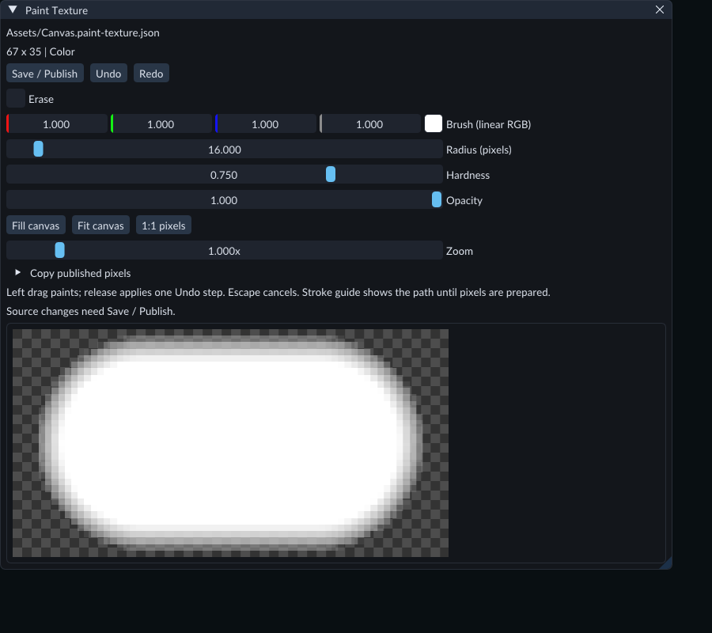
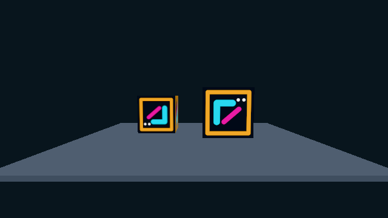

# Paint a texture

Use **Paint Texture** to author a Color image or numeric Data image. The canvas
has its own source file, Undo history and **Save / Publish** command. Materials,
Sprites and exported games use its published Texture asset.

The checkerboard reveals transparency. Brush controls apply to the next stroke;
the stroke guide shows its path while you drag.

## Create a canvas

1. Stop Play. Open **Content → Create / Register → New paint texture...**.
2. Enter a project-relative **Project file**, such as `Assets/Artwork.paint-texture.json`.
3. Set **Width** and **Height**, from 1 to 1024 pixels each.
4. Choose **Color (sRGB storage)** for artwork, or **Data (raw channels)** for numeric maps and masks.
5. Click **Create**. The transparent canvas opens in **Paint Texture**.

Canvas dimensions and interpretation stay fixed after creation. Existing files
are protected. Double-click a paint source or its Texture asset in Content to
reopen it.

## Paint, erase and fill

Choose the brush color, **Radius (pixels)**, **Hardness** and **Opacity**. Drag with
the left mouse button on the image. Release to prepare and apply the complete
stroke as one Undo step. The guide remains visible until the pixels are ready.
Separate strokes can build opacity; overlapping points within one stroke do not
repeatedly apply opacity.

- **Radius (pixels)** accepts 0.5 to 256 source pixels and is independent of zoom.
- **Hardness** controls the edge falloff, from 0 to 1.
- **Opacity** controls stroke strength, from 0 to 1.
- **Erase** reduces alpha on a Color canvas. On a Data canvas it blends each channel toward the canvas background.
- **Fill canvas** replaces every pixel with the brush color in one Undo step. It ignores Erase and the stroke opacity.

Color brushes use linear RGB values. The source stores sRGB RGB bytes with straight
alpha; blending happens in linear color. Erasing retains the hidden RGB values.
Data brushes treat all four channels independently as normalized numeric values.

**Escape** cancels a held stroke or pending pixel preparation. **Undo** also
cancels pending preparation; otherwise it undoes a complete stroke, fill or copy.
**Redo** restores a completed edit. Cancelling preparation does not change the
source or its history.

Use **Fit canvas**, **1:1 pixels**, **Zoom** and the canvas scrollbars to inspect the
image. These viewing controls do not change its pixels. Painting is disabled
during Play, publication and pending pixel preparation.

## Copy a published image into the canvas

Import the original image first, then create a paint canvas with matching
dimensions and Color/Data interpretation.

1. Expand **Copy published pixels**.
2. Choose a **Published image**.
3. Click **Copy pixels** and wait for preparation to finish.

This replaces the canvas pixels in one Undo step. The selected Texture, imported
image and any owning model remain unchanged. The paint source keeps its own asset
identity. Subsequent changes to the selected image do not update the copied pixels.

Copy uses the published base image of a single 2D Texture. It supports normalized
byte samples and decoded unsigned LDR block samples. The selected Color or Data
usage must be available and dimensions must match. Linear Color bytes are encoded
to sRGB for the Color canvas; alpha stays straight. Data channels retain their raw
values.

Premultiplied or unknown Color alpha, signed/HDR samples, higher precision,
arrays, cube maps and volumes are unsupported. Copy errors preserve the canvas.
Review an imported image's published dimensions and usage in the
[Texture preview](textures.md) before copying it.

## Publish and use the result

Click **Save / Publish**. This saves the source and prepares an ordinary Texture
through the texture import pipeline. Wait for publication to finish. A failed
publication keeps the previously working Texture selected and retains the source
for correction.

Assign the Texture in the [Material editor](materials.md). A compatible unlit
Material can use the same painted Texture on a Mesh and a Sprite. Save the Material
and consuming Scene before [exporting the game](../getting-started/standalone-runtime.md). If export reports
an outdated dependency, republish the affected Material and retry.

The texture-painting Gallery scene shares one painted Texture and Material between
a rotating cube and a Sprite. Open `Scenes/170-texture-painting.scene.json` in the
Feature Gallery project to try it.

Closing a changed canvas offers **Save**, **Discard** or **Keep editing**. Save
waits for publication. Discard closes the draft; a source already written by Save
remains on disk. If another application changes the source, Save reports a
baseline conflict and preserves your draft. Resolve the external edit before
retrying, or discard and reopen the saved source.

## Limits

The canvas supports 2D RGBA8 Color/Data pixels up to 1024 × 1024. A stroke accepts
up to 256 path points and a bounded amount of pixel work. Very long or broad
strokes can be rejected; use shorter strokes. Source files are limited to 16 MiB.

Undo retains up to 64 entries within an 8 MiB weighted source-history budget;
older entries can be evicted. An edit that cannot retain both Undo and Redo is
rejected. Current and saved source values have their own storage.

This is a 2D image canvas. It does not project brush strokes onto model geometry,
change UVs, or paint skeletal weights. Imported and model-generated images become
editable here through an explicit pixel copy.
