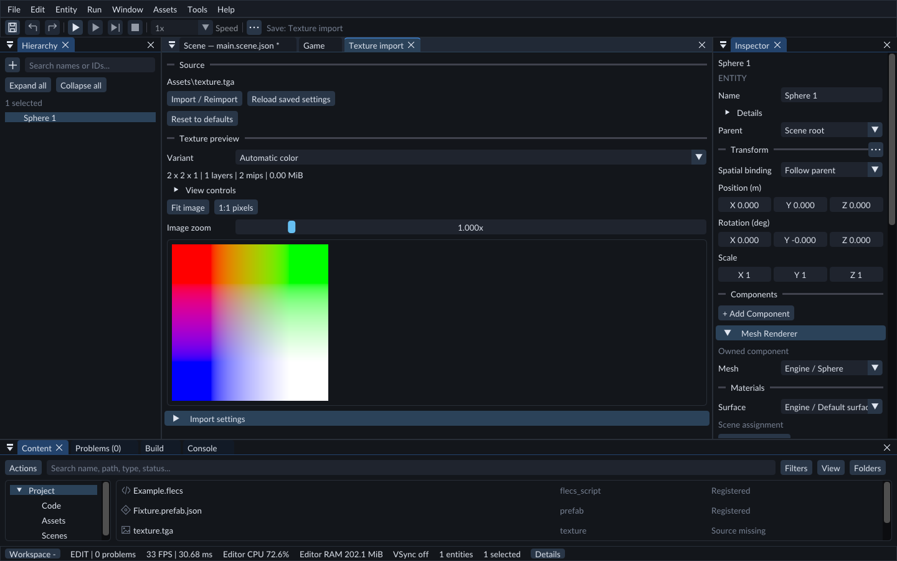
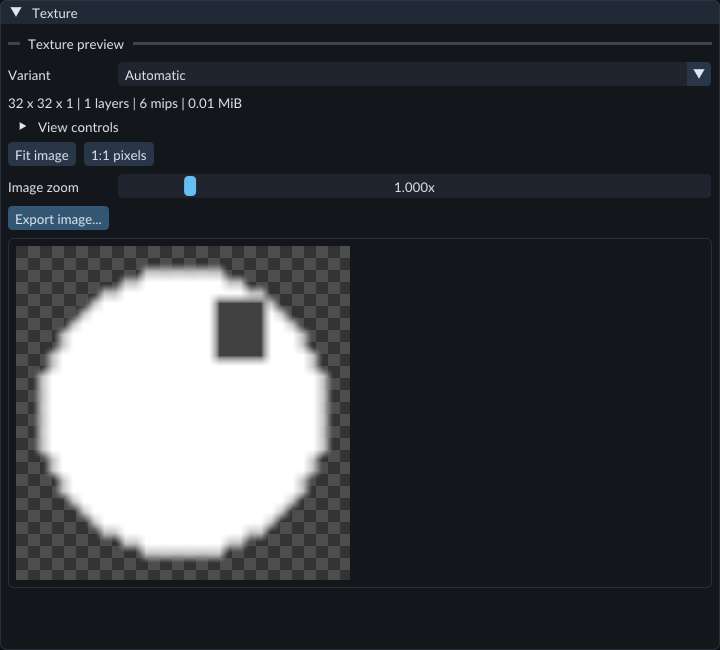
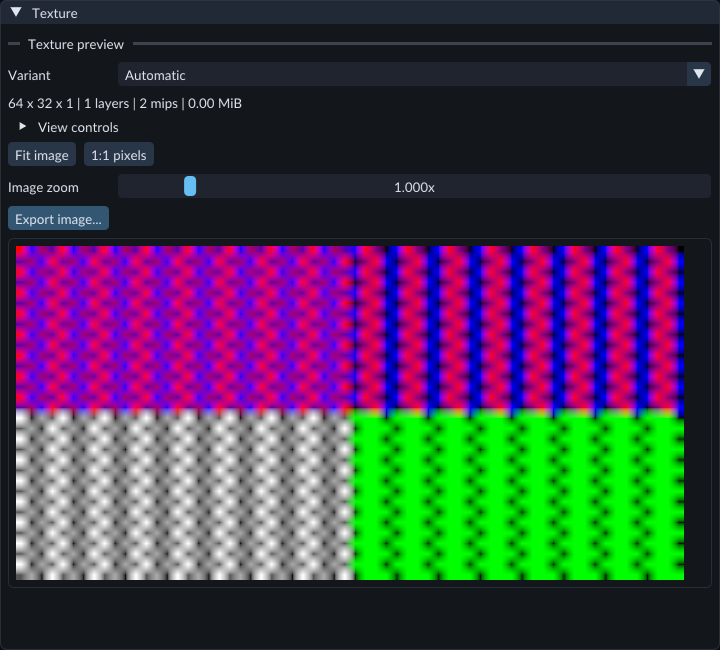
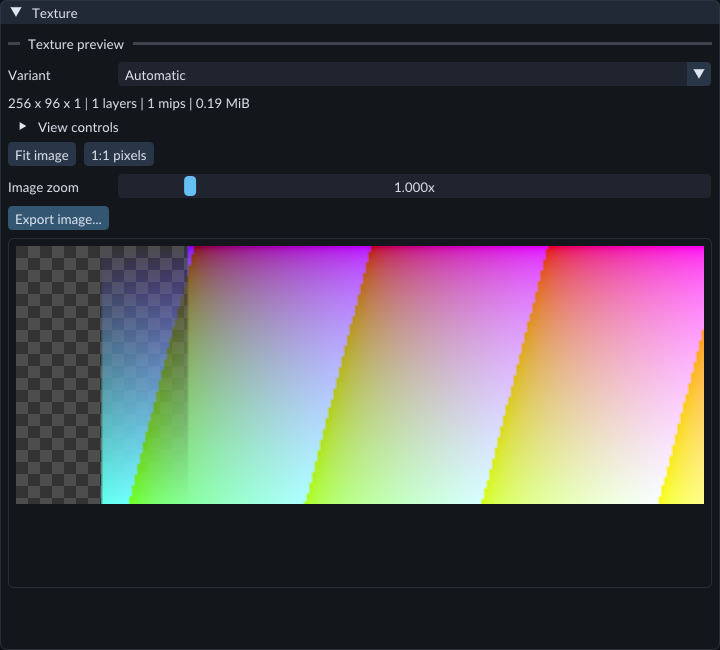
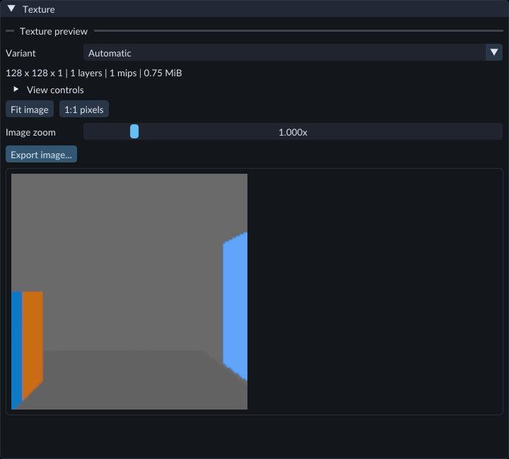

# Importing and exporting textures

Import prepares an image for use as a texture and gives it a durable asset identity.
The original image stays unchanged. Assign textures to surface roles in the [Material editor](materials.md);
its surface preview shows them on geometry. The Texture import document also displays
the last published texture.

Review image usage and import settings before importing or reimporting.

For files outside the project, use **Content → Import files** or drop them onto Content. The [Content import review](content-browser.md) copies sources into a new folder and can import them with default settings. Turn off automatic import there to review the settings below before cooking.

## Import an image

1. Copy the source into your project's **Assets** folder.
2. Stop Play. In **Content → Create / Register**, choose **Import texture...**.
3. Enter its project-relative path, such as `Assets/brick.png`, and choose **Review settings**.
4. Choose its **Usage**, color space and other settings below.
5. Choose **Import / Reimport**. Progress appears in the Texture import document.
6. After success, use **Content → Refresh** to see the registered texture immediately.

The current source accepts supported PNG, JPEG, TGA, BMP, still WebP, HDR/RGBE,
DDS, KTX and KTX2 files. A recognized extension does not guarantee every variant of
that format is supported. Unsupported compression, color profiles, dimensions or
malformed files produce an error while preserving the previous usable texture.

## Choose what the pixels mean

- **auto:** ordinary color, or HDR when the source declares floating HDR data.
- **color:** surface color; automatic color space uses sRGB for ordinary images.
- **data:** numeric channels such as roughness or masks; linear values.
- **normal:** tangent-space normals; linear values and normalized generated mips.
- **hdr:** high-dynamic-range color; linear floating storage.

**Additional usages** prepares more interpretations under the same texture asset.
For example, one source can have both color and data variants without creating
separate AssetIds. Up to three additional distinct usages can be selected. A usage
already selected as primary is included once.

**Flip normal green** converts the opposite normal-map Y convention and applies
only to normal variants. **Premultiply alpha** affects color/HDR variants.
Anisotropy requires linear filtering and support from the active graphics device.
An imported texture can be valid while its sampling settings or storage format are
unsupported by that device. The preview reports the problem and keeps its previous
usable image; it does not silently clamp sampling or change the saved settings.
Image maximum size selects the first standard
mip level that fits. BC compression currently accepts 8-bit normalized images;
it does not silently reduce HDR or 16-bit pixels to 8-bit.

DDS/KTX containers keep their supplied dimensions and mip levels. Their settings
omit image resizing, mip generation and pixel flips. A usage that contradicts the
container's declared color space is rejected.

## Change settings later

Double-click a texture in Content, or select it and choose **Open texture** in
Inspector. The same Texture import document opens with its saved settings.

Edits stay in this draft until **Import / Reimport** succeeds. **Use default** removes
one explicit setting override. **Reset to defaults** resets the draft's known
settings. **Reload saved settings** discards the draft and reloads saved values.
The main Save command also imports when this document has focus.

Closing the document or switching scenes/projects with a pending import offers
**Apply**, **Discard**, or **Keep editing**. Apply waits for successful import.
Discard cancels pending work and keeps any previously selected texture. Keep
editing cancels the close/switch. Import settings have their own ownership;
**scene Undo does not undo an import or settings publication**.

## Errors and cancellation

Use **Cancel import** to reject pending work. The error appears beside the import
settings and in Problems. If a source or its saved settings changed while you were
working, reload the saved settings and retry. Failed, cancelled or stale imports
leave the previous selected asset usable.

Keep each source's adjacent `.forge-import.json` file and `forge.assets.json` with
the project. They preserve identity and settings. `.forge/cache` is disposable
prepared data; removing it causes a verified rebuild. Do not copy a sidecar to
create a different logical asset with the same ID.

## Inspect the published texture

Double-click a standalone texture in Content to open its import document and preview.
Textures generated inside a model open a read-only **Texture** tab. Change those
textures through the owning model source/import rather than importing the model as an image.

The preview uses the **published** asset. Unapplied import settings do not change
it. A failed replacement keeps the previous good revision visible with an error.
Viewing never changes scene content or creates an Undo entry.

- **Variant** chooses color, data, normal or HDR interpretation. A missing variant reports an error; it is not silently replaced with color.
- Expand **View controls** for **Mip**, **Array layer**, **Cube face** or **Depth slice**, as appropriate to the texture.
- **Channels** isolates red, green, blue or alpha as grayscale. Isolated RGB channels show sampled linear values; alpha has no gamma transfer.
- **Display** chooses raw data, ordinary color or HDR with PBR Neutral tone mapping. **Exposure (stops)** changes brightness without changing the pixels on disk.
- **Checkerboard** reveals transparency in RGBA mode. **Nearest pixels** shows individual texels instead of filtering between them.
- **Signed values to 0..1** makes negative numeric values visible by mapping −1 to black and +1 to white. Alpha is unchanged.
- **Fit image** fits the image. **1:1 pixels** shows one cooked texel per screen pixel; **Image zoom** and the scrollbars let you inspect other magnifications and regions. Ctrl+Plus/Minus still scales the whole editor.

Only the visible image region is rendered. Preview output is limited to 2048 pixels
per axis; exceptionally large visible areas are downsampled. This viewer has separate
256 MiB CPU and GPU texture payload budgets. An asset exceeding the preview budget
can remain valid for another consumer; the preview reports the limitation.
Import settings are under the separate **Import settings** foldout.

## Export stored pixels

Open a published byte-storage texture in Content. In **Texture preview**, choose its **Variant**
and expand **View controls** to select a **Mip**, **Array layer**, **Cube face** or
**Depth slice**, when available. **Automatic** selects HDR color when present,
otherwise color; choose data or normal explicitly for those variants.

The export button sits above the published image. The checkerboard belongs to the preview.

1. Click **Export image...** below **Image zoom**.
2. Choose **PNG image** and a **.png** filename. For sRGB byte storage, you can also choose **Lossless WebP image** and a **.webp** filename. A suffix that disagrees with the selected file type produces an error.
3. Confirm replacement if the filename already exists. Wait for **Image saved** in the status bar or Console.

The export contains the selected published mip/layer/face/slice at its stored
resolution, with its top row first. It copies RGBA bytes, including transparency
and RGB under fully transparent pixels. R8 becomes red with green/blue zero and
opaque alpha; RG8 keeps red/green with blue zero and opaque alpha. The second
channel is green, not alpha.

Preview **Channels**, **Display**, **Exposure (stops)**, checkerboard, filtering,
zoom and scroll position do not affect this export. It performs no color transfer,
tone mapping, normal reconstruction or alpha conversion. PNG records sRGB only
for sRGB storage; data and linear channels remain unlabelled. WebP requires sRGB
storage in this export profile; choose PNG for other stored channels.

The PNG/WebP stored-pixel profile supports uncompressed R8, RG8, RGBA8 and RGBA8
sRGB. Compressed, 16-bit normalized and floating-point storage cannot use this
profile. For supported compressed storage, use the decoded-texture workflow below. For normalized 16-bit storage, use PNG16 below. For supported floating-point HDR textures, use the HDR profile below. The complete
selected texture must fit 128 MiB; the chosen image must fit 4096 pixels per axis
and 64 MiB RGBA. Choose a smaller mip for an oversized image. The encoded file
limit is 68 MiB. A rejected export keeps any existing destination file intact.

A generated model texture can also be exported from its read-only **Texture** tab.
An unapplied import draft is excluded: publish it first to export the new result.
Export needs the published cooked data and never rebuilds from the original image.
If that data is unavailable or invalid, use the ordinary import workflow first.

One image operation runs at a time across texture and Scene/Game exports.
Changing projects while the picker or request is pending cancels it. Once the
pixel/file job starts, it finishes before retirement; changing Scenes does not
cancel a texture export. Export creates no Scene Undo entry and changes no import
settings. The file does not preserve sampler settings, semantic usage, alpha
convention, other mips or asset identity. When importing it again, choose the
appropriate settings for its stored channels; identical appearance is not implied.

## Export a compressed texture

Open a published **BC1**, **BC2**, **BC3**, **BC4**, **BC5** or **BC7** UNORM texture.
Their sRGB forms are supported where available. In the Feature Gallery,
**Assets/TextureBlocks/BlockColors.dds** contains an original BC1 sRGB pattern with
color stripes, transparent regions and a second opaque mip.

The viewer filters the published image for inspection. Export uses decoded texels
at the selected mip's own resolution.

1. Choose **Variant** and, under **View controls**, the desired **Mip**, **Array layer**, **Cube face** or **Depth slice**.
2. Click **Export image...** and choose **PNG image** with a **.png** filename. For sRGB storage, **Lossless WebP image** is also available. Use JPEG only when every selected texel is opaque; the Gallery pattern's **Mip** 1 is opaque.
3. Confirm replacement when requested. Wait for **Image saved**, followed by **decoded block texels** in the completion message.

The file contains decoded RGBA8 reference texels at the selected mip's resolution.
Compression has already changed the original pixels; decoding cannot restore them.
It does not export the original compressed blocks. PNG/WebP preserve the decoded
values; JPEG introduces additional loss. Edge blocks are cropped to the image size.

BC1 retains encoded punch-through transparency. BC4 becomes red with green/blue
zero and opaque alpha; BC5 retains red/green with blue zero and opaque alpha.
Normal blue is not reconstructed. Color transfer, preview controls, alpha hints
and material settings do not reinterpret the values. PNG labels only actual sRGB
storage; WebP and JPEG require sRGB. JPEG also checks actual alpha.

Signed BC4/BC5 and BC6 HDR storage are outside this profile. The selected cooked
texture must fit 128 MiB; output must fit 4096 pixels per axis and 64 MiB RGBA8.
The packaged asset worker must be present. A failed decode keeps an existing
output file intact. The original editable source may be absent after publication.

## Export 16-bit stored samples

Open a published **R16**, **RG16** or **RGBA16** normalized texture. Choose the
matching **Color**, **Data** or **Normal** under **Variant**; select data/normal
explicitly for those usages. In the Feature Gallery, **Assets/TexturePrecision/Normalized16.png** provides an original RGBA16
sample with gradients, low-bit variation and transparency. This profile preserves
normalized samples; floating-point half values use the separate HDR workflow.

The preview is an inspection image. The exported PNG retains 16-bit sample precision.

1. Select **Mip**, **Array layer**, **Cube face** or **Depth slice** as needed under **View controls**.
2. Click **Export image...**. The chooser offers **PNG image** for this selection. Use a **.png** filename and confirm replacement when required.
3. Wait for **Image saved**. The completion message identifies **16-bit PNG**.

The file contains 16-bit RGBA samples. Present channels, alpha and RGB beneath
transparent alpha remain exact. R16 expands to red with green/blue zero and
alpha 65535; RG16 retains red/green with blue zero and alpha 65535. Green is not
interpreted as alpha. Cooked byte order is converted to the PNG file convention;
no color transfer, normal reconstruction, tone mapping or alpha conversion occurs.
The PNG has no invented sRGB label. Source color/import metadata, sampler settings
and other subresources are excluded; choose the correct usage/linear settings when
importing it again.

The full selected texture must fit 256 MiB, and the chosen image must fit 4096 pixels
per axis and 128 MiB of RGBA16 samples. Encoded output is capped at 136 MiB. Choose a
smaller mip for an oversized image. A failed export preserves an existing file.
JPEG, WebP and HDR filenames cannot store this exact normalized 16-bit profile.

Agent PNG inspection previews quantize each 16-bit channel to the nearest 8-bit
value and may reduce resolution to 1024 pixels on the longest side. These previews
retain alpha and the unlabelled channel interpretation, with no gamma conversion.
Current and later preview requests use the same quantization. Inspect the full
PNG with a 16-bit-capable reader to check precision; the screenshot/preview alone
does not demonstrate low-bit equality.

## Export a JPEG image

Choose **JPEG image** with a **.jpg** or **.jpeg** filename when you want a smaller,
lossy still image from an opaque sRGB byte texture. Select its published **Mip**,
**Array layer**, **Cube face** or **Depth slice** first, then click **Export image...**.
In **JPEG quality**, enter **1–100** (default **90**) and click **Save JPEG**. Higher
values retain more detail; 100 is still lossy. **Cancel** stops before pixel loading
or encoding begins. Confirm **Replace** if an appended filename already exists.
See [Save an image](viewport.md) for the quality controls.

The selected pixels must use sRGB byte storage and every alpha value must be 255.
JPEG does not flatten transparency or reinterpret data, normal or HDR channels.
A texture labelled opaque can still contain other alpha values, particularly in
filtered mips; those selections are rejected. Choose PNG or WebP for transparency,
PNG for other byte channels, or HDR for supported linear float textures.

The byte export size limits above also apply to JPEG. The full file uses the
selected stored resolution. Agent PNG previews show the decoded JPEG, including
compression changes. JPEG carries no source/import metadata or lossless color
promise. Failed exports leave an existing destination intact.

## Export an HDR image

Open a published HDR texture and choose **HDR color** under **Variant**, or leave
**Automatic** when that variant is present. HDR output requires HdrColor
RGBA16Float or RGBA32Float storage. Choose one **Mip**, **Array layer**,
**Cube face** or **Depth slice** under **View controls** as needed.

The HDR preview shows one cube face using display tone mapping. The exported HDR file contains linear RGB before that display processing.

1. Click **Export image...**. A supported HDR variant opens the **HDR image (Radiance RGBE)** picker with a **.hdr** filename.
2. Choose a destination, keep the **.hdr** suffix and confirm any replacement.
3. Wait for **Image saved**. Open the written file in an HDR-capable image application, or import it into FORGE with HDR color usage and linear storage.

The file contains one 2D image from that published selection, with its top row
first. A cube export contains one face per operation. Preview exposure, tone
mapping, channels, checkerboard, zoom and crop do not enter the file.
RGB values retain high dynamic range through shared-exponent RGBE encoding.
This encoding quantizes color; weaker channels can lose precision or become zero.
It is not lossless floating-point storage.

The image uses FORGE's linear sRGB/Rec.709 primaries and D65 white point.
Original source metadata and calibrated physical units are not preserved.
RGB must be finite and nonnegative, every selected alpha must equal 1, and nonzero
pixel magnitudes must fit the RGBE exponent range. Unsupported transparency,
negative/nonfinite values or range produce an error without replacing a good file.
RGBA bytes, compressed textures, normalized 16-bit data and other semantic usages
cannot use this HDR profile. No automatic color-space, transparency or data conversion
is performed.

The complete selected HDR texture must fit 256 MiB, detached RGB floats 192 MiB,
the selected image 4096 pixels per axis, and the encoded file 68 MiB. Existing cooked
artifact limits also apply. The shared image-task, project cancellation and import /
Scene-history behavior described above also applies to HDR.

MCP writes the same HDR file and reports its path and MIME through capture status.
Inline HDR image previews are unavailable in this profile; this does not prevent
successful file output. Scene/Game view-image capture uses PNG, lossless WebP or
opaque JPEG. Timeline frame export uses PNG.
