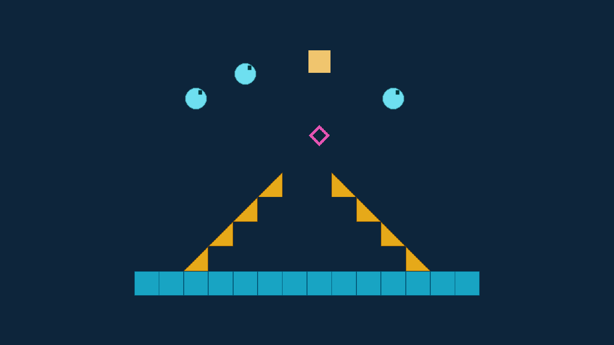
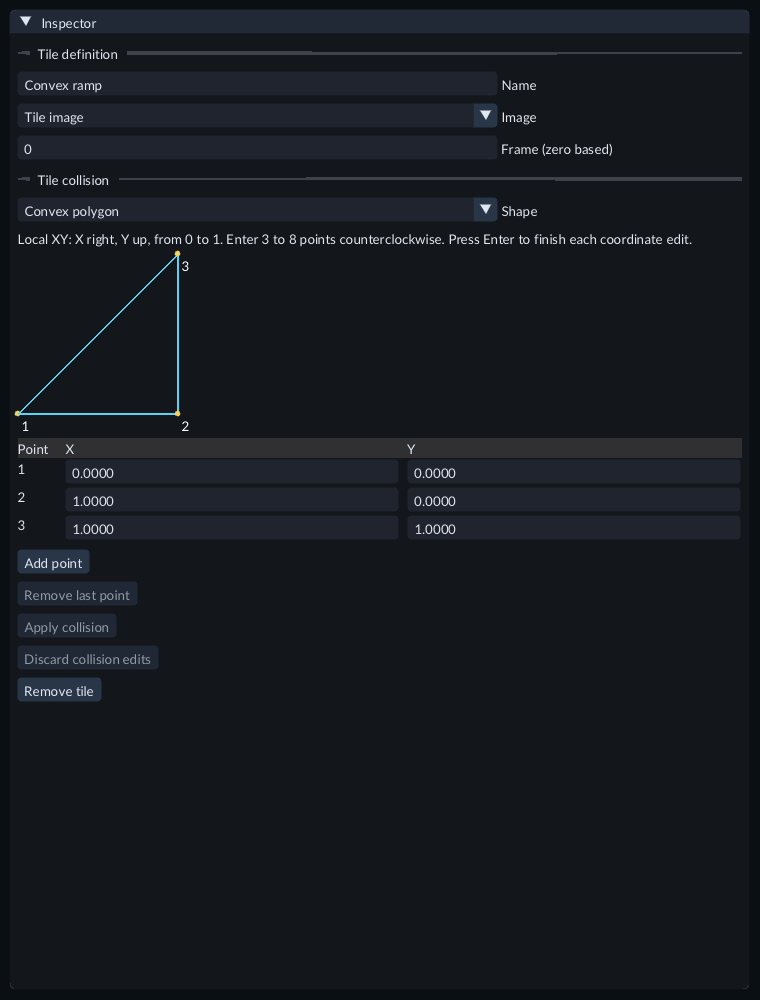
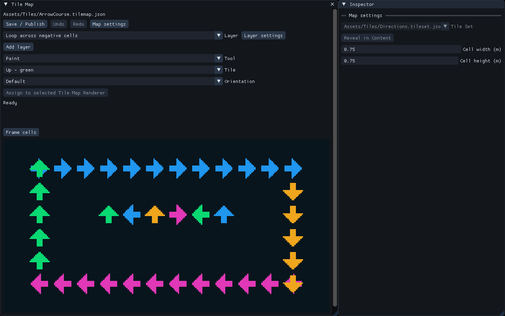

# Tile Sets and Tile Maps

A **Tile Set** gives names to cells of an image sheet. A **Tile Map** stores which
tile appears at each grid position. A Scene's **Tile Map Renderer** places that
map in the world. Multiple renderers can use one map asset.

## Try the Gallery

Copy **Examples/FeatureGallery** to a writable folder and open that project.
Open **Scenes/74-tile-maps.scene.json**. The left course and smaller mirrored copy
use the same map. Their camera is included; these unlit images need no light.

1. In Content, open **Assets/Tiles/ArrowCourse.tilemap.json**.
2. Select **Loop across negative cells** and choose an arrow in the palette.
3. Drag with the left mouse button to paint. Releasing the button creates one Undo step. Try **Undo** and **Redo**; press Escape during a stroke to cancel it.
4. Choose Erase to remove cells. Use the middle mouse button to pan and the wheel to zoom. **Corner markers** is a second layer over the loop.
5. Choose **Save / Publish**, then return to Scene. Both instances show the saved map. Press Play and open Game to compare the mirrored copy.

Map source editing is disabled during Play. Stop before changing the authored
cells. Scene changes and map-source changes have their own document Undo histories.

### Collision-profile course

Open **Scenes/101-tile-collision-profiles.scene.json**. The cyan full-cell floor,
amber convex ramps and pink no-collision decoration use one Tile Set and Map.
Press Play: circles roll down the original and mirrored ramps; the box falls
through the pink decoration onto the floor. Stop before editing their profiles.

The course at its saved starting positions.

## Make a map

Create a Sprite image material from an imported image. Use Content's **Create /
Register** menu to create a **New Tile Set...**. Add that image material, set its
sheet grid, and define the named tiles. Save and publish the set.

Create a **New Tile Map...**, select the published set, and paint its cells.
After **Save / Publish**, drag the map from Content into Scene, or create a Tile
Map Renderer and use **Assign to selected Tile Map Renderer**. Save the Scene.
Cell width and height use local meters; ordinary entity transforms position,
rotate, scale or mirror the complete map. Coordinates may be negative.

To filter small or distant cells, select the Map entity and set **Mip filtering**
in **Tile Map Renderer** to **Nearest** or **Linear**. Nearest selects one smaller
image level; Linear blends adjacent levels. Disabled is the default. Each defined
tile frame is filtered independently, so neighboring atlas frames stay separate.
Save the Scene or Prefab before exporting. Each used Tile Set image supports up
to 512 filtered frames; large image banks can exceed the resource budget. A failed
replacement keeps the last complete working map and reports the problem.

Changing a set's sheet grid or definitions requires saving/publishing the set and
then the affected map. A failed publication retains the last working result and
reports the problem. The built-in profile supports up to 262144 occupied cells,
1024 chunks and 8 layers per map; it does not stream an unlimited world.

## Make painted floors and walls

Open **Scenes/77-painted-2d-collision.scene.json** in the Feature Gallery, press
Play and open Game. The amber box and cyan circle land on the raised painted
platforms. The rose box and green circle land on the lowest floor. Blue decorative
arrows do not stop the bodies.

Stop, then open **Assets/Tiles/PaintedPlatforms.tilemap.json**. On **Solid
platforms**, erase the three cells in the left raised platform. Save/publish and
Play again: the amber box falls to the lowest floor. Undo the Map edit and publish
to restore the platform.

For your own Map actor:

1. Add **Physics Body 2D**. Choose **Motion** as Static or Kinematic. Leave **Sensor** off for solid collision.
2. Add **Tile Map Collider 2D**. Choose its **Collision layer** by name.
3. Choose each tile's collision profile in the Tile Set Inspector, or put decoration in a different layer. Hiding a layer or renderer does not remove collision.
4. Turn on the Scene collision outline to inspect the selected published layer. Save the Scene, then test with ordinary Dynamic2D bodies.

Maps use full cells or convex polygons with Static or Kinematic bodies. Dynamic
Maps are unavailable. Static nonsensor Maps using full cells can use the
one-way option below. An empty or all-None selected layer has no native shape. Excessively large or complex collision reports a problem and
keeps the previous working runtime cells and collision.

## Choose collision for a tile

The diagram shows the applied ramp in local XY coordinates.

1. Open the `.tileset.json` in Content, then select a tile definition.
2. In Inspector, find **Tile collision**. Set **Shape** to **Full cell**, **None** or **Convex polygon**. Full cells merge with neighboring full cells; None makes the tile decorative.
3. For a polygon, enter 3–8 points in the X/Y table. Coordinates run from 0 to 1 across the cell, with X right and Y up. List points counterclockwise; press Enter after editing a coordinate.
4. **Add point** appends a point on the closing edge. Move it off that edge before applying. **Remove last point** removes the final vertex. The diagram numbers the current draft points.
5. Choose **Apply collision** to validate the complete profile in one Undo step. Invalid or nonconvex shapes leave the applied source unchanged. **Discard collision edits** returns to the applied profile. Apply or discard before Save, Undo or selecting another tile.
6. Choose **Save / Publish** for the Tile Set, then save and publish each Map that uses it. Return to Scene and enable **Selected collision** on its Map actor to inspect the published shapes. Save the Scene and Play.

Cell flips and transpose also transform custom polygons. Polygons can provide
ordinary solid or sensor collision; custom polygons cannot use **One-way
collision**. Use separate Map actors/layers when a scene needs both types.
Automatic concave decomposition is unavailable. A very small polygon can fail
physical-scale validation even when its normalized coordinates are valid.

Older sources may contain unrelated extension data named `collision`. A profile
edit reports a conflict rather than reinterpreting that data. Resolve the named
extension in the source before applying a collision profile.

## Make painted platforms one-way

1. Select the Map entity. Under **Physics Body 2D**, choose **Static** and turn **Sensor** off.
2. Enable **One-way collision**. Keep **One-way margin** at 0.02 m initially.
3. Enable **Selected collision** in Scene. Each rectangle's arrow points toward its solid face.
4. Save and Play. Objects can pass from the opposite side and land on that face. Stop restores the saved starting scene; export uses the saved policy.

The policy applies to every occupied rectangle in the selected collision layer.
Each rectangle has its own face, including raised platforms. Negative Y scale
reverses the face; Z rotation rotates it. Flipping a tile's image does not change
its collision face. Kinematic, sensor and Dynamic one-way Maps are unavailable.
Ordinary ray/overlap/sweep queries still see complete rectangles, and checked
character placement still rejects embedded positions.

Open **86-one-way-tile-maps** in the Feature Gallery. The cyan circle rises
through a painted platform toward an ordinary ceiling; the other bodies fall
onto painted roofs. Stop, disable **One-way collision** on the Map and Play again
to compare its underside response. Restore the option and save. Existing Project
Code can use the same painted-cell editing and physics query APIs; no new API or
special tile entity is needed.

## Moving Maps and trigger regions

Open **81-moving-tile-maps** in the Feature Gallery and Play. The painted course
moves left and right using an ordinary transform animation on a Kinematic Map.
Select the course to inspect its Motion, Collision layer and Transform Animator.
Stop before changing those saved settings. Move or animate the whole Map actor;
its rectangles move together. Use C++ Kinematic targets for gameplay-controlled
motion. Large instantaneous changes should use explicit teleport.

Open **82-tile-map-triggers** and Play. The translucent painted regions have
**Sensor** enabled. Bodies pass through them and land on the solid receiver below.
To create a trigger, enable **Sensor** on a Static or Kinematic Map body, choose
its Collision layer and save the Scene. Sensor regions still respect body layers
and masks. **Selected collision** identifies a Map sensor and shows its published
outline; runtime cell edits are not drawn by that authored outline.

C++ can read the ordinary 2D sensor Begin/End events after physics. Several
rectangles can report the same body pair, so one End does not mean the visitor
has left every rectangle. Fast-moving sensors can miss crossings. Use suitable
physics queries when your game needs a separate check. Sensor inclusion in a
query is independent of whether the Map has solid response.

Both examples can be exported normally. Stop restores the authored transforms
and cells; runtime movement and trigger events do not save themselves.

## C++ runtime changes

Each running map instance has its own cell state. C++ code can query cells and
queue bounded edits from a fixed-step system. Changes appear at a fixed-tick
boundary and disappear on Stop. They do not save into the authored map.

**CodeExamples/TileMapEdits.hpp** shows one queued cell write using the public SDK.
Use the actor's Scene/entity IDs, layer key and a tile key from its set. Tile zero
erases a cell. A returned token must be inspected on a later tick and released
when it finishes. The matching installed SDK includes this helper and the tested
`tile_map_gameplay` sample. The Gallery's default Scene needs no C++ module.

**CodeExamples/PaintedCollision.hpp** shows removal of Gallery77's left platform
and an ordinary physics ray query. An accepted cell edit updates collision at the
same fixed-step boundary. Scene outlines show the published source; they do not
display these temporary runtime edits. Stop restores the published Map.

## Export

Save/publish the assets and save the Scene. In Project Settings, choose **Use saved
current scene as startup** and save settings. Export Game with the matching
runtime kit. The exported game includes prepared maps, sets, materials and images;
it runs without the editor, source files or a compiler. Optional C++ modules must
be built and supplied through the ordinary matching module-kit export flow.

## Visual examples

Choose a layer, tile and tool, then paint on the canvas. Inspector edits the selected map or layer.

Several scene objects can use the same saved Tile Map with different transforms.
