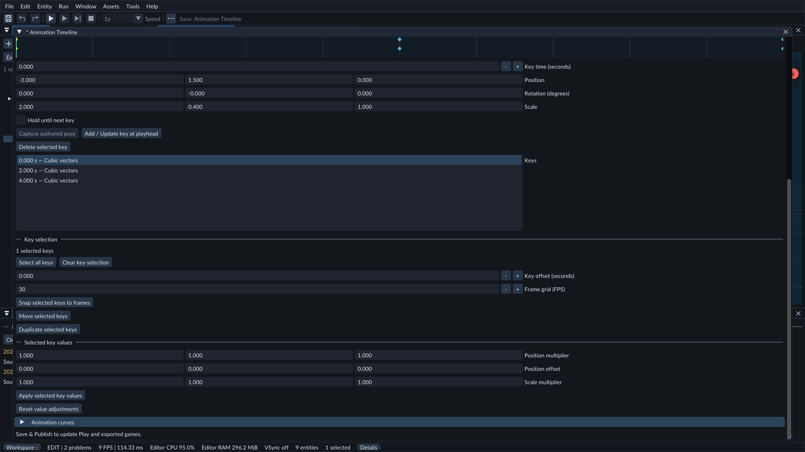
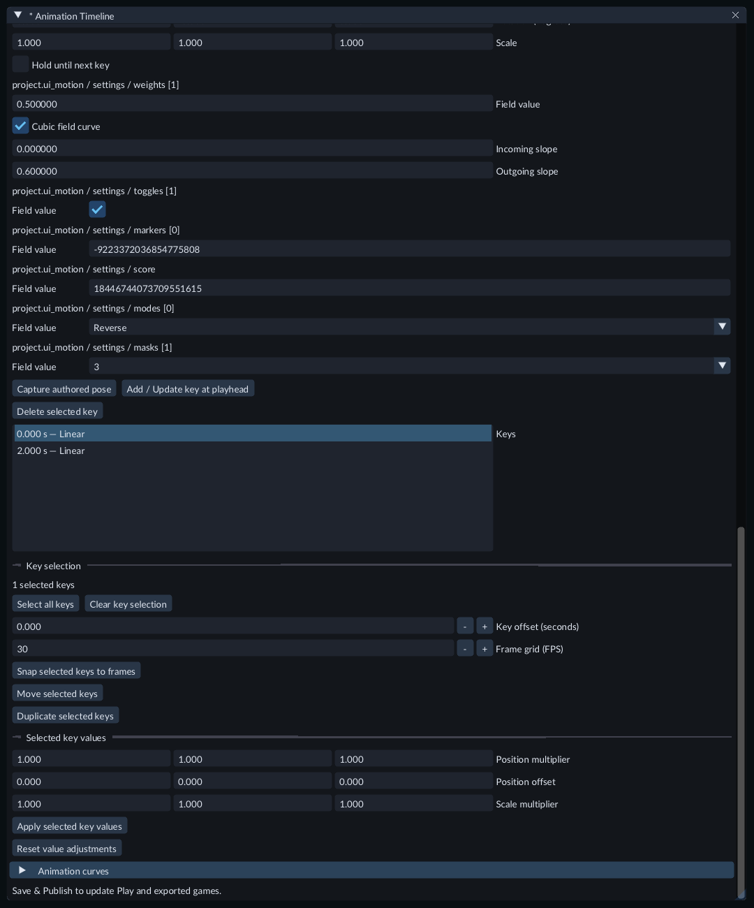

# Transform animation timeline

Animate an object's position, rotation and size without writing code. A reusable
**transform animation** appears in Content as an `.animation.json` file. A
**Transform Animator** component connects that clip to an object in the scene.
Use an [Animation Sequence](animation-sequences.md) to coordinate several clips.

Select keys to edit their time and values. Expand Animation curves to work with interpolation.

## Create a clip

1. Create and select a cube. Save the scene.
2. In **Content → Create / Register**, choose **New transform animation...**. Enter a project path such as `Assets/CubeMotion.animation.json` and choose **Create**. The Animation Timeline opens.
3. Choose the cube in **Preview object**. The chosen object is only a preview target until you attach the clip.
4. Set **Duration (seconds)** and press Enter. Check the channels you want to animate: **Position**, **Rotation**, and/or **Scale**.
5. The new clip has one key at time zero. Enter its local position, rotation in degrees and scale, then choose **Add / Update key at playhead**.
6. Click farther along the ruler, or set **Key time (seconds)** and press Enter. Enter another pose and choose **Add / Update key at playhead**. A key at the same time is updated; keys at other times stay in place.

Values are local to the object's parent. A clip can be attached to several objects;
its keys have the same local values on each object. It does not remember a scene
object's name or contain C++ code.

## Edit and preview

Select a diamond or a row in **Keys** to inspect its pose. Edit the fields and use
**Add / Update key at playhead** to commit. A new key becomes selected.

Hold **Ctrl** while clicking diamonds or rows to add or remove keys from the
selection. **Select all keys** and **Clear key selection** are in **Key selection**;
gold diamonds identify selected keys. Pose and curve fields edit the active key.

Drag a selected diamond to move the whole selection while preserving its spacing.
The ruler shows temporary key positions while held; the preview motion uses the
applied clip until release. Release commits one Undo step. Escape, changing window
focus, losing application focus, entering Play, closing the timeline or changing
the document cancels a held drag. Drag offsets snap to one millisecond; clicking a
key without dragging preserves its exact saved time.

Enter **Key offset (seconds)**, then choose **Move selected keys** or **Duplicate
selected keys**. Positive offsets place keys later; negative offsets place them
earlier. Duplicates retain their poses, curves and settings and get new identities.
**Delete selected keys** removes the selection; at least one key must remain.
Offsets outside the clip or landing two keys at the same time are rejected without
replacing the clip. Each batch uses one source Undo step.

Position and scale interpolate between keys. Rotation follows the shortest turn
between the saved orientations. **Hold until next key** keeps this key's pose
until the next key, then changes immediately. Before the first key and after the
last key, the nearest pose is held.

Scrub the ruler or **Playhead**, then use **Play preview**, **Pause preview**,
**Stop preview**, **Loop preview**, and **Preview speed**. The colored PREVIEW
message identifies the temporary Scene view; the same status row shows when preview
is stopped. Preview leaves the saved scene,
scene Undo history and physics unchanged. Stop, entering Play, closing the timeline,
changing projects or deleting the preview object ends preview.

**Capture authored pose** copies the chosen object's saved local transform into
the fields. It does not capture the temporary preview. Timeline **Undo / Redo**
affects clip edits; scene Undo affects attachment and ordinary scene edits.

## Animate a component field

For a project C++ field, first build and inspect the project's components, then add the desired
component to an object. See [C++ project code](native-gameplay.md). The component
must opt into authoring and expose an editable float, double, Boolean, integer or
enum field, either at its root or within editable structs.

A selected key shows continuous curves and exact held values on Settings array entries.

1. Open an animation clip in the Timeline and choose that object as **Preview object**.
2. Expand **Component fields** and choose **Add** beside the component and field. Every existing key starts with the object's current authored field value.
3. Select a key and edit **Field value**. Numbers use an input box, Booleans use a checkbox, enums list their declared choices and bitmasks let you toggle declared flags. Choose **Add / Update key at playhead**. Repeat for another key to change the value over time.
4. For a curved float or double transition, enable **Cubic field curve** and enter **Incoming slope** and **Outgoing slope**, measured in field units per second. Commit with **Add / Update key at playhead**. **Hold until next key** takes precedence over the outgoing curve. Component curves use these numeric controls.
5. Use **Save & Publish**, attach the clip with **Transform Animator**, save the scene and press **Play**. Timeline **Undo / Redo** applies to the clip's edits.

The target must already have the matching inspected component. FORGE rejects a
changed schema, read-only field or ancestor, or curve outside the field's supported range.
Remove an obsolete binding and add the current field after inspecting a changed
component schema. Keep at least one transform channel, property or component-field binding.

Scene and sequence previews sample the fields without running project C++ code.
The Timeline's field values follow the playhead; test a C++ behavior's visible
effect in **Play → Game**. Gameplay runs before animation in the fixed update, so
a regular C++ fixed system reads the last committed animated value. A seek applies
the requested value before the next gameplay tick. Inspector changes to an animated
runtime field can be replaced by the next animation update.

Boolean, integer, enum and bitmask fields hold their value until the next key.
They have no cubic controls. Integer inputs retain exact signed or unsigned values,
including 64-bit values; the target's native width, range and choices still apply.

Select a saved key to inspect its held values. Enum and flag controls use the
component's declared choices.

Expand your C++ component's struct in the Inspector to inspect its members.
Timeline lists each available leaf with its full path, such as **settings / speed**.
Choose **Add** for that leaf. Neighboring values remain unchanged. **Capture authored
pose** captures the bound leaves as well as the transform.

Up to 64 scalar component leaves can be bound per clip, including editable members
inside nested structs, fixed arrays and admitted native tables. [UI Values](sequence-ui.md) also exposes its named numeric leaves through this workflow without project C++. Arbitrary DOM properties are unavailable here. Array/table elements must already exist: add or edit their data
in the Inspector first. Timeline shows zero-based indices for positional entries
and key values for tables with declared entry keys. Reordering a keyed table keeps
its animation on that entry. Removing the selected entry reports a binding error;
restore it or remove the binding. Animation never creates/resizes the collection. Export includes the selected cooked clip; a behavior
that consumes these fields still needs the project's matching
compiled C++ module and runtime kit. The exported game does not need a C++ compiler.

Try **Examples/ComponentAnimation** for a cube whose compiled C++ system consumes
an animated **settings / speed** field. Open its **Assets/SpinSpeed.animation.json** to edit the
90 → 270 → 90 speed curve, the one-second **settings / enabled** pause and the **settings / direction**
changes. Its **settings / axis [0]** and **settings / axis [1]** tracks change the
rotation axis: indices0/1/2 are local X/Y/Z. The cube pauses from one to two seconds,
then reverses around X before returning toward Y. At least one of the three axis values
must be nonzero; the C++ system normalizes them. Build Project Code first for a source checkout. The combined
Windows package supplies a matching compiled module. Its C++ system uses the
existing post-animation phase to consume the current tick's sample.

## Animate camera zoom or light color

For an image-sheet animation, choose a Sprite as **Preview object** and enable
**Sprite frame (step)** under **Animated properties**. Its whole-number frame
holds until the next key and has no curve or tangent controls. All keyed frames
must fit the target Sprite's grid. See [World sprites and image sheets](sprites.md).

Choose an object with a **Camera** or **Light** in **Preview object**, then expand
**Animated properties**. Check camera field of view/orthographic height, or light
intensity/red/green/blue. Adding a property copies its current authored value into
every existing key. Change the property fields and choose **Add / Update key at
playhead** to give different keys different values. Field of view uses degrees;
light colors use linear values from 0 to 1. **Capture authored pose** also captures
the selected properties. Hold, key selection, timing, Save & Publish and Undo work
as they do for transforms.

You can turn off Position, Rotation and Scale for a clip that changes only camera
or light properties. Keep at least one property, material track, component field or transform channel. The target
must already have the needed component. Play locks authored Timeline controls.

Scene preview leaves saved values unchanged. For Light preview, uncheck Scene's
**Preview light** so the view uses scene lighting. Camera preview updates its
frustum; the Scene view keeps your editor camera. Use **Play → Game** to see the
camera image zoom. **Stop preview** restores the authored view.

Try **FeatureGallery / Scenes / 49-animated-camera-and-light.scene.json**. In Play,
the camera alternates between 40 and 80 degrees while sunlight changes brightness
and shifts between cool and warm colors. Its sources are in
**Assets / AnimatedProperties**. They are included as compiled clips when exporting.

## Animate an object's material values

Choose an object with a **Mesh Renderer** as the **Preview object**, then expand
**Animated material values**. Wait for its material fields to load, choose its
**Material slot**, and check **Base Color Factor**, **Roughness Factor** or another
available numeric value. Adding a track starts every existing key with that
object's authored value, or the shared material's default when it has no override.

Set **Key time (seconds)** and press Enter. Change the track's fields and choose
**Add / Update key at playhead**. Color fields use linear RGB/RGBA values. You can
turn off Position, Rotation and Scale for a material-only clip. **Hold until next
key** switches immediately at the next key; ordinary keys interpolate. The ruler
shows a row for each selected material track.

In **Animation curves**, choose the slot/value in **Curve value**, then its
**Axis** (R/G/B/A for colors). Use Linear or Cubic interpolation, incoming/outgoing
slopes, Flat/Linear/Smooth tangents, or drag a gold handle. **Fit curve and handles**
brings tangent handles into view. Apply uses one Timeline Undo step; Escape cancels
a drag. **Capture authored pose** also copies selected material values into the
key fields. **Remove track** removes that track and its keys' values together.

Preview changes only the temporary Scene view. A missing slot, incompatible type,
or curve outside the selected material's allowed values reports an error and
keeps the authored view. Material tracks change this object's numeric appearance;
other objects using the same shared material keep their own values. Textures,
shader features and material variations remain their existing separate controls.

Choose **Save & Publish**, attach the clip, then use **Play → Game**. Stop Play
before editing the authored keys. During Play the clip replaces an animated value
at its next update, including an Inspector live change to that value. Save the
Scene before export; the exported game includes prepared clips/materials and needs
no C++ compiler for this animation.

Try **FeatureGallery / Scenes / 67-animated-material-values.scene.json**. The gray
cube stays unchanged. The other cubes compare linear, smooth and held red/blue
color and polished/matte roughness, using one shared material. The smooth cube is
a Prefab instance. Sources are under **Assets / ObjectValues**; the ordinary C++
example is **CodeExamples / MaterialAnimation.hpp**.

## Animate particle size and color

Choose an object with a **Particle Emitter** as the **Preview object**. In
**Animated properties**, enable **Particle size multiplier** and the red, green
or blue factors. Edit their values and use **Add / Update key at playhead**.
Size ranges from 0.01 to 16; linear color factors range from 0 to 1. These factors
multiply the shared effect's lifetime size/color curves. They keep the same effect,
seed, emission speed and motion. Turn off Position, Rotation and Scale for a clip
that changes appearance only.

The Scene preview shows the existing frozen particle sample with the selected
appearance. **Stop preview** restores the authored view. Save and publish, attach
the clip to the emitter, then use **Play → Game** to see it animate. Inspector live
changes to a keyframed field are replaced by the clip at the next animation tick.

Try **FeatureGallery / Scenes / 60-animated-particle-appearance.scene.json**. The
left jet grows and changes color over a two-second loop; the right jet keeps its
appearance. They share one effect and seed. Select the left jet and open
**Assets/AnimationTiming/ParticleAppearance.animation.json** in Timeline to change
its keys. Export ships prepared animation and effect files and needs no C++ build.

## Animate sound volume and pitch

Select an object with an **Audio Source**, open its animation in **Timeline**, and
expand **Animated properties**. Enable **Audio volume (linear)** and **Audio pitch / speed**.
Give its keys different values, then **Save & Publish** and attach the animation.
Volume ranges from 0 (silent) to 4; 1 is normal. Pitch/speed ranges from 0.25 to 4;
1 plays normally, 2 plays twice as fast and higher pitched. It does not preserve pitch.

Preview lets you inspect the values without starting sound. Press **Play** to hear
the changes. Assign a clip and enable **Play on start** on the Audio Source. Mix
channel/master volume still applies. Edit the animation keys to change the values
that the animation controls; saved Inspector values stay unchanged when Play stops.

Try **FeatureGallery / Scenes / 53-animated-audio.scene.json**. The sound grows louder
and higher pitched as the light brightens, then returns over a six-second loop.
Its editable animation lives in **Assets / AnimatedProperties / AudioPulse.animation.json**.

## Navigate and select keys

Choose **Zoom in** or **Zoom out** to inspect a smaller or larger time range.
Hold **Ctrl** and scroll over the ruler to zoom around the pointer. Drag with the
middle mouse button to pan. **Fit clip** shows the whole clip again; **Fit selected
keys** focuses on the keys you have selected. These controls only change your view.

Hold **Shift** and drag a rectangle across key diamonds to select a group. Add
**Ctrl** to keep earlier selections, or **Alt** to remove keys from the selection.
Release applies the selection. Escape, losing focus, resizing the ruler or entering
Play cancels a held gesture. Selecting and navigating create no clip Undo step.
Ordinary key clicks, Ctrl-click toggles and dragging a selected group still work.

## Adjust timing

To make an entire clip slower or faster, enter **Retimed duration (seconds)**,
then choose **Scale whole clip timing**. For example, changing a four-second clip
to eight seconds spreads its keys out and adjusts curve slopes for slower motion.
The original **Duration (seconds)** field changes only the clip's end time.

To place selected keys on frame boundaries, set **Frame grid (FPS)** in **Key
selection**, then choose **Snap selected keys to frames**. The grid accepts whole
values from 1 to 240. At 30 FPS, keys land on the nearest thirtieth of a second.
This is a key-placement tool; it does not change the game's frame rate.

Both actions use one Undo step. Keys keep their poses and identities. Frame snapping
keeps curve slopes unchanged, so it can change the motion between keys. If an action
would put two keys at the same time, move a key past the end, or create invalid
curves, Forge keeps the previous clip and shows an error. Save & Publish applies
the result to Play and exported games.

Try **FeatureGallery / Scenes / 45-animation-timing.scene.json**. The blue lane
uses the original four-second clip, the middle lane stretches it to eight seconds,
and the last lane rounds its keys to a two-FPS grid. Open the sources under
**Assets/AnimationTiming** to inspect or adjust them.

## Adjust selected values together

Select keys, then find **Selected key values**. **Position multiplier** changes how
far each X/Y/Z value lies from zero; **Position offset** adds a local displacement.
**Scale multiplier** multiplies each saved X/Y/Z size. Enter the three lanes in X,
Y, Z order. Choose **Apply selected key values** to commit one Undo step.

For example, X position multiplier `0.5` halves a motion's X extent; X offset `2`
then moves it two local units. Scale multipliers `2, 1, 1` double its X size.
Negative multipliers reflect values, and zero makes that lane constant. Positions
are relative to the object's parent and use local zero, so this is not a gizmo pivot.
Rotation and key times stay the same. Matching curve slopes adjust with the values.

**Reset value adjustments** returns the temporary fields to multipliers `1` and
offsets `0`; it leaves your keys unchanged. Changing only some keys also changes
the transitions to their neighbors. Invalid results keep the previous clip and show
an error. Use **Save & Publish** for Play and export.

Try **FeatureGallery / Scenes / 47-animation-key-values.scene.json** and open the
clips under **Assets/AnimationValues**. The first lane uses original motion, the
second reverses and offsets the position values, and the third changes size values.

## Shape motion with curves

Select a key in **Keys**, then expand **Animation curves**. Choose Position or Scale
in **Curve value**, then **Cubic** in **Outgoing interpolation** to ease toward the next key. Zero slopes
slow the motion at each end. **Linear** keeps a constant change between values.
Rotation still follows the shortest turn between orientations.

**Position incoming/outgoing (units/s)** and **Scale incoming/outgoing (units/s)**
set how quickly each value changes at the selected key. Incoming affects a cubic
segment arriving from the previous key; outgoing affects the next cubic segment.
For example, positive outgoing Y and negative incoming Y on the next key create
an upward arc between equal heights. A longer segment produces a larger arc for
the same slopes. **Hold until next key** overrides the outgoing curve.

Choose **Curve value** and **Axis** to inspect position or scale. The blue curve
shows the applied values; gold guides show the slope fields. Drag a gold handle
up or down to change that slope. The key's time and value stay fixed. Release
commits one Undo step and updates preview; Escape or losing focus cancels the drag.
Incoming handles appear for a cubic segment from the previous key, and outgoing
handles for a cubic segment toward the next key. Held segments have no handles.
**Fit curve and handles** brings distant handles into view; **Fit curve** fits just
the motion. Fitting does not edit the clip.

Select one or several keys, then choose **Flat tangents** for eased ends,
**Linear tangents** to match each neighboring segment's slope, or **Smooth
tangents** for a shared slope that flattens peaks and valleys. Presets affect
position and scale on the selected keys, leave Hold unchanged and use one Undo
step. Applying Linear to both ends of a segment gives constant motion.

For a camera, light, sound or particle property enabled in this clip, choose that
property in **Curve value**. **Incoming slope** and **Outgoing slope** change how
quickly its value changes at the key. Zero slopes give eased ends. FOV uses degrees
per second in the editor. Presets affect only the chosen property; other properties
and object motion keep their settings. Hold still overrides the outgoing curve.

Try **FeatureGallery / Scenes / 61-animated-property-curves.scene.json**. The left
particle jet eases its size and color; the right uses constant-rate changes between
the same values. Open **Assets/AnimationTiming/SmoothParticleAppearance.animation.json**,
select a key and choose Particle size multiplier to inspect or edit its curve.
Apply, Save & Publish, and restart Play. Export includes the compiled clip.

Entering numeric slopes leaves them pending. **Apply curve settings**, **Save &
Publish**, another clip edit or changing key selection commits them. Undo first
cancels pending fields. A preset replaces pending slopes. Invalid or excessive
curves retain the previous clip and show an error so you can correct the fields.
Closing asks you to save, discard or keep editing pending changes. **Save &
Publish** updates Play and exported games.

Try **FeatureGallery / Scenes / 13-transform-curves.scene.json**. Three platforms
compare linear motion, smooth easing and an arc. Open **EasedPlatform.animation.json**
or **ArcPlatform.animation.json** in Content to change the curves. Curve clips need
a current FORGE build; older builds reject their format. These timeline editing
changes do not themselves require rebuilding your C++ module. Use a matching SDK
when an engine update changes the native module interface or build configuration.

## Use in Play and export

Choose **Save & Publish**, then **Attach animation to object**. The Inspector's
**Transform Animator** exposes the clip, **Enabled**, **Play On Start**, **Loop**
and speed (`0–4`). A speed of zero holds time. Without Loop, playback holds the
end pose. Restart Play after changing an already published clip.

Add an enabled game camera and light before trying Play. Pause holds animation;
Step advances one simulation tick. Stop restores the authored scene. Save the
scene and [export the game](runtime-content.md): the exported folder
contains the animation clip and plays it without the editor, source files or a C++
compiler.

A Transform Animator cannot also control an object driven by a dynamic Physics
Body, Character Controller, active navigation movement or skeletal Animator.
FORGE reports the conflicting controller. Existing physics shape/scale checks also
apply to animated poses. Use an ordinary visual object for the first experiment.

Try **FeatureGallery / Scenes / 08-transform-animation.scene.json**. The blue
platform travels between two markers, turns and changes height over four seconds.
Open `Platform.animation.json` in Content to inspect and change its keys.

This timeline edits object transforms. Skeletal animation has its own state,
blend-space and rig tools; they do not add bone tracks to this timeline. Object
transform clips currently have no reverse playback, event or blending tracks.

Try **FeatureGallery / Scenes / 18-animation-key-batches.scene.json**. Three lanes
compare original eased travel, the same two keys moved one second later, and
copies placed three seconds later. Open **BatchOriginal.animation.json**,
**BatchShifted.animation.json** or **BatchRepeated.animation.json** in Content to
inspect their key times. Play and export use the published clips.
