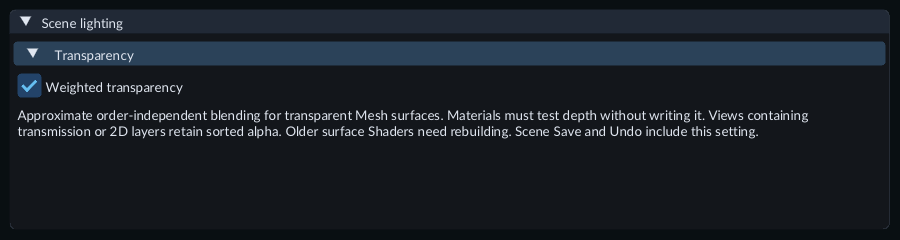
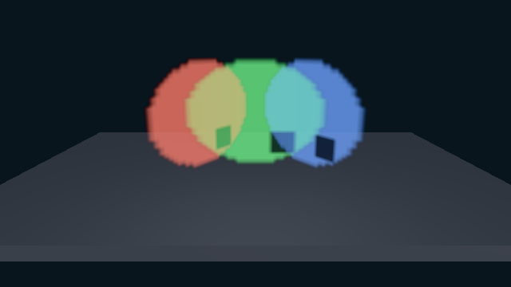

# Blend overlapping transparent Meshes

**Weighted transparency** blends eligible transparent Mesh surfaces without relying
on their part order. Use it for overlapping colored surfaces whose intersections
look wrong with ordinary sorting. It is an approximate blend: colors can differ
from a physically layered surface, especially when one layer is nearly opaque.

## Enable the Scene setting

1. Stop Play. Open **Tools > Scene lighting...**.
2. Expand **Transparency** and enable **Weighted transparency**.
3. Open a receiving [Material](materials.md). Under **Surface state**, choose **Blend** in **Alpha**, enable **Depth test** and disable **Depth write**. Save the Material.
4. Set the material's base color alpha below 1, or use a color image with alpha. Assign the material to the Mesh. Use **Two-sided** if the surface must be visible from both sides.
5. Inspect the overlap in Scene, or press Play with an enabled Camera to inspect Game. Toggle the Scene setting in Edit to compare the two blends.
6. Save the Scene. **Undo / Redo** reverses changes to the setting.

The Scene setting enables the blend for compatible Mesh surfaces in each view.

The option starts disabled in new and existing Scenes. Disabled Scenes use the
usual back-to-front part sorting. The setting belongs to the authored Scene and
is locked during Play; it is separate from live component values.

## Try the Gallery

Open **114-weighted-transparency** in the [Feature Gallery](../getting-started/feature-gallery.md).
Three intersecting panels reuse the same image material with separate per-object
colors and alpha. The floor remains opaque. Select a panel to move or rotate it,
or adjust its material values. Toggle **Weighted transparency** to compare the
appearance at intersections.

Each panel has its own placement and color values while sharing one Material and Texture.

## Compatibility and troubleshooting

The renderer uses ordinary sorted drawing for the entire affected view when it
contains a visible Sprite, Tile Map, transparent particle, transmission material,
or an incompatible transparent Mesh. This keeps those layers together. Check
**Problems** for a rendering warning explaining why weighted blending was unavailable.

- Keep **Depth test** on and **Depth write** off for every Blend Mesh in the view. A depth-writing transparent material keeps the view on ordinary sorting.
- Rebuild a custom Surface Shader or Material Graph and its dependent Materials with the current tools. An older cook remains usable with ordinary drawing.
- Transmission/refraction needs sorted background transport. Weighted blending does not trace light through glass or supply exact physical layer ordering.
- Opaque and Mask surfaces retain their depth and cutout behavior. Weighted blending does not add transparent shadow casting.
- Large render targets may exceed the attachment budget or the device's supported formats. The view retains ordinary sorting and reports the reason.

## Save and export

Save the Scene and any edited Materials before export. The Scene setting and normal
Material/Texture dependencies travel through the usual export process. To export
the Gallery example, choose **Use saved current scene as startup** in Project Settings,
then follow [Export a game or package content](runtime-content.md).
