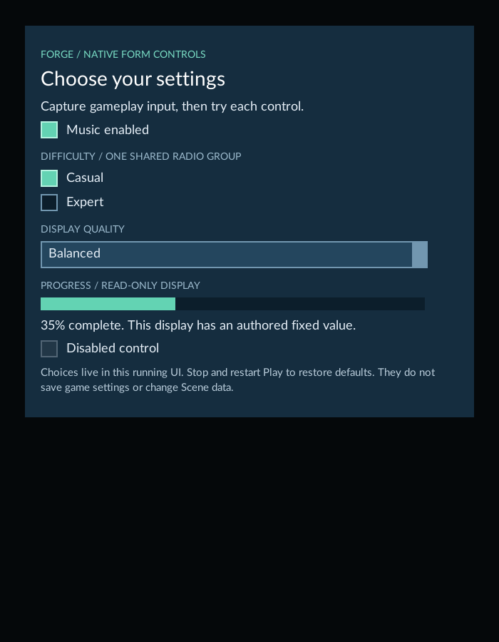
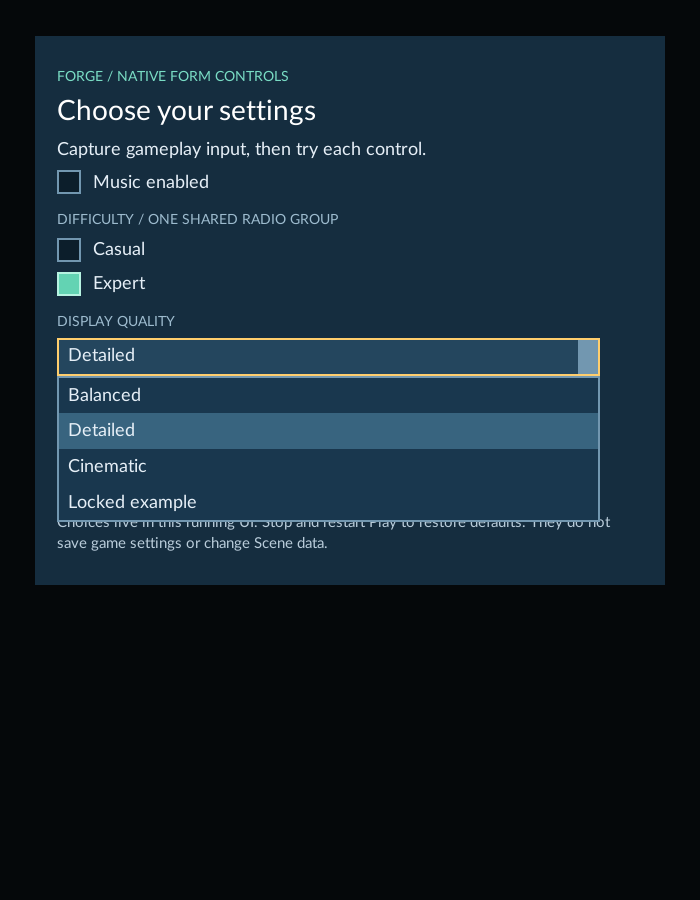
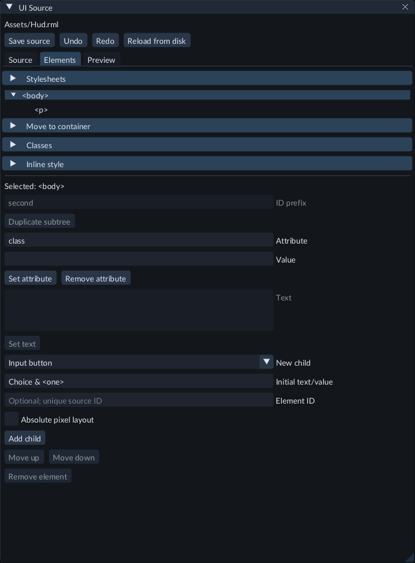
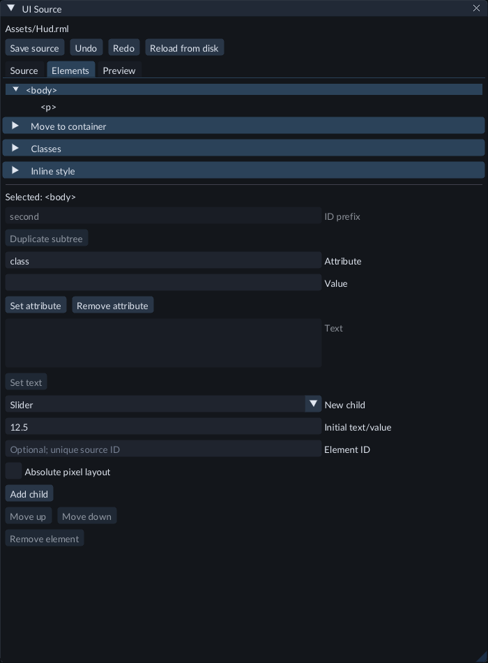

# Form controls

Use buttons for actions, checkboxes for independent choices, radio buttons for one choice in a group,
dropdowns for a list of options, sliders for bounded numbers, and progress for a read-only numeric display.
These are native controls in the running game HUD. The source editor creates and
styles them; use Play to interact with them.

## Try the Feature Gallery

1. Open the packaged **Examples/FeatureGallery** project.
2. Open `Scenes/212-ui-form-controls.scene.json` and press **Play**.
3. In **Game**, choose **Capture gameplay input**.
4. Click **Music enabled** to toggle its checkbox.
5. Choose **Expert**. The **Casual** radio clears because both belong to the `difficulty` group.
6. Open **Display quality** and choose **Detailed**. **Locked example** is disabled.
7. Inspect the progress bar: its authored fixed value is 35%. **Disabled control** cannot be toggled.
8. Press **Escape** to release input, stop Play, then start again. The authored defaults return.

The Gallery HUD uses native controls and the bundled font. It needs no project
C++ module or Light. The Scene includes a Camera.

Choose an enabled option from the native dropdown. Disabled options remain visible.

## Create and name controls

Open an RML document from Content with **Edit UI source**. In **Elements**, select
its parent, choose the required **New child** kind and use **Initial text/value**
where applicable. A nonempty dropdown starts with one selected option. Add more
**Dropdown option** children to that dropdown. Choose **Save source** before Play.
See [UI source](ui-source.md) for source selection, attributes, styling and Undo.

For common settings, select one control and use **Control properties**. Stage
flags, radio groups, slider bounds and steps, option defaults, captions or progress
values, text placeholders, image sources/crops, length and dimensions, or label targets, then choose
**Apply properties** and **Save source**. Each applied batch
has one source Undo step. These are authored values; native controls determine the
result during Play. See [UI source](ui-source.md) for reset, binding and numeric
limits.

Give controls unique `id` attributes when labels or agents must address them.
A label's `for` attribute names its target ID. Give radios the same `name` to make
a group, distinct `value` attributes for its choices, and mark only the initial
choice `checked`. Checkboxes may also start `checked`. A dropdown's option uses
`value` for its data and text for its caption; mark its initial option `selected`.
Use `disabled` to block interaction with a control or option.

The Gallery's `Assets/UI/Forms/forms.rml` shows these attributes together.
`forms.rcss` styles borders, checked/focus/disabled states and the dropdown list.
Appearance is authored: controls do not acquire an editor theme automatically.
For progress, `value="0.35" max="1"` displays 35%. Change the source or connect
appropriate gameplay bindings to drive a display from your game.

## Create an action button

1. Open the Gallery's `Scenes/210-ui-source-authoring.scene.json`.
2. In Content, open `Assets/UI/SourceAuthoring/hud.rml` with **Edit UI source**.
3. In **Elements**, select the `panel` container. Choose **New child → Input button**, enter `Step` under **Initial text/value**, then choose **Add child**.
4. Give the selected new input the `id` attribute `native-step`. Add `data-event-click` with the value `command('Step')`.
5. Choose **Save source**, press **Play**, capture Game input, then click the existing **Pause** button.
6. Click your new **Step** button. The tick advances once for each click.
7. Stop Play. Set the input's `disabled` attribute to `disabled`, save and restart Play. The input button is disabled. Remove the attribute to enable it again.

Choose the kind and caption before **Add child**. Creation makes one source Undo
step and selects the new input. Initial text is a literal `value` caption; characters
such as `<` and `&` are escaped in the source. Use the existing attribute fields to
name the button and assign its supported command binding.

The **Button** kind creates a button with child content. Use its `focus:none`
inline style to block activation. Its `disabled` attribute has no native disabled
state. **Input button** supports the native `disabled` attribute. Style Input
buttons with an `input` selector or a class you assign. Neither kind automatically
saves game settings or adds a command; the `data-event-click` binding supplies the
action. Save source before Play and export.

## Create a slider

1. Open an RML document with **Edit UI source** and select its parent in **Elements**.
2. Choose **New child → Slider**. Enter a number, such as `12.5`, under **Initial text/value**, then choose **Add child**. Leaving the value empty starts at `0`.
3. Give the input a unique `id`. Add `min`, `max` and `step` attributes, for example `0`, `100` and `5`. The native defaults are `0`, `100` and `1`.
4. Use `orientation="vertical"` for a vertical slider; otherwise it is horizontal. Style its input and native slider parts in your stylesheet.
5. Choose **Save source**, start **Play** and capture Game input. Drag the slider or focus it and use its native keyboard controls. The native control rounds to its step and clamps to its bounds.
6. Add an appropriate `data-event-change` binding when changes should affect your game. The slider alone does not save settings or assign a gameplay property.

Creation selects the new input and makes one source Undo step. Initial values must
be finite numbers within `-1000000` to `1000000`. Save source before export.
For example, in the Gallery's source-authoring HUD, give the slider
`data-event-change="command('Step')"`; pause that HUD before changing the slider to
see each change advance its tick. Choose bounds and step that suit your game.

## Test controls with an AI agent

Connect through [MCP](mcp.md), enable **Allow C++ build and execution**, then ask
the agent to start Play and inspect the HUD's native form controls. Read-only
connections can inspect state but cannot start Play or change controls.

The agent reads `forge_play_ui_controls` for the current document instance, unique
IDs, checked flags, selected value, progress and presentation revision. To change
a checkbox it calls `forge_play_ui_check` with the desired checked state. To choose
a radio it calls `forge_play_ui_choose`. For a dropdown it reads
`forge_play_ui_options`, then uses the selected row's index and state token with
`forge_play_ui_select`. A changed presentation or option requires a fresh read.

For buttons, the agent reads `forge_play_ui_buttons`, then calls
`forge_play_ui_press` with the current instance, unique element ID and presentation
revision. Generic captions appear as `text`; input button captions appear as
`value`. Generic `enabled` is unavailable; the view reports native focus and
`pressable` eligibility. A fresh press can fire again, while receipt replay uses
the original result without clicking twice. Native event cancellation remains in
effect. Semantic press keeps the current pointer position. Delivery does not confirm that gameplay accepted a command.

For sliders, the agent reads `forge_play_ui_ranges`, then calls
`forge_play_ui_range_value` with the current scope, instance, unique ID,
presentation revision and numeric `value`. Read the returned native `value`
string: the authored attribute can differ after native rounding. The value string
has six decimal places and does not expose the control's full private precision.
Numeric values and bounds must be finite within `-1000000..1000000`, with a
positive step of at least `0.000001`. Unsupported configurations are visible but
cannot be edited through this action. Each fresh request reaches the native
setter. Repeated requests outside the bounds can trigger another native change
event even if the displayed value stays the same; receipt replay does not set it
twice. `value_text_changed` describes the returned text, not gameplay acceptance.

For keyboard testing, use `forge_play_ui_widget_focus` with the observed `kind`
and current scope, then `forge_play_ui_widget_key` for that exact focused control.
These tools support checkboxes, radios, dropdowns, buttons, input buttons and
sliders; text fields keep their existing field tools. Supported keys are arrows,
Home, End, Page Up, Page Down, Space, Return (`accept`), Escape, Tab (`next`) and
Shift-Tab (`previous`). Native controls decide which keys have an effect.

Horizontal sliders use Left/Right; vertical sliders use Up/Down. Dropdown arrows
change selection. Native checkbox and radio Space/Return use their own events.
A fresh key can emit another native event for an already-selected radio. Input
buttons support Space/Return with their default native tab stop. A generic Button
with `tab_stop:false` does not gain keyboard activation automatically: set its
inline style to `tab-index:auto;` when it should take part in native keyboard
navigation. Its native `focus` style must also allow focus. The observations
report `focusable` and `tab_stop` separately from visibility and enabled state.

Tab may leave the original control or move to another control family. Read the
appropriate view again or focus a specific control before sending its next key.
Keyboard delivery and `consumed` describe native input handling, not value change
or gameplay acceptance. Receipt replay does not send the key twice. Keyboard
testing does not replace native event cancellation, save settings or write source.

Already-satisfied checkbox, radio and dropdown actions do not focus or activate the control. Native events and
gameplay callbacks can change the result, so the agent reads the returned state.
Text/password/text-area fields have their own [field tools](ui-text-input.md).
Password plaintext is omitted from observations.

## Save, export and limits

Runtime choices are local to the running UI. They do not automatically save game
settings, edit RML, change Scene data or enter Scene Undo. Add your game's binding,
command or save behavior when choices must affect gameplay or persist. Progress
observation does not provide a progress-editing command.

Save UI resources, the Scene and Project Settings before exporting with the
matching runtime kit. Set this Scene as startup to export the Gallery example.
The exported game accepts normal player input; editor MCP tools do not attach to
that process. See [Export a game](runtime-content.md).

Agent actions require unique visible enabled targets, current Play and
presentation scope, and ordinary native focus/input routing. Camera-output input
also needs a current surface hit. Duplicate IDs, missing controls or incomplete
scans cannot authorize changes. Discovery is limited to 4,096 native nodes and
64 form controls. Buttons and sliders each have their own 64-control counter. Dropdown pages contain at most 32 options; text/value reads are
bounded and can report unavailable data without truncating it. If a dropdown page
has no state token for an option, that option cannot be selected through MCP.
If a page is not ready, allow a native UI update and read again. Arbitrary DOM/script edits,
IME composition injection and general accessibility automation are unavailable.
