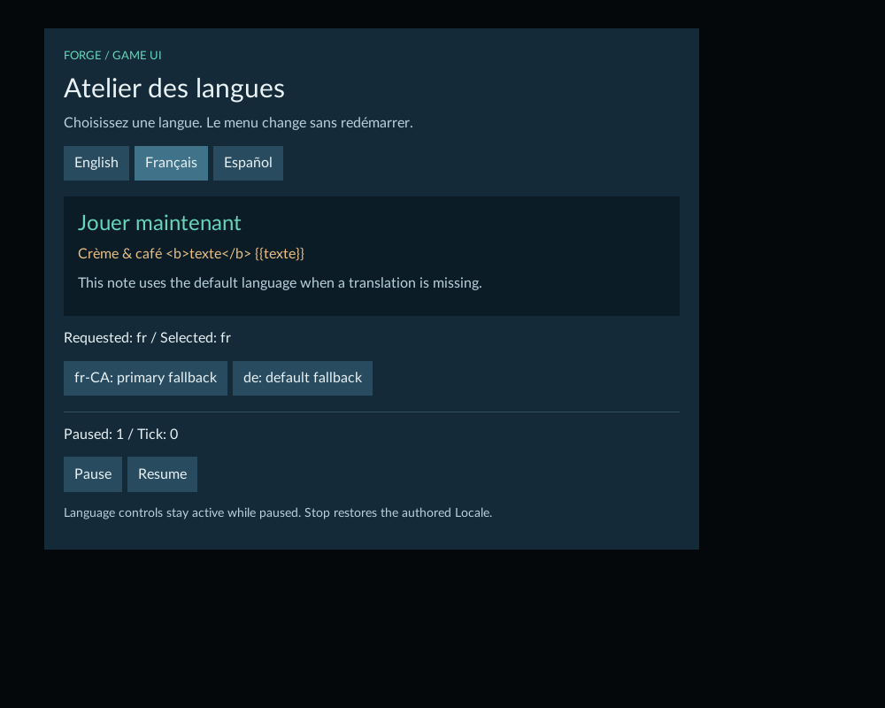
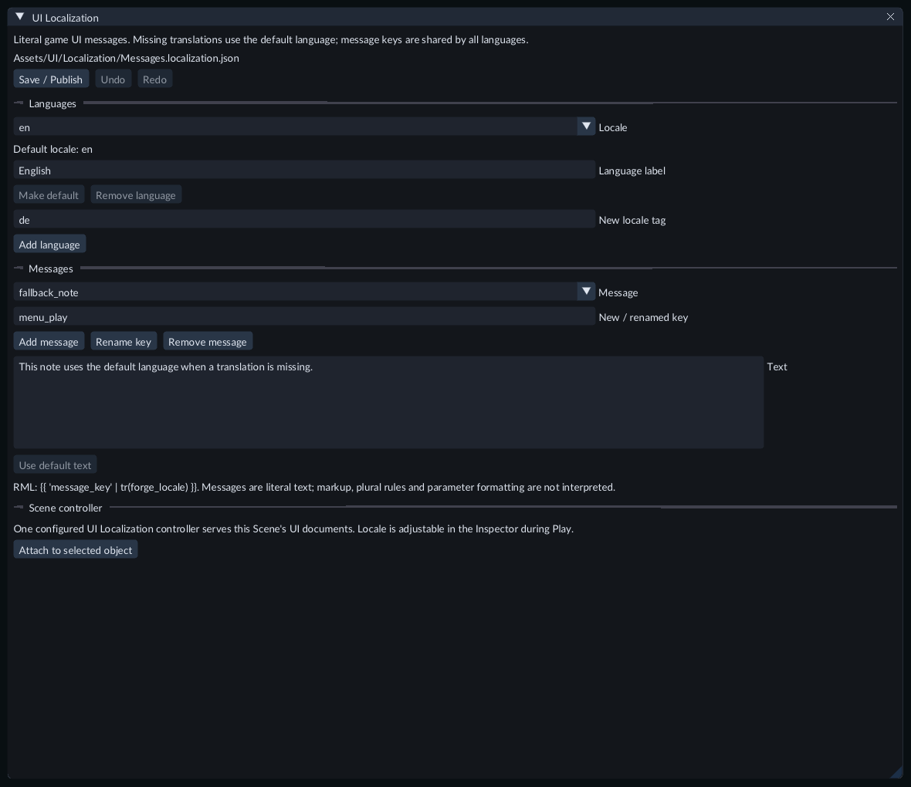

# Translate a game's menus and HUD

A **UI Localization** catalog stores literal messages in several languages.
Your RML document refers to a message key, and a Scene's UI Localization
controller chooses the language. This translates your game's interface.

## Try the ready example

Open Feature Gallery's **Scenes/133-ui-localization.scene.json** and press
**Play**. Enable **Capture gameplay input**, then click **Français** or
**Español**. The menu changes immediately.



The language buttons also work after **Pause**. **fr-CA: primary fallback**
selects French; **de: default fallback** uses English because German is absent.
The **Requested** and **Selected** values show the difference. The note below
the highlighted message has no French or Spanish translation and uses English.

Press **Escape** to release game input. Select **Language controller - inspect
Locale** to read or adjust its live `locale` value. The Game controls report the
language actually displayed and the number of messages using the default.

## Create a catalog

1. Stop Play. In **Content → Create / Register**, choose **New UI localization...**.
2. Enter a project file such as `Assets/Messages.localization.json` and click **Create**.
3. The **UI Localization** document opens with English as the default language and a French translation of `menu_play`.
4. Select a **Locale** and a **Message**. Edit its **Text**, then click outside the field to commit one source Undo step.
5. Click **Save / Publish**. Wait until publication finishes before assigning the catalog or exporting.



Open the published catalog from Content to edit it again. Keep the
`.localization.json` suffix when moving or duplicating its source file.

## Languages and messages

- **New locale tag → Add language** creates a language with no translations. Tags use ASCII letters and digits separated by hyphens, for example `de`, `fr-CA` or `en-GB`. The first segment contains 2–8 letters; later segments contain 1–8 letters or digits. Total length is 2–35 bytes.
- **Language label** is the readable name shown in the catalog's Locale list.
- **New / renamed key → Add message** adds a key in the default language. Keys start with a letter or underscore, then contain only letters, digits or underscores. Enter the new message's text below.
- **Rename key** renames the selected key in every language. Update any RML expressions that use the old key yourself.
- **Remove message** removes that key and its translations in every language.
- **Use default text** removes the selected non-default translation. An explicitly empty translation displays empty text; it does not mean fallback.
- **Make default** chooses the selected language as the default and copies any missing default messages into it first.
- **Remove language** removes a non-default language and its translations. The current default language cannot be removed.

The default language defines all available keys. Other languages may omit keys.
Use the document's **Undo** and **Redo** to restore edits. Undo during an active
text draft cancels that draft. Save flushes the active text field. Closing a
changed document offers **Save**, **Discard** and **Keep editing**.

## Connect the catalog to a Scene

1. Create or select an object in Hierarchy for the Scene's language controller.
2. After publishing the catalog, click **Attach to selected object** in its document.
3. The object receives **UI Localization**, its `catalog` reference and the catalog's default `locale`. This is one Scene Undo step.
4. Save the Scene. Keep one configured controller for all active UI Documents in that Scene.

You can also add **Runtime UI / UI Localization** through the Inspector and
assign the catalog with its asset picker. Add a Camera for Game view. Create and
assign a [UI Document](runtime-ui.md) for the menu or HUD itself.

## Display a message in RML

Put a literal message key through `tr(forge_locale)`:

```xml
<h1>{{ 'menu_play' | tr(forge_locale) }}</h1>
<button data-event-click="command('forge.locale', 'fr')">Français</button>
<p>Requested: {{forge_locale}} / Selected: {{forge_resolved_locale}}</p>
```

FORGE supplies these bindings when the Scene has a configured controller.
Omit `data-model` attributes. Edit RML in your preferred text editor; use Content
to register it and its project-relative resources. The language command needs no
project C++ module.

Messages are literal text: `<b>`, `&` and `{{braces}}` inside a message remain
visible text. Put presentation markup around the translation expression in RML.
There are no plural rules or parameter substitutions in this catalog format.

## Change language, save and export

Language tags are compared without case. Selection tries an exact language tag,
then its primary language, then the catalog's default. A missing translation uses
the default message. An unknown key displays `[[key]]` so it is visible while
testing.

During Play or Pause, change `locale` in the controller's **Live gameplay**
Inspector, use a language button, or write the same component from project C++.
Language changes keep the current UI context and focus. Catalog references and
source edits require returning to Edit mode.

Stop restores authored values. Use **Keep values after Stop...** deliberately
to retain a supported live change. FORGE does not automatically save a player's
language preference. Ordinary runtime recovery retains the runtime Scene's
Locale; prepared Editor SDK Play has no process-recovery checkpoint.

After editing messages, **Save / Publish**, save the Scene and start Play again.
For saved external table or RML changes during Play, **Reload UI** prepares a new
complete presentation. Failure keeps the previous usable UI and reports an error.
Restart Play when replacing a font under the same font family.

Before [exporting](../getting-started/standalone-runtime.md), save or explicitly
discard all drafts. The Scene's catalog reference includes the selected cooked
table in the game. Editable catalog source and its import worker are unnecessary
in the exported game.

## Limits and troubleshooting

- Each catalog supports eight languages and 128 message keys. Source is limited to 256 KiB, each message to 1 KiB, each language label to 64 bytes and each key to 48 bytes. These are UTF-8 byte limits.
- A Scene UI context supports one configured controller and one catalog. Independent Worlds have independent language values.
- Keep the model names `forge_locale` and `forge_resolved_locale`, and the action name `forge.locale`, free for localized UI.
- Text is UTF-8, but visible characters depend on the loaded fonts. The bundled Latin font supports the Gallery's accented examples. Full script shaping and complete international input are unavailable.
- If text does not change, check the Scene controller, its published catalog, the message key, the RML expression and the requested language. Read the Game language/fallback status and Problems panel.
- If a source edit fails validation, correct it or Undo the draft. If a reload fails, the displayed text may still belong to the retained previous presentation.

For agents, use `asset.localization.catalog`, the `ui_localization` source
document operations, ordinary Scene component/property operations, and
`play.ui.command` with `forge.locale`. `play.ui` reports runtime settings and the
actual displayed localization when a live presenter is available. See
[live automation](live-automation.md).
