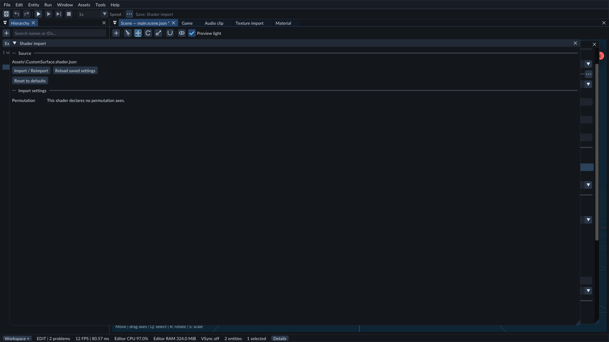
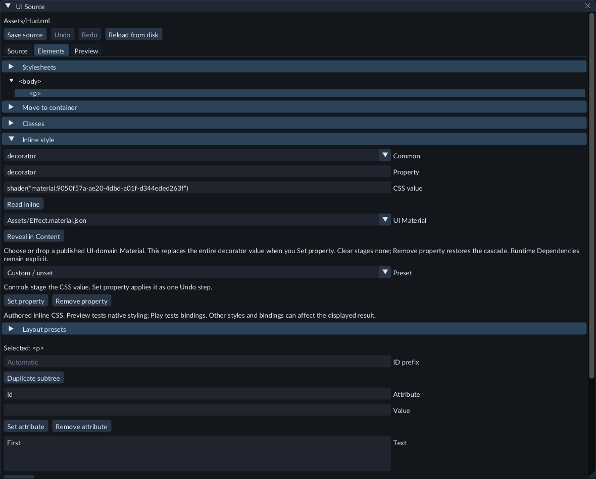

# Create a procedural UI Material effect

A UI Material draws a custom color effect inside a UI element. It can use the
element's UV coordinates, size, presentation time and saved numeric Material
values. The element keeps its normal layout, clipping and opacity.

This workflow requires the Windows D3D12 editor, a project with a registered RML
document, and the matching runtime kit for export. It uses HLSL rather than a
visual graph. See [UI source editing](ui-source.md) to open and save RML/RCSS files.

## Create and import the Shader

1. Stop Play. Create the project folders `Assets` and `Shaders` if needed.
2. Create `Assets/Panel.shader.json` with the declaration below. Replace the example `asset_id` with a fresh UUID, then keep that UUID for this Shader.
3. Create `Shaders/panel.hlsl` with the function below.
4. Choose **Content → Create / Register → Import shader...**, select `Assets/Panel.shader.json`, choose **Review settings**, then **Import / Reimport**.
5. Wait for publication. Open Problems if compilation reports an error.

```json
{
  "format": "forge.shader",
  "version": 2,
  "asset_id": "6b8a461e-bf35-4ff3-a24d-aad09481c59e",
  "source_root": "Shaders",
  "stages": [
    {
      "stage": "pixel",
      "source": "panel.hlsl",
      "entry": "Panel"
    }
  ],
  "surface": {
    "version": 4,
    "domain": "ui",
    "uv_sets": [0],
    "parameters": {
      "tint": {"type": 5, "value": [0.2, 0.6, 1.0, 0.75]}
    },
    "textures": {},
    "labels": {"tint": "Tint"}
  }
}
```

```hlsl
#include "engine/forge.surface.hlsli"
float4 Panel(ForgeUiInput input) {
    float4 tint = ForgeParameter_tint();
    return float4(tint.rgb * input.UV.x, tint.a);
}
```

The function returns linear RGB and straight alpha. FORGE applies element opacity,
target color conversion and premultiplication. Do not premultiply the return value.
Type5 means linear RGBA; scalar and vector parameters use the ordinary Material
parameter types. `input.Size` contains element pixels and `input.Time` contains
presentation seconds. Presentation time continues while simulation is paused.



Use Shader import to publish the declaration and its HLSL source.

## Create the Material and select it in UI

1. Choose **Content → Create / Register → New material...** and create `Assets/Panel.material.json`.
2. In the Material document, select the imported Shader in **Surface Shader**.
3. Adjust **Tint** and choose **Save** to publish the Material. Keep transparency at **Blend**, enable **Two-sided**, and leave **Depth test** and **Depth write** off.
4. Open the registered RML document, select an element in **Elements**, and expand **Inline style**. For selected siblings use **Group inline style**; in RCSS select a flat rule or a width-conditioned child rule and expand **Rule properties**.
5. Choose `decorator` from **Common**, then select the published Material in **UI Material**. You can search its path or drop it from Content. The Material must use the UI surface domain; unpublished, incompatible or damaged publications are rejected.
6. Choose **Set property** to replace the decorator value in one source Undo step, then **Save source**. Refresh the RML Preview or restart/reload UI in Play to inspect the result. Selecting a Material stages the CSS value without saving or changing the source.



The picker replaces the complete decorator value, including any existing gradient
or decorator list. Keep custom combinations in **CSS value** or **Source**. **None /
Clear** stages `none`, which disables decorators when applied. **Remove property**
removes this declaration so the stylesheet cascade can supply another value.
Reading mixed or unsupported CSS never replaces it automatically.

For direct source editing, use the Material UUID, which differs from the Shader
UUID. This example gives an element a class and an explicit size:

```css
body, div { display: block; }
.panel {
    width: 240px;
    height: 80px;
    decorator: shader("material:YOUR-MATERIAL-UUID");
}
```

```xml
<div class="panel" />
```

The panel fades from black to the chosen tint across its width. Changing element
opacity or parent clipping still affects the result. UI Materials preview in the
UI document or Play; the Material document's geometry preview is for other
surface domains. To change the effect, edit the HLSL and reimport the Shader,
then save/rebuild its Material. A failed publication keeps the previous published
Material usable.

## Include the effect in an exported game

Select the registered UI document in **Content**. In **Inspector → Runtime
Dependencies**, add the Material with expected type **Material** and a reason,
then choose **Save declarations**. Review declarations after editing the source.
Previewing a reference does not add it to required runtime content.

Save the UI source and Material before exporting. The exported Material contains
its exact compiled Shader; the game runs without HLSL or Material source files.
Use a runtime kit with UI effect support. An older kit is rejected before replacing
the export destination.

## Limits and troubleshooting

- Use one Pixel function, UV0 and numeric Material parameters. UI effects do not accept textures, custom vertex stages, mesh lighting or a Mesh/Sprite assignment.
- A missing or incompatible Material reports an admission error. Check the UUID, publication, UI Shader domain and Runtime Dependencies declaration.
- The UI render state is transparent, two-sided and has depth testing/writing off. Incompatible values prevent publication.
- UI effects and native gradients share a maximum of256 compiled handles. Reduce the number of distinct decorated elements if the handle limit is reported.
- Nonfinite shader output displays diagnostic magenta. Check divisions and math in the function, then reimport and publish the Material again.

See [Shader import](shaders.md), [Materials](materials.md),
[Runtime UI](runtime-ui.md) and [Runtime content](runtime-content.md).
