# Edit a game's UI source

Use **UI Source** to edit a game's RML document or RCSS stylesheet inside FORGE.
RML describes the widgets and their bindings; RCSS controls their appearance and
layout. **Source**, **Elements** and **Preview** share one source draft and Undo
history. Preview an unsaved RML draft while Play is stopped; use **Game** to test
its gameplay bindings and interaction.

## Open an example

1. Copy **Examples/FeatureGallery** to a writable location and open its project.
2. Open **Scenes/210-ui-source-authoring.scene.json** and press **Play**.
3. Open **Game**. The panel shows text, a tick counter, Pause, Resume, Step and a text field. Capture gameplay input to interact with it.
4. Stop Play. In **Content**, find **Assets/UI/SourceAuthoring/hud.rml** and choose **Edit UI source**. Double-clicking the registered document also opens it.

The example includes a Camera and uses the supplied Lato font. No Light or
project C++ module is required. Register your own RML or RCSS files through
**Content → Create / Register → Runtime UI → Register / Refresh** before opening
them from Content. Keep editable sources under **Assets**, **Sources**, **UI** or
**Shaders** inside the project.

## Edit widgets with Elements

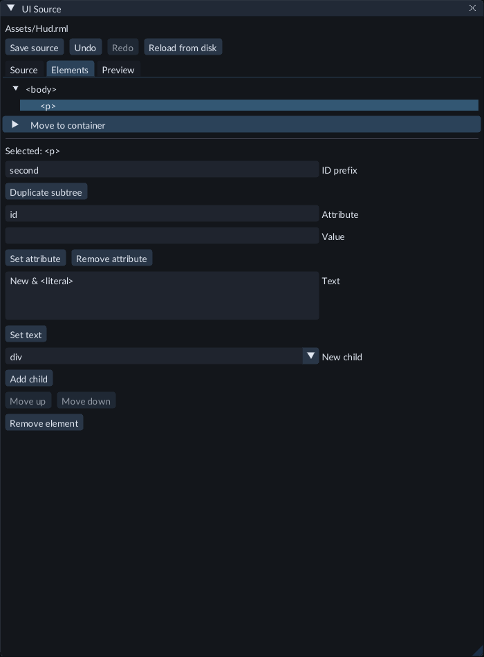

Select a widget in the source outline to change its attributes, text or position.

1. Select **Elements**. Expand the body and select a paragraph, button or container.
2. To change an attribute, enter its **Attribute** name and **Value**, then choose **Set attribute**. For example, use `style` and `color:#73d7bd;` to set text color. **Remove attribute** removes the named attribute.
3. For a leaf containing text, edit **Text** and choose **Set text**. Containers with child widgets or comments protect their contents from this replacement.
4. Select a container, choose **New child**, enter optional **Initial text/value**, then **Add child**. The new control becomes selected. See the control choices below.
5. Select a widget and use **Move up**, **Move down** or **Remove element** to change its position among siblings or remove it.

Each successful operation is one source Undo step. The outline is derived again
after an edit; most operations clear the selection. Duplication selects the new
root, creating a control selects its root, and inline style edits keep the edited element selected. Select an element
again after Undo or Redo.
Element positions describe the current source, rather than permanent widget IDs.
Use an `id` attribute to name a widget for styles and bindings.

Text and attribute values escape markup characters such as `<` and `&`. RML
bindings keep their source meaning: `Tick {{tick}}` displays the runtime counter.
Use **Source** to write child markup, resource declarations or other RML syntax.
The Elements controls protect document structure and style/resource declarations.
Use **Preview** for native rendering and the supported pixel layout controls.

## Create common controls

1. In **Elements**, select the body or a container such as a div or form.
2. Choose **New child**. The choices include Container, Inline text, Paragraph, Button, Input button, Slider, Label, Text input, Password input, Checkbox, Radio option, Text area, Dropdown, Dropdown option, Progress, Image, Line break and Form.
3. Enter **Initial text/value** when enabled. Optionally enter a unique **Element ID**. Leave **Absolute pixel layout** off for normal flow layout, then choose **Add child**. The new control is selected so you can assign its attributes and style.
4. Use **Undo** or **Redo** for the whole creation. Choose **Save source** to write it to disk. **Preview** checks native appearance; use **Game** during Play to test interaction.

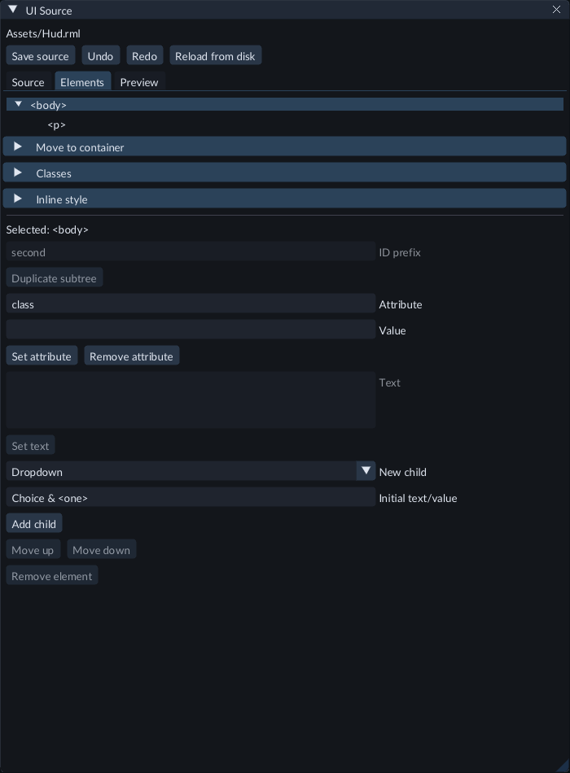

Choose a kind and initial value before Add child. A dropdown with initial text
creates its first selected option in the same Undo step.

**Slider** creates a native range input. Enter a finite numeric initial value;
set `min`, `max`, `step` and optional `orientation` in Attributes. See
[Form controls](ui-form-controls.md) for Play and agent controls.

**Input button** stores its caption in `value` and supports the native `disabled`
attribute. **Button** has child text and uses its native focus style for activation;
use `focus:none` to block it. See [Form controls](ui-form-controls.md) for creating
an action button and testing it through Play or an agent.
When editing an input type manually, use the lowercase values written by this menu.

Initial text is limited to 8,192 UTF-8 bytes. Markup characters are escaped; RML
bindings keep their existing source semantics. Creation preserves the surrounding
source and adds no automatic IDs, label targets, resource registration or event
bindings. Complete source and opening-tag limits still apply.

- Text input and Password input use the initial field as their `value`. Checkbox and Radio option use it as the submitted value, rather than a visible label. They start unchecked.
- Text area uses the initial field as its content. Set its text or attributes after creation for additional content and constraints.
- Dropdown with initial text creates one selected option using that text for its label and value. An empty field creates an empty dropdown. Select the dropdown and choose Dropdown option to add further options. A new option uses its initial text for label and value; it does not change an existing selection.
- Dropdown option requires a dropdown parent. A dropdown accepts option children. Text areas, options and progress controls do not accept new controls through this menu.
- Progress starts with `value="0"` and the native maximum of one. Use Set attribute to change its value. Progress, Image and Line break have no initial text field.
- Image needs a `src` attribute, such as `badge.tga` for an image beside the RML file. Save, then Register / Refresh the document and its contained resources as described in [Runtime UI](runtime-ui.md).

For a checkbox label, assign the input an `id`, create a Label and set its `for`
attribute to that ID. Give radio options the same `name` to form a group. Use the
normal attribute controls to set `checked`, `disabled`, option `selected` and other
admitted attributes; remove an attribute to clear it. Author IDs and targets
explicitly, then save and test native behavior in Game.

## Create a control with a pixel layout

1. In **Elements**, select a container and choose the **New child** kind.
2. Enter a unique **Element ID**, such as `settings-panel`. Use literal source names up to128 UTF-8 bytes. The source check rejects duplicate or ambiguous IDs and ID literals containing dynamic expressions.
3. Enable **Absolute pixel layout**. Set **Left (px)**, **Top (px)**, **Width (px)** and **Height (px)**. The initial proposal is `0, 0, 160, 40`. Positions can be negative; all values must be finite and within `-65536..65536`, with width/height at least `1`.
4. Choose **Add child**. The new root is selected with its ID and explicit absolute pixel styles. Creation is one source Undo step; the file stays unsaved.
5. Open **Preview**, refresh and inspect the new control. Native layout and the cascade determine whether it can be moved or resized on the canvas. Choose **Save source** when satisfied.

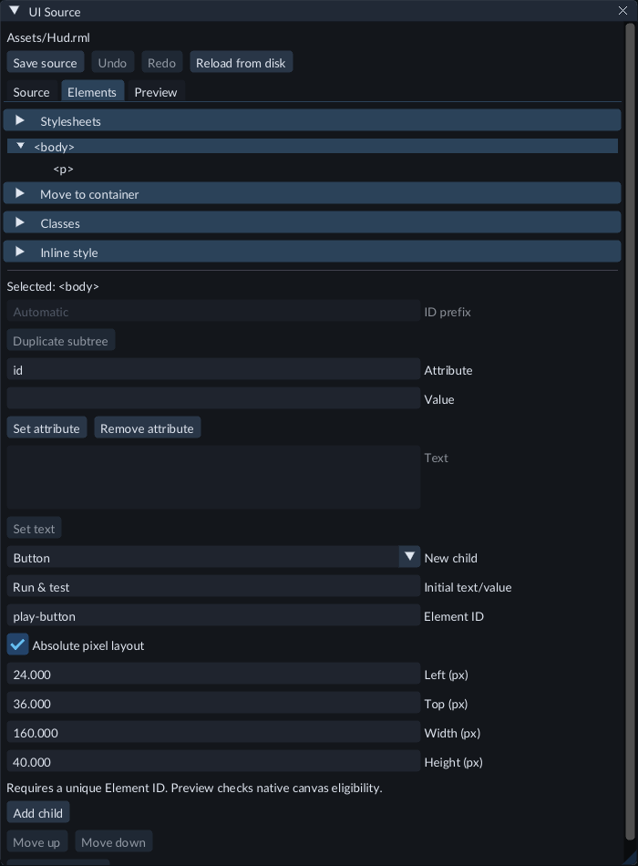

Pixel creation requires an Element ID; Add child is disabled while it is empty.
Line breaks and dropdown options keep their native flow layout and cannot use
this setup. Data-bound ancestors reject pixel setup. Invalid IDs or geometry
leave source and history unchanged; correct the fields and try again.

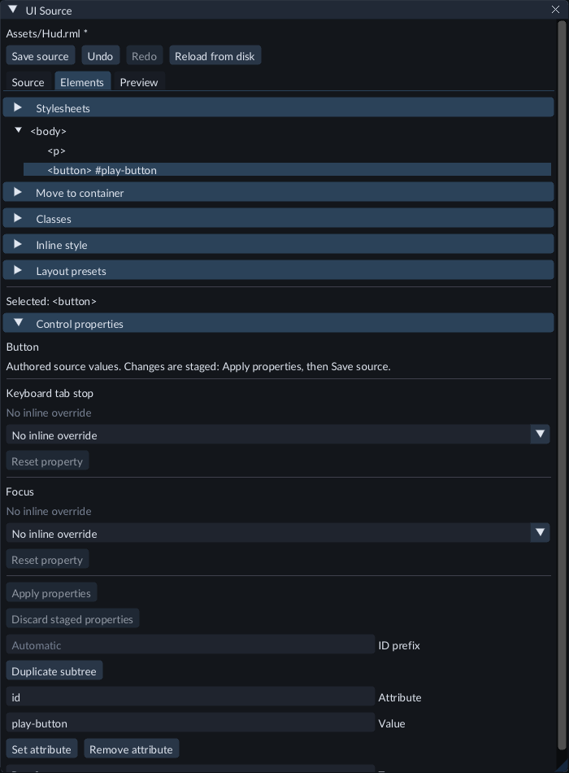

Leaving **Absolute pixel layout** off preserves normal flow creation. An optional
ID can also name a flow control without assigning layout. Existing source IDs and
styles stay unchanged. Constraints, transforms, scrolling or stylesheet overrides
can make a created control ineligible for canvas gestures; use the explanation
in Preview and the existing Inline style/Source controls. Resource registration,
Scene assignment and export retain their [runtime UI workflow](runtime-ui.md).

## Edit control properties

Select one supported control in **Elements**, then expand **Control properties**.
The panel shows authored literals or defaults from the RML source. It does not
show the running game's values or computed stylesheet results.

1. Edit the values you need. A slider offers **Initial value**, **Minimum**, **Maximum**, **Step**, **Orientation** and **Disabled**. Checkbox and radio controls offer **Initially checked**; radios also have **Radio group**.
2. Changed rows show **Staged change**. The source draft, Undo history and disk stay unchanged while you enter values.
3. Choose **Apply properties**. The complete edit becomes one source Undo step, and the control stays selected. If a value is invalid, correct it and apply again.
4. Choose **Save source** before testing or exporting. Use **Preview** for appearance and **Game** during Play for interaction. Refresh a registered resource when its source update is offered.

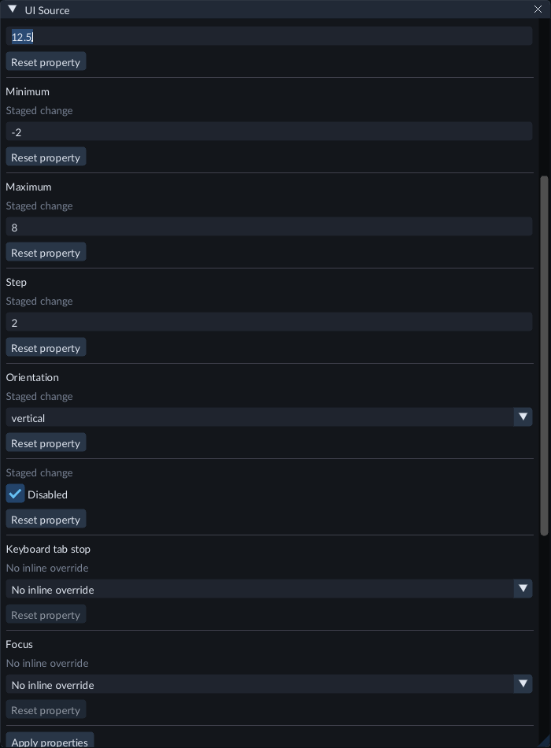

Scroll the panel when needed. **Native default** means the property has no authored
attribute. **No inline override** leaves focus or tab behavior to styles and native
defaults. **Staged change** identifies a pending edit; it is written to the draft
only on Apply.

**Reset property** stages removal of an attribute or inline override. **Keep
override** cancels that reset. **Discard staged properties** restores this panel's
values without changing the source draft. Undo and Redo operate on an applied
batch. Saving a source does not automatically save game settings or Scene data.

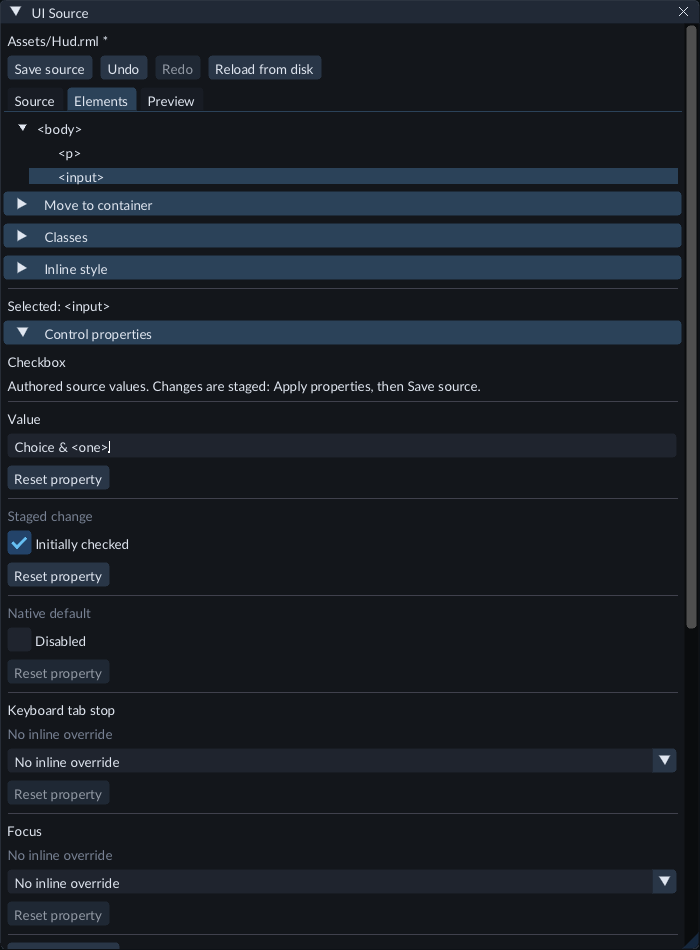

Supported controls include:

- **Text input** and **Password input**: initial source value, placeholder, maximum length, width in characters, disabled state and focus/tab styles. Initial password text is visible in source; runtime password observations stay redacted.
- **Text area**: placeholder, maximum length, rows, columns, wrapping, disabled state and focus/tab styles. Edit its initial body through the existing **Text** field; changing dimensions preserves that body.
- **Image**: source, sprite name, crop rectangle and width/height attributes. Source paths follow the RML document's directory. A nonempty sprite takes precedence over source and crop; a missing sprite does not fall back to source.
- **Label**: target ID. An empty target uses the first descendant control. Its existing text and nested markup remain unchanged when you set a target.
- **Checkbox** and **Radio option**: value, initial checked state and disabled state; radios also have a group name.
- **Dropdown**: disabled and focus/tab styles. Select a **Dropdown option** child to edit its value, initial selection and disabled state. Clear other authored initial flags when you want one initial choice.
- **Slider**: authored value, bounds, step, orientation, disabled state and focus/tab styles. Numbers must be finite within `-1000000..1000000`; step must be at least `0.000001`. The native slider owns rounding and clamping during Preview or Play.
- **Progress**: authored value and maximum. The native display clamps its value; a maximum of zero or less uses `1`. For example, value `0.35` and maximum `1` displays 35%.
- **Input button**: caption, disabled state and focus/tab styles. **Button** offers focus/tab styles; use the existing **Text** field for its simple leaf caption. A generic button has no native disabled flag.

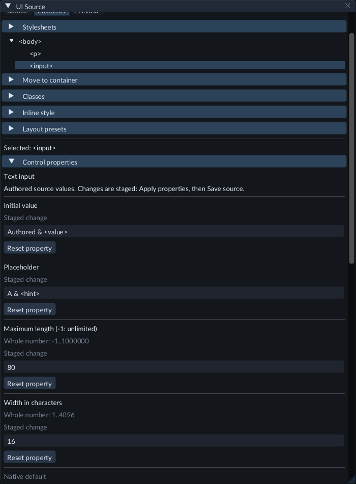

Text input source settings are staged together; scroll to **Apply properties**
when ready. An initial password value is authored source, so do not use it for a
user's runtime password.

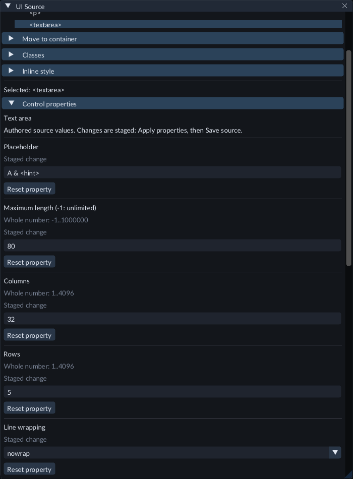

A text area's dimensions and wrapping can change without replacing its initial
body. Use **Text** for plain initial content or **Source** for unsupported forms.
With the current native parser, entities in a textarea body can appear literally
(for example, `&amp;`). Test punctuation in **Preview** before exporting. For
an exact escaped initial value, leave the body empty and set its `value` attribute
in **Source**, for example:

```xml
<textarea value="Initial &amp; &lt;notes&gt;"></textarea>
```

Do not add body text to this form: the native body parser can replace that initial
attribute value. Test the result in **Preview** or **Game**.

Text dimensions and maximum length require whole numbers. Width, rows and columns
support `1..4096`; maximum length supports `-1..1000000`, with `-1` leaving length
unlimited and `0` giving a zero-length input limit. Reset removes the override and
restores the native default: width/columns `20`, rows `2`, maximum length `-1`.
The panel shows each integer range. An existing unsupported numeric spelling stays
in Source until you explicitly replace or reset it. Native controls determine
maximum-length behavior; the property panel does not truncate authored text.

Source numbers use native float precision. Equal typed numbers preserve existing
source spelling. Flags use attribute presence: typing `false` into a present
`checked` or `disabled` attribute does not clear it. Use the property checkbox or
remove the attribute instead.

Known bindings, duplicate attributes and unsupported source forms show a reason.
Use the **Attribute**/**Value** controls or **Source** for those cases; the property panel does not remove
bindings. A plain custom numeric or choice literal can be replaced explicitly.
Text controls also retain their existing text and attribute controls. Property
edits retain unrelated source, IDs and resource references. See
[Form controls](ui-form-controls.md) for runtime keyboard and agent input.

## Set an image source, crop and size

1. Create an **Image** child, select it in **Elements**, and expand **Control properties**.
2. Enter **Image source (document relative)**, such as `Badge.tga` for a file beside the RML document. Use the existing import and resource refresh controls to make that image available.
3. Leave **Sprite name (takes precedence)** empty for an ordinary image. To use a named sprite from an authored stylesheet, enter that name instead. Clear the sprite override to return to the source image.
4. Optionally enter **Crop rectangle (x y width height)**: four space-separated finite texture-pixel numbers, such as `0 0 32 16`. Crop width and height must be within `0.000001..1000000`; each coordinate's magnitude is at most `1000000`. Crop edges must stay distinct at native float precision; increase a very small crop at a large coordinate if needed. Empty or Reset removes cropping; a named sprite supplies its own crop.
5. Set positive **Width attribute** or **Height attribute** values to request native sizing. One positive value keeps the image/crop aspect ratio; two positive values set both dimensions. `0` leaves that attribute out of the size request. **Reset property** removes the attribute entirely.
6. Choose **Apply properties** for one source Undo step, then **Save source**. Refresh the registered document and check **Preview** or **Game** before export.

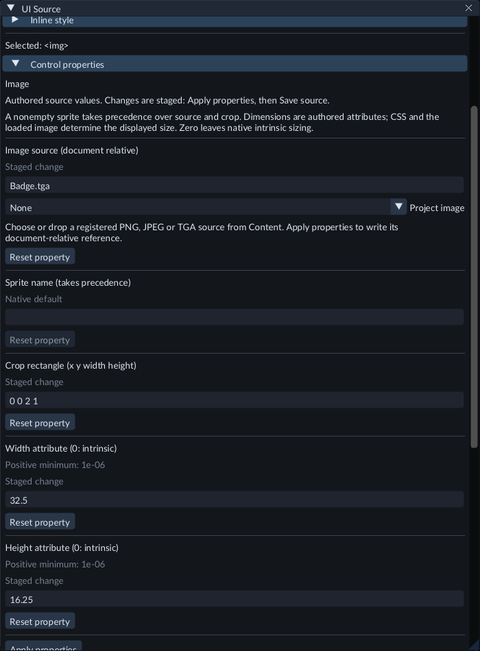

Absent image dimensions show an unavailable intrinsic-size reason. The panel does
not load the texture or guess its dimensions; a new dimension entry starts at `0`
as an editing proposal. Another positive size attribute can still determine the
other dimension through the native aspect ratio. Attribute numbers use native float precision: `0` or `0.000001..1000000`. CSS width/height can override these attributes, and display density
can scale native dimensions. Source values are separate from the displayed size.

For tint, expand **Inline style**, choose `image-color` in **Common**, and use the
existing **Color** control. Choose **Set property**, then **Save source**. This
uses the same hex/RGBA, group/rule, Undo and resource ownership as other styles.
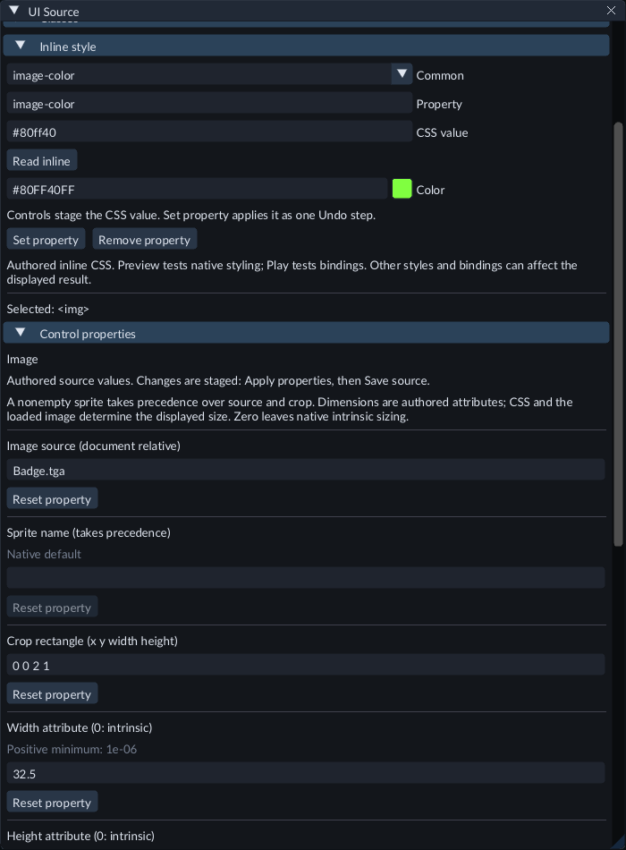

Missing resources or sprite names need correction in the existing import/source/
stylesheet workflow; changing this panel does not create another texture or sprite.

## Edit an inline style property

1. Select one widget in **Elements** and expand **Inline style**.
2. Choose a property from **Common**, or enter its **Property** name, such as `color`, `width` or `font-size`.
3. Choose **Read inline** to load its authored value. If the property is absent, the field is blank. It does not show the computed value from stylesheets or inheritance.
4. Enter a **CSS value**, such as `#77bdf7`, `24px` or `50%`, and choose **Set property**. The same widget stays selected for your next property edit.
5. To remove that declaration, choose **Remove property**. Stylesheets, inheritance and bindings then determine its appearance.
6. Each source change is one **Undo** step. Open **Preview** to check native styling, then **Save source** and use Play to check gameplay bindings.

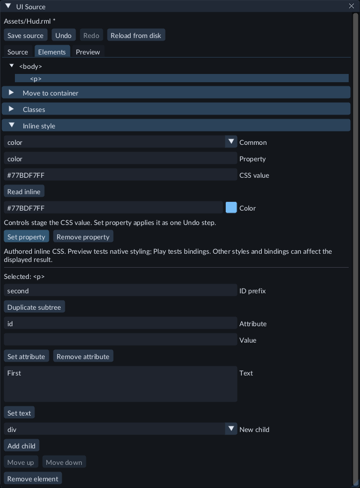

The selected paragraph has a `color` override. These fields edit authored source,
not a computed runtime value. Existing model/event bindings remain intact and can
override the authored value during Play. Other declarations and surrounding
comments keep their original bytes. Removing the only declaration keeps the
`style` attribute and any surrounding comments. An identical value or absent-property removal
creates no source Undo step.

Use a lowercase property name beginning with a letter, up to 64 letters, digits,
`_` or `-`. Values are limited to 8,192 UTF-8 bytes and the whole opening tag must
still fit its source limit. Use one quoted inline style with plain property names.
Duplicate matching declarations, entity-encoded styles, extra declarations in a
value, markup and conflicts with the attribute's quote character use **Source**.
For example, use CSS single quotes inside a double-quoted attribute. Source
admission checks structure and resource limits; Preview and Play check native
CSS behavior. These controls do not provide a complete theme or responsive designer.

## Choose a color or number

**Inline style**, **Group inline style** and **Rule properties** share the same
value controls. Changes to these controls only stage the **CSS value** field.
Choose **Set property** to change source as one Undo step, then **Save source**
to save the document. Reading or opening a control does not rewrite source.

- For `color`, `background-color` and `image-color`, a **Color** field appears for `#RRGGBB` and `#RRGGBBAA` values. The last two digits are alpha: `00` is transparent, `ff` is opaque. Edit the hex field or open its swatch to choose a color.
- For common numeric properties, use **Number** and **Unit**. **Unitless** leaves the value without a suffix; `px` means pixels, `dp` means density-scaled pixels and `%` means a percentage relative to the property's CSS reference. Changing the unit keeps the number; it does not convert physical sizes.
- If the authored value is absent, mixed or uses another CSS form, no color or number is guessed. **New color** stages opaque white; **New number** stages a supported starting value for the selected property. These explicit replacements do not publish source until you choose **Set property**. A group change applies the value to every selected sibling.

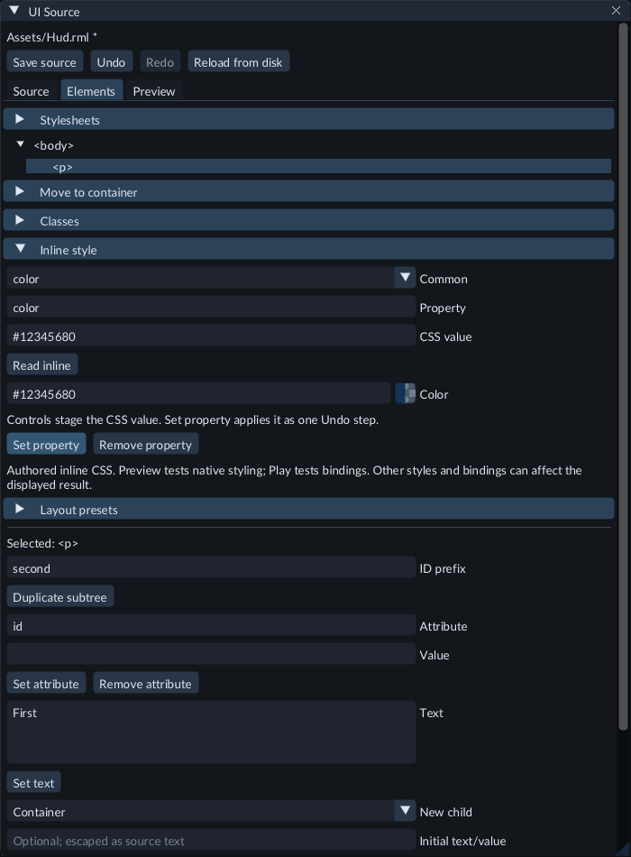

The Color field uses alpha as its final byte. Set property applies the staged
value; the source stays unsaved until Save source.

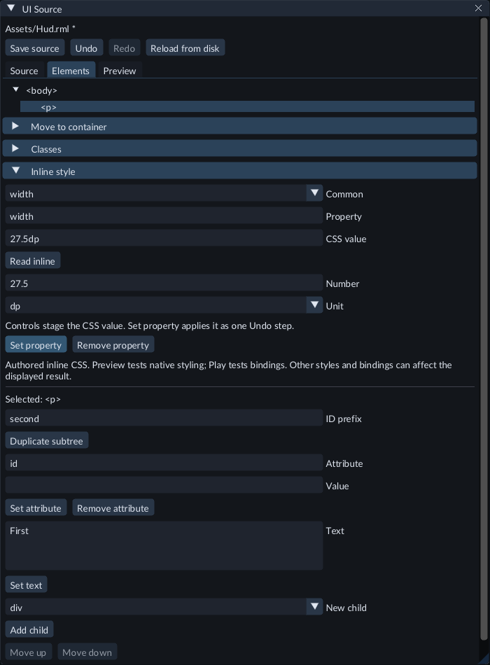

Number and Unit stage a width of `27.5dp`. Changing the unit retains `27.5`.

The numeric control accepts finite values from -65,536 to 65,536 for `opacity`,
`font-size`, `width`, `height`, `padding`, `margin`, `left`, `top`, `right` and
`bottom`. Individual properties have additional constraints; for example, an
admitted font size is at most 256. Use the appropriate unit for the property and
check **Preview**. Numeric or color controls do not expand the absolute-pixel
requirements for dragging widgets in Preview.

**CSS value** remains available for named colors, short hex colors, other units,
multi-value declarations and other supported CSS syntax. Unsupported forms stay
as text. Opening a color control preserves the existing spelling and precision;
an edited color is rounded to eight bits per channel. An invalid numeric entry
keeps the previous CSS value and disables property publication until corrected.

## Style text with presets

1. Select one text control in **Elements** and expand **Inline style**. For several siblings, select them together and use **Group inline style**. A stylesheet rule uses the same controls in **Rule properties**.
2. Choose `font-weight`, `font-style`, `text-align`, `text-decoration`, `text-transform` or `white-space` from **Common**.
3. Choose a **Preset**. The **CSS value** changes; your source stays unchanged until you choose **Set property**.
4. Choose **Set property**, check the result in **Preview**, then **Save source**. A group or rule edit is one source Undo step.

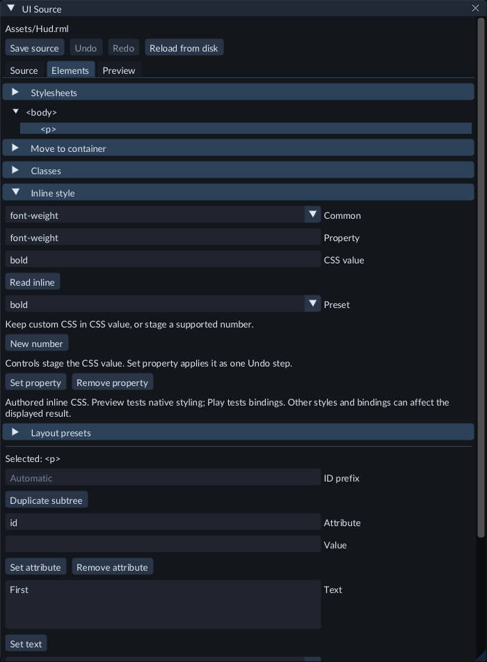

- `font-weight`: `normal`, `bold`, or a whole unitless Number from `1..1000`.
- `font-style`: `normal`, `italic`.
- `text-align`: `left`, `right`, `center`, `justify`.
- `text-decoration`: `none`, `underline`, `overline`, `line-through`.
- `text-transform`: `none`, `capitalize`, `uppercase`, `lowercase`.
- `white-space`: `normal`, `pre`, `nowrap`, `pre-wrap`, `pre-line`.
- `line-height`: A nonnegative Number, `px`, `dp` or `%`, up to `65536`.
- `letter-spacing`: `normal`, or a Number in `px`/`dp` from `-65536..65536`.

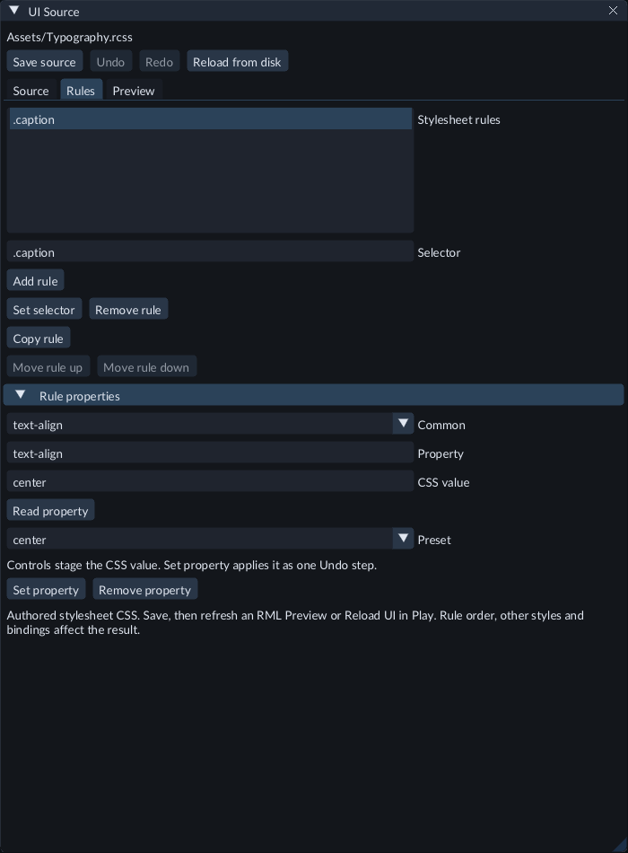

Choose **New number** to stage a supported numeric value, then edit **Number** and
**Unit**. Line height starts at `1.2`; letter spacing starts at `0px`; a numeric
weight starts at `400`. The Unit menu lists the literal helper's supported units.
For example, `120%` line height follows the current font size.

**Custom / unset** keeps an absent or unsupported preset value explicit. You can
keep custom CSS in **CSS value**, or choose a replacement preset/number. Reading
or opening the controls does not normalize an existing value. Use **Remove
property** to restore stylesheet/inherited behavior. Other properties and comments
retain their source bytes. Native CSS validation and the fonts available to your
project determine the rendered result; choosing a weight/style does not load a
new font face. See [UI text shaping](ui-text-shaping.md) for font resources.

## Build a responsive flex layout

1. Create or select a **Container** in **Elements** and expand **Inline style**.
2. Choose `display` from **Common**, choose the `flex` **Preset**, then **Set property**.
3. Set `flex-direction` to `row` for horizontal children or `column` for vertical children. The reverse presets reverse their visual order while source order stays unchanged.
4. Set `flex-wrap` to `wrap` when children should flow onto another line. Choose `nowrap` for one line, or `wrap-reverse` to reverse the line direction.
5. Use `justify-content` for spacing along the main direction, `align-items` across it, and `align-content` for multiple wrapped lines. A child's `align-self` can override its parent's cross-direction alignment; `auto` follows the parent.
6. Choose `row-gap` or `column-gap`, then **New number**, **Number**, **Unit** and **Set property** to space rows or columns. Check **Preview** at the intended game size, then **Save source**.

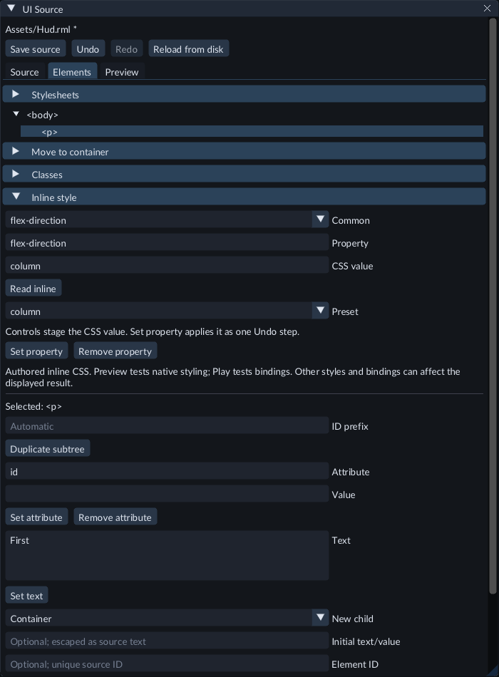

The same presets work in **Group inline style** for selected siblings and in a
stylesheet's **Rule properties**. Each Set property is one source Undo step;
Save source writes the file. Reading or staging a preset does not change it.

- `display` presets include `none`, `block`, `inline`, `inline-block`, `flow-root`, `flex` and `inline-flex`. Other native display values remain available in **CSS value**.
- `justify-content` offers `flex-start`, `flex-end`, `center`, `space-between`, `space-around` and `space-evenly`. `align-content` also offers `stretch`.
- `align-items` offers `flex-start`, `flex-end`, `center`, `baseline` and `stretch`; `align-self` also offers `auto`.
- `flex-grow` and `flex-shrink` take nonnegative unitless numbers up to `65536`. They divide spare space or shrink demand among children; zero disables that contribution.
- `flex-basis` accepts `auto` or a nonnegative `px`, `dp` or `%` number up to `65536` to request the starting size along the main direction.
- `row-gap`, `column-gap`, `min-width`, `min-height`, `max-width` and `max-height` accept nonnegative `px`, `dp` or `%` numbers up to `65536`. The maximum-size properties also offer `none`.

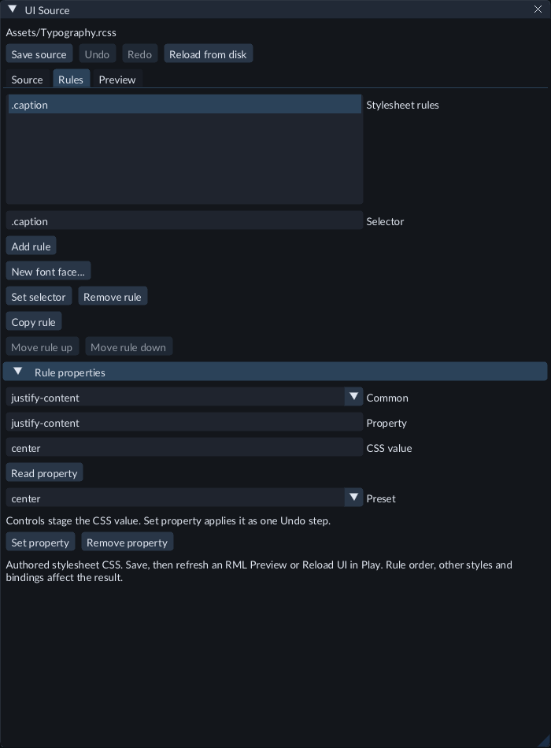

Use **CSS value** for compound values: set **Property** to `flex` and
**CSS value** to `1 0 auto`. Other supported units can also be entered directly. Presets are convenient literal inputs; the native layout and
cascade determine the result. A percentage uses the native property's containing
size rules. Wrapped line alignment needs cross-direction space, and growth needs
spare main-direction space. Size limits can constrain growth. **Remove property**
restores the applicable stylesheet or native behavior. Flex controls do not make
relative or flow-based elements eligible for absolute-pixel Preview dragging.

## Set padding, margins, borders and overflow

1. Select a widget in **Elements**, expand **Inline style** and open **Common**. For siblings use **Group inline style**; stylesheet rules use **Rule properties**.
2. Type part of the property name in **Search properties**, such as `border` or `padding`. Search ignores letter case. If nothing matches, change the search. Opening Common again starts with the full list.
3. Choose a property. Use **Preset**, **New number** with **Number / Unit**, or **New color** with **Color**, as appropriate. These controls only stage **CSS value**.
4. Choose **Set property**, check **Preview**, then **Save source**. Each Set property is one source Undo step; **Remove property** restores the applicable stylesheet or native value.

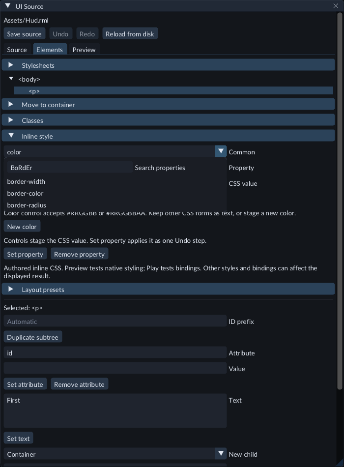

- `position`: `static`, `relative`, `absolute` or `fixed`. The position mode changes how native layout uses offsets; it does not change source parentage.
- `box-sizing`: `content-box` makes width/height describe the content; `border-box` includes padding and borders within the requested width/height.
- `overflow-x` and `overflow-y`: `visible`, `hidden`, `auto` or `scroll`. Hidden clips overflow; auto shows native scrolling when needed. Choose the appropriate axis and check the game UI input behavior.
- `padding-top`, `padding-right`, `padding-bottom`, `padding-left`: nonnegative `px`, `dp` or `%` values up to `65536`.
- `margin-top`, `margin-right`, `margin-bottom`, `margin-left`: `auto`, or `px`, `dp` or `%` values from `-65536..65536`. Negative margins can overlap neighboring content.
- `border-width` and `border-radius`: nonnegative `px` or `dp` values up to `65536`. The simple controls set the same width or radius on all sides/corners.
- `border-color`: the existing RGBA color control, with alpha as the last byte; a simple value applies to all sides.
- `right` and `bottom`: the existing offset number/unit controls, alongside `left` and `top`.

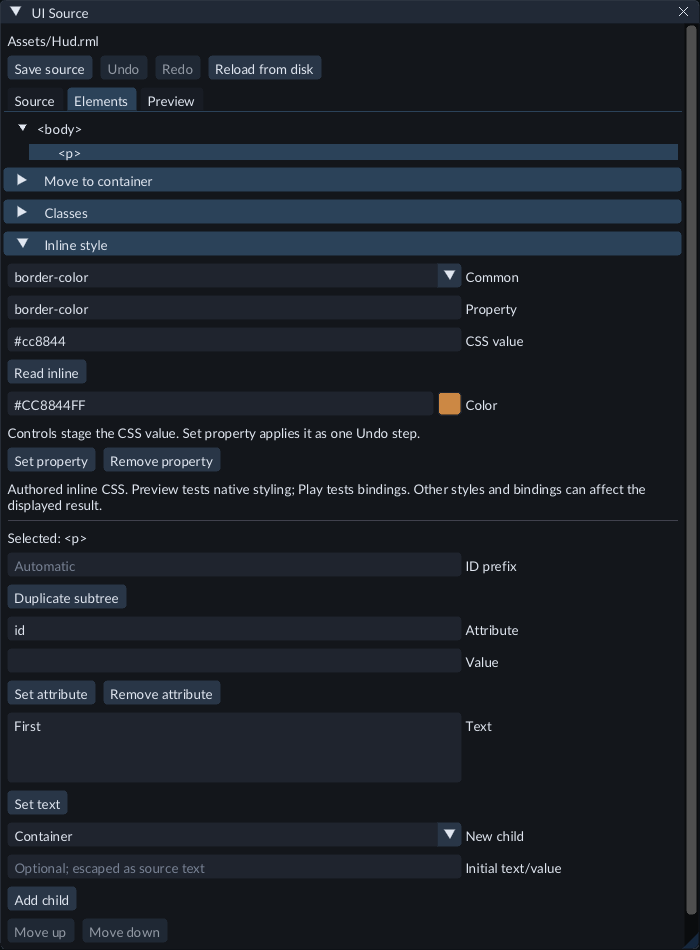

Percentage side padding and margins use the native containing width, including
vertical sides. Padding and borders reduce the content area of a border-box.
For different sides/corners or compound values, enter the native CSS in
**Property** and **CSS value**, for example `border-width` with `1px 2px 3px 4px`.
Existing multi-value declarations stay text until you explicitly replace them.
Opening a simple control does not flatten a compound value. Box styling does not
expand the separate eligibility rules for dragging in Preview.

## Style several controls together

1. In **Elements**, select a widget and **Ctrl**-click its siblings. Choose up to 32 widgets with the same parent.
2. Expand **Group inline style**. Choose the property and **Read inline** to inspect authored values.
3. If the values differ, the field is blank and **Mixed authored values** appears. Enter the value you want to apply to every selected sibling, then choose **Set property**. **Remove property** removes that override from the whole selection.
4. The group stays selected after an edit. Each change is one **Undo** step; an invalid member or value rejects the whole change.

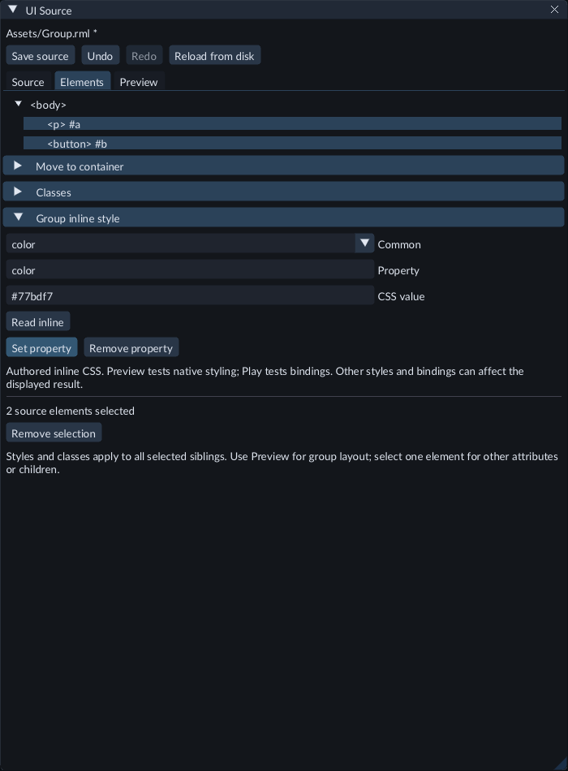

Read inspects authored declarations, without computing stylesheets or evaluating
bindings. A uniform absent property leaves the field blank without the mixed
message. Use Preview and Play to check the result. The same name/value/quote/source
limits apply as single-widget inline styles. A property change does not alter
other declarations, bindings or widget IDs. Save remains explicit.

## Assign reusable classes

1. Select one widget or a sibling group in **Elements** and expand **Classes**.
2. Choose **Read classes**. Different authored lists display **Mixed authored class lists** and leave the field blank.
3. Enter a **Class list**, such as `shared Active`, then choose **Set classes**. This replaces the complete authored list on every selected sibling.
4. Use **Clear classes** to remove those class attributes. Each change is one Undo step; runtime class bindings remain intact.
5. Save the RML source. In its linked stylesheet's **Rules** view, use a selector such as `.shared` to style those widgets, save the stylesheet and refresh the RML preview or Reload UI in Play.

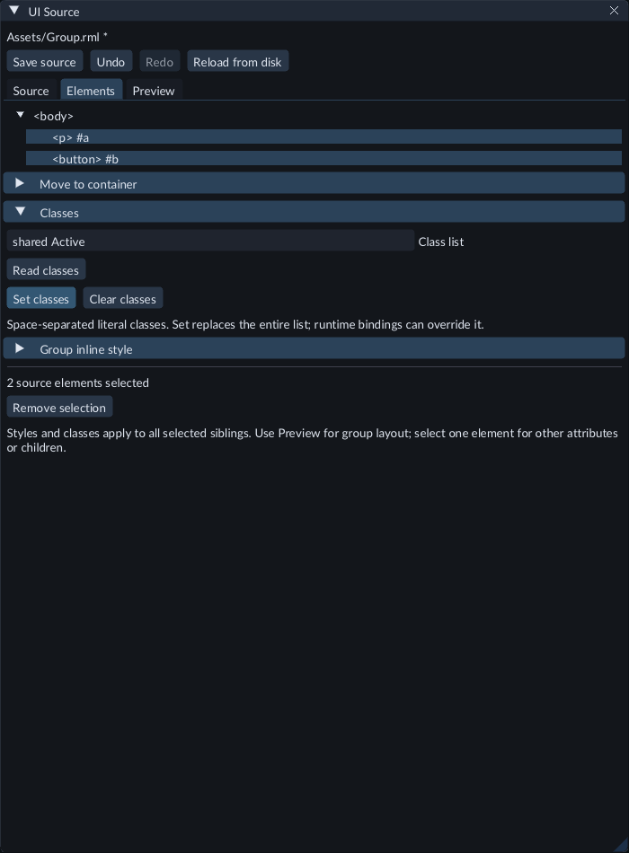

Enter names without a leading dot. The control accepts up to 32 distinct,
space-separated ASCII names, 64 bytes per name and 1,024 bytes total. Names start
with a letter or `_`, followed by letters, digits, `_` or `-`. Other class forms,
duplicate attributes, direct class expressions and lists too large for the field
use Source. Existing entities are decoded for reading; setting an identical list
retains its original encoding and quotes. Clear on absent attributes is a no-op.
Bindings can still change the active classes during Play.

## Duplicate a static control

1. In **Elements**, select a static control or container.
2. Leave **ID prefix** empty for an automatic name, or enter a name such as `settings`. Use a lowercase letter first, followed by lowercase letters, digits, `_` or `-`, up to 64 characters.
3. Choose **Duplicate subtree**. The copy appears immediately after the original and becomes selected. Its source remains unsaved.
4. Adjust the copy's text, attributes and layout. A copied absolute-positioned panel initially overlaps the original, so use **Preview** or Source to move it.
5. Use **Undo** to remove the entire copy, or **Save source** when ready.

The copy includes the selected element and its children. Existing source and IDs
stay unchanged. A prefix of `settings` changes copied `id="panel"` to
`id="settings-panel"`; a root without an ID receives `id="settings"`. With no
prefix, FORGE tries `copy`, then `copy2` through `copy64`. Choose another prefix
if those names collide. Copied IDs must fit within 128 UTF-8 bytes.

A copied label whose `for` target is inside the subtree points to the copied
control. External label targets, class names and stylesheet selectors remain
unchanged. Review any ID-based styling and project-specific references yourself.
Use Source for bound or event-driven controls, text expressions, script/template
declarations, fragment links and document/resource structure. Duplication rejects
ambiguous or duplicate IDs, unsupported references and a result exceeding the
source limits; it leaves the draft unchanged.

## Remove several siblings

In **Elements**, hold **Ctrl** and select up to 32 elements with the same source
parent, then choose **Remove selection**. In Preview, a selected group also offers
**Remove group**. Removal uses source ranges and does not require an editable pixel
layout. Protected document/resource elements, mixed parents or nested selections
reject the whole operation. One **Undo** restores every removed subtree. Save
remains explicit.

## Move controls into a container

1. In **Elements**, select one static control or use **Ctrl** to select up to 32 siblings.
2. Expand **Move to container** and choose **New parent**. Containers appear in source order with indentation; giving them unique IDs makes them easier to identify.
3. Set **Placement** to **At end**, or choose **Before** one of that container's existing children.
4. Choose **Move selection**. All selected subtrees move together in their original source order, regardless of the order you selected them.
5. Use **Undo** or **Redo** to restore the whole move. Select the controls again for another structured edit, then **Save source** when ready.

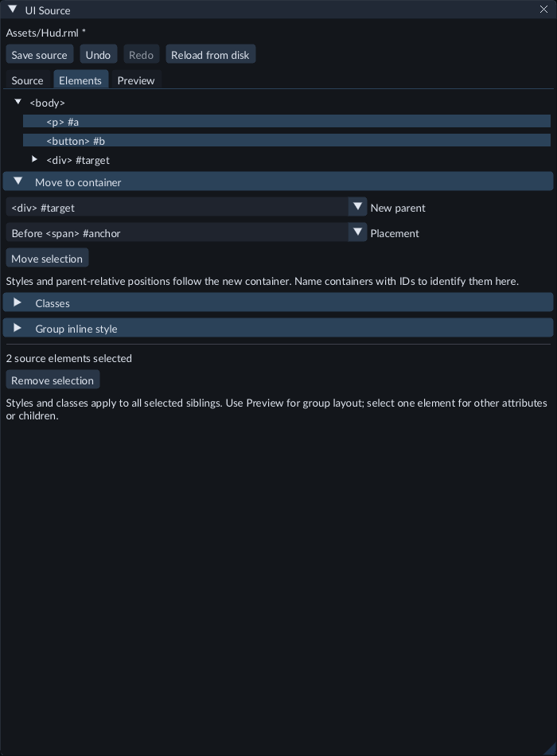

The move retains each subtree's markup and IDs. Comments inside a moved subtree
travel with it; comments and text between selected siblings stay at the original
location. Styles, inherited properties and parent-relative positions follow the
new hierarchy. FORGE does not rewrite selectors, references or pixel offsets to
preserve the old appearance. Preview and test the result before saving.

Choose an existing container with separate opening and closing tags. The body is
also a valid destination. The chooser excludes selected elements and their
descendants. Invalid placement, mixed or nested selections, protected declarations,
bound/event-driven scopes, expressions, fragment links and relative native label
targets reject the entire move. Named IDs throughout the document must be unique,
literal and at most 128 UTF-8 bytes. Anonymous controls can still move. The full
result must satisfy the source nesting limits. Use Source for unsupported cases.
If the resulting source is identical, its revision and history stay unchanged.
Hierarchy editing does not require the pixel-canvas layout subset and
does not change the Scene hierarchy.

You can also drag a selected row onto a container in the Elements outline.
Dragging a selected group member carries the whole group. A click on an unselected
row selects it alone; **Ctrl** toggles membership. Hold **Shift** while dropping to
place the selection before that row instead of inside it. The same static-source
and placement limits apply. Source does not change during hover; one drop creates
one Undo step. **Escape**, application/window focus loss, a task lock, a source
change or switching views cancels or invalidates the drag. Finish or cancel a drag
before Save or source Undo/Redo. The explicit **New parent / Placement** controls
remain available when you need a precise destination.

## Preview and adjust layout

For a ready-to-edit example, open **Scenes/211-ui-layout-preview.scene.json** in
the Feature Gallery. In Content, choose **Edit UI source** on
**Assets/UI/Layout/layout.rml**. Its blue panel already has a unique ID and an
inline pixel layout. Its teal and purple siblings provide a group-editing example.

1. Open a registered RML document and stop Play.
2. Select **Preview**. Set **Size (px)** to the desired physical viewport width and height. **Density** controls density-independent units such as `dp`.
3. Click **Refresh preview** to reload the current draft and saved linked resources. RML edits appear without saving. Linked RCSS, fonts and images use their saved bytes.
4. Click an element in the image, or select it in **Elements** and return to Preview. A unique `id` connects the native element to its source. Blue outlines identify editable layouts; an amber outline and explanation identify unsupported layouts.
5. Drag an editable element to move it. Drag its bottom-right handle to resize it. Release to commit one source Undo step, or press **Escape** to cancel.
6. Alternatively, enter **Left / Top / Width / Height (px)** and choose **Apply layout**.

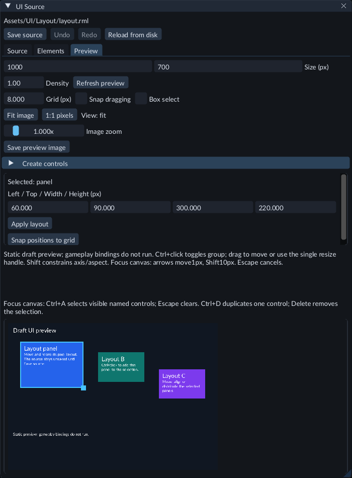

The selected panel shows its authored pixel values and a blue border with a
bottom-right resize handle. The image initially fits the canvas region while
**Size (px)** retains the preview's physical viewport dimensions.

Canvas editing requires a quoted inline `style` with `position:absolute` and
plain pixel values for `left`, `top`, `width` and `height`. For example, add this
child inside the document's body in Source:

```xml
<div id="layout-demo" style="position:absolute;left:24px;top:400px;width:260px;height:80px;background-color:#285d88;pointer-events:auto;">Move this panel</div>
```

Give the element an ID used only once. Existing percentages, `dp`, automatic
sizes and responsive rules remain available through Inline style or Source. The source-authoring
example's main panel uses responsive constraints, so edit that panel through those controls
or create a separate pixel layout element for the canvas.

Move and resize replace the four existing values and retain unrelated source,
comments and styling. The source stays unchanged during a drag; Save and source
Undo/Redo wait until the gesture finishes or is cancelled. Closing the source,
switching source views or starting a blocking task cancels an active gesture.

Preview is static: it does not execute gameplay, evaluate gameplay models or
provide runtime form interaction. Test those behaviors in Play. A failed source
or resource load keeps the last usable image, marks it stale and prevents layout
edits against that old geometry. Correct the error and refresh.

After replacing an existing font family or changing the project's text shaping
or whole-character editing settings, save any draft you need, close UI Source and
reopen it. This starts the preview with the current font and text settings.

Preview supports dimensions from 1 to 2,048 pixels per axis and density from 0.5
to 4. Native observations cover at most 512 IDs of up to 128 UTF-8 bytes each.
Canvas sizes must be at least one pixel; values must stay within 65,536 pixels.
Transforms, animation, transitions, scrolled ancestors, min/max size constraints,
right/bottom constraints, duplicate properties, entity-encoded inline styles and
data-bound ancestors use Source for layout editing. Sizes clamped by native box
sizing also use Source. An RML draft must have a
registered, contained source in the editable project. To preview an RCSS
stylesheet, open the RML that links it.

## Zoom and scroll the Preview image

1. Open **Preview**. **Fit image** shows the native viewport inside the canvas region and returns scrolling to the top-left corner.
2. Choose **1:1 pixels** to display one native preview pixel per canvas unit. Use the canvas scrollbars or mouse wheel to reach parts outside the visible area. A horizontal wheel scrolls sideways.
3. Drag **Image zoom** to choose a scale from **0.125× to 8×**. Changing it switches from fit to manual zoom and returns scrolling to the top-left. Ctrl+click the slider to type a value; typed values clamp to the same limits.
4. Select, move, resize or place controls using the normal canvas tools. FORGE converts the displayed pointer position and movement back to native viewport pixels, including scrolling and zoom.

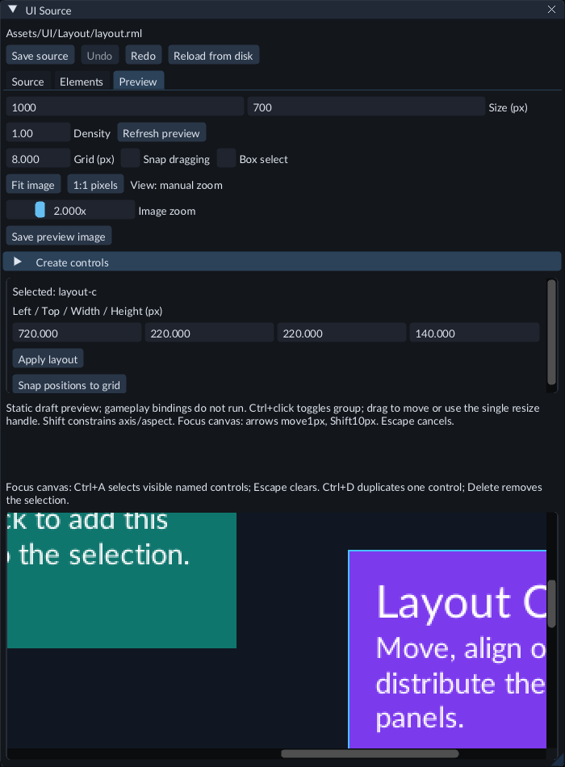

**View: fit** or **View: manual zoom** identifies the active display mode.
**Size (px)** still defines the native viewport; **Density** retains its normal
preview meaning. Image zoom and canvas scrolling leave source, selection, Undo
and the native rendered image unchanged. **Save preview image** saves the complete
native image, including areas outside the current canvas crop.

**Ctrl+A** selects eligible named elements across the full native viewport,
including elements outside a zoomed canvas crop. Box selection uses the rectangle
you draw on the image. View controls and scrolling are disabled during a gesture;
finish or cancel it before changing the view. **Fit image** restores an overview.
RML scroll containers retain the canvas layout limits described above.

## Place a control in Preview

1. Open the Gallery's **211-ui-layout-preview** scene and **layout.rml**, stop Play and select **Preview**. Refresh if needed.
2. Select the blue panel, or another editable absolute-pixel container with a unique ID. Expand **Create controls**. The **Parent** line identifies the selected container.
3. Choose **New child**, enter any **Initial text/value** and a unique **Element ID**, then set **Width (px)** and **Height (px)**. These are source CSS sizes, at least one pixel and no greater than 65,536.
4. Enable **Click to place**. Click inside the selected container's padding box on the preview image. The click supplies the new control's top-left border corner in physical preview pixels; image scaling is handled automatically.
5. The new control becomes selected and placement turns off. Collapse **Create controls** for more canvas space, then move or resize the control as needed. **Undo** removes the whole creation; **Redo** restores it. Choose **Save source** before registering updates or exporting.

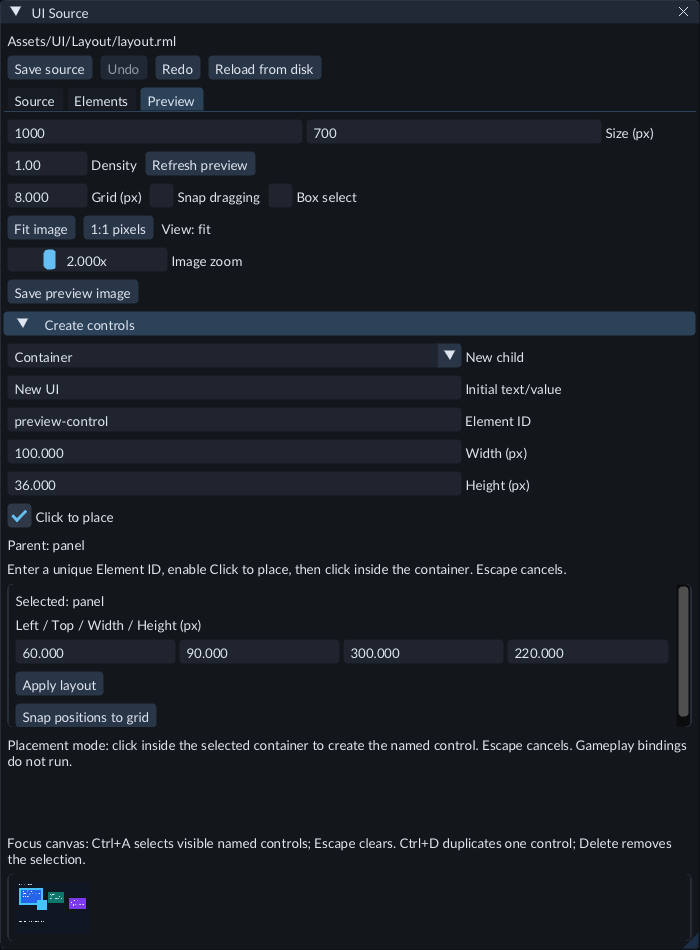

An Element ID is required before Click to place becomes available. This menu
offers the same control kinds as Elements except Line break and Dropdown option,
which retain their native flow layout. To create another control, select its
parent again and enter another unique ID.

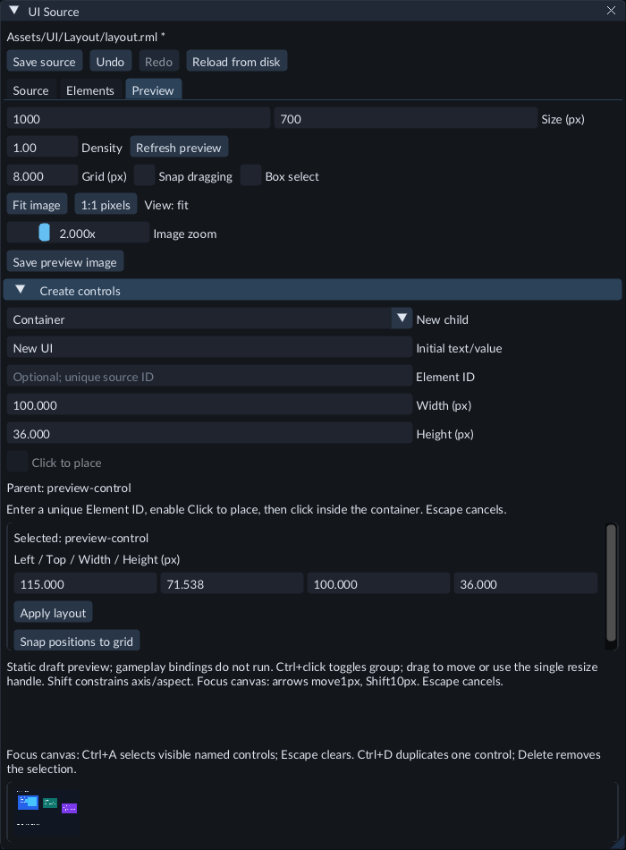

Placement appends the child to the selected container and writes an absolute
pixel layout with zero margin. Native padding and borders determine its origin;
the stylesheet and box-sizing rules still determine the rendered size. The parent
and new child must satisfy the canvas eligibility rules above. A dropdown cannot
be a placement parent. Use Elements or Source for responsive or unsupported
layouts. This creates source content; it does not add gameplay bindings or register
resources.

Press **Escape** or turn off **Click to place** to cancel. Changing source,
switching views, closing the document, losing application focus or entering Play
or a blocking task also cancels placement. Invalid points, stale geometry or
unsupported native layout leave source and Undo history unchanged. Correct the
problem, refresh Preview and try again.

## Move, align and space a group

1. Open Gallery scene **211** and its **layout.rml** source, then select **Preview**.
2. Click the blue panel. Hold **Ctrl** and click the teal and purple panels to add them. Ctrl+click a selected panel removes it. The same modifier works in **Elements**. Select between 2 and 32 elements with the same source parent.
3. Drag any selected member to move the group while preserving sizes and spacing. Release for one Undo step, or press **Escape** to cancel. Resize handles are available when only one element is selected.
4. Choose an **Operation** in the group controls, then **Apply group**. Edge and center alignment use the visible native border boxes, including padding and borders.
5. For **Move group**, enter **Delta X / Y (px)**. Distribution needs at least three elements and spaces them in their native left-to-right or top-to-bottom order, regardless of selection order. Move the outer elements farther apart if there is insufficient room for non-overlapping gaps.
6. Use **Undo** or **Redo** to restore the whole operation, then **Save source** when ready.

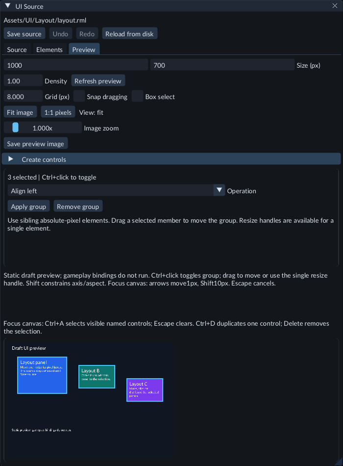

Every member must satisfy the canvas limits above. One unsupported, stale,
out-of-range or differently parented member rejects the whole operation. No
source changes during a drag; cancellation keeps the original source. Single
selection retains its numeric layout fields and resize handle. Use the matching
operations below for group dimensions. Group scale gestures, flow/relative units
and canvas reparenting are unavailable.

## Select controls with a rectangle

1. Open **Preview** and enable **Box select** beside **Snap dragging**.
2. Drag across the image to fully enclose the controls you want. You can start at either corner. Release to replace the selection; hold **Ctrl** when starting the drag to add controls.
3. New members enter in source order. The last member is active. An additive selection keeps existing members in their current order and appends new ones.
4. Disable **Box select** to move or resize the selection. You can then use the group operations above when all members are editable siblings.

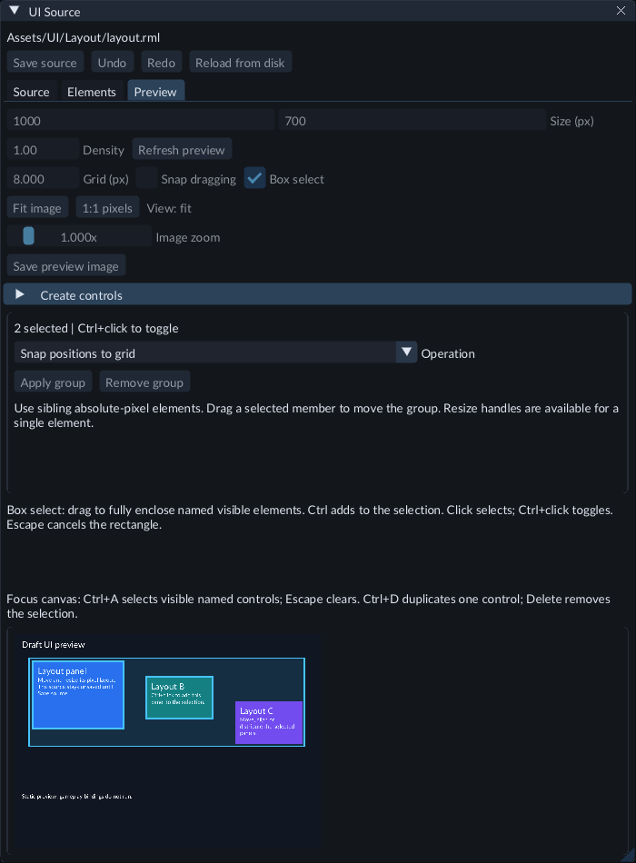

The blue rectangle shows the area being selected; the outlines show the existing
selection until release. Only fully enclosed, visible elements with unique IDs
and an unambiguous source match are included. Partially enclosed, hidden and
unnamed elements are skipped. Flow-layout elements can be selected for inspection,
but selection does not enable unsupported layout edits.

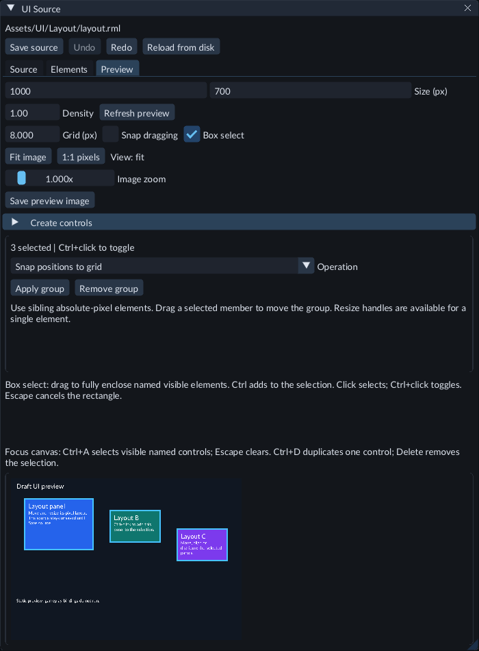

At most 32 elements can be selected. A result above that limit is refused and the
previous selection is retained. Dragging over an empty area clears a replacement
selection; an additive drag over empty space keeps it. A click selects one control
and Ctrl+click toggles it. **Escape**, changing source views, closing the document,
losing focus or entering a locked task cancels an unfinished rectangle. **Click to
place** and **Box select** are mutually exclusive.

Selection changes do not edit source, create Undo records or require Save.
Subsequent property and layout edits keep their usual Undo and Save behavior.

## Match a group's width or height

1. Select between 2 and 32 editable sibling controls in Preview. Add the reference control **last** with Ctrl+click. The last-selected control is active.
2. Choose **Match active width**, **Match active height** or **Match active size** under **Operation**. The **Reference** line identifies the control whose size will be used.
3. Choose **Apply group**. Every selected member takes the reference's visible border-box dimension on the chosen axes. Positions stay unchanged; the other dimension stays unchanged when matching only one axis.
4. Use **Undo** or **Redo** for the entire match, then choose **Save source** when ready. Applying an already-matched size creates no extra source Undo step.

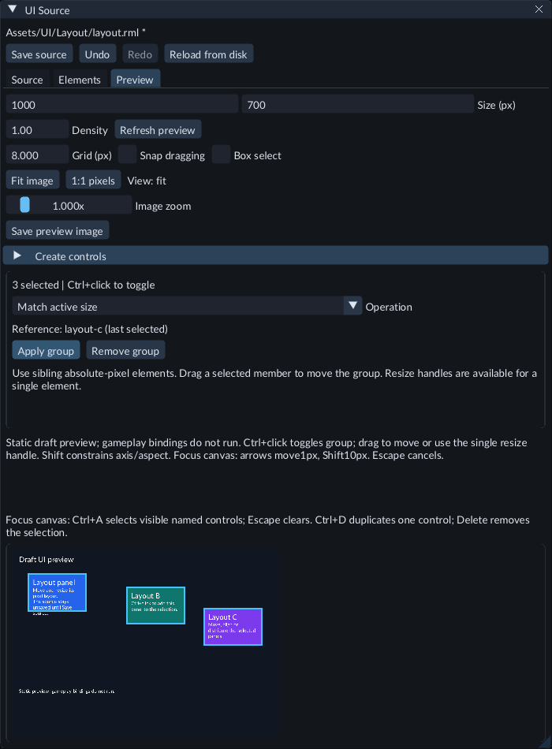

Visible dimensions include padding and borders. Controls with different
box-sizing or padding can therefore receive different CSS width/height values
while displaying the same size. Native layout validates the complete result.
If a member cannot attain the target size within the canvas limits, the whole
operation is refused. Source and history stay unchanged; refresh Preview after
a rejected native candidate. To use a different reference, Ctrl+click it out of
the selection, then Ctrl+click it again to add it last.

## Select, duplicate and delete with the keyboard

Click the **Preview** canvas to give it focus, finish any drag, and turn off
**Click to place** before using these shortcuts. They work with **Box select**
enabled or disabled.

- **Ctrl+A** replaces selection with visible, uniquely named source elements whose whole border boxes fit inside the preview viewport, in source order. The 32-member limit still applies.
- **Escape** clears selection. During a gesture or queued edit, it cancels that operation while keeping its existing selection.
- **Ctrl+D** duplicates one selected source subtree and selects the copy. Select exactly one element first.
- **Delete** removes the selected one to 32 sibling subtrees together.

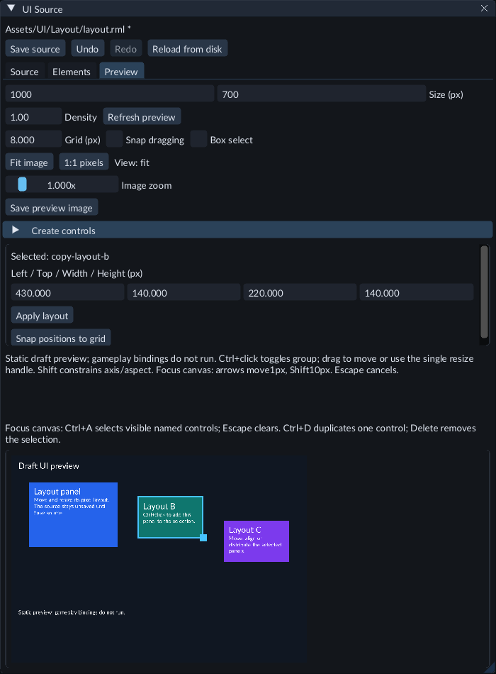

Duplication keeps the original element and its IDs. The copy receives unique IDs
and remapped internal label targets through the same rules as **Duplicate** in
Elements. It initially occupies the same layout position; move it after copying.
Dynamic or protected source is refused. Delete requires distinct sibling roots;
protected, nested or incompatible selections are refused together. Use
**Undo** or **Redo** for one complete structural operation, then **Save source**
when ready. Selection changes alone create no source Undo record.

These shortcuts operate only when the canvas has focus and no text field is
active. Source text, numeric fields and other panels retain their own keyboard
input. **Escape**, changing views, source edits, focus loss or a task lock cancels
queued canvas work before it changes source. Play and locked tasks disable it.

## Align controls to a pixel grid

1. Select an editable control in **Preview**. Set **Grid (px)** in the Preview toolbar, then choose **Snap positions to grid** below the control's layout fields.
2. For a sibling group, choose **Snap positions to grid** under **Operation**, use the toolbar's **Grid (px)** value and choose **Apply group**. The same canvas limits apply to every member.
3. Inspect the result, then use **Undo** or **Redo** for the entire alignment. Choose **Save source** when ready.

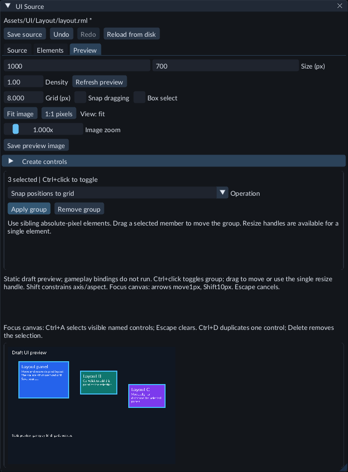

Grid spacing defaults to eight physical preview pixels and accepts finite values
from 1 to 1,024. The grid starts at the preview image's top-left corner. Each
visible border corner rounds to the nearest grid position; exact halfway values
round away from zero. For example, positions `12` and `-12` on an eight-pixel grid
become `16` and `-16`. Padding, borders and parent offsets remain accounted for
by native layout. Widths and heights stay unchanged. Already aligned controls
create no extra source Undo step. Invalid or unsupported members reject the
whole operation without changing source or history.

## Move controls with the keyboard

1. Click an editable control on the **Preview** image. Ctrl+click adds siblings; the canvas must have focus.
2. Press an arrow key to move the selection one physical preview pixel. Hold **Shift** while pressing an arrow for ten pixels. Each press is one source Undo step; holding an arrow does not repeat the movement.
3. Use **Undo** or **Redo** and **Save source** as with mouse layout edits.

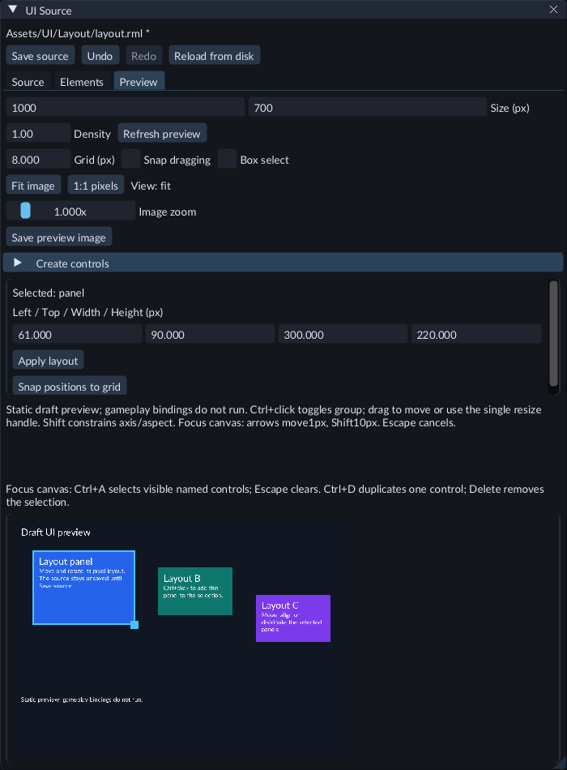

Typing or moving the caret in a numeric field, Source view or another focused
panel leaves the canvas unchanged. Pending keyboard movement cancels on Escape,
source edits, task/Play locks, view changes, closing or leaving the source window.
The same size, membership and source/preview validity limits apply as for mouse
layout edits. Movement preserves each member's size and the selected group.

## Snap and constrain a drag

1. Select an editable control or sibling group in **Preview**. Set **Grid (px)** in the toolbar and enable **Snap dragging** when you want grid alignment during movement.
2. Drag a selected control. A group keeps its spacing; the last-selected control supplies the border corner that snaps to the viewport grid. Clicking without moving does not snap anything.
3. Hold **Shift** during movement to constrain it to the dominant horizontal or vertical axis. A tie chooses horizontal. The other coordinate stays unchanged, even if it began off-grid.
4. Release the mouse to commit one source Undo step, or press **Escape** to cancel. Choose **Save source** when ready.

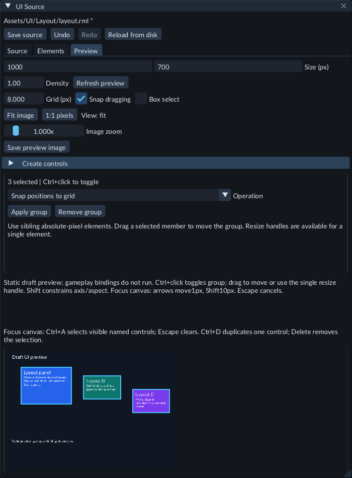

Snap dragging is optional and initially off. It uses the same 1–1,024 pixel grid
spacing as one-shot alignment. Moving a group with this option preserves spacing;
one-shot **Snap positions to grid** aligns every member separately. Dragging
clamps movement at the source coordinate bounds. If snapping would exceed those
bounds, the candidate cannot commit; move back into range or cancel.

## Keep visible aspect while resizing

1. Select one editable control. Drag its bottom-right resize handle.
2. Hold **Shift** to retain the visible border-box aspect ratio. Padding, borders and box-sizing remain accounted for; the control's top-left corner stays fixed.
3. With **Snap dragging** enabled, the dominant size snaps to **Grid (px)** and the other size follows the aspect ratio. The relative width or height change determines the dominant size. The two dimensions need not both be grid multiples.
4. Release to commit one Undo step, or press **Escape** to cancel. Save the source before registering updates or exporting.

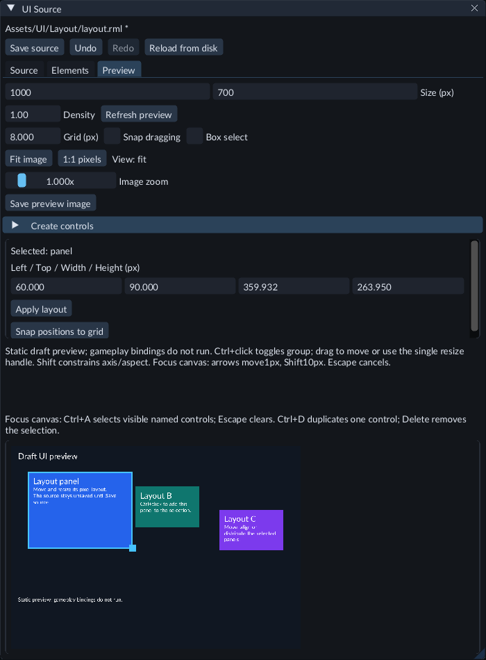

The source sizes remain within 1–65,536 pixels. Aspect locking takes priority over
snapping, including at a source size limit. Without Shift or Snap dragging,
resizing retains the ordinary independent width/height behavior. Group resize,
relative layouts and the other canvas exclusions remain unavailable. Unsupported
native sizing keeps the source unchanged; release or cancel and correct the
layout before retrying.

## Save a preview image

1. Open **Preview** and check that the current draft has rendered successfully.
2. Choose **Save preview image** and select an output filename. PNG preserves the display pixels; lossless WebP and opaque JPEG are also supported.
3. For JPEG, choose the quality and confirm **Save JPEG**. Confirm replacement when asked.
4. Wait for the image task to report that the image was saved.

The file contains the rendered game UI, without editor controls, selection outlines
or resize handles. Saving an image does not save the source or change the Scene.
The draft and preview must still match when the native image copy starts. Changes
before that point cancel or fail the request; a queued copy finishes independently
of later editing or source closure. Finish the current image task before saving
another image. Stale previews and hosts without a rendered image cannot be saved.

## Edit stylesheet rules

1. Open a `.rcss` file from **Content** using **Edit UI source**.
2. Choose **Rules**. Select a flat rule in **Stylesheet rules**; its selector appears in **Selector**.
3. Expand **Rule properties**. Choose a **Common** property or enter its **Property** name. **Read property** loads that rule's authored value; absence leaves the field blank.
4. Enter a **CSS value** and choose **Set property**, or choose **Remove property**. The selected rule stays selected after a property change.
5. To rename the selected rule's selector, edit **Selector** and choose **Set selector**. To append an empty rule, enter a selector and choose **Add rule**. **Remove rule** removes the selected flat block.
6. Each source change is one **Undo** step. Choose **Save source**, reopen the RML document and **Refresh preview**, or use **Reload UI** during Play.

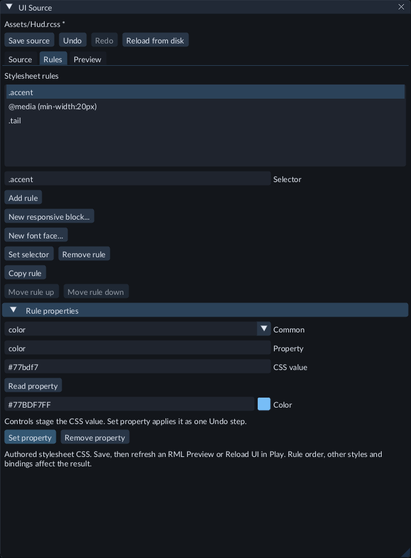

The selected flat rule has a color override. Other blocks remain listed in source
order; selecting a nested block or at-rule keeps it in Source.

Rules edit the stylesheet source; they do not show computed CSS. Order, specificity,
inline styles and bindings affect the result. Other rules, declarations and
surrounding comments retain their bytes. Identical source results create no Undo
step. After Undo/Redo or a structural source edit, select the rule again.

Use **Copy rule** to insert an unchanged copy immediately after the selected flat
block. The selector stays the same and the copy becomes selected. Change its
selector or properties as needed. **Move rule up** and **Move rule down** swap
adjacent flat blocks; they cannot cross at-rules or nested blocks. Order can change
which declaration wins. Comments inside a block travel with it; comments between
blocks remain between them. Copy and each changed move use one Undo step. Boundary
or identical-source moves create no history. Save, then refresh native UI to check
the cascade.

At-rules, nested blocks and incomplete source stay in **Source**. The outline
supports up to 4,096 top-level blocks. New selectors fit 1,024 UTF-8 bytes and do
not contain at-rules, comments, escapes or additional blocks. Child selectors such
as `.panel > button` are supported. Property names use
the same lowercase 64-byte profile as inline styles; new values fit 8,192 bytes.
Stylesheet values can use either CSS quote form because there is no surrounding
markup attribute. Ambiguous matching declarations use Source. An existing value
too long for the control disables its property buttons; use Source to edit it.

## Edit the source and styles

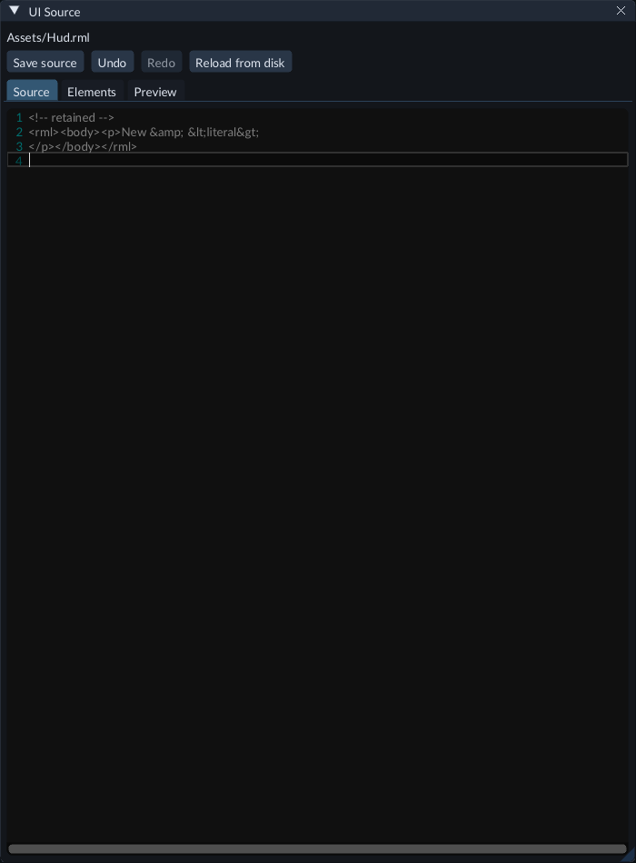

Use Source for RML text and RCSS styles. All views share the same draft and history.

Open **hud.rcss** from Content to change the example's colors, spacing or sizes.
Only one UI source is open at a time. Switching to another file asks you to save,
discard or keep editing an unsaved draft. RCSS offers Rules in place of the RML
element outline; Source remains available for complete stylesheet editing.

Incomplete source may remain in the text draft. The Elements or Rules view explains why
it cannot inspect that draft. Save checks the bounded source structure and supported
static profile; native styles, properties and resources are checked when loading
the HUD. Correct source errors before saving and test the result in Play. Current admission limits include 256 KiB of source, 8,192 tags and
32 levels of nesting. See [Runtime UI](runtime-ui.md) for supported resources,
bindings and styling limits.

## Save, run and export

Choose **Save source**, or use the Save shortcut while UI Source has focus.
**Undo** and **Redo** act on this source, independently of Scene history. Saving
does not clear source history. Save retains a file's uniform Windows line endings.

Save checks that the file on disk still matches the version you opened or last
saved. If another program changed it, Save reports a conflict without overwriting
that file. Preserve any draft text you need, then choose **Reload from disk** and
explicitly discard the old draft to load the current file. Reload starts fresh
source history. Closing an unsaved source offers **Save**, **Discard** and
**Keep editing**.

Save or discard all drafts before starting Play, switching projects or exporting.
UI Source is read-only during Play. To test a native edit, Stop, edit and save,
then start Play again. A user's externally saved change can use **Reload UI**
during Play; unsuccessful reload keeps the last working HUD. Reload clears local
focus and text-field contents. Restart Play after replacing a font family.

Saving source does not register it, refresh dependency metadata, assign a UI
Document component or reload the running HUD. Those actions stay explicit. Use
the [Runtime UI registration and resource workflow](runtime-ui.md) to record
linked styles, fonts and images after a successful load.

For export, save the Scene and choose it as the project's startup Scene. Export
through **Export Game** with a matching runtime kit. Export follows the registered
document and its supporting resources; the native source editor and its draft
history are not part of the exported game. The example's buttons and bindings use
the existing runtime UI commands.

See also [Content](content-browser.md), [Undo and redo](undo-redo.md),
[Runtime UI](runtime-ui.md) and [Export a game](runtime-content.md).
