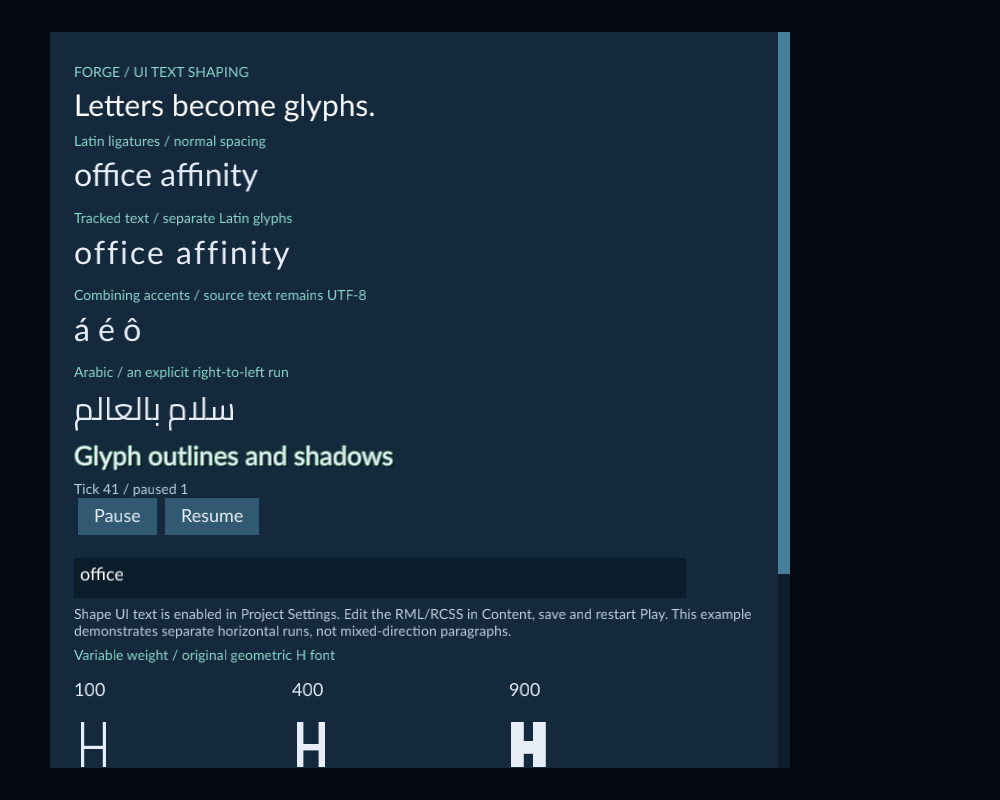

# Edit whole UI characters

Enable **Edit whole UI characters** to move and delete a complete Unicode
character with arrow and deletion keys in game UI text fields. It also keeps
word, line and page navigation on complete character boundaries when the native
control reports an unambiguous movement. A character
can contain several code points, such as a letter with a combining accent or an
emoji sequence. This option works independently of [Shape UI text](ui-text-shaping.md).

The UiTextShaping example includes a text field below the Pause and Resume buttons.

## Enable the option

1. Stop Play and open **Tools → Project Settings**.
2. Choose **Set up game defaults** if game defaults are absent.
3. Expand **Game defaults** and enable **Edit whole UI characters**.
4. Choose **Save Settings**, then start Play and select **Game**.

Existing projects retain native editing until this option is enabled. Saving
settings is separate from Scene Undo. Restart Play after changing the option.
Text entered in the running HUD stays local to that UI; it does not save a new
RML value or modify the authored Scene.

## Try the included field

1. Open **Examples/UiTextShaping**, then **Scenes/TextShaping.scene.json**.
2. Start **Play**, select **Game**, and click the text field. Both text options are enabled in this project.
3. Select the field's text with **Ctrl+A** and paste `áb`. Here, the accent after `a` is a separate combining code point.
4. Press **End**, then **Backspace** to delete `b`. Press **Backspace** again: the accented `a` disappears together.
5. Paste the same text again. Press **Home**, then **Right**: the caret moves past the accented `a` in one step. Press **Left** to return before it.
6. From **Home**, press **Delete**: the accented `a` disappears and `b` remains.
7. Paste `áb` again and press **Home**. Hold **Shift** and press **Right** once to select the accented `a` together. Press **Right** again while holding Shift to include `b`.
8. Keep Shift held and press **Left** to shrink the selection back to the accented `a`. Release Shift, then press **Backspace** or **Delete** to remove that character together, leaving `b`.
9. Paste `áb` again and press **Home**. **Shift+Right**, then **Shift+Left**, selects the accented character and collapses the selection at the original caret.
10. Replace the text with `alpha beta`, press **Home**, then **Ctrl+Right** to move to the next word. Return Home and use **Ctrl+Shift+Right** to extend the selection by words; **Ctrl+Shift+Left** shrinks it toward the original caret.

Use a font containing the characters you test. Missing glyph boxes indicate font
coverage, even when an emoji sequence is edited as one character.

## Controls and limits

- **Plain Left / Right:** move by a whole character in logical text order.
- **Plain Backspace / Delete:** delete the adjacent whole character.
- **Shift+Left / Shift+Right:** extend or shrink a selection by whole characters in logical text order. Reverse direction to move back toward where the selection started.
- **Ctrl+Left / Ctrl+Right:** use native word movement, keeping the destination on a complete character boundary.
- **Ctrl+Shift+Left / Ctrl+Shift+Right:** extend, shrink or reverse a native word selection while keeping complete characters and its original anchor.
- **Up / Down, Page Up / Page Down, Home / End:** use native layout and align an unambiguous destination to a complete character. Shift selects; Ctrl+Home/End targets the document bounds.
- **Partially selected character + a supported key above:** expand to its whole character boundary before the native action.
- **Shift+Backspace / Shift+Delete:** delete complete selected or adjacent characters.
- **Ctrl+Backspace / Ctrl+Delete:** delete a complete existing selection. With no selection, native word deletion applies and can split a combined character.
- **Active IME composition:** existing platform/native behavior.

When a supported selection starts inside a character, the selection expands to
include that whole character. Native word grouping determines which word boundary
is used; forward and backward movement can group punctuation differently.
Password fields use their native masked-word grouping.

Text inputs, password inputs and textareas support the option. Native disabled
controls and ordinary maximum-length restrictions still apply. Pointer selection,
collapsed word deletion and unsupported or ambiguous modified selection retain
native behavior; their caret can be inside a multi-code-point character. The next supported key above
uses the complete character boundary.

The option covers fields up to **64 KiB of UTF-8** and **16,384 code points**.
Larger fields retain native editing without being truncated. Font rendering has
its own limits. This is not complete international text editing, paragraph
bidirectional layout, accessibility or a complete IME implementation. Test your
target keyboards, input languages and displays. The native `readonly` attribute
is unavailable; use supported disabled controls when editing must be blocked.

## Save and export

Save the UI source, Scene and Project Settings, and test Play before exporting.
Use the runtime kit packaged with the matching editor. A kit lacking the enabled
whole-character editing profile, including native navigation and selected deletion,
is rejected. Players need no compiler or
machine-installed font. See [Export a game](runtime-content.md).

## Test fields with an AI agent

After [connecting through MCP](mcp.md) with **Allow C++ build and execution**,
ask the agent to start Play and inspect the native fields in the game HUD.
It can focus a uniquely named visible enabled field, type text, select all and
send the supported native navigation/deletion keys. The named keys
`select_left` and `select_right` send Shift+Left and Shift+Right. `word_left` and
`word_right` send Ctrl+Left and Ctrl+Right; `select_word_left` and
`select_word_right` add Shift for word selection. The UiTextShaping example's
input has the ID `field`. The agent reads the current document instance and
presentation revision before acting; reloading the UI requires a fresh read.

For native line/document, vertical/page navigation and word deletion, the agent
can use the additional keys listed in [MCP game creation](mcp.md). `select_home`
and `select_end` send Shift+Home/End; `document_home` and `document_end` send
Ctrl+Home/End. `word_backspace` and `word_delete` send Ctrl+Backspace/Delete.
The saved option aligns supported native navigation and existing deletion
selections. With no selection, Ctrl word deletion can split a combined character. Read the resulting selection and focus each time.

These operations use the same native fields and saved editing option. Password
plaintext is omitted from observations. Field text stays in the running UI;
game models may replace it, and it is not saved into source or Scene Undo.
Camera-output input requires existing native surface focus/hover mapping. IME
composition injection and arbitrary DOM/script editing are unavailable.
