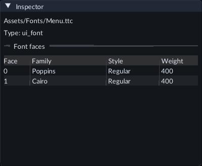
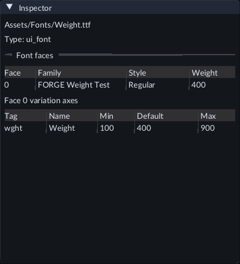
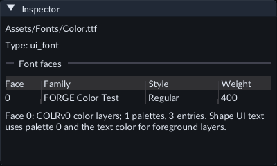
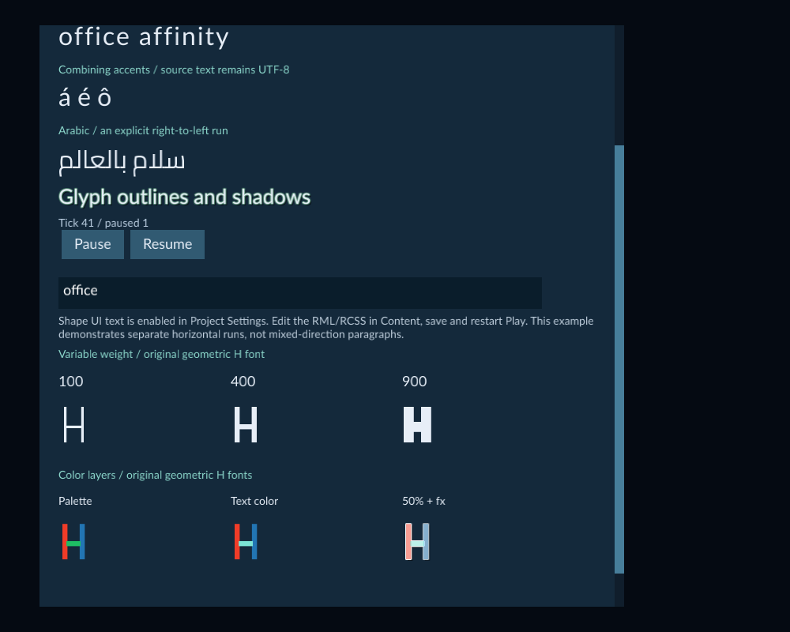

# Shape game UI text

Enable text shaping when your game needs supported script joining, ligatures or
combining marks. Use a project font containing the characters you want to show.
The setting applies to the game's UI documents throughout the project.


The example uses separate Latin and Arabic runs, a project font, native font
effects, a local text field, three variable weights and original layered color glyphs.

The example also enables [Edit whole UI characters](ui-text-input.md), a separate
option for arrow and word movement, selection and plain deletion in its text field.

## Try the example

1. Open the included **Examples/UiTextShaping** project with **File → Open project...**.
2. Open **Scenes/TextShaping.scene.json**, then start **Play** and select **Game**.
3. Compare the normal and tracked Latin samples. Tracking separates the Latin ligatures. The Arabic sample uses an explicit right-to-left run.
4. Click the text field to enter text. **Pause** and **Resume** use the normal gameplay controls; the field's contents stay local to the running UI.
5. Scroll down to compare **Variable weight** and **Color layers**. The latter shows fixed palette colors, a foreground layer using the text color, and half-opacity text with effects.
6. Stop Play. In **Content**, open **Assets/UI/hud.rml** or **hud.rcss** to edit the text and styles. Choose **Save source**, then start Play again.

The example includes a Camera, so it can run in Game without scene setup. Its
font notice is included in the project. See [Edit UI source](ui-source.md) for
source history, conflicts and registration.

## Enable shaping in your project

1. Stop Play and open **Tools → Project Settings**.
2. If game defaults are absent, choose **Set up game defaults**.
3. Expand **Game defaults** and enable **Shape UI text**.
4. Choose **Save Settings**, then start Play again.

Existing projects keep the original text rendering until you enable this option.
Saving changes project settings, independently of Scene Undo. Restart Play after
changing the option or replacing a font family.

## Choose a font and run direction

Put a suitable `.ttf` or `.otf` font inside your project. Collections use `.ttc`
or `.otc`, as described below. Font `src` paths are
relative to the project root. For example:

```css
@font-face { font-family: MenuArabic; src: "Assets/Fonts/menu.ttf"; }
#greeting {
    font-family: MenuArabic;
    font-size: 32px;
    -rmlui-language: ar;
    -rmlui-direction: rtl;
}
```

```xml
<p id="greeting">سلام بالعالم</p>
```

Use `ltr` for a left-to-right run or leave direction automatic when appropriate.
Keep runs needing different directions in separate text elements. Language and
direction affect shaping; they do not translate your text. Use a
[UI Localization catalog](ui-localization.md) for translated messages.

`letter-spacing` controls tracking. Nonzero tracking disables supported Latin
ligatures; combining marks stay attached to their native cluster. Existing
shadows and outlines work with shaped glyphs. Separate multiple `font-effect`
values with commas.

## Copy a font into your project

1. In Content, choose **Import files...** and select a `.ttf`, `.otf`, `.ttc` or `.otc` file that you may redistribute.
2. Choose an unused destination folder below **Assets**, then choose **Prepare import**.
3. Review the files and destination. A batch containing fonts uses **copy only**; **Import with defaults after copying** is disabled.
4. Choose **Copy sources**, wait for completion and close the review.
5. In Content's **Create / Register** tools, expand **Runtime UI**, enter the copied relative path in **Project UI file** and choose **Register / Refresh**.

Each selected source gets a **Source-1**, **Source-2**, and similar subfolder.
Use that complete project-relative path in the font's `src` declaration. Copying
preserves file bytes; registration validates the font and records its asset
identity. Fonts are not registered by copying alone. A mixed batch containing
fonts is also copy only; copy/import models or images separately when you want
automatic import with defaults.

## Use a font collection

A collection stores multiple faces in one file. Put the `.ttc` or `.otc` inside
your project, then give each face a family alias in your RCSS:

```css
@font-face {
    font-family: MenuFace;
    src: "Assets/Fonts/menu.ttc";
    -rmlui-face-index: 1;
}
#caption { font-family: MenuFace; font-size: 28px; }
```

Face indices start at **0**. The example above chooses the second face. Omit
`-rmlui-face-index` to choose the first face. Use a different family alias for
each face you want to select in styles. Save the source, register or refresh
its resources, and restart Play after replacing a loaded font family.

Open **Examples/UiFontCollections**, open **Scenes/FontCollections.scene.json**
and start Play. The two Latin samples use Poppins at face 0 and Cairo at face 1
from the same **Assets/Fonts/Menu.ttc** file. The Arabic sample and text field
also use Cairo. Open **Assets/UI/hud.rcss** in Content to see the declarations.
Both font notices are included in the project.

Collection face selection works with the default font backend and with **Shape
UI text**. Script joining and ligatures still require the shaping option. Files
are limited to **4 MiB** and **32 faces**; all selected faces must fit the normal
font and UI budgets. See **Use a variable weight font** below for an
admitted weight axis. Other axis controls, named variation instances and color
glyphs are outside this workflow.

## Find a font's face index

1. Register the project font using **Content → Create / Register → Runtime UI → Register / Refresh**.
2. Select its `ui_font` asset in Content, then open **Inspector**.
3. Under **Font faces**, read the **Face**, **Family**, **Style** and **Weight** columns. Use the zero-based **Face** number in `-rmlui-face-index`.



The font detail controls show the registered collection's two faces. Face 1
selects Cairo. A standalone font has face 0.

These are names recorded inside the font; your RCSS `font-family` alias is your
own choice. Weight is the recorded numeric weight, not a control that changes
the font. Names or weight can be **Unavailable** when the file has no supported
information. The face index remains usable. Labels are limited to 64 UTF-8
bytes; an unsupported or oversized label is omitted rather than shortened.

After replacing a font file, use **Register / Refresh** again to update these
details. Older registered fonts can also need a refresh before the table appears.
Registration preserves their asset IDs and source bytes. Restart Play after
replacing a loaded font. Inspecting the table does not edit or save font data.

## Use a variable weight font

1. Copy a variable TrueType font into your project, register it, and select its `ui_font` asset in Content.
2. In **Inspector**, read its **variation axes** table. `wght` identifies weight; **Min**, **Default** and **Max** show the design range. The table is read-only.
3. Enable **Shape UI text** in Project Settings, choose **Save Settings**, and restart Play.
4. Declare the font with `@font-face`, then use ordinary numeric `font-weight`:

```css
@font-face {font-family:MenuVariable;src:"Assets/Fonts/MenuVariable.ttf";}
.menu-heading {font-family:MenuVariable;font-weight:650;}
```



The axis table describes the saved font. Change the text element's RCSS weight
to select a different design during Play.

Weights from **1–1000** clamp to the font's admitted weight range. Other axes
stay at their defaults. The font must have at most **16 axes** and one valid
`wght` axis within 1–1000. A font outside these limits retains its default design.
Normal font/glyph limits apply, including **128 distinct face, size and effective
weight combinations**. Avoid continuously animating weight through many designs.

In **Examples/UiTextShaping**, scroll down to **Variable weight**. The original
geometric `H` font compares weights **100**, **400** and **900**. Open
**Assets/UI/hud.rcss**, change one weight, choose **Save source**, then restart
Play. This small font contains only `H` and space; use your own licensed typeface
for normal game text.

Axis names can be unavailable. Metadata lists at most **16 axis records across
all faces** in a file; later faces can show that details were omitted by this
limit. **Hidden** reflects the font's recorded axis flag. Register / Refresh after
changing a font, and restart Play after replacing it. Inspection and refresh
preserve the font's bytes and asset ID.

## Use layered color glyphs

1. Copy a font with **COLRv0** vector layers and a **CPAL** palette into your project, then register it as a UI source.
2. Select its `ui_font` asset in Content. Inspector lists recorded color-layer details when available. Register / Refresh after replacing the source; these details are read-only.
3. Enable and save **Shape UI text** in Project Settings, then restart Play.
4. Use the normal `@font-face` declaration and assign that family to your text:

```css
@font-face {font-family:MenuColor;src:"Assets/Fonts/MenuColor.ttf";}
.badge {font-family:MenuColor;font-size:64px;color:#7be4d580;}
```





Palette **0** supplies the font's fixed layer colors. A layer marked as
foreground by the font uses the element's text `color`. Text alpha and inherited
opacity fade all layers; changing RGB leaves fixed palette hues intact. Shadows
and outlines use the glyph's combined intrinsic coverage, including palette
alpha. A foreground layer contributes opaque intrinsic coverage to effects;
text transparency still fades the text itself.

The font must provide **1–16 palettes**, each with **1–256 entries**. A glyph can
have at most **32 layers**. Normal font and atlas limits apply. The optional
renderer admits at most **16,384 color-glyph lookups**, **65,536 cached layer
references**, and **262,144 quads in a text layer**; stop and restart Play after
reaching a cache limit. Unsupported color formats retain their available outline
fallback; they are not established color-rendering workflows.

Open **Examples/UiTextShaping** and scroll to **Color layers** to try the original
geometric `H` fixtures. Edit **Assets/UI/hud.rcss**, save the source, then restart
Play. These fonts contain only `H` and space. Use a properly licensed typeface
with the glyph coverage your game needs.

## Save and export

Save the UI source, Scene and Project Settings. After a successful Play, use
**Register / Refresh** to publish the UI resource metadata when needed. Choose
the saved Scene as startup and export using the runtime kit packaged with the
matching editor. An older kit without the current shaping, weight and color-layer support is rejected. Exported
games include the selected project font through the existing UI resource closure;
players do not need that font installed.
Collections also require matching font-collection support in the runtime kit.

Keep the font's required redistribution notices with your game. The included
example's Cairo font notice also travels in the matching runtime resources.
See [Export a game](runtime-content.md) for the normal export workflow.

## Limits and troubleshooting

- Missing glyph boxes usually mean the selected font lacks those characters. Assign a font containing the script. Fallback chooses a face covering a whole run; arbitrary mixed-script fallback is unavailable.
- Use horizontal text and font sizes from **1–512 px**. A single run supports **64 KiB** of UTF-8 and **16,384 glyphs**, within the normal document limits.
- Only the admitted weight axis is adjustable through `font-weight`; other axis controls, named variation instances and vertical text are unavailable. Color rendering is limited to COLRv0 vector layers with palette 0; COLRv1 paints, SVG glyphs, bitmap color fonts and general color emoji are unsupported. Use a valid zero-based collection face index; an invalid index reports a font diagnostic.
- Shaping does not provide full paragraph bidirectional layout, joining across separate elements, complete international input methods or accessibility. Use the separate [Edit whole UI characters](ui-text-input.md) option for bounded plain-key movement/deletion, Shift-arrow selection and Ctrl-arrow word movement/selection. Check text entry on your target systems.
- A failed reload keeps the last usable HUD and reports a diagnostic. If a font or glyph cache limit is reached, simplify the UI or stop and restart Play.
