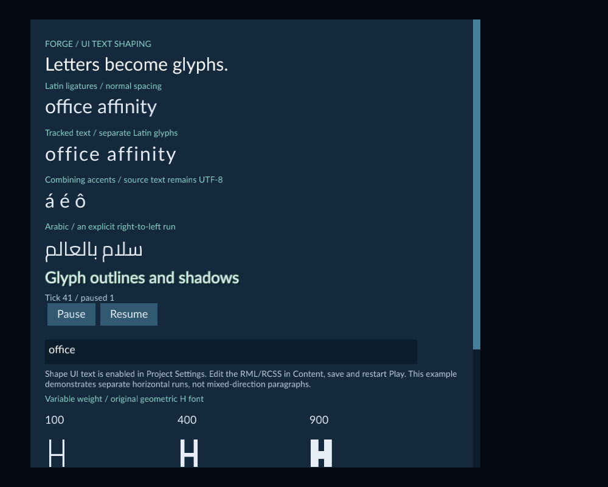

# Shape game UI text

Enable text shaping when your game needs supported script joining, ligatures or
combining marks. Use a project font containing the characters you want to show.
The setting applies to the game's UI documents throughout the project.



The example uses separate Latin and Arabic runs, a project font, native font
effects and a local text field.

The example also enables [Edit whole UI characters](ui-text-input.md), a separate
option for plain arrow movement and deletion in its text field.

## Try the example

1. Open the included **Examples/UiTextShaping** project with **File → Open project...**.
2. Open **Scenes/TextShaping.scene.json**, then start **Play** and select **Game**.
3. Compare the normal and tracked Latin samples. Tracking separates the Latin ligatures. The Arabic sample uses an explicit right-to-left run.
4. Click the text field to enter text. **Pause** and **Resume** use the normal gameplay controls; the field's contents stay local to the running UI.
5. Stop Play. In **Content**, open **Assets/UI/hud.rml** or **hud.rcss** to edit the text and styles. Choose **Save source**, then start Play again.

The example includes a Camera, so it can run in Game without scene setup. Its
font notice is included in the project. See [Edit UI source](ui-source.md) for
source history, conflicts and registration.

## Enable shaping in your project

1. Stop Play and open **Tools → Project Settings**.
2. If game defaults are absent, choose **Set up game defaults**.
3. Expand **Game defaults** and enable **Shape UI text**.
4. Choose **Save Settings**, then start Play again.

Existing projects keep the original text rendering until you enable this option.
Saving changes project settings, independently of Scene Undo. Restart Play after
changing the option or replacing a font family.

## Choose a font and run direction

Put a suitable `.ttf` or `.otf` font inside your project. Collections use `.ttc`
or `.otc`, as described below. Font `src` paths are
relative to the project root. For example:

```css
@font-face { font-family: MenuArabic; src: "Assets/Fonts/menu.ttf"; }
#greeting {
    font-family: MenuArabic;
    font-size: 32px;
    -rmlui-language: ar;
    -rmlui-direction: rtl;
}
```

```xml
<p id="greeting">سلام بالعالم</p>
```

Use `ltr` for a left-to-right run or leave direction automatic when appropriate.
Keep runs needing different directions in separate text elements. Language and
direction affect shaping; they do not translate your text. Use a
[UI Localization catalog](ui-localization.md) for translated messages.

`letter-spacing` controls tracking. Nonzero tracking disables supported Latin
ligatures; combining marks stay attached to their native cluster. Existing
shadows and outlines work with shaped glyphs. Separate multiple `font-effect`
values with commas.

## Copy a font into your project

1. In Content, choose **Import files...** and select a `.ttf`, `.otf`, `.ttc` or `.otc` file that you may redistribute.
2. Choose an unused destination folder below **Assets**, then choose **Prepare import**.
3. Review the files and destination. A batch containing fonts uses **copy only**; **Import with defaults after copying** is disabled.
4. Choose **Copy sources**, wait for completion and close the review.
5. In Content's **Create / Register** tools, expand **Runtime UI**, enter the copied relative path in **Project UI file** and choose **Register / Refresh**.

Each selected source gets a **Source-1**, **Source-2**, and similar subfolder.
Use that complete project-relative path in the font's `src` declaration. Copying
preserves file bytes; registration validates the font and records its asset
identity. Fonts are not registered by copying alone. A mixed batch containing
fonts is also copy only; copy/import models or images separately when you want
automatic import with defaults.

## Use a font collection

A collection stores multiple faces in one file. Put the `.ttc` or `.otc` inside
your project, then give each face a family alias in your RCSS:

```css
@font-face {
    font-family: MenuFace;
    src: "Assets/Fonts/menu.ttc";
    -rmlui-face-index: 1;
}
#caption { font-family: MenuFace; font-size: 28px; }
```

Face indices start at **0**. The example above chooses the second face. Omit
`-rmlui-face-index` to choose the first face. Use a different family alias for
each face you want to select in styles. Save the source, register or refresh
its resources, and restart Play after replacing a loaded font family.

Open **Examples/UiFontCollections**, open **Scenes/FontCollections.scene.json**
and start Play. The two Latin samples use Poppins at face 0 and Cairo at face 1
from the same **Assets/Fonts/Menu.ttc** file. The Arabic sample and text field
also use Cairo. Open **Assets/UI/hud.rcss** in Content to see the declarations.
Both font notices are included in the project.

Collection face selection works with the default font backend and with **Shape
UI text**. Script joining and ligatures still require the shaping option. Files
are limited to **4 MiB** and **32 faces**; all selected faces must fit the normal
font and UI budgets. Custom variation axes, named variation instances and color
glyphs are outside this workflow.

## Save and export

Save the UI source, Scene and Project Settings. After a successful Play, use
**Register / Refresh** to publish the UI resource metadata when needed. Choose
the saved Scene as startup and export using the runtime kit packaged with the
matching editor. An older kit without shaping support is rejected. Exported
games include the selected project font through the existing UI resource closure;
players do not need that font installed.
Collections also require matching font-collection support in the runtime kit.

Keep the font's required redistribution notices with your game. The included
example's Cairo font notice also travels in the matching runtime resources.
See [Export a game](runtime-content.md) for the normal export workflow.

## Limits and troubleshooting

- Missing glyph boxes usually mean the selected font lacks those characters. Assign a font containing the script. Fallback chooses a face covering a whole run; arbitrary mixed-script fallback is unavailable.
- Use horizontal text and font sizes from **1–512 px**. A single run supports **64 KiB** of UTF-8 and **16,384 glyphs**, within the normal document limits.
- Variable axes, color glyphs and vertical text are unsupported. Use a valid zero-based collection face index; an invalid index reports a font diagnostic.
- Shaping does not provide full paragraph bidirectional layout, joining across separate elements, complete international input methods or accessibility. Use the separate [Edit whole UI characters](ui-text-input.md) option for bounded plain-key movement/deletion. Check text entry on your target systems.
- A failed reload keeps the last usable HUD and reports a diagnostic. If a font or glyph cache limit is reached, simplify the UI or stop and restart Play.
