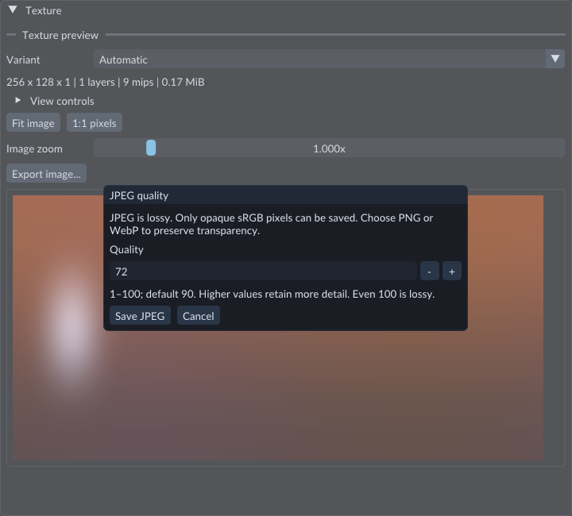

# Viewport

The Scene panel previews authored meshes, models, cameras and lights. The separate Game panel presents the running world. Camera navigation changes your view without editing entity positions.

## Orbit and look

Hold the middle mouse button (MMB) and drag to orbit. Drag left to see more of the right face; drag down to see more of the top.

Hold the right mouse button (RMB) and drag to look around from the current camera position. Start the gesture over the Scene image. You do not need to select the Scene tab first when its image is visible.

## Fly and pan

While holding RMB, use W/S to fly forward/backward and A/D to fly left/right. Space raises altitude; Shift lowers it along world Y. Holding both cancels vertical movement. Release RMB to stop flight.

Hold Shift+MMB to pan. Dragging left moves the camera right; dragging down moves the camera up. The mouse wheel changes viewing distance in Perspective, or visible height in Orthographic.

Gestures that begin outside the image do not acquire viewport navigation. Losing application focus stops navigation.

## Frame what you need

Select one or more entities in Hierarchy, hover the Scene image, and press F to
frame their geometry and structural descendants. **View → Frame selected**
provides the same command. Imported models use their current loaded mesh, morph
and skeletal bounds; a model root frames its complete placed subtree. **Fit scene**
frames visible meshes together; an explicitly selected hidden mesh can still be
framed. **Reset view** restores the default camera.

A selected **Navigation Region 2D** frames its full navigation footprint, including
when it has no visible art. If the same entity also renders a Mesh or Sprite,
framing includes the art and the independent navigation extent. See
[Navigation](navigation.md) for outline selection and centered resize handles.

A selected Navigation Agent can show its requested point with **Navigation overlay**.
Use **Edit destination in Scene** in its Inspector to drag the point along the saved
navigation plane, with world snapping and one Undo step. **W** restores object Move;
**Q** restores selection. The [navigation guide](navigation.md) covers prerequisites,
axis controls, cancellation and saving.

If part of the requested geometry is still loading or has failed, framing preserves the camera and reports that it is not ready. Retry after loading completes. It does not fit an incomplete subset or substitute a cube for a missing model. Very large extents can exceed the current camera framing range.

Left-click visible geometry, a camera/light icon or a visible navigation-region outline to select an object under the
pointer. Ctrl-click or Shift-click an object toggles it in the
selection; clicking without a modifier selects one object. Clicking empty space
clears selection. Amber guides mark selected objects; primitive bounds can show
through other objects to help locate the selection. Selection changes Inspector and Hierarchy.
Selection through this view is disabled during Play.

## Move selected objects

Choose **Move** in the Scene toolbar, or hover the Scene image and press **W**.
The primary object shows red X, green Y, and blue Z handles plus a center square.
For a single selection, that is the selected object; for several, it is the last
selected object. **Select** (Q) hides the handles and only selects objects. The
active tool is visible in the toolbar and the bottom-of-view hint.

If object axes are missing, check that **Move** is selected and Play is stopped. FORGE remembers your Select/Move choice between launches. RMB+W still flies forward and does not switch tools.

1. Drag an axis handle to move only along that world axis.
2. Drag the center square to move in the camera's viewing plane.
3. Release the left mouse button to apply the move as one undoable edit.
4. Press Escape before release to cancel.

A drag previews the new position without saving partial changes. Losing application
focus, resizing the viewport, changing the selection or changing scenes cancels it.
An axis pointing nearly straight toward the camera is hidden because it has too
little screen length to drag; orbit to expose it. The selected spatial roots move
by the same world-space offset. Children following a selected spatial ancestor
move with it and are not transformed twice; **World** and **Explicit** bindings
use their own spatial relationships. See [Transforms](transforms.md) and
[Hierarchy selection](entities-hierarchy.md).

Turn on **Snap** or hold Ctrl while dragging to snap moved coordinates to multiples
of **View → Snap spacing**. Step is measured in world units. Ctrl+Plus/Minus
continues to scale the interface independently of the camera. Use **R** or **S**
over Scene for rotation or scale, or edit those values in Inspector. Rotation/scale
drag handles and local-axis move handles are unavailable. See
[Transforms](transforms.md) for axis constraints and per-object rotation/scale.

## Reference grid and flight speed

**View → Grid** shows a reference plane through world zero. **Grid plane** chooses Ground XZ, Front XY or Side YZ; Ground XZ is the default. It appears infinite: there is no rectangular patch edge. Thin, muted lines keep approximately one-pixel coverage as you zoom. Small divisions blend away as they become crowded, with subtle emphasis on larger divisions. The whole grid gradually loses contrast at shallow viewing angles toward the horizon, including the colored world axes. It is visible from either side, with opaque scene objects covering the grid where appropriate.

Red marks world X, green world Y and blue world Z. Each plane shows its two axes crossing at world `(0,0,0)`. The colored axes and gray lines belong to the same rendering, so look, pan, orbit and flight do not move them relative to objects or world coordinates. Their screen positions naturally change with the camera view. Looking exactly along the plane makes it edge-on; looking away from it hides it.

Open **View** to change **Grid spacing** and **Fly speed**. Grid spacing is the smallest displayed division; farther divisions are multiples of ten. This display adjustment does not change snap spacing. The grid is an editor reference, not a floor entity, collision surface or game asset.

Flight speed applies to RMB+WASD, Space and Shift. Tool choice, grid visibility/base spacing, snapping/step and flight speed persist between editor launches. Selection outlines and move handles remain editor overlays, so they can remain visible through other objects.

## Save an image

In the Scene toolbar, open **View → Save image…**. In Game, click **Save image…**
above the image. Choose **PNG image** with a **.png** filename, or **Lossless WebP image**
with a **.webp** filename. For opaque images, choose **JPEG image** with **.jpg**
or **.jpeg**. PNG is the default. Change the filename suffix when
changing the file type; a conflicting suffix produces an error. Wait for
**Image saved** in the status bar or Console. Keep the requested view open;
Game needs an active camera.

PNG and WebP store the captured RGBA pixels losslessly, including transparency.
JPEG requires every captured alpha value to be fully opaque. Its **JPEG quality**
dialog accepts **1–100**, with **90** as the default. Higher values retain more
detail; even 100 is lossy. Click **Save JPEG** to continue or **Cancel** to keep
existing files. If adding a suffix names an existing file, confirm **Replace**
after choosing quality. A rejected export preserves the previous file.

Choose quality before capture or encoding starts. The same dialog serves Scene, Game and supported byte Texture exports.

The image uses the view's current render size. Scene includes the visible grid;
Game includes runtime UI drawn into its image. Selection handles, debug overlays
and editor panels are excluded. PNG/WebP preserve colors and transparency; JPEG changes
colors through lossy compression and cannot store transparency.

One image saves at a time. Changing Scene before capture cancels the request.
Once the image is captured, saving can finish in the background while you continue
working. The existing image is replaced only after a complete image has been encoded and written.
Saving an image does not mark
the Scene as changed or add an Undo step. This command saves a single image.
For numbered PNG sequence preview frames, use
[Timeline → Export frames](animation-sequences.md).

To export a published texture's stored channels, use
[Texture preview → Export image...](textures.md).

## Save a camera bookmark

Choose **View → Save view** to store one camera bookmark for the current scene. **View → Restore view** returns to it. The bookmark also restores automatically when that scene opens again, including after an editor restart. A scene without a bookmark opens with the default camera.

Bookmarks include the projection, orthographic height and grid plane. Older bookmarks restore Perspective with the Ground XZ grid. **Reset view** restores those defaults for the current view; save it to replace a bookmark.

Bookmarks are stored separately from scene content under the project's `.forge` folder. They do not enter scene undo history. Each saved scene path has its own bookmark; untitled scenes share one slot. Save As does not copy the old filename's bookmark to the new filename.

## Orientation gizmo

The compact widget in the image's upper-right corner shows world X in red, Y in green, and Z in blue. Positive endpoints are filled; negative endpoints carry a minus sign.

Click an endpoint to choose an orthographic view from that side toward the current camera target, with a matching reference plane. **+Y** gives an exact top view and **-Y** an exact bottom view. Click the current viewing-axis endpoint again to flip to the opposite side. Drag the widget to orbit. It works without an object selected and does not create scene edits or undo entries.

The view label identifies the viewing direction and current **Perspective** or **Orthographic** projection. Toggle **View → Orientation gizmo** to hide or show it. The setting persists. The widget hides when the viewport is too small to fit it.

## Orthographic editing

Open **View → Projection** to switch between Perspective and Orthographic. Orthographic keeps equally sized objects the same screen size at different depths. Switching matches the size at the camera target within the supported zoom limits. **View height (m)** controls the full visible vertical height; the horizontal extent follows the panel's shape.

**View → Axis views** offers Front (-Z), Back (+Z), Top (+Y), Bottom (-Y), Right (+X) and Left (-X). These select orthographic projection and the matching XY, XZ or YZ grid. You can still orbit, pan, frame, select and transform objects. An axis facing directly toward the camera remains hidden when it cannot be dragged usefully.

These settings belong to Scene editing. They do not change authored Camera components, Play, exported games or Scene Undo. To change the game's projection, select its Camera and edit it in Inspector.

For object rotation and scaling with **R / S**, followed by **X / Y / Z**, see [Transforms](transforms.md).

## Static preview performance

An unchanged EDIT view reuses its rendered scene image. Navigation, object edits, resize and transform previews refresh it immediately; Play renders continuously. Grid, selection overlays and the interface remain responsive every frame. See [Performance](performance.md) for measurement and comparison controls.

## Tool discovery

Scene exposes **Select**, **Move**, **Rotate (R)** and **Scale (S)**. Rotate and Scale start the existing modal gesture: X/Y/Z constrains, Enter or left-click confirms, Escape cancels. **View** describes supported tool spaces: world axes for Move/Rotate, local axes for Scale. View also groups grid, orientation, navigation overlay, framing and camera options. Camera gestures and the existing infinite grid remain unchanged.

Runtime output and HUD appear in the separate **Game** tab; Scene remains authored content during Play.

## Compact tool row

The **+** is Add Entity. Pointer, arrows, ring and diagonal-box icons select Select/Move or start Rotate/Scale. The selected icon is highlighted; Rotate/Scale returns to the resting tool when its modal gesture ends. The magnet toggles move snapping. The eye opens View settings. Hover for names, shortcuts and purpose. Existing camera and R/S/XYZ shortcuts are unchanged. The Scene tab carries the filename and unsaved `*`.

Transform icons also have named entries under **Entity > Transform tools** and in the Command Palette.

## Imported mesh loading

The Scene view prepares each entity's assigned **Mesh Renderer** with its materials
and textures. An incomplete replacement keeps the previous complete draw; an
initial failure appears in **Problems** with a diagnostic fallback. Moving the
camera is not required to reveal a completed load.

Scene and Game use the same rendering resources for static, skinned and morphed
meshes, PBR and unlit materials, supported optical extensions, lights, shadows and
environments. Game uses enabled authored Camera components. Model placement and
selection use imported mesh geometry; importing a file alone does not place it in
the scene. Drag the Model from Content onto Scene or use **Place in scene** in its
import document. See [Models](models.md) and [Play mode](play-mode.md).

Legacy primitive entities resolve built-in Mesh/Material resources without
rewriting their authored scene data. Their default material stays unlit. Assign a
PBR material when the object should receive scene lighting and shadows.

## Brightness and transparent materials

Open the Scene **View** menu and adjust **Exposure** to brighten or darken the
preview. A value of **+1 EV** doubles the light; **-1 EV** halves it. **0 EV** restores
the default. This personal preference is saved between editor sessions and does not
change authored objects or game cameras. The grid and selection overlays keep their
normal colors.

The viewport keeps bright lighting values in an HDR target, then uses PBR Neutral
tone mapping for the display. Blended imported materials render after solid and
cutout materials, from far to near. Intersecting transparent surfaces can still show
sorting artifacts; this is conventional transparency, not order-independent rendering.

Use [Scene lighting](lighting.md) for authored environment maps and Game exposure.

## Place assets from Content

Drag a Model, Mesh or Prefab onto the Scene image to place it at the cursor on a plane through the view target. Each placement is one Undo step. Drag a Scene asset to open it through the normal unsaved-changes workflow. Materials, textures, clips and audio belong on compatible Inspector fields. See [Content browser](content-browser.md) for placement and cancellation details.

## Camera and light helpers

Cameras have a small camera icon; lights have a sun icon. Click an icon in Scene to
select its entity, including objects with no mesh. Icons remain a constant screen
size as you zoom. They draw through geometry for authoring; move handles take
priority over icons, and overlapping icons select the nearest camera/light.
Hidden hierarchy branches omit their icons. Locked entities cannot be picked.
Disabled Camera/Light components retain a muted icon so you can find and re-enable them.

Selecting a camera shows its view volume. Perspective rays follow field of view;
orthographic edges stay parallel. Imported cameras keep their own view direction.
Selecting a light shows its direction, point range, spot inner/outer cone,
Rectangle outline and emitting direction, or Sphere radius rings. Rectangle guides
follow the light's rotation, including roll. Area emitter dimensions are world
metres and ignore entity scale. **F** frames the emitter outline when the selected
light has no mesh; a co-located mesh remains part of the framing bounds.
The guide uses the current effective transform, including parenting and prefab values.

Open **View** to toggle **Camera / light helpers**, change **Helper size**, or set
**Guide distance**. Long or unlimited ranges show a capped-guide notice. Open-ended
camera rays indicate a truncated guide, not a new far clipping plane. These personal
settings do not change authored range, clipping, or Game view.

## Preview lighting

**Preview light** supplies a neutral, camera-relative light rig in Scene so you can
see newly created PBR objects before placing lights. It is enabled for a fresh
workspace. Turn it **off** to judge your scene's own lighting, shadows and environment.
The checkbox stays visible on the Scene toolbar and its setting persists.

Preview lighting changes no entities, assets, Save or Undo history. Game always
uses authored lighting. A scene with no lights/environment can therefore look dark
in Game even while its objects are clearly visible in Scene.

Auto-aspect camera guides follow the last rendered Game view size. Before the Game
view has been drawn, they use the Scene panel's proportions. Set the camera's fixed
aspect when you need a specific output shape independent of panel sizes. Guides
follow the same current transform preview as the rendered scene during dragging.

Very short Scene panels omit the bottom gesture reminder and guide captions when
those would overlap. Enlarge the panel to restore them; contextual control and
helper tooltips remain available when Tooltips is enabled.

Selected helper names sit above their icons. Guide captions use a dark background
so grid lines and selection guides do not obscure their explanation.
