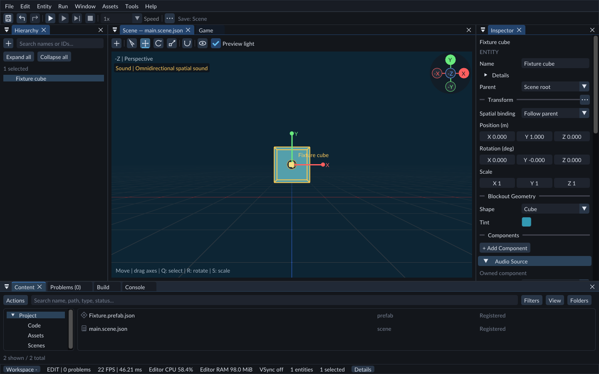
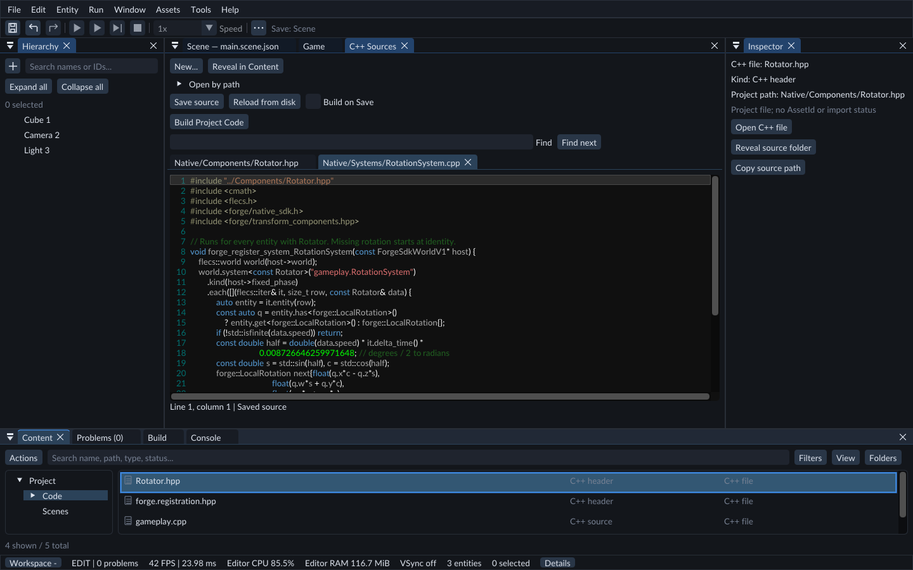

# Find your way around FORGE

Start with three ideas: a **scene** contains placed objects, an **asset** is reusable
content, and **project code** supplies behavior. They belong to one project.

## Hierarchy: what is in this scene

Hierarchy lists the scene's entities: cubes, lights, cameras, characters and other
objects. Selecting an entity shows its components in Inspector. A component stores
one kind of data, such as a Transform, Mesh Renderer or your own Rotator settings.
Parenting organizes objects and can make their transforms follow a parent.

## Content: what the project can use

Content is the project browser. Its Scenes and Assets folders contain reusable
files such as models, materials, sounds and prefabs. A prefab is a saved group of
entities that you can place more than once. Editing a shared material can affect
many objects; changing one object's Transform affects that scene object.

Code is another part of Content. It shows the actual C++ files under `Native/`.
Double-click a supported file to open its document in the central workspace.
Select a scene object in Hierarchy to return Inspector to that object.

## C++ Sources and Build: write behavior

A C++ **Component** defines data, such as speed. A **System** acts on entities with
that data, such as rotating every entity with Rotator. Add the component through
Inspector after building it; selecting its source file does not attach it to a cube.

C++ Sources edits the files. Build checks your compiler and builds Project Code.
Save the source and build before Play. See [Project Code](../editor/native-gameplay.md).

## Scene and Game: editing and playing

Scene lets you navigate and arrange objects. Its editing camera and preview light
help you work. Game uses saved Camera and Light entities and displays the running
scene. If Game is black, check its camera and lighting before moving objects.

Play runs a separate copy. Live gameplay Inspector edits affect that copy; choose
[Keep values after Stop](../editor/play-mode.md) to retain supported changes.

## Save the document you are editing

Ctrl+S applies to the active document. Scene Save saves scene changes; Save source
saves C++; Save / Publish in an asset document updates that reusable asset.
An asterisk marks unsaved work. Check the toolbar's Save target when switching tasks.
Undo and Redo also follow the active document's supported history.

## Find controls and errors

Use the menu bar or [Command palette](../editor/commands.md) to find a command.
Problems lists actionable issues; Console keeps timestamped details; Build contains
compiler output. Open hidden panels through Window and use
[Panels and windows](../editor/panels-windows.md) to restore a useful layout.

Continue with [Your first scene](first-scene.md), then
[Play and export](../editor/runtime-content.md) when it is ready to run on its own.
