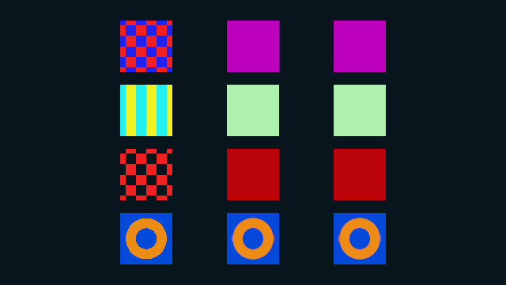
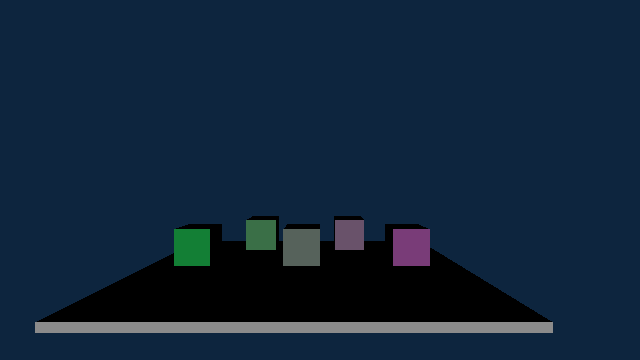
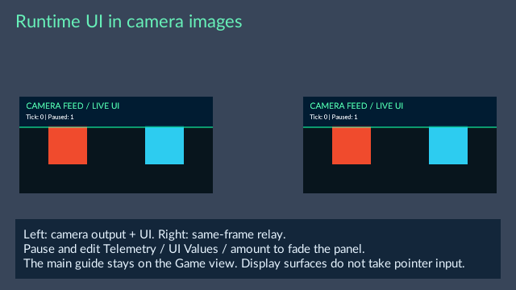
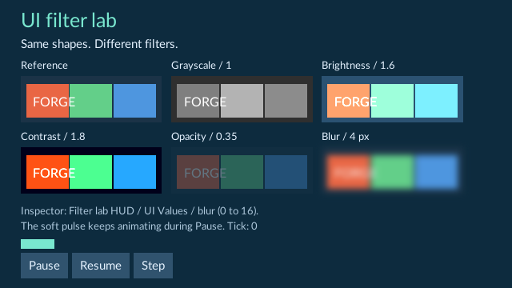
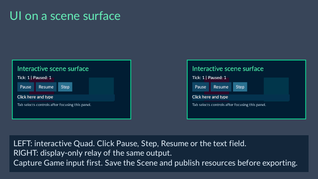
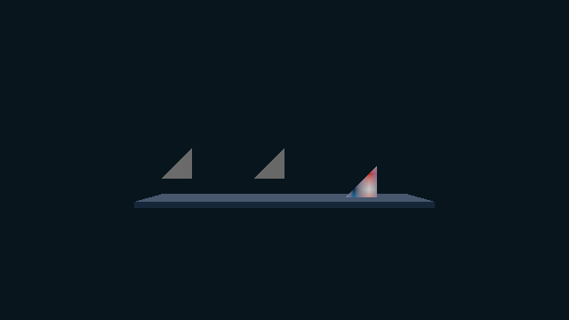
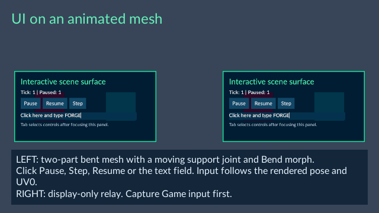
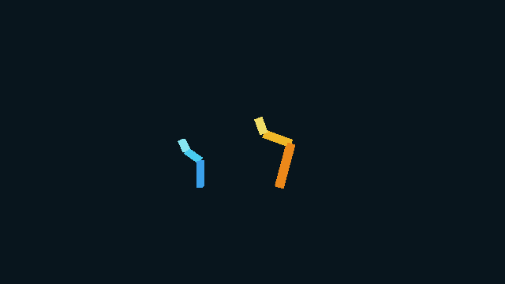

# Explore the Feature Gallery

**187-sequence-clip-collections** gives three original models eight clip placements
each on one sixteen-second controller. Open it and press **Play → Game** for direct,
morph and mapped motion. Select **Sixteen-second clip collection**, open its Timeline,
edit numbered starts and clip pickers, or use **Add clip** and **Remove clip**.
Apply timing, refresh, preview and save the Scene before exporting with the matching
runtime kit. No project C++ is required. See
[Eight-clip arrangements](../editor/animation-sequences.md).

**186-nested-sequence-rates** uses a four-second root with children at **2×** and **0.5×**,
plus a child at **0.5×** inside the fast section. They coordinate original motion,
morph and mapped clips.
Open it and press **Play → Game**. Select a child, open the parent's Timeline and
edit **Start in parent** and **Placement rate** with **Apply placement timing**.
Refresh, scrub and save the Scene. During Play, use **Select controller**
to move up to the parent; pause, restart or seek the arrangement at the root. Set it as Startup Scene and export
with the matching runtime kit; no project C++ is required.

**185-skeletal-sequence-tracks** coordinates three original models with one
four-second sequence. Open it and press **Play → Game** to see direct motion,
morph animation and a mapped clip. Select **Four-second shared sequence**, choose
**Open sequence timeline** in Inspector, refresh clips and scrub the **(Skeletal)**
rows. Save arrangement edits with **Save scene**. Set it as Startup Scene and export
with the matching runtime kit; no project C++ is required. See
[Arrange skeletal animation](../editor/animation-sequences.md).

**184-sequence-binding-crossfades** uses one sequence to blend a cube's per-object
Material color/roughness and two named HUD values. Open it and press **Play → Game**.
Both tracks overlap from one to two seconds; the four-second sequence repeats.
Select **Four second binding loop**, open Timeline, refresh clips and scrub to
preview both tracks. Sources are in **Assets/Sequences** and the HUD is in
**Assets/UI/BindingCrossfade**. Publish clip edits, save the Scene and export with
a matching runtime kit; no project C++ is required. See
[Material and component-field crossfades](../editor/animation-sequences.md).

**183-sequence-property-crossfades** blends a light's intensity and color from
blue to orange between one and two seconds. The arrow switches Sprite frames at
one and a half seconds. Open the scene and press **Play → Game**, or select
**Four second property loop** and open its Timeline to refresh and preview both
tracks. Edit the clips in **Assets/Sequences**, use **Save & Publish** and save
the Scene before exporting with a matching runtime kit. No C++ module is needed.
See [Property crossfades](../editor/animation-sequences.md).

**161-fixed-ecs-workers** provides sixteen colored cubes, camera and light for
the supplied ParallelMotion C++ example. It stays static until you build the
example and attach Parallel Motion to cubes. Compare saved **Fixed ECS workers**
settings of 1 and 4, use Pause/Step, and tune positive or negative speed in Live
gameplay. Save and export with the matching module and worker-capable runtime
kit. Follow [Worker system setup](../editor/native-gameplay.md).

**160-local-fog-volumes** surrounds depth markers with a blue box and a warm
ellipsoid. Select either mist entity and use **Inspector → Fog Volume** to change
Shape, Density, half extents or Enabled. The center markers sit outside both
volumes. Camera and light are included; save and export with the matching runtime
kit. Project C++ is optional. See [Local fog controls](../editor/lighting.md).

**159-input-message-triggers** has three cubes with Released/Changed messages.
Build its supplied InputMessageTriggers C++ observer with the matching SDK, then
capture Game input. Release Space to switch the orange cube's height; Q/E or the
right stick controls the blue cube; W/A/S/D or the left stick controls the green
cube. Console shows trigger and dispatch status. Save settings/scene and include
the matching module and runtime kit for export. See
[Input Message setup and examples](../editor/input-messages.md).

**157-foliage-wind** compares 64 wind-enabled plants with a still 24-plant patch
on the heightfield. The blade template also has Wind enabled. Press Play to see
the geometry and shadows move; Pause and Step control its simulation sample.
Stop and open **Inspector → Mesh Renderer → Wind**, or tune the temporary values
in the colored **Live gameplay** panel. Save and export with the matching runtime
kit; project C++ is optional. See [Add wind](../editor/foliage.md).

**143-fast-approximate-antialiasing** animates a pink bar across thin diagonal
lines and tilted cubes. Stop Play and open **Tools > Scene lighting... → Fast
approximate anti-aliasing** to compare enabled/disabled output, Subpixel smoothing
and Edge search steps. Camera, light and animation are included; no project C++
module is needed. Save and export it normally. See [Scene lighting](../editor/lighting.md).

**142-prefab-variants** compares an animated base with amber, blue and chained pink
variants. Press Play to see independent sequence controllers and different speeds.
Stop and open **Assets/Variants/AmberBeacon.prefab.json** to inspect inherited
values, change explicit overrides and use Revert. Camera and light are included;
the Scene exports without project C++. See [Prefabs and variants](../editor/prefabs.md).

**140-navigation-links** connects separated islands with authored Navigation Links.
The cyan agent patrols in both directions through the dynamic `Loop` profile. The
orange agent crosses once through the static `OneWay` profile. Select a link to edit
its local endpoints, Plane, Build profile, Endpoint radius and Bidirectional setting,
then rebuild that same profile. During Play, Navigation progress identifies the
active span. Save, select this Scene as startup and export to run it without project
C++. See [Connect separated walkable parts](../editor/navigation.md).

**139-behavior-tree** combines priority-based chasing with a timed patrol. The
cyan agent follows an orange target within 3.5 m, otherwise waits and walks between
green markers. Select the agent during Play to inspect **Node**, **Tree result**
and **Steps**. Stop and open **Assets/Navigation/PatrolChaseTree.behavior.json**
to edit its ordered Selector, Reactive sequence and Sequence branches. It exports
without project C++. See [Behavior trees](../editor/navigation-behavior.md).

**138-navigation-profiles** uses separate `default` and `Large` Nav assets on one
floor. Play to watch a small cyan agent cross the narrow passage while a larger
amber agent moves in the left room. Stop, open **Content → Create / Register →
Navigation → Build profile**, and switch the saved settings/overlay. Assign the
matching named Nav asset in each agent's Inspector, then save/export normally.
See [Navigation profiles](../editor/navigation.md).

**137-navigation-collision-sources** has two ready routes: Circle/Capsule Collider
obstacles on a Box Collider floor, and a selected Tile Map collision layer. Press
Play, then inspect an agent’s **Live gameplay → Navigation progress**. Outside
Play, select a source to inspect **Shape source → Collider 2D**, edit its collider,
rebuild the **2D (XY)** NavMesh and save. It exports without project C++. See
[Collision navigation sources](../editor/navigation.md).

**136-navigation-polygons** contains an L-shaped walkable floor and a concave
obstacle, each with an agent and destination. Press Play to see both routes.
Outside Play, edit a region's **Points**, rebuild its **2D (XY)** NavMesh and save.
The Scene includes ready navigation, camera, light and ordinary visual meshes;
it exports without project C++. See [Polygon regions](../editor/navigation.md).

**134-signal-lock** is a playable signal-and-route puzzle. Capture gameplay input,
choose **Play**, match the receiver's hint, then open the connection. **Return to
menu** resets the choices. Its Application States definition includes parent
modes, subordinate choices and a computed lock result. Controls also work while
paused. Open **Assets/UI/SignalLock/SignalLock.appstates.json** to edit the modes;
RML and RCSS are beside it. No project C++ module is required. See
[Application States](../editor/application-states.md).

**131-patrol-behavior** shows two agents sharing a patrol-and-wait graph with
independent progress. One uses an Anchor to offset its route. **132-chase-behavior-xy**
shows a cyan agent watching and following an animated orange target using near/far
conditions. Open their `.behavior.json` assets in Content to edit the state graph;
select an agent during Play to inspect its progress. Both examples are ready to
export without a C++ module. See [Navigation behaviors](../editor/navigation-behavior.md).

**129-moving-navigation-3d** and **130-moving-navigation-xy** show an orange
animated obstacle and a cyan agent. Play to see the agent change its route as the
obstacle leaves its way, then reach the yellow destination marker. Select the
obstacle outside Play to inspect **Navigation Obstacle → Radius / Height** and its
ordinary animation clip. Both Scenes have a ready **Dynamic obstacles** NavMesh
and can be exported without a C++ module. See [Moving obstacles](../editor/navigation.md).

**128-sprite-tile-bloom** shows three Sprites above a Tile Map pattern. Open
**Tools > Scene lighting... > Bloom** and toggle **Enable bloom**. Its saved values
are **Brightness threshold → 0.25**, **Intensity → 1.25** and **Spread → 3**.
Compare Scene preview with Game, then save and choose this Scene as startup before
exporting. No custom shader compiler or C++ module is needed. See
[Glow for images and tiles](../editor/sprites.md).

**127-source-aware-sprite-atlas** uses stable frame keys from one maintained atlas.
Play to compare stationary and animated keys with three filtering modes. Open
**Assets/Sprites/SourceAware.atlas.json**, change padding or input order, then
**Save / Publish**. Existing keys keep their image choices after repacking. Save
and choose this Scene as startup before exporting. See
[Maintained Sprite atlases](../editor/sprites.md).

**126-tile-chunk-residency** visits five painted regions with a looping camera.
Press Play, open Game and inspect **Tools > Loaded resources > Tile chunks**.
The complete Map has 10 occupied chunks; each stopped camera view prepares two
pages. Stop to edit **Assets/Tiles/ChunkResidency.tilemap.json** or the camera's
**Assets/Tiles/ChunkResidencyCamera.animation.json** Clip. Save/publish changed
assets and save the Scene. Choose this Scene as startup before export; the entire
Map remains available after camera movement. See
[Camera movement and loading](../editor/tile-maps.md).

**125-custom-polygon-one-way** shows landing on a ring roof, a hole floor and an
island while violet passes upward through the ring to a ceiling. Stop, select the
course and toggle **Physics Body 2D → One-way collision** to compare response.
Enable **Selected collision** to inspect arrows on original edges. See
[Tile collision controls](../editor/tile-maps.md).

**124-dynamic-tile-map-bodies** drops three two-cell Maps onto an amber receiver.
Compare density mass, a mirrored 12 kg override and locked rotation. Stop before
editing **Density**, **Mass** or **Lock rotation**. Keep **Spatial binding → World**
and **One-way collision** off. See [Dynamic Maps](../editor/tile-maps.md).

**123-tile-collision-contours** shows a ring, its inner void, a separate island and
two bars. Open **Assets/Tiles/ContourTiles.tileset.json** and choose **Tile collision
→ Contours / holes**. Select a **Contour** and **Loop**, edit its points, then apply
and publish the Set and Map. See [Tile collision controls](../editor/tile-maps.md).

**122-neighbor-tiles** uses one painted tile for edges around a hole, a flipped L
and an isolated arrow; connected interiors animate. Open
**Assets/Tiles/NeighborDirections.tileset.json**, select the paint tile and edit
**Tile neighbor rules** in Inspector. Apply, save/publish the Set and Map, then
Play. Paint or erase cells to change their selected neighbors. See
[Choose tiles from their neighbors](../editor/tile-maps.md).

**121-animated-tiles** has four rows of arrows: forward, reverse, variable-duration
and static. Open **Assets/Tiles/AnimatedDirections.tileset.json**, select a tile
and edit **Tile animation** in Inspector. Apply, save/publish the Set and Map,
then Play again. Pause holds the images and Step advances one simulation tick.
See [Animate a tile](../editor/tile-maps.md).

**120-concave-tile-collision** uses editable L and U tile outlines. Press Play:
amber and rose land on upper edges while cyan and green fall into the notches.
Stop and open **Assets/Tiles/ConcaveTiles.tileset.json** to edit the points in
**Tile collision**. Publish the Set and Map, save, then choose the Scene as startup
before export. See [Tile collision controls](../editor/tile-maps.md).

**119-moving-one-way-platforms** moves a painted course and narrow ledge using one
translation clip. Amber lands on the moving ledge while cyan passes upward through
the one-way surfaces. Stop before changing body settings; edit the included
**Assets/Physics2D/Platform.animation.json** to change their shared movement.
See [Moving platforms](../editor/tile-maps.md).

**118-local-diffuse-irradiance** compares warm, overlapping and cool map-based
diffuse light on receivers and a floor, without direct lights or a global environment.
Select either diffuse volume and adjust **Diffuse intensity**, **Edge fade**,
**Priority** or its bounds. **Intensity** separately controls reflections and is
zero in this example. Save and choose this Scene as startup before export.
See [Scene lighting](../editor/lighting.md).

**117-light-images** compares repeating Directional arrows, a patterned Spot light
and a Point light using a captured cubemap. Select a **... change Light image**
entity and try its image assignment, rotation or intensity. Directional also exposes
world size and tiling. Save and choose this Scene as startup before export. It reuses
included Textures and needs no C++ module or additional import. See
[Use an image to shape a light](../editor/lighting.md).

**116-clustered-projectors** places 64 tinted badge projectors over a lit floor.
They share one material and image. Select a **Paint row ... column ...** entity in
Hierarchy, then change its tint, opacity, position or size. The other patches keep
their own values. Save and choose this Scene as startup before export; no C++ module
or additional import is required. See [Project material channels onto a Mesh](../editor/decals.md).

**115-projected-surface-channels** compares normal-only, roughness-only and combined
material projections. Select a projector and change **Normal influence** or
**Roughness influence** in Inspector. Color influence is 0; the receiver's color
stays unchanged. The scene reuses a ripple normal map and needs no new import or
C++ module. Save and choose it as startup before export. See
[Project material channels onto a Mesh](../editor/decals.md).

**114-weighted-transparency** blends three intersecting colored image panels above
an opaque floor. In Edit, open **Tools > Scene lighting... > Transparency** and
toggle **Weighted transparency** to compare the intersections. The panels share one
Material and Texture with separate object color values. Save and choose this Scene
as startup before export. See [Blend overlapping transparent Meshes](../editor/transparency.md).

**113-projected-color-decals** paints a shared badge image onto two lit cubes and
overlapping color onto a floor. Select a **Decal Projector**, then adjust its box,
tint, opacity, layers or priority in Inspector. The left badge mirrors local X.
Save and choose this Scene as startup before export. See
[Project material channels onto a Mesh](../editor/decals.md) for placement and current limits.

**112-area-lights** compares a warm rectangular emitter with a cool spherical
emitter on two metal spheres and a rough receiver. Press Play, then select either
light and adjust **Emitter Width (m)** / **Emitter Height (m)** or **Emitter Radius
(m)** under **Live gameplay**. Stop, keep the values you want and save. Rotation
aims the rectangle and turns its highlight; entity scale does not resize either
emitter. Area shadows are unavailable. Choose this Scene as startup before export.
See [Scene lighting](../editor/lighting.md) for controls and limits.

**111-contact-hardening-shadows** compares resting and raised boxes on a lit floor.
Select **Soft sun - change Shadow Angular Radius** and compare **Shadow Angular
Radius (rad)** at **0.08** and **0**. A larger source softens separated shadows;
a contact shadow stays sharper. Point and Spot lights use **Shadow Source Radius
(m)**. Save and select this Scene as startup before export. See
[Scene lighting](../editor/lighting.md) for steps, Play tuning and limits.

**110-reflection-map-capture** supplies a saved HDR map and two metal spheres.
Select its captured reflection volume to create a new map through Inspector,
review/import it, save and export. The **Capture reflection maps** section below explains its layer masks and steps.

**109-rough-reflection-filtering** shows alternating amber and blue columns over
a rough metal floor. Press Play to inspect the saved result. Stop, open **Tools >
Scene lighting... → Screen-space reflections**, and toggle **Roughness filtering**.
Compare the reflected detail, then change the floor's **roughnessFactor** below
**Maximum roughness**. Save the Scene, select it as startup and export. The example
uses built-in assets and requires no C++ module or additional import.

**108-material-normal-occlusion** supplies a normal-mapped blue wall and amber
posts. In **Tools > Scene lighting... → Ambient occlusion**, compare **Normal
influence** at **0** and **1**. The surface directions change; geometry and depth
remain the same. Save before exporting; the supplied cooked Material and original
normal texture are included. See [Scene lighting](../editor/lighting.md).

**107-local-reflection-probes** supplies warm and cool imported reflection maps
inside two overlapping boxes. Select either probe to adjust **Reflection map**,
half extents, **Edge fade**, **Priority**, **Map rotation** or **Box projection**.
Compare the smooth metal spheres and floor, then save and export the Scene.
See [Scene lighting](../editor/lighting.md) for the workflow and limits.

**106-screen-space-reflections** shows amber and blue blocks reflected in a smooth
metal floor. In **Tools > Scene lighting... → Screen-space reflections**, toggle
the effect and adjust distance, thickness, strength or maximum roughness. Keep
source objects visible in the same view. Save the Scene before exporting.
See [Scene lighting](../editor/lighting.md) for steps and limits.

**105-ambient-occlusion** shows three amber posts and a lower ledge against a blue
wall. In **Tools > Scene lighting... → Ambient occlusion**, toggle the effect and
adjust Radius, Strength or Depth bias. The built-in environment supplies the
ambient lighting; direct lighting remains unchanged. Save before exporting.

**104-motion-blur** compares a moving checker panel with a stationary panel behind
it. Press Play, then stop to adjust **Tools > Scene lighting... → Motion blur**.
Select its sequence controller to inspect or capture the motion in Timeline.
**103-depth-of-field** compares checker panels at three camera distances, while
**102-temporal-antialiasing** compares moving foreground detail and thin edges.
See [Scene lighting](../editor/lighting.md) for controls, saving and limits.

**101-tile-collision-profiles** shows a cyan full-cell floor, mirrored amber
convex ramps and pink decoration with no collision. Press Play: circles roll on
the ramps and the box falls through the decoration to the floor. Stop, open
**Assets/Tiles/CollisionProfiles.tileset.json** and select **Convex ramp** to
edit its collision in Inspector. Save/publish the Set and Map before Play or export.
See [Tile collision profiles](../editor/tile-maps.md).

**100-ui-animation** shows width/opacity keyframes, a translating marker,
hover transitions and a pause-state color transition. Press Play, capture gameplay
input and Pause: UI motion continues while the tick counter holds. Edit
**Assets/UI/Motion/hud.rcss**, save and use **Reload UI**. Set this Scene as startup
and export to run the same saved interface without a C++ module.

**99-sprite-frame-filtering** compares Disabled, Nearest and Linear filtering from
left to right. The rows show fine checks, stripes, transparent pixels and ring
edges. Select a Sprite and change **Image fill → Mip filtering**, or change its
size to compare different reductions. See [Sprite filtering](../editor/sprites.md).

Left: Disabled. Center: Nearest. Right: Linear. Each column uses the same source frames.

**98-distance-fog** places colored columns at increasing camera distances. Open
**Tools > Scene lighting... → Distance fog**, adjust Start/End or toggle fog,
then save and export. See [Scene lighting](../editor/lighting.md) for controls and limits.

**97-packed-sprite-fills** compares original and packed artwork in Sliced and Tiled
modes. Change both members of a pair together, then save and export. See
[Sprites](../editor/sprites.md) for original-canvas borders, density and transparent
margin behavior.

The packaged **Examples/FeatureGallery** project gives you focused scenes to
open in the editor and export as standalone games. You can see how each effect is
authored, change it, then compare the result in Play and in the exported game.

Copy the whole gallery folder to a writable location before editing it. Choose
**File → Open project...** and select that copy. Use Content's scene list to open
**Transforms**, **Lighting**, **Physics**, **Cameras**, **Editable Mesh**, **Sculpt**, **Vertex Paint**, or **Transform Animation**. The project's `README.md`
gives a short experiment and expected result for each scene.

**96-automatic-exposure** animates ordinary sunlight from dim to bright and back.
Press Play to watch brightness settle after each change, then stop and open
**Tools > Scene lighting... > Automatic exposure** to adjust the rates, gain limits
or target. Save and export the Scene to compare the same effect in a standalone
game. See [Scene lighting](../editor/lighting.md) for controls and current limits.

To export one, open and save that scene. In **Tools → Project Settings**, select
**Use saved current scene as startup** and **Save Settings**. Then use **Run →
Export Game...**, selecting the `runtime-kit` beside the packaged editor and an
output folder outside the project. Run the resulting `forge_game.exe`. Repeat
with another startup scene to export a different demonstration.

The gallery contains ordinary saved project content. Most scenes need no C++ compiler; optional C++ examples require the matching development tools to build. The included [reference game](../reference-game.md)
remains a separate combined gameplay example.

## Capture reflection maps

Open **Scenes/110-reflection-map-capture.scene.json** and press Play. Two smooth
metal spheres and a floor use the supplied captured HDR map. Amber and blue
capture sources use **Layers = 1**; the game Camera uses **Layers = 2** to keep those
panels out of its direct view. The spheres use **Layers = 2**, so capture with **Layers = 1**
excludes the spheres themselves. The shared room geometry uses **Layers = 3**, combining both bits.

Stop Play, select **Captured reflection volume - create a new snapshot** and click
**Capture reflection map…**. Set **Face size (pixels)** to **128**, **Layers** to **1** and choose a new folder
below **Assets**. Click **Capture map**, then keep **Import with defaults after
copying** enabled and click **Copy sources** in the generated-source review. Wait
for publication, close the dialog and save the Scene. This mode creates a new
map. To retain the assigned Texture ID after changing a source panel, open the
capture dialog, enable **Update assigned map**, keep **128** pixels and **Layers = 1**,
then click **Rebake map**. Review **Reimport with saved settings after updating**
and choose **Update source**. Changing a panel does not update a map automatically. Compare
**Enabled** on the probe, or change a panel and capture again to see the difference.
Box projection starts off for this directional-map comparison.

Set this Scene as Startup Scene and export after saving. The captured Texture
travels with the game; the editable DDS source is not required at runtime. No C++
module is required. See [Capture a reflection map](../editor/lighting.md)
for clipping, layer masks, cancellation and assignment rules.

## Top-down 2D navigation

Scene **80-xy-navigation** contains a walkable rectangle, an orange obstacle and
three Sprite agents. Play to see the cyan agent route around the obstacle and
the green/amber pair steer past each other. Select a region to see its outline;
press **F** to frame it and **W** to resize with its gold edge handles. You can also
change Width/Height or Obstacle in Inspector while stopped, then rebuild
through **Content → Create / Register → Navigation → Plane → 2D (XY)**.
During Play, select an agent and use Live gameplay to change its Speed or destination.
Pause before setting several goal coordinates. Stop restores authored values unless
you keep chosen settings through the runtime tuning review.
Navigation progress shows concrete failed details and a **World coordinates**
section for valid route samples.
Save and select the Scene as startup before export. See [Navigation](../editor/navigation.md).

## Paint textures on a model

Open **178-mesh-texture-painting**. Play displays orange and cyan strokes on an
original bent panel with skin and morph animation. Stop Play, open
**Assets/Painting/MeshSurface.paint-texture.json** in Content, expand the model
root and select **Bent two-part panel** in Hierarchy. In **Paint Texture**, enable
**Paint on selected Mesh**, choose **Base Color Texture** in **Material image**,
then left-drag on the panel in Scene. Release prepares one texture Undo step.

The canvas shows draft pixels; **Save / Publish** updates the panel. Save the
Material and Scene, choose this Scene as Startup Scene, and export to run the
published artwork and animation. See [Paint a texture](../editor/texture-painting.md)
for brush controls, independent image copies, UV requirements and limits.

## 2D physics

Scene **79-one-way-platforms** compares landing from above and passage from below.
Select a green platform to edit **One-way collision** and **One-way margin**.
**Selected collision** shows the solid-face arrow. Save and choose this scene as
startup to export the same behavior.

Scene **75-2d-physics** contains falling boxes, a circle and a capsule, a moving
platform and a pass-through sensor. Change body settings in Inspector while
stopped, then compare Play. **Selected collision** shows the authored collider.
The ordinary Sprite children follow the capsule. Save and select this Scene as
startup before export. See [2D physics](../editor/physics-2d.md).

## Tile Maps

Scene **77-painted-2d-collision** lets ordinary 2D bodies land on painted floors
and platforms. Open **Assets/Tiles/PaintedPlatforms.tilemap.json**, erase the
left raised platform, save/publish and Play: the amber box falls to the lowest
floor. Undo and publish to restore it. The Map actor's **Tile Map Collider 2D**
chooses its solid layer by name; decoration stays on another layer.

Scene **74-tile-maps** contains an editable two-layer arrow course and
a mirrored copy of the same map. Open **Assets/Tiles/ArrowCourse.tilemap.json**
from Content to paint, erase and try stroke Undo/Redo. Save/publish before Play or
export. See [Tile Sets and Tile Maps](../editor/tile-maps.md).

## World sprites and frame animation

Scene **71-world-sprites** compares image sizes, tints, mirrored images, pivots
and transparent overlap. Scene **72-sprite-frame-animation** cycles a large arrow
through four image-sheet frames while four smaller arrows show the individual
cells. Select the animated Sprite to inspect its grid and animation, or open its
clip under **Assets/Sprites** in Timeline. Save before exporting either scene.
See [World sprites and image sheets](../editor/sprites.md).

Scene **73-sprite-image-fill** compares complete-image stretch,
preserved borders and repeated image fill. Two smaller examples show compressed
borders and mirrored partial repeats. Its original panel art uses one shared
Material. Try Image fill, Width and Height in Inspector; choose the Scene as
startup before exporting.

## Sequence sound cues

Scene **70-sequence-audio-cues** plays three original tones at zero, two and four
seconds while a gold panel moves and the camera cuts between views. Select its
sequence controller and open Timeline to edit the sound points. Sources own pitch,
volume and mixer routing. Timeline preview is silent; use Play to hear changes.
Save the Scene before exporting. See [Animation sequences](../editor/animation-sequences.md).

## Create Prefabs from C++

Scene **64-runtime-prefab-creation** starts with a floor, camera and light.
Its optional original C++ example creates two blue robots with gold caps, then a
third after two seconds. They rotate independently. Follow **Runtime Prefab
creation** in the Gallery's `CodeExamples/README.md` to add and build the example
in a writable Gallery copy. The C++ code is optional; without it, this scene stays
an empty stage. `Assets/RuntimeRobot.prefab.json` is already declared in the
Scene's Runtime Dependencies. Save the startup scene/settings and export after
building. The exported game carries the compiled behavior and Prefab; a player
does not need a compiler. See [C++ project code](../editor/native-gameplay.md).

## Portable prefab rigs

Open **63-portable-prefab-rigs** and press Play. The left door runs at normal
sequence speed and the right at half speed. The pendulums above them use separate
body links and gravity settings. Both rigs come from the same prefab source.

Select a rig or one of its members to inspect inherited values and overrides.
Open **Assets/PortableSequenceRig.prefab.json** to inspect its member reference
fields. Save the scene before exporting. The exported game includes its prefab
definition and prepared clip; it needs no source project or C++ compiler.

Scene **55-layered-heightfield-terrain** contains editable height layers on two
adjoining tiles and three spheres that land on the cooked static surface. Open
its source under **Assets/Terrain**, paint a layer and publish, then rebuild its
Collision asset before testing physics again. See [Terrain](../editor/terrain.md).

## Two-clip skeletal animation

For object animation timing, open **45-animation-timing**. Three lanes compare
the original clip, a slower retimed clip and frame-snapped keys. Open the sources
under **Assets/AnimationTiming** to experiment with the [timing controls](../editor/transform-animation.md).

Scene **09-animation-blending** compares Idle, an equal mix and Reach on three
skinned columns. Select the middle root and open **Preview skeletal animation...**
from Content to scrub or try smooth transitions. See [Preview and blend two animations](../editor/animation-blending.md). Both clips are included when you export this scene.

## Named states and timing markers

Scene10 compares Idle/Walk/Run on real characters. Scene11 carries editable Pulse
markers on Walk/Run. The optional C++ example shows those timing points changing
the character height; normal clip playback requires no compiler. See
[Choose named states](../editor/animation-states.md) and
[Trigger C++ actions](../editor/animation-markers.md).

## Physics joints

Scene **20-physics-joints** demonstrates a distance tether and hinged pendulum.
Select a joint entity to assign bodies, adjust local anchors, and change distance
or angle limits. See[Connect bodies with a joint](../editor/physics.md). Play and
standalone export use the same engine-owned physics components.

Scene21 demonstrates a point joint's freely rotating pendulum and a fixed joint's
falling rigid pair. They use the normal Physics Joint component and saved scene
body references, with no gameplay compiler required.

Scene **22-continuous-collision** compares blue continuous and amber discrete cubes
falling onto very thin platforms. Press Play and watch the landing area. The example
uses normal project gravity and engine components; no C++ compilation is required.
The camera starts below the falling cubes, so they enter from above.

### Spatial sound comparison

Scene **31 — Audio falloff** contains three cubes with inverse, linear and
exponential distance curves and a camera/listener. Only blue starts automatically.
Stop to switch the source's **Play On Start**, move the camera and compare.
**Falloff strength** changes distance loss without replacing the sound; strength0
keeps positional panning. [Audio controls](../editor/audio.md) explain the limits.

Scene **32 — Directional audio** shows a speaker aimed toward its camera/listener.
Select the speaker for its angular guide. Rotate **Aim parent** Y180degrees to
hear the quieter rear side; **Outside volume** and full openings control that
difference. [Audio controls](../editor/audio.md) explain direction and limits.

Scene **33 — Audio mixer** plays three pitches through Music, Effects and Dialogue.
Select each emitter for **Mix channel**. Change its shared volume in **Project
Settings → Game defaults**, save settings while stopped, then Play/export to
compare. Master affects every channel.

While playing, use **Project Settings → Live audio mix → Apply live mix** to
adjust the current four volumes. Saved defaults stay unchanged; Stop and Play
restores them. The section also reports output, voice counts and clip cache use.

Scene **34 — Audio import processing** compares original stereo and processed
mono sound. Open its WAVs from Content to compare waveforms and audition them.
Change mono, peak normalization and silence trimming under Import settings,
then reimport. The source remains unchanged; Play and export use the processed
clip. See [Process a clip during import](../editor/audio.md).

Scene **87-sprite-frame-regions** uses unequal rectangles from the original image
sheet, including animated, cropped, Sliced and mirrored Tiled examples. Edit the
Sprite's **Frame regions** list or use **Choose frame...**. See [Sprites](../editor/sprites.md).

Scene **86-one-way-tile-maps** shows falling bodies and a reversed-gravity
circle passing through painted rectangles. Select the Map's **One-way collision**
option and inspect its solid-face arrows. See [Tile Maps](../editor/tile-maps.md).

Scene **85 — Audio filters** compares a dry tone with low-pass and high-pass
processing of the same recording. Stop the dry speaker and restart either
filtered speaker under **Live sound**. See [Filter a sound](../editor/audio.md).

Scene **84 — Independent audio** compares ordinary gameplay sound with music
that continues while game Play is paused. The UI speaker can play a one-shot from
**Live sound** during Pause. Select each speaker's **Pause with game** option to
inspect its policy. See [Audio pause and playback](../editor/audio.md).

Scene **83 — Audio source codecs** compares the same original stereo recording
as WAV, FLAC and MP3. Only WAV starts automatically. Enable one speaker at a time
with **Play On Start**, or open a clip from **Assets/AudioCodecs** to preview it.
All formats share import processing and exported PCM playback. See
[Audio sources and importing](../editor/audio.md).

Scene **35 — Moving audio** animates two emitters past a camera/listener: one
has Doppler enabled and the comparison has it disabled. Select either during Play
and use **Live sound → Play / Restart** or **Stop sound** to compare. Loop jumps
reset motion without a pitch spike. Export uses the saved animation and cooked
tone without development sources. See [Audio controls](../editor/audio.md).

## Touch contacts

Open **Scenes/88-touch-input.scene.json** to test the project's Touch0 input actions. Capture Game input and read the values in Console's Gameplay input section. The optional **CodeExamples/TouchCursor.cpp** system moves and resizes its Sprite from those actions; the Scene alone shows the authored marker. Follow [Touch input](../editor/touch-input.md) to build the matching module, test contacts and export.

## Touch gestures

Open **Scenes/89-touch-gestures.scene.json** for a canvas Sprite and the project's gesture actions. The optional **CodeExamples/TouchGestures.cpp** system pans, zooms and rotates that Sprite from two-finger input. Build/register its matching module and capture Game input; the Scene alone supports Console input monitoring. Follow [Touch input](../editor/touch-input.md) for units, behavior and export steps.

## Audio echo

Open **Scenes/90-audio-echo.scene.json** for a dry recording and two echo settings. Only the dry source starts automatically, and each clip plays once. Use **Live sound → Play / Restart** on one source at a time to compare the original recording with quarter-second or half-second repeats. Source Pause freezes a remaining echo; Resume continues it, while Stop clears it. Save authored settings before exporting. See [Audio](../editor/audio.md) for the controls and limits.

## Tap, hold and swipe

Open **Scenes/91-single-touch-gestures.scene.json**. The seven Single touch actions
are saved in the project. The optional **CodeExamples/SingleTouch.cpp** system turns
the Sprite on Tap, resets it on Double tap, resizes it on Long press and moves it
on directional swipes. Register its matching module and capture Game input, or
monitor actions in Console without code. See [Touch input](../editor/touch-input.md)
for timing limits, C++ setup and export.

## Four local controllers

Open **Scenes/92-multiple-gamepads.scene.json** for four colored markers and separate **Player 1 move** through **Player 4 move** actions. In Game, use **Gamepads...** to check assignments. Capture gameplay input and watch each player's left stick in Console. Build/register **CodeExamples/MultipleGamepads.cpp**, or the matching SDK's `multiple_gamepads_gameplay` target, to move the markers. Save the Scene and Settings, choose it as startup, build current code and export. The exported game assigns connected controllers independently of the editor session. See [Gameplay input](../editor/input.md) for assignments, limits and vibration.

## Raw controller motion

Open **Scenes/93-gamepad-motion.scene.json** for acceleration and gyroscope X/Y markers. Build/register **CodeExamples/GamepadMotion.cpp** with its fixed system and unscaled control callback, or build the matching SDK’s **gamepad_motion_gameplay** sample. Installing the sample opts into enabling Player 1’s supported sensors. Capture Game input to receive readings; open **Gamepads... → Motion sensors** to inspect modes and **Console → Controller motion** to monitor raw values. Save Scene and Settings, select this Scene as startup, build current project code, then export. See [Gameplay input](../editor/input.md) for units, prerequisites and limits.

## Packed Sprite images

Scene **94-sprite-atlas-packing** compares the original Badge and Panel on the left
with the same pixels selected from one generated PNG on the right. The bottom
Sprite shows the whole atlas. Inspect the two packed Sprites' **Frame regions**;
Frame0 selects Badge and Frame1 selects Panel. See [Sprite atlas packing](../editor/sprites.md)
to generate your own PNG and apply its ordered frame rectangles.

## Trimmed Sprite canvases

Open **Scenes/95-sprite-frame-metadata.scene.json**. The originals on the left and
packed frames on the right keep the same visible size, alignment and transparent
canvas. The second pair uses Flip X; the bottom image shows clockwise storage.
Inspect **Frame regions**, including the canvas dimensions, retained offsets and
`rotated_clockwise`. Use Simple image mode and a Blend Material with depth writes
off. Save the scene and set it as startup to export this comparison. See
[Sprites and atlas packing](../editor/sprites.md) for the complete workflow.

## Foliage placement

Open **144-foliage-placement.scene.json** for128 green and 64 amber tapered blades,
an independent template and a moving marker. Stop Play, select the template and
open **Tools > Foliage placement...**. Choose **Use selected Mesh Renderer**, set
**Group name**, center, radius, spacing, count, seed and variation, then use
**Check layout** and **Place foliage**. One Scene Undo removes the new group.
The source Mesh opens through Content; its base pivot keeps scaled blades on the
origin plane. Save the Scene and export through the normal workflow. The tool
uses a horizontal plane in this example. Gallery147 demonstrates published
heightfield projection; use Minimum/Maximum slope to filter a new candidate pool
and Align to terrain slope to tilt its placement frames.
See [Place foliage](../editor/foliage.md).

Gallery **157-foliage-wind** adds a moving/still comparison using the same blade
and terrain assets. Its Wind values are ordinary Mesh Renderer properties.

## Live camera images

Open **152-camera-render-textures** and press Play. Two Cameras share a split
output, and a third relays that image to a second monitor while the source cubes
rotate. Inspect **Assets/RenderTextures** for the published image configurations,
Materials and rotation Clip. See [Show a camera image on a Mesh](../editor/render-textures.md)
for layer masks, resizing and export. This scene needs no project C++ compiler.

## Smooth camera views

Open **153-camera-transitions** and press Play. A narrow left view holds for two
seconds, eases into a wider right view, then smoothly returns to the left. A final
half-second uses the overview camera before the loop restarts. Both shot cameras
move with the same animated rig.

Stop, select **Director - six-second loop** and open its sequence Timeline. Select
**B - one-second smooth incoming view**, change **Shot blend in**, choose **Apply
shot fields**, then **Refresh clips** and preview in Game. Save the Scene and export
normally; no project C++ module is needed. See [Camera shots](../editor/animation-sequences.md).

The Game view interpolates both the camera pose and lens while the shared rig moves.

## UI in camera images

Open **154-camera-output-ui** and press Play. The telemetry header appears on both
monitors; the right monitor reads the left through a second Camera during the same
frame. The help panel remains on the main Game view. Pause, select **Telemetry -
UI in Split camera output**, and change **Live gameplay → UI Values → amount**
between `0` and `1` to fade the output panel. The fixed gameplay tick stays held.

The monitor Materials contain their UV orientation. Edit the RML in
**Assets/UI/CameraOutput**, save and use **Reload UI**. Select this Scene as startup,
save it and use the editor's matching runtime kit to export. Mesh clicks do not
provide input to the displayed UI. See [Runtime UI](../editor/runtime-ui.md).

## UI filter samples

Open **155-ui-filters** and press **Play** to compare reference, grayscale,
brightness, contrast, opacity and blur samples. Pause, select **Filter lab HUD**,
and edit **Live gameplay → UI Values → blur** from `0` to `16`. The soft pulse
continues on presentation time while the fixed tick stays held. Stop restores
the saved value. Edit **Assets/UI/Filters/Lab.rml** and use **Reload UI** for saved
source changes. Select this Scene as startup and export with the matching runtime
kit. See [Runtime UI](../editor/runtime-ui.md) for ranges, nesting and resource limits.

The same editable document supplies every sample and the presentation-time pulse.

## UI shadow samples

Open **162-ui-drop-shadows** and press **Play** to compare hard, left-offset, soft,
stacked and model-controlled shadows. Pause, select **Shadow lab HUD**, and change
**Live gameplay → UI Values → blur** between `0` and `16`. Stop restores the saved
value; the small pulse keeps animating during Pause. Edit
**Assets/UI/Shadows/Lab.rml** and use **Reload UI** for saved source changes.
Choose this Scene as startup before export with the matching runtime kit. See
[Runtime UI](../editor/runtime-ui.md) for shadow syntax, ranges and image-edge limits.

## UI backdrop samples

Open **163-ui-backdrop-filters** and press **Play**. Compare the reference colors
with blur, grayscale, contrast and a foreground filter. Pause, select
**Backdrop lab HUD**, and change **Live gameplay → UI Values → blur** from `0`
to `16`. The live panel's background changes while its text stays sharp. The small
color bar keeps animating during Pause. Edit **Assets/UI/Backdrops/Lab.rml** and
use **Reload UI** for saved source changes. Select this Scene as startup before
export with the matching runtime kit. See [Runtime UI](../editor/runtime-ui.md)
for transparency, clipping, ranges and nesting limits.

## Export decoded texture blocks

Open **Assets/TextureBlocks/BlockColors.dds** in Content. Its published BC1 sRGB
pattern includes color stripes, punch-through transparency and a second opaque
mip. Use **Export image...** for PNG or lossless WebP; choose **Mip** 1 for JPEG.
The image contains decoded reference texels, so it cannot restore color detail
lost during compression. No Scene or project C++ is required. See
[compressed texture export](../editor/textures.md) for controls and limits.

Open **Assets/TextureBlocks/HdrUnsigned.dds** or **HdrSigned.dds** and choose
**Variant → HDR color** for BC6 HDR examples. Export **Mip** 0 as **.hdr** to
inspect decoded linear HDR values through the shared-exponent file format.
The signed example's **Mip** 1 contains negative red values and reports an error
when exported to HDR, preserving any existing destination. See
[HDR texture export](../editor/textures.md) for decoding, inspection and limits.

## UI linear-gradient samples

Open **164-ui-linear-gradients** and press **Play**. Compare horizontal, vertical,
multiple-stop, transparent and repeating gradients. Pause and change **Gradient lab
HUD → UI Values → angle** in the live tuning controls. The small animated bar
continues on presentation time. Stop and save an authored angle to keep it.
Export the saved startup Scene with the supplied runtime kit.
See [Runtime UI](../editor/runtime-ui.md) for source syntax,
limits and the illustrated workflow.

## UI radial and conic samples

Open **165-ui-radial-conic-gradients** and press **Play**. Compare circles,
ellipses, repeating rings, conic colors and transparent wedges. Tune **Gradient
lab HUD → UI Values → angle** while paused. The small bar animates on presentation
time; save an authored value after stopping to keep it. Export the saved startup
Scene with the supplied runtime kit. See [Runtime UI](../editor/runtime-ui.md)
for syntax, limits and the illustrated workflow.

## UI alpha-mask samples

Open **166-ui-alpha-masks** and press **Play**. Compare a reference card with
linear, radial, conic, PNG and live-angle masks. Select **Mask lab HUD → UI Values
→ angle** in live Play tuning. The mask fades both the surface and its text. The
small bar continues animating while paused. Stop and save authored values to keep
them; export the saved startup Scene with the supplied runtime kit.
See [Runtime UI](../editor/runtime-ui.md) for alpha, resource and chain limits.

## UI box-shadow samples

Open **167-ui-box-shadows** and press **Play**. Compare reference, hard offset,
soft offset, spread, inset and live panels. Pause and tune **Box shadow lab HUD →
UI Values → blur** between `0` and `32`. The small bar pulses opacity while
simulation is paused. For animated shadow controls, use **173-ui-shadow-motion**. Stop and save the
authored value to keep it. Export the saved startup Scene with the supplied kit.
See [Runtime UI](../editor/runtime-ui.md) for syntax, shared resource limits and
viewport clipping.

## Morphological anti-aliasing sample

Open **168-morphological-antialiasing** and press **Play**. The moving pink bar,
thin lines and tilted cubes reuse the edge laboratory layout for comparison with
**143-fast-approximate-antialiasing**. Stop and open **Tools > Scene lighting... →
Morphological anti-aliasing** to compare thresholds, search distance and corner
rounding. Enabling a spatial method disables the other in one Undo step; temporal
anti-aliasing remains independent. Save and export the selected startup Scene with
the supplied runtime kit. See [Lighting](../editor/lighting.md) for the illustrated
controls and current bounds.

## Occlusion culling sample

Open **169-occlusion-culling** and press **Play**. A blue wall moves and turns in
front of a grid of 32 spheres while the two side landmarks remain visible. Stop
Play and open **Tools > Scene lighting... > Occlusion culling** to compare enabled
and disabled rendering. The picture should remain consistent. The moving wall is
a child of an animated pivot using a shared transform clip. Save and export this
Scene to keep its culling setting and animation. See
[Occlusion culling](../editor/occlusion-culling.md) for the illustrated controls,
safety bias, supported geometry and limits.

## Texture painting sample

Open **170-texture-painting** and press **Play**. The rotating cube and Sprite
share one painted Texture and Material. Stop Play, then open
`Assets/Painting/Signal.paint-texture.json` in Content. Change the brush color and
drag on the canvas. Release to apply one stroke, then try Undo and Redo.
Choose **Save / Publish** to update the image used by both objects. Save the
consuming Material and Scene before export. See
[Paint a texture](../editor/texture-painting.md) for Color/Data interpretation,
copying published images, controls and limits.

## UI luminance-mask samples

Open **171-ui-luminance-masks** and press **Play**. Compare opaque gray in an
alpha mask and a luminance mask, then try the brightness fade, color weights,
PNG image and live angle. Select **Luminance mask lab HUD → UI Values → angle**
in live Play tuning. The mask affects the panel and its text; the small bar keeps
its presentation animation while simulation is paused. The image dependency is
already declared. Save an authored angle and the Scene before exporting with the
current runtime kit. See the runtime UI guide for syntax and shared layer limits.

## Audio streaming sample

Open **172-audio-streaming** and press **Play**. A blue cube rotates while a
quiet twelve-second stereo pulse loops. In Content, open
`Assets/AudioStreaming/PagePulse.wav`, expand **Import settings** and inspect
**Playback storage: stream**. Clip details show the cooked 48000 Hz rate; the
original source is 44100 Hz. Try preview seeking, then use Live sound to pause,
resume and restart the source in Play. Live audio mix separates resident PCM,
stream page budgets and temporary disk backing. Save before exporting with the
matching runtime kit. See [Audio](../editor/audio.md)
for preparation, eight-voice and import limits.

## Animated UI shadow samples

Open **173-ui-shadow-motion** and press **Play**. Compare color/offset keyframes,
hover/focus transitions, inner-shadow motion and a discrete inset switch. Pause,
then tune **Animated shadow lab HUD → UI Values → blur** between `0` and `32` to
change the Live card. Shadow motion continues while gameplay is paused. Stop,
set authored starting values and save to keep them; export the saved startup
Scene with the supplied runtime kit. See [Animate a panel shadow](../editor/runtime-ui.md).

## Interactive scene surface samples

Open **174-interactive-ui-surfaces**, press **Play**, open **Game**, and capture
gameplay input. Click **Pause**, **Step** or **Resume** on the left monitor. Click
its text field and type; Tab navigates its controls after focus. The right monitor
relays the same camera image and remains display-only.

The same camera image feeds both monitors; input is enabled on the left Quad.

The left Quad's **UI Surface Input → Render Texture** matches its unlit Material
and output UI Document. Edit the documents in **Assets/UI/SceneSurface**. Save the
Scene and source resources, publish changes, select this startup Scene in Project
Settings, and export with the runtime kit packaged with this editor. Focus and
typed field text are transient. See
[UI surface setup and limits](../editor/runtime-ui.md).

## FBX models, materials and animation

The static placement keeps its imported checker Material while the other two animate.

Open **175-fbx-model-import** and press **Play**. Inspect the textured static
triangle, the triangle driven by a transform clip, and the linearly skinned
triangle whose bone moves. Both animated models rise and return; the static
model stays on the platform.

The original FBX files and checker image are in **Assets/FBX**. Select a Model
asset in Content and choose **Import settings / Place** to inspect its family
and preview. Edit a source, reimport it, then save the Scene. To export this
example, select it as the startup Scene in Project Settings and use the matching
runtime kit packaged with this editor. Meshes, textures and animation travel with
the exported game. See [FBX importing](../editor/models.md)
for supported source versions, materials, skinning and clip limits.

## Runtime reflection capture

Open **176-runtime-reflection-capture** and press **Play**. Two hidden source panels
rotate while the metal spheres and floor reflect their changing shapes. Select
**Runtime reflection volume - toggle Runtime capture** and compare **Runtime
capture** on against the supplied saved fallback.

**Capture interval** defaults to **0.25** simulation seconds; **0** refreshes each
rendered frame. **Capture face size** starts at **64** and accepts **16**, **32**, **64**, **128** or **256**.
**Capture layers = 1** excludes the layer 2 receivers. **Intensity** controls base
reflections and **Diffuse intensity** controls local diffuse light. Runtime maps
are world aligned; **Map rotation** affects the saved fallback.

Save authored values, set this Scene as Startup Scene and export using a matching
runtime kit. No C++ module or source import is required. Each run recreates its GPU
maps. See [Refresh lighting during Play](../editor/lighting.md) for limits and
troubleshooting.

## UI on animated meshes

Open **177-animated-mesh-ui**, press **Play**, open **Game**, and capture gameplay
input. The left panel is a two-part bent mesh with a moving support joint and a
**Bend** morph. Click **Pause**, **Step**, **Resume** or its text field. Step advances
the animation once while keeping the controls usable. The right monitor relays
the same output image.

The panel uses **UI Surface Input → Geometry → Mesh**. Its original model is
**Assets/UI/MeshSurface/Panel.gltf**. Save the Scene and published resources,
choose the Scene as startup in Project Settings, and export with the runtime kit
packaged with this editor. See [animated and custom mesh setup](../editor/runtime-ui.md)
for UV layout, Material requirements, capture behavior and current limits.

## Transfer motion between skeletons

Open **179-animation-retargeting**, press **Play** and open **Game**. The short blue
model uses its original Swing animation. The taller gold model plays mapped motion
while keeping its own rest rotations and bone lengths. Stop Play and open
**Assets/AnimationRetarget/Swing.retarget.json** in Content to inspect the explicit
joint pairs, change the sampling rate and publish the clip again. Save the Scene
and export with the matching runtime kit to run the same motion in a standalone game.
See [Transfer animation to another skeleton](../editor/animation-retargeting.md).

## Compose clips and layers

Open **180-animation-graphs**, press **Play** and open **Game**. Three gold rigs use
one graph: defaults on the left, full upper motion in the middle and a zero-strength
layer holding rest on the right. Stop and open
**Assets/AnimationGraphs/Layered.animgraph.json** in Content. Inspect its shared Rest
clip, mapped Swing, Blend/Additive nodes, upper-chain mask and two named input slots.
The selected model root's Animator can override either input. See
[Compose an animation graph](../editor/animation-graphs.md) for preview, live tuning,
saving and export.

## Record a game with sound

For a fresh game run with physics, HUD animation and sound, open
**182-game-recording** and use [Record a game movie](../editor/game-recording.md).
The falling red cube uses physics; the gold panel and three tones use the scene
sequence. The HUD pulse follows recorded time. Choose 180 frames at 30 FPS to
record the full six-second sequence through **Run → Record game…**.

## Export a sequence movie

Open **181-sequence-movies**, select **Movie preview - open Timeline, then Export
frames**, and open its Timeline. The moving gold panel and two camera shots share a
six-second sequence. Stop Game Play, refresh clips, choose **Export frames…**, then
select **AVI movie (Motion JPEG)** under **Additional output**. Choose a short frame
range and a new output folder, then start export. Open `animation.avi` in a compatible
player. The PNG frames and receipt remain in the same folder. This example is silent
and reuses existing Gallery motion and materials. See [sequence movie export](../editor/animation-sequences.md).
